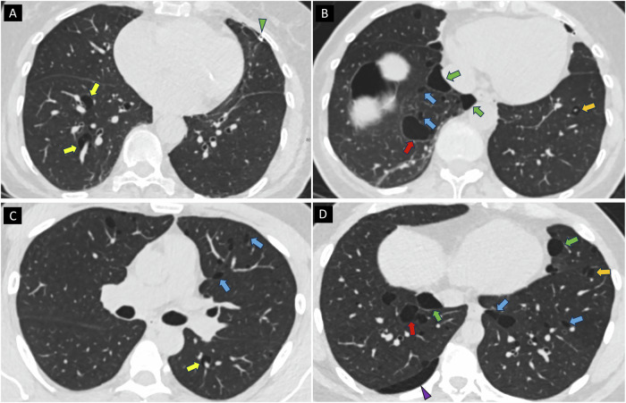
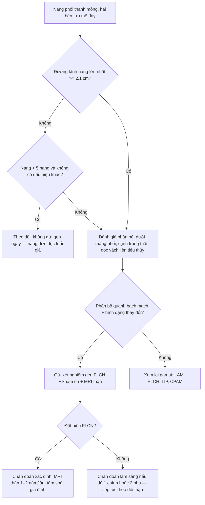
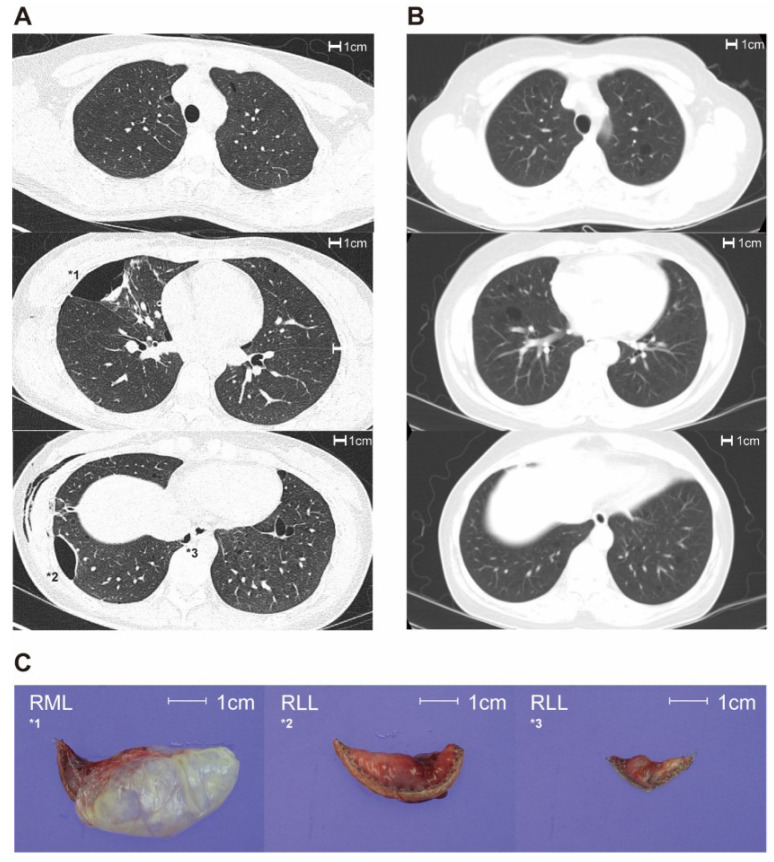
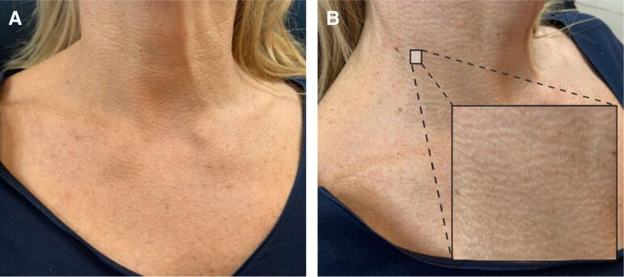

# 697 — Hội chứng Birt–Hogg–Dubé (FLCN): nang phổi ĐÁY, tràn khí tái phát, u da & ung thư thận

**Tags:** `pattern:nang-phoi` `vung:phoi` `vung:mong-phoi` `anatomy:interlobular-septum` `protocol:HRCT` `score:FLCN-2.1cm` `incidentaloma:nang-phoi`
**Mức chắc chắn (certainty):** tổng hợp y văn (literature synthesis) — tự biên từ các bài mở 2023–2026 (PMC9858281, PMC12328879, PMC13200743, PMC10373902) + số liệu hướng dẫn ERN GENTURIS 2024 trích qua các bài đó; **không** gắn một ca nguyên văn duy nhất.

## 1. Tổng quan bệnh học – cơ chế hình ảnh

- **Bản chất:** hội chứng Birt–Hogg–Dubé (Birt–Hogg–Dubé syndrome — BHD) là bệnh **di truyền trội nhiễm sắc thể thường** do đột biến dòng mầm gen **FLCN (17p11.2)**, mã hoá **folliculin** — protein ức chế u hoạt động qua con đường **mTORC1**. Bài tổng quan 2026 gọi tên mới là **hội chứng thiếu folliculin (folliculin deficiency syndrome — FDS)**, tên cũ là BHD (PMC13200743).
- **Dịch tễ:** ước tính **1/200.000** người (PMC9858281); **1,86/1.000.000** (PMC13200743); phân tích UK Biobank cho thấy biến thể FLCN gây bệnh gặp ở **1/4.190** người — nghĩa là **đa số bị bỏ sót** (PMC12328879).
- **Bộ ba biểu hiện** (tần suất ước tính):
  - **U da** fibrofolliculoma/trichodiscoma: **84%** (PMC9858281); tổn thương nhỏ, cùng màu da, ở mặt/cổ/thân trên, xuất hiện tuổi 20–30.
  - **Nang phổi:** **70–85%** (PMC9858281) đến **80–100%** người mang đột biến (PMC12328879) — là biểu hiện **thấm nhập cao nhất** và là dấu hiệu hình ảnh chính.
  - **Tràn khí màng phổi tự phát:** **~25%** (PMC9858281), **24–38%** (PMC12328879); nguy cơ **tích luỹ 28,4–37,3% tới tuổi 65** ở người mang đột biến FLCN (PMC12328879).
  - **Ung thư thận:** **19–35%** (PMC9858281), phát hiện trên hình ảnh bụng **tới 27%** (PMC13200743). Mô học đặc trưng: **ung thư tế bào thận thể nhiễm sắc (chromophobe RCC)**, **oncocytoma**, **u tế bào ưa acid lai (hybrid oncocytic tumour — HOT)**; thể tế bào sáng (clear cell) **ít điển hình hơn** (PMC12328879).
- **TẠI SAO nang hình thành (mô bệnh → hình ảnh):** FLCN mất chức năng → **mTORC1 tăng hoạt** (PMC12904720) → tế bào biểu mô vách liên tiểu thùy tăng sinh và chết theo chương trình bất thường → **vỡ thành ống phế nang nhỏ và giãn nang vách liên tiểu thùy** (PMC13639611). Vì tổn thương khởi phát **dọc vách liên tiểu thùy, dưới màng phổi và quanh mạch máu**, nang BHD có **phân bố "quanh bạch mạch" (perilymphatic)** — đúng như giải phẫu bệnh, và đây là chốt hình ảnh phân biệt với LAM/PLCH (PMC12328879).
- **TẠI SAO trông như vậy trên CT (vật lý):** khí trong nang **≈ −1.000 HU**, thành nang là mô liên kết **mỏng < 2 mm nhưng nhìn thấy được** (khác khí phế thũng: thành không xác định) (PMC12328879). Nang BHD thường **dẹt/lưỡi liềm (lentiform), bầu dục hoặc bất quy tắc, kích thước rất khác nhau trong cùng một phổi**; một số nang **"ôm" tĩnh mạch chạy xuyên qua = dấu tĩnh mạch xuyên nang (traversing vein sign / air-cuff sign)**. Nhu mô phổi xen kẽ **bình thường** (không GGO, không nốt) — khác PLCH/LIP (PMC13200743).
- **Ngưỡng định lượng bắt buộc (dùng để quyết định gửi xét nghiệm gen):**
  - **Đường kính nang lớn nhất ≥ 2,1 cm**: độ nhạy **99%**, độ đặc hiệu **82%** cho BHD (AUC 0,955) — **đây là biến duy nhất độc lập** trong mô hình đa biến (PMC9858281). Giá trị trung bình: **4,1 ± 1,1 cm** ở BHD so với **1,6 ± 0,9 cm** ở nhóm không BHD (p < 0,001).
  - **> 40 nang**: 80% ca BHD (không phân biệt được với nhóm không BHD, p = 1,000) (PMC9858281). Nghiên cứu khác: **trung vị 63 nang** so với **5 nang** (p = 0,002); **6 thùy** so với **2 thùy** bị ảnh hưởng (p = 0,002); nang lớn nhất **25 mm** so với **11 mm** (p < 0,001) (PMC12328879).
  - **Phân bố quanh bạch mạch (perilymphatic)**: **100% vs 5%**, độ chính xác **97%** — đặc hiệu nhất trong mọi dấu CT (PMC12328879).
  - **Nang dọc vách liên tiểu thùy**: 100% vs 16%, độ chính xác **91%**; **nang quanh mạch**: 100% vs 37%, chính xác 80%; **hình bất quy tắc**: chính xác **94%**; **tĩnh mạch xuyên nang**: 83% vs 24% (p = 0,01) (PMC12328879).
  - **Nang lớn nhất < 29 mm** liên quan **nguy cơ tràn khí thấp hơn** (PMC12328879).

## 2. Mẫu hình + chẩn đoán phân biệt theo vị trí (gamut)

- **Mẫu hình chốt:** *nhiều nang thành mỏng, hai bên, **ưu thế ĐÁY phổi** (dưới carina), tập trung **dưới màng phổi – cạnh trung thất – dọc vách liên tiểu thùy**, kích thước và hình dạng rất khác nhau, nhu mô xen kẽ bình thường.*
- **Gamut theo vị trí nang (4 nhóm bệnh nang lan toả — bảng 3 của PMC13200743):**
  - **Đáy + dưới màng phổi/cạnh trung thất:** **BHD/FDS** (hình dạng thay đổi, có thể có tĩnh mạch xuyên nang) và **LIP** (lymphoid interstitial pneumonia — dọc phế quản–mạch, kèm nốt/GGO, thường có bệnh tự miễn như Sjögren).
  - **Lan toả, đối xứng, tròn đều:** **LAM** (lymphangioleiomyomatosis) — nữ tuổi sinh sản, tràn dịch dưỡng trấp, u cơ mỡ mạch thận (AML), VEGF-D tăng.
  - **Đỉnh – giữa phổi, hình kỳ quái, có nốt:** **PLCH** (pulmonary Langerhans cell histiocytosis) — người hút thuốc, nang "hình lá cỏ ba lá", nốt thoái triển để lại nang.
  - **Một thùy, đơn ổ:** **CPAM/CLM bẩm sinh** (bài 698), **hẹp phế quản bẩm sinh (bronchial atresia)**, **nang phế quản (bronchogenic cyst)**.
- **Gamut theo bối cảnh lâm sàng:** tràn khí tự phát ở người **trẻ, gầy, không hút thuốc, có tiền sử gia đình** → nghĩ BHD/LAM/Marfan; tràn khí tái phát **nhiều lần cùng bên hoặc hai bên** ở người **20–40 tuổi** → BHD.
- **Mnemonic "BHD = Bottom, Hilar-paramediastinal, Diverse":** **B**ottom (đáy), **H**ilar/paramediastinal (cạnh rốn phổi–trung thất), **D**iverse (kích thước–hình dạng rất khác nhau).
- **Không được bỏ sót u thận:** khi thấy nang đáy phổi, phải **nhìn lại phần trên hai thận** trên cửa sổ bụng của chính CT ngực — có thể bắt được u thận sớm (PMC12328879).

## 3. Bảng so sánh phân biệt (ma trận đối chiếu)

| Thực thể (entity) | Hình ảnh điển hình (HRCT) | Chốt vào (rule-in) | Chốt loại (rule-out) | Gợi ý xác nhận |
|---|---|---|---|---|
| **BHD/FDS (FLCN)** | Nhiều nang thành mỏng, **ưu thế đáy**, dưới màng phổi + cạnh trung thất + dọc vách liên tiểu thùy; kích thước/hình dạng rất khác nhau; nhu mô xen kẽ bình thường | **Nang lớn nhất ≥ 2,1 cm + phân bố quanh bạch mạch (chính xác 97%) + nang dọc vách liên tiểu thùy** | Nang tròn đều lan toả đối xứng (→ LAM); nang đỉnh kèm nốt (→ PLCH); nang **< 5 nang** hoặc **< 2,1 cm** đơn thuần | Xét nghiệm gen **FLCN** (giải trình tự + MLPA); khám da; MRI thận |
| **LAM** | Nang tròn/bầu dục **lan toả, đối xứng**, kể cả góc sườn hoành; không vách trong nang | **Nang tròn đều + tràn dịch dưỡng trấp + AML thận + VEGF-D tăng** | Nang dẹt bất quy tắc ưu thế đáy, có tĩnh mạch xuyên nang → BHD | VEGF-D, CT bụng, sinh thiết phổi (HMB-45), gen TSC1/TSC2 |
| **PLCH** | Nang **đỉnh–giữa**, hình kỳ quái, thành dày/mỏng không đều, kèm **nốt** và GGO; nang tồn tại khi nốt mất | **Nang kỳ quái vùng đỉnh + nốt + tiền sử hút thuốc** | Nang đáy, không nốt, nhu mô xen kẽ bình thường → BHD/LIP | HRCT thì nốt, ngừng thuốc lá, sinh thiết (Langerhans/CD1a) |
| **LIP** | Nang thưa, dọc **phế quản–mạch và dưới màng phổi**, có vách trong nang; kèm nốt/GGO | **Nang + GGO + nốt dọc trục phế quản–mạch + bệnh tự miễn** | Không GGO, không nốt → BHD | Bệnh tự miễn (Sjögren), HIV, sinh thiết |
| **CPAM/CLM (bài 698)** | **Một thùy**, nang lớn hoặc vi nang, có thể đặc; thường phát hiện trước sinh | **Đơn ổ trong một thùy + phát hiện tiền sản** | Nang hai bên nhiều thùy → bệnh nang lan toả | CT ngực, MRI tiền sản, mô bệnh học |
| **Khí phế thũng / bóng khí (bulla/bleb)** | Khoang khí **thành không xác định**; bóng khí > 1 cm thành rất mỏng, thường đỉnh | **Thành không thấy rõ + vùng phổi còn lại có khí phế thũng** | **Thành mỏng nhưng thấy được + nang ở đáy** → nang thật (BHD) | So sánh với phim/CT cũ, HRCT |
| **Ung thư phổi dạng nang** | Nang **thành dày không đều**, có **nốt thành (mural nodule)**, vách trong nang | **Nốt thành + dày thành tiến triển** | Thành mỏng đều < 2 mm → nang lành | CT theo dõi 3 tháng, PET/CT, sinh thiết |

*Bốn lát cắt CT cửa sổ phổi (A–D) của hai ca BHD đã xác nhận di truyền: nang thành mỏng ưu thế đáy, phân bố quanh bạch mạch — nang quanh mạch (mũi tên vàng), nang dưới màng phổi cạnh trung thất (mũi tên xanh lá), nang dọc vách liên tiểu thùy (mũi tên xanh dương), hình dạng thay đổi và nang bất quy tắc (mũi tên đỏ), tĩnh mạch xuyên nang ở thùy dưới trái (mũi tên cam). Nguồn: Shakur A et al., Insights into Imaging 2025 (PMC12328879) Fig. 3, CC BY 4.0.*

## 4. Protocol chụp + hệ phân độ/điểm chuẩn hoá

- **Chẩn đoán hình ảnh (phổi):**
  - **HRCT ngực liều thấp, lát 1 mm, không cản quang** là chuẩn; chụp **một lần nền** ở người đã biết bệnh **từ 20 tuổi**, **không chụp lặp thường quy** vì nang BHD **ổn định hoặc lớn rất chậm** qua các nghiên cứu 1–66 tháng (PMC12328879, PMC13200743).
  - Khi có nang đáy chưa rõ nguyên nhân: **đo đường kính nang lớn nhất** (mm), đếm số nang (mốc 40), ghi **vị trí từng nang** (dưới màng phổi, cạnh trung thất, quanh mạch, dọc vách liên tiểu thùy), **hình dạng** và **tĩnh mạch xuyên nang**.
- **Tầm soát thận (bắt buộc, suốt đời):** **MRI bụng mỗi 1–2 năm, ưu tiên hằng năm, bắt đầu từ 20 tuổi** (PMC12328879, theo hướng dẫn ERN GENTURIS 2024); nếu đã có u thận → khoảng cách ngắn hơn, theo dõi chuyên khoa niệu.
- **Tiêu chuẩn chẩn đoán lâm sàng (Menko 2009, còn dùng):** **chẩn đoán xác định khi có 1 tiêu chuẩn CHÍNH hoặc 2 tiêu chuẩn PHỤ** (PMC12267975).
  - **Chính:** (1) **≥ 5 fibrofolliculoma/trichodiscoma** ở người lớn, **≥ 1 tổn thương đã xác nhận mô bệnh học**; (2) **đột biến dòng mầm FLCN** gây bệnh.
  - **Phụ:** (1) **nhiều nang phổi hai bên, ưu thế đáy, không rõ nguyên nhân khác**, có hoặc không có tràn khí tự phát; (2) **u thận khởi phát < 50 tuổi, hai bên/nhiều ổ, hoặc mô học HOT**; (3) **người thân bậc 1 đã được chẩn đoán BHD**.
- **Hướng dẫn ERN GENTURIS 2024 (trích qua PMC12328879):** **khuyến cáo mạnh xem xét BHD khi một người có bất kỳ tổ hợp nào của u da dạng fibrofolliculoma, nang phổi, u thận**; **tầm soát thận bằng MRI**; **không cần theo dõi nang phổi bằng HRCT lặp lại**.
- **Xét nghiệm gen:** giải trình tự **FLCN** toàn bộ exon + **MLPA** tìm mất đoạn lớn (tỉ lệ phát hiện 88–96% ở người được chẩn đoán BHD) (PMC12328879); **tầm soát dây (cascade testing)** cho người thân bậc 1.
- **Sơ đồ quyết định khi gặp nang phổi đáy tình cờ:**

## 5. Biến thể bình thường và cạm bẫy

- **Nang đơn độc hoặc vài nang ở người lớn tuổi là bình thường theo tuổi** — trong nghiên cứu BHD, **không ca nào có < 5 nang lại dương tính FLCN** (PMC12328879). Đừng "thấy nang là gửi gen".
- **Nhầm khí phế thũng/bulla với nang:** bulla có **thành không xác định**, nang BHD có **thành mỏng nhìn thấy được**; nang BHD **không ưu thế đỉnh** như bleb/bulla nguyên phát (PMC13200743).
- **Cạm bẫy "nang cạnh trung thất":** nang BHD ở mặt trong phổi cạnh trung thất dễ bị đọc thành **nang trung thất/nang phế quản**; nang phế quản là **một ổ, thành rõ, trong trung thất**, không kèm nang rải rác hai đáy phổi.
- **Cạm bẫy tràn khí:** ở người trẻ tràn khí tự phát, người đọc chỉ nhìn **đỉnh phổi** để tìm bleb — BHD nằm ở **ĐÁY**; phải cuộn xuống đáy và **đo nang lớn nhất**.
- **"Tĩnh mạch xuyên nang" bị đọc là vách trong nang** → nhầm với LIP. Tĩnh mạch xuyên nang là **dấu ủng hộ BHD** (83% vs 24%).
- **Bỏ sót u thận** vì chỉ đọc cửa sổ phổi: luôn xem **cửa sổ mô mềm phần trên hai thận** trên chính CT ngực.
- **Thoát vị/thoái triển:** nang BHD **không thoái triển** và **không đáp ứng corticoid** — điều trị corticoid vô ích; chỉ can thiệp khi tràn khí hoặc nang quá lớn gây chèn ép.
- **Gia đình:** người thân **không có nang phổi vẫn có thể mang đột biến** — tư vấn di truyền không dựa vào HRCT một mình.

## 6. Tự lượng giá — Blind Quiz

**Ca 1 — Nam 39 tuổi, tràn khí tự phát tái phát 3 lần, không hút thuốc, bố từng bị tràn khí. Nhìn CT dưới đây, mô tả trước khi đọc đáp án.**

- Gợi ý lâm sàng: trẻ, không hút thuốc, tràn khí tái phát, tiền sử gia đình.
- Câu hỏi: nang nằm ở **vùng nào của phổi** và **phân bố theo giải phẫu nào**? Ba chẩn đoán phân biệt? Dấu hiệu nào chốt?

<b>Bấm để hiện đáp án (findings + chẩn đoán)</b>

- Dấu hiệu: **nhiều nang thành mỏng (< 2 mm), hai bên, ưu thế ĐÁY**, tập trung **dưới màng phổi – cạnh trung thất – dọc vách liên tiểu thùy** (phân bố **quanh bạch mạch**); kích thước và hình dạng **rất khác nhau** (nang dẹt, bầu dục, bất quy tắc); một số nang có **tĩnh mạch xuyên qua**.
- Chẩn đoán: **hội chứng Birt–Hogg–Dubé (FLCN)** — cơ chế: đột biến FLCN làm mất ức chế mTORC1, gây vỡ và giãn nang dọc vách liên tiểu thùy nên nang "bám" theo vách/dưới màng phổi.
- Phân biệt: **LAM** (nang tròn đều lan toả, tràn dịch dưỡng trấp, AML thận), **PLCH** (nang đỉnh kỳ quái + nốt, hút thuốc), **khí phế thũng/bulla** (thành không xác định).
- Việc cần làm: **gen FLCN**, **khám da** tìm fibrofolliculoma, **MRI thận** (nguy cơ ung thư thận 19–35%), tầm soát người thân.
- Nguồn ảnh: Shakur A et al., *Insights into Imaging* 2025 (PMC12328879) Fig. 3, CC BY 4.0.

**Ca 2 — Hai bệnh nhân cùng độ tuổi, cùng có nang phổi đáy: ai cần gửi xét nghiệm gen?**

- Gợi ý: cả hai đều có nang hai bên, ưu thế đáy; một người có tiền sử tràn khí.
- Câu hỏi: khác biệt định lượng nào giữa hai cột ảnh? Ngưỡng nào quyết định gửi gen?

<b>Bấm để hiện đáp án (findings + chẩn đoán)</b>

- Dấu hiệu: cột **A (BHD)** — nang **lớn, kích thước rất khác nhau**, có nang lớn ≥ 2,1 cm, thành mỏng thấy được; cột **B (không BHD)** — nang **nhỏ hơn, kích thước đồng đều hơn**. Phần C là **bệnh phẩm đại thể** đánh số tương ứng nang trên CT.
- Số liệu: đường kính nang lớn nhất **4,1 ± 1,1 cm** (BHD) so với **1,6 ± 0,9 cm** (không BHD), p < 0,001; **ngưỡng 2,1 cm** cho độ nhạy **99%**, độ đặc hiệu **82%**; **đa dạng kích thước** gặp 100% vs 18,2% (p = 0,001).
- Kết luận: người có nang **≥ 2,1 cm + đa dạng kích thước** cần **gửi gen FLCN**; người chỉ có vài nang nhỏ đồng đều thì theo dõi.
- Nguồn ảnh: Choi YJ et al., *Diagnostics* 2023 (PMC9858281) Fig. 1, CC BY 4.0.

**Ca 3 — Nữ 53 tuổi, "sần da vùng cổ" nhiều năm, anh trai bị tràn khí màng phổi tái phát. Ảnh lâm sàng dưới đây gợi ý gì?**

- Gợi ý lâm sàng: sẩn nhỏ cùng màu da, không đau, không ngứa, ở mặt–cổ; tiền sử gia đình tràn khí.
- Câu hỏi: tên tổn thương da? Liên quan đến bệnh gì? Cần hỏi thêm và chụp gì?

<b>Bấm để hiện đáp án (findings + chẩn đoán)</b>

- Dấu hiệu: nhiều **sẩn nhỏ, cùng màu da hoặc hơi nhạt màu, bề mặt nhẵn** ở mặt/cổ — hình thái **fibrofolliculoma** (u nguyên bào nang lông); mô bệnh: nang trung tâm giãn chứa keratin, mô liên kết lỏng xung quanh.
- Chẩn đoán: **Birt–Hogg–Dubé** — da + nang phổi + u thận là bộ ba; **≥ 5 fibrofolliculoma (≥ 1 xác nhận mô bệnh) là tiêu chuẩn CHÍNH**, đủ để chẩn đoán xác định (Menko 2009).
- Việc cần làm: **HRCT ngực** tìm nang đáy, **MRI thận** (nguy cơ 19–35%, mô học chromophobe/oncocytoma/HOT), **gen FLCN**, tầm soát anh trai và người thân bậc 1.
- Nguồn ảnh: Theodorakopoulou E et al., *Aesthetic Surgery Journal Open Forum* 2023 (PMC10373902) Fig. 1, CC BY 4.0.

## Bài liên quan chéo

- [601 – Tràn khí màng phổi tự phát ở trẻ lớn & vị thành niên](../601-tran-khi-mang-phoi-tu-phat-tre-lon-vats/lesson.md) (bóng khí đỉnh, ngưỡng tái phát, VATS)
- [698 – Nang phổi bẩm sinh CPAM/CCAM & bóng khí bẩm sinh](../698-nang-phoi-bam-sinh-cpam-ccam/lesson.md) (nang đơn ổ bẩm sinh — đối cực với bệnh nang lan toả)
- [156 – Hội chứng di truyền u thận](../156-hoi-chung-di-truyen-u-than/lesson.md) (nguy cơ thận của BHD trong bối cảnh phổ di truyền)
- [151 – U thận đặc](../151-u-than-dac/lesson.md) (mô học chromophobe/oncocytoma/HOT)
- [199 – Quy trình xét nghiệm gen & tầm soát gia đình](../199-quy-trinh-xet-nghiem-gen-tam-soat-gia-dinh/lesson.md) (cascade testing)

## Ảnh

- Tên file theo quy ước `NNN_slug_Modality_SourceID.jpg`; nguồn + giấy phép từng ảnh ở `images/CREDITS.md`.
- Cả 4 ảnh đều **CC BY 4.0** — trích dẫn, giữ attribution, không crop làm mất dấu hiệu.

> Không dùng để chẩn đoán độc lập khi chưa có người hướng dẫn.
