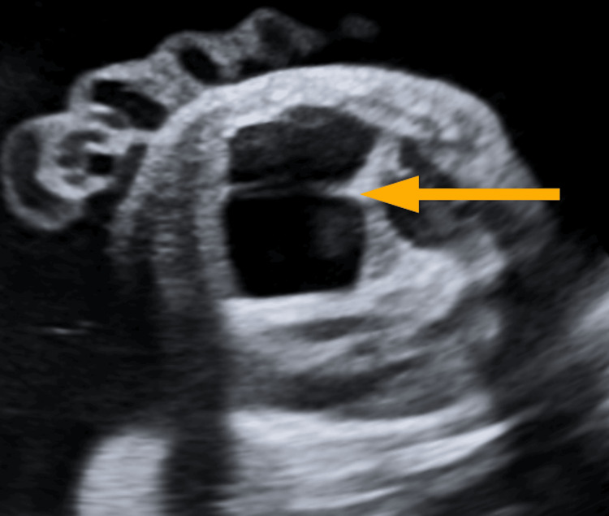
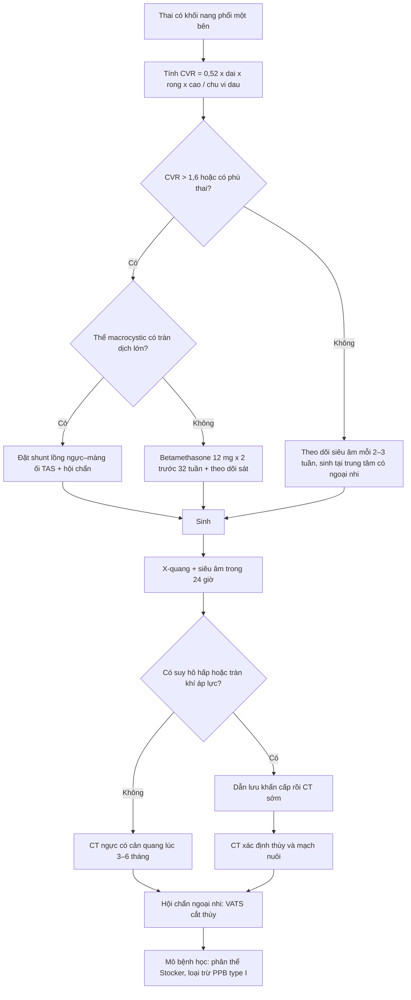
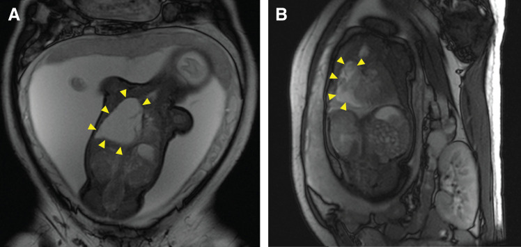
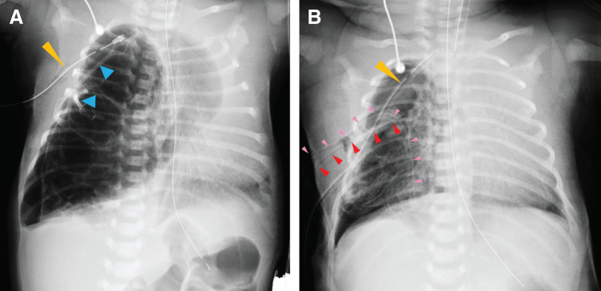
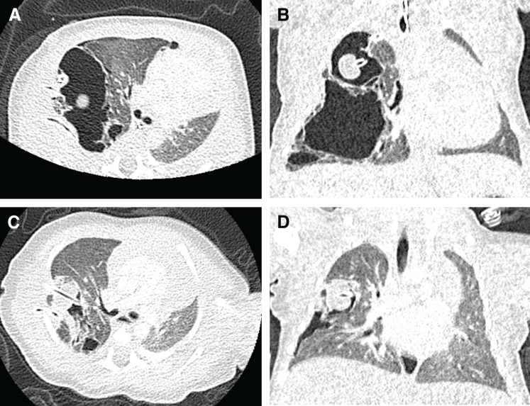

# 698 — Nang phổi bẩm sinh CPAM/CCAM & bóng khí bẩm sinh: Stocker, CVR và quyết định mổ hay theo dõi

**Tags:** `pattern:nang-phoi` `pattern:bong-khi` `vung:phoi` `protocol:MRI-thai` `protocol:CT-nguc-nhi` `score:CVR` `incidentaloma:nang-phoi-thai`
**Mức chắc chắn (certainty):** tổng hợp y văn (literature synthesis) — tự biên từ bài tổng quan + ca nguyên văn mở 2024–2026 (PMC11201397, PMC13534148, PMC13275188, PMC12960765, PMC13121396); phần quiz dùng **ca nguyên văn** của Okumura 2026 và Sathian 2026 (ghi rõ nguồn từng ảnh).

## 1. Tổng quan bệnh học – cơ chế hình ảnh

- **Định nghĩa:** **dị dạng đường thở phổi bẩm sinh (congenital pulmonary airway malformation — CPAM)**, tên cũ **CCAM**, là tổn thương **hamartoma** do **tăng sinh hỗn loạn các tiểu phế quản tận**, tạo các khoang nang **có thông với cây phế quản** và **cấp máu từ động mạch phổi** (khác **phổi phụ/sequestration**: cấp máu từ **động mạch hệ thống**) (PMC11201397, PMC13534148). Tên **CPAM** được ưu tiên vì tổn thương chỉ dạng nang ở **3/5** thể và chỉ "adenomatoid" ở **thể 3** (PMC11201397).
- **Dịch tễ:** CPAM là dị dạng phổi bẩm sinh hay gặp nhất; tỉ lệ **1/7.200** ca sinh trong nghiên cứu tiến cứu gần đây (ước tính cũ 1/11.000–1/35.000) (PMC13534148); dị dạng phổi bẩm sinh nói chung chiếm **5–18%** các dị tật bẩm sinh (PMC11201397).
- **Sinh bệnh học:** **tắc nghẽn đường thở trong tử cung** (nguyên phát hoặc thứ phát) → giãn và loạn sản phổi phía dưới chỗ tắc; bằng chứng: **hẹp phế quản bẩm sinh (bronchial atresia) có mặt ở 70% ca CPAM** và 82% ca sequestration trong lòng thùy — CPAM, sequestration, hẹp phế quản, khí phế thũng thùy bẩm sinh là **một "continuum"** của loạn sản phổi (PMC11201397). Yếu tố phân tử: **FGF10** tăng tín hiệu, **DICER1** đột biến gây nang đường thở giống PPB, **KRAS** ở CPAM type 1 có tăng sinh nhầy (PMC11201397).
- **Phân loại Stocker (5 thể) — ngưỡng kích thước nang là chốt hình ảnh** (bảng 1 của PMC11201397):
  - **Thể 0 — 2%**, phát sinh từ khí–phế quản: loạn sản phế nang, **không sống được**.
  - **Thể 1 — 60–65%**, phát sinh từ phế quản: **nang lớn 2–10 cm** (một hoặc vài nang), có nang nhỏ quanh.
  - **Thể 2 — 10–40%**, phát sinh từ tiểu phế quản: **nhiều nang nhỏ 0,5–2 cm**; hay kèm dị tật tim–thận.
  - **Thể 3 — 5–10%**, phát sinh từ ống phế nang: **vi nang < 5 mm, trông như khối đặc** ("adenomatoid").
  - **Thể 4 — 10–15%**, phát sinh từ nang tận: **nang lớn > 10 cm ở ngoại vi thùy** — **không phân biệt được với PPB type I** trên hình ảnh.

- **TẠI SAO hình ảnh thay đổi theo thời gian (vật lý):** trong tử cung và **vài giờ đầu sau sinh**, nang chứa **dịch phổi thai** → trên X-quang là **đám mờ đặc** (dễ nhầm viêm phổi/tràn dịch). Khi dịch được thay bằng khí, tổn thương thành **các khoang sáng** (**≈ −1.000 HU**) với **thành mỏng**; nếu bội nhiễm → **mức khí–dịch** và thành dày. Trên MRI: nang **toàn khí = tín hiệu rất thấp mọi chuỗi xung**; nang **chứa dịch = tăng tín hiệu trên T2** (PMC11201397).
- **Ngưỡng định lượng bắt buộc:**
  - **CVR (CPAM volume ratio)** = **0,52 × dài × rộng × cao (cm) / chu vi đầu (cm)**. **CVR > 1,6** dự báo nguy cơ **phù thai (hydrops fetalis)** và biến chứng sơ sinh; **CVR < 0,9–1,6** tiên lượng thuận lợi: nguy cơ phù **< 3%**, sống **94%**; **CVR ≥ 0,84** dự báo **suy hô hấp lúc sinh** (PMC11201397, PMC13534148, PMC12960765).
  - **Phân loại Adzick theo siêu âm:** **macrocystic = nang ≥ 5 mm**; **microcystic = nang < 5 mm**, phổi **tăng hồi âm đặc** (PMC13601915).
  - **Phù thai** xảy ra ở **3–5%** ca CPAM tiền sản; **> 75%** trẻ sinh ra **không triệu chứng**; **18,5%** tổn thương **thoái triển hoàn toàn** trong tử cung (PMC11201397, PMC13534148).
  - **Nguy cơ ác tính 2–4%**; **PPB (pleuropulmonary blastoma)** có tỉ lệ **1/250.000** ca sinh và **~4%** ở trẻ có CPAM; **2/3** ca PPB mang đột biến **DICER1** dòng mầm (PMC11201397, PMC13534148).
  - **Người lớn:** **74,4%** có triệu chứng, **> 30%** viêm hô hấp tái diễn, **11,7%** tổn thương chứa u khi mổ, CPAM liên quan u phổi **> 20%** (PMC11963009).

## 2. Mẫu hình + chẩn đoán phân biệt theo vị trí (gamut)

- **Mẫu hình tiền sản (siêu âm):** khối **tăng hồi âm** hoặc **đa nang** trong lồng ngực thai, **một bên**, ưu thế **thùy dưới**; kèm **đẩy trung thất**, **đa ối** (do chèn ép thực quản), **tràn dịch màng phổi**, **phù thai** (PMC12960765).
- **Mẫu hình sau sinh (X-quang):** đám mờ đặc **một bên/một thùy** ở giờ đầu (dịch còn trong nang) → **khối nang sáng** với thành mỏng, có thể **đẩy trung thất**, **xẹp phổi lành**, hoặc **tràn khí màng phổi áp lực** khi nang vỡ (PMC13275188).
- **Mẫu hình CT:** nang **trong một thùy**, kích thước đồng nhất theo thể (type 1 nang lớn, type 2 nhiều nang nhỏ, type 3 đặc/vi nang, type 4 nang lớn ngoại vi); **không có cấp máu hệ thống** (nếu có → **hybrid lesion** CPAM + sequestration) (PMC11201397).
- **Gamut theo vị trí & cơ chế:**
  - **Trong nhu mô, một thùy:** **CPAM** (có thông phế quản, mạch phổi), **sequestration trong thùy (intralobar)** (mạch hệ thống), **hẹp phế quản bẩm sinh** (nang nhầy trung tâm + vùng phổi tăng sáng phía dưới).
  - **Trung thất/ngoài nhu mô:** **nang phế quản (bronchogenic cyst)** — một ổ, thành rõ, thường cạnh carina; **sequestration ngoài thùy (extralobar)** — khối đặc, mạch hệ thống, hay kèm dị tật khác.
  - **Cả thùy tăng sáng:** **khí phế thũng thùy bẩm sinh (congenital lobar hyperinflation/emphysema)** — thùy **căng giãn**, **mạch máu thưa và bị đẩy**, **không có thành nang rời**; hay gặp **thùy trên trái (42,2%)** (PMC11201397).
  - **Lồng ngực chứa tạng:** **thoát vị hoành bẩm sinh (CDH)** — quai ruột trong ngực, trung thất đẩy, **không có thành nang**.
  - **Nang mắc phải:** **nang sau viêm/nang khí (pneumatocele)**, **áp-xe phổi**, **bệnh nang lan toả** (LAM, PLCH, BHD — bài 697) — **hai bên, nhiều thùy**.
- **Mnemonic "CYST":** **C**PAM, **Y**oung age (tiền sản/sơ sinh), **S**ystemic artery (→ sequestration), **T**hùy đơn (đơn ổ).

## 3. Bảng so sánh phân biệt (ma trận đối chiếu)

| Thực thể (entity) | Hình ảnh điển hình | Chốt vào (rule-in) | Chốt loại (rule-out) | Gợi ý xác nhận |
|---|---|---|---|---|
| **CPAM type 1** | **Nang lớn 2–10 cm** trong một thùy, thành mỏng, có thể mức khí–dịch; 60–65% ca | **Nang lớn đơn ổ hoặc vài nang + một thùy + phát hiện tiền sản** | Nang hai bên nhiều thùy → bệnh nang lan toả; mạch hệ thống nuôi tổn thương → sequestration | CT ngực có cản quang; mô bệnh học sau cắt thùy |
| **CPAM type 2** | **Nhiều nang nhỏ 0,5–2 cm**, có thể kèm đám đặc; hay kèm dị tật tim–thận | **Đa nang nhỏ đồng đều trong một thùy + dị tật phối hợp** | Nang lớn đơn thuần → type 1 | CT + siêu âm tim/thận |
| **CPAM type 3** | **Vi nang < 5 mm, trông như khối đặc**, tăng hồi âm trên siêu âm | **Khối "đặc" một thùy ở sơ sinh + vi nang trên CT lát mỏng** | Khối đặc thật (u, sequestration) → cần cản quang/mô bệnh | CT lát mỏng, mô bệnh |
| **CPAM type 4 / PPB type I** | **Nang lớn > 10 cm ngoại vi**, thành mỏng; **không phân biệt được trên hình ảnh** | **Nang lớn + tràn khí + tổn thương hai bên/nhiều thùy + DICER1** → nghi PPB | Nang một thùy đơn thuần ở trẻ không triệu chứng → CPAM | **Bắt buộc mô bệnh học**; xét nghiệm **DICER1** |
| **Sequestration (trong/ngoài thùy)** | Khối đặc hoặc nang, **mạch máu hệ thống** từ động mạch chủ | **Thấy động mạch hệ thống nuôi tổn thương trên CTA/MRI** | Mạch nuôi từ động mạch phổi → CPAM | CTA ngực, MRI, siêu âm Doppler tiền sản |
| **Khí phế thũng thùy bẩm sinh** | **Cả thùy tăng sáng, căng giãn**, mạch thưa và bị đẩy; không thành nang rời | **Thùy căng + mạch máu thưa, đẩy trung thất** | Nhiều nang có thành rõ → CPAM | X-quang, CT thì hít vào/thở ra |
| **Nang phế quản** | **Một ổ**, thành rõ, thường cạnh carina/trung thất, có thể chèn ép | **Nang đơn độc trung thất, không nhu mô phổi** | Nang trong nhu mô, nhiều ổ → CPAM | CT/MRI trung thất, mô bệnh |
| **Thoát vị hoành bẩm sinh** | Quai ruột trong ngực, trung thất đẩy mạnh, phổi xẹp | **Thấy ruột/dạ dày trong lồng ngực** | Không có quai ruột → loại CDH | X-quang bụng–ngực, siêu âm |

*Siêu âm thai: tổn thương **macrocystic** (nang lớn ≥ 5 mm) trong lồng ngực thai — mũi tên vàng. Nguồn: Sathian S et al., Cureus 2026 (PMC12960765) Fig. 1, CC BY 4.0.*

## 4. Protocol chụp + hệ phân độ/điểm chuẩn hoá

- **Tiền sản:**
  - **Siêu âm thai** là tuyến đầu: đo **kích thước 3 chiều** tổn thương → tính **CVR**, đánh giá **đẩy trung thất**, **tràn dịch**, **đa ối**, **phù thai**; lặp mỗi **2–3 tuần** (PMC13534148, PMC12960765). Tổn thương thường **tăng đến tuần 20–26, chững lại ~tuần 29** rồi có thể **thoái triển** (PMC13534148).
  - **MRI thai** (không cản quang, chuỗi T2 nhanh) khi cần xác định **vị trí/thể tích**, **mạch máu bất thường**, hoặc **phù thai** (PMC13275188).
  - **Phân tầng nguy cơ theo CVR:** **< 0,9–1,6** → theo dõi, sinh tại trung tâm có ngoại nhi; **> 1,6** → nguy cơ phù thai cao, hội chẩn can thiệp bào thai.
  - **Can thiệp bào thai:** **betamethasone 12 mg × 2 liều** trước **32 tuần** cho thể **microcystic** hoặc **CVR > 1,6**; **đặt shunt lồng ngực–màng ối (TAS)** cho thể **macrocystic có phù thai/tràn dịch lớn** (PMC12960765, PMC13275188).
- **Sau sinh:**
  - **X-quang ngực + siêu âm trong 24 giờ đầu** cho mọi trẻ có chẩn đoán tiền sản (PMC13534148).
  - **CT ngực có cản quang, lát mỏng, liều theo cân nặng** ở **3–6 tháng tuổi** (trẻ không triệu chứng) hoặc **ngay** khi có triệu chứng, để **xác định thùy tổn thương, mạch nuôi, loại trừ sequestration** và lập kế hoạch mổ (PMC13534148, PMC11201397). **ALARA:** giảm kVp/mAs theo tuổi–cân nặng, không chụp lặp không cần thiết.
  - **Mổ:** **cắt thùy nội soi (VATS)** là ưu tiên; tuổi mổ trung vị **5,5 tháng (4–8)** trong loạt 20 ca, **75%** mổ nội soi, biến chứng hậu phẫu **25%** (nhiễm vết mổ, tràn khí, thủng thực quản), **không tử vong** (PMC13534148). Mổ nội soi **giảm thời gian nằm viện** và biến chứng so với mở ngực (PMC13121396).
  - **Theo dõi bảo tồn** chỉ nên là lựa chọn **có giám sát** (CT định kỳ) và **đã tư vấn đầy đủ** nguy cơ nhiễm trùng/ác tính; trong loạt trên, 2 trẻ không mổ vẫn không triệu chứng sau 9 và 24 tháng (PMC13534148).
- **Sơ đồ quyết định (tiền sản → sau sinh):**

## 5. Biến thể bình thường và cạm bẫy

- **"Thoái triển" trên siêu âm ≠ hết bệnh:** tổn thương **không thấy trên X-quang sau sinh vẫn có thể thấy trên CT**; bắt buộc **CT trước khi kết luận thoái triển** (PMC13534148).
- **X-quang giờ đầu có thể chỉ là đám mờ đặc** (nang còn đầy dịch phổi thai) → dễ chẩn đoán nhầm **viêm phổi bẩm sinh/tràn dịch**; nếu trẻ không đáp ứng kháng sinh, **chụp lại sau 24–48 giờ** sẽ thấy nang sáng.
- **Type 4 CPAM vs PPB type I — cạm bẫy chết người:** manh mối nghi PPB: **triệu chứng (đặc biệt tràn khí màng phổi)**, **tổn thương hai bên/nhiều thùy**, **nang phức tạp**, **đột biến DICER1**; **bắt buộc mô bệnh học** và theo dõi dài hạn, không được coi là "CPAM lành" (PMC11201397).
- **Đừng bỏ sót mạch hệ thống:** mọi "CPAM" trước mổ cần **CTA/MRI** để loại **sequestration/hybrid** — ảnh hưởng kỹ thuật mổ (kiểm soát động mạch hệ thống).
- **Đo CVR sai:** đo **đường kính lớn nhất 3 chiều** và **chu vi đầu thai**, không đo trên mặt cắt không chuẩn; CVR có thể **tăng vọt** (ca nguyên văn: 2,0 → **2,46** → sau TAS **1,06**) (PMC13275188).
- **Tràn khí áp lực ở sơ sinh có CPAM:** khi trẻ đột ngột xấu, ưu tiên **giải áp** trước khi chụp CT — ca nguyên văn có **PaCO₂ > 100 mmHg, pH 6,8** và cứu được bằng **dẫn lưu nang + dẫn lưu màng phổi** (PMC13275188).
- **Không nhầm với bệnh nang lan toả:** nang **hai bên, nhiều thùy** ở trẻ lớn/người lớn **không phải CPAM** — nghĩ **BHD (bài 697)**, LAM, PLCH, LIP.

## 6. Tự lượng giá — Blind Quiz

**Ca 1 — Thai 33 tuần, siêu âm thấy khối đa nang lớn ở ngực phải, đa ối (AFI 37 cm). Ảnh dưới đây thuộc thể nào?**

- Gợi ý lâm sàng: thai 33 tuần, đa ối, đẩy trung thất; chưa phù thai.
- Câu hỏi: thể **macrocystic hay microcystic**? Cần đo gì để phân tầng nguy cơ? Ngưỡng nào khiến phải can thiệp?

<b>Bấm để hiện đáp án (findings + chẩn đoán)</b>

- Dấu hiệu: **nhiều khoang trống âm lớn (≥ 5 mm)** trong lồng ngực thai, đẩy trung thất sang bên — **thể macrocystic**.
- Số liệu ca này: thể tích tổn thương **78 mL**, **CVR 2,5** rồi **2,8** — nhóm **nguy cơ cao phù thai**; trẻ sinh 33 tuần, **2,4 kg**, suy hô hấp, mổ **cắt thùy phổi phải ngày thứ 9**.
- Ngưỡng: **CVR > 1,6** = nguy cơ phù thai/biến chứng; **CVR < 0,9** tiên lượng thuận lợi; **CVR ≥ 0,84** dự báo suy hô hấp lúc sinh.
- Nguồn ảnh: Sathian S et al., *Cureus* 2026 (PMC12960765) Fig. 1, CC BY 4.0.

**Ca 2 — Thai 20 tuần 4 ngày: MRI thai dưới đây. Trung thất bị đẩy nhiều, CVR = 2,0. Bước tiếp theo?**

- Gợi ý lâm sàng: chưa phù thai, chưa suy tim thai; theo dõi nhiều tuần.
- Câu hỏi: mô tả tổn thương? Vì sao CVR quan trọng hơn kích thước tuyệt đối? Can thiệp gì khi CVR tăng tiếp?

<b>Bấm để hiện đáp án (findings + chẩn đoán)</b>

- Dấu hiệu: **khối macrocystic lớn chiếm lồng ngực phải**, **đẩy trung thất sang trái** (mũi tên vàng) — hình B là sau can thiệp, nang **bớt căng**, CVR giảm còn **1,06**.
- Diễn tiến ca này: CVR **2,0** (20 tuần) → chọc hút **30 mL** nhưng CVR tăng lại → **2,46** (30 tuần) → **đặt TAS 31 tuần** (4 ống, 1 hoạt động) → CVR **1,06** (36 tuần) → mổ lấy thai 38 tuần.
- Vì sao CVR: chuẩn hoá theo **chu vi đầu thai** nên phản ánh **mức chèn ép tương đối** và dự báo phù thai tốt hơn kích thước tuyệt đối.
- Ngưỡng can thiệp: **CVR > 1,6** hoặc có phù thai → **TAS** (macrocystic) hoặc **betamethasone 12 mg × 2** (microcystic).
- Nguồn ảnh: Okumura K et al., *Surgical Case Reports* 2026 (PMC13275188) Fig. 1, CC BY 4.0.

**Ca 3 — Sơ sinh sau sinh mổ 38 tuần đột ngột suy hô hấp; X-quang dưới đây. Làm gì ngay?**

- Gợi ý lâm sàng: khí máu PaCO₂ > 100 mmHg, pH 6,8; trước đó đã có chẩn đoán CPAM macrocystic.
- Câu hỏi: hai bất thường chính trên phim? Vì sao không chờ CT? Sau giải áp, CT cho thấy gì?

<b>Bấm để hiện đáp án (findings + chẩn đoán)</b>

- Dấu hiệu: **nang lớn căng thêm + đẩy trung thất rất mạnh sang trái**; có **ống dẫn lưu màng phổi** (mũi tên cam) và ống TAS (mũi tên xanh); hình B sau khi đặt thêm **hai ống dẫn lưu vào nang** (mũi tên đỏ/hồng) → nang xẹp, trung thất về gần giữa.
- Chẩn đoán: **CPAM macrocystic biến chứng tràn khí áp lực/căng nang** — xử trí: **giải áp ngay** (chọc/dẫn lưu nang + màng phổi, áp lực hút **−5 cmH₂O**) rồi mới CT; ca này rút ống nội khí quản **ngày thứ 8**, cắt thùy sau đó.
- Đối chiếu CT sau dẫn lưu:

- CT cho thấy **nang giảm thể tích rõ**, phổi lành nở lại, trung thất còn lệch nhẹ — đủ thông tin để **lập kế hoạch cắt thùy nội soi**.
- Nguồn ảnh: Okumura K et al., *Surgical Case Reports* 2026 (PMC13275188) Fig. 2 và Fig. 3, CC BY 4.0.

## Bài liên quan chéo

- [697 – Hội chứng Birt–Hogg–Dubé (FLCN)](../697-hoi-chung-birt-hogg-dube-flcn/lesson.md) (nang phổi hai bên ở người lớn — đối cực với nang một thùy bẩm sinh)
- [601 – Tràn khí màng phổi tự phát ở trẻ lớn & vị thành niên](../601-tran-khi-mang-phoi-tu-phat-tre-lon-vats/lesson.md) (bóng khí, ngưỡng tái phát, VATS)
- [610 – Suy hô hấp sơ sinh & dị dạng phổi](../610-suy-ho-hap-so-sinh-va-di-dang-phoi/lesson.md)
- [621 – Nang sán lá phổi ở trẻ](../621-nang-san-la-phoi-o-tre/lesson.md) (nang phổi mắc phải — DDx nhiễm trùng)
- [606 – Bệnh phổi mạn ở trẻ sinh non (BPD)](../606-bpd-tre-sinh-non/lesson.md) (bệnh phổi mạn tính ở trẻ — khác nang bẩm sinh)

## Ảnh

- Tên file theo quy ước `NNN_slug_Modality_SourceID.jpg`; nguồn + giấy phép từng ảnh ở `images/CREDITS.md`.
- Cả 4 ảnh **CC BY 4.0**, **không crop**, giữ nguyên mũi tên đánh dấu của tác giả.

> Không dùng để chẩn đoán độc lập khi chưa có người hướng dẫn.
