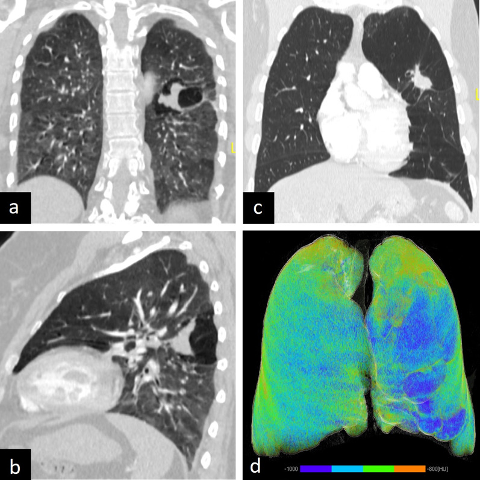
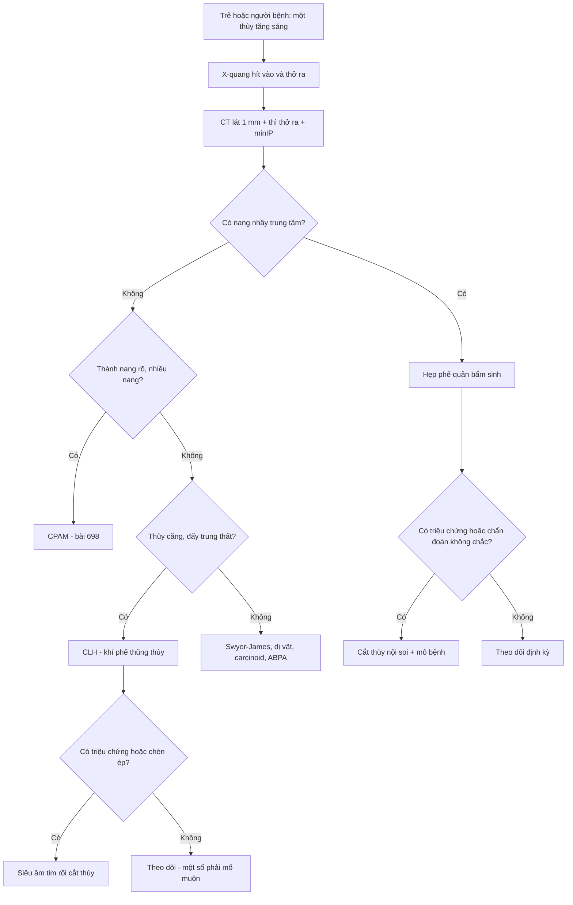
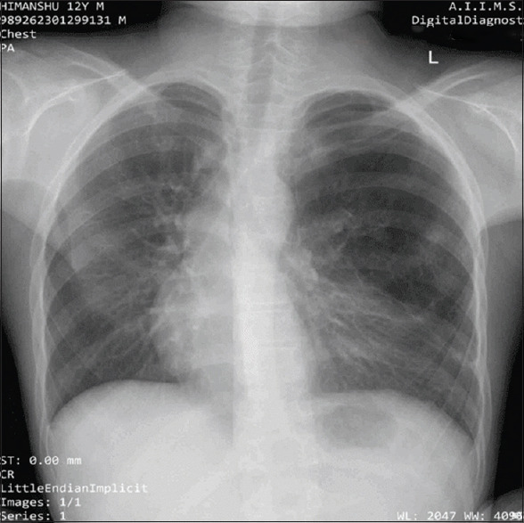
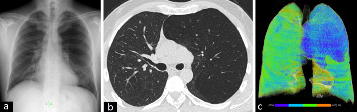

# 699 — Hẹp phế quản bẩm sinh & khí phế thũng thùy bẩm sinh: nang nhầy trung tâm vs thùy căng giãn

**Tags:** `pattern:thuy-tang-sang` `pattern:nang-nhay` `vung:phoi` `protocol:CT-thi-tho-ra` `protocol:CT-nguc-nhi` `anatomy:phoi-thuy`
**Mức chắc chắn (certainty):** tổng hợp y văn (literature synthesis) — tự biên từ bài tổng quan dị dạng phổi bẩm sinh (PMC11201397), khuyến cáo hình ảnh nhi của ESR (PMC12226615), loạt ca hẹp phế quản bẩm sinh 2026 (PMC13446928) và ca khí phế thũng thùy bẩm sinh ở vị thành niên (PMC11459388); phần quiz dùng **ca nguyên văn** (ghi nguồn từng ảnh).

## 1. Tổng quan bệnh học – cơ chế hình ảnh

- **Hai thực thể — hai cơ chế khác nhau, cùng một mẫu hình "thùy tăng sáng":**
  - **Hẹp phế quản bẩm sinh (congenital bronchial atresia — BA):** **một phế quản thùy/phân thùy bị tắc hoàn toàn** trong khi **đường thở và nhu mô phía dưới phát triển bình thường**. Hai giả thuyết: (1) **mất liên tục giữa chồi phế quản và tế bào phế quản nguyên thuỷ**, (2) **thiếu máu nuôi đoạn thành phế quản** trong tử cung (PMC11201397).
  - **Khí phế thũng thùy bẩm sinh** (congenital lobar emphysema; tên chính xác hơn là **congenital lobar hyperinflation — CLH**, hay **overinflation — CLO**; bài này dùng **CLH** để không lẫn với **CLE = khí phế thũng trung tâm tiểu thùy** ở bài 052): **sụn phế quản bất thường** → **hẹp kiểu van một chiều (ball-valve)** → thùy **căng giãn tiến triển**; **phế nang giãn to nhưng KHÔNG phá huỷ vách** — vì vậy "emphysema" là **tên gọi lịch sử không chính xác** (PMC11201397).
- **TẠI SAO BA gây tăng sáng dù tắc hoàn toàn:** khí vẫn vào vùng phổi bị tắc qua **lỗ Kohn (pores of Kohn)** và **kênh Lambert (channels of Lambert)** — **thông khí bàng hệ (collateral ventilation)** — nhưng khó ra → **ứ khí dần (air trapping)**. Vì **không có van một chiều thực sự**, tăng sáng xuất hiện **từ từ**, khác CLH (van một chiều → căng nhanh) (PMC11201397, PMC12226615).
- **TẠI SAO có "nang nhầy" trung tâm:** dịch nhầy do tuyến phế quản tiết ra **không thoát được** qua chỗ tắc → **phế quản phía dưới giãn và đầy nhầy = nang nhầy/phế quản (bronchocele/mucocele)** — trên CT là **cấu trúc phân nhánh đậm độ mô mềm, hình "ngón tay găng" (finger-in-glove)**, đôi khi có mức khí–dịch (PMC11201397).
- **TẠI SAO trông như vậy trên CT (vật lý):** khí **≈ −1.000 HU**; **nang nhầy đậm độ mô mềm (~0–40 HU), không bắt thuốc** — nếu **bắt thuốc** thì phải nghĩ **carcinoid**; trên **MRI, nhầy tăng tín hiệu mạnh trên T2** (dịch giàu protein), giúp phân biệt với khối đặc (PMC12226615).
- **Dịch tễ & số liệu bắt buộc:**
  - **CLH:** **1/20.000–30.000** ca sinh (ước tính lịch sử); chiếm **tới 10%** dị dạng phổi bẩm sinh; **nam:nữ = 3:1**; **50% không rõ nguyên nhân**; **thùy trên trái 40–45%**, **thùy giữa phải 30%**, **thùy trên phải 20%**, **thùy dưới 5%** (PMC12226615).
  - **CLH — thời điểm triệu chứng:** **25%** có triệu chứng **ngay khi sinh**, **50% trong tháng đầu**, số còn lại **sau 6 tháng** (PMC9121231); **14–20%** có **dị tật tim bẩm sinh** kèm → **siêu âm tim trước mổ** (PMC11327477).
  - **BA:** hay gặp ở **thùy trên, đặc biệt thùy trên trái**; trong loạt 5 ca nhi, **thùy trên trái 80%**, tuổi mổ trung vị **11 tháng (20 ngày – 12 tuổi)**, **80%** được nghi ngờ **từ tiền sản**, **3/5** có triệu chứng hô hấp (PMC13446928).
  - **BA là "bạn đồng hành" của dị dạng phổi bẩm sinh:** gặp ở **100%** ca **sequestration**, **82%** ca **sequestration trong thùy**, **70%** ca **CPAM**, **50%** ca **CLH** — nên khi thấy BA phải tìm tổn thương phối hợp, và ngược lại (PMC11201397).

## 2. Mẫu hình + chẩn đoán phân biệt theo vị trí (gamut)

- **Mẫu hình chốt của BA:** *thùy/phân thùy **tăng sáng**, **mạch máu thưa và bị đẩy**, kèm **khối/nang nhầy phân nhánh trung tâm** (bronchocele) ở rốn phổi; **không thấy phế quản dẫn vào** vùng đó.*
- **Mẫu hình chốt của CLH:** *một thùy **căng giãn**, **tăng sáng**, **mạch máu thưa nhưng vẫn thấy tới ngoại vi**, **đẩy trung thất và cơ hoành**, **không có nang nhầy trung tâm**; hay gặp **thùy trên trái**.*
- **Gamut theo "một thùy tăng sáng":**
  - **BA** — có **bronchocele**, không có van một chiều.
  - **CLH/CLO** — **không bronchocele**, thùy căng, van một chiều, sụn bất thường.
  - **CPAM type 1/4** (bài 698) — **nang có thành rõ**, có thể mức khí–dịch, thường phát hiện tiền sản.
  - **Sequestration** — khối đặc/nang + **động mạch hệ thống** từ động mạch chủ (thường kèm BA).
  - **Swyer–James–MacLeod** (bài 614) — **phổi/tổn thương nhỏ hơn**, tăng sáng **sau nhiễm trùng**, **giãn phế quản**, mạch máu thưa; khởi phát **sau viêm phổi/vi rút**.
  - **Dị vật đường thở (bài 612)** — trẻ lớn, **đột ngột**, tăng sáng **một bên**, **air trapping thì thở ra**; dị vật cản quang có thể thấy.
  - **Carcinoid phế quản** — người lớn, **khối trung tâm bắt thuốc**, tắc nghẽn + ứ khí phía dưới (bắt chước BA).
  - **ABPA** — "ngón tay găng" **hai bên**, giãn phế quản trung tâm, tiền sử hen.
- **Mnemonic "CLEAR":** **C**PAM, **L**obar hyperinflation (CLH), **E**ndobronchial foreign body, **A**tresia (BA), **R**are — Swyer–James.

## 3. Bảng so sánh phân biệt (ma trận đối chiếu)

| Thực thể (entity) | Hình ảnh điển hình | Chốt vào (rule-in) | Chốt loại (rule-out) | Gợi ý xác nhận |
|---|---|---|---|---|
| **BA** | Thùy/phân thùy tăng sáng + **nang nhầy phân nhánh trung tâm**, mạch thưa; **không thấy phế quản dẫn vào** | **Bronchocele + tăng sáng phía dưới + không thấy phế quản đoạn gần** | Thùy căng giãn **không có bronchocele** → CLH; nhiều nang thành rõ → CPAM | CT lát 1 mm thì thở ra, minIP; **MRI T2** (nhầy sáng); nội soi phế quản |
| **CLH/CLO** | **Cả thùy căng giãn, tăng sáng**, mạch thưa **nhưng thấy tới ngoại vi**, **đẩy trung thất/cơ hoành**, không bronchocele | **Thùy căng + đẩy trung thất + không nang nhầy + sơ sinh/nhũ nhi** | Có **bronchocele** → BA; có **nang thành rõ** → CPAM | X-quang hít vào–thở ra; CT; **siêu âm tim** (14–20% có dị tật tim) |
| **CPAM (bài 698)** | **Nang có thành rõ** trong một thùy, kích thước đồng nhất theo thể; có thể mức khí–dịch | **Nang thành rõ + phát hiện tiền sản** | Tăng sáng **không thành nang** → CLH/BA | CT; mô bệnh sau cắt thùy |
| **Sequestration** | Khối đặc/nang, thường **đáy sau**, **động mạch hệ thống** nuôi tổn thương | **Thấy động mạch hệ thống từ động mạch chủ** | Mạch nuôi chỉ từ động mạch phổi | **CTA/MRI**; siêu âm Doppler |
| **Swyer–James** | **Phổi nhỏ hơn**, tăng sáng, **giãn phế quản**, mạch thưa; thường một bên | **Tiền sử viêm phổi/vi rút + phổi nhỏ + giãn phế quản** | Thùy **căng to, đẩy trung thất** → CLH | So phim cũ, CT thì thở ra |
| **Dị vật đường thở** | Tăng sáng **một bên**, **air trapping thì thở ra**, có thể xẹp phổi | **Khởi phát đột ngột + hội chứng xâm nhập + chênh thể tích thì thở ra** | Tăng sáng **từ từ, có bronchocele** → BA | Nội soi phế quản (chẩn đoán và điều trị) |
| **Carcinoid** | **Khối trung tâm bắt thuốc** + ứ khí/giãn phế quản phía dưới | **Người lớn + khối bắt thuốc + không thấy phế quản** | Nang nhầy **không bắt thuốc**, có từ nhỏ → BA | CT có cản quang, PET/CT, sinh thiết |

*Hai ca **hẹp phế quản bẩm sinh** không triệu chứng: (a, c) coronal và (b) sagittal cho thấy **khối giảm đậm độ trung tâm** do **phế quản đầy nhầy**; thì **thở ra** và dựng 3D (d) cho thấy rõ **ứ khí** phía dưới. Nguồn: Durhan G et al., Insights into Imaging 2021 (PMC8557233) Fig. 15, CC BY 4.0.*

### Đọc đúng "hai dấu hiệu đi cùng nhau"
- **Bronchocele + tăng sáng phía dưới = BA** — bronchocele là **hệ quả của tắc hoàn toàn**, không phải khối u.
- **Thùy căng + không bronchocele = CLH** — nguyên nhân là **sụn phế quản** và **van một chiều**, nên **không ứ nhầy**.
- Nếu **có cả nang thành rõ + bronchocele** → **tổn thương hỗn hợp** (CPAM + BA) — rất hay gặp, đừng chỉ chẩn đoán một bệnh (PMC11201397).

## 4. Protocol chụp + hệ phân độ/điểm chuẩn hoá

- **X-quang ngực:** **hai thì (hít vào tối đa + thở ra)** hoặc **nằm nghiêng** khi trẻ hợp tác — **air trapping chỉ lộ ra ở thì thở ra**; so sánh **thể tích hai bên**, tìm **đẩy trung thất**, **mức dịch**, **khối cạnh rốn** (PMC12226615).
- **CT ngực:** **lát mỏng 0,6–1 mm**, **cửa sổ phổi**, **thì hít vào + thì thở ra**, dựng **minIP**; **cản quang** khi cần tìm **mạch hệ thống** (sequestration) hoặc **khối bắt thuốc** (carcinoid); **giảm liều theo cân nặng (ALARA)** — trẻ nhỏ ưu tiên **siêu âm/X-quang trước** (PMC12226615).
- **MRI:** chuỗi **T2** (không cần cản quang) để xác nhận **nang nhầy tăng tín hiệu** và phân biệt với khối đặc; hữu ích khi trẻ cần tránh bức xạ lặp lại (PMC12226615).
- **Nội soi phế quản:** chỉ định khi **nghi dị vật**, khi **CT không thấy phế quản dẫn vào** nhưng cần loại trừ nguyên nhân mắc phải, hoặc để **lấy mẫu/điều trị** (PMC13446928).
- **Siêu âm tim:** **bắt buộc trước mổ CLH** vì **14–20%** có dị tật tim bẩm sinh (PMC11327477).
- **Quyết định điều trị (không có bảng điểm chuẩn hoá — dùng tiêu chí lâm sàng):**
  - **BA:** **cắt thùy/phân thùy nội soi** khi **có triệu chứng** (nhiễm trùng tái diễn, khó thở) hoặc **chẩn đoán không chắc**; **quan sát** ở người lớn **không triệu chứng, tổn thương nhỏ** (PMC13446928).
  - **CLH:** **mổ cắt thùy** khi **triệu chứng** hoặc **căng giãn gây chèn ép**; **theo dõi** ở trẻ **không triệu chứng** được chấp nhận, nhưng **một số vẫn phải mổ muộn** (ca 17 tuổi mổ vì triệu chứng mới) (PMC11459388).
- **Sơ đồ quyết định:**

## 5. Biến thể bình thường và cạm bẫy

- **Phim thở ra không đủ / trẻ khóc:** **giả tăng sáng** một bên do **hít vào không đều** — luôn so **hai thì** và **hai bên**, đừng chẩn đoán CLH trên một phim thì hít vào.
- **CLH vs tràn khí màng phổi:** trong CLH **vẫn thấy mạch máu tới ngoại vi**, **không có đường màng phổi**, và **đẩy trung thất**; tràn khí có **đường màng phổi + vô mạch ngoại vi** (bài 041/601).
- **Nang nhầy bị đọc là "khối u rốn phổi":** **không bắt thuốc**, hình **phân nhánh**, kèm **tăng sáng phía dưới** → BA, không phải u; nếu **bắt thuốc** → nghĩ **carcinoid** (PMC8557233).
- **Bỏ sót BA vì chỉ nhìn nhu mô:** phải **truy vết phế quản** từ rốn tới thùy tăng sáng; **không thấy phế quản dẫn vào** là dấu chốt.
- **BA + CPAM/sequestration (tổn thương hỗn hợp):** **70%** CPAM và **100%** sequestration có BA — **đừng dừng ở một chẩn đoán**, luôn tìm **mạch hệ thống** trước mổ (PMC11201397).
- **Swyer–James bị gọi là bẩm sinh:** đây là **di chứng sau nhiễm trùng** ở trẻ nhỏ — phổi **nhỏ hơn**, có **giãn phế quản**; không phải bất thường phát triển (bài 614).
- **X-quang sơ sinh có thể mờ đặc:** trong CLH, **dịch phổi thai** còn trong thùy căng → phim đầu có thể **mờ**, chỉ **tăng sáng sau 24–48 giờ**; chụp lại trước khi kết luận (PMC11201397).
- **Không bỏ sót tim bẩm sinh:** **14–20%** CLH có dị tật tim — **siêu âm tim trước mổ**, và ngược lại, trẻ có tim bẩm sinh + tăng sáng một thùy cần nghĩ CLH (PMC11327477).

## 6. Tự lượng giá — Blind Quiz

**Ca 1 — Bệnh nhi có vùng tăng sáng thùy trên trái, X-quang ngực dưới đây. Chẩn đoán?**

- Gợi ý lâm sàng: không sốt, không dị vật; bài gốc không nêu chi tiết ngoài hình ảnh.
- Câu hỏi: hai dấu hiệu chính? Vì sao không phải CLH? Bước hình ảnh tiếp theo?

<b>Bấm để hiện đáp án (findings + chẩn đoán)</b>

- Dấu hiệu: **vùng tăng sáng thùy trên trái** + **khối tròn/bầu dục cạnh rốn phổi** (nang nhầy) — mạch máu trong vùng tăng sáng **thưa**.
- Chẩn đoán: **hẹp phế quản bẩm sinh (BA)** — bronchocele + ứ khí phía dưới. **CLH bị loại** vì CLH **không có nang nhầy trung tâm**.
- Tiếp theo: **CT lát mỏng thì thở ra** để xác định **phế quản không dẫn vào**, loại **sequestration** (mạch hệ thống) và **CPAM** phối hợp.
- Nguồn ảnh: Bhatt S et al., *J Indian Assoc Pediatr Surg* 2026 (PMC13446928) Fig. 1, CC BY-NC-SA 4.0 (dùng nguyên bản, không crop).

**Ca 2 — Người lớn 42 tuổi, nhiễm trùng hô hấp tái diễn, CT ngực dưới đây. Ba dấu hiệu và chẩn đoán?**

- Gợi ý lâm sàng: không khó thở cấp, không dị vật; bệnh nhân được chụp vì viêm hô hấp lặp lại.
- Câu hỏi: thùy nào? Vì sao gọi là "khí phế thũng" là không chính xác? Phân biệt với BA bằng dấu nào?

<b>Bấm để hiện đáp án (findings + chẩn đoán)</b>

- Dấu hiệu: (a) X-quang **tăng sáng nửa trái**; (b) CT axial **thùy trên trái căng giãn, mạch máu thưa và bị đẩy**, đẩy trung thất nhẹ; (c) dựng 3D định lượng cho thấy vùng **tăng thể tích** (màu xanh).
- Chẩn đoán: **khí phế thũng thùy bẩm sinh (CLH/CLO)** — phế nang **giãn nhưng không phá vách**, nên "emphysema" chỉ là tên lịch sử.
- Phân biệt: **BA** sẽ có **nang nhầy trung tâm** và **không có van một chiều**; **CPAM** có **nang thành rõ**.
- Nguồn ảnh: Durhan G et al., *Insights into Imaging* 2021 (PMC8557233) Fig. 5, CC BY 4.0.

**Ca 3 — Bệnh nhân không triệu chứng, CT dưới đây. Vì sao đây là hẹp phế quản chứ không phải khí phế thũng thùy?**

- Gợi ý lâm sàng: phát hiện tình cờ, không ho, không khó thở.
- Câu hỏi: mô tả tổn thương trung tâm và phía dưới? Vì sao tăng sáng xuất hiện dù tắc hoàn toàn? Có cần mổ ngay không?

<b>Bấm để hiện đáp án (findings + chẩn đoán)</b>

- Dấu hiệu: **khối đậm độ mô mềm phân nhánh ở rốn** (a, c) = **phế quản đầy nhầy**; **vùng phổi phía dưới tăng sáng** trên thì **thở ra** (b) và dựng 3D (d) = **ứ khí**; **không thấy phế quản dẫn vào**.
- Cơ chế: khí vào qua **lỗ Kohn/kênh Lambert** nhưng không ra → **ứ khí bàng hệ**, không cần van một chiều.
- Xử trí: **không triệu chứng, tổn thương khu trú** → **theo dõi** là lựa chọn hợp lý; mổ khi **triệu chứng hoặc chẩn đoán không chắc**.
- Nguồn ảnh: Durhan G et al., *Insights into Imaging* 2021 (PMC8557233) Fig. 15, CC BY 4.0.

## Bài liên quan chéo

- [698 – Nang phổi bẩm sinh CPAM/CCAM & bóng khí bẩm sinh](../698-nang-phoi-bam-sinh-cpam-ccam/lesson.md) — nang thành rõ, Stocker, CVR
- [614 – Bệnh tiểu phế quản tắc nghẽn (BO) & Swyer–James](../614-benh-tieu-phe-quan-tac-nghen-BO-Swyer-James/lesson.md) — tăng sáng mắc phải
- [612 – Cấp cứu đường thở trên ở trẻ em](../612-cap-cuu-duong-tho-tren-tre-em/lesson.md) — dị vật đường thở
- [601 – Tràn khí màng phổi tự phát ở trẻ lớn & vị thành niên](../601-tran-khi-mang-phoi-tu-phat-tre-lon-vats/lesson.md) — phân biệt với tràn khí
- [610 – Suy hô hấp sơ sinh & dị dạng phổi](../610-suy-ho-hap-so-sinh-va-di-dang-phoi/lesson.md) — tiếp cận X-quang sơ sinh
- [606 – Bệnh phổi mạn ở trẻ sinh non (BPD)](../606-bpd-tre-sinh-non/lesson.md) — tăng sáng hai bên, khác một thùy

## Ảnh

- Tên file theo quy ước `NNN_slug_Modality_SourceID.jpg`; nguồn + giấy phép từng ảnh ở `images/CREDITS.md`.
- **Hai ảnh CC BY 4.0** (Durhan 2021) và **một ảnh CC BY-NC-SA 4.0** (Bhatt 2026) — ảnh NC-SA **dùng nguyên bản, không crop/ghép**.
- **Không dùng để chẩn đoán độc lập khi chưa có người hướng dẫn.**
