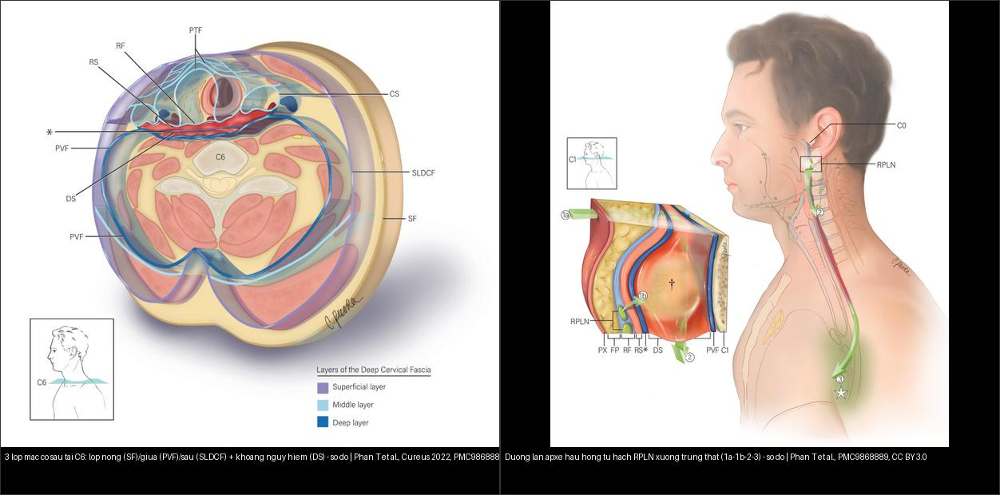
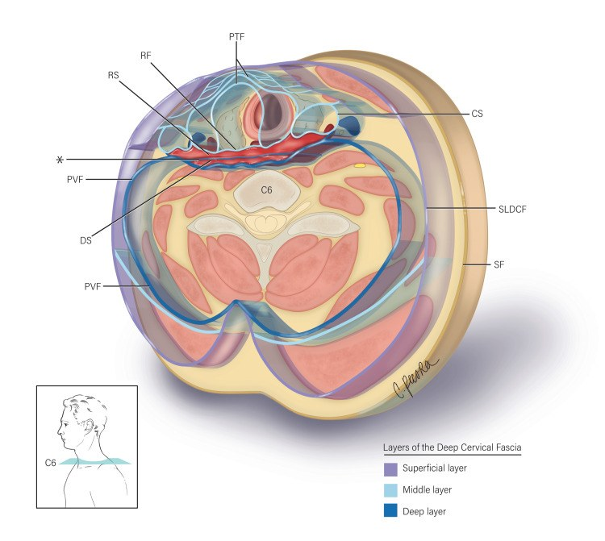
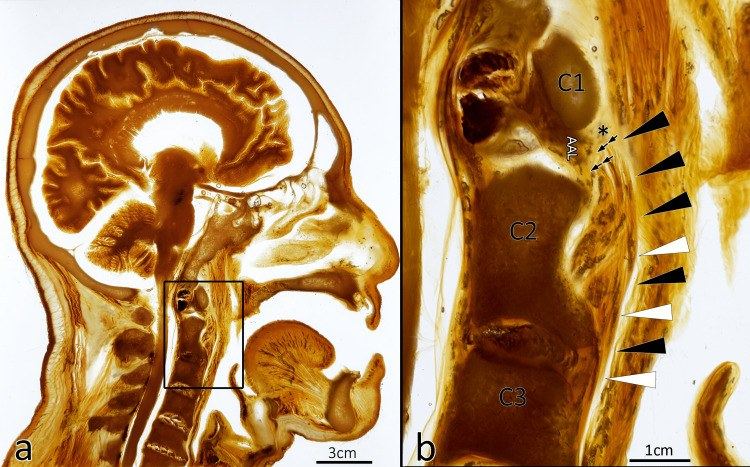
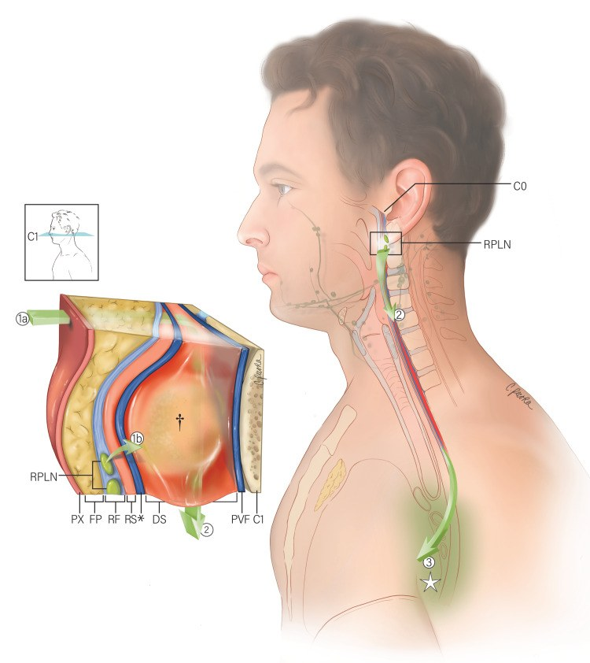

# 700 — Tổng quan Đầu Mặt Cổ & mạc cổ sâu / Head & Neck overview

**Tags:** `tong-quan`
**Mức chắc chắn (certainty):** tổng hợp y văn (literature synthesis).
**Học thuyết cốt lõi:** véc-tơ đẩy mạc cổ (hướng đẩy của mỡ khoang bên hầu + ICA định khu khoang) & thanh thải nhầy – lan thần kinh (PNTS). Bài 230 (TI-RADS tuyến giáp) giữ nguyên dải 200 — xem [230 – Tuyến giáp](../230-tuyen-giap-hach-co/lesson.md).

## Bảng so sánh phân biệt bắt buộc (Đầu Mặt Cổ)
| Mẫu hình (pattern) | Vị trí (location) | Gamut chính (DDx) | Phân biệt nhanh (Chốt định lượng / Tín hiệu) | Bài chi tiết |
|---|---|---|---|---|
| Tắc phức hợp lỗ ngách (OMC) & Dày niêm mạc | Mũi xoang (sinonasal) | Viêm xoang, nấm (mycetoma > 70 HU), polyp, u | Keros I 1–3 mm / II 4–7 mm / III 8–16 mm; Onodi/Haller; nấm > 70 HU + black turbinate = Mucor xâm lấn | `710`, `715` |
| Mờ xương đá & Nghe kém dẫn truyền | Xương đá (temporal bone) | Viêm tai, cholesteatoma, hở ống bán khuyên (SSCD), viêm xương chũm biến chứng nội sọ, **viêm tai ngoài ác tính/viêm xương nền sọ** | Mòn scutum + Prussak; non-EPI DWI (+) ≥ 2–3 mm = cholesteatoma (mô hạt âm); Pöschl/Stenvers cho SSCD; mòn vách xoang sigma + khuyết thuốc MRV = OLST; **ĐTĐ + mô hạt ống tai + mòn xương nền sọ + liệt dây sọ = NOE** | `720`, `236`, `233` |
| **Trẻ liệt mặt ngoại vi + nghe kém, màng nhĩ liền** | Đỉnh xương đá – thượng mê đạo (petrous apex) | Cholesteatoma xương đá (Sanna I–V) · u hạt cholesterol · dịch kẹt · viêm đỉnh xương đá (Gradenigo) · schwannoma VII · chondrosarcoma | **DWI sáng + ADC tối (759–1.370 ×10⁻⁶ mm²/s) + T1 tối = cholesteatoma**; **T1 sáng không tiêm = u hạt cholesterol**; **không tiêu xương + T2 sáng + DWI tối = dịch kẹt**; liệt mặt < 12 tháng còn cửa sổ hồi phục dây VII | [1713](../1713-cholesteatoma-xuong-da-o-tre/lesson.md) |
| **Tai chảy mủ mạn + trẻ có/ chuẩn bị cấy ốc tai (CI trong tai có bệnh)** | Xương thái dương: thượng nhĩ – sào bào – ốc tai | Cholesteatoma mắc phải/ bẩm sinh · viêm tai giữa mạn · u hạt cholesterol · mô hạt viêm · cholesteatoma xương đá · áp-xe Bezold | **Mờ HOÀN TOÀN sào bào trên HRCT → phải CWD/STP (5/5), sào bào thông khí → CWU (7/7)**; **vôi hóa ốc tai độ I–III (độ I: > 4 mm cửa sổ tròn; III: > 180°, dài ≥ 8 mm = tắc nặng)**; có nam châm → **DWI mất giá trị, theo dõi bằng CT 6 tháng/1-3-5-10 năm** | [1704](../1704-vtg-man-cholesteatoma-tre-cay-oc-tai/lesson.md) |
| **Liệt dây thần kinh sọ + sưng cổ sau viêm tai/họng** | Đỉnh xương đá – ống Dorello – TM cảnh trong | Gradenigo (VI) · liệt VII do AOM · viêm mê nhĩ · Lemierre (IX–XII, huyết khối IJV) | **Tam chứng Gradenigo đầy đủ chỉ 22%, viêm đỉnh xương đá 1/50.000 trẻ AOM** → CT 0,5–1 mm + MRI T1+C; **huyết khối IJV + nốt phổi ngoại vi = Lemierre (3,6/triệu/năm, Fusobacterium 72,3%)** | `237`, `238`, `236`, `730` |
| **Đau đầu/đau cổ + tủy xương clivus bất thường** | Nền sọ GIỮA (clivus, lồi cầu chẩm) | Viêm xương nền sọ giữa (CSBO) · NPC · chordoma/chondrosarcoma · di căn/myeloma · IgG4 · nấm · lao | **CSBO: MRI T1 tối + ngấm thuốc, CT có thể BÌNH THƯỜNG, CRP/ESR cao, liệt dây sọ 82%**; **NPC: khối vòm Rosenmüller + hạch cổ + EBV**; **chordoma: T2 rất sáng, đường giữa**; **IgG4: đối xứng, đáp ứng corticoid** | `253`, `233`, `730`, `750` |
| Sưng cổ cấp + Sốt (Deep neck infection) | Khoang cổ sâu (deep neck) | Áp-xe vs viêm mô tế bào, khoang nguy hiểm vs trước sống | Sau hầu < 7 mm (C2) / < 14–22 mm (C6); danger space xuống trung thất; phù dẹt không viền = không mổ | `730` |
| Khối tuyến mang tai (Parotid mass) | Tuyến nước bọt (salivary) | Pleomorphic adenoma, Warthin, ác tính | T2 sáng như dịch + ADC > 1,5 = pleomorphic; bắt sớm-thải nhanh = Warthin; T2 đen + ADC < 1,0 + tua gai = ác | `740` |
| Hạch cổ to (Neck nodes) | Cổ I–VII (neck levels) | Viêm, di căn (ENE), lymphoma, lao | Nhóm II > 15 mm, khác > 10 mm, Rouvière > 5–8 mm; ENE = ngoại khoa; NI-RADS 1–4 sau điều trị | `750`, `230` |
| **Nang giáp có triệu chứng (Cystic thyroid nodule)** | Tuyến giáp (thyroid) | Nang thuần/nang ưu thế dịch · nang keo đặc · nang xuất huyết · ung thư có thành phần nang · nang giáp lưỡi | Dịch **> 50%** thể tích + FNA lành tính; **VRR > 50% = thành công**; nang một thùy đáp ứng tốt hơn; **khàn tiếng 0,53%**, chưa có liệt dây thanh vĩnh viễn | `1622`, `230` |
| Dị dạng mạch máu & u mạch máu đầu–cổ ở trẻ (Vascular anomalies) | Da–mô mềm–khoảng cổ–hốc mắt–đường thở | IH, CH, LM, VM, AVM/AVF, KHE | **IH đoạn mặt > 5 cm → PHACE** (MRI/MRA não–cổ, tim, mắt, đường thở); **LM: T2 rất sáng, không flow**; **VM: sỏi tĩnh mạch, ngấm chậm**; **AVM: flow void + nidus + dẫn lưu sớm**; **IH đoạn cùng cụt vắt đường giữa → LUMBAR** | `741`, `746` |
| **Há miệng hạn chế (MIO ≤ 35 mm) sau xạ đầu cổ** | Khớp thái dương hàm – cơ nhai (khoang nhai) | Xơ hóa cơ nhai do xạ (RIF) · tái phát u khoang nhai · ORN xương hàm · áp-xe răng · rối loạn khớp thái dương hàm | **Teo + ngấm thuốc cơ đúng trường xạ, KHÔNG khối = RIF**; **masseter Dmean ≥ 37,5 Gy → trismus 45,7% vs 11,9% (HR 4,89)**; **ADC masseter > 1.381 ×10⁻⁶ mm²/s → 71,4% vs 6,1% (HR 11,17)**; **khối + xâm lấn mỡ cạnh hầu + hạch mới = tái phát → sinh thiết**, không sinh thiết mù trong mô xạ | [1761](../1761-trismus-sau-xa-tri-dau-co/lesson.md) |
| **Tê/đau vùng V3 + teo cơ nhai một bên sau xạ** | Thần kinh sinh ba V3: Meckel's cave – lỗ bầu dục – khoang nhai | Bệnh thần kinh V3 sau xạ · u lan theo dây (NPC/ACC/SCC da) · u nền sọ tại lỗ bầu dục · bệnh thần kinh vận động V3 · sau mổ răng/ORN | **Teo mỡ ≥ 2 cơ V3 + dây ngấm thuốc nhẹ + KHÔNG khối/không giãn lỗ + DWI không hạn chế = xạ**; **dây dày/ngấm mạnh + giãn lỗ + ADC tối = u lan theo dây → sinh thiết ổ u**; tiềm tàng **trung vị 7,6 năm**, nguy cơ **44,5% ở 20 năm** (xạ quy ước); V3 **Dmax 66 Gy / D1cc 62,7 Gy** là vùng cảnh báo | [1764](../1764-v3-sau-xa-tri-dau-co/lesson.md) |
| **Cổ đông cứng + mở miệng hạn chế + ngửa cổ hạn chế sau xạ (đường thở khó)** | Đường thở trên: miệng – họng – thanh môn – khí quản cổ, mô mềm cổ trước | Xơ hóa mô mềm + trismus + phù thanh môn do xạ · tái phát u/hẹp thanh môn · hẹp khí quản sau mở khí quản · cổ cứng không do xạ (dính khớp) · tắc tĩnh mạch cảnh trong | **ORN-DAS ≥ 4 = nguy cơ cao** (ORN 1 + MIO < 3 cm 2 + Mallampati III/IV 1/2 + hạn chế ngửa cổ 1 + tiền sử khó 1; AUC 0,76; PPV 64,3%); **đèn trực tiếp FPS 54,2% ở ORN vs 79,5%**; **FOI 28,8% vs 9,4%**; **video 100% ở ca được chọn**; mô xơ **T2 thấp, ADC không giảm, không khối** = xạ, **khối + ADC thấp = tái phát** | [1768](../1768-co-dong-cung-sau-xa-duong-tho-kho/lesson.md) |
| **Cần mở khí quản / FONA ở cổ đã xạ (không đặt được nội khí quản)** | Cổ trước: da – mô mềm trước cổ – màng giáp nhẫn – sụn nhẫn – khí quản cổ | Xơ hóa + sụn vôi hóa · phù thanh môn · liệt hai dây thanh sau xạ · hoại tử sụn thanh quản do xạ (LCRN) · hẹp sau mở khí quản · khí quản lệch | **Màng giáp nhẫn 8,7 → 7,5 mm**, **da–màng 11,7 → 10,2 mm** (231 ca xạ); **CICO: scalpel-bougie oxy hóa 83% vs cannula 18%** (lợn béo); **cricothyroidotomy chuyển tiếp → hẹp 1 năm 13,0%**; **chỉ 9% ca mổ đầu cổ cần mở khí quản gây tê tại chỗ** | [1769](../1769-co-dong-cung-sau-xa-duong-tho-kho/lesson.md) |
| **Phù mặt–cổ + đau đầu/ù tai/nhìn mờ sau xạ, tắc tĩnh mạch cảnh trong HAI BÊN** | Tĩnh mạch cảnh trong hai bên – xoang màng não – tĩnh mạch cảnh ngoài | Hẹp/tắc IJV sau xạ + vét hạch · mảnh sinh lý · huyết khối IJV · chèn ép u/xương · tắc TM chủ trên · phù bạch mạch · huyết khối xoang màng não (CVST) | **Bàng hệ + lỗ tĩnh mạch cảnh bất đối xứng phân biệt hẹp với mảnh** (mảnh trái **48,4%** người bình thường); **CTV gọi tắc giả 4/4 nhưng DSV thông cả 4**; **stent: 127/144 (95,5%) thông ở 30,5 tháng**, Frisén **2 → 1** | [1770](../1770-tac-tinh-mach-canh-trong-hai-ben-sau-xa/lesson.md) |
| **Cứng–dày mô mềm cổ + đau/hạn chế vai sau xạ** | Mô mềm cổ: da – mô dưới da – cơ ức đòn chũm – mạc cổ – cơ thang | Xơ hóa do xạ (RIF) · tái phát u/hạch · phù bạch mạch · sẹo mổ cổ · hoại tử xương hàm · liệt cơ thang do dây XI | **Dày da + mất lớp mỡ dưới da + teo cơ đúng trường xạ, KHÔNG khối = RIF**; **cơ ức đòn chũm 46,98 vs 28,10 kPa** (người không xạ); **da V15 < 20% / mô dưới da V15 < 25%** nếu đã mổ, **SCM V70 < 25%** nếu không mổ; **khối + ADC thấp/FDG dương = tái phát**; vai: **xạ đơn thuần 96,3 vs mổ + xạ 65,3 điểm UW-QoL** | [1763](../1763-xo-hoa-mo-mem-co-sau-xa/lesson.md) |
| **Sưng mềm–ấn lõm vùng mặt/cổ sau mổ + xạ** | Mô mềm ngoài: mi – má – dưới cằm – cổ – hõm trên đòn | Phù bạch mạch ngoài (thể B/C) · xơ hóa do xạ (D) · tái phát u/di căn da · viêm mô tế bào/áp-xe · tụ dịch sau mổ · tắc tĩnh mạch chủ trên · suy giáp · giả phình cảnh | **Mềm + ấn lõm + giảm khi kê cao/băng ép + T2 sáng + KHÔNG khối = phù bạch mạch**; **rắn, không lõm, T2 thấp = xơ hóa (D)**; **khối/lệch trục + ADC thấp/FDG dương = tái phát**; **70% phù ngoài / 34% phù trong ở 360 ngày**; **Dmean level IV ≥ 58,7 Gy** và **level I–VII ≥ 58,6 Gy** dự báo phù mặt ≥ 2; **vòng cổ ICC 0,958–0,994 nhưng độ dày bì chỉ 0,136–0,354** | [1767](../1767-phu-bach-mach-dau-co-sau-xa/lesson.md) |
| **Chảy máu cam nặng/tái diễn ở trẻ** | Hốc mũi – mũi hầu | Chảy máu trước vô căn, JNA, HHT, rối loạn đông máu, giả phình cảnh trong/SPA, u mũi hầu | **90% trẻ chảy máu thể trước (Kiesselbach)** → không cần chụp; **nam 12–16 tuổi + một bên + giãn lỗ bướm–khẩu cái + blush DSA = JNA** (nút mạch 24–48 giờ trước mổ, giảm tưới máu 86%); **tái diễn + giãn mạch môi/lưỡi + tiền sử gia đình = HHT** (tầm soát AVM phổi–não); **vòng nối nguy hiểm: lỗ tròn, màng não giữa, sàng, hầu lên** → bơm nhầm = mù/đột quỵ; **trẻ có rối loạn đông máu: INR/aPTT bình thường KHÔNG loại trừ VWD, chỉ 4,9% phải truyền** | `743`, `744`, `741`, `249` |

## Hình minh họa — mạc cổ sâu & đường lan (học thuyết cốt lõi)

*Trái: lát cắt ngang tại **C6** — 3 lớp mạc cổ sâu (nông SF/giữa PVF/sâu SLDCF) và **khoảng nguy hiểm (danger space, DS)** ngay sau mạc alar. Phải: đường lan của áp-xe hầu họng — từ **hạch sau hầu (RPLN)** theo **1a→1b→2→3** xuống **trung thất**. Nguồn: Phan T et al., Cureus 2022 (PMC9868889), CC BY 3.0. Ảnh ghép letterbox.*

*Lát cắt ngang C6: lớp nông (SF) · lớp giữa (PVF) · lớp sâu (SLDCF); **khoảng nguy hiểm (DS)** nằm giữa mạc alar và lớp sâu — đây là "đường cao tốc" đưa nhiễm trùng từ cổ xuống **trung thất**. Nguồn: Phan T et al., Cureus 2022 (PMC9868889), CC BY 3.0.*

*Tiêu bản trong suốt dọc (plastinate): tương quan **mạc alar** với khoảng sau hầu/khoảng nguy hiểm (a toàn cảnh, b cận cảnh — mũi tên chỉ mạc alar). Nguồn: Phan T et al., Cureus 2022 (PMC9868889), CC BY 3.0.*

## Ca minh họa — Blind Quiz

**Ca 1 — Nam giới, sưng cổ cấp + sốt sau viêm họng. Ảnh sơ đồ: nhiễm trùng theo đường nào xuống trung thất?**

- Gợi ý: viêm họng/áp-xe amiđan → sưng cổ, đau khi nuốt, khó thở.
- Câu hỏi: Ổ nhiễm xuất phát từ hạch nào? Đi qua khoảng nào để tới trung thất? Nguy cơ nếu chậm trễ?

<b>Bấm để hiện đáp án (findings + chẩn đoán)</b>

- Dấu hiệu (findings): đường lan bắt đầu từ **hạch sau hầu (retropharyngeal lymph node, RPLN)** → **1a/1b** vào **khoảng sau hầu** → **2** qua **khoảng nguy hiểm (danger space)** → **3** xuống **trung thất**.
- Chẩn đoán (diagnosis): **áp-xe khoảng cổ sâu lan trung thất** — vì **khoảng nguy hiểm chạy liên tục từ nền sọ xuống trung thất sau**; chậm trễ → **viêm trung thất, sốc nhiễm khuẩn, tử vong**. Xử trí: **kháng sinh + dẫn lưu/mổ sớm**, đánh giá đường thở.
- Nguồn ảnh: Phan T et al., Cureus 2022 (PMC9868889), Fig. 3, CC BY 3.0.

## Bài liên quan chéo
- [230 – Tuyến giáp TI-RADS](../230-tuyen-giap-hach-co/lesson.md) *(giữ nguyên dải 200)*
- [1622 – Đốt cồn nang giáp lành tính](../1622-dot-con-nang-giap-pei/lesson.md) *(đã có)*
- [941 – Đốt nhiệt tuyến cận giáp: PTH washout, 4D-CT & bẫy “đốt nhầm nhân giáp”](../941-dot-tuyen-can-giap/lesson.md) *(mới)*
- [710 – Mũi xoang & OMC](../710-sinonasal-ct-anatomy/lesson.md) *(đã có)*
- [730 – Nhiễm trùng cổ sâu](../730-deep-neck-infections/lesson.md) *(đã có)*
- [741 – Dị dạng mạch máu đầu–cổ ở trẻ: ISSVA, PHACE & LUMBAR](../741-di-dang-mach-mau-dau-co-o-tre/lesson.md) *(đã có)*
- [743 – Chảy máu cam nặng/tái diễn ở trẻ: CTA, DSA & nút mạch](../743-chay-mau-cam-nang-o-tre/lesson.md) *(đã có)*
- [744 – Chảy máu cam ở trẻ có rối loạn đông máu: xét nghiệm, desmopressin/TXA & ngưỡng truyền](../744-chay-mau-cam-tre-roi-loan-dong-mau/lesson.md) *(đã có)*
- [746 – CM-AVM (RASA1/EPHB4): mảng đỏ "quầng nhạt" + shunt não–tủy, khác HHT ở chỗ KHÔNG có PAVM](../746-cm-avm-rasa1-ephb4/lesson.md) *(mới)*
- [236 – Viêm tai xương chũm & biến chứng nội sọ](../236-viem-tai-xuong-chum-bien-chung-noi-so/lesson.md) *(đã có — dải 200, xương đá)*
- [237 – Biến chứng thần kinh sọ của viêm tai: Gradenigo, liệt VII, viêm mê nhĩ](../237-bien-chung-than-kinh-so-viem-tai-gradenigo/lesson.md) *(đã có — dải 200)*
- [238 – Hội chứng Lemierre & huyết khối tĩnh mạch cảnh trong nhiễm khuẩn](../238-lemierre-huyet-khoi-tm-canh-trong/lesson.md) *(đã có — dải 200)*
- [253 – Viêm xương nền sọ GIỮA không do tai (CSBO): clivus, lồi cầu & cạm bẫy "CT bình thường"](../253-viem-xuong-nen-so-giua-khong-do-tai/lesson.md) *(đã có — dải 200, nội dung đầu cổ)*
- [233 – Viêm tai ngoài ác tính & viêm xương nền sọ BÊN](../233-viem-tai-ngoai-ac-tinh-nen-so/lesson.md) *(đã có — dải 200)*

## Quy hoạch Master Curriculum Đầu Mặt Cổ (700–799)
> Đã viết có link; chưa viết là text dự kiến. ID ổn định, không đánh lại số.

**700–759 — Tổng quan, Mũi xoang, Tai & Cổ sâu**
- **700** – Tổng quan Đầu Mặt Cổ & Bản đồ Mạc cổ sâu *(bài này)*
- 710 – Giải phẫu CT Mũi Xoang & Phức hợp Lỗ ngách (OMC) *(đã có — [bài học](../710-sinonasal-ct-anatomy/lesson.md))*
- 715 – Viêm mũi xoang & Nấm xoang (xâm lấn vs không xâm lấn) *(đã có — [bài học](../715-rhinosinusitis-fungal/lesson.md))*
- 720 – Xương đá, Viêm tai & Cholesteatoma *(đã có — [bài học](../720-temporal-bone-cholesteatoma/lesson.md))*
- 1704 – Viêm tai giữa mạn & cholesteatoma ở trẻ có cấy ốc tai: HRCT chọn CWU/CWD/STP, một thì vs hai thì, CT theo dõi khi có nam châm *(mới — [bài học](../1704-vtg-man-cholesteatoma-tre-cay-oc-tai/lesson.md))*
- 1713 – Cholesteatoma xương đá ở trẻ: phân độ Sanna I–V, DWI không-EPI + T1 (cholesteatoma vs u hạt cholesterol), ngưỡng xử trí dây VII theo thời gian liệt *(mới — [bài học](../1713-cholesteatoma-xuong-da-o-tre/lesson.md))*
- 730 – Khoang cổ sâu & Nhiễm trùng cấp cứu (Áp-xe vs Viêm mô tế bào) *(đã có — [bài học](../730-deep-neck-infections/lesson.md))*
- 740 – Tuyến nước bọt: U hỗn hợp, Warthin & Ác tính *(đã có — [bài học](../740-salivary-gland-tumors/lesson.md))*
- 741 – Dị dạng mạch máu đầu–cổ ở trẻ: ISSVA, PHACE & LUMBAR *(đã có — [bài học](../741-di-dang-mach-mau-dau-co-o-tre/lesson.md))*
- 750 – Bản đồ Hạch cổ (I–VII) & ACR NI-RADS *(đã có — [bài học](../750-cervical-lymph-nodes-nirads/lesson.md))*
- 941 – Đốt nhiệt tuyến cận giáp (adenoma): PTH washout, 4D-CT, đốt cồn/nhiệt & bẫy đốt nhầm nhân giáp *(mới — [bài học](../941-dot-tuyen-can-giap/lesson.md))*
- 743 – Chảy máu cam nặng/tái diễn ở trẻ: nội soi, CTA, DSA & nút mạch (JNA, HHT), Fisch *(đã có — [bài học](../743-chay-mau-cam-nang-o-tre/lesson.md))*
- 744 – Chảy máu cam ở trẻ có rối loạn đông máu: xét nghiệm, desmopressin/TXA & ngưỡng truyền *(đã có — [bài học](../744-chay-mau-cam-tre-roi-loan-dong-mau/lesson.md))*
- 745 – HHT ở trẻ: Curaçao (kém tin cậy ở trẻ), tầm soát PAVM (TTCE/CT, ngưỡng động mạch nuôi ≥ 3 mm) & bAVM (MRI/MRA → DSA), bậc thang chảy máu cam (ESS) *(mới — [bài học](../745-hht-o-tre-tam-soat-avm-phoi-nao/lesson.md))*
- 746 – CM-AVM (RASA1/EPHB4): ≥ 3 mảng đỏ có quầng nhạt + shunt não–tủy (pial AVF 43,3%, AVM 36,0%, vGaM 66,7% ở EPHB4), **không PAVM**; MRI/MRA não + toàn tủy *(mới — [bài học](../746-cm-avm-rasa1-ephb4/lesson.md))*
- 1761 – Trismus sau xạ trị đầu cổ: MIO ≤ 35 mm, ngưỡng liều masseter Dmean < 37,5 Gy, ADC masseter dự báo, tập dự phòng không hiệu quả *(mới — [bài học](../1761-trismus-sau-xa-tri-dau-co/lesson.md))*
- 1764 – Bệnh thần kinh V3 sau xạ trị đầu cổ: tê–đau V3, teo cơ nhai không khối, tiềm tàng 7,6 năm, V3 Dmax 66 Gy/D1cc 62,7 Gy, phân biệt u lan theo dây *(mới — [bài học](../1764-v3-sau-xa-tri-dau-co/lesson.md))*
- 1763 – Xơ hóa mô mềm cổ sau xạ & hội chứng vai–cổ: dày da + mất mỡ dưới da + teo cơ, SWE 46,98 vs 28,10 kPa, TD50 da 40,2 Gy (không mổ) vs 8,4 Gy (đã mổ), vai 96,3 vs 65,3 điểm, phân biệt tái phát *(mới — [bài học](../1763-xo-hoa-mo-mem-co-sau-xa/lesson.md))*
- 1767 – Phù bạch mạch đầu–cổ ngoài sau xạ trị: thể B/C/D, 70% phù ngoài / 34% phù trong ở 360 ngày, phù mặt ≥ 2 gặp 29,9% (84,6% trong 3–6 tháng), ngưỡng level IV 58,7 Gy / level I–VII 58,6 Gy, vòng liều 16 Gy, vòng cổ ICC 0,958–0,994 vs độ dày bì 0,136–0,354 *(mới — [bài học](../1767-phu-bach-mach-dau-co-sau-xa/lesson.md))*
- 1768 – "Cổ đông cứng" sau xạ & đường thở khó: ORN-DAS 0–7 điểm (AUC 0,76; ≥ 4 PPV 64,3%), đèn trực tiếp FPS 54,2% vs 79,5%, FOI 28,8% vs 9,4%, siêu âm bản đồ khí quản lệch 1,5 cm, AEC/ECMO khi mở khí quản bất khả thi *(mới — [bài học](../1768-co-dong-cung-sau-xa-duong-tho-kho/lesson.md))*
- 1769 – Mở khí quản/FONA xuyên cổ đã xạ: màng giáp nhẫn **8,7 → 7,5 mm**, da–màng **11,7 → 10,2 mm**, CICO scalpel-bougie **83% vs 18%**, cricothyroidotomy chuyển tiếp → hẹp **13,0%**, LCRN **4,3%** *(mới — [bài học](../1769-co-dong-cung-sau-xa-duong-tho-kho/lesson.md))*
- 1770 – Tắc tĩnh mạch cảnh trong hai bên sau xạ: mảnh trái **48,4%** (không bàng hệ) vs hẹp có bàng hệ; CTV tắc giả **4/4**; stent **95,5% thông/30,5 tháng**, Frisén **2 → 1** *(mới — [bài học](../1770-tac-tinh-mach-canh-trong-hai-ben-sau-xa/lesson.md))*
- 253 – Viêm xương nền sọ GIỮA không do tai (CSBO): clivus/lồi cầu, **CT âm tính không loại trừ**, MRI T1FS+Gd, sinh thiết sâu, kháng sinh ≥ 6 tuần *(đã có — dải 200, nội dung đầu cổ — [bài học](../253-viem-xuong-nen-so-giua-khong-do-tai/lesson.md))*

> Không dùng để chẩn đoán độc lập khi chưa có người hướng dẫn.
