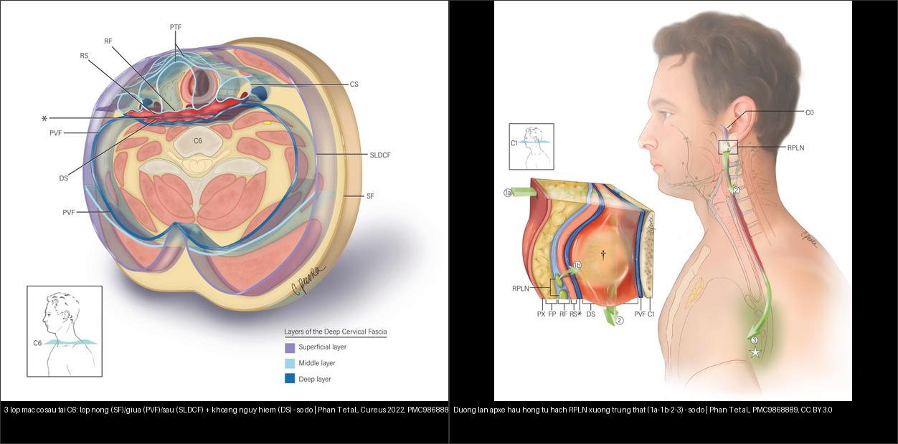
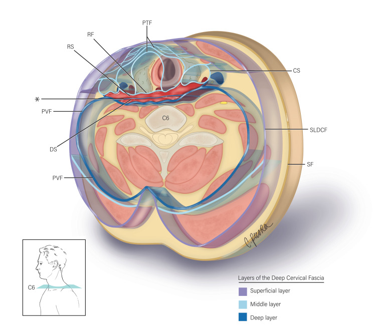
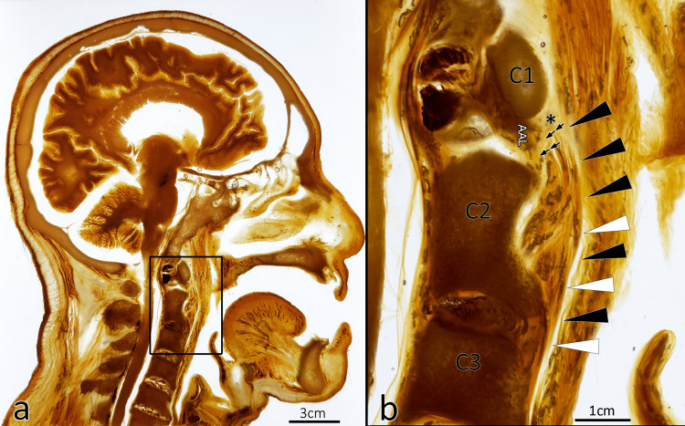
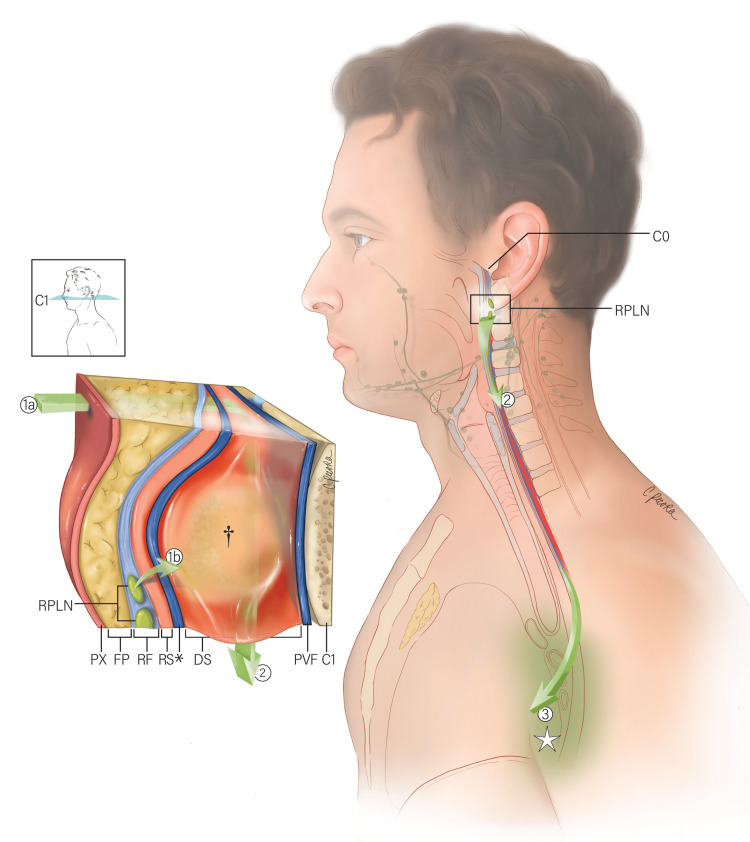

# 700 — Tổng quan Đầu Mặt Cổ & mạc cổ sâu / Head & Neck overview

**Tags:** `tong-quan`
**Mức chắc chắn (certainty):** tổng hợp y văn (literature synthesis).
**Học thuyết cốt lõi:** véc-tơ đẩy mạc cổ (hướng đẩy của mỡ khoang bên hầu + ICA định khu khoang) & thanh thải nhầy – lan thần kinh (PNTS). Bài 230 (TI-RADS tuyến giáp) giữ nguyên dải 200 — xem [230 – Tuyến giáp](../230-tuyen-giap-hach-co/lesson.md).

## Bảng so sánh phân biệt bắt buộc (Đầu Mặt Cổ)
| Mẫu hình (pattern) | Vị trí (location) | Gamut chính (DDx) | Phân biệt nhanh (Chốt định lượng / Tín hiệu) | Bài chi tiết |
|---|---|---|---|---|
| Tắc phức hợp lỗ ngách (OMC) & Dày niêm mạc | Mũi xoang (sinonasal) | Viêm xoang, nấm (mycetoma > 70 HU), polyp, u | Keros I 1–3 mm / II 4–7 mm / III 8–16 mm; Onodi/Haller; nấm > 70 HU + black turbinate = Mucor xâm lấn | `710`, `715` |
| Mờ xương đá & Nghe kém dẫn truyền | Xương đá (temporal bone) | Viêm tai, cholesteatoma, hở ống bán khuyên (SSCD), viêm xương chũm biến chứng nội sọ | Mòn scutum + Prussak; non-EPI DWI (+) ≥ 2–3 mm = cholesteatoma (mô hạt âm); Pöschl/Stenvers cho SSCD; mòn vách xoang sigma + khuyết thuốc MRV = OLST | `720`, `236` |
| **Liệt dây thần kinh sọ + sưng cổ sau viêm tai/họng** | Đỉnh xương đá – ống Dorello – TM cảnh trong | Gradenigo (VI) · liệt VII do AOM · viêm mê nhĩ · Lemierre (IX–XII, huyết khối IJV) | **Tam chứng Gradenigo đầy đủ chỉ 22%, viêm đỉnh xương đá 1/50.000 trẻ AOM** → CT 0,5–1 mm + MRI T1+C; **huyết khối IJV + nốt phổi ngoại vi = Lemierre (3,6/triệu/năm, Fusobacterium 72,3%)** | `237`, `238`, `236`, `730` |
| Sưng cổ cấp + Sốt (Deep neck infection) | Khoang cổ sâu (deep neck) | Áp-xe vs viêm mô tế bào, khoang nguy hiểm vs trước sống | Sau hầu < 7 mm (C2) / < 14–22 mm (C6); danger space xuống trung thất; phù dẹt không viền = không mổ | `730` |
| Khối tuyến mang tai (Parotid mass) | Tuyến nước bọt (salivary) | Pleomorphic adenoma, Warthin, ác tính | T2 sáng như dịch + ADC > 1,5 = pleomorphic; bắt sớm-thải nhanh = Warthin; T2 đen + ADC < 1,0 + tua gai = ác | `740` |
| Hạch cổ to (Neck nodes) | Cổ I–VII (neck levels) | Viêm, di căn (ENE), lymphoma, lao | Nhóm II > 15 mm, khác > 10 mm, Rouvière > 5–8 mm; ENE = ngoại khoa; NI-RADS 1–4 sau điều trị | `750`, `230` |
| Dị dạng mạch máu & u mạch máu đầu–cổ ở trẻ (Vascular anomalies) | Da–mô mềm–khoảng cổ–hốc mắt–đường thở | IH, CH, LM, VM, AVM/AVF, KHE | **IH đoạn mặt > 5 cm → PHACE** (MRI/MRA não–cổ, tim, mắt, đường thở); **LM: T2 rất sáng, không flow**; **VM: sỏi tĩnh mạch, ngấm chậm**; **AVM: flow void + nidus + dẫn lưu sớm**; **IH đoạn cùng cụt vắt đường giữa → LUMBAR** | `741` |

## Hình minh họa — mạc cổ sâu & đường lan (học thuyết cốt lõi)

*Trái: lát cắt ngang tại **C6** — 3 lớp mạc cổ sâu (nông SF/giữa PVF/sâu SLDCF) và **khoảng nguy hiểm (danger space, DS)** ngay sau mạc alar. Phải: đường lan của áp-xe hầu họng — từ **hạch sau hầu (RPLN)** theo **1a→1b→2→3** xuống **trung thất**. Nguồn: Phan T et al., Cureus 2022 (PMC9868889), CC BY 3.0. Ảnh ghép letterbox.*

*Lát cắt ngang C6: lớp nông (SF) · lớp giữa (PVF) · lớp sâu (SLDCF); **khoảng nguy hiểm (DS)** nằm giữa mạc alar và lớp sâu — đây là "đường cao tốc" đưa nhiễm trùng từ cổ xuống **trung thất**. Nguồn: Phan T et al., Cureus 2022 (PMC9868889), CC BY 3.0.*

*Tiêu bản trong suốt dọc (plastinate): tương quan **mạc alar** với khoảng sau hầu/khoảng nguy hiểm (a toàn cảnh, b cận cảnh — mũi tên chỉ mạc alar). Nguồn: Phan T et al., Cureus 2022 (PMC9868889), CC BY 3.0.*

## Ca minh họa — Blind Quiz

**Ca 1 — Nam giới, sưng cổ cấp + sốt sau viêm họng. Ảnh sơ đồ: nhiễm trùng theo đường nào xuống trung thất?**

- Gợi ý: viêm họng/áp-xe amiđan → sưng cổ, đau khi nuốt, khó thở.
- Câu hỏi: Ổ nhiễm xuất phát từ hạch nào? Đi qua khoảng nào để tới trung thất? Nguy cơ nếu chậm trễ?

<b>Bấm để hiện đáp án (findings + chẩn đoán)</b>

- Dấu hiệu (findings): đường lan bắt đầu từ **hạch sau hầu (retropharyngeal lymph node, RPLN)** → **1a/1b** vào **khoảng sau hầu** → **2** qua **khoảng nguy hiểm (danger space)** → **3** xuống **trung thất**.
- Chẩn đoán (diagnosis): **áp-xe khoảng cổ sâu lan trung thất** — vì **khoảng nguy hiểm chạy liên tục từ nền sọ xuống trung thất sau**; chậm trễ → **viêm trung thất, sốc nhiễm khuẩn, tử vong**. Xử trí: **kháng sinh + dẫn lưu/mổ sớm**, đánh giá đường thở.
- Nguồn ảnh: Phan T et al., Cureus 2022 (PMC9868889), Fig. 3, CC BY 3.0.

## Bài liên quan chéo
- [230 – Tuyến giáp TI-RADS](../230-tuyen-giap-hach-co/lesson.md) *(giữ nguyên dải 200)*
- [710 – Mũi xoang & OMC](../710-sinonasal-ct-anatomy/lesson.md) *(đã có)*
- [730 – Nhiễm trùng cổ sâu](../730-deep-neck-infections/lesson.md) *(đã có)*
- [741 – Dị dạng mạch máu đầu–cổ ở trẻ: ISSVA, PHACE & LUMBAR](../741-di-dang-mach-mau-dau-co-o-tre/lesson.md) *(đã có)*
- [236 – Viêm tai xương chũm & biến chứng nội sọ](../236-viem-tai-xuong-chum-bien-chung-noi-so/lesson.md) *(đã có — dải 200, xương đá)*
- [237 – Biến chứng thần kinh sọ của viêm tai: Gradenigo, liệt VII, viêm mê nhĩ](../237-bien-chung-than-kinh-so-viem-tai-gradenigo/lesson.md) *(đã có — dải 200)*
- [238 – Hội chứng Lemierre & huyết khối tĩnh mạch cảnh trong nhiễm khuẩn](../238-lemierre-huyet-khoi-tm-canh-trong/lesson.md) *(đã có — dải 200)*

## Quy hoạch Master Curriculum Đầu Mặt Cổ (700–799)
> Đã viết có link; chưa viết là text dự kiến. ID ổn định, không đánh lại số.

**700–759 — Tổng quan, Mũi xoang, Tai & Cổ sâu**
- **700** – Tổng quan Đầu Mặt Cổ & Bản đồ Mạc cổ sâu *(bài này)*
- 710 – Giải phẫu CT Mũi Xoang & Phức hợp Lỗ ngách (OMC) *(đã có — [bài học](../710-sinonasal-ct-anatomy/lesson.md))*
- 715 – Viêm mũi xoang & Nấm xoang (xâm lấn vs không xâm lấn) *(đã có — [bài học](../715-rhinosinusitis-fungal/lesson.md))*
- 720 – Xương đá, Viêm tai & Cholesteatoma *(đã có — [bài học](../720-temporal-bone-cholesteatoma/lesson.md))*
- 730 – Khoang cổ sâu & Nhiễm trùng cấp cứu (Áp-xe vs Viêm mô tế bào) *(đã có — [bài học](../730-deep-neck-infections/lesson.md))*
- 740 – Tuyến nước bọt: U hỗn hợp, Warthin & Ác tính *(đã có — [bài học](../740-salivary-gland-tumors/lesson.md))*
- 741 – Dị dạng mạch máu đầu–cổ ở trẻ: ISSVA, PHACE & LUMBAR *(đã có — [bài học](../741-di-dang-mach-mau-dau-co-o-tre/lesson.md))*
- 750 – Bản đồ Hạch cổ (I–VII) & ACR NI-RADS *(đã có — [bài học](../750-cervical-lymph-nodes-nirads/lesson.md))*

> Không dùng để chẩn đoán độc lập khi chưa có người hướng dẫn.
