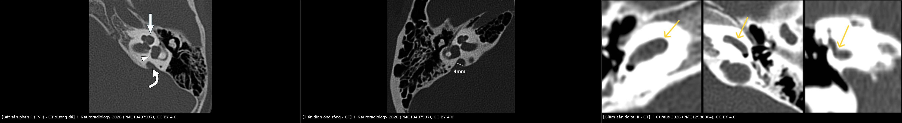
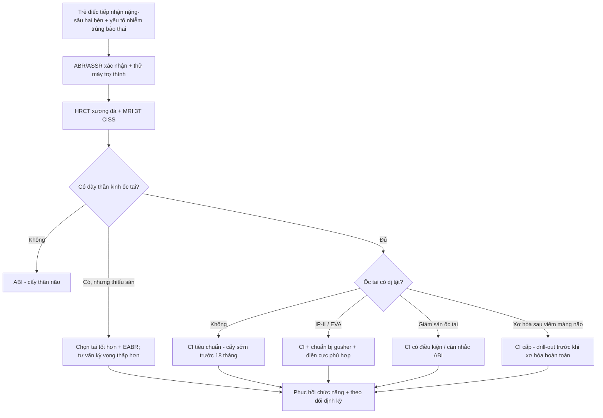
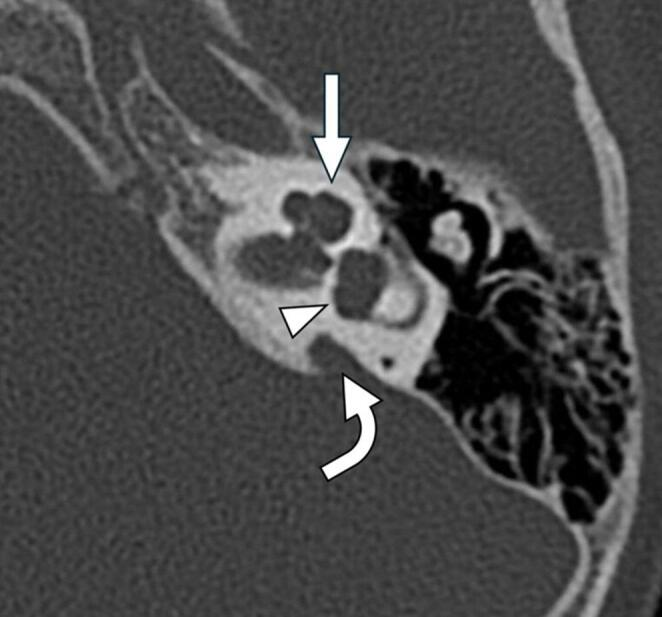
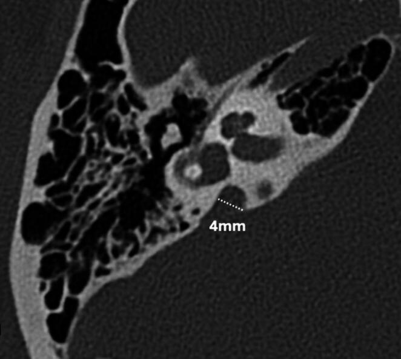
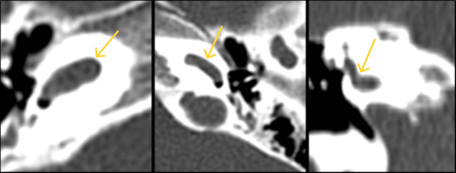

# 702 — Cấy ốc tai điện tử ở trẻ điếc do nhiễm trùng bào thai (rubella/CMV): chọn tai nào, cấy lúc nào, và hình ảnh tiền phẫu quyết định kết quả

**Tags:** `pattern:di-thinh-tiep-nhan` `pattern:giam-san-oc-tai` `pattern:bat-san-phan` `pattern:ong-tai-trong-hep` `pattern:di-thinh-tien-trien` `vung:tai-trong` `vung:tai-xuong-da` `anatomy:oc-tai` `anatomy:day-than-kinh-VIII` `protocol:CT-xuong-da-lat-mong` `protocol:MRI-CISS` `protocol:ABR` `incidentaloma:khong`
**Mức chắc chắn (certainty):** tổng hợp y văn (literature synthesis) — ghép **tổng quan 14 tham số CT tiền phẫu cho cấy ốc tai** (Neuroradiology 2026, PMC13407937), **loạt 56 trẻ cCMV/89 tai cấy** (PMC13703150), **meta-analysis điếc muộn do CMV bẩm sinh** (PMC13425846), **nghiên cứu 30 năm về phát triển nghe lời nói sau cấy** (PMC13234484), **107 trẻ thiếu sản dây thần kinh ốc tai** (PMID 42867353), **38 ca rubella bẩm sinh được cấy** (PMC12156128), **giám sát CRS Ấn Độ 2016–2025** (PMC13546868), **HRCT+MRI 10 ca tiền phẫu** (Cureus 2026, PMC12988004). Không có ca do nhóm tự chụp.

> **Câu hỏi thực hành:** bé gái **14 tháng**, **ABR hai tai không đáp ứng ở 100 dB nHL**, không dùng được máy trợ thính. Mẹ **nhiễm CMV trong thai kỳ** (IgM dương tính), bé **không triệu chứng lúc sinh**, **sàng lọc thính lực sơ sinh qua** — đến 12 tháng mới phát hiện không phản ứng với tiếng. Câu hỏi: **có phải cấy ốc tai không, cấy tai nào, cần chụp gì trước mổ, và có nguy cơ gì?**
> Bài chốt **ba quyết định**: **(1) nhiễm trùng bào thai là nguyên nhân điếc tiếp nhận **tiến triển và muộn** — "sàng lọc sơ sinh qua" **không loại trừ** (13,9% trẻ cCMV có điếc muộn; PMC13425846), nên **chỉ định cấy không chờ "ổn định"**; (2) **MRI là bắt buộc trước cấy** để đếm **dây thần kinh ốc tai** — không có dây thần kinh thì cấy ốc tai vô ích, phải chuyển **cấy thân não (ABI)** (PMID 42867353); (3) **cấy trước 18 tháng** cho kết quả ngôn ngữ tốt hơn rõ rệt (PMC13234484), và **bất thường tai trong** (IP-II, giảm sản ốc tai, ống nội dịch rộng) quyết định **đường mổ, chiều dài điện cực và nguy cơ "gusher" dịch não tủy**.**

## 1. Tổng quan bệnh học – cơ chế hình ảnh: vì sao CMV/rubella làm điếc, và vì sao phải nhìn cả ốc tai lẫn dây thần kinh

- **Cơ chế điếc của nhiễm trùng bào thai (hai bệnh, hai kiểu diễn tiến):**
  - **CMV bẩm sinh (cCMV):** virus gây viêm **thể vân mạch (stria vascularis)**, **tế bào lông** và **hạch xoắn (spiral ganglion)**; tổn thương có thể **một bên**, **không đối xứng**, **dao động** và **tiến triển sau sinh** — nên **điếc muộn/tiến triển** là đặc trưng. Trong **56.892 trẻ** được sàng lọc bằng PCR nước tiểu: **tỷ lệ nhiễm 0,46%**, **83,4% không triệu chứng lúc sinh**, **13,9% có điếc muộn** (PMC13425846).
  - **Rubella bẩm sinh (CRS):** virus gây **chết tế bào và viêm mê nhĩ** trong giai đoạn **cơ quan cảm thụ đang biệt hóa (tam cá nguyệt 1)** → điếc **nặng–sâu, thường hai bên**, có thể **tiến triển**. Trong giám sát **583 ca CRS xác nhận** (Ấn Độ 2016–2025): **26,8% có điếc**, **81,3% có dị tật tim**, tử vong tích lũy 1 năm **32,2%** (PMC13546868) — nên **điếc là phần nổi của "bệnh đa cơ quan"**, phải khám mắt/tim/trí tuệ song song (bài 6128).
  - Cả hai đều **không có thuốc phục hồi tế bào lông** → phục hồi chức năng duy nhất là **cấy ốc tai điện tử (cochlear implant, CI)** hoặc **cấy thân não (auditory brainstem implant, ABI)** khi không có dây thần kinh.
- **TẠI SAO hình ảnh tiền phẫu quyết định kết quả (vật lý + giải phẫu):**
  - **CT xương đá (HRCT, 0,4–0,6 mm, bone kernel):** hiển thị **vỏ xương mê nhĩ** — thấy **số vòng ốc tai**, **vách giữa các vòng (interscalar septum)**, **trụ ốc tai (modiolus)**, **tiền đình**, **ống bán khuyên**, **ống nội dịch**, **trần tai giữa**, **ống thần kinh mặt**, **bóng tĩnh mạch cảnh**. Đây là bản đồ cho **đường mổ hốc nhận (receiver well)**, **mastoide**, **mặt chuỳ** và **vị trí mở ốc tai (cochleostomy)**.
  - **MRI 3T, chuỗi nặng T2 (CISS/FIESTA/SPACE), lát ≤ 0,8 mm:** hiển thị **dịch nội dịch sáng** và **dây thần kinh VIII tối trong ống tai trong** — thấy **4 dây thần kinh (VII, VIII–ốc tai, VIII–tiền đình trên/dưới)**. Đây là **thứ duy nhất** đếm được **dây thần kinh ốc tai**; CT chỉ suy ra gián tiếp qua **đường kính ống tai trong (IAC)**.
  - **Ngưỡng định lượng quan trọng:**
    - **Ống tai trong hẹp:** đường kính **< 3 mm** ở giữa ống → nghĩ **hẹp/thiếu sản dây thần kinh** (đo trên MRI, không đo trên CT).
    - **Ống nội dịch rộng (EVA):** đường kính **> 1,5 mm ở điểm giữa** hoặc **> 1,9 mm ở lỗ mở (operculum)** → nguy cơ **"gusher" dịch não tủy** khi mở ốc tai (PMC13407937, Fig 14 minh hoạ **4 mm**).
    - **Bất sản phần II (incomplete partition type II — "Mondini"):** **đỉnh ốc tai dạng nang**, **vách giữa các vòng khiếm khuyết**, **tiền đình giãn**, **ống nội dịch giãn** (PMC13407937, Fig 12).
    - **Giảm sản ốc tai (cochlear hypoplasia, CH):** ốc tai **nhỏ, ít vòng**, có thể **thiếu dây thần kinh ốc tai** (Cureus 2026, Fig 6: CH II + tiền đình bất thường + thiếu ống bán khuyên trên + **bất sản dây thần kinh ốc tai**).
  - **TẠI SAO "đếm dây thần kinh" lại quyết định:** điện cực cấy chỉ có giá trị nếu có **hạch xoắn + sợi trục** để kích thích. **Bất sản dây thần kinh ốc tai (cochlear nerve aplasia)** → CI **không mang lại nghe**, phải **ABI**; **thiếu sản (hypoplasia)** → CI vẫn có thể tốt nếu chọn tai đúng, và **tỷ lệ diện tích dây thần kinh VIII/dây VII (VCN/FN)** là yếu tố dự báo độc lập (107 trẻ, PMID 42867353). Trong nhóm **cCMV có bất thường não trên MRI**, điểm **CAP** sau cấy **thấp hơn** nhóm cCMV không bất thường não — tức **tổn thương trung ương** giới hạn kết quả dù ốc tai tốt (PMC13703150).
  - **TẠI SAO thời điểm quan trọng — bằng số:** trẻ cấy **trước 18 tháng** có **phát triển nghe lời nói sớm nhanh hơn**; **nguyên nhân nhiễm trùng trước sinh** và **bệnh lý thần kinh thính giác** là yếu tố **tiên lượng xấu hơn** (294 trẻ, 30 năm; PMC13234484). Ngược lại, **không cấy** cũng có giá: **6,6% (36/545)** người dùng bỏ thiết bị, **8,7% ở trẻ điếc trước ngôn ngữ** — lý do hay gặp là **không thích nghi âm thanh (48%)** và **không thấy hiệu quả chủ quan (48%)** (PMID 42969302) → **tư vấn kỳ vọng thực tế** là một phần của chỉ định.

## 2. Mẫu hình + chẩn đoán phân biệt theo vị trí (Gamut)

- **Mẫu hình cốt lõi:** trẻ **điếc tiếp nhận nặng–sâu hai bên**, **không hưởng lợi từ máy trợ thính**, có **yếu tố nhiễm trùng bào thai** (CMV, rubella, toxoplasma, herpes) — cần **phân loại bất thường tai trong theo giải phẫu** để chọn can thiệp.
- **Gamut theo vị trí (từ ngoài vào trong):**
  - **Ốc tai:** **bất sản hoàn toàn (Michel)** → không cấy được; **hang chung (common cavity)**; **bất sản phần (incomplete partition) I/II/III**; **giảm sản ốc tai (CH)**; **ốc tai bình thường nhưng xơ hóa lòng (labyrinthitis ossificans)** sau viêm màng não.
  - **Tiền đình – ống bán khuyên:** loạn sản tiền đình, **thiếu ống bán khuyên trên** (thường đi kèm CH — Cureus Fig 6); **EVA** (ống nội dịch rộng).
  - **Ống tai trong – dây thần kinh:** **hẹp ống tai trong (< 3 mm)**, **bất sản/thiếu sản dây thần kinh ốc tai**, **dây thần kinh mặt lạc chỗ** (ảnh hưởng đường mổ).
  - **Mê nhĩ – màng não:** **rò dịch não tủy qua ốc tai** (khiếm khuyết vách), **viêm màng não tái diễn** (liên quan dị tật tai trong — xem mục 5).
- **Mnemonic "CHIP" cho dị tật ốc tai:** **C**ommon cavity (hang chung) – **H**ypoplasia (giảm sản) – **I**ncomplete partition (I, II, III) – **P**artial/complete aplasia (Michel). **CHIP** xếp theo **mức độ khiếm khuyết vỏ xương và trụ ốc tai tăng dần**; **càng khiếm khuyết nhiều → càng dễ thiếu dây thần kinh** → càng phải **MRI**.
- **Điểm khác biệt với người lớn:** ở trẻ, **nhiễm trùng bào thai** đứng đầu nguyên nhân **điếc tiến triển/muộn**; **di truyền (GJB2, SLC26A4)** và **viêm màng não** là hai nguyên nhân lớn còn lại. **SLC26A4** hay đi với **EVA** hai bên; **GJB2** thường **ốc tai bình thường** trên hình ảnh → **hình ảnh bình thường không loại trừ điếc di truyền**.

## 3. Bảng so sánh phân biệt (ma trận đối chiếu)

| Thực thể (entity) | Hình ảnh điển hình (CT / MRI) | Chốt vào (rule-in) | Chốt loại (rule-out) | Gợi ý xác nhận |
|---|---|---|---|---|
| **Điếc do cCMV, tai trong bình thường** | CT: ốc tai đủ 2,5 vòng, không EVA; MRI: dây thần kinh ốc tai **đủ**, có thể **bất thường chất trắng** | **Tiền sử CMV + điếc tiến triển/dao động + hình ảnh tai trong bình thường** | **EVA/IP-II rõ** → nguyên nhân giải phẫu (dù vẫn có thể đồng thời CMV) | PCR CMV nước tiểu/máu sơ sinh (bài 6102); MRI não |
| **Điếc do rubella bẩm sinh** | Tai trong **thường bình thường**; có thể kèm dị tật tim, đục thủy tinh thể | **CRS xác nhận (IgM/PCR) + điếc nặng–sâu hai bên** | **Dị tật tai trong lớn** → nghĩ nguyên nhân khác/đồng thời | Huyết thanh/PCR rubella; khám mắt–tim (bài 6128) |
| **Bất sản phần II (IP-II / "Mondini")** | CT: **đỉnh ốc tai dạng nang**, thiếu vách giữa vòng đỉnh–giữa, **tiền đình giãn**, **ống nội dịch giãn** | **Đỉnh ốc tai nang + tiền đình giãn** | **Ốc tai đủ vòng, vách liên tục** → không IP-II | HRCT 0,5 mm + MRI CISS (đếm vòng, xem dây thần kinh) |
| **Giảm sản ốc tai (CH)** | CT: **ốc tai nhỏ, < 2 vòng**, trụ ốc tai kém; MRI: **thường thiếu sản/bất sản dây thần kinh ốc tai** | **Ốc tai nhỏ + dây thần kinh ốc tai nhỏ/không thấy** | **Ốc tai đủ vòng + dây thần kinh rõ** → loại CH | MRI CISS là chốt; đo đường kính ốc tai (PMC13407937 Fig 13) |
| **Thiếu sản dây thần kinh ốc tai (CND)** | MRI: **dây thần kinh ốc tai mảnh/không thấy**, **IAC < 3 mm**, **VCN/FN thấp**; CT có thể bình thường | **Không thấy/teo dây thần kinh ốc tai trên CISS + IAC hẹp** | **Dây thần kinh đủ 4 bó trong IAC** → loại CND | MRI 3T CISS + đo VCN/FN; **EABR xuyên màng nhĩ** khi còn nghi ngờ |
| **Xơ hóa mê nhĩ sau viêm màng não** | CT: **mất tín hiệu dịch trong ốc tai/vòng**, có thể **canxi hóa**; MRI T2: **mất tín hiệu nội dịch** từng phần | **Tiền sử viêm màng não + mất tín hiệu T2 trong ốc tai** | **Dịch T2 sáng toàn bộ ốc tai** → chưa xơ hóa | MRI T2 lát mỏng; **cấy sớm trước khi xơ hóa** |
| **Ống nội dịch rộng (EVA)** | CT/MRI: **> 1,5 mm ở điểm giữa**, **> 1,9 mm ở operculum**, có thể kèm IP-II | **Ống nội dịch giãn + mất nghe tiến triển** | **< 1,5 mm** → không EVA | Đo trên CT axial/coronal + MRI; cảnh báo **gusher** |

*Trái: **bất sản phần II** — đỉnh ốc tai dạng nang (mũi tên), tiền đình giãn (đầu mũi tên), ống nội dịch giãn (mũi tên cong). Giữa: **ống nội dịch rộng** đo **4 mm** ở operculum. Phải: **giảm sản ốc tai II** — ốc tai nhỏ, tiền đình bất thường. Ảnh ghép letterbox: Neuroradiology 2026 (PMC13407937) + Cureus 2026 (PMC12988004), cả hai **CC BY 4.0**.*

## 4. Protocol chụp + tiêu chuẩn chỉ định/phân tầng

- **Quy trình hình ảnh tiền phẫu (bắt buộc cả hai):**
  - **HRCT xương đá:** lát **0,4–0,6 mm**, **bone kernel**, **axial + coronal** (hoặc reformat đa bình diện), trường nhỏ; đánh giá **9 điểm**: (1) hốc nhận/mastoide, (2) mặt chuỳ, (3) **ốc tai (số vòng, vách, trụ)**, (4) **tiền đình/ống bán khuyên**, (5) **ống nội dịch**, (6) **cửa sổ tròn**, (7) **ống thần kinh mặt**, (8) **bóng tĩnh mạch cảnh/màng não**, (9) **ống tai trong**.
  - **MRI 3T:** **CISS/FIESTA/SPACE T2 nặng**, lát **≤ 0,8 mm** qua **ống tai trong**; **đếm 4 bó dây thần kinh**, đo **đường kính IAC**, **diện tích VCN/FN**; thêm **T2/FLAIR toàn não** (cCMV: chất trắng, canxi hóa, bất thường vỏ) và **T1 sau tiêm** khi nghi viêm.
  - **Khi nào chụp:** **trước cấy, không trì hoãn**; nếu đã có **viêm màng não** → chụp **ngay** vì xơ hóa tiến triển trong **vài tuần**; nếu **cCMV** → chụp **một lần trước cấy** + MRI não (không cần chụp lặp lại chỉ để "theo dõi ốc tai").
- **Tiêu chuẩn chỉ định cấy (thực hành, không phải RADS):**
  - **Điếc tiếp nhận nặng–sâu hai bên** (ngưỡng điển hình **≥ 90 dB HL** ở tần số nói), **không hưởng lợi** với máy trợ thính **3–6 tháng** ở trẻ lớn, **ngay khi xác định** ở trẻ nhỏ.
  - **Tuổi:** cấy **càng sớm càng tốt**, ưu tiên **6–18 tháng**; **trước 18 tháng** có lợi thế phát triển nghe lời nói (PMC13234484). Ở trẻ **viêm màng não**, cấy **trước khi xơ hóa** (không chờ đủ tuổi nếu ốc tai đang xơ).
  - **Chống chỉ định/đổi hướng:** **bất sản dây thần kinh ốc tai** → **ABI**; **bất sản ốc tai (Michel)** → ABI; **chậm phát triển nặng/không hợp tác phục hồi chức năng** → cân nhắc kỹ, nhưng **không phải chống chỉ định tuyệt đối**.
- **Phân tầng theo hình ảnh (không có hệ điểm chuẩn — ghi rõ "chưa có RADS"):**
  - **Nhóm A — giải phẫu thuận lợi:** ốc tai đủ vòng, dây thần kinh đủ → **CI tiêu chuẩn**, tiên lượng tốt.
  - **Nhóm B — dị tật nhưng còn ốc tai:** IP-II, EVA, CH nhẹ → **CI được**, chuẩn bị **gusher**, chọn **điện cực ngắn/phù hợp**, theo dõi **áp lực dịch não tủy**.
  - **Nhóm C — thiếu sản dây thần kinh:** → **CI có điều kiện** (chọn tai tốt hơn, **EABR**), kỳ vọng thấp hơn; **bất sản** → **ABI**.
  - **Nhóm D — ốc tai xơ hóa/không thấy lòng:** → **CI cấp** (drill-out) hoặc ABI.

## 5. Biến thể bình thường và cạm bẫy

- **"Sàng lọc thính lực sơ sinh qua" không loại trừ cCMV:** **83,4%** trẻ nhiễm **không triệu chứng lúc sinh** và **13,9%** có **điếc muộn** (PMC13425846) → trẻ có tiền sử CMV phải **theo dõi ABR định kỳ nhiều năm**, không chỉ một lần.
- **MRI bình thường không loại trừ điếc:** **GJB2** và nhiều nguyên nhân di truyền có **tai trong bình thường**; ngược lại **CMV** có thể gây điếc **không kèm dị tật**. **Hình ảnh bình thường = loại trừ dị tật, không loại trừ điếc.**
- **Đừng đo ống tai trong trên CT rồi kết luận dây thần kinh:** CT chỉ thấy **xương**; ống tai trong **hẹp trên CT** là gợi ý, **chốt là MRI CISS**. Ngược lại, **IAC bình thường vẫn có thể thiếu dây thần kinh ốc tai**.
- **EVA: hai ngưỡng khác nhau, đừng lẫn:** **> 1,5 mm ở điểm giữa** (Valvassori) vs **> 1,9 mm ở operculum** (Cincinnati). Ghi rõ **đo ở đâu** và **mm**; đo sai vị trí → bỏ sót hoặc overcall.
- **"Gusher" không phải biến chứng của bệnh mà của giải phẫu:** **EVA, IP-II, IP-III, hang chung** đều có **khiếm khuyết vách** → mở ốc tai là **mở vào khoang dịch não tủy**. Phải **chuẩn bị sẵn** (nâng đầu giường, dẫn lưu, đóng kín lỗ mở, theo dõi rò dịch não tủy).
- **Xơ hóa mê nhĩ tiến triển nhanh:** CT **bỏ sót giai đoạn sớm** (xơ hóa chưa canxi hóa); **MRI T2** là chuẩn. Ở trẻ **viêm màng não**, **chờ 6 tháng để "ổn định" là mất cửa sổ** — hình ảnh quyết định thời điểm.
- **Bất thường não trên MRI ở cCMV đổi tiên lượng:** nhóm có bất thường não có **CAP thấp hơn** sau cấy (PMC13703150) → **tư vấn trước mổ** phải dựa trên **MRI não**, không chỉ ốc tai.
- **Artifact và tư thế:** HRCT **không đủ lát mỏng** làm **vách giữa các vòng giả biến mất** → gọi nhầm IP-II; MRI **không đủ độ phân giải** làm **dây thần kinh giả teo**. Luôn ghi **thông số** (mm, kernel, từ trường) trong báo cáo.

## 6. Tự lượng giá — Blind Quiz

**Ca 1 — Bé gái 14 tháng, ABR không đáp ứng 100 dB nHL, mẹ nhiễm CMV trong thai. Nhìn ảnh CT xương đá, mô tả trước.**

- Câu hỏi: (1) Có bao nhiêu vòng ốc tai? (2) Đỉnh ốc tai và tiền đình bất thường thế nào? (3) Chẩn đoán giải phẫu? (4) Nguy cơ khi mổ?

<b>Bấm để hiện đáp án (findings + chẩn đoán)</b>

- Dấu hiệu: **đỉnh ốc tai dạng nang** (mũi tên trắng), **vách giữa vòng đỉnh–giữa khiếm khuyết**, **tiền đình giãn** (đầu mũi tên), **ống nội dịch giãn** (mũi tên cong).
- Chẩn đoán: **bất sản phần II (incomplete partition type II, "Mondini")** — khiếm khuyết vách trục ốc tai, còn vỏ xương.
- Nguy cơ khi mổ: **"gusher" dịch não tủy** do thông thương với khoang dưới nhện; có thể kèm **thiếu sản dây thần kinh ốc tai** → phải xem MRI trước khi quyết định.
- Nguồn ảnh: Neuroradiology 2026, PMCID PMC13407937, **CC BY 4.0**.

**Ca 2 — Bé trai 3 tuổi, nghe kém tiến triển 1 năm, không tiền sử viêm màng não. CT xương đá:**

- Câu hỏi: (1) Cấu trúc nào đang được đo? (2) Ngưỡng bệnh lý? (3) Liên quan đến cấy ốc tai?

<b>Bấm để hiện đáp án</b>

- Cấu trúc: **ống nội dịch (vestibular aqueduct)** đo tại **operculum**, ở ca này **4 mm**.
- Ngưỡng: **> 1,9 mm ở operculum** (hoặc **> 1,5 mm ở điểm giữa**) → **EVA**; thường đi với **SLC26A4** và **IP-II**.
- Liên quan cấy: **nguy cơ gusher dịch não tủy cao**, cần chuẩn bị và chọn điện cực phù hợp; EVA cũng gây **điếc tiến triển** nên **không chờ**.
- Nguồn ảnh: Neuroradiology 2026, PMCID PMC13407937, **CC BY 4.0**.

**Ca 3 — Bé gái 20 tháng, điếc sâu hai bên, không hưởng lợi máy trợ thính. CT xương đá 3 lát liên tiếp:**

- Câu hỏi: (1) Ốc tai có gì bất thường? (2) Cần thêm chuỗi nào để quyết định cấy? (3) Nếu không thấy dây thần kinh ốc tai thì làm gì?

<b>Bấm để hiện đáp án</b>

- Dấu hiệu: **ốc tai nhỏ, ít vòng (giảm sản ốc tai — CH II)**, **tiền đình bất thường**, ca nguồn còn **thiếu ống bán khuyên trên** và **bất sản dây thần kinh ốc tai**.
- Cần thêm: **MRI 3T CISS/FIESTA** để **đếm 4 bó dây thần kinh trong ống tai trong** và đo **IAC/VCN–FN** — quyết định CI hay ABI.
- Nếu **bất sản dây thần kinh ốc tai**: **CI không có giá trị**, chuyển **cấy thân não (ABI)**; nếu **thiếu sản**: có thể CI **tai tốt hơn**, cân nhắc **EABR xuyên màng nhĩ** và tư vấn kỳ vọng thấp hơn.
- Nguồn ảnh: Cureus 2026, PMCID PMC12988004, **CC BY 4.0**.

## Bài liên quan chéo
- [6128 – Rubella bẩm sinh (CRS)](../6128-rubella-bam-sinh/lesson.md) (điếc 75,6%, tam chứng Gregg)
- [6102 – Nhiễm CMV bẩm sinh](../6102-nhiem-cmv-bao-thai/lesson.md) (chẩn đoán, PCR, điều trị)
- [6100 – Chăm sóc và cai ống mở khí quản ở trẻ](../6100-cham-soc-va-cai-ong-mo-khi-quan-tre/lesson.md) (trẻ điếc + bệnh nền hô hấp)
- [720 – Cholesteatoma xương đá](../720-temporal-bone-cholesteatoma/lesson.md) (giải phẫu xương đá, đường mổ)
- [715 – Viêm xoang nấm xâm lấn](../715-rhinosinusitis-fungal/lesson.md) (nhiễm trùng lan nội sọ ở trẻ giảm miễn dịch)
- [700 – Tổng quan Đầu Cổ](../700-head-neck-overview/lesson.md)

## Ảnh
- `images/702_oc-tai_CT_Neuroradiology2026-PMC13407937-fig12.jpg` — Neuroradiology 2026 (PMC13407937), **CC BY 4.0**.
- `images/702_oc-tai_CT_Neuroradiology2026-PMC13407937-fig14.jpg` — Neuroradiology 2026 (PMC13407937), **CC BY 4.0**.
- `images/702_oc-tai_CT-Cureus2026-PMC12988004-fig6.jpg` — Cureus 2026 (PMC12988004), **CC BY 4.0**.
- `images/composite_oc-tai.jpg` — ảnh ghép letterbox 3 ảnh trên, **CC BY 4.0** (xem `images/CREDITS.md`).

> Không dùng để chẩn đoán độc lập khi chưa có người hướng dẫn.
