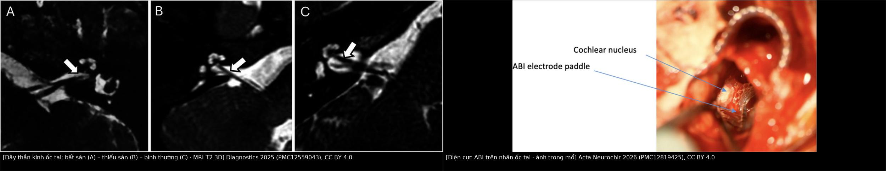
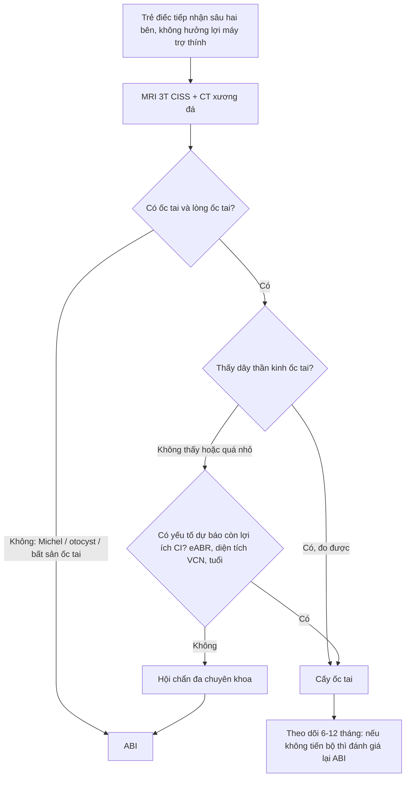
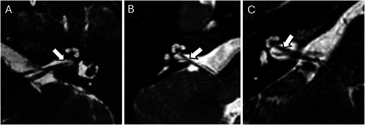
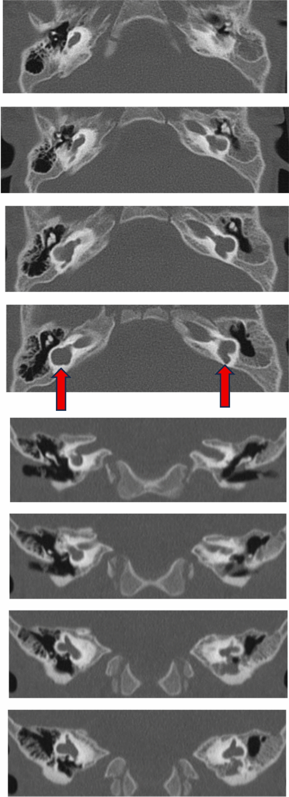
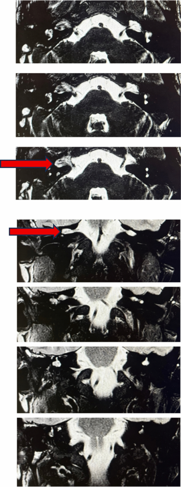

# 703 — Cấy thân não thính giác (ABI) ở trẻ bất sản dây thần kinh ốc tai: chọn bệnh nhi bằng MRI, đặt điện cực lên nhân ốc tai, và đọc lại vị trí điện cực trên CT

**Tags:** `pattern:di-thinh-tiep-nhan` `pattern:bat-san-day-than-kinh-oc-tai` `pattern:di-dang-tai-trong` `vung:tai-trong` `vung:oc-tai` `vung:than-nao` `anatomy:oc-tai` `anatomy:day-than-kinh-VIII` `anatomy:nhan-oc-tai` `protocol:MRI-CISS` `protocol:CT-xuong-da` `protocol:eABR` `score:Sennaroglu` `incidentaloma:khong`
**Mức chắc chắn (certainty):** tổng hợp y văn (literature synthesis) — ghép **loạt 112 trẻ ABI** (Advanced Science 2025, PMC12362790), **tổng quan 15 bài + 38 ca** (Dtsch Arztebl Int 2022, PMC9201461), **tổng quan hệ thống 13 bài về ngôn ngữ** (Braz J Otorhinolaryngol 2022, PMC9760993), **kỹ thuật ABI nhi** (Acta Neurochir 2026, PMC12819425), **số hóa 155 tai dị tật tai trong** (Eur Radiol 2025, PMC12559043), **39 trẻ điếc một bên** (Sci Rep 2021, PMC7870947), **ca nguyên văn có ảnh** thất bại cấy ốc tai rồi chuyển ABI (J Med Case Rep 2026, PMC13374130) và **hai anh em FGF3/LAMM** (Ther Adv Rare Dis 2024, PMC11526279). Không có ca do nhóm tự chụp.

> **Câu hỏi thực hành:** bé trai **20 tháng**, **ABR hai tai không có sóng V ở 100 dB nHL**, không hưởng lợi máy trợ thính. MRI 3T CISS **không thấy bó dây thần kinh ốc tai đi vào lỗ ốc tai hai bên**; CT xương đá: ốc tai hai bên **nhỏ, vách không hoàn chỉnh**; không có bất thường não. Gia đình hỏi: **có cấy ốc tai được không, nếu không thì làm gì, cháu sẽ nghe được đến đâu?**
> Bài chốt **ba quyết định**: **(1) đích của can thiệp đổi từ ốc tai sang nhân ốc tai** — khi không có dây thần kinh ốc tai hữu dụng, cấy ốc tai không có đường dẫn điện, phải **cấy thân não thính giác (auditory brainstem implant, ABI)**; **(2) hình ảnh quyết định cả chỉ định lẫn đường mổ** — MRI đếm bó dây, CT lập bản đồ xương đá và lỗ Luschka, **eABR trong mổ** xác nhận từng điện cực; **(3) kỳ vọng phải nói bằng số** — ABI cho **nhận biết âm thanh** gần như chắc chắn, **CAP trung bình 3,57** và chỉ **38,24% đạt CAP ≥ 5** (hiểu lời nói), trẻ **< 3 tuổi** và **không có khuyết tật kèm** làm tốt hơn; tại một trung tâm lớn **~50% trẻ cấy không dùng thiết bị** — tư vấn trung thực là một phần của chỉ định.

## 1. Tổng quan bệnh học – cơ chế hình ảnh: vì sao phải nhảy qua ốc tai, và vì sao hình ảnh là cửa vào

- **Vì sao ABI hoạt động (giải phẫu – sinh lý):** đường thính giác ngoại vi biến âm thanh thành điện thế ở **tế bào lông**, dẫn truyền qua **hạch xoắn – dây thần kinh VIII (nhánh ốc tai)** tới **phức hợp nhân ốc tai (cochlear nucleus complex)** ở **mặt lưng–bên thân não, ngang cầu–hành**. ABI đặt một **mảng điện cực (electrode paddle)** ngay trên nhân này, **bỏ qua cả ốc tai lẫn dây thần kinh ốc tai**. Vì vậy ABI là lựa chọn khi **không có ốc tai để đặt điện cực** hoặc **không có dây thần kinh để dẫn điện**.
- **Tổ chức tần số (tonotopy) vẫn còn ở nhân ốc tai:** tần số **cao xếp phía lưng**, **tần số thấp phía bụng** — nên vị trí mảng điện cực theo trục lưng–bụng quyết định **cao độ** mà trẻ nghe được; đây là lý do phải chỉnh vị trí điện cực **theo đáp ứng eABR từng điện cực**, không phải "đặt vào là xong".
- **Ai là ứng viên (số liệu):** khoảng **1–10%** trẻ điếc bẩm sinh không thể cấy ốc tai vì thiếu ốc tai hoặc thiếu/hỏng dây thần kinh ốc tai (PMC9201461). CND gặp ở **25–48%** trẻ điếc **một bên** bẩm sinh và **15,4%** trẻ điếc **hai bên nặng–sâu** (PMC12382941). Trong **39 trẻ** điếc một bên bẩm sinh không hội chứng, **35,9% (14/39)** có CND — **7 bất sản, 7 thiếu sản** — và **mọi ca bất sản đều điếc sâu** (PMC7870947). Trong **155 tai** dị tật tai trong, bất thường **dây thần kinh ốc tai chiếm 66%** và **dây tiền đình ốc tai 54%** (PMC12559043) — tức **hình thái dây thần kinh**, không chỉ hình thái xương, mới là biến quyết định.
- **TẠI SAO MRI chứ không phải CT (vật lý):** trên **CT xương đá**, xương đặc **+700 đến +2.000 HU** nên chỉ thấy **lỗ ốc tai** và **ống tai trong** — suy ra dây thần kinh một cách gián tiếp. Trên **MRI chuỗi steady-state nặng T2 (CISS/FIESTA/DRIVE)**, **dịch não tủy sáng tuyệt đối** còn **sợi trục có myelin (ít proton tự do) tối** → thấy **các bó dây thần kinh như những "vạch đen" trong dịch sáng**. Bình thường có **4 bó** trong ống tai trong (VII, VIII–ốc tai, VIII–tiền đình trên, VIII–tiền đình dưới); **bó trước–dưới** là dây thần kinh ốc tai. Đây là lý do **"CT bình thường" không loại trừ CND** — ngưỡng CT và phân độ ống tai trong đã chốt ở bài [1971](../1971-bat-san-giam-san-day-than-kinh-oc-tai/lesson.md) (**lỗ ốc tai ≤ 1,2 mm**, **IAC < 3,9 mm**).
- **TẠI SAO đúng tuổi lại quan trọng (bằng số):** châu Âu duyệt ABI cho trẻ **> 18 tháng**, đồng thuận nghiêng **18–24 tháng** — cân giữa **độ dẻo thần kinh tối đa** và **thể tích máu/dịch não tủy còn nhỏ ở trẻ < 1 tuổi** (PMC12819425). Trong **112 trẻ**, cấy **< 3 tuổi** có **CAP 5,12 so với 4,05** ở 24 tháng (p = 0,032) và **PTA tốt hơn** (40,25 so với 47,13 dB, p = 0,035) (PMC12362790). Tổng quan **15 bài + 38 ca** cũng kết luận cấy **< 3 tuổi** có lợi và **trẻ có khuyết tật kèm** kém hơn rõ rệt (PMC9201461).
- **TẠI SAO kết quả "khiêm tốn" hơn cấy ốc tai:** điện cực ABI nằm **trên bề mặt thân não**, không có **tổ chức tần số chính xác như ốc tai** và dòng điện lan rộng → **nhận biết âm thanh tốt**, nhưng **hiểu lời nói** là kỹ năng khó nhất (PMC9760993). Con số thực tế: **CAP trung bình 3,57 (SD 1,04)**, **38,24% đạt CAP ≥ 5** (PMC9201461); trong loạt 112 trẻ, **CAP 4,36 ở 24 tháng và 6,00 ở 48 tháng**, **PTA có trợ thính 30,10 dB ở 48 tháng** (PMC12362790). Ngược lại, tại một trung tâm chuyên khoa, **~50% trẻ cấy không dùng thiết bị** (PMC12819425) — nên **ABI không phải "lựa chọn an toàn hơn"**, mà là can thiệp **có chỉ định chặt và tư vấn dài**.

## 2. Mẫu hình + chẩn đoán phân biệt theo giải phẫu (gamut)

- **Mẫu hình cốt lõi:** trẻ **điếc tiếp nhận nặng–sâu hai bên**, **không hưởng lợi máy trợ thính**, có **một trong các tổn thương sau** trên hình ảnh — và câu hỏi không còn là "có điếc không" mà là **"còn chỗ nào để kích thích thần kinh không"**.
- **Gamut theo vị trí tổn thương (từ ngoài vào trong):**
  - **Mê nhĩ – ốc tai (không có "cửa vào"):** **bất sản mê nhĩ (labyrinthine aplasia/Michel)** — không có ốc tai, tiền đình, ống bán khuyên; **u nang tai trong thô sơ (rudimentary otocyst)** — chỉ một nang nhỏ, không có ống tai trong; **bất sản ốc tai** — tiền đình còn, ốc tai mất; **hang chung (common cavity)** — một buồng nang chung ốc tai–tiền đình.
  - **Ốc tai dị tật nhưng còn lòng (có thể vẫn cấy ốc tai):** **giảm sản ốc tai (CH I–IV)**, **bất sản phần (IP I–III)**, **ốc tai rỗng/xơ hóa (labyrinthitis ossificans)** sau viêm màng não.
  - **Dây thần kinh ốc tai:** **bất sản (aplasia)** — không có bó trước–dưới; **thiếu sản (hypoplasia)** — có bó nhưng nhỏ hơn dây mặt; thường đi kèm **hẹp lỗ ốc tai** (10/14 ca, p = 0,001 — PMC7870947).
  - **Thân não:** **bất thường vị trí nhân ốc tai/lỗ Luschka** trong một số hội chứng (FGF3/LAMM) — ảnh hưởng trực tiếp **chỗ đặt điện cực**.
  - **Ngoài bẩm sinh:** **NF2 – u bao dây thần kinh tiền đình ốc tai hai bên** ở trẻ lớn/vị thành niên (chỉ định nguyên thủy của ABI).
- **Mnemonic "MACC" cho nhóm chỉ định chắc chắn:** **M**ichel (bất sản mê nhĩ) – **A**plasia cochleae (bất sản ốc tai) – **C**ochlear nerve aplasia (bất sản dây thần kinh ốc tai) – **C**ommon cavity khi không có dây. Ba nhóm đầu là **chỉ định chắc chắn**; **giảm sản ốc tai, hang chung, thiếu sản dây thần kinh ốc tai** là **chỉ định có thể** — phải cân nhắc từng ca (PMC12819425).
- **Điều KHÔNG phải chỉ định ABI:** **CND một bên** (tai kia còn nghe — ưu tiên chỉnh âm, theo dõi); **ốc tai dị tật nhưng còn lòng và còn dây thần kinh đo được** (cấy ốc tai vẫn là lựa chọn đầu); **điếc do ANSD với tai trong và dây bình thường** (bài [478](../478-diec-tiep-am-ansd-tre/lesson.md)); **trẻ quá nhỏ < 12–18 tháng** khi chưa đủ dữ liệu hành vi và cân nặng/thể tích máu (thận trọng theo tuổi duyệt).

## 3. Bảng so sánh phân biệt (ma trận đối chiếu)

| Thực thể (entity) | Hình ảnh điển hình (CT / MRI) | Chốt vào (rule-in) | Chốt loại (rule-out) | Gợi ý xác nhận |
|---|---|---|---|---|
| **Bất sản mê nhĩ (Michel) / u nang thô sơ** | CT: **không có ốc tai, tiền đình, ống bán khuyên** (Michel) hoặc **nang vài mm, không ống tai trong** (otocyst); MRI: **không có dịch nội dịch** | **Mất toàn bộ mê nhĩ trên CT + không có dây VIII trên MRI** | Còn ốc tai dù nhỏ → không phải Michel | CT 0,6 mm + MRI CISS; tư vấn **ABI là lựa chọn duy nhất** |
| **Bất sản ốc tai** | CT: **không thấy ốc tai**, **tiền đình và ống bán khuyên còn đúng vị trí**; MRI: **không có dây ốc tai** | **Mất ốc tai nhưng còn tiền đình** | Hang chung (một buồng chung) → thể khác | CT + MRI; **ABI** |
| **Hang chung (common cavity)** | CT: **một buồng nang chung** ốc tai–tiền đình, **có ống tai trong đi vào giữa buồng**; MRI: đếm bó dây | **Buồng chung + có dây thần kinh ốc tai đo được** → có thể **cấy ốc tai**; **không có dây** → **ABI** | Otocyst (không có IAC) → ABI chắc chắn | MRI CISS là trọng tài; eABR xuyên màng nhĩ khi còn nghi ngờ |
| **Bất sản dây thần kinh ốc tai hai bên** | MRI: **không có bó trước–dưới** trong ống tai trong trên **≥ 2 lát liên tiếp**; CT: **lỗ ốc tai ≤ 1,2 mm**, IAC có thể hẹp | **Không thấy dây ốc tai + lỗ ốc tai hẹp** | Thấy bó mảnh → **thiếu sản**, không phải bất sản | MRI 3T CISS 0,5–0,8 mm + tái tạo oblique sagittal (bài 1971) |
| **Thiếu sản dây thần kinh ốc tai** | MRI: **đủ 4 bó nhưng bó ốc tai nhỏ hơn dây mặt**; CT: lỗ ốc tai **1,2–1,9 mm** | **Dây ốc tai nhỏ hơn dây VII rõ rệt** + lỗ ốc tai hẹp vừa | Dây ốc tai bằng dây VII → bình thường | Đo diện tích VCN (mm²), tỷ lệ VCN/FN; **CI trước, ABI nếu thất bại** |
| **Xơ hóa mê nhĩ sau viêm màng não** | MRI T2: **mất tín hiệu dịch trong ốc tai/tiền đình**, có thể canxi hóa; CT: **ốc tai đặc** | **Tiền sử viêm màng não + mất tín hiệu dịch** | Dịch sáng toàn bộ ốc tai → chưa xơ hóa | MRI T2 3D; **cấy ốc tai sớm trước khi xơ hóa**, ABI khi lòng ốc tai mất hoàn toàn |
| **NF2 – schwannoma tiền đình ốc tai hai bên** | MRI T1 sau tiêm: **khối trong ống tai trong/góc cầu–tiểu não** hai bên; CT: **giãn ống tai trong** | **U hai bên + điếc sâu** | U một bên + tai kia bình thường → không phải NF2 | MRI sọ–nền sọ; ABI đặt **cùng lúc hoặc sau mổ u** (chỉ định nguyên thủy) |

*Trái: **A** bất sản — không có bó dây thần kinh ốc tai đi vào lỗ ốc tai; **B** thiếu sản — có bó nhưng nhỏ; **C** bình thường (Eur Radiol 2025, PMC12559043, CC BY 4.0). Phải: **mảng điện cực ABI đặt trong hõm bên (lateral recess) trên nhân ốc tai** (Acta Neurochir 2026, PMC12819425, CC BY 4.0). Ảnh ghép letterbox, không crop.*

### Ba câu hỏi phải trả lời trước khi gọi ABI

1. **Còn dây thần kinh ốc tai không?** Nếu **có và đo được kích thước** → **cấy ốc tai** vẫn là lựa chọn đầu (kể cả khi ốc tai dị tật); nếu **không có** → ABI.
2. **Còn lòng ốc tai để đặt điện cực không?** Nếu **ốc tai đặc/xơ hóa** hoặc **không có ốc tai** → ABI.
3. **Có chống chỉ định thần kinh – gây mê – nhiễm trùng không?** Bất thường thân não, động kinh chưa kiểm soát, nhiễm trùng da đầu, trẻ quá nhỏ/thiếu cân → hoãn và hội chẩn.

## 4. Protocol chụp + hệ phân độ + quy trình

### 4.1 Hình ảnh trước can thiệp (bắt buộc cả hai)

| Chuỗi | Thông số | Trả lời câu hỏi gì |
|---|---|---|
| **MRI 3T CISS/FIESTA/DRIVE** | Lát **0,5–0,8 mm**, axial + **tái tạo oblique sagittal vuông góc ống tai trong**, FOV hẹp | **Đếm 4 bó** trong ống tai trong; đo **diện tích dây ốc tai**, tỷ lệ **VCN/FN**; xác định **ống tai trong có thông**; tìm bất thường thân não |
| **CT xương đá** | Lát **0,5–0,6 mm**, bone kernel, axial + coronal | **Michel/otocyst/bất sản ốc tai/hang chung**; đo **lỗ ốc tai**, **IAC**, **chiều cao ốc tai**; bản đồ **xoang sigma, trần tai giữa, ống thần kinh mặt, tĩnh mạch cảnh** cho đường mổ |
| **Thính lực** | ABR/ASSR, trở kháng nhĩ lượng, máy trợ thính thử | Xác nhận **điếc sâu hai bên** và **không hưởng lợi máy trợ thính** |
| **eABR xuyên màng nhĩ (khi còn nghi ngờ)** | Kích thích mỏm ốc tai qua màng nhĩ | Đánh giá **chức năng dây ốc tai còn lại** trước khi quyết định CI/ABI (PMC12819425) |

- **Ngưỡng định lượng dùng lại từ bài 1971** (không lặp lại toàn bộ): **lỗ ốc tai ≤ 1,2 mm** là hẹp (Se 84% / Sp 98% cho CND); **IAC < 3,9 mm**; **bình thường 4 bó**, CND trung bình **1,71 ± 0,80 bó**. Bài này **không** thay ngưỡng đó — chỉ dùng để chọn **CI hay ABI**.
- **Số liệu hình thái để nhớ:** **bất sản lỗ ốc tai OR 2,562 (p = 0,015)** và **bất sản dây ốc tai OR 2,599 (p = 0,014)** là yếu tố dự báo **mức điếc** mạnh hơn hình thái ốc tai (PMC12559043); **76,7%** trẻ trong loạt này được chụp **3T** — nên **1,5T không đủ** cho ca nghi bất sản dây.

### 4.2 Phân loại dùng để gọi tên (Sennaroglu)

- **Michel**, **u nang thô sơ (rudimentary otocyst)**, **bất sản ốc tai**, **hang chung**, **giảm sản ốc tai CH I–IV**, **bất sản phần IP I–III**, **bất thường dây thần kinh (bất sản/thiếu sản)** — dùng đúng tên để hội chẩn thống nhất (PMC5635626).
- **Phân loại này quyết định chỉ định:** nhóm **Michel/otocyst/bất sản ốc tai** đi thẳng **ABI**; nhóm **hang chung/CH/IP** phải **đếm dây** trước.

### 4.3 Quyết định CI hay ABI (sơ đồ hội chẩn, không phải phác đồ cứng)

- **Số liệu đỡ cho nhánh "CI vẫn có ích":** meta-analysis **16 nghiên cứu, 248 trẻ** CND cho thấy **cải thiện nhận thức lời nói sau cấy ốc tai, SMD 2,18 (95% CI 1,68–2,69)** — nên **"không thấy dây trên MRI" không đồng nghĩa "CI vô ích"** (PMID 39520244).
- **Số liệu đỡ cho nhánh "ABI":** **38,24%** trẻ ABI đạt **CAP ≥ 5**; **trẻ không có khuyết tật kèm** và **cấy < 3 tuổi** làm tốt hơn (PMC9201461).

### 4.4 Trong mổ và sau mổ (phần hình ảnh)

- **Đường mổ:** **retrosigmoid craniotomy** (ngắn hơn translabyrinthine, giữ tai trong, tránh giới hạn của xương chũm trẻ nhỏ); mốc tìm nhân ốc tai: **lỗ Luschka** (lỗ của hõm bên não thất IV, nhận ra nhờ **đám rối mạch mạc** và **tiểu thùy nhộng (flocculus)**), **dây IX ở bờ đuôi**, **tĩnh mạch chạy từ cụm IX–X–XI tới VII–VIII** là sàn hõm bên, và **tĩnh mạch nhỏ trên bề mặt thân não** đánh dấu nhân ốc tai (PMC12819425).
- **eABR trong mổ:** chỉnh **vị trí mảng điện cực** theo đáp ứng từng điện cực; loạt 112 trẻ phải **chỉnh vị trí trung bình 2,3 lần**, **eABR% trong mổ 72,73 ± 17,99%**, và **eABR ≥ 60%** dự báo kết quả tốt hơn (CAP 4,79 so với 3,17 ở 24 tháng, p = 0,0035) (PMC12362790).
- **CT sau mổ (khi cần):** **MPR theo đường McRae**, đo **góc V kiểu I–IV** (nhìn nghiêng) và **góc T kiểu A–D** (nhìn sau), khoảng cách **D1 từ basion** và **D2 từ đường giữa**; ở trẻ các khoảng cách này **nhỏ hơn 8–42%** so với người lớn, và **vị trí mảng điện cực khác nhau nhiều, có thể giải thích khác biệt kết quả** (PMID 28700445). **Chỉ định chụp CT sau mổ thường quy: chưa rõ — cần tra**; hiện dùng khi **nghi di lệch paddle** (rò dịch não tủy, kết quả tụt) hoặc trước khi lập trình lại.
- **Biến chứng phải nói trước mổ:** **rò dịch não tủy** là biến chứng đáng kể hay gặp nhất; ngoài ra **liệt dây thần kinh sọ**, **pseudomeningocele**, **giãn não thất**, **kích thích không do thính giác (non-auditory stimulation)**, **viêm màng não**, **di lệch thiết bị** (PMC12819425). Nhiễm ABI ở trẻ **hiếm**: tổng quan phạm vi **9 nghiên cứu, 12 ca** — **5 ca chỉ kháng sinh**, **3 ca cần dẫn lưu dịch não tủy**, **4 ca phải mổ**, và **chưa có ca nào phải tháo thiết bị vì nhiễm** (PMID 42896075).
- **Phục hồi chức năng là phần của "protocol":** trị liệu thính giác–lời nói **tích cực, kéo dài nhiều năm**; hỗ trợ **giao tiếp thị giác** vẫn thiết yếu vì kỹ năng hiểu lời nói phát triển chậm (PMC9760993).

## 5. Biến thể bình thường và cạm bẫy

- **"Không thấy dây" trên một chuỗi ≠ bất sản:** bó dây thần kinh ốc tai chỉ **0,2–0,5 mm**, nên **lát > 1 mm, 1,5T, nhiễu chuyển động** dễ tạo **bất sản giả**. Luôn **đếm trên ≥ 2 lát liên tiếp** và **tái tạo oblique sagittal**; nếu nghi ngờ, **eABR xuyên màng nhĩ** là bằng chứng chức năng (PMC12819425).
- **Hẹp lỗ ốc tai ≠ mất dây:** **10/14** ca CND có hẹp lỗ ốc tai (p = 0,001), nhưng **chỉ 3/14** có hẹp ống tai trong (PMC7870947) — **hẹp lỗ ốc tai chỉ là dấu gián tiếp**, MRI mới là trọng tài.
- **Dây thần kinh mặt đi sát dây ốc tai:** đặt điện cực lệch hoặc dòng lan → **giật mặt, chóng mặt** (kích thích không do thính giác); xử trí bằng **tắt điện cực/đổi tham số**, không vội mổ lại (PMC12819425).
- **Thân não không "chuẩn" ở một số hội chứng:** trong **FGF3/LAMM**, **lỗ Luschka và nhân ốc tai nằm lệch xuống thấp**; đặt điện cực theo vị trí chuẩn **không có đáp ứng**, phải đặt **caudal và medial hơn** (PMC11526279). Đây là lý do phải **đọc MRI thân não**, không chỉ đọc tai trong.
- **Cạm bẫy "đã cấy ốc tai thất bại thì hết cách":** ca nguyên văn cho thấy **CI thất bại → tháo → ABI** vẫn cho **lợi ích thính giác khiêm tốn nhưng có nghĩa** (phân biệt từ 1–3 âm tiết, hiểu câu nhờ đọc hình miệng); ngược lại **xơ hóa mê nhĩ sau nhiễm/tháo** làm **cấy lại vô vọng** — nên **kiểm soát nhiễm trùng và quyết định sớm** (PMC13374130).
- **Cạm bẫy tâm lý – tư vấn:** hứa "nghe và nói được như trẻ CI" là **sai số liệu** (CAP trung bình 3,57; chỉ 38,24% đạt CAP ≥ 5; ~50% không dùng thiết bị ở một trung tâm) — tư vấn **kỳ vọng thấp–trung bình** giúp gia đình gắn bó với phục hồi chức năng tốt hơn.

## 6. Tự lượng giá — Blind Quiz

**Ca 1 — Ba bệnh nhi điếc tiếp nhận sâu, mỗi bé một lát MRI 3T CISS vuông góc ống tai trong (A, B, C). Không có thông tin tuổi/giới của từng bé trong hình gốc:**

- Gợi ý: cả ba ảnh đều ở **cùng mặt phẳng qua ống tai trong**; mũi tên trắng chỉ **bó dây thần kinh ốc tai**.
- Câu hỏi: (1) Ở mỗi ảnh, **có hay không** bó dây thần kinh ốc tai? (2) Ảnh nào là **bất sản**, **thiếu sản**, **bình thường**? (3) Với ảnh **A** hai bên, bước tiếp theo là **cấy ốc tai hay ABI**?

<b>Bấm để hiện đáp án</b>

- **A = bất sản:** **không có bó** đi vào lỗ ốc tai — ô trước–dưới của ống tai trong trống.
- **B = thiếu sản:** **có bó** nhưng **nhỏ hơn hẳn** dây thần kinh mặt cùng bên.
- **C = bình thường:** **4 bó** rõ, bó ốc tai **tương đương** dây mặt.
- Nếu **A hai bên**: **không có đường dẫn điện từ ốc tai** → **ABI** là lựa chọn; nhưng phải **đo lại diện tích VCN/tỷ lệ VCN/FN** và **eABR** trước khi loại bỏ hoàn toàn cấy ốc tai (dữ liệu 248 trẻ vẫn cho thấy cải thiện sau CI — PMID 39520244).
- Nguồn ảnh: *European Radiology* 2025 (**PMC12559043**), **CC BY 4.0**; ba bệnh nhi khác nhau, không phải ba lát của một bé.

**Ca 2 — Trẻ 17 tuổi (người Thái Lan), điếc sâu hai bên từ 5 tháng tuổi; CT xương đá 8 lát liên tiếp từ trên xuống, chụp trước lần cấy ốc tai đầu tiên:**

- Gợi ý: mũi tên đỏ chỉ **ốc tai** mỗi bên; chú ý **số vòng**, **vách giữa các vòng** và **tiền đình**.
- Câu hỏi: (1) Mô tả bất thường **tai phải** và **tai trái**. (2) Hai tai có **cùng một kiểu dị tật** không? (3) Với hình ảnh này, **cấy ốc tai hai bên** có hợp lý không?

<b>Bấm để hiện đáp án</b>

- **Tai phải:** **ốc tai giảm sản**, **vòng đáy giãn**, **vách giữa các vòng không hoàn chỉnh** (kiểu Mondini/bất sản phần II), **tiền đình dạng nang**, ống bán khuyên giãn.
- **Tai trái:** **bất sản ốc tai** với **hang chung** gồm tiền đình và ống bán khuyên bên.
- **Hai tai khác kiểu** — dị tật **không đối xứng**. CT **một mình không đủ** để chọn can thiệp: MRI của ca này cho thấy **thiếu sản dây thần kinh ốc tai bên phải** và **bất sản bên trái** → **cấy ốc tai phải vẫn làm được** (bé được cấy lúc **15 tháng**, đạt **CAP 8** trước khi mất theo dõi); **tai trái không cấy được** vì **không có dây thần kinh**.
- Vì vậy đáp án đúng là **không thể quyết định chỉ bằng CT**: phải **đếm dây thần kinh trên MRI**; nếu **bất sản hai bên** mới đi thẳng **hội chẩn ABI**.
- Nguồn ảnh: *Journal of Medical Case Reports* 2026 (**PMC13374130**), **CC BY-NC-ND 4.0** (nguyên bản, không crop/không ghép) — ca nguyên văn, 8 lát của **một bệnh nhi**.

**Ca 3 — Cùng bệnh nhi trên, sau khi **tháo cấy ốc tai phải** vì viêm mô chũm–tai mạn không kiểm soát, đang được đánh giá ABI. MRI T2 8 lát qua ống tai trong:**

- Gợi ý: mũi tên đỏ chỉ **ốc tai/tiền đình phải**; so sánh **độ sáng của dịch** với bên trái và với dịch não tủy.
- Câu hỏi: (1) Vì sao ốc tai phải **mất tín hiệu sáng**? (2) Dấu hiệu này thay đổi chỉ định thế nào? (3) Cần chuẩn bị gì khác trước ABI?

<b>Bấm để hiện đáp án</b>

- **Mất tín hiệu dịch trong ốc tai và tiền đình phải** = **xơ hóa mê nhĩ (labyrinthine ossificans)** sau can thiệp/nhiễm — tổ chức xơ–xương lấp lòng ốc tai, không còn dịch để điện cực "nhìn thấy" trên T2.
- Hệ quả: **không còn lòng ốc tai** cho điện cực → **cấy ốc tai lại gần như vô vọng**, chuyển **ABI**; nếu còn một phần lòng, phải mổ **sớm** trước khi xơ hóa hoàn toàn.
- Chuẩn bị khác: **đếm bó dây trên CISS**, **đánh giá thân não**, **điều trị/loại trừ nhiễm trùng vết mổ**, tư vấn **kỳ vọng CAP** và **khả năng không dùng thiết bị**.
- Kết cục của ca: **cấy lại ốc tai phải thất bại vì xơ hóa mê nhĩ trong mổ**, tai trái **bất sản dây thần kinh** → **ABI cứu vãn**, kích hoạt sau mổ **1 tháng**; bé **phân biệt được từ 1–3 âm tiết** nhưng **hiểu câu vẫn phải đọc hình miệng** — đúng mức kỳ vọng "khiêm tốn nhưng có ý nghĩa" của ABI.
- Nguồn ảnh: *Journal of Medical Case Reports* 2026 (**PMC13374130**), **CC BY-NC-ND 4.0** (nguyên bản, không crop/không ghép).

## 7. Câu hỏi nghiên cứu & điểm chưa đồng thuận (tính đến 11/2026)

1. **[Tranh cãi] Ở trẻ điếc hai bên có bất sản dây thần kinh ốc tai trên MRI, cấy ốc tai trước có cải thiện nhận thức lời nói so với ABI trước hay không?**
   - **Đã biết:** meta-analysis **248 trẻ** CND cho thấy cải thiện sau cấy ốc tai (**SMD 2,18; 95% CI 1,68–2,69**), nhưng gộp cả **thiếu sản** và **bất sản** (PMID 39520244); **41,7%** nhà lâm sàng vẫn chọn cấy ốc tai cho **bất sản**, trong khi **38,24%** trẻ ABI đạt **CAP ≥ 5** (PMC12382941, PMC9201461).
   - **Chưa rõ:** không có thử nghiệm ngẫu nhiên; **nhóm bất sản thuần** chưa được phân tầng theo **diện tích VCN/eABR**, nên không biết trẻ nào "đáng thử CI" trước ABI.
   - **Hướng nghiên cứu:** registry tiến cứu phân tầng theo **hình thái dây (bất sản/thiếu sản) + eABR + tuổi**, outcome **CAP/MAIS ở 24 tháng**.
   - **Nguồn:** PMC12382941 (2025); PMC9201461 (2022); DOI 10.1002/lary.31888 (2025).

2. **[Khoảng trống] Ngưỡng nào trên MRI/CT dự báo đủ chính xác để chọn ABI thay vì cấy ốc tai — và các trung tâm có đo giống nhau không?**
   - **Đã biết:** **bất sản lỗ ốc tai OR 2,562** và **bất sản dây ốc tai OR 2,599** dự báo mức điếc (PMC12559043); **hẹp lỗ ốc tai** đi với CND **10/14 ca** (p = 0,001) nhưng **chỉ 3/14** có hẹp ống tai trong (PMC7870947); lỗ ốc tai **1,42 ± 0,37 mm** ở bệnh so với **2,05 ± 0,24 mm** ở chứng (PMC13464796).
   - **Chưa rõ:** **định nghĩa "thiếu sản"** và cách đo **diện tích VCN** chưa thống nhất; **76,7%** ca trong một loạt được chụp **3T**, phần còn lại 1,5T — độ phân giải khác nhau làm ngưỡng không chuyển được giữa các trung tâm (PMC12559043).
   - **Hướng nghiên cứu:** nghiên cứu độ chính xác chẩn đoán **đa trung tâm, đọc mù**, cùng protocol **CISS 0,5–0,8 mm** và cùng cách đo.
   - **Nguồn:** PMC12559043 (2025); PMC7870947 (2021); PMC13464796 (2026).

3. **[Khác biệt thực hành] Tuổi cấy và theo dõi hình ảnh sau ABI: cấy < 3 tuổi, và có nên chụp CT kiểm tra vị trí điện cực thường quy?**
   - **Đã biết:** châu Âu duyệt ABI **> 18 tháng**, đồng thuận nghiêng **18–24 tháng** (PMC12819425); **< 3 tuổi** cho **CAP/PTA tốt hơn** (PMC12362790, PMC9201461); **vị trí mảng điện cực** đo trên CT **khác nhau nhiều** và có thể giải thích khác biệt kết quả (PMID 28700445); **eABR trong mổ** phải chỉnh vị trí **trung bình 2,3 lần** (PMC12362790).
   - **Chưa rõ:** **ngưỡng tuổi dưới** an toàn (12–18 tháng) và **lợi ích của CT sau mổ thường quy** so với chỉ chụp khi kết quả tụt/di lệch — chưa có dữ liệu so sánh.
   - **Hướng nghiên cứu:** đoàn hệ tiến cứu đối chiếu **CT thường quy vs CT theo triệu chứng**, outcome **số điện cực hoạt động và CAP sau 12 tháng**.
   - **Nguồn:** PMC12819425 (2026); PMC12362790 (2025); DOI 10.1097/AUD.0000000000000448 (2017).

## Bài liên quan chéo
- [1971 – Bất sản/giảm sản dây thần kinh ốc tai](../1971-bat-san-giam-san-day-than-kinh-oc-tai/lesson.md) (ngưỡng CT, phân độ IAM 0–V, diện tích VCN)
- [702 – Cấy ốc tai ở trẻ điếc do CMV/rubella](../702-oc-tai-nhiem-trung-bao-thai/lesson.md) (MRI CISS trước cấy, EVA, gusher)
- [497 – Theo dõi sau cấy ốc tai ở trẻ](../497-theo-doi-sau-cay-oc-tai-tre/lesson.md) (nhiễm, viêm màng não muộn)
- [692 – Microtia – hẹp ống tai ngoài](../692-microtia-atresia-phuc-hoi-thinh-luc/lesson.md) (điếc dẫn truyền bẩm sinh)
- [720 – Cholesteatoma xương đá](../720-temporal-bone-cholesteatoma/lesson.md) (giải phẫu xương đá, đường mổ)
- [700 – Tổng quan Đầu Cổ](../700-head-neck-overview/lesson.md)

## Ảnh
- `images/703_day-than-kinh_MRI-PMC12559043-Fig3.jpg` — *European Radiology* 2025 (**PMC12559043**), **CC BY 4.0**.
- `images/703_oc-tai_CT-PMC13374130-Fig2.jpg` — *Journal of Medical Case Reports* 2026 (**PMC13374130**), **CC BY-NC-ND 4.0** (nguyên bản, không crop/không ghép).
- `images/703_oc-tai_MRI-PMC13374130-Fig4.jpg` — *Journal of Medical Case Reports* 2026 (**PMC13374130**), **CC BY-NC-ND 4.0** (nguyên bản, không crop/không ghép).
- `images/703_dien-cuc_MO-PMC12819425-Fig5.jpg` — *Acta Neurochirurgica* 2026 (**PMC12819425**), **CC BY 4.0**.
- `images/composite_abi.jpg` — ảnh ghép letterbox từ 2 ảnh trên, **CC BY 4.0** (xem `images/CREDITS.md`).

> Không dùng để chẩn đoán độc lập khi chưa có người hướng dẫn.
