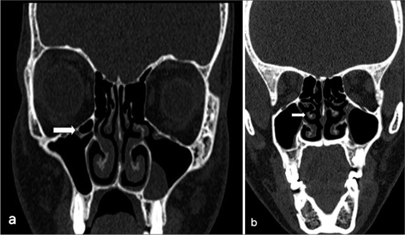
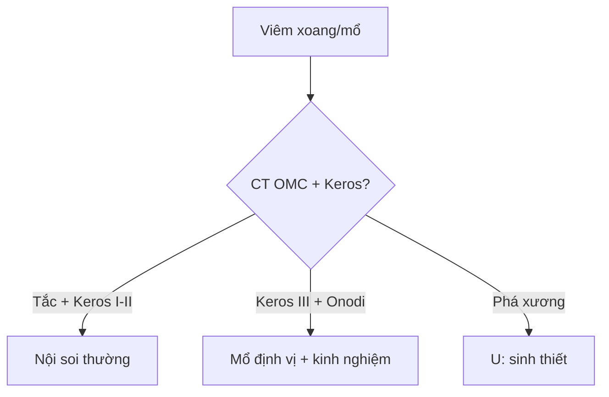

# 710 — Mũi xoang & OMC: Keros, Haller, concha & mổ an toàn / Sinonasal CT

**Tags:** `pattern:mui-xoang` `vung:dau-mat-co` `protocol:CT-mui-xoang`
**Mức chắc chắn (certainty):** tổng hợp y văn (literature synthesis) — nhóm tự biên từ y văn mở, chưa gắn ca nguyên văn đơn lẻ.

## 1. Tổng quan — OMC tắc là viêm, sàng mỏng là hiểm

- Phức hợp lỗ ngách (OMC): mỏm móc + bóng sàng + khe + lỗ xoang hàm — TẠI SAO tắc OMC = viêm hàm-sàng-trán: 3 xoang chung 1 cửa thoát.
- Mảnh sàng ngoài (lamina papyracea) + trần sàng mỏng như giấy — TẠI SAO Keros III (8–16 mm) nguy hiểm nhất: mái sàng sâu + thành bên thấp = dao mổ lạc vào sọ/mắt.
- Haller (dưới ổ mắt), Onodi (quanh thần kinh thị), concha bullosa (cuốn giữa khí hóa) — chèn OMC + lạc đường mổ.

## 2. Gamut tắc mũi/viêm xoang (Gamut)

- **Tắc OMC + mờ hàm-sàng:** viêm xoang mạn — nội soi mở OMC.
- **Haller/Onodi/concha + viêm tái diễn:** biến thể gây tắc — mổ + sửa biến thể.
- **Keros III + Onodi + động mạch sàng:** mổ nguy cơ cao — CT < 1 mm + định vị.
- **Khối + phá xương + chảy máu:** u (inverted papilloma/K) — sinh thiết, đừng nạo viêm mù.

## 3. Bảng so sánh phân biệt (ma trận đối chiếu)

| Thực thể (entity) | Hình ảnh điển hình | Chốt vào (rule-in) | Chốt loại (rule-out) | Gợi ý xác nhận |
|---|---|---|---|---|
| Viêm tắc OMC | **Mờ hàm-sàng + OMC tắc + không phá xương** | **Tắc cửa + mờ theo dẫn lưu** | Phá xương → u | Nội soi + CT |
| Biến thể nguy hiểm | **Haller/Onodi/concha + Keros III** | **Biến thể + viêm tái diễn** | Không biến thể → viêm đơn | CT 1 mm + bản đồ mổ |
| Keros sâu | **Mái sàng 8–16 mm + sàng thấp** | **Keros III = dao gần sọ** | Keros I (1–3 mm) → an toàn | Định vị + mổ kinh nghiệm |
| U xoang | **Khối + phá xương + chảy máu mũi 1 bên** | **Phá xương + đơn bên + lớn tuổi** | Không phá → viêm | Sinh thiết + MRI |

*(a) axial + (b) coronal: tế bào dưới ổ mắt (mũi tên) + polyp hàm trái. Nguồn: Taneja et al., J Clin Imaging Sci 2024 Fig. 4, CC BY-NC-SA 4.0.*

## 4. Protocol CT mũi xoang

- **CT coronal + axial + sagittal lát ≤ 1 mm (xương + mô mềm)** trước mọi mổ xoang; đo Keros + liệt kê biến thể.

## 5. Cạm bẫy

- **Lát cắt > 1,5 mm** giả khuyết sàng/giấy — coronal mỏng mới kết luận.
- **Onodi bỏ sót** cắt vào thần kinh thị — đọc axial + sagittal mọi ca mổ bướm.
- **Nấm > 70 HU tưởng máu/u** — vôi nấm + black turbinate là Mucor (bài 715).

## 6. Tự lượng giá — Blind Quiz

**Ca 1 — Viêm hàm trái tái diễn. Đọc CT.**

- Hỏi: tế bào dưới ổ mắt là gì? Có gây tắc không? Keros cần đo thêm gì?

<b>Bấm để hiện đáp án</b>

- Dấu hiệu (findings): **tế bào Haller** (dưới ổ mắt, mũi tên) + dày niêm mạc hàm trái.
- Chẩn đoán (diagnosis): **viêm xoang do biến thể Haller chèn OMC** — mổ mở + lấy biến thể (đo Keros + Onodi trước mổ!).
- Nguồn: Taneja et al., Fig. 4, CC BY-NC-SA 4.0.

**Ca 2 — Mổ sàng + mù đột ngột 1 bên:** tổn thương gì? Biến thể nào? *(Bảng mục 3.)*

<b>Bấm để hiện đáp án</b>

- **Thần kinh thị trong tế bào Onodi:** đọc Onodi + định vị trước mọi mổ bướm/sàng sau.

## Bài liên quan chéo
- [700 – Tổng quan Đầu Cổ](../700-head-neck-overview/lesson.md)
- [715 – Viêm/nấm xoang (dự kiến viết sau)]
- [235 – Thái dương & xoang](../235-xuong-thai-duong-xoang/lesson.md) (nấm > 100 HU)

> Không dùng để chẩn đoán độc lập khi chưa có người hướng dẫn.
