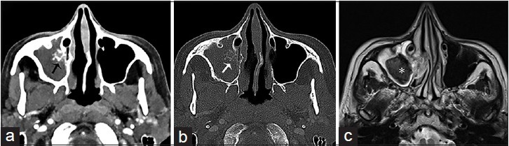
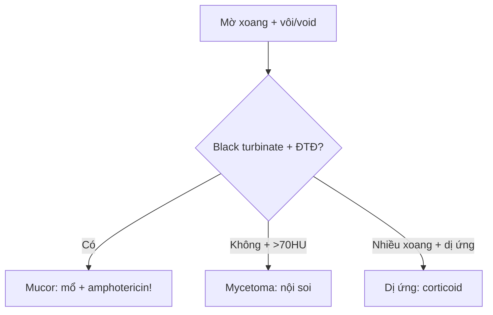

# 715 — Viêm & nấm xoang: mycetoma, dị ứng & Mucor xâm lấn / Fungal sinusitis

**Tags:** `pattern:viem-nam-xoang` `vung:dau-mat-co`
**Mức chắc chắn (certainty):** tổng hợp y văn (literature synthesis) — nhóm tự biên từ y văn mở, chưa gắn ca nguyên văn đơn lẻ.

## 1. Tổng quan — miễn dịch quyết định xâm lấn + kim loại quyết định tín hiệu

- Nấm bóng (mycetoma, Aspergillus, miễn dịch thường): búi sợi + canxi/kim loại — TẠI SAO **> 70 HU + T2 void**: oxalate canxi + sắt/mangan + không nước tự do.
- Mucor xâm lấn cấp (đái tháo đường, < 4 tuần, tử vong 50–80%): xâm mạch — TẠI SAO **black turbinate (cuốn không ngấm)** + lan mỡ quanh xoang + xoang hang: hoại tử thiếu máu do tắc mạch.
- Dị ứng (atopy): nhầy đặc kim loại — T2 void + giãn xoang + không ngấm trong (viền ngấm!).

## 2. Gamut mờ xoang 1 bên (Gamut)

- **> 70 HU + vôi + viêm mạn 1 xoang hàm:** mycetoma — nội soi lấy bóng nấm.
- **Đái tháo đường + black turbinate + lan hốc mắt/sọ:** Mucor cấp — mổ cắt lọc + amphotericin tối khẩn!
- **Dị ứng + nhiều xoang + T2 void + giãn:** dị ứng — corticoid + phẫu thuật dẫn lưu.
- **Phá xương + khối + chảy máu:** u — sinh thiết (đừng nạo nấm mù!).

## 3. Bảng so sánh phân biệt (ma trận đối chiếu)

| Thực thể (entity) | Hình ảnh điển hình | Chốt vào (rule-in) | Chốt loại (rule-out) | Gợi ý xác nhận |
|---|---|---|---|---|
| Mycetoma | **> 70 HU + vôi + 1 xoang + T2 void** | **Vôi + miễn dịch thường + mạn** | Black turbinate → Mucor | Nội soi lấy + cấy |
| Mucor xâm lấn | **Black turbinate + lan mỡ/hốc mắt + ĐTĐ** | **Không ngấm + cấp + suy giảm MD** | Vôi đơn độc → mycetoma | Mổ + amphotericin tối khẩn |
| Dị ứng | **Nhiều xoang + T2 void + giãn + viền ngấm** | **Atopy + 2 bên + nhầy đặc** | Phá xương + khối → u | Corticoid + phẫu thuật |
| U xoang | **Khối + phá xương + chảy máu 1 bên** | **Phá + khối + lớn tuổi** | Vôi + void → nấm | Sinh thiết + MRI |

*(a–b) CT vôi + viêm xương; (c) T2 void + niêm mạc phù. Nguồn: Gavito-Higuera et al., J Clin Imaging Sci 2016 Fig. 3, CC BY-NC-SA 3.0.*

## 4. Protocol mũi xoang nấm

- **CT không tiêm (HU!) + MRI (T2 void + ngấm) + đường máu + nội soi sinh thiết** khi 1 xoang + vôi/void; ĐTĐ + black turbinate = tối khẩn.

## 5. Cạm bẫy

- **Dịch cô đặc mạn** giả máu/u — HU + T2 void + bối cảnh mới phân biệt.
- **Mucor chờ sinh thiết** = tử vong — black turbinate + ĐTĐ là mổ + thuốc ngay.
- **Dị ứng lan sọ tưởng K** — viền ngấm + không phá thật + atopy là mổ dẫn lưu.

## 6. Tự lượng giá — Blind Quiz

**Ca 1 — Viêm hàm phải mạn + đau mặt. Đọc CT + MRI.**

- Hỏi: vôi bao nhiêu HU thì nghĩ nấm? Mổ hay thuốc?

<b>Bấm để hiện đáp án</b>

- Dấu hiệu (findings): đặc hàm phải + **vôi trong > 70 HU** + viêm xương + T2 void (*).
- Chẩn đoán (diagnosis): **nấm bóng mycetoma** — nội soi lấy bóng + dẫn lưu (không phải Mucor vì không black turbinate/lan).
- Nguồn: Gavito-Higuera et al., Fig. 3, CC BY-NC-SA 3.0.

**Ca 2 — ĐTĐ + nghẹt mũi + cuốn giữa không ngấm + mờ lan hốc mắt:** mycetoma hay Mucor? *(Bảng mục 3.)*

<b>Bấm để hiện đáp án</b>

- **Mucor xâm lấn cấp:** mổ cắt lọc + amphotericin tối khẩn (tử vong 50–80% nếu chờ!).

## Bài liên quan chéo
- [700 – Tổng quan Đầu Cổ](../700-head-neck-overview/lesson.md)
- [710 – Mũi xoang OMC](../710-sinonasal-ct-anatomy/lesson.md) (biến thể)
- [235 – Thái dương & xoang](../235-xuong-thai-duong-xoang/lesson.md) (vôi nấm)

> Không dùng để chẩn đoán độc lập khi chưa có người hướng dẫn.
