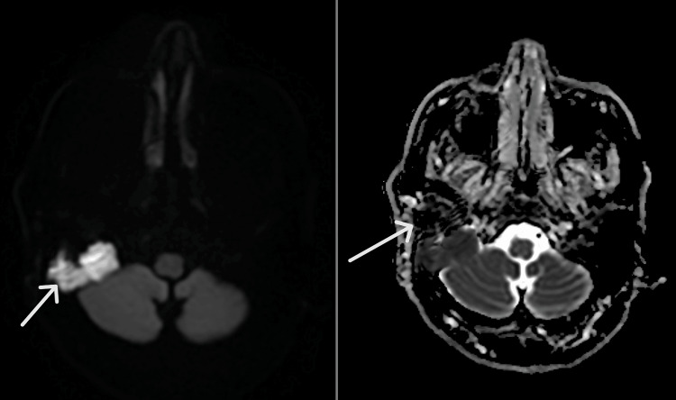
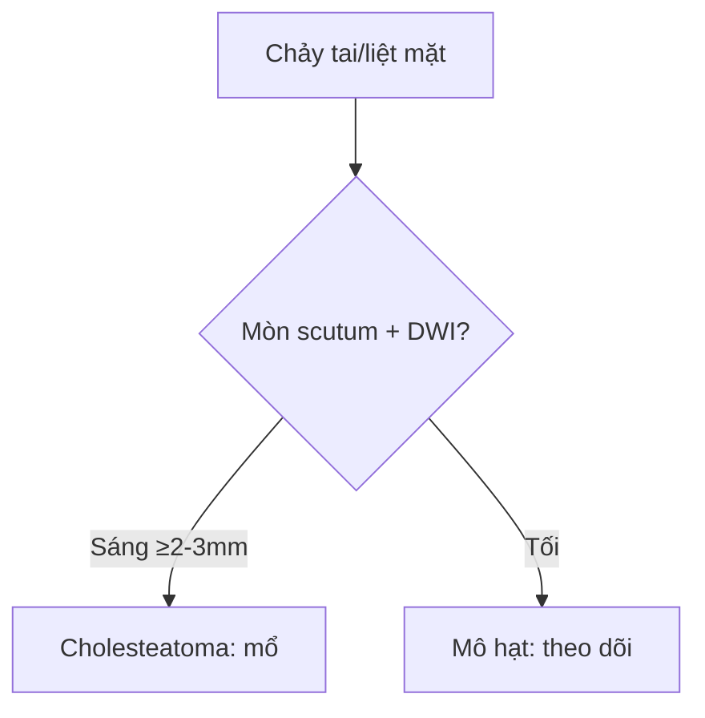

# 720 — Xương đá & cholesteatoma: scutum, DWI & mặt / Temporal bone

**Tags:** `pattern:cholesteatoma` `vung:xuong-da` `protocol:MRI-non-EPI`
**Mức chắc chắn (certainty):** tổng hợp y văn (literature synthesis) — nhóm tự biên từ y văn mở, chưa gắn ca nguyên văn đơn lẻ.

## 1. Tổng quan — keratin đặc + ăn xương + liệt VII

- Cholesteatoma: biểu mô sừng tích tụ (Prussak/thượng nhĩ) — TẠI SAO **non-EPI DWI sáng từ ≥ 2–3 mm**: keratin đặc hạn chế khuếch tán; mô hạt/viêm DWI tối.
- Ăn mòn tường thượng nhĩ (scutum) + chuỗi xương con — TẠI SAO nghe kém dẫn truyền + liệt VII: u ăn ống Fallop + đè chuỗi.
- SSCD (hở ống trên): Pöschl/Stenvers mới thấy — TẠI SAO axial thường sót: ống nằm chéo mặt cắt.

## 2. Gamut chảy tai/nghe kém/liệt mặt (Gamut)

- **Mòn scutum + Prussak + DWI sáng:** cholesteatoma — mổ tiệt căn (theo dõi DWI sau mổ!).
- **Liệt VII ngoại biên + DWI sáng + mòn ống Fallop:** cholesteatoma biến chứng — mổ cấp cứu + bảo tồn VII.
- **Chóng mặt + tiếng vang + hở ống trên:** SSCD — Pöschl/Stenvers + bít ống.
- **Mô hạt sau mổ DWI tối:** viêm — theo dõi, đừng mổ lại vội.

## 3. Bảng so sánh phân biệt (ma trận đối chiếu)

| Thực thể (entity) | Hình ảnh điển hình | Chốt vào (rule-in) | Chốt loại (rule-out) | Gợi ý xác nhận |
|---|---|---|---|---|
| Cholesteatoma | **Mòn scutum + DWI sáng ≥ 2–3 mm** | **Keratin + ăn xương + DWI (+)** | DWI tối → mô hạt | Mổ + DWI theo dõi |
| Viêm/mô hạt | **Dày niêm + không mòn + DWI tối** | **Không ăn xương + DWI (−)** | Mòn + DWI (+) → cholesteatoma | Kháng sinh + theo dõi |
| SSCD | **Hở ống trên Pöschl + chóng mặt tiếng vang** | **Hở + VEMP (+) + thính lực** | Mòn thượng nhĩ → cholesteatoma | Bít ống khi nặng |
| Liệt VII do u | **Mòn Fallop + DWI sáng + HB III** | **Liệt ngoại biên + u ăn ống** | Liệt trung ương → não | Mổ + bảo tồn VII |

*CT mòn chũm + T2 sáng + DWI sáng/ADC tối. Nguồn: Kaimal et al., Cureus 2026 Fig. 1–3, CC BY 4.0.*

## 4. Protocol xương đá

- **CT 0,5 mm + MRI non-EPI DWI** khi chảy tai mạn/liệt mặt; Pöschl/Stenvers khi nghi SSCD.

## 5. Cạm bẫy

- **EPI DWI méo nền sọ** giả âm/dương — non-EPI + ngưỡng 2–3 mm.
- **Liệt Bell tưởng VII ngoại biên** — chảy tai/mòn xương là CT/MRI ngay (đừng steroid mù!).
- **Tồn dư sau mổ** tái phát — DWI định kỳ 1–2 năm (mô hạt DWI tối!).

## 6. Tự lượng giá — Blind Quiz

**Ca 1 — Ông 72 tuổi liệt mặt phải 8 tháng, không chảy tai. Đọc CT + DWI.**

- Hỏi: mòn ở đâu? DWI nói gì? Bell hay u? Mổ gì?

<b>Bấm để hiện đáp án</b>

- Dấu hiệu (findings): mòn chũm + ống Fallop + DWI sáng/ADC tối.
- Chẩn đoán (diagnosis): **cholesteatoma chũm biến chứng liệt VII (HB III)** — bóc toàn bộ xương đá + bịt (không phải Bell!).
- Nguồn: Kaimal et al., Fig. 1–3, CC BY 4.0.

**Ca 2 — Sau mổ chũm + DWI tối + không mòn mới:** tồn dư hay mô hạt? *(Bảng mục 3.)*

<b>Bấm để hiện đáp án</b>

- **Mô hạt:** theo dõi DWI định kỳ (sáng ≥ 2–3 mm mới là tồn dư).

## Bài liên quan chéo
- [700 – Tổng quan Đầu Cổ](../700-head-neck-overview/lesson.md)
- [235 – Thái dương & xoang](../235-xuong-thai-duong-xoang/lesson.md) (vôi nấm)
- [217 – CPA](../217-ngoai-truc-CPA/lesson.md) (lan hố sau)

> Không dùng để chẩn đoán độc lập khi chưa có người hướng dẫn.
