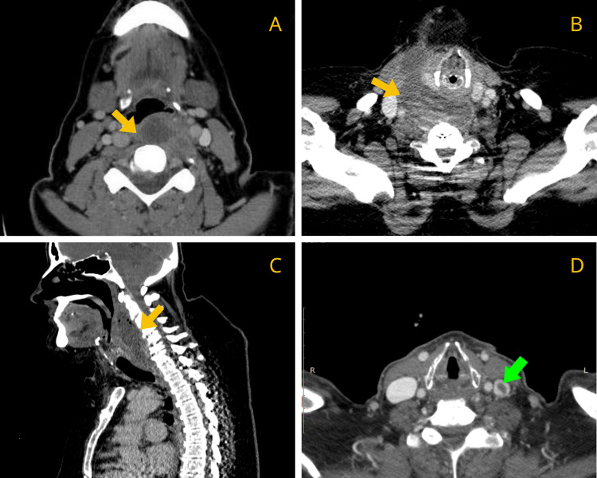
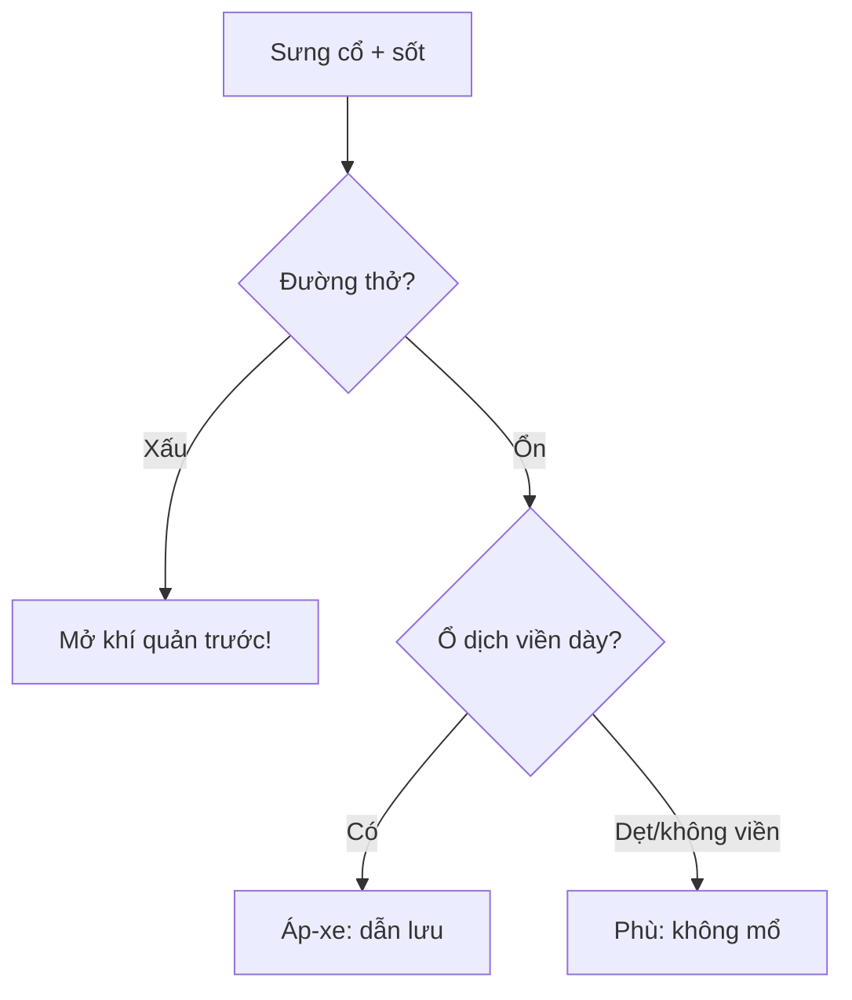

# 730 — Cổ sâu: áp-xe sau hầu, danger space & phù giả / Deep neck infection

**Tags:** `pattern:nhiem-trung-co` `vung:co-sau` `protocol:CT-co-tiem`
**Mức chắc chắn (certainty):** tổng hợp y văn (literature synthesis) — nhóm tự biên từ y văn mở, chưa gắn ca nguyên văn đơn lẻ.

## 1. Tổng quan — mạc alar chia thật-giả + khoang nguy hiểm xuống hoành

- Sau hầu thật (giữa họng-buccal và alar) vs **danger space (sau alar, trước trước sống)** — TẠI SAO danger xuống trung thất sau tới hoành: không có rào cản dưới, mủ chảy trọng lực thẳng xuống.
- Ngưỡng: sau hầu **< 7 mm (C2)** / **< 14–22 mm (C6)**; áp-xe = ổ dịch + viền ngấm dày + khí + lan khoang; **phù dẹt không/viền mỏng** = huyết khối IJV/viêm gân dài cổ — mổ oan!
- 81,8% lan khoang kề (bên hầu, trước sống) + Staph + WBC 16,5k + CRP 191 — đường thở là ưu tiên số 1 (2/11 mở khí quản).

## 2. Gamut sưng cổ + sốt + nuốt đau (Gamut)

- **Ổ dịch + viền dày + khí + lan:** áp-xe sau hầu — kháng sinh + dẫn lưu (miệng/cổ) + giữ đường thở.
- **Dẹt + không/viền mỏng + IJV tắc/viêm gân:** phù giả — kháng đông/kháng viêm, đừng mổ!
- **Lan dọc danger + trung thất:** viêm trung thất xuống — lồng ngực + dẫn lưu + ICU.
- **Khò khè + lệch khí quản:** chèn đường thở — mở khí quản trước mọi CT!

## 3. Bảng so sánh phân biệt (ma trận đối chiếu)

| Thực thể (entity) | Hình ảnh điển hình | Chốt vào (rule-in) | Chốt loại (rule-out) | Gợi ý xác nhận |
|---|---|---|---|---|
| Áp-xe sau hầu | **Ổ dịch + viền dày + khí + lan khoang** | **Viền dày + khí + sốt cao** | Dẹt + không viền → phù | Dẫn lưu + cấy + KS |
| Phù giả (edema) | **Dẹt + không/viền mỏng + IJV tắc** | **Huyết khối IJV/viêm gân + dẹt** | Viền dày + khí → mủ | Kháng đông, không mổ |
| Danger/trung thất | **Lan dọc sau alar + khí trung thất** | **Xuống hoành + sốc** | Khu trú → thường | Lồng ngực + ICU |
| Chèn thở | **Lệch/ép khí quản + khò khè** | **Đường thở = ưu tiên 1** | Thở êm → CT thường | Mở khí quản trước! |

*(A–C) ổ dịch + lan trước sống/danger; (D) huyết khối IJV trái (xanh). Nguồn: Sideris et al., Cureus 2026 Fig. 3, CC BY 4.0.*

## 4. Protocol CT cổ tiêm

- **CT cổ-ngực cản quang** khi sưng + sốt + nuốt đau (đo mm + lan + khí + IJV); đường thở xấu là mở khí quản trước CT.

## 5. Cạm bẫy

- **Phù sau hầu mổ oan** — IJV + gân dài cổ + hình dẹt là chốt không mổ.
- **Danger xuống trung thất bỏ sót** — CT phải tới hoành khi lan dọc.
- **Gây mê mất đường thở** — đánh giá + mở khí quản tỉnh trước mổ dẫn lưu.

## 6. Tự lượng giá — Blind Quiz

**Ca 1 — Nuốt đau + sốt + sưng cổ. Đọc CT 4 ảnh.**

- Hỏi: lan tới đâu? Mũi tên xanh là gì? Mổ đường nào?

<b>Bấm để hiện đáp án</b>

- Dấu hiệu (findings): ổ dịch sau hầu + lan trước sống + danger + **tắc IJV trái** (xanh).
- Chẩn đoán (diagnosis): **áp-xe sau hầu lan rộng + huyết khối IJV** — dẫn lưu (miệng/cổ) + kháng sinh + kháng đông + giữ đường thở.
- Nguồn: Sideris et al., Fig. 3, CC BY 4.0.

**Ca 2 — Dẹt sau hầu + không viền + IJV tắc + C6 10 mm:** mủ hay phù? *(Bảng mục 3.)*

<b>Bấm để hiện đáp án</b>

- **Phù giả:** kháng đông, không mổ (viền dày + khí mới là mủ).

## Bài liên quan chéo
- [700 – Tổng quan Đầu Cổ](../700-head-neck-overview/lesson.md)
- [710 – Mũi xoang](../710-sinonasal-ct-anatomy/lesson.md) (lan từ xoang)
- [750 – Hạch cổ (dự kiến viết sau)]

> Không dùng để chẩn đoán độc lập khi chưa có người hướng dẫn.
