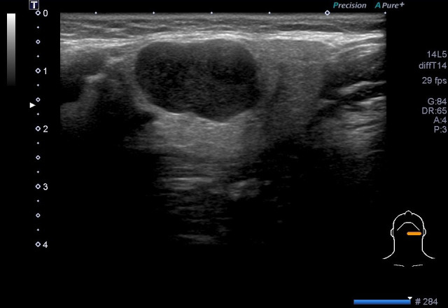
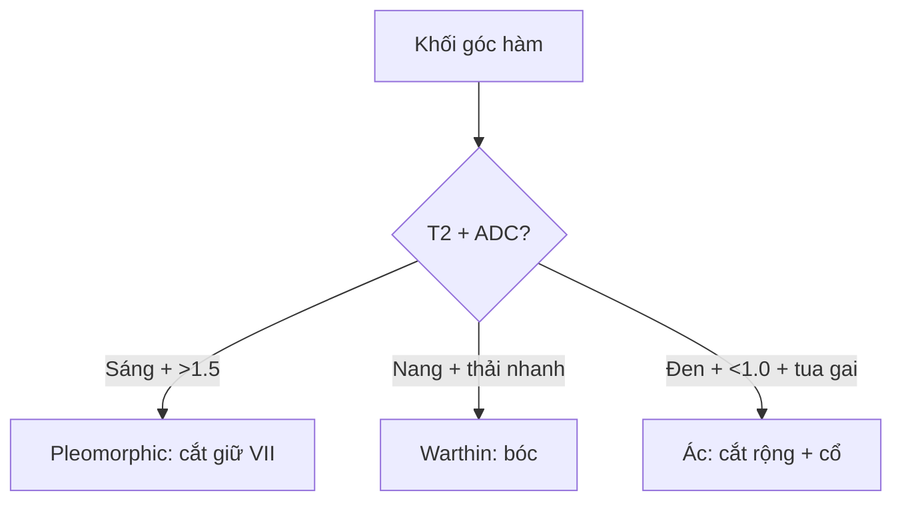

# 740 — Tuyến mang tai: pleomorphic, Warthin & ác tính / Salivary tumors

**Tags:** `pattern:u-tuyen-bot` `vung:tuyen-bot`
**Mức chắc chắn (certainty):** tổng hợp y văn (literature synthesis) — nhóm tự biên từ y văn mở, chưa gắn ca nguyên văn đơn lẻ.

## 1. Tổng quan — nhầy-sụn sáng T2 + lympho hút thuốc + tua gai đen T2

- Pleomorphic adenoma (38% u tuyến): nhầy-sụn — TẠI SAO **T2 rất sáng + ADC > 1,5 + SWE cứng nhất**: mô nhầy nhiều nước tự do; vỏ bao (trừ đa nhân!).
- Warthin (33%, hút thuốc, nam): lympho + nang — TẠI SAO **T2 trung gian + bắt sớm-thải nhanh + nang**: mô lympho giàu mạch.
- Ác tính (14,8%): tua gai + hoại tử + vôi + hạch — **T2 đen + ADC < 1,0 + đàn hồi cứng không đều** (OR vôi 14,8!).

## 2. Gamut khối góc hàm (Gamut)

- **T2 sáng + ADC cao + vỏ bao:** pleomorphic — cắt bảo tồn VII (tránh gieo!).
- **Hút thuốc + nang + bắt-thải nhanh:** Warthin — bóc (tái phát đa ổ!).
- **Tua gai + T2 đen + hạch + vôi:** ác tính — cắt rộng + nạo cổ + xạ.
- **Thùy sâu qua hầm trâm-hàm:** định khu sai — MRI + mổ đường cổ.

## 3. Bảng so sánh phân biệt (ma trận đối chiếu)

| Thực thể (entity) | Hình ảnh điển hình | Chốt vào (rule-in) | Chốt loại (rule-out) | Gợi ý xác nhận |
|---|---|---|---|---|
| Pleomorphic | **T2 sáng + ADC > 1,5 + vỏ + SWE cứng** | **Nhầy-sụn + vỏ bao** | Không vỏ + tua gai → ác | Cắt + giữ VII (đừng vỡ vỏ!) |
| Warthin | **Nang + bắt sớm-thải nhanh + hút thuốc** | **Lympho + nang + nam hút thuốc** | T2 sáng đều → pleomorphic | Bóc + theo dõi đa ổ |
| Ác tính | **Tua gai + T2 đen + ADC < 1,0 + vôi + hạch** | **Không đều + vôi (OR 14,8) + ENE** | Vỏ bao + T2 sáng → lành | Cắt rộng + cổ + xạ |
| Thùy sâu | **Qua hầm trâm-hàm + đẩy mỡ bên hầu** | **Đường hầm + ICA bị đẩy** | ICA ôm → bên hầu | MRI + mổ cổ |

*Siêu âm + đàn hồi: lành vỏ bao (khác ác tính tua gai). Nguồn: Cheng et al., Front Oncol 2026 Fig. 2, CC BY 4.0.*

## 4. Protocol tuyến nước bọt

- **Siêu âm + Doppler + đàn hồi (SWE/RTE) + MRI (T2/ADC/DCE) + Milan FNA** khi khối góc hàm; VII trước mọi mổ mang tai.

## 5. Cạm bẫy

- **Vỡ vỏ pleomorphic** gieo tái phát đa nhân — bóc nguyên khối, đừng chọc nhiều lần.
- **Thùy sâu tưởng bên hầu** mổ sai đường — hầm trâm-hàm + ICA là chốt.
- **Warthin 2 bên** bỏ sót bên đối diện — siêu âm cả 2 tuyến + tiền sử thuốc lá.

## 6. Tự lượng giá — Blind Quiz

**Ca 1 — Nữ 46 tuổi khối mang tai trái. Đọc siêu âm + đàn hồi.**

- Hỏi: lành hay ác? Mổ thế nào để không liệt mặt?

<b>Bấm để hiện đáp án</b>

- Dấu hiệu (findings): bầu dục thùy rõ + vỏ bao + T2 sáng + ADC cao.
- Chẩn đoán (diagnosis): **pleomorphic adenoma** — cắt bảo tồn dây VII, không vỡ vỏ (gieo tái phát!).
- Nguồn: Cheng et al., Fig. 2, CC BY 4.0.

**Ca 2 — Tua gai + T2 đen + hạch cổ hoại tử:** lành hay ác? *(Bảng mục 3.)*

<b>Bấm để hiện đáp án</b>

- **Ác tính tuyến nước bọt:** cắt rộng + nạo cổ + xạ (ENE + Milan V–VI).

## Bài liên quan chéo
- [700 – Tổng quan Đầu Cổ](../700-head-neck-overview/lesson.md)
- [750 – Hạch cổ](../750-cervical-lymph-nodes-nirads/lesson.md) (ENE)
- [230 – Tuyến giáp](../230-tuyen-giap-hach-co/lesson.md) (FNA cổ)

> Không dùng để chẩn đoán độc lập khi chưa có người hướng dẫn.
