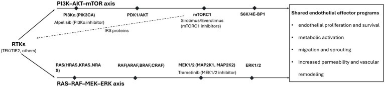
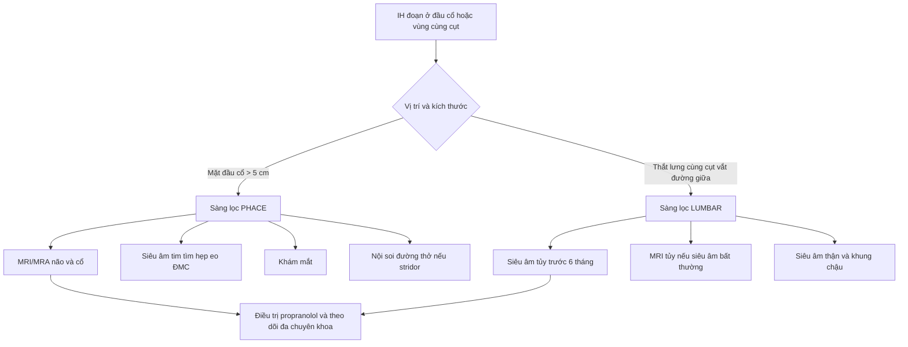
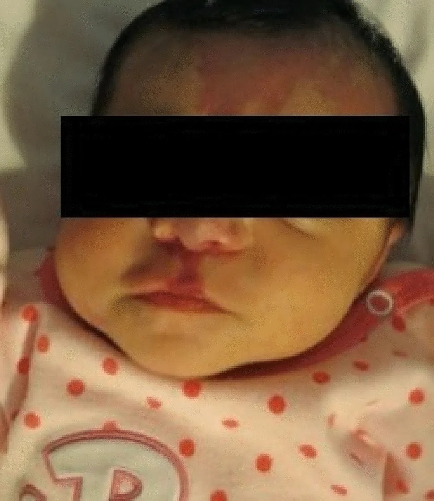
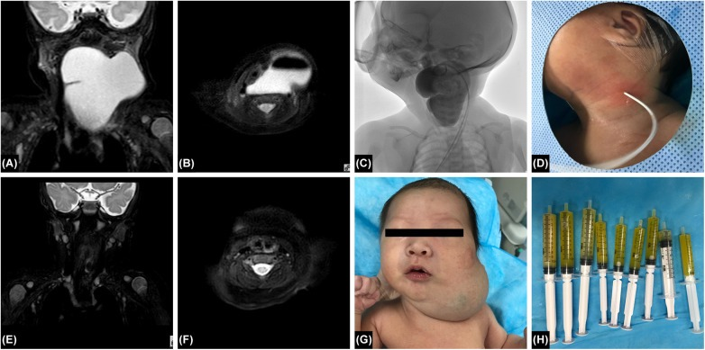
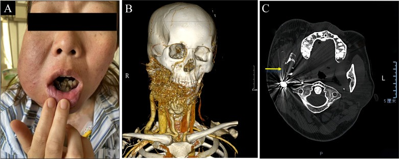

# 741 — Dị dạng mạch máu đầu–cổ ở trẻ: ISSVA 2018, PHACE & LUMBAR / Pediatric head and neck vascular anomalies

**Tags:** `pattern:di-dang-mach-mau` `pattern:u-mach-mau` `vung:dau-co` `vung:co` `protocol:MRI-dau-co` `protocol:US-Doppler` `score:ISSVA`
**Mức chắc chắn (certainty):** tổng hợp y văn (literature synthesis) — tổng hợp phân loại ISSVA 2018, review định lượng PHACE/LUMBAR và các ca nguyên văn CC BY; phần quiz giữ đúng mô tả của bài gốc.

## 1. Tổng quan bệnh học – cơ chế hình ảnh

### 1.1 Hai nhóm không được lẫn: u mạch máu (tumor) vs dị dạng mạch máu (malformation)

- **ISSVA 2018** chia dị thường mạch máu thành **u mạch máu (vascular tumors)** — bệnh lý **tăng sinh tế bào nội mô thật** — và **dị dạng mạch máu (vascular malformations)** — **sai khớp trong quá trình tạo mạch**, không phải ung thư, không tự thoái triển.
- **U mạch máu nhũ nhi (infantile hemangioma, IH):** xuất hiện **sau sinh 1–2 tuần**, **tăng sinh nhanh 1–3 tháng**, rồi **thoái triển** trong nhiều năm; **GLUT-1 dương** (dấu hiệu phân biệt với dị dạng mao mạch); tỉ lệ mắc khoảng **2,8%** (meta-analysis 2024), đa số ở đầu–cổ.
- **Dị dạng mạch máu:** có từ lúc sinh, **lớn theo tỉ lệ cơ thể**, không thoái triển; chia **dòng chảy chậm (slow-flow)** — mao mạch, bạch mạch, tĩnh mạch — và **dòng chảy nhanh (high-flow)** — động–tĩnh mạch (AVM/AVF).
- Hệ quả lâm sàng: cùng một khối ở má/cổ nhưng **IH có thể điều trị nội khoa bằng propranolol**, **dị dạng bạch mạch (LM) đáp ứng sirolimus/sclerotherapy**, **VM đáp ứng sclerotherapy**, **AVM phải can thiệp nội mạch** — chọn sai nhóm là chọn sai đường điều trị.

### 1.2 TẠI SAO tín hiệu MRI phản ánh đúng bản chất

- **T2 rất sáng ở LM:** nang chứa **dịch bạch huyết giàu nước, ít protein** → thời gian T2 dài → tín hiệu cao gần dịch não tủy; vách mỏng tín hiệu thấp; **không có dòng chảy** nên Doppler không màu.
- **T2 sáng ở VM:** các **kênh tĩnh mạch giãn, máu ứ tốc độ chậm** → tín hiệu T2 cao; **sỏi tĩnh mạch (phlebolith)** là canxi → **tín hiệu thấp trên mọi chuỗi xung**, không ngấm thuốc; sau tiêm VM **ngấm thuốc chậm, lan dần (slow fill-in)** vì thuốc đi vào lòng mạch chậm.
- **AVM có dòng chảy nhanh:** trên T2 thấy **khoảng trống tín hiệu (flow voids)** do proton chuyển động nhanh ra khỏi lát cắt; MRA/CTA thấy **động mạch nuôi giãn, nidus, dẫn lưu tĩnh mạch sớm**; DSA là tiêu chuẩn vàng.
- **IH tăng sinh:** mô giàu tế bào nội mô + mạch nhỏ → T2 trung bình–cao, **ngấm thuốc mạnh và đồng nhất**, dòng chảy cao; khi thoái triển → **mỡ/xơ**, T1 sáng, T2 trung bình, ngấm ít.
- **Ngưỡng định lượng quan trọng nhất:** **IH đoạn (segmental) vùng mặt–đầu > 5 cm** là ngưỡng phải nghĩ **PHACE**; **IH đoạn vùng thắt lưng–cùng cụt–chậu vắt qua đường giữa** là ngưỡng phải nghĩ **LUMBAR**.

## 2. Mẫu hình + chẩn đoán phân biệt theo vị trí (gamut)

- **Câu hỏi tiếp cận:** (1) có từ lúc sinh hay xuất hiện sau sinh? (2) dòng chảy nhanh hay chậm? (3) có nang dịch, sỏi tĩnh mạch, mỡ, hay mạch máu? (4) có hội chứng kèm theo (PHACE/LUMBAR/PROS)?
- **Theo dòng chảy:**
  - **Chậm – dịch:** dị dạng bạch mạch (LM), dị dạng bạch mạch–tĩnh mạch (LVM).
  - **Chậm – máu:** dị dạng tĩnh mạch (VM), dị dạng mao mạch (CM).
  - **Nhanh:** AVM, AVF, Parkes Weber.
- **Theo vị trí đầu–cổ:**
  - **Hốc mắt/quanh ổ mắt:** IH (thường gặp nhất ở trẻ nhũ nhi), VM, LM, AVF màng não; IH quanh mắt **có thể gây nhược thị do che trục thị giác**.
  - **Vùng mang tai/má:** IH, LM đa nang, VM; **LM lớn có thể lan xuống trung thất**.
  - **Đường thở trên – dưới thanh môn:** IH dạng "râu quai nón" (beard distribution) → **stridor, khó thở, chẩn đoán nhầm croup**.
  - **Cổ sâu:** LM (vách mỏng, nhiều nang), VM (sỏi tĩnh mạch), AVM (flow void).
  - **Xương hàm/maxilla:** VM/AVM trong xương; **AVM hàm dưới có thể chảy máu ồ ạt sau nhổ răng**.
- **Hội chứng phải nhớ:**
  - **PHACE:** **P**osterior fossa, **H**emangioma đoạn, **A**rterial anomalies, **C**ardiac/coarctation, **E**ye anomalies; kèm **khe xương ức, đường giữa bụng**.
  - **LUMBAR:** **L**ower body hemangioma, **U**rogenital, **M**yelopathy, **B**one, **A**norectal/arterial, **R**enal.
  - **PROS (PIK3CA-related overgrowth spectrum):** dị dạng mạch + phì đại mô; **somatic PIK3CA**.
  - **Parkes Weber:** AVM + phì đại chi, **RASA1/EPHB4**.

## 3. Bảng so sánh phân biệt (ma trận đối chiếu)

| Thực thể (entity) | Hình ảnh điển hình (US/CT/MRI) | Chốt vào (rule-in) | Chốt loại (rule-out) | Gợi ý xác nhận |
|---|---|---|---|---|
| **U mạch máu nhũ nhi (IH)** | Xuất hiện sau sinh, tăng sinh 1–3 tháng; T2 trung bình–cao, ngấm mạnh đồng nhất, dòng chảy cao; GLUT-1 (+) | **Tuổi + tiến triển sau sinh + GLUT-1 dương** | Có từ lúc sinh và đã ổn định → nghĩ u mạch bẩm sinh/dị dạng | Siêu âm Doppler + lâm sàng; propranolol nếu nguy cơ chức năng |
| **U mạch bẩm sinh (CH: RICH/NICH)** | Có sẵn lúc sinh, đã kích thước tối đa; RICH thoái triển nhanh, NICH không; GLUT-1 (−) | **Có từ lúc sinh + GLUT-1 âm** | Xuất hiện muộn sau sinh → IH | Theo dõi RICH; NICH có thể cần can thiệp |
| **Dị dạng bạch mạch (LM)** | Đa nang, T2 rất sáng gần dịch, vách mỏng, **không dòng chảy**, không ngấm dịch; có thể xuất huyết trong nang | **Đa nang T2 rất sáng + không flow + vách mỏng** | Có thành phần đặc ngấm thuốc/flow → LVM hoặc u | US Doppler + MRI T2 FS; sclerotherapy nếu macrocystic |
| **Dị dạng tĩnh mạch (VM)** | T2 sáng, lobulated, **sỏi tĩnh mạch** (tối mọi chuỗi), mềm/ép được, ngấm chậm lan dần; ± huyết khối | **Sỏi tĩnh mạch + chậm flow + ngấm chậm** | Có động mạch nuôi + dẫn lưu sớm → AVM | MRI + US Doppler; DSA nếu nghi nhanh |
| **AVM/AVF** | Flow voids, động mạch nuôi giãn, **nidus**, dẫn lưu tĩnh mạch sớm; CTA/MRA/DSA | **Nidus + dẫn lưu tĩnh mạch sớm** | Không nidus, chỉ ứ máu chậm → VM | DSA (chẩn đoán + điều trị); **không sinh thiết** |
| **KHE (kaposiform hemangioendothelioma)** | Khối mạch xâm nhập, có thể chảy máu; **giảm tiểu cầu + rối loạn đông (Kasabach–Merritt)** | **Giảm tiểu cầu nặng + khối mạch** | Tiểu cầu bình thường → ít nghĩ KHE | CBC/đông máu + MRI; sirolimus/steroid |

*Hai trục tín hiệu nội mô: **PI3K–AKT–mTOR** (dị dạng tĩnh mạch/bạch mạch, PIK3CA/TEK) và **RAS–RAF–MEK–ERK** (AVM, RAS/MAPK). Đây là cơ sở chọn sirolimus/alpelisib hay trametinib. Nguồn: Front Neurol 2026 (PMC13038566), CC BY 4.0.*

## 4. Protocol chụp + phân loại/điểm chuẩn hóa

### 4.1 Protocol hình ảnh đầu–cổ

- **Siêu âm Doppler màu là bước đầu tiên:** đầu dò linear tần số cao; đánh giá **thành phần nang/đặc**, **ép được**, **có flow hay không**, **vận tốc/trở kháng**; đo kích thước 3 chiều.
- **MRI là chuẩn mô tả:** T1, **T2 fat-sat/STIR**, T1 sau tiêm fat-sat; **lát 3–4 mm**, trường nhìn từ nền sọ đến trung thất trên; MRA nếu nghi AVM.
- **CT/CTA:** khi cần **xương hàm/maxilla**, **đường thở**, hoặc **mạch máu**; dùng liều thấp ở trẻ.
- **DSA:** tiêu chuẩn vàng cho AVM/AVF, đồng thời điều trị (nút mạch, ethanol, coil).
- **Không chọc hút/sinh thiết AVM** khi chưa kiểm soát — nguy cơ chảy máu không cầm.

### 4.2 Phân loại ISSVA 2018 (tóm tắt dùng trong báo cáo)

- **U mạch máu:** lành (IH, CH, angioma dạng tuyến), trung gian (KHE, composite), ác (angiosarcoma).
- **Dị dạng mạch máu:** mao mạch, bạch mạch, tĩnh mạch, động–tĩnh mạch, **kết hợp**, dị dạng của mạch lớn có tên, kèm bất thường khác.
- Trong báo cáo nên ghi **tên ISSVA + dòng chảy + vị trí + hội chứng nghi ngờ**, tránh dùng "lymphangioma", "cavernous hemangioma" — là thuật ngữ cũ, dễ gây điều trị sai.

### 4.3 Sàng lọc PHACE và LUMBAR

- **PHACE:** IH đoạn vùng mặt/đầu–cổ **> 5 cm**, đặc biệt **V1** hoặc nhiều khoanh → **MRI/MRA não + cổ**, **siêu âm tim** (hẹp eo ĐMC), **khám mắt**, **nội soi đường thở** nếu stridor/khàn.
  - Tỉ lệ trong PHACE: **bất thường mạch máu não 72–91%**, **IH đường thở 40–52%**, bất thường tim/ĐMC **~50%**, bất thường mắt **25–50%**; IH tồn dư **> 90%**.
  - **IH-MAG** (u mạch máu tăng sinh tối thiểu/ngưng) vẫn là IH, **GLUT-1 dương**, và **vẫn là dấu hiệu PHACE** — không được bỏ qua.
- **LUMBAR:** IH đoạn vùng **thắt lưng–cùng cụt–chậu**, **vắt qua đường giữa** → **siêu âm tủy sống trước 6 tháng** (khi chưa cốt hóa cung sau), **MRI tủy** nếu bất thường; **siêu âm thận–chậu**, khám hậu môn–sinh dục.
  - Nghiên cứu 91 bệnh nhân LUMBAR: **100% IH có dạng đoạn và liên quan đường giữa**; tổn thương **hoàn toàn một bên, không chạm đường giữa** ít nguy cơ hơn.

### 4.4 Ngưỡng điều trị

- **IH:** propranolol uống **1 mg/kg/ngày tuần 1 → 2 mg/kg/ngày tuần 2 → 3 mg/kg/ngày** duy trì; khởi trị **càng sớm càng tốt trong pha tăng sinh** (trước 3 tháng hiệu quả hơn); theo dõi nhịp tim, huyết áp, đường huyết. Chỉ định: **loét, chảy máu, nguy cơ nhược thị, tắc đường thở, biến dạng**.
- **LM:** **sclerotherapy** (pingyangmycin/bleomycin, lauromacrogol) cho **macrocystic**; **sirolimus** cho LM lan tỏa/phức tạp, liều khởi đầu **0,8 mg/m² × 2 lần/ngày**, đích **trough 10–15 ng/mL** (Adams) hoặc **4–12 ng/mL** (PERFORMUS).
- **VM:** sclerotherapy (ethanol tuyệt đối, polidocanol bọt) ± sirolimus; ĐMC/huyết khối trong lòng mạch cần đánh giá đông máu.
- **AVM:** **embolization** qua DSA (coil, ethanol, keo); **trametinib** (MEK ức chế) cho AVM có **RAS/MAPK** chọn lọc, đặc biệt khi không thể can thiệp triệt để.

## 5. Biến thể bình thường và cạm bẫy

- **"Vết đỏ bẩm sinh" không phải luôn là dị dạng mao mạch:** **IH-MAG** có thể phẳng, ít tăng sinh nhưng vẫn là IH (GLUT-1+), **vẫn phải sàng lọc PHACE** nếu ở mặt.
- **U mạch máu bẩm sinh (CH)** đã có kích thước tối đa lúc sinh; **RICH tự thoái triển**, **NICH thì không** — không điều trị như IH.
- **Sỏi tĩnh mạch** trên CT rất dễ nhầm với **vôi hóa hạch/uyến giáp**; trên MRI nó **tối mọi chuỗi**, không ngấm thuốc — đây là chốt.
- **AVM có thể "im lặng" rồi bùng phát sau chấn thương/nhổ răng**; chảy máu ồ ạt, **không sinh thiết mù**.
- **LM lớn ở cổ có thể lan trung thất** — luôn chụp từ nền sọ đến trung thất, không chỉ vùng cổ.
- **PHACE + propranolol:** trước đây lo ngại giảm tưới máu não ở bệnh nhân có bất thường mạch máu; dữ liệu đa trung tâm cho thấy propranolol **vẫn dùng được** nhưng cần **đánh giá mạch máu não trước** và phối hợp thần kinh.
- **Sai thuật ngữ dẫn tới sai điều trị:** "lymphangioma" → LM; "cavernous hemangioma" → VM (thường); "strawberry hemangioma" → IH.

## 6. Tự lượng giá — Blind Quiz

**Ca 1 — Trẻ sơ sinh có mảng đỏ đoạn vùng trán–mũi bên trái, kèm nhược thị được phát hiện muộn.**

- Gợi ý lâm sàng: trẻ sơ sinh, tổn thương đỏ phẳng–gồ, lan theo khoanh V1 trái xuống sống mũi; mẹ thấy từ những ngày đầu.
- Câu hỏi: Chẩn đoán nhóm tổn thương? Vì sao phải sàng lọc hội chứng? Cần những thăm khám nào trước khi cho propranolol?

<b>Bấm để hiện đáp án (findings + chẩn đoán)</b>

- Dấu hiệu: **IH đoạn (segmental) vùng V1 trái**, kích thước **> 5 cm**, lan qua sống mũi; đây là **dấu hiệu da đặc trưng của PHACE**.
- Chẩn đoán: **PHACE syndrome** — vì tổn thương là IH đoạn lớn vùng mặt; PHACE có **bất thường mạch máu não 72–91%**, **bất thường tim/ĐMC ~50%**, **bất thường mắt 25–50%**, **IH đường thở 40–52%**.
- Cần làm: **MRI/MRA não–cổ**, **siêu âm tim** (hẹp eo ĐMC), **khám mắt**, **nội soi đường thở** nếu có stridor; sau đó **propranolol 1→3 mg/kg/ngày** và theo dõi đa chuyên khoa.
- Nguồn ảnh: Gnazzo M et al., Neurol Sci 2026 (PMC13545040), Fig. 2, CC BY 4.0.

**Ca 2 — Sơ sinh có khối cổ bên to, khó thở, da căng.**

- Gợi ý lâm sàng: sơ sinh, khối cổ bên **> 6 cm**, căng, có thể đẩy lệch đường thở; siêu âm thấy nhiều nang.
- Câu hỏi: Mô tả tín hiệu MRI và chẩn đoán? Vì sao khối này không phải VM? Hướng xử trí cấp?

<b>Bấm để hiện đáp án (findings + chẩn đoán)</b>

- Dấu hiệu: khối **đa nang (multiloculated)**, **T2 rất sáng**, vách mỏng, **không có dòng chảy** trong nang; các nang lớn chèn ép đường thở.
- Chẩn đoán: **dị dạng bạch mạch (lymphatic malformation, LM)** — vì nang chứa dịch bạch huyết giàu nước → T2 rất sáng, không flow; VM sẽ có **sỏi tĩnh mạch** và ngấm thuốc chậm.
- Xử trí: bảo vệ đường thở (đặt nội khí quản nếu cần), **sclerotherapy cấp cứu** dưới siêu âm (pingyangmycin/lauromacrogol); **sirolimus** nếu lan tỏa/phức tạp.
- Nguồn ảnh: Zhang X et al., Front Pediatr 2026 (PMC13079304), Fig. 1, CC BY 4.0.

**Ca 3 — Người trẻ chảy máu không cầm sau nhổ răng, vùng hàm dưới phải sưng.**

- Gợi ý lâm sàng: nam/nữ trẻ, tiền sử tổn thương mạch hàm dưới, chảy máu ồ ạt sau nhổ răng; CT thấy tổn thương xương hàm.
- Câu hỏi: Dấu hiệu nào trên hình chốt AVM? Vì sao không sinh thiết? Điều trị chuẩn?

<b>Bấm để hiện đáp án (findings + chẩn đoán)</b>

- Dấu hiệu: **AVM trong xương hàm dưới** — CTA 3D thấy **mạng mạch dày đặc, động mạch nuôi giãn**, CT axial có **flow void/nidus** và phá xương; lâm sàng chảy máu sau nhổ răng.
- Vì sao không sinh thiết: AVM **dòng chảy nhanh, áp lực cao**, sinh thiết có thể gây **chảy máu không kiểm soát**; chẩn đoán bằng **CTA/MRA/DSA**.
- Điều trị: **DSA + embolization** (coil, ethanol tuyệt đối, bọt polidocanol) ± phẫu thuật sau khi kiểm soát dòng chảy; theo dõi tái thông.
- Nguồn ảnh: Dong D et al., Front Cardiovasc Med 2026 (PMC12823793), Fig. 1, CC BY 4.0.

## Bài liên quan chéo
- [700 – Tổng quan Đầu Mặt Cổ & mạc cổ sâu](../700-head-neck-overview/lesson.md)
- [658 – PHO/OAVS, Goldenhar & cung mang](../658-pho-oavs-goldenhar-va-cung-mang/lesson.md)
- [667 – U mạch máu gan ở trẻ & điều trị](../667-u-mach-mau-gan-o-tre-va-dieu-tri/lesson.md)
- [740 – Tuyến nước bọt: u hỗn hợp, Warthin & ác tính](../740-salivary-gland-tumors/lesson.md)
- [750 – Bản đồ hạch cổ & NI-RADS](../750-cervical-lymph-nodes-nirads/lesson.md)

> Không dùng để chẩn đoán độc lập khi chưa có người hướng dẫn.
