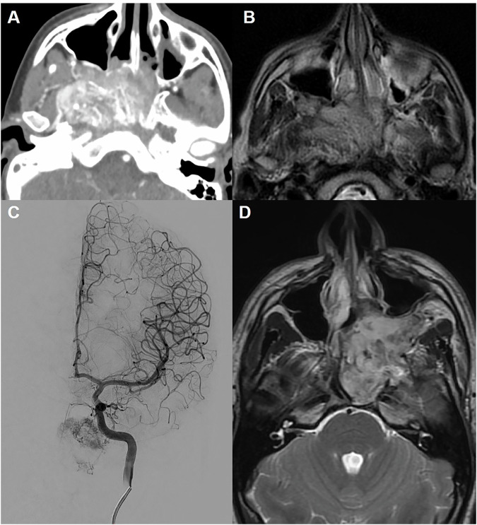
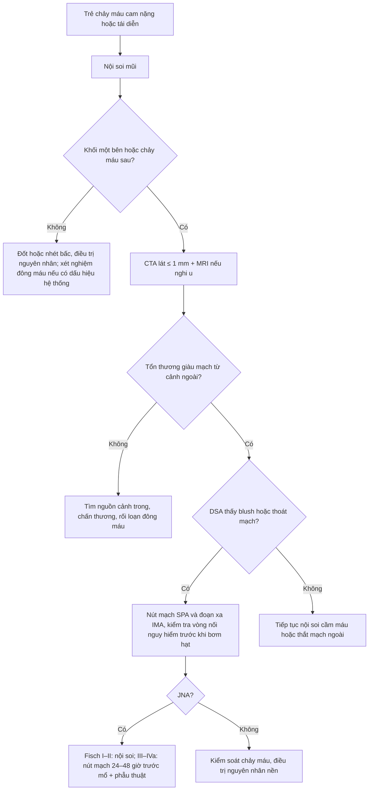
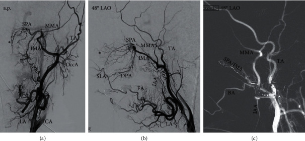
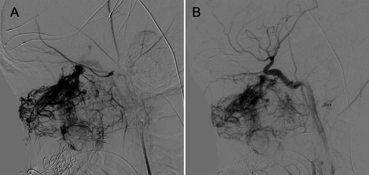

# 743 — Chảy máu cam nặng/tái diễn ở trẻ: nội soi, CTA, DSA và nút mạch / Severe paediatric epistaxis

**Tags:** `pattern:chay-mau` `vung:mui` `vung:dau-co` `score:Fisch-JNA` `protocol:CTA-DSA-chay-mau-cam`
**Mức chắc chắn (certainty):** tổng hợp y văn (literature synthesis) — nhóm tự biên từ y văn mở (Eur Radiol 2026, Radiol Res Pract 2020, Cureus 2021, Int Arch Otorhinolaryngol 2022, J Clin Med 2026), đối chiếu khuyến cáo ESR/ACR và AAO mà bài gốc trích dẫn; không gắn một ca nguyên văn duy nhất.

## 1. Tổng quan bệnh học – cơ chế hình ảnh

- **Vì sao trẻ khác người lớn:** **90% chảy máu cam ở trẻ là thể TRƯỚC**, nguồn từ **đám rối Kiesselbach (vùng Little)** ở vách ngăn trước — nơi hội tụ **nhánh động mạch sàng trước, động mạch khẩu cái lớn, động mạch mặt (môi trên)**; niêm mạc mỏng, dễ tổn thương do **ngoáy mũi, không khí khô, viêm mũi dị ứng**. Chảy máu **thể SAU chỉ 5–10%**, từ **đám rối Woodruff** (thành sau – sàn mũi), khó cầm và **thường gặp ở người lớn hơn** (PMC13282215).
- **Tần suất:** khoảng **60% dân số có ít nhất một lần chảy máu cam**, chỉ **6% cần chăm sóc y tế**; ở trẻ ngoại trú, chảy máu cam chiếm **1/300 lượt khám**, **84% dưới 12 tuổi**, gần **một nửa dưới 6 tuổi** (PMC7455835, PMC9122762). Khoảng **6%** các ca cần **can thiệp vượt quá đốt điện/nhét bấc** (PMC13282215).
- **Điểm mấu chốt ở trẻ — chảy máu cam có thể là CỬA VÀO bệnh hệ thống:** trong 100 trẻ khám vì chảy máu cam, **57 trẻ có thêm biểu hiện chảy máu khác**, **47 trẻ được chẩn đoán rối loạn đông máu thực sự**; **điểm chảy máu (bleeding score) ≥ 2** có giá trị gợi ý nguyên nhân hệ thống (PMC9122762). Vì vậy câu hỏi đầu tiên không phải "chụp gì" mà là **"chảy máu đơn thuần hay kèm bầm da, chảy máu răng, tiền sử gia đình?"**
- **Ba nguyên nhân "phải nghĩ tới" khi trẻ chảy máu cam nặng/tái diễn:**
  - **U mạch mũi hầu (juvenile nasopharyngeal angiofibroma — JNA):** trẻ **nam, tuổi dậy thì (12–16, trung bình 14)**, chảy máu cam **tái diễn một bên + nghẹt mũi**; khối giàu mạch xuất phát từ **lỗ bướm–khẩu cái** (PMC8294459).
  - **Bệnh u mạch máu di truyền (hereditary haemorrhagic telangiectasia — HHT / Osler–Weber–Rendu):** di truyền **trội NST thường**, **ENG/ACVRL1/SMAD4/GDF2**, tần suất **1/5.000–1/8.000**; chảy máu cam tái diễn + **giãn mạch niêm mạc (môi, lưỡi)** + **dị dạng động–tĩnh mạch tạng (phổi, não, gan)** (PMC12608258).
  - **Rối loạn đông máu** (bệnh von Willebrand, giảm tiểu cầu, hemophilia) — xét nghiệm trước khi can thiệp mù.
- **TẠI SAO đọc được trên hình ảnh (vật lý):**
  - **CTA:** thuốc cản quang **thì động mạch 20–30 giây**, lát mỏng **≤ 1 mm** (tái tạo 0,25–3 mm), **liều tham chiếu CTDIvol 4–10 mGy, DLP 100–250 mGy·cm** cho vùng mũi–xoang; CTA **định vị nguồn chảy và lập kế hoạch nút mạch** — mô hình mạch của hốc mũi chủ yếu từ **động mạch hàm trong (IMA) → động mạch bướm–khẩu cái (SPA)** (nhánh động mạch cảnh ngoài), trong khi **trần mũi do động mạch sàng trước/sau từ động mạch mắt (nhánh động mạch cảnh trong)** (PMC13282215, PMC7455835).
  - **DSA:** hình nền đã trừ cho thấy **blush của khối u**, **thoát mạch hoạt tính** (đổi hình theo thì) vs **giả phình** (giữ hình, đổ đầy rồi xả) — đây là phân biệt quyết định kỹ thuật can thiệp.
  - **MRI:** mô mềm và **lan nội sọ**; JNA có **đường dòng chảy (flow void)** trong khối và **ngấm thuốc mạnh** — nhưng **không thay thế DSA** để đánh giá mạch nuôi.

## 2. Mẫu hình + chẩn đoán phân biệt theo vị trí (gamut)

- **Chảy máu vùng TRƯỚC (vách ngăn, vùng Little):** vô căn/tự phát, **chấn thương ngón tay**, khô niêm mạc, viêm mũi dị ứng, **dị vật mũi**, polyp, **u máu vách ngăn**, rối loạn đông máu nhẹ. → **Không cần chụp** nếu đơn thuần, một bên rõ ràng, đáp ứng đốt/nhét bấc.
- **Chảy máu vùng SAU (Woodruff, SPA):** vô căn ở người lớn, **tăng huyết áp**, **chống đông/chống kết tập tiểu cầu**, sau phẫu thuật mũi, **giả phình SPA/IMA sau chấn thương**.
- **Chảy máu TRẦN mũi / sàng trước–sau:** chấn thương mặt, vỡ nền sọ, **tổn thương động mạch cảnh trong**, sau phẫu thuật xoang — **nguy cơ chảy máu từ tuần hoàn cảnh trong, nút mạch sai = đột quỵ/mù**.
- **Chảy máu MŨI HẦU / một bên + nghẹt mũi ở trẻ nam dậy thì:** **JNA**, **ung thư cơ vân (rhabdomyosarcoma)**, u lympho, **u nguyên bào khứu giác (esthesioneuroblastoma)**, polyp hậu mũi.
- **Chảy máu LAN TỎA niêm mạc, tái diễn nhiều năm:** **HHT**, rối loạn đông máu, bệnh thận mạn (tăng huyết áp + ure), thuốc.
- **Mnemonic "KISS–JHH":** **K**iesselbach (trước, trẻ) · **I**MA/SPA (nguồn sau) · **S**àng trước/sau (trần, cảnh trong) · **S**ystemic (đông máu, HHT) — cộng **J**NA (nam dậy thì) · **H**HT · **H**uyết áp/thuốc.

## 3. Bảng so sánh phân biệt (ma trận đối chiếu)

| Thực thể (entity) | Hình ảnh điển hình (nội soi/CT/CTA/MRI/DSA) | Chốt vào (rule-in) | Chốt loại (rule-out) | Gợi ý xác nhận |
|---|---|---|---|---|
| **Chảy máu cam trước vô căn** | Nội soi: điểm rỉ máu ở **vùng Little**, không khối; CT bình thường | **Chảy máu một bên rõ ở vùng Little, đáp ứng đốt/nhét bấc, không thiếu máu** | Khối một bên, chảy máu sau, thiếu máu nặng → không phải vô căn | **Không chụp**; điều trị bảo tồn |
| **JNA** | CTA: khối **ngấm mạnh**, **giãn rộng lỗ bướm–khẩu cái**, đẩy thành sau xoang hàm (Holman–Miller); MRI: **flow void**; DSA: **blush** từ IMA/SPA ± nhánh cảnh trong | **Nam 12–16 tuổi + chảy máu một bên + khối mũi hầu ngấm mạnh, giãn lỗ bướm–khẩu cái** | Nữ, tuổi nhỏ, khối không ngấm, không giãn lỗ → nghĩ polyp/u khác | **CTA + MRI**; **không sinh thiết**; DSA khi chuẩn bị nút mạch |
| **HHT** | Nội soi: nhiều **giãn mạch dạng đốm** ở vách trước/mũi; CT phổi/gan: **AVM**; MRI não: AVM | **Chảy máu tái diễn + giãn mạch môi/lưỡi + ≥ 3 tiêu chuẩn Curaçao hoặc đột biến gen** | Không giãn mạch, không tiền sử gia đình, chảy máu một lần → ít nghĩ HHT | Xét nghiệm **ENG/ACVRL1/SMAD4/GDF2**; tầm soát AVM phổi–não |
| **Rối loạn đông máu** | Hình ảnh mũi bình thường; **PT/aPTT/TXĐ, von Willebrand, tiểu cầu** bất thường | **Bleeding score ≥ 2** + bầm da/chảy máu răng + tiền sử gia đình | Công thức – đông máu bình thường, chảy máu khu trú → loại | Xét nghiệm đông máu **trước** can thiệp |
| **Giả phình ĐM cảnh trong/SPA sau chấn thương** | CTA: **túi đối quang giữ hình** cạnh ĐM; DSA: đổ đầy–xả, **không đổi hình theo thì** | **Chấn thương mặt/nền sọ + chảy máu ồ ạt tái phát** | Thoát mạch hoạt tính (đổi hình, lan thì muộn) → tổn thương mạch đang chảy | **DSA** là chuẩn; nút mạch/coil/stent |
| **U cơ vân / u lympho mũi hầu** | Khối **không giàu mạch điển hình**, phá xương, hạch cổ; MRI hạn chế khuếch tán | **Khối phá xương + hạch cổ + trẻ nhỏ** | Khối ngấm mạnh lan tỏa, giãn lỗ bướm–khẩu cái → JNA | **Sinh thiết** (khác JNA); PET/CT giai đoạn |
| **Dị vật / polyp / u máu vách ngăn** | Nội soi thấy trực tiếp; CT: hình khối nhỏ, không phá xương | **Nội soi thấy tổn thương khu trú** | Nội soi sạch, chảy máu từ nguồn mạch lớn → tìm nguồn sâu | Nội soi là chuẩn; CT chỉ khi cần |

*(A) CTA trục: khối ngấm mạnh ở mũi hầu; (B, D) MRI T2: khối mô mềm **lan rộng, giãn lỗ bướm–khẩu cái**, đẩy ra trước; (C) DSA: **blush mạch nuôi** từ động mạch hàm trong. Nguồn: Péporté ARJ et al. — Eur Radiol 2026 (PMC13282215), CC BY 4.0.*

## 4. Protocol chụp + phân độ + can thiệp

**Chuỗi xử trí (theo ESR 2026 và AAO):**

1. **Bước 0 — cầm máu và hỏi bệnh:** ép mũi, chống sốc nếu mất máu; hỏi **thời gian, một/bhai bên, tái diễn, thuốc, tiền sử gia đình, bầm da**; cân nặng để tính liều và lượng máu mất.
2. **Bước 1 — nội soi mũi (bắt buộc):** xác định **trước/sau**, tìm **khối một bên, giãn mạch, dị vật**. Đây là "chẩn đoán hình ảnh" đầu tay — **không cần CT cho chảy máu trước đơn thuần** (Khuyến cáo mạnh, mức chứng cứ 2a/I) (PMC13282215).
3. **Bước 2 — CT/CTA khi:** chảy máu **nặng, tái diễn, thể sau**, nghi **khối/u**, **chấn thương**, hoặc chuẩn bị can thiệp. CTA lát **≤ 1 mm**, thì động mạch; tái tạo đa bình diện; **giảm liều theo ALARA ở trẻ** (CTDIvol 4–10 mGy, DLP 100–250 mGy·cm).
4. **Bước 3 — MRI** khi nghi **JNA/u mô mềm/lan nội sọ**: T1, T2, T1 fat-sat sau tiêm; JNA có **flow void** và ngấm mạnh.
5. **Bước 4 — DSA ± nút mạch:** chỉ đặt khi **đã xác định nguồn từ động mạch cảnh ngoài** và có ý định điều trị. **Mục tiêu: SPA và đoạn xa IMA** (đôi khi cả động mạch mặt vì vòng nối).
6. **Bước 5 — phẫu thuật** (nội soi cầm máu, thắt SPA, cắt u) khi nút mạch thất bại/không phù hợp.

**Số liệu can thiệp (để tư vấn gia đình):**

- **Nút mạch chảy máu cam sau:** kiểm soát **~87%**, biến chứng nhẹ **20%**, biến chứng nặng (**hoại tử, liệt, mù, đột quỵ**) **2,1–3,8%** (PMC13282215). Loạt 141 thủ thuật chuẩn hóa (bột vi cầu **500 µm** + **coil** cho SPA/IMA xa, tránh động mạch màng não giữa): **95,1%** cầm máu ngay, **90,2%** thành công chung, **4,8%** tái chảy trong 5 ngày, **13,0%** tái chảy sau 5 ngày, **không có biến chứng thần kinh nặng** (PMC7455835).
- **"Vòng nối nguy hiểm" phải loại trừ trước khi bơm hạt:** **động mạch lỗ tròn, động mạch màng não giữa, động mạch màng não phụ, động mạch sàng, động mạch hầu lên, vòng nối mặt–mắt** — bơm nhầm → **mù/đột quỵ** (PMC7455835).
- **JNA:** nút mạch **trước mổ 24–48 giờ**; loạt 5 trẻ **12–16 tuổi**, giảm tưới máu **86,0 ± 9,7%**, cắt u Fisch II–IIIa với **mất máu < 700 mL**, không biến chứng (PMC8294459).
- **HHT:** bậc thang điều trị — **giữ ẩm niêm mạc → acid tranexamic/đốt laser → bevacizumab toàn thân → tạo hình niêm mạc/bịt mũi** (PMC12608258). Nút mạch chỉ dành cho ca kháng trị, và **hiệu quả giảm dần** vì mạch tái tạo.

**Phân độ JNA (Fisch) — dùng để chọn đường mổ và dự báo chảy máu:**

- **Fisch I:** giới hạn trong hốc mũi/mũi hầu. **II:** lan vào **hố khoeo–khẩu cái**, xoang hàm, xoang bướm. **IIIa:** lan **hố dưới thái dương** chưa vào ổ mắt; **IIIb:** đã vào ổ mắt. **IVa:** lan **nội sọ ngoài màng cứng**; **IVb:** **nội sọ trong màng cứng** — nhóm tiên lượng nặng nhất, cân nhắc kỹ chỉ định mổ.

## 5. Biến thể bình thường và cạm bẫy

- **Nhét bấc gây giả tổn thương:** bấc/merocel tạo **bóng khí và hình giả khối** trên CT; đọc lại sau khi rút bấc, hoặc dùng MRI để phân biệt.
- **"Không thấy gì trên CTA" không loại trừ chảy máu:** CTA âm tính vẫn có thể do **chảy máu ngắt quãng**; DSA vẫn là chuẩn khi lâm sàng nặng. Ngược lại, **DSA âm tính thì đừng nút mạch** — nút "mù" chỉ thêm nguy cơ.
- **Phân biệt thoát mạch vs giả phình:** **thoát mạch hoạt tính** đổi hình và lan ở thì muộn (đang chảy); **giả phình** giữ hình, đổ đầy rồi xả (nguy cơ vỡ về sau). Cả hai đều cần can thiệp nhưng kỹ thuật khác nhau (hạt vs coil/stent).
- **Cấm sinh thiết JNA:** khối giàu mạch, sinh thiết có thể gây **chảy máu không cầm** — chẩn đoán bằng **CTA/MRI/DSA** (PMC13282215).
- **HHT ở trẻ: tiêu chuẩn Curaçao KÉM tin cậy** vì chảy máu cam phổ biến ở mọi trẻ và **giãn mạch xuất hiện muộn**; trẻ có tiền sử gia đình nên **xét nghiệm gen + tầm soát AVM phổi/não** thay vì chờ đủ tiêu chuẩn (PMC12608258). Ca 15 tuổi có AVM não, em gái 7 tuổi tử vong do xuất huyết não — **không được bỏ qua tiền sử gia đình** (PMC12954979).
- **Đừng quy mọi chảy máu tái diễn cho "vô căn":** điểm chảy máu **≥ 2** kèm bầm da/chảy máu răng → xét nghiệm đông máu **trước** khi đốt (PMC9122762).
- **Bẫy liều ở trẻ:** giảm liều cản quang theo cân nặng và **hạn chế CT lặp**; ưu tiên nội soi và MRI khi có thể — nhưng **không trì hoãn CTA** ở ca chảy máu ồ ạt nghi tổn thương mạch lớn.

## 6. Tự lượng giá — Blind Quiz

**Ca 1 — Nam 14 tuổi, chảy máu cam tái diễn bên trái 6 tháng, nghẹt mũi trái tăng dần, thiếu máu nhẹ. Nội soi: khối đỏ ở mũi hầu trái.**

- Câu hỏi: Ba dấu hiệu hình ảnh gợi ý chẩn đoán? Vì sao **không** sinh thiết? Bước điều trị tiếp theo?

<b>Bấm để hiện đáp án</b>

- **Findings:** khối **ngấm thuốc mạnh** trên CTA, lan từ **lỗ bướm–khẩu cái** vào mũi hầu, **giãn rộng lỗ bướm–khẩu cái/khe chân bướm–hàm**, T2 có **flow void**; DSA có **blush** mạch nuôi từ động mạch hàm trong.
- **Chẩn đoán:** **JNA** — u mạch lành tính nhưng chảy máu nhiều, điển hình **nam dậy thì**.
- **Vì sao không sinh thiết:** nguy cơ chảy máu ồ ạt; chẩn đoán dựa trên hình ảnh.
- **Điều trị:** nút mạch **trước mổ 24–48 giờ** rồi cắt u (nội soi/qua đường miệng tùy Fisch); ca Fisch II–IIIa trong loạt mất máu **< 700 mL**.
- Nguồn: Péporté ARJ et al., *Eur Radiol* 2026 (PMC13282215), CC BY 4.0.

**Ca 2 — Nam 15 tuổi, chảy máu cam tái diễn nhiều năm, mẹ và nhiều người trong gia đình cũng chảy máu cam. Da niêm mạc có vài đốm đỏ ở môi.**

- Câu hỏi: Chẩn đoán nghĩ tới? Cần tầm soát gì ngoài mũi? Vì sao không nút mạch ngay?

<b>Bấm để hiện đáp án</b>

- **Findings:** giãn mạch niêm mạc + chảy máu tái diễn + tiền sử gia đình → **HHT**. DSA cho thấy **mạng mạch tăng sinh** của niêm mạc mũi được nút bằng hạt/coil tại **IMA–SPA**.
- **Tầm soát bắt buộc:** **AVM phổi (CTA ngực)** và **AVM não (MRI)** — vì AVM não/phổi có thể gây xuất huyết hoặc áp-xe não; trẻ có tiền sử gia đình nên **xét nghiệm gen** (ENG/ACVRL1/SMAD4/GDF2).
- **Vì sao không nút mạch ngay:** HHT là bệnh niêm mạc lan tỏa, nút mạch chỉ là **bậc cuối** cho ca kháng trị; bậc thang là **giữ ẩm → acid tranexamic/đốt laser → bevacizumab → tạo hình niêm mạc/bịt mũi**. Ảnh là ca người lớn (49 tuổi) dùng minh họa kỹ thuật.
- Nguồn: Franke M et al., *Radiol Res Pract* 2020 (PMC7455835), CC BY.

**Ca 3 — Nam 13 tuổi, JNA Fisch IVa, được nút mạch trước mổ. So sánh hai lần chụp mạch.**

- Câu hỏi: (A) và (B) khác nhau ở đâu? Làm sao biết nút mạch "đủ"? Khi nào mổ?

<b>Bấm để hiện đáp án</b>

- **Findings:** (A) trước nút: **blush dày đặc** của khối; (B) sau nút: **mất blush**, chỉ còn mạch nuôi bình thường của vùng.
- **Đánh giá "đủ":** giảm tưới máu **> 80–90%** khối (loạt này đạt **86,0 ± 9,7%**), không còn nhánh nuôi lớn từ cảnh ngoài; kiểm tra **vòng nối nguy hiểm** trước khi bơm hạt.
- **Thời điểm mổ:** **24–48 giờ** sau nút mạch — đủ để huyết khối hóa mạch nuôi nhưng chưa tái thông.
- Nguồn: Vakharia K et al., *Cureus* 2021 (PMC8294459), CC BY 4.0.

## Bài liên quan chéo
- [741 – Dị dạng mạch máu đầu–cổ ở trẻ](../741-di-dang-mach-mau-dau-co-o-tre/lesson.md) (AVM, u mạch, phân loại ISSVA)
- [249 – Rò động mạch cảnh–xoang hang sau chấn thương](../249-ro-dong-mach-canh-xoang-hang-chan-thuong/lesson.md) (chảy máu mũi ồ ạt do nguồn cảnh trong)
- [700 – Tổng quan đầu–cổ](../700-head-neck-overview/lesson.md)
- [750 – Hạch cổ & NI-RADS](../750-cervical-lymph-nodes-nirads/lesson.md) (đánh giá hạch trong u mũi hầu)
- [920 – Nút mạch tiêu hóa](../920-vascular-embolization-gi-bleed/lesson.md) (nguyên lý nút mạch, vật liệu, biến chứng)

> Không dùng để chẩn đoán độc lập khi chưa có người hướng dẫn.
