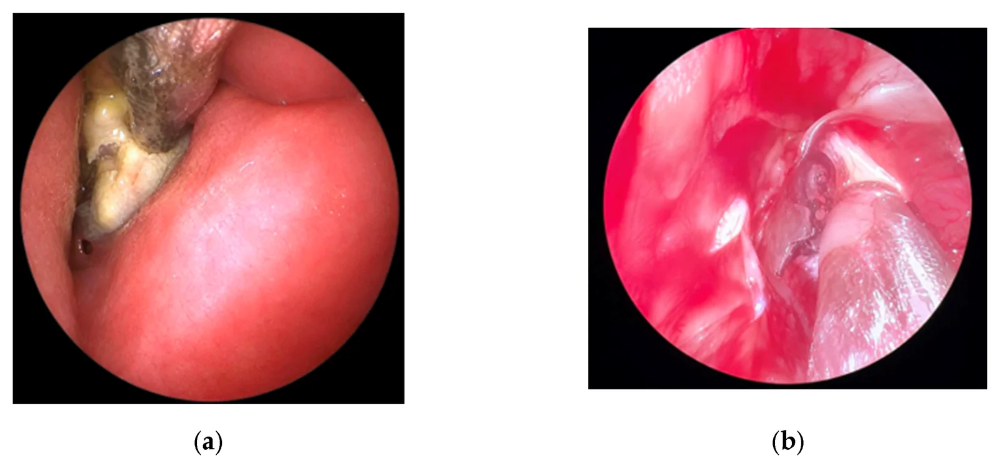
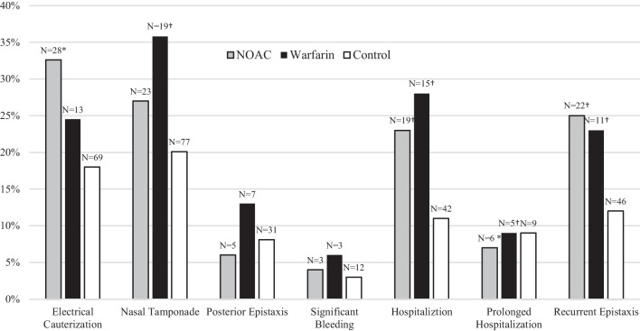
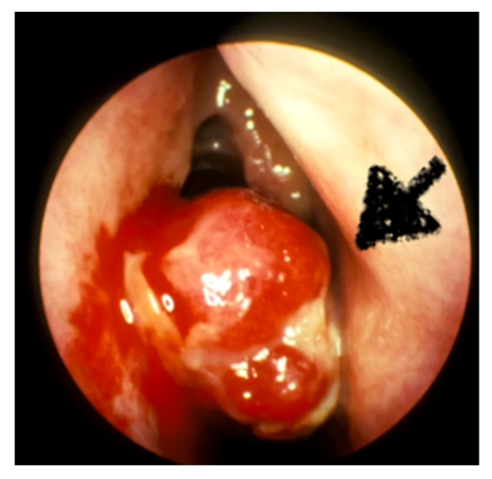

# 744 — Chảy máu cam ở trẻ có rối loạn đông máu: xét nghiệm, desmopressin/acid tranexamic & ngưỡng truyền / Epistaxis in children with a bleeding disorder

**Tags:** `pattern:chay-mau` `vung:mui` `vung:dau-co` `protocol:CTA-DSA-chay-mau-cam` `protocol:xet-nghiem-dong-mau`
**Mức chắc chắn (certainty):** tổng hợp y văn (literature synthesis) — nhóm tự biên từ loạt 944 trẻ chảy máu cam tại khoa cấp cứu (JACEP Open 2026), guideline điều trị chảy máu nguy kịch trong ITP (Blood Adv 2026), tổng quan điều trị bệnh von Willebrand (Blood Adv 2026), meta-analysis RCT về acid tranexamic tại chỗ (Cureus 2026) và khuyến cáo hình ảnh ESR (Eur Radiol 2026); **không** gắn một ca nguyên văn duy nhất.

## 1. Tổng quan bệnh học – cơ chế hình ảnh

- **Nối tiếp [bài 743](../743-chay-mau-cam-nang-o-tre/lesson.md):** bài 743 phủ **chảy máu cam nặng/tái diễn** (nội soi, CTA, DSA, Fisch cho JNA). Bài này phủ **nhóm trẻ có rối loạn đông máu** — nơi câu hỏi không còn là "máu từ đâu" mà là **có cần xét nghiệm gì, dùng thuốc gì, nâng yếu tố/tiểu cầu tới ngưỡng nào, và đốt có an toàn không**.
- **Vì sao vị trí quan trọng:** **80–90%** các đợt chảy máu cam xuất phát từ **niêm mạc phía trước**, vùng **đám rối Kiesselbach (Kiesselbach plexus)** trên vách sụn — nơi hội tụ các nhánh **động mạch sàng trước, sàng sau, mặt, khẩu cái lớn**, mô đệm mỏng, mạch nằm nông ngay dưới niêm mạc (PMC13282215). Chỉ **5–10%** là chảy máu sau (đám rối Woodruff), thường ở người lớn tuổi và **khó cầm hơn nhiều**.
- **TẠI SAO rối loạn đông máu đổi hoàn toàn cách xử trí (vật lý + sinh học):**
  - Bình thường, cầm máu tại vách mũi là **cầm máu tiên phát**: tiểu cầu bám dính → ngưng tập → cục tiểu cầu; rồi **fibrin** gia cố. Khi **thiếu yếu tố von Willebrand (VWF)** → tiểu cầu **không bám dính được vào collagen dưới nội mạc** dù số lượng tiểu cầu bình thường; khi **giảm tiểu cầu** → không đủ "gạch" để xây nút; khi **dùng kháng đông** → fibrin không hình thành.
  - Hệ quả: cục máu **vẫn hình thành nhưng dễ trôi** → chảy máu **kéo dài, tái phát trong 24 giờ**, không đáp ứng với bóp mũi đơn thuần. Bóp mũi 10–15 phút **vẫn là bước 1**, nhưng ở nhóm này **phải chuẩn bị thuốc/sản phẩm thay thế ngay từ đầu**.
- **Ngưỡng định lượng cần nhớ (từ loạt 944 trẻ, PMC12914786):**
  - Chỉ **31,4% (296/944)** trẻ chảy máu cam được làm xét nghiệm; **4,9% (46/944)** phải truyền sản phẩm máu (hồng cầu **19,6%**, tiểu cầu **21,7%**, yếu tố đông máu **23,9%**, nhiều sản phẩm **34,8%**).
  - Nhóm được truyền có **Hb trung vị 8,3 vs 12,6 g/dL (P < 0,001)** và **tiểu cầu 23,5 vs 247 K/µL (P < 0,001)** — nhưng **INR 1,2 vs 1,1 (P = 0,959)** và **aPTT 28,4 vs 26,8 giây (P = 0,209)** **không khác biệt**.
  - **Bài học cốt tử:** **INR/aPTT bình thường KHÔNG loại trừ rối loạn đông máu** — vì aPTT chỉ dài khi yếu tố VIII/IX giảm **dưới ~30–40%**, còn **bệnh von Willebrand type 1 (thể hay gặp nhất) có aPTT hoàn toàn bình thường**. Vì vậy bộ xét nghiệm ở trẻ chảy máu cam tái diễn **phải có CBC + VWF:Ag/VWF:RCo (± FVIII)**, không chỉ đông máu cơ bản.
  - Yếu tố **liên quan tới việc phải truyền**: chảy máu **kéo dài hoặc tái phát trong 24 giờ**, **đang chảy khi đến**, **đã biết rối loạn đông máu**, **đang điều trị ung thư**, **đang dùng kháng đông**, **tiền sử chảy máu cam**, và **đã can thiệp mũi tại khoa cấp cứu** (PMC12914786).
- **TẠI SAO trẻ dễ chảy máu cam hơn người lớn:** niêm mạc mỏng, mạch nông, diện tích vách sụn lớn so với đầu; **không khí khô** (điều hòa, mùa lạnh) làm nứt niêm mạc; **nhiễm trùng hô hấp trên** và **dị vật** là yếu tố tại chỗ thường gặp. Ở trẻ có bệnh nền, các yếu tố này **cộng dồn** với khiếm khuyết cầm máu.

## 2. Mẫu hình + chẩn đoán phân biệt theo vị trí (gamut)

- **Theo vị trí:** **trước (80–90%)** — Kiesselbach, nhìn thấy điểm chảy bằng đèn + banh mũi, cầm được bằng bóp/đốt/chèn trước; **sau (5–10%)** — Woodruff, máu chảy xuống họng, **không thấy điểm chảy**, cần chèn sau/CTA/nút mạch.
- **Theo tuổi:** **nhũ nhi (< 2 tuổi)** — nghĩ **dị vật, viêm mũi, rối loạn đông máu bẩm sinh, bị bạo hành** (chảy máu cam đơn thuần rất hiếm); **2–10 tuổi** — vô căn/Kiesselbach, dị vật, **ITP**; **dậy thì nam** — **u mạch máu vòm mũi họng (juvenile nasopharyngeal angiofibroma — JNA)** cho tới khi loại trừ; **lớn hơn** — **HHT**, polyp, u.
- **Theo cơ chế:** **tiểu cầu** (ITP, suy tủy, hóa trị) · **yếu tố đông máu** (VWD, hemophilia, bệnh gan, thiếu vitamin K) · **chức năng tiểu cầu** (Glanzmann, Bernard–Soulier) · **mạch máu** (HHT, JNA, dị dạng) · **tại chỗ** (dị vật, chấn thương, viêm mũi, thuốc xịt).
- **Mnemonic "CAM–MÁU":** **C**BC + **A**PTT/INR (không đủ một mình) · **M**àng niêm mạc (khô, viêm, dị vật) · **Á**p lực/bóp đúng 10–15 phút · **U** (JNA ở trai dậy thì, HHT ở người trẻ có thiếu máu) · **M**edicaments (kháng đông, NSAID, hóa trị).
- **Quy tắc vàng:** trẻ **chảy máu cam tái diễn + thiếu máu thiếu sắt + tiền sử gia đình** → nghĩ **HHT**; trẻ **trai dậy thì + nghẹt mũi MỘT BÊN + chảy máu tái diễn** → **JNA**, **cấm sinh thiết**, chuyển CTA.

## 3. Bảng so sánh phân biệt (ma trận đối chiếu)

| Thực thể (entity) | Hình ảnh / xét nghiệm điển hình | Chốt vào (rule-in) | Chốt loại (rule-out) | Gợi ý xác nhận |
|---|---|---|---|---|
| **Bệnh von Willebrand (VWD)** | **aPTT bình thường** ở type 1; **VWF:RCo < 0,30 IU/mL**; PFA-100 dài; niêm mạc (cam, răng, kinh nguyệt) | **VWF:RCo thấp + tiền sử chảy máu niêm mạc + bleeding score cao** | VWF:RCo bình thường + INR/aPTT bình thường → không loại trừ type 2 nhẹ, cần lặp khi có viêm | VWF:Ag, VWF:RCo, FVIII, đa trùng VWF; **không lấy máu khi đang viêm** |
| **ITP** | **Tiểu cầu < 20 × 10⁹/L**, hồng cầu/lý lịch đông máu bình thường; **không gan lách to** | **Tiểu cầu rất thấp + chảy máu niêm mạc, đông máu bình thường** | Tiểu cầu > 50 × 10⁹/L → ít gây chảy máu tự phát | CBC + phết máu; loại trừ suy tủy, TTP, DIC |
| **Hemophilia A/B** | **aPTT dài**, tiểu cầu bình thường; **FVIII/IX giảm** | **aPTT dài + tiền sử gia đình + khớp/máu tụ** | aPTT bình thường **loại trừ hemophilia nặng**, không loại trừ thể nhẹ | Định lượng FVIII/FIX; **không dùng desmopressin cho hemophilia B** |
| **Rối loạn chức năng tiểu cầu (Glanzmann, Bernard–Soulier)** | **Số tiểu cầu bình thường**, INR/aPTT bình thường, **PFA-100 dài**; chảy máu niêm mạc nặng | **Chảy máu niêm mạc + số tiểu cầu bình thường + đông máu bình thường** | Tiểu cầu thấp → nghĩ ITP/suy tủy | Ngưng tập tiểu cầu; **truyền tiểu cầu kháng HLA**, rFVIIa khi thất bại |
| **Đang dùng kháng đông / DOAC** | INR cao (warfarin) hoặc **anti-Xa** (LMWH/DOAC); thường có bệnh tim bẩm sinh | **INR > 2 + đang dùng thuốc + chảy máu kéo dài** | INR 1,0–1,2 và không dùng thuốc → không phải nguyên nhân | INR/anti-Xa; **thuốc giải đặc hiệu** theo loại thuốc |
| **HHT** | Niêm mạc mũi có **telangiectasia**; CT/CTA có thể thấy AVM phổi–gan–não; **thiếu máu thiếu sắt** | **Chảy máu cam tái diễn + telangiectasia môi/lưỡi/đầu ngón + tiền sử gia đình** | Không telangiectasia, không tiền sử gia đình → ít nghĩ HHT | Tiêu chuẩn Curaçao; nội soi mũi; sàng lọc AVM phổi (CEUS/CT) |
| **JNA** | **Nam dậy thì**, nghẹt mũi **một bên**; CTA: khối **ngấm mạnh**, mở rộng **hố chân bướm–khẩu cái**; MRI T2 nhiều dòng chảy; DSA cấp máu từ **động mạch hàm trong** | **Trai dậy thì + khối vòm mũi họng ngấm mạnh + chảy máu tái diễn** | Không có khối, niêm mạc bình thường → loại JNA | **CTA/MRI + DSA**; **tuyệt đối không sinh thiết tại phòng khám** |
| **Dị vật / chấn thương mũi** | Một bên, **mùi hôi, dịch mủ**, thấy dị vật; CT khi nghi xuyên thấu | **Một bên + mùi hôi + trẻ nhỏ** | Hai bên, niêm mạc lành → ít nghĩ dị vật | Nội soi mũi; **không thổi dị vật lên** |
| **Bệnh gan / thiếu vitamin K** | **INR cao, tiểu cầu thấp, fibrinogen thấp**; vàng da, gan lách to | **INR > 1,5 + bệnh gan + albumin thấp** | INR bình thường → loại trừ | Đông máu toàn bộ, fibrinogen, bilan gan; vitamin K |

*Nội soi mũi trái ở trẻ: (a) **mảnh lạc/đậu phộng** bị bỏ quên, bám mô hạt viêm và dịch mủ, niêm mạc xung quanh phù nề; (b) hình trong mổ sau khi lấy dị vật. Đây là nguyên nhân **một bên** hay gặp nhất ở trẻ nhỏ — chảy máu cam tái diễn một bên + **mùi hôi** phải nội soi trước khi nghĩ tới rối loạn đông máu. Nguồn: Pediatr Rep 2026 (PMC13516713), CC BY 4.0.*

## 4. Protocol chụp + phân tầng điều trị

**Bậc thang cầm máu (áp dụng cho mọi trẻ, nhóm rối loạn đông máu cần thêm bước 2b–3):**

1. **Bóp mũi đúng cách 10–15 phút** (đầu hơi cúi, thở miệng) + **thuốc co mạch tại chỗ + tê** (oxymetazoline/lidocaine) nếu còn chảy.
2. **Xét nghiệm (chỉ khi có chỉ định):** CBC, INR, aPTT, fibrinogen; **thêm VWF:Ag/VWF:RCo + FVIII** nếu chảy máu niêm mạc tái diễn hoặc tiền sử gia đình; nhóm đang dùng kháng đông: **INR/anti-Xa**.
3. **Thuốc theo cơ chế:**
   - **Acid tranexamic (TXA) tại chỗ** (bông tẩm 500 mg hoặc dạng xịt): **giảm chảy máu lại trong 24 giờ — RR 0,39 (0,17–0,89), giảm nguy cơ tuyệt đối 19,1 điểm %**; **không** giảm nhu cầu can thiệp tiếp (RR 0,59; 0,22–1,59) — dùng **sớm, đừng kỳ vọng thay thế được chèn/đốt** (PMC13603284).
   - **TXA toàn thân** (khi chảy máu nặng/niêm mạc lan tỏa): **10–15 mg/kg IV (tối đa 1 g) mỗi 8 giờ, 1–3 ngày** (khuyến cáo mạnh, độ chắc chắn rất thấp — PMC13487680).
   - **Desmopressin (DDAVP)** — chỉ khi **VWD type 1 (đặc biệt VWF > 0,30 IU/mL)**, một số type 2A/2M **đã chứng minh đáp ứng**, và **hemophilia A nhẹ**: **0,3 µg/kg IV/SC (tối đa 20 µg)** hoặc **150–300 µg đường mũi**. **Chống chỉ định: VWD type 3, type 2B** (làm nặng giảm tiểu cầu), **trẻ < 2 tuổi** (hạ natri, co giật). Tác dụng **giảm dần khi dùng lặp (tachyphylaxis)** → hạn chế số lần; **hạn chế nước + theo dõi Na** (PMC12887782).
   - **Định nghĩa đáp ứng desmopressin:** VWF hoạt tính **tăng ≥ 2 lần** nền **và** VWF + FVIII:C **duy trì > 0,50 IU/mL trong ≥ 4 giờ** (PMC12887782).
4. **Sản phẩm thay thế — ngưỡng:**
   - **VWF concentrate:** chảy máu **nặng** — đỉnh **0,80–1,00 IU/mL** (cả VWF và FVIII), **đáy ≥ 0,50 IU/mL** tới khi cầm máu; phẫu thuật lớn giữ **≥ 0,50 IU/mL ít nhất 3 ngày** (PMC12887782).
   - **Tiểu cầu:** trong **ITP có chảy máu nguy kịch** (định nghĩa: **tiểu cầu < 20 × 10⁹/L** + vị trí nguy hiểm **hoặc** huyết động không ổn định): truyền **≥ 1 liều tiểu cầu**, **đánh giá lại liên tục** để quyết định truyền tiếp — phối hợp **corticoid liều cao + IVIG 1 g/kg (1–2 ngày) + TXA + TPO-RA** (khuyến cáo mạnh; PMC13487680). Tử vong trong chảy máu nguy kịch ở ITP: **30,6% người lớn / 19,7% trẻ** (PMC11798764).
   - **Glanzmann/Bernard–Soulier:** truyền tiểu cầu **kháng HLA**; **rFVIIa** khi thất bại (đã có ca BSS kháng truyền tiểu cầu HLA-matched được cứu bằng rFVIIa — PMC12945955).
5. **Can thiệp tại chỗ:** **đốt (silver nitrate/bipolar) CHỈ khi nhìn thấy rõ một điểm chảy ở vùng Kiesselbach** và đã kiểm soát được chảy máu ồ ạt; trong loạt 944 trẻ, đốt bạc nitrat chỉ dùng ở **3%**, chèn mũi **5%**. **Không đốt mù**, **không đốt cả hai bên cùng lúc** (nguy cơ thủng vách), **không đốt diện rộng** ở trẻ có rối loạn đông máu.
6. **Chèn mũi / bóng:** chèn trước có thể mua tại chỗ; bóng/merocel để **< 48–72 giờ** (nguy cơ hoại tử niêm mạc, nhiễm trùng, sốc độc).
7. **Hình ảnh & can thiệp mạch:** **không chụp thường quy**. **CTA** khi chảy máu **sau, nặng, tái diễn** hoặc nghi tổn thương mạch/u; **DSA + nút mạch** là lựa chọn bậc 2 cho chảy máu không cầm — khoảng **6%** ca cần can thiệp vượt quá đốt/chèn (PMC13282215).

```mermaid
flowchart TD
  A[Trẻ chảy máu cam] --> B[Bóp mũi 10–15 phút + co mạch/tê tại chỗ]
  B --> C{Còn chảy?}
  C -->|Không| D[Cho về + hướng dẫn bôi Vaseline, tránh ngoáy]
  C -->|Có| E{Có rối loạn đông máu đã biết, ung thư, đang kháng đông, chảy máu kéo dài/tái phát?}
  E -->|Không| F[Nội soi mũi tìm điểm chảy → đốt nếu thấy]
  E -->|Có| G[CBC + INR/aPTT + fibrinogen; thêm VWF:Ag/VWF:RCo + FVIII]
  G --> H{Cơ chế?}
  H -->|VWD type 1/hemophilia A nhẹ| I[Desmopressin 0,3 µg/kg, tối đa 20 µg]
  H -->|VWD type 3/2B, chảy máu nặng| J[VWF concentrate, đỉnh 0,8–1,0 IU/mL]
  H -->|ITP, tiểu cầu dưới 20 × 10⁹/L| K[Truyền tiểu cầu + corticoid + IVIG + TXA]
  H -->|Glanzmann/BSS| L[Tiểu cầu kháng HLA; rFVIIa nếu thất bại]
  I --> M[TXA tại chỗ + TXA toàn thân 10–15 mg/kg mỗi 8 giờ]
  J --> M
  K --> M
  L --> M
  M --> N{Cầm máu?}
  N -->|Có| D
  N -->|Không| O[Chèn mũi trước/bóng dưới 72 giờ]
  O --> P{Vẫn chảy hoặc chảy sau?}
  P -->|Có| Q[CTA mũi → DSA nút mạch]
  P -->|Không| D
```

*So sánh NOAC (xám), warfarin (đen) và chứng (trắng) ở **người lớn** chảy máu cam cấp (786 bệnh nhân, theo dõi 52,6 ± 20,4 tháng): can thiệp nhỏ (đốt điện, chèn mũi), chảy máu sau, chảy máu đáng kể, nhập viện, nhập viện kéo dài (> 3 ngày), tái phát. Can thiệp nhỏ: chứng **63,1%** — kháng kết tập tiểu cầu **74,4%** — kháng đông kép **79,6%** — warfarin **77,3%** (p < 0,05); riêng NOAC **không khác chứng** và **không ca nào cần can thiệp lớn**. Nguồn: Eur Arch Otorhinolaryngol 2024 (PMC11393048), CC BY 4.0 — **dữ liệu người lớn**, dùng tham chiếu vì bằng chứng ở trẻ còn thiếu.*

## 5. Biến thể bình thường và cạm bẫy

- **INR/aPTT bình thường ≠ không rối loạn đông máu:** VWD type 1 và rối loạn chức năng tiểu cầu có **đông máu cơ bản hoàn toàn bình thường**; trong loạt 944 trẻ, INR và aPTT **không phân biệt** được nhóm phải truyền (P = 0,959 và 0,209). Ai chỉ làm INR/aPTT rồi kết luận "đông máu bình thường" là **bỏ sót VWD**.
- **Đốt hai bên cùng lúc:** nguy cơ **thủng vách** — chỉ đốt một bên, một điểm, diện nhỏ.
- **Đốt khi không thấy điểm chảy:** đốt mù trên niêm mạc đang viêm vừa **không cầm được máu** vừa tạo **loét mới chảy**. Ở nhóm rối loạn đông máu, **ưu tiên TXA + sản phẩm thay thế** trước.
- **Desmopressin không phải "thuốc cầm máu chung":** sai ở **type 3 và type 2B** (làm nặng giảm tiểu cầu), **nguy hiểm ở trẻ < 2 tuổi** (hạ natri → co giật), và **mất tác dụng khi dùng lặp**. Luôn **hạn chế nước** và **đo Na** nếu dùng ≥ 2 liều.
- **Kỳ vọng quá vào TXA:** TXA tại chỗ giảm **chảy máu lại trong 24 giờ** nhưng **không giảm nhu cầu can thiệp tiếp** (RR 0,59; 0,22–1,59) — đừng coi TXA là thay thế cho chèn/đốt/nâng yếu tố.
- **"Chảy máu cam tái diễn ở trẻ = lành tính":** bẫy bỏ sót **JNA** (trai dậy thì, **một bên**, nghẹt mũi) và **HHT** (thiếu máu thiếu sắt, tiền sử gia đình). **JNA cấm sinh thiết** — sinh thiết tại phòng khám có thể gây chảy máu không cầm.
- **Truyền máu theo phản xạ:** chỉ **4,9%** trẻ chảy máu cam được truyền; tỷ lệ này **thay đổi 4–24%** giữa các bệnh viện (dẫn trong PMC12914786) → **thiếu tiêu chuẩn**, dễ truyền thừa. Ngưỡng Hb và tiểu cầu phải gắn với **cơ chế** và **đang chảy hay đã cầm**.
- **Chèn bóng quá lâu:** hoại tử niêm mạc, viêm xoang, sốc độc; tháo/đánh giá trong **48–72 giờ**.
- **Sau khi cầm máu vẫn phải tìm nguyên nhân:** trẻ tái diễn **≥ 3 đợt/năm**, thiếu máu, hoặc chảy máu niêm mạc khác (nướu, phân) → **bleeding score + VWF panel**, không chỉ hướng dẫn bôi ẩm.

## 6. Tự lượng giá — Blind Quiz

**Ca 1 — Bé trai 4 tuổi, chảy máu cam **một bên trái** tái diễn 3 tuần, ngủ ngáy, hơi thở **mùi hôi**, không sốt. Mẹ cho biết bé hay nhét đồ chơi vào mũi.**

- Hỏi: (1) Findings chính? (2) Ba chẩn đoán phân biệt của chảy máu cam **một bên** ở trẻ? (3) Việc đầu tiên phải làm và việc **không** được làm?

<b>Bấm để hiện đáp án (findings + chẩn đoán)</b>

- **Findings:** nội soi mũi trái — **khối/mảnh dị vật** (đậu phộng) bám **mô hạt viêm + dịch mủ**, niêm mạc phù nề, dễ chảy máu khi chạm; hình (b) là trong mổ sau khi lấy dị vật.
- **Chẩn đoán:** **dị vật mũi bị bỏ quên** — chảy máu do **viêm mô hạt** quanh dị vật, không phải do rối loạn đông máu.
- **Phân biệt một bên ở trẻ:** dị vật, **JNA** (trai dậy thì — xem [bài 743](../743-chay-mau-cam-nang-o-tre/lesson.md)), u/polyp, viêm xoang một bên, **HHT**, chấn thương.
- **Xử trí:** **nội soi lấy dị vật** (gây mê nếu cần, tránh đẩy sâu); **kháng sinh** khi có viêm mũi xoang mủ; kiểm tra **bên đối diện**; hướng dẫn cha mẹ.
- **Điều KHÔNG làm:** **thổi ngược dị vật lên** (nguy cơ sặc vào đường thở), **đốt mù** khi chưa thấy điểm chảy, và **không kết luận "rối loạn đông máu"** khi chưa loại dị vật.
- **Nguồn ảnh:** Pediatr Rep 2026 (PMC13516713), CC BY 4.0.

**Ca 2 — Bé gái 10 tuổi, tiền sử ITP (tiểu cầu 18 × 10⁹/L), chảy máu cam tái diễn **cùng bên phải** 2 tháng sau một đợt chèn bông cầm máu ở tuyến trước; nghẹt mũi một bên, mùi hôi.**

- Hỏi: (1) Vì sao chảy máu tái diễn dù tiểu cầu đã được điều trị? (2) Findings? (3) Xử trí và ngưỡng tiểu cầu cần đạt trước can thiệp?

<b>Bấm để hiện đáp án</b>

- **Findings:** nội soi — **khối mô hạt đỏ, dễ chảy máu** (mũi tên) bao quanh **vật liệu chèn còn sót** ở ngách giữa; không thấy điểm chảy mạch máu đơn thuần.
- **Chẩn đoán:** **bỏ quên vật liệu chèn mũi** gây **viêm mô hạt + chảy máu tái diễn** — nguyên nhân **tại chỗ**, không phải do ITP nặng lên.
- **Vì sao quan trọng:** trẻ có bệnh đông máu/giảm tiểu cầu thường được chèn nhiều lần; **mỗi lần chèn phải ghi hồ sơ + hẹn tháo** (bóng/merocel **< 48–72 giờ**) — bỏ quên tạo **ổ viêm mạn + chảy máu** đúng như ca này.
- **Xử trí:** lấy vật liệu sót dưới nội soi, rửa, **kháng sinh** nếu có mủ, cầm máu bằng **TXA tại chỗ** (và TXA toàn thân **10–15 mg/kg mỗi 8 giờ** nếu còn chảy); kiểm soát tiểu cầu theo guideline chảy máu nguy kịch (**chảy máu nguy kịch = tiểu cầu < 20 × 10⁹/L + vị trí nguy hiểm/huyết động không ổn định → truyền ≥ 1 liều, đánh giá lại** — PMC13487680).
- **Bài học:** **chảy máu tái diễn một bên ở trẻ có bệnh nền đông máu vẫn phải nội soi** — đừng quy hết cho "bệnh nền".
- **Nguồn ảnh:** Pediatr Rep 2026 (PMC13516713), CC BY 4.0.

## Bài liên quan chéo
- [743 – Chảy máu cam nặng/tái diễn ở trẻ: nội soi, CTA, DSA & nút mạch](../743-chay-mau-cam-nang-o-tre/lesson.md) (Fisch, JNA, HHT)
- [741 – Dị dạng mạch máu đầu–cổ ở trẻ](../741-di-dang-mach-mau-dau-co-o-tre/lesson.md) (ISSVA, phân loại mạch máu)
- [710 – Giải phẫu CT xoang mũi](../710-sinonasal-ct-anatomy/lesson.md) (giải phẫu nền)
- [116 – Nhiễm trùng nang gan ở người ghép thận](../116-nhiem-trung-nang-gan-ghep-than/lesson.md) (ca nút mạch ở bệnh nhân ghép thận)

## Ảnh
- `images/744_di-vat-mui_Noi-soi_PMC13516713.webp` — nội soi mũi: dị vật (đậu phộng) + mô hạt, CC BY 4.0 (PMC13516713).
- `images/744_bong-sot_Noi-soi_PMC13516713.webp` — nội soi: mô hạt quanh vật liệu chèn còn sót, CC BY 4.0 (PMC13516713).
- `images/744_chong-dong_Bar_PMC11393048.jpg` — kết cục chảy máu cam theo nhóm kháng đông (người lớn), CC BY 4.0 (PMC11393048).
- Nguồn + giấy phép từng ảnh: `images/CREDITS.md`.

> Không dùng để chẩn đoán độc lập khi chưa có người hướng dẫn.
