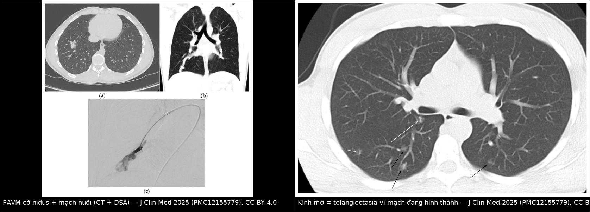
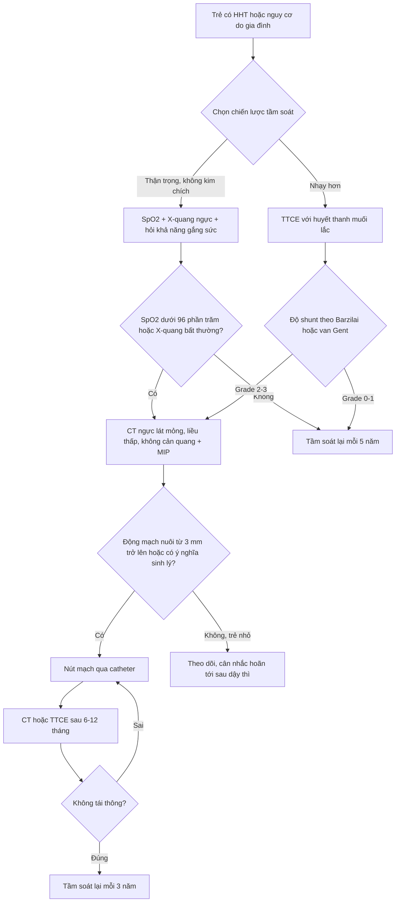
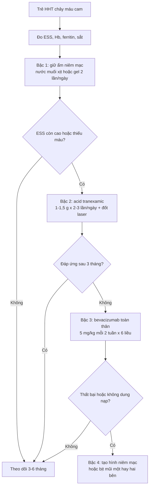
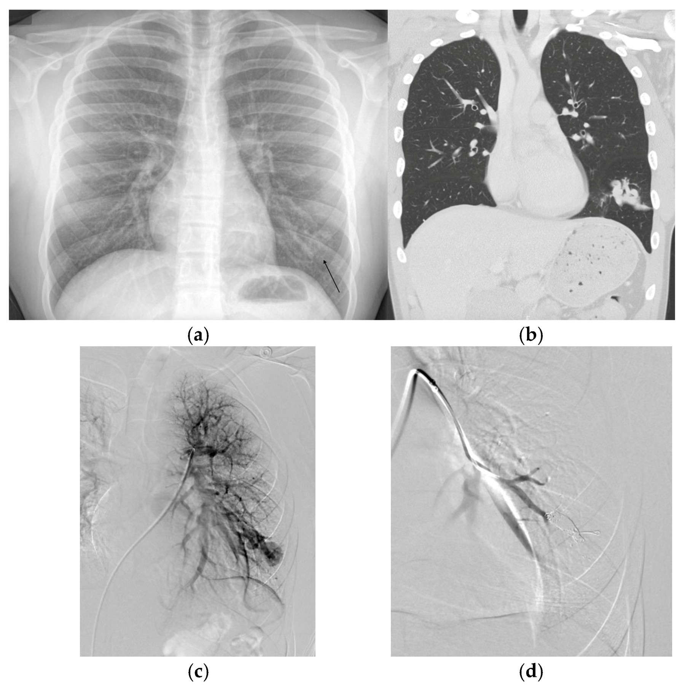
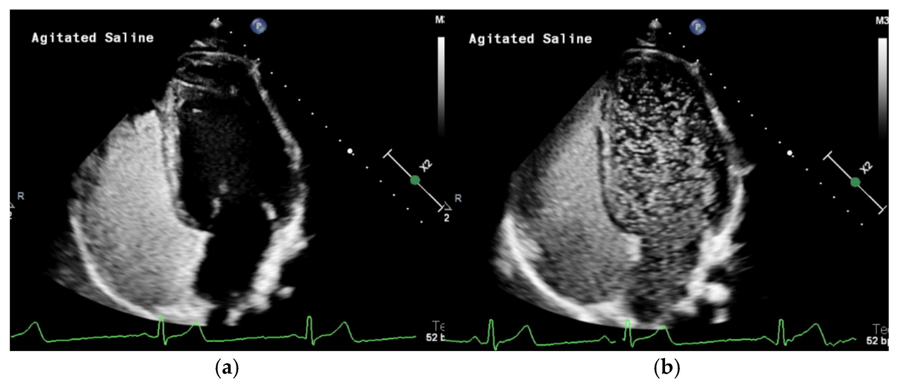
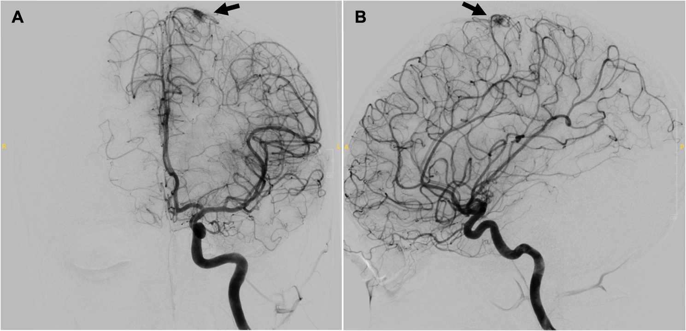
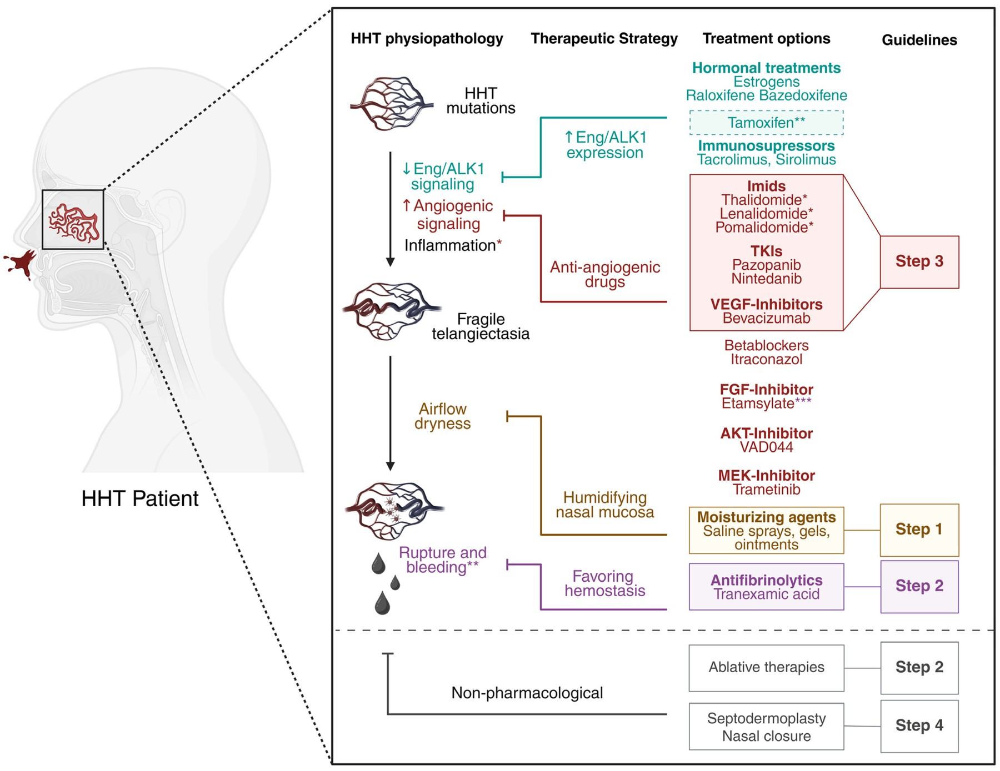

# 745 — Bệnh u mạch máu di truyền (HHT) ở trẻ: tầm soát AVM phổi – não & điều trị chảy máu cam tái diễn / Hereditary haemorrhagic telangiectasia in children

**Tags:** `pattern:di-dang-dong-tinh-mach` `pattern:gian-mach-niem-mac` `pattern:kinh-mo` `pattern:shunt-phai-trai` `vung:mui` `vung:phoi` `vung:nao` `vung:gan` `score:Curacao` `score:Barzilai` `score:vanGent` `score:Shin` `score:ESS` `protocol:TTCE` `protocol:CT-nguc-lat-mong` `protocol:MRI-nao-MRA` `protocol:DSA-nut-mach`

**Mức chắc chắn (certainty):** tổng hợp y văn (literature synthesis) — tổng quan có hệ thống về **PAVM ở trẻ HHT** (J Clin Med 2025, PMC12155779); cập nhật **tiêu chuẩn Curaçao** sau giải trình tự toàn hệ gen (J Med Genet 2024, PMC10850674); ca gia đình có **bAVM** ở trẻ 15 tuổi (BMC Pediatr 2026, PMC12954979); tổng quan **điều trị chảy máu cam HHT** (J Clin Med 2026, PMC12608258). Không có thử nghiệm ngẫu nhiên lớn nào về **liều/chỉ định** ở trẻ; các ngưỡng "khi nào nút mạch" là khuyến cáo của **Second International HHT Guidelines** được các nguồn trên trích lại.

> **Câu chốt:** HHT ở trẻ **không phải "chảy máu cam hay tái diễn"** mà là **bệnh mạch máu hệ thống có 3 cửa tử vong**: **(1) PAVM** → shunt phải–trái gây **giảm oxy** và **áp-xe não/đột quỵ do huyết khối nghịch (paradoxical embolus)**; **(2) bAVM** → **xuất huyết não**, có thể là **biến cố đầu tiên** (ca em gái 7 tuổi tử vong trước khi cả gia đình được chẩn đoán); **(3) chảy máu cam/GI** → **thiếu máu thiếu sắt** mạn. Ba câu hỏi phải trả lời ở mọi trẻ nghi HHT: **có PAVM không (TTCE/CT) · có AVM não không (MRI/MRA) · chảy máu cam đang ở bậc nào (ESS)**. Sai lầm chết người: **chờ đủ 3 tiêu chuẩn Curaçao** ở trẻ (chảy máu cam phổ biến ở mọi trẻ, giãn mạch xuất hiện muộn) — phải **xét nghiệm gen + tầm soát tạng** khi có tiền sử gia đình.

## 1. Tổng quan bệnh học – cơ chế hình ảnh

### 1.1 Bệnh học: mất cân bằng BMP9/ALK1 → mao mạch bị "bỏ qua"

- **Di truyền:** trội nhiễm sắc thể thường; **ENG** (HHT1), **ACVRL1/ALK1** (HHT2), **SMAD4** (hội chứng JP-HHT), **GDF2/BMP9**; hai gen đầu chiếm **96%** ca đủ tiêu chuẩn Curaçao, **SMAD4** chỉ **1–2%** (PMC12155779). Trình tự toàn hệ gen đã **loại bỏ locus HHT3** trên nhiễm sắc thể 5 (PMC10850674).
- **Cơ chế:** mất chức năng **endoglin/ALK1** → giảm tín hiệu **BMP9–SMAD1/5/8** ở nội mô → tăng yếu tố sinh mạch (VEGF), giảm ổn định thành mạch. Kết quả: **giãn mạch (telangiectasia)** ở mao mạch niêm mạc và **AVM** ở tạng — nơi **giường mao mạch bị thay bằng ống nối động–tĩnh mạch trực tiếp** (PMC12608258).
- **Vì sao PAVM gây bệnh nặng hơn "một nốt trong phổi":** mất giường mao mạch phổi = mất **bộ lọc** duy nhất giữ huyết khối/vi khuẩn khỏi tuần hoàn hệ thống → **shunt phải–trái**. Hệ quả: **giảm oxy (hypoxemia)**, **ngón tay dùi trống**, và **đột quỵ/TIA/áp-xe não/nhồi máu cơ tim** do **embolus nghịch**. Đây là lý do phải **tầm soát chứ không chờ triệu chứng**.
- **Vì sao HHT hay bị bỏ sót ở trẻ:** biểu hiện **phụ thuộc tuổi** — chảy máu cam có ở **> 90%** người HHT *cả đời* nhưng cũng rất phổ biến ở trẻ bình thường; **giãn mạch môi/lưỡi/đầu ngón xuất hiện muộn**; vì vậy **Curaçao kém tin cậy ở trẻ** (PMC12608258).

### 1.2 Ngưỡng định lượng trụ cột

| Đại lượng | Con số | Nguồn |
|---|---|---|
| Tần suất HHT | **1/5.000 – 1/8.000** (Bắc Mỹ **1/5.000**); quần thể cách ly có thể **1/1.331** | PMC12608258, PMC12155779 |
| Tỉ lệ HHT có PAVM | **30–50%**; ngược lại **~90%** người có PAVM có HHT | PMC12155779 |
| PAVM ở trẻ HHT | **gần bằng người lớn** (không hiếm vì còn nhỏ); hay gặp ở **ENG (HHT1)** | PMC12155779 |
| Tốc độ lớn của túi PAVM | **~10%/năm** đường kính trên CT; **tăng nhanh trong dậy thì** | PMC12155779 |
| Ngưỡng can thiệp (khuyến cáo) | **Động mạch nuôi ≥ 3 mm** → nút mạch nội mạch; hoặc PAVM lớn/có ý nghĩa sinh lý, **SpO₂ giảm**, đã có biến chứng | PMC12155779 (theo Second International HHT Guidelines) |
| Tái thông sau nút mạch ở **trẻ** | **tới 70%** (người lớn **tới 50%**); **44%** phát triển tuần hoàn bàng hệ hệ thống | PMC12155779 |
| Nút mạch khi **< 15 tuổi** | **23,1%** PAVM tồn tại (dai dẳng) | PMC12155779 |
| Thời gian theo dõi sau nút mạch | CT và/hoặc TTCE lúc **6–12 tháng**; nếu không tái thông → **mỗi 3 năm** | PMC12155779 |
| Tầm soát định kỳ ở trẻ không triệu chứng | **≥ mỗi 5 năm** | PMC12155779 |
| PAVM thể lan tỏa (diffuse) | **~4%**; khó nút mạch, có ca cải thiện sau **cắt phân thùy/thùy** | PMC12155779 |
| bAVM ở trẻ HHT phát hiện khi tầm soát | **14%** (trong đó **58%** không triệu chứng); đoàn hệ tiến cứu khác: **3% (2/61)** trẻ không triệu chứng | PMC12954979 |
| Nguy cơ vỡ của bAVM ở HHT | **20%** (tổng quan hệ thống) | PMC12954979 |
| Chảy máu cam ở HHT | **> 90%** có ít nhất một lần trong đời | PMC12608258 |
| Thang **ESS** | 0–10 điểm; **khác biệt tối thiểu có ý nghĩa = 0,71** → **ngừng trị liệu nếu không giảm ≥ 0,71** | PMC12608258 |

### 1.3 TẠI SAO hình ảnh trông như vậy (vật lý + mô bệnh)

- **Kính mờ (ground-glass opacity) trên CT = telangiectasia đang hình thành.** Ở đây là **vi mạch giãn giữa tiểu động mạch và tiểu tĩnh mạch** — không có nidus lớn, không có bao; trên HRCT chỉ thấy **mờ nhẹ, bờ không rõ**. Vì vậy **kính mờ ở trẻ HHT không mặc định là viêm phổi** — đặc biệt khi **nhiều ổ, đáy phổi, không sốt** (PMC12155779, Hình 4).
- **PAVM trưởng thành = nốt/kính mờ + 2 mạch nhìn rõ.** Khi vi mạch lớn dần, **động mạch nuôi** và **tĩnh mạch dẫn lưu** trở nên nhìn thấy, rồi **túi phình (sac)** xuất hiện; trên CT **không cản quang** vẫn thấy vì máu trong lòng mạch **~40–60 HU** tương phản với khí phổi **−800 đến −900 HU** — không cần tiêm cản quang. **MIP** giúp lần theo mạch nuôi/tĩnh mạch dẫn.
- **Vì sao tĩnh mạch dẫn lưu thường to hơn động mạch nuôi:** áp lực và lưu lượng bên tĩnh mạch tích lũy từ toàn nidus → **giãn theo thời gian**; dấu này giúp phân biệt với **phình động mạch phổi** (không có tĩnh mạch dẫn lưu to).
- **Vì sao TTCE bắt được shunt:** bong bóng siêu âm (**agitated saline**) bị **giữ lại ở giường mao mạch** bình thường; nếu có **shunt trong tim** → xuất hiện ở tim trái sau **1–2 chu kỳ**; nếu **shunt trong phổi** → sau **3–8 chu kỳ** (thời gian đi qua tuần hoàn phổi). Đây là **lý do định thời bằng số chu kỳ tim**, không phải "thấy bong bóng là xong".
- **Vì sao bAVM ở HHT khó thấy trên MRA:** tổn thương **nhỏ, nhiều ổ, lưu lượng thấp**, dễ bị coi là "mạch nổi" — ca 15 tuổi trong bài có **MRI/MRA chỉ thấy mạch nổi + nốt nhỏ ở thùy chẩm phải, không nidus rõ**, nhưng **DSA** mới xác định AVM đỉnh đầu từ động mạch cảnh trái (PMC12954979, Hình 2). Bài học: **MRA bình thường/không kết luận + nghi ngờ cao → DSA**, nhất là khi đã có **hemosiderin** (dấu xuất huyết cũ).
- **Vì sao chảy máu cam tái diễn:** niêm mạc mũi có **telangiectasia thành mỏng, thiếu cơ trơn**; **không khí khô** làm nứt niêm mạc → chảy máu. Do đó **giữ ẩm** là bậc 1, không phải "cầm máu bằng cách đốt" (PMC12608258).

*Trái: PAVM thùy dưới phải — nidus có mạch nuôi rõ trên CT lát mỏng + hình chụp mạch chọn lọc tương ứng. Phải: nhiều ổ **kính mờ** (mũi tên đen) = telangiectasia vi mạch, kèm **mạch thẳng đang hình thành** (mũi tên trắng) ở trẻ HHT có giảm oxy và dùi trống ngón tay. Ảnh ghép letterbox từ J Clin Med 2025 (PMC12155779), CC BY 4.0.*

## 2. Mẫu hình + chẩn đoán phân biệt theo vị trí (gamut)

**Mẫu hình chốt:** *trẻ có **chảy máu cam tái diễn** hoặc **tiền sử gia đình HHT**, kèm **≥ 1 tổn thương mạch**: **kính mờ/nốt phổi có mạch nuôi – tĩnh mạch dẫn**, **AVM não nhỏ nhiều ổ**, **giãn mạch môi/lưỡi/đầu ngón**, hoặc **shunt phải–trái trên TTCE**.*

### 2.1 Gamut theo cơ quan (ưu tiên tầm soát)

| Cơ quan | Tổn thương | Hệ quả nếu bỏ sót | Cách phát hiện |
|---|---|---|---|
| **Phổi** | **PAVM** (đơn giản **~90%**, phức tạp **~10%**, lan tỏa **4%**) | Giảm oxy, **đột quỵ/TIA**, **áp-xe não**, vỡ gây ho máu | **TTCE** (sàng lọc) → **CT lát mỏng** (± MIP) → **DSA để nút** |
| **Não** | **bAVM** (nhỏ, nhiều ổ, Spetzler–Martin thấp) | **Xuất huyết não** (20% nguy cơ vỡ) | **MRI + MRA** (có cản quang); **DSA** khi MRA không kết luận |
| **Mũi** | Telangiectasia niêm mạc mũi | Thiếu máu thiếu sắt, truyền máu | Nội soi mũi; **ESS** |
| **Gan** | AVM gan (**HHT2 nhiều hơn**) | **Suy tim cung lượng cao**, tăng áp cửa | Siêu âm Doppler; CT/MRI có cản quang |
| **Tiêu hóa** | Telangiectasia niêm mạc | Xuất huyết tiêu hóa, thiếu máu | Nội soi khi có thiếu máu không rõ nguồn |
| **Da – niêm mạc** | Giãn mạch môi, lưỡi, đầu ngón, mặt | Không nguy hiểm nhưng là **tiêu chuẩn chẩn đoán** | Khám + **soi đèn**; chụp ảnh theo dõi |

### 2.2 Gamut theo tuổi (chọn xác suất trước và cách tầm soát)

- **< 2 tuổi:** hiếm có đủ tiêu chuẩn; **chảy máu cam đơn thuần rất hiếm** → nghĩ dị vật, viêm mũi, rối loạn đông máu. Nếu có **tiền sử gia đình** → **xét nghiệm gen**, không chờ triệu chứng.
- **2–10 tuổi:** bắt đầu có giãn mạch môi; **PAVM có thể đã lớn** dù không triệu chứng → **sàng lọc bằng SpO₂ + X-quang ngực** hoặc **TTCE**; **MRI não** một lần khi chẩn đoán.
- **Dậy thì:** PAVM **tăng nhanh (~10%/năm)**; **chảy máu cam nặng lên**; cân nhắc **rút ngắn khoảng tầm soát**.
- **Vị thành niên:** thường là lúc **phát hiện PAVM lớn** và **nút mạch**; đồng thời là lúc **bAVM** có thể biểu hiện.

### 2.3 Mnemonic **"CAM–PAV–B"** (5 câu hỏi ở trẻ nghi HHT)

- **C** — **Curaçao** có mấy tiêu chuẩn? (nhưng **không chờ đủ 3** ở trẻ).
- **A** — **Ai trong gia đình** đã chảy máu cam / xuất huyết não / được chẩn đoán? (vẽ **gia hệ**).
- **M** — **Mũi**: ESS bao nhiêu, có thiếu máu thiếu sắt không?
- **PAV** — **P**hổi: SpO₂, X-quang, TTCE; **A**VM não: MRI/MRA.
- **B** — **Bậc điều trị** chảy máu cam (1 giữ ẩm → 2 TXA/đốt → 3 bevacizumab → 4 tạo hình/bịt mũi).

## 3. Bảng so sánh phân biệt (ma trận đối chiếu)

| Thực thể (entity) | Hình ảnh điển hình | Chốt vào (rule-in) | Chốt loại (rule-out) | Gợi ý xác nhận |
|---|---|---|---|---|
| **PAVM trong HHT** | Kính mờ/nốt + **động mạch nuôi + tĩnh mạch dẫn lưu** (tĩnh mạch thường to hơn), **nhiều ổ**, đáy phổi/lingula; TTCE **grade 3** | **Nhiều ổ + tiền sử gia đình/gen HHT + TTCE dương + ≥ 1 tổn thương có mạch nuôi rõ** | **Tổn thương đơn độc, không mạch nuôi, không shunt trên TTCE** → không phải PAVM | CT lát mỏng ± MIP; TTCE; DSA trước nút |
| **PAVM đơn độc (không HHT)** | **Một ổ**, thường thùy dưới trái; không giãn mạch niêm mạc | **Một tổn thương + không tiêu chuẩn Curaçao + gen âm** | **Nhiều ổ + giãn mạch môi + gia đình** → HHT | Gen **ENG/ACVRL1/SMAD4/GDF2** |
| **Phình động mạch phổi** | Nốt **bờ rõ**, **không có tĩnh mạch dẫn lưu to**, có thể **vôi hóa thành** | **Thành mạch đủ 3 lớp, không có nidus** | **Có tĩnh mạch dẫn lưu to + shunt** → PAVM | CTA/CT cản quang; theo dõi |
| **Phình giả Rasmussen (lao hang)** | Hang + **mạch máu trong thành hang**, thường **một ổ**, bối cảnh lao/ho máu | **Ho máu + hang + bối cảnh nhiễm lao** | **Không hang, không nhiễm trùng** → không phải | CTA; nút mạch |
| **Hội chứng gan–phổi (HPS)** | Giãn mạch **đáy phổi đối xứng**, **shunt trong phổi** trên TTCE, bệnh gan | **Xơ gan + giảm oxy + shunt trong phổi không có nidus** | **Có nidus/mạch nuôi rõ** → PAVM | Siêu âm tim cản âm; khí máu; CT |
| **bAVM trong HHT** | **Nidus nhỏ, nhiều ổ**, có thể chỉ **mạch nổi + hemosiderin** trên MRI, **không có nidus rõ trên MRA** | **Nhiều ổ + HHT đã xác định + hemosiderin cũ** | **Một AVM lớn điển hình, không tổn thương khác** → AVM lẻ | **MRI + MRA**; **DSA** khi không kết luận; SWI cho máu cũ |
| **CM–AVM (RASA1/EPHB4)** | AVM phổi/não + **dị dạng mao mạch da** (mảng hồng), có thể **giống HHT** | **Gen RASA1/EPHB4 + mảng da + AVM** | **ENG/ACVRL1 dương** → HHT | Panel gen mạch máu (có cả 6 gen) |
| **Cavernoma (hang mạch)** | **"Popcorn"**, viền hemosiderin, **không shunt**, không có mạch nuôi | **SWI: viền hemosiderin đậm, không nidus mạch** | **Có mạch nuôi + tĩnh mạch dẫn + shunt** → AVM | MRI **SWI**; MRA/DSA âm |

## 4. Protocol chụp + hệ phân độ/điểm chuẩn hóa

### 4.1 Chẩn đoán: Curaçao + gen (và vì sao "Curaçao ở trẻ" là bẫy)

- **4 tiêu chuẩn Curaçao:** (1) **chảy máu cam tái diễn, tự phát**; (2) **giãn mạch niêm mạc ở vị trí điển hình** (môi, khoang miệng, ngón tay, mũi); (3) **tổn thương tạng** (AVM phổi/gan/não/tủy, giãn mạch tiêu hóa); (4) **tiền sử gia đình** (người thân bậc 1).
- **≥ 3 tiêu chuẩn = HHT chắc chắn; 2 = nghi ngờ**; nhưng dữ liệu mới: **chỉ 1 tiêu chuẩn là PAVM cũng đủ gợi ý mạnh** — PAVM đơn độc có thể là **biểu hiện duy nhất** (PMC10850674).
- **Cảnh báo trung thực:** tác giả PMC10850674 kết luận **có thể đủ 3 tiêu chuẩn mà KHÔNG phải HHT** → **nên xét nghiệm gen để xác nhận**, đặc biệt khi 3 tiêu chuẩn chỉ gồm **chảy máu cam + giãn mạch + gia đình** (khi đó nên gọi "**HHT khả năng cao**" thay vì "chắc chắn").

### 4.2 Tầm soát PAVM ở trẻ — hai con đường hợp lệ

- **Vì sao có 2 chiến lược:** chiến lược **thận trọng** (SpO₂ + X-quang) đã được chứng minh **an toàn qua > 7.000 người–năm** theo dõi, **không có biến chứng PAVM** ở trẻ đã tầm soát; đổi lại **có thể bỏ sót PAVM nhỏ** tới tuổi trưởng thành. **TTCE** nhạy hơn nhưng cần **đường truyền**, có **dương tính giả** (shunt vi mạch sinh lý, shunt gan) (PMC12155779).
- **Ngưỡng cắt của TTCE:** **Barzilai 0–4** (theo độ đậm đặc thất trái); **van Gent định lượng: grade 1 ≤ 29 bong bóng, grade 2 = 30–100, grade 3 > 100**. **Grade 0–1 gần như không có PAVM điều trị được** → có thể **hoãn CT** (PMC12155779).
- **CT ngực:** **lát mỏng, liều thấp, không cản quang** là đủ; **MIP** để lần mạch; **không** dùng CT làm test sàng lọc đầu tay.

### 4.3 Phân độ PAVM ở trẻ trên CT (Shin) — dùng để mô tả "đang ở giai đoạn nào"

| Độ | Hình ảnh | Ý nghĩa |
|---|---|---|
| **0** | Nốt, **không nghĩ PAVM** | Không theo dõi như PAVM |
| **1** | **Kính mờ** (telangiectasia + viêm quanh mạch) | Chưa có mạch rõ |
| **2** | Kính mờ + **mạch trong tổn thương tăng** | Đang trưởng thành |
| **3A / 3B** | Kính mờ + **động mạch nuôi ở trung tâm** / mạch thay dần nhu mô | Trung gian |
| **4A / 4B** | **≥ 2 mạch rõ** (động mạch nuôi + tĩnh mạch dẫn), tĩnh mạch ở ngoại vi / mạch thay nốt | Gần trưởng thành |
| **5** | Nốt, **tĩnh mạch dẫn > động mạch nuôi**, chưa có túi | Trưởng thành sớm |
| **6** | **PAVM trưởng thành có túi**, thấy rõ động mạch nuôi + tĩnh mạch dẫn | Chỉ định can thiệp nếu ≥ 3 mm |

(Nguồn bảng: PMC12155779, Table 1 — thang **Shin** cho PAVM nhi.)

### 4.4 AVM não: tầm soát và phân tầng

- **MRI não có cản quang + MRA** là test tầm soát được khuyến cáo khi chẩn đoán HHT ở trẻ (PMC12954979).
- **DSA** khi: MRA **không kết luận**, có **hemosiderin** trên SWI, hoặc có triệu chứng thần kinh mà hình ảnh không giải thích được. Ca 15 tuổi: **MRI/MRA chỉ gợi ý**, **DSA** xác định AVM đỉnh đầu và **xạ phẫu (Gamma Knife)** được chỉ định trước triệu chứng.
- **Đặc điểm khác AVM lẻ:** **nhỏ hơn, nhiều ổ, Spetzler–Martin thấp hơn**, ít chảy máu khi phát hiện — nhưng **nguy cơ vỡ 20%** trong tổng quan hệ thống nên **không được "theo dõi đơn thuần"** khi còn trẻ (PMC12954979).

### 4.5 Chảy máu cam: thang ESS và bậc thang điều trị

- **ESS (Epistaxis Severity Score)** gồm **6 câu** (tần suất, thời gian, cường độ, cần chăm sóc y tế, thiếu máu, truyền máu) → **0–10**; **MID = 0,71**.

- **Bậc 1 — giữ ẩm:** nước muối **2 lần/ngày trong 12 tuần** giảm ESS trong một RCT; đây là bậc **rẻ, an toàn, làm trước** (PMC12608258).
- **Bậc 2 — acid tranexamic (TA):** **ATERO: 1,5 g × 2/ngày** giảm **thời gian chảy máu/tháng** (không giảm số đợt); thử nghiệm khác **1 g × 3/ngày** cải thiện ESS nhưng **không tăng Hb**; dạng **xịt tại chỗ (NOSE)** **không khác placebo**. Tác dụng phụ: **đau đầu (tới 50%)**, rối loạn thị giác, co giật, huyết khối; **giảm liều theo chức năng thận** (thải **95% qua nước tiểu**) (PMC12608258).
- **Bậc 2 — đốt/áp lạnh:** **laser được ưu tiên hơn đốt điện** (ít tổn thương niêm mạc); **sóng cao tần**: 57 bệnh nhân/150 lần, hiệu quả trung bình **25 tháng (1–86)**; **xơ hóa bằng sodium tetradecyl sulfate**: ESS **−0,95** (p = 0,027); **nguy cơ mù do nối động mạch** (rất hiếm nhưng phải tư vấn) (PMC12608258).
- **Bậc 3 — bevacizumab:** **InHIBIT-Bleed (n = 238):** Hb **+3,2 g/dL**, ESS **−3,4**; **RCT mù đôi (n = 24):** thành công (giảm ≥ 50% truyền máu) **63,6% vs 33,3%** (không đạt ý nghĩa vì thiếu lực), nhưng **lượng hồng cầu truyền −44% vs −4%** và **Hb tăng có ý nghĩa**. Tác dụng phụ (VASCERN, n = 69): **đau khớp 10%, đau đầu 4%, protein niệu 3%**, và **1 ca ho máu tử vong từ PAVM không được theo dõi** → **phải nút/sàng lọc PAVM trước khi dùng bevacizumab** (PMC12608258).
- **Bậc 4 — tạo hình niêm mạc/bịt mũi:** **ngừng chảy máu tới 83%**, **Hb +4,68 g/dL**, giảm nhu cầu truyền máu; đổi lại **phải thở bằng miệng, mất/giảm khứu giác**, nhiều bệnh nhân từ chối hoặc xin mở lại (PMC12608258).

### 4.6 Nút mạch PAVM ở trẻ — điểm khác người lớn

| Vấn đề | Người lớn | Trẻ |
|---|---|---|
| Tái thông | tới **50%** | tới **70%**; **23,1%** PAVM tồn tại nếu nút **< 15 tuổi** |
| Bàng hệ hệ thống | ít | **44%** phát triển tuần hoàn bàng hệ |
| Chiến lược | nút khi ≥ 3 mm | cân nhắc **hoãn PAVM nhỏ, không triệu chứng tới sau dậy thì** để tránh tái thông khó xử lý |
| Kỹ thuật | gây tê tại chỗ | **gây mê** cho trẻ nhỏ; **heparin 50–100 U/kg**, đích **ACT 200**; **cefazolin 25–50 mg/kg**; **cản quang 6–8 mL/kg**; cẩn thận **bọt khí** (nguy cơ embolus nghịch) |

(Nguồn: PMC12155779.)

## 5. Biến thể bình thường và cạm bẫy

### 5.1 "Bình thường" dễ đọc quá

- **Shunt vi mạch nhỏ trên TTCE** (grade 1) có thể gặp ở người **không có PAVM** — do giãn mao mạch sinh lý; **grade 0–1 không cần CT**.
- **Giãn mạch môi ở trẻ dậy thì** có thể chỉ là **mạch máu bình thường**; Curaçao đòi **nhiều tổn thương ở vị trí điển hình**, không phải một nốt.
- **Mạch nổi trên MRA ở trẻ** có thể là **bất thường phát triển bình thường**; chỉ gọi bAVM khi có **nidus** hoặc **DSA xác nhận**.
- **Kính mờ đáy phổi ở trẻ nằm lâu** (xẹp phổi phụ thuộc) có thể giống telangiectasia — đọc trên **HRCT thì hít vào**, đối chiếu **vị trí và tính đối xứng**.

### 5.2 Cạm bẫy

1. **Chờ đủ 3 tiêu chuẩn Curaçao ở trẻ** → bỏ sót. Trẻ có **tiền sử gia đình** phải **xét nghiệm gen + tầm soát tạng** ngay (PMC12608258).
2. **Coi PAVM là "bất thường lành tính"** → bỏ qua **áp-xe não/đột quỵ**; PAVM là **đường vào của embolus nghịch**, không phải nốt theo dõi thụ động.
3. **Tầm soát não bằng MRA rồi kết luận "không có AVM"** khi MRA không kết luận — ca 15 tuổi chứng minh **DSA cần thiết** (PMC12954979).
4. **Đọc kính mờ ở trẻ HHT là "viêm phổi"** và cho kháng sinh lặp lại — kiểm tra **vị trí đáy phổi, nhiều ổ, không sốt, SpO₂ thấp**.
5. **Dùng bevacizumab khi chưa loại trừ/điều trị PAVM** → nguy cơ **ho máu tử vong** (ca trong VASCERN) (PMC12608258).
6. **Nút mạch PAVM nhỏ trước dậy thì** → **tái thông cao** và khó nút lại do **mạch méo**; cân nhắc **hoãn**.
7. **Quên khám da – niêm mạc và vẽ gia hệ**: chẩn đoán HHT ở trẻ thường đến từ **một người lớn trong nhà**; bỏ qua = bỏ lỡ **tầm soát cascade** cho anh chị em.
8. **"Đã nút mạch là xong"** — PAVM mới có thể xuất hiện; theo dõi **6–12 tháng rồi mỗi 3 năm** (PMC12155779).
9. **Thiếu máu thiếu sắt ở trẻ HHT bị coi là "ăn uống kém"** — phải tính **lượng máu mất qua chảy máu cam** và **bổ sung sắt** (đa số bệnh nhân cần), đôi khi **truyền máu**.
10. **Sai thời điểm đọc TTCE**: đếm bong bóng **sau 3–8 chu kỳ** cho shunt phổi, **1–2 chu kỳ** cho shunt trong tim — đọc lệch sẽ **gọi nhầm PFO thành PAVM** (hoặc ngược lại).

## 6. Tự lượng giá — Blind Quiz

**Ca 1 — Vị thành niên khó thở khi gắng sức, X-quang có đám mờ đáy phổi trái. Nhìn 4 ảnh trước khi đọc đáp án.**

- Gợi ý: khó thở và giảm khả năng gắng sức; sau đó được chẩn đoán **HHT**.
- Câu hỏi: (a) Đám mờ là gì và vì sao **không cần cản quang** vẫn thấy? (b) Ảnh (c) và (d) khác nhau ở điểm nào? (c) Chỉ định can thiệp dựa trên ngưỡng nào?

<b>Bấm để hiện đáp án (findings + chẩn đoán)</b>

- **Dấu hiệu:** (a) X-quang: **đám mờ bờ không rõ thùy dưới trái** (mũi tên); (b) CT không cản quang lát trục: **nidus mạch + mạch nuôi và tĩnh mạch dẫn**; (c) chụp mạch phổi chọn lọc: **nidus mạng mạch lớn**; (d) **sau nút**: mất tưới máu phần nidus, còn **coil/plug**.
- **Chẩn đoán:** **PAVM phức tạp thùy dưới trái** trong bệnh cảnh HHT.
- **Vì sao không cần cản quang:** máu trong lòng mạch **~40–60 HU** tương phản với khí phổi (**−800 đến −900 HU**); CT **lát mỏng + MIP** đủ lần mạch.
- **Ngưỡng can thiệp:** **động mạch nuôi ≥ 3 mm**, PAVM lớn/có ý nghĩa sinh lý, **SpO₂ giảm**, hoặc đã có biến chứng.
- **Nguồn:** J Clin Med 2025 (PMC12155779), **CC BY 4.0**.

**Ca 2 — Trẻ HHT, siêu âm tim với huyết thanh muối lắc. Nhìn 2 khung trước.**

- Gợi ý: khung (b) lấy **8 chu kỳ tim** sau khung (a).
- Câu hỏi: (a) Đây là shunt **trong tim** hay **trong phổi**? Vì sao? (b) Độ shunt xếp loại gì? (c) Bước tiếp theo?

<b>Bấm để hiện đáp án (findings + chẩn đoán)</b>

- **Dấu hiệu:** (a) **thất phải căng đầy bong bóng**, thất trái còn trống; (b) sau **8 chu kỳ**, **thất trái đầy bong bóng** dày đặc.
- **Kết luận:** **shunt trong phổi (intrapulmonary)** — bong bóng xuất hiện muộn (**3–8 chu kỳ**); nếu **trong tim (PFO)** sẽ thấy sau **1–2 chu kỳ**.
- **Độ:** **grade 3** (theo van Gent: **> 100 bong bóng/khung**; hoặc Barzilai 4 nếu đậm đặc hoàn toàn) → **chỉ định CT ngực** để tìm PAVM điều trị được.
- **Bước tiếp theo:** **CT lát mỏng không cản quang** → nếu động mạch nuôi **≥ 3 mm** → **nút mạch**; nếu nhiều ổ nhỏ, cân nhắc theo dõi.
- **Nguồn:** J Clin Med 2025 (PMC12155779), **CC BY 4.0**.

**Ca 3 — Bé trai 15 tuổi chảy máu cam tái diễn; em gái 7 tuổi tử vong đột ngột sau 1 ngày nôn và lơ mơ.**

- Gợi ý: mẹ có chảy máu cam và giãn mạch môi; MRI/MRA não trước đó chỉ thấy **mạch nổi + nốt nhỏ thùy chẩm phải**, **có hemosiderin** ở vỏ chẩm phải.
- Câu hỏi: (a) Chẩn đoán và tiêu chuẩn nào đã đạt? (b) Vì sao MRA không kết luận mà vẫn phải DSA? (c) Xử trí thế nào khi trẻ **chưa có triệu chứng thần kinh**?

<b>Bấm để hiện đáp án (findings + chẩn đoán)</b>

- **Dấu hiệu:** DSA động mạch cảnh trái: **AVM nhỏ ở đỉnh đầu** (mũi tên) — (A) hình thẳng, (B) hình nghiêng; các ổ mạch nhỏ khác ở tuần hoàn sau.
- **Chẩn đoán:** **HHT** (đột biến **ENG c.1134G>A, p.Ala378=**, phân loại pathogenic) với **chảy máu cam + giãn mạch môi + tiền sử gia đình**; **bAVM nhiều ổ**.
- **Vì sao DSA:** bAVM trong HHT **nhỏ, nhiều ổ, lưu lượng thấp** → MRA dễ bỏ sót; **hemosiderin** trên MRI là dấu **xuất huyết cũ** nên **không được dừng ở MRA**.
- **Xử trí:** **xạ phẫu Gamma Knife** trước triệu chứng (đã thực hiện), theo dõi thần kinh; đồng thời **tầm soát cascade** cho anh chị em (một người anh 12 tuổi **âm tính** được ra khỏi chương trình).
- **Phản biện:** đây là **ca gia đình có biến cố tử vong** — không chứng minh xạ phẫu tốt hơn theo dõi; các lựa chọn khác gồm **vi phẫu/nút mạch** tùy vị trí.
- **Nguồn:** BMC Pediatr 2026 (PMC12954979), **CC BY-NC-ND 4.0** — ảnh dùng **nguyên bản**, không chỉnh sửa.

**Ca 4 (tùy chọn) — Trẻ HHT chảy máu cam 4–5 lần/tuần, Hb 9,2 g/dL. Trước khi chọn điều trị, hãy xem bậc thang.**

<b>Bấm để hiện đáp án (findings + chẩn đoán)</b>

- **Đánh giá:** tính **ESS** (0–10); trẻ này có **thiếu máu** và **tần suất cao** → ESS thường **> 6**.
- **Bậc 1:** **giữ ẩm** (nước muối/gel 2 lần/ngày) + **bổ sung sắt**; đo lại sau **12 tuần**.
- **Bậc 2:** **acid tranexamic uống** ± **đốt laser**. Hai liều đã có dữ liệu là **1,5 g × 2/ngày** (ATERO) và **1 g × 3/ngày**; **chưa có RCT liều ở trẻ** — dùng theo cân nặng và hướng dẫn của đơn vị.
- **Bậc 3:** **bevacizumab toàn thân 5 mg/kg mỗi 2 tuần × 6 liều** — **chỉ sau khi đã tầm soát/nút PAVM**.
- **Bậc 4:** **tạo hình niêm mạc/bịt mũi** khi phụ thuộc truyền máu.
- **Nguyên tắc:** **ngừng/đổi bậc nếu ESS không giảm ≥ 0,71**.
- **Nguồn:** J Clin Med 2026 (PMC12608258), **CC BY 4.0**.

## Bài liên quan chéo
- [743 – Chảy máu cam nặng/tái diễn ở trẻ: nội soi, CTA, DSA & nút mạch](../743-chay-mau-cam-nang-o-tre/lesson.md) — **bài tiếp cận triệu chứng**; HHT chỉ là một hàng trong gamut
- [744 – Chảy máu cam ở trẻ có rối loạn đông máu](../744-chay-mau-cam-tre-roi-loan-dong-mau/lesson.md) — phân biệt bằng xét nghiệm đông máu
- [741 – Dị dạng mạch máu đầu–cổ ở trẻ: ISSVA, PHACE & LUMBAR](../741-di-dang-mach-mau-dau-co-o-tre/lesson.md) — phân loại dị dạng mạch
- [094 – Ho ra máu từ động mạch phổi: phình giả Rasmussen & nút mạch phổi](../094-phinh-gia-rasmussen-nut-mach-dong-mach-phoi/lesson.md) — phân biệt phình giả với PAVM
- [091 – Ho ra máu ồ ạt & nút mạch động mạch phế quản](../091-ho-ra-mau-oat-nut-mach-dong-mach-phe-quan/lesson.md)
- [020 – Nốt phổi & Fleischner](../020-not-phoi/lesson.md) — nốt ở trẻ **không** áp Fleischner
- [212 – Xuất huyết não](../212-xuat-huyet-so-nao/lesson.md) — biến cố của bAVM

## Ảnh
- Tên file: `745_*_Modality_SourceID`; nguồn + giấy phép từng ảnh trong `images/CREDITS.md`.
- `composite_pavm-truong-thanh.jpg` — ghép **2 hình CC BY 4.0** (PMC12155779), letterbox bằng `tools/make_composite.py`.
- Ảnh từ **BMC Pediatr (PMC12954979, CC BY-NC-ND)** dùng **nguyên bản**, **không** ghép/crop.
- Không dùng ảnh từ nguồn không rõ giấy phép; Radiopaedia/AuntMinnie chỉ dẫn link.

> Không dùng để chẩn đoán độc lập khi chưa có người hướng dẫn.
