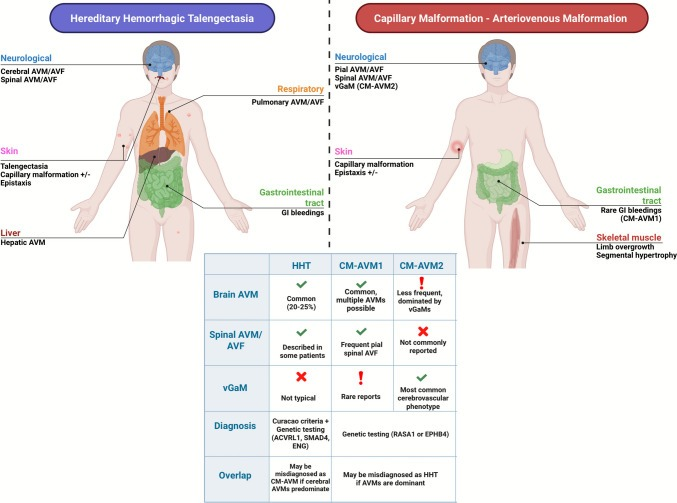
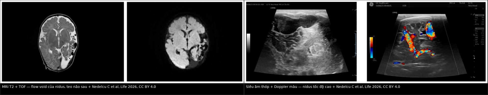
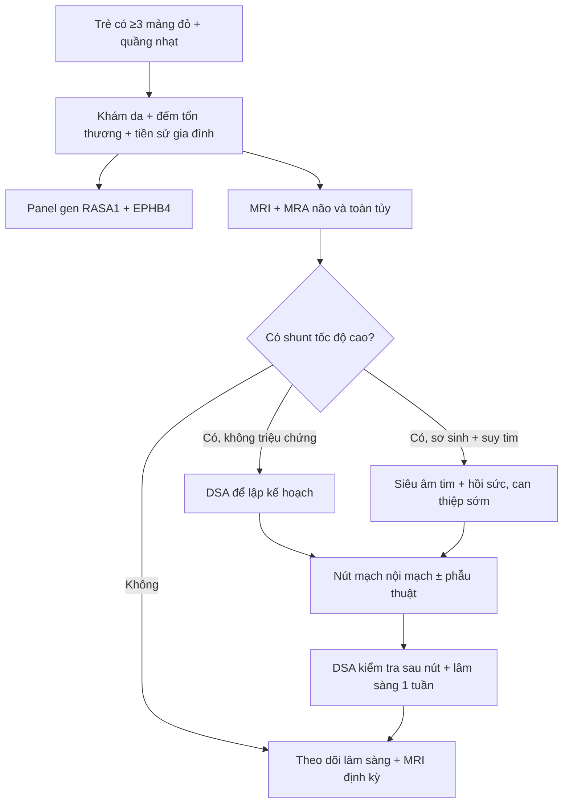
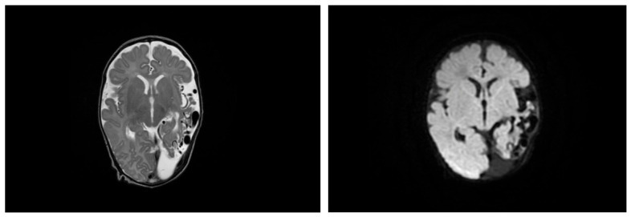
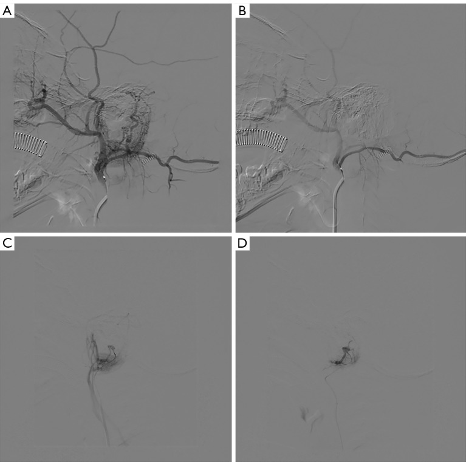
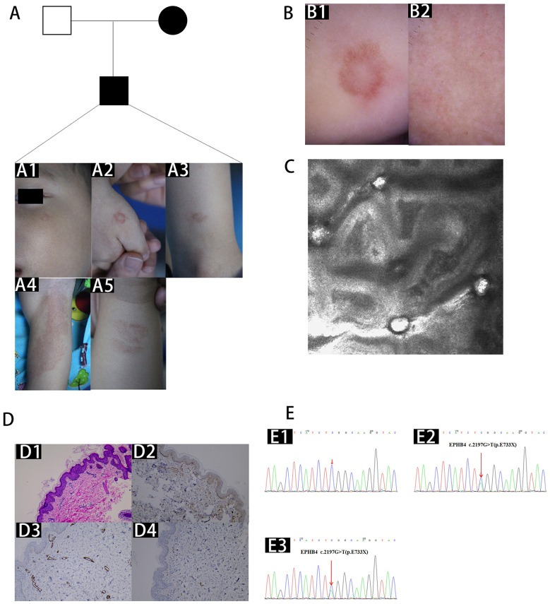

# 746 — Hội chứng mảng mao mạch – dị dạng động tĩnh mạch (CM-AVM): mảng đỏ "quầng trắng" + shunt não–tủy tốc độ cao / Capillary malformation–arteriovenous malformation syndrome

**Tags:** `pattern:mang-mao-mach` `pattern:shunt-toc-do-cao` `pattern:flow-void` `pattern:di-dang-dong-tinh-mach` `vung:da` `vung:nao` `vung:tuy` `vung:chi` `score:CM-AVM-criteria` `protocol:MRI-nao-tuy-MRA` `protocol:TOF` `protocol:US-Doppler-TCD` `protocol:DSA`

**Mức chắc chắn (certainty):** tổng hợp y văn (literature synthesis) — tổng quan có hệ thống **148 bệnh nhân CM-AVM đã xác định gen** trong 37 nghiên cứu (Childs Nerv Syst 2025, PMC12705803); tổng quan **127 bệnh nhân EPHB4** + một gia đình 4 thế hệ (Acta Derm Venereol 2022, PMC9558756); 8 gia đình Trung Quốc (Front Med 2026, PMC13065680); 3 ca sơ sinh CM-AVM1/CM-AVM2/đột biến kép có theo dõi Doppler–MRI (Life 2026, PMC13302150); 9 trẻ nút mạch vùng tai (Quant Imaging Med Surg 2025, PMC12591897). Các ngưỡng "chụp gì, khi nào" là khuyến cáo được các nguồn trên trích lại, **không có thử nghiệm ngẫu nhiên**.

> **Câu chốt:** CM-AVM **không phải** "mảng đỏ bẩm sinh lành tính" mà là **bệnh mạch máu di truyền trội, có 2 cửa tử vong**: **(1) AVM/AVF màng mềm trong não–tủy** → xuất huyết, động kinh, thiếu máu cục bộ do "steal"; **(2) vein of Galen malformation (vGaM) ở sơ sinh** → **suy tim lưu lượng cao**, tăng áp động mạch phổi, tổn thương não. Ba câu hỏi ở mọi trẻ có **≥ 3 mảng mao mạch (capillary malformation, CM)**: **đếm và tả mảng da (có quầng nhạt không?) · có shunt tốc độ cao trong não/tủy không (MRI/MRA) · gen RASA1 hay EPHB4**. Sai lầm hay gặp: **gọi là HHT** rồi đi tầm soát phổi–gan (CM-AVM hầu như **không** có PAVM) trong khi **bỏ qua não–tủy** — đúng chiều ngược lại.

## 1. Tổng quan bệnh học – cơ chế hình ảnh

### 1.1 Bệnh học: hai gen, một con đường RAS–MAPK, cơ chế "hai đòn"

- **CM-AVM1 (OMIM 608354):** đột biến mất chức năng **RASA1** (nhiễm sắc thể 5) — mã hoá **p120-RasGAP**, yếu tố **ức chế** đường RAS–MAPK. Mất một alen → ức chế không đủ → tín hiệu RAS/ERK tăng ở tế bào nội mô.
- **CM-AVM2 (OMIM 618196):** đột biến **EPHB4** (nhiễm sắc thể 7) — thụ thể tyrosine kinase của trục **ephrin-B2/EphB4**, quyết định **biệt hoá tĩnh mạch – động mạch** trong phôi; đột biến cũng hội tụ về **RAS–MAPK/VEGF** (PMC12705803).
- **Cơ chế "hai đòn" (two-hit)** giải thích vì sao cùng một đột biến dòng mầm mà chỉ **một vài ổ** thành AVM: đột biến dòng mầm + **đột biến soma thứ hai** tại cụm nội mô tại chỗ → mất hoàn toàn chức năng tại clone đó → nidus khu trú. Đã tìm thấy đột biến soma alen RASA1 thứ hai trong mô AVM (PMC12705803); mô hình này cũng dùng cho **Parkes Weber** (đột biến **thể khảm** RASA1; PMC11532015).
- **Di truyền:** trội nhiễm sắc thể thường, **thấm không hoàn toàn**: RASA1 **90–99%**, EPHB4 **93%** (tổn thương da gần như 100%); **de novo ~25%**; thể khảm có ghi nhận (PMC9558756, PMC13065680).

### 1.2 Ngưỡng định lượng trụ cột

| Đại lượng | Con số | Nguồn |
|---|---|---|
| Tần suất CM-AVM | **~1/100.000** (Bắc Âu); ước tính từ ExAC: **1/20.000** (CM-AVM1) và **1/12.000** (CM-AVM2) | PMC13302150 |
| Mảng mao mạch (CM) trong dân số chung | **0,3–0,5%** (phần lớn là bớt rượu vang đơn độc, **không** phải CM-AVM) | PMC13065680 |
| Tiêu chuẩn lâm sàng CM-AVM | **≥ 3 CM điển hình**; **< 3** vẫn chấp nhận nếu **có tiền sử gia đình** hoặc **đột biến đã xác định** | PMC13065680 |
| Kích thước CM | điển hình **1–3 cm**, đã ghi nhận tới **15 cm**; **quầng nhạt (white halo)** quanh CM do **vi shunt** | PMC9558756 |
| Shunt tốc độ cao (AVM/AVF) ở người mang đột biến | **~1/3** bệnh nhân; 18,1% trong loạt EPHB4 (23/127) | PMC13065680, PMC9558756 |
| Loại tổn thương nội sọ (148 bệnh nhân) | **pial AVF 43,3% · AVM 36,0% · vGaM 17,3% · phình mạch 1,3% · cavernoma 2,0%**; **không có AVF màng cứng** | PMC12705803 |
| Theo gen — RASA1 (n = 127) | pial AVF **48,03%** · AVM **42,52%** · vGaM **9,44%** · cavernoma 1,57% · phình 0,79% | PMC12705803 |
| Theo gen — EPHB4 (n = 21) | **vGaM 66,7%** · pial AVF 9,5% · **AVM 0%** · phình 4,8% · cavernoma 4,8% | PMC12705803 |
| Điều trị trong loạt 148 ca | **nút mạch nội mạch 24,7%** · **mổ 5,3%** · theo dõi 0,7% · phối hợp 0,7% | PMC12705803 |
| Loạt EPHB4 (n = 127) | nhiều CM **89,76%**, CM đơn độc **9,44%**; AVM/AVF **18,1%**, **trong CNS 3,9%**; giãn mạch **22%**; **Bier spots 15,7%** | PMC9558756 |
| Nút mạch vùng tai ở trẻ | **9 trẻ / 22 lần**, **2,4 ± 0,8 lần/ca**, hiệu quả **9/9**, **1 ca bùng lại sau 1 tuần**, **0 biến chứng**, theo dõi trung vị **8 tháng** | PMC12591897 |

### 1.3 TẠI SAO hình ảnh trông như vậy (vật lý + huyết động)

- **"Flow void" trên MRI = proton chạy quá nhanh.** Trong nidus và tĩnh mạch dẫn lưu, máu chảy nhanh và rối loạn (**TCD đo được PSV 111 cm/s ở động mạch não giữa; 249/160 cm/s tâm thu/tâm trương ở động mạch xuyên** — PMC13302150) nên phần lớn spin **rời mặt cắt** giữa lúc kích thích và lúc thu tín hiệu → **mất tín hiệu (signal void)**, không cần cản quang. Đây là lý do chuỗi **T2/TOF** đủ để thấy nidus, còn **DWI không hạn chế khuếch tán** vì không phải nhồi máu cấp.
- **TOF-MRA sáng vì "máu mới vào":** spin trong động mạch nuôi chưa bị bão hoà nên tạo tín hiệu cao; tĩnh mạch dẫn lưu **ngấm sớm thì động mạch** trên MRA/CTA/DSA = **bằng chứng shunt** (không có giường mao mạch trung gian).
- **Giãn tĩnh mạch và xoang = hậu quả áp lực, không phải dị dạng thứ hai.** Ca 1: xoang sigma–ngang **giãn không đối xứng**, tĩnh mạch quanh não giãn, **xoang sigma trái phình dạng túi** — tĩnh mạch "động mạch hoá" vì nhận toàn bộ lưu lượng shunt (PMC13302150).
- **Teo nhu mô + "steal" = thiếu máu mạn, không phải loạn sản.** Máu "bị hút" qua shunt làm vùng vỏ quanh nidus **giảm tưới máu mạn** → teo **parieto-choccipital** trên T2 (ca 1); vì mạn và còn bù trừ nên **không hạn chế khuếch tán**, khác nhồi máu cấp. Hệ quả xương: **dày vòm sọ** do tăng tưới máu lâu năm (ca 3 — PMC13302150).
- **Trên siêu âm thóp:** nidus hiện **đám mạch giãn, xoắn, dòng xoáy**; Doppler màu **đầy màu, hỗn hợp đỏ–xanh** (aliasing) vì vận tốc vượt thang đo. **Chỉ số sức cản (RI) giảm** là dấu hiệu định lượng của shunt: ca 2 có **RI 0,80 → 0,34** trong vài ngày, kèm tụt huyết áp tâm trương và suy tim cung lượng cao (PMC13302150).
- **Vì sao tim là "đầu cuối" của shunt não:** mỗi ml máu qua nidus **quay lại tim ngay** mà không qua giường mao mạch → **tăng lưu lượng, giãn buồng tim phải, tăng áp phổi**. Ở sơ sinh (vGaM) đây là lý do nhập NICU vì **suy hô hấp/tăng áp phổi** chứ không phải vì thần kinh.

## 2. Mẫu hình + chẩn đoán phân biệt theo vị trí (Gamut)

### 2.1 Mẫu hình da: "nhiều mảng đỏ nhỏ có quầng nhạt"

- **CM điển hình:** dát đỏ–hồng, **1–3 cm**, có **quầng nhạt** quanh (do vi shunt làm co mạch tại chỗ), ở **mặt, thân, chi**; có từ lúc sinh hoặc xuất hiện dần; **đếm được nhiều ổ** (đôi khi "không đếm xuể"). Bier spots và giãn mạch niêm mạc gặp ở **CM-AVM2** (22% và 15,7%) và chính là lý do **dễ chẩn đoán nhầm HHT**.
- Gamut theo **số lượng + quầng**: **1 mảng** → bớt rượu vang đơn độc (0,3–0,5% dân số), CM-AVM thể đơn độc (9,44% loạt EPHB4), Sturge–Weber nếu ở V1; **nhiều mảng có quầng** → **CM-AVM1/CM-AVM2** (hàng đầu), HHT, dày mạch mao mạch – dị dạng mạch có phì đại (DCMO), cutis marmorata telangiectatica congenita (CMTC); **mảng + phì đại chi** → Klippel–Trénaunay (chậm dòng) hoặc **Parkes Weber (nhanh dòng)**.

### 2.2 Mẫu hình nội sọ: shunt nhanh ở trẻ/sơ sinh

- **Pial AVF (43,3%)** — ống thông trực tiếp động–tĩnh mạch **không có nidus**, màng mềm; **RASA1** chiếm ưu thế (**48,03%** vs 9,5%).
- **AVM có nidus (36,0%)** — nidus + động mạch nuôi + tĩnh mạch dẫn lưu; **chỉ gặp ở RASA1** trong loạt 148 ca (**42,52%**; EPHB4 **0%**).
- **vGaM (17,3%)** — giãn phình hệ Galen, **thường gặp nhất ở EPHB4 (66,7%)**, biểu hiện **sơ sinh**: suy tim lưu lượng cao, tăng áp phổi, giãn não thất.
- Hiếm: **phình động mạch nội sọ 1,3%**, **cavernoma 2,0%**. **Không có AVF màng cứng** trong 148 ca → nếu thấy AVF màng cứng, phải nghĩ nguyên nhân khác.
- **Mnemonic "RASA1 rộng – EPHB4 hẹp":** RASA1 = **R**ộng (pial AVF + AVM + vGaM hiếm); EPHB4 = **E**arly (sơ sinh) + **V**ein of Galen, **không** AVM não.

### 2.3 Mẫu hình tủy và chi

- **Tủy:** AVF/AVM **màng mềm tủy** đã mô tả ở CM-AVM (đặc biệt RASA1) — cùng cơ chế shunt, biểu hiện **yếu chi, rối loạn cơ tròn, đau lưng**, dễ bị quy cho "viêm tủy" nếu không thấy flow void trên T2.
- **Chi (Parkes Weber):** mảng CM + **shunt nhanh trong da/cơ/xương** + **phì đại chi** (ca 2: chênh vòng chi **~2 cm** ở tay) — thể khảm của CM-AVM, khác Klippel–Trénaunay ở **tốc độ dòng**.

## 3. Bảng so sánh phân biệt (ma trận đối chiếu)

| Thực thể (entity) | Hình ảnh điển hình | Chốt vào (rule-in) | Chốt loại (rule-out) | Gợi ý xác nhận |
|---|---|---|---|---|
| **CM-AVM1 (RASA1)** | Nhiều CM 1–3 cm có quầng; **pial AVF 48,03%**, **AVM não 42,52%**; có thể AVF tủy, Parkes Weber | **≥ 3 CM + tiền sử gia đình**; **pial AVF/AVM không có bệnh phổi–gan** | Phổi–gan có nhiều AVM + chảy máu cam mạn → HHT | Gen **RASA1**; MRI/MRA não–tủy |
| **CM-AVM2 (EPHB4)** | CM nhiều ổ + **giãn mạch 22%**, **Bier spots 15,7%**; **vGaM 66,7%**, **AVM não 0%** | **vGaM ở sơ sinh** + mảng da + giãn mạch niêm mạc | Có AVM nidus não → nghĩ RASA1 hơn | Gen **EPHB4**; MRI/MRA + siêu âm tim |
| **HHT (ENG/ACVRL1/SMAD4)** | Giãn mạch **môi–lưỡi–đầu ngón**, nhỏ như đầu đinh ghim; **PAVM 15–50%**, AVM não **10–23%**; chảy máu cam **> 90%** người lớn | **Chảy máu cam tái diễn + giãn mạch niêm mạc + PAVM/AVM gan** | **vGaM** (HHT không có) ; **không PAVM** sau tuổi lớn → ít khả năng HHT | Panel **ENG/ACVRL1/SMAD4**; CT ngực + TTCE |
| **Sturge–Weber (GNAQ thể khảm)** | Bớt đỏ **V1** + **angioma màng não cùng bên** + teo vỏ, vôi hoá "đường ray"; **chậm dòng**, không flow void | **Bớt V1 + teo vỏ/angioma cùng bên + glôcôm** | Có **flow void + tĩnh mạch dẫn lưu sớm** → không phải SWS | MRI + cản quang; nhãn áp |
| **Klippel–Trénaunay (PIK3CA)** | Bớt đỏ + **giãn tĩnh mạch bề mặt** + phì đại mô–xương chi; **chậm dòng** | **Tam chứng bớt + giãn TM + phì đại chi**, không thrill | **Có thrill/bruit, tĩnh mạch dẫn lưu động mạch hoá** → Parkes Weber | Doppler: **không** có phổ động mạch trong tổn thương |
| **Parkes Weber (RASA1/EPHB4 thể khảm)** | Mảng da + **shunt nhanh** + phì đại chi; có thể suy tim | **Phì đại chi + Doppler phổ động–tâm trương + flow void** | Không có shunt nhanh → KTS hoặc chỉ CM | Doppler + MRA/CTA + gen mô tổn thương |
| **Bớt rượu vang đơn độc** | **Một** mảng, không quầng, không triệu chứng | Một ổ, không tiền sử gia đình, không triệu chứng | **≥ 3 ổ**, quầng nhạt, tiền sử gia đình | Không cần gen; theo dõi lâm sàng |

*Sơ đồ đối chiếu HHT (trái) với CM-AVM1/CM-AVM2 (phải): HHT có PAVM và AVM gan; CM-AVM có pial AVF/AVM não và **vGaM ở CM-AVM2**, gần như **không** có AVM phổi–gan. Nguồn: Palermo M et al, Childs Nerv Syst 2025, CC BY 4.0.*

### 3.1 Đọc ảnh shunt tốc độ cao: 3 dấu hiệu định vị

*Trái: MRI T2 + TOF — **cụm flow void** ở thuỳ chẩm–thái dương trái, teo nhu mô quanh và giãn khoang dịch. Phải: siêu âm thóp + Doppler màu — **nidus mạch xoắn, dòng xoáy** (aliasing). Nguồn: Nedelcu C et al, Life 2026, CC BY 4.0. Ảnh ghép letterbox.*

- **Dấu 1 — flow void:** chuỗi T2 (không cản quang) đã thấy "lỗ đen" mạch; nếu chỉ thấy trên T1 sau tiêm thì nghĩ tổn thương khác.
- **Dấu 2 — tĩnh mạch dẫn lưu giãn sớm:** xoang sigma/ngang **giãn không đối xứng**, có khi phình dạng túi — chốt shunt (ca 1).
- **Dấu 3 — teo + steal:** teo vỏ **quanh nidus**, không hạn chế khuếch tán; đừng đọc là "loạn sản vỏ não".

## 4. Protocol chụp + phân tầng xử trí

### 4.1 Chụp gì, cho ai

- **Trẻ có ≥ 3 CM (hoặc < 3 kèm tiền sử gia đình/đột biến):** khuyến cáo hiện hành là **MRI + MRA não VÀ toàn bộ tủy** cho **mọi trẻ đạt tiêu chuẩn "có thể" hoặc "chắc chắn"**, kể cả **không triệu chứng**, vì tỉ lệ tổn thương nội sọ–tủy cao (PMC13302150, PMC12705803).
- **Trình tự ở sơ sinh:** **siêu âm thóp + Doppler xuyên sọ (TCD) tại giường** trước (nhanh, không gây mê) → nếu nghi shunt: **MRI/MRA** (T1, T2, FLAIR, DWI/ADC, TOF, MRA có cản quang) + **siêu âm tim** tìm suy tim cung lượng cao/tăng áp phổi.
- **DSA (chụp mạch số hoá xoá nền)** là **chuẩn vàng** về giải phẫu nidus, động mạch nuôi, tĩnh mạch dẫn lưu và **bắt buộc trước nút mạch**; dùng 3D xoay để chọn catheter.
- **Đo và ghi vào báo cáo:** đường kính nidus (**mm** — ca 1: **30 mm**), số + đường kính động mạch nuôi, tĩnh mạch dẫn lưu, **hẹp đường ra tĩnh mạch**, mức **teo/steal**, có **xuất huyết** không; với AVM não có thể kèm **Spetzler–Martin** để so sánh theo dõi.
- **Định lượng huyết động:** TCD ghi **PSV/EDV/RI** từng động mạch (ca 1: MCA **PSV 111 cm/s, RI 0,63**; xuyên **PSV 249/EDV 160 cm/s, RI 0,36**); **RI giảm dần** là dấu shunt nặng lên (ca 2: **0,80 → 0,34**).
- **Tầm soát gia đình:** khám da bố mẹ/anh chị em; **panel gen** tối thiểu **RASA1 + EPHB4**, và nếu có chảy máu cam/giãn mạch niêm mạc thì **kèm ENG/ACVRL1/SMAD4** để loại HHT. Không cần **tầm soát phổi–gan thường quy** (xem mục 5).

### 4.2 Phân tầng xử trí

- **Nút mạch** là điều trị chính: **24,7%** trong 148 ca; loạt tai ở trẻ **9/9 hiệu quả**, **2,4 ± 0,8 lần/ca**, **0 biến chứng**, nhưng **1 ca bùng lại sau 1 tuần** → phải khám + DSA kiểm tra **sớm (1 tuần)**, không chờ 3 tháng.
- **Phẫu thuật** dành cho tổn thương **không tiếp cận được bằng catheter**, máu tụ chèn ép, hoặc di chứng (**5,3%** loạt 148 ca).
- **vGaM sơ sinh:** ưu tiên **ổn định huyết động + can thiệp sớm** vì suy tim/tăng áp phổi là nguyên nhân tử vong, không phải bản thân túi phình.
- **Tổn thương da:** đa số **theo dõi/laser thẩm mỹ**; tổn thương da–dưới da khu trú có thể **tiêm bleomycin** (PMC13065680) — không phải chỉ định cấp cứu.

## 5. Biến thể bình thường và cạm bẫy

- **Cạm bẫy #1 — gọi CM-AVM là HHT.** CM-AVM2 có **giãn mạch 22%**, **Bier spots 15,7%**, có thể **chảy máu cam**; nhưng **PAVM 15–50% của HHT không có ở CM-AVM** (loạt > 300 người mang RASA1: **không** PAVM/AVM gan; ngoại lệ rất hiếm được báo). Vì vậy **đừng** đặt lịch CT ngực/TTCE định kỳ cho CM-AVM, và **đừng** bỏ MRI não–tủy. Đây cũng là **chỗ đề bài BACKLOG ban đầu ghi sai** ("CM-AVM cũng gây PAVM/bAVM") — nguồn 2025–2026 cho thấy **bAVM có, PAVM gần như không**.
- **Cạm bẫy #2 — một mảng đỏ = "bớt lành tính".** CM đơn độc chiếm **9,44%** loạt EPHB4 và **không** loại trừ CM-AVM khi có **tiền sử gia đình**; ngược lại **0,3–0,5%** dân số có bớt rượu vang **không** phải CM-AVM → dựa vào **số lượng + quầng + gia đình**, không dựa vào màu.
- **Cạm bẫy #3 — "flow void là AVM".** Phình động mạch, biến đổi tĩnh mạch, và **AVM đã huyết khối** (mất flow void) đều có thể gây nhầm: AVM huyết khối trông như khối đặc/cavernoma; phình mạch không có tĩnh mạch dẫn lưu sớm.
- **Cạm bẫy #4 — tìm AVF màng cứng.** Trong **148** ca CM-AVM **không có AVF màng cứng**; nếu gặp, phải nghĩ nguyên nhân khác (sau chấn thương, huyết khối xoang) và **không** gán cho RASA1/EPHB4.
- **Cạm bẫy #5 — teo não bị đọc là loạn sản/hội chứng bẩm sinh khác.** Teo do steal **có flow void + TCD tăng vận tốc**; loạn sản vỏ não **không** có shunt.
- **Cạm bẫy #6 — sơ sinh "chỉ có mảng đỏ" nhưng đang suy tim.** Ca 2 nhập viện vì **tăng áp phổi nặng**, chênh vòng tay **~2 cm**, **RI 0,80 → 0,34** trong vài ngày; nếu chỉ khám da sẽ bỏ sót shunt. Ở sơ sinh có mảng đỏ + suy tim: **siêu âm tim + TCD + MRI/MRA ngay**.
- **Biến thể bình thường:** **Bier spots** (đốm nhạt trên nền da ửng đỏ do co mạch), **cutis marmorata** khi lạnh, **nevus araneus** — không phải CM-AVM; nhưng Bier spots + nhiều CM **là gợi ý CM-AVM2**.

## 6. Tự lượng giá — Blind Quiz

**Ca 1 — Bé trai 1 tháng tuổi, có mảng nhạt vùng chẩm, tiếng thổi sọ, tim phải giãn. Nhìn 2 lát cắt trước, mô tả trước khi mở đáp án.**

- Gợi ý lâm sàng: không co giật, không xuất huyết; bác sĩ tim mạch nghi "bất thường hồi lưu tĩnh mạch phổi".
- Câu hỏi: có bao nhiêu dấu hiệu của shunt tốc độ cao? Chẩn đoán? Cần làm gì tiếp?

<b>Bấm để hiện đáp án (findings + chẩn đoán)</b>

- **Findings:** cụm **flow void** lớn ở thuỳ **chẩm–thái dương trái** (nidus **30 mm**), tĩnh mạch quanh não và **xoang sigma trái giãn/phình**, **teo nhu mô** parieto-choccipital, **không hạn chế khuếch tán**.
- **Chẩn đoán:** **AVM não tốc độ cao** trong **CM-AVM1** (RASA1 c.2422_2423del); TCD xác nhận **PSV 249, EDV 160 cm/s, RI 0,36**.
- **Vì sao:** flow void = spin rời mặt cắt; teo = steal mạn; không hạn chế khuếch tán loại nhồi máu cấp.
- **Nguồn ảnh:** Nedelcu C et al, Life 2026 (PMC13302150), Fig. 2, CC BY 4.0.

**Ca 2 — Bé gái 10 tuổi, mảng đỏ sau tai, tiếng thổi sau tai; chụp mạch trước và sau can thiệp.**

- Câu hỏi: tổn thương cấp máu từ đâu? Sau nút mạch còn shunt không? Vì sao phải chụp lại?

<b>Bấm để hiện đáp án (findings + chẩn đoán)</b>

- **Findings:** (A) nidus mạch dày đặc sau tai, **động mạch nuôi** từ hệ cảnh ngoài, **tĩnh mạch dẫn lưu** đổ sớm; (B) sau nút: **mất tưới máu nidus**, còn giường mô; (C, D) tổn thương nhỏ vùng tai — trước/sau nút.
- **Chẩn đoán:** **CM-AVM vùng tai/ quanh tai** — 9 trẻ, 22 lần nút, **2,4 ± 0,8 lần/ca**, **1 ca bùng lại 1 tuần** → phải chụp lại để không bỏ sót tái thông.
- **Nguồn ảnh:** Jiao B et al, Quant Imaging Med Surg 2025 (PMC12591897), Fig. 1, **CC BY-NC-ND 4.0** (nguyên bản).

**Ca 3 — Bé gái 5 tuổi, nhiều mảng đỏ hình vòng có tâm nhạt; mẹ và anh trai cũng có.**

- Câu hỏi: gọi tên dấu hiệu da? Đủ tiêu chuẩn chẩn đoán chưa? Bước tiếp theo bắt buộc?

<b>Bấm để hiện đáp án (findings + chẩn đoán)</b>

- **Findings:** nhiều **mảng mao mạch dạng vòng** đường kính **1–3 cm** với **tâm nhạt (quầng trắng)** ở thân/chi; dermoscopy thấy **mạng mao mạch**; phả hệ: mẹ + con + anh trai (trội).
- **Chẩn đoán:** **CM-AVM** (đủ **≥ 3 CM** + tiền sử gia đình); bước tiếp: **gen RASA1/EPHB4** + **MRI/MRA não và toàn tủy** (kể cả không triệu chứng).
- **Vì sao:** quầng nhạt do **vi shunt**; 1/3 bệnh nhân có shunt nhanh, phần lớn **không triệu chứng** lúc đầu.
- **Nguồn ảnh:** Lin Y et al, Front Med 2026 (PMC13065680), Fig. 1, CC BY 4.0.

## Bài liên quan chéo
- [745 – HHT ở trẻ: tầm soát AVM phổi–não](../745-hht-o-tre-tam-soat-avm-phoi-nao/lesson.md) (hàng phân biệt bắt buộc: **HHT có PAVM, CM-AVM thì không**)
- [741 – Dị dạng mạch máu đầu–cổ ở trẻ: ISSVA, PHACE & LUMBAR](../741-di-dang-mach-mau-dau-co-o-tre/lesson.md) (phân loại ISSVA, chậm dòng vs nhanh dòng)
- [743 – Chảy máu cam nặng/tái diễn ở trẻ: CTA, DSA & nút mạch](../743-chay-mau-cam-nang-o-tre/lesson.md) (nút mạch vùng đầu–cổ)
- [744 – Chảy máu cam ở trẻ có rối loạn đông máu](../744-chay-mau-cam-tre-roi-loan-dong-mau/lesson.md) (khi "chảy máu cam" không do mạch)

> Không dùng để chẩn đoán độc lập khi chưa có người hướng dẫn.
