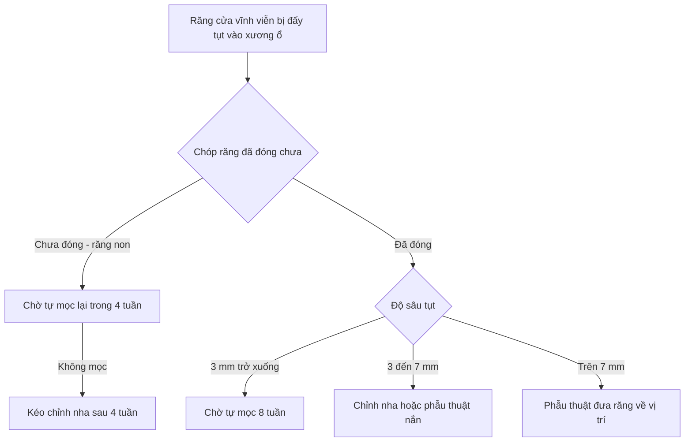
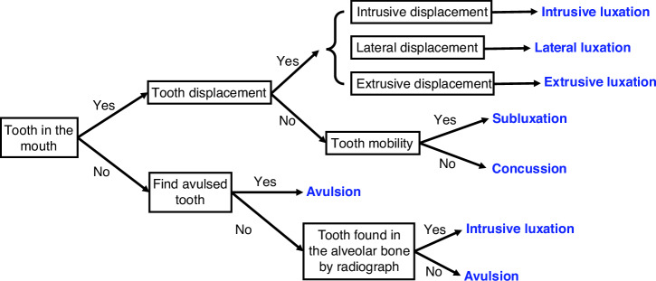
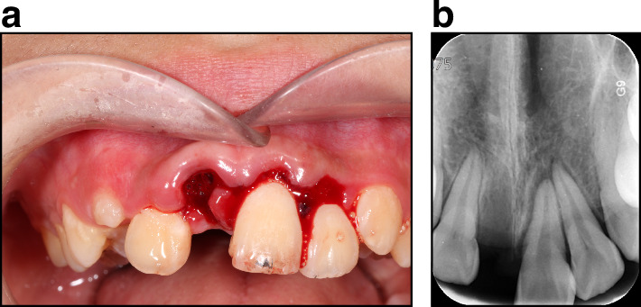
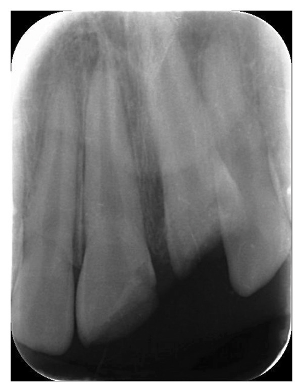
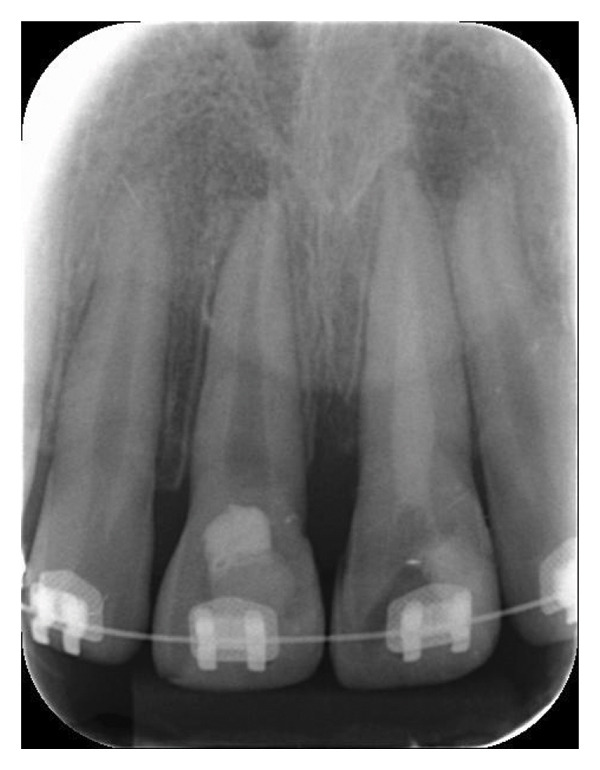
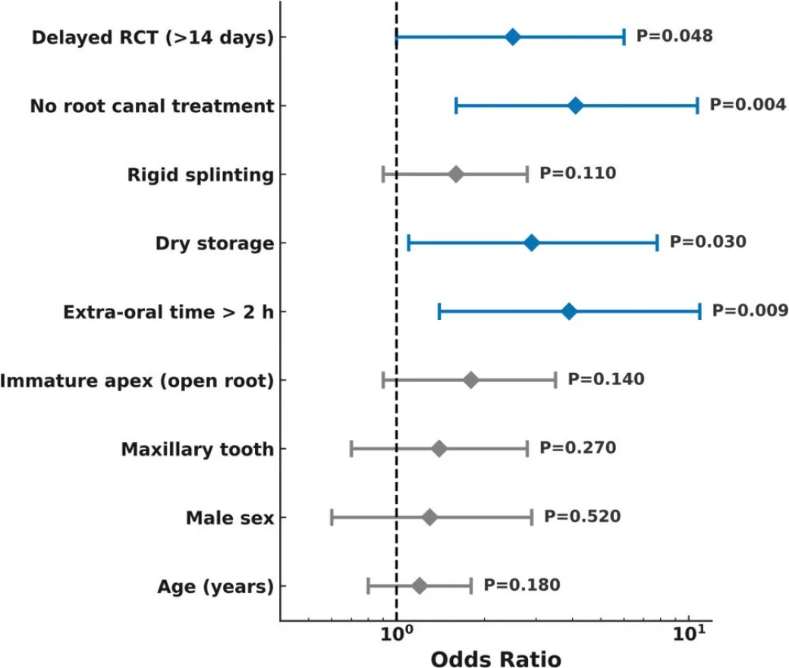

# 747 — Chấn thương răng và ổ răng ở trẻ: luxation – intrusion – avulsion, CBCT và ngưỡng nẹp / Traumatic dental injuries in children

**Tags:** `pattern:di-lech-rang` `pattern:gay-chan-rang` `pattern:mat-lien-tuc-DCNC` `vung:rang-ham` `vung:ham-mat` `anatomy:rang-ham` `protocol:CBCT` `protocol:toan-hinh` `score:IADT`
**Mức chắc chắn (certainty):** tổng hợp y văn (literature synthesis) — ghép **sổ đăng ký 1.000 ca / 1.904 răng vĩnh viễn** (J Clin Med 2026, PMC13706110, CC BY 4.0), **đồng thuận chuyên gia 2024 về luxation – avulsion** (Int J Oral Sci 2024, PMC11427573, CC BY 4.0), **thuật toán gãy hàm + chấn thương răng** (Front Oral Health 2026, PMC13478809, CC BY 4.0), **120 răng replant muộn, theo dõi ≥ 12 tháng** (Acta Odontol Scand 2026, PMC13615479, CC BY 4.0), **ca intrusion nặng có CBCT** (Case Rep Pediatr 2026, PMC13329111, CC BY 4.0) và **nghiên cứu CBCT về thời gian ngoài ổ răng – môi trường bảo quản** (Int J Clin Pediatr Dent 2026, PMC13458372, CC BY-NC). Bài **9421** phủ **liều CBCT nha khoa**; bài này phủ **chẩn đoán và xử trí chấn thương**, không lặp phần liều.

## 1. Tổng quan bệnh học – cơ chế hình ảnh

- **Bản chất:** chấn thương răng là **tổn thương dây chằng nha chu (periodontal ligament, PDL) và mạch máu chóp răng**. Ba mức: **dập PDL (concussion)** → **rách một phần, răng còn trong ổ nhưng di lệch (luxation)** → **đứt hoàn toàn, răng rời ổ (avulsion)**. Máu tụ trong khe PDL là **nguyên nhân hình ảnh** của dấu hiệu sớm nhất.
- **TẠI SAO phim thấy "dày khe PDL":** PDL bình thường là **dải sáng ~0,2 mm** giữa chân răng và xương ổ. Khi rách/dập, **máu và dịch phù** lấp khe → **dải sáng rộng ra**, có khi **> 1 mm**, kèm **mất liên tục lá cứng (lamina dura)**. Trên phim 2D, hai dấu hiệu này **chồng lên thân răng và xương ổ** nên dễ bị bỏ.
- **TẠI SAO có "quầng sáng quanh chóp" muộn:** mạch máu chóp bị đứt → **hoại tử tủy** → viêm quanh chóp và **tiêu chân răng viêm (inflammatory root resorption)** — ổ tiêu **dạng chén, bờ không đều**, tiến triển nhanh. Thể **tiêu thay thế (replacement resorption/ankylosis)** xảy ra khi PDL chết hoàn toàn: xương **dính trực tiếp vào ngà**, **mất khe PDL**, răng **cố định** và **chìm dần** — đây là **hậu quả của replant muộn**, không phải nhiễm trùng.
- **Số nằm lòng (dịch tễ):** sổ đăng ký **1.000 ca** (61,6% nam; tuổi trung vị **13**, IQR 7–26), **1.904 răng vĩnh viễn + 528 răng sữa**; **84,1% đến trong 24 giờ**; **ngã 67,8%**, đạp xe **18,6%**; **răng cửa giữa hàm trên 54,9%** (vĩnh viễn) và **58,7%** (sữa); **luxation 69,8%** răng vĩnh viễn (sữa **92,8%**), **gãy răng 57%** răng vĩnh viễn (sữa **14,2%**); **avulsion 202 răng** (139 vĩnh viễn, 63 sữa); **40,9%** ca avulsion răng vĩnh viễn có **bảo quản khô**; điều trị ban đầu: **nẹp 36,5%**, **trám/phủ mặt gãy 27,0%**, **nắn 11,3%** (PMC13706110).
- **Số nằm lòng (tiên lượng replant muộn):** **120 răng** replant sau **> 60 phút** ngoài ổ, theo dõi ≥ 12 tháng: **tiêu chân răng 60,0%** (viêm **41,7%**, thay thế **58,3%**); **sống sót 24 tháng 78,3%**, **giữ được chức năng 68,3%**; yếu tố nguy cơ độc lập: **ngoài ổ > 2 giờ**, **bảo quản khô**, **không điều trị tủy**, **điều trị tủy muộn > 14 ngày** (PMC13615479).
- **Ngưỡng thời gian PDL:** khô **< 60 phút** = PDL **còn trung bình** (một phần tế bào đã chết); khô **> 60 phút** = PDL **kém**, phần lớn tế bào chết (PMC11427573).
- **TẠI SAO chấn thương răng đi kèm gãy hàm:** trong **gãy xương hàm dưới đơn thuần**, **43,5%** bệnh nhân có tổn thương răng (trung bình **~4 răng**/người); ở trẻ, **34,7%** ca gãy hàm có chấn thương răng, **~10%** mất ít nhất một răng (PMC13478809). → **Đọc CT hàm mà không đọc răng là bỏ sót gần một nửa.**

## 2. Mẫu hình + chẩn đoán phân biệt theo vị trí (gamut)

- **Mẫu hình:** trẻ ngã/đập mặt → **răng cửa giữa hàm trên** đau, lung lay, lệch trục, hoặc **mất răng**; phim quanh đỉnh/OPG thấy **khe PDL rộng, răng lệch, đường gãy chân răng, hoặc ổ răng trống**.
- **Gamut theo hướng và mức di lệch (thứ tự nặng dần):**
  1. **Concussion** — răng không di lệch, chỉ đau khi gõ; phim **bình thường hoặc khe PDL hơi rộng**.
  2. **Subluxation** — răng lung lay, **không di lệch**; phim **khe PDL rộng**.
  3. **Extrusive luxation** — răng **dài ra**, di lệch ra ngoài ổ; phim **khe PDL rộng phía chóp**.
  4. **Lateral luxation** — răng **lệch sang bên, thường kèm gãy xương ổ**; phim **khe PDL rộng một bên, chồng hình**.
  5. **Intrusive luxation** — răng **ngắn lại, đẩy sâu vào xương ổ**; phim **khe PDL mất/ép, đường men nằm dưới mức răng bên cạnh**.
  6. **Avulsion** — răng **rời hẳn**; phim **ổ răng trống**, kiểm tra **răng có bị hít/sặc vào phổi** hay không.
  7. **Gãy chân răng** — đường sáng **ngang chân răng** (cổ/thân/chóp), mảnh chóp **di lệch**.
  8. **Gãy xương ổ răng** — đường gãy **qua xương ổ**, nhiều răng **di lệch cùng khối**.
- **Phân biệt "không phải chấn thương":** chóp răng **mở sinh lý** (răng đang mọc) dễ bị đọc thành gãy chân răng; **răng sữa chưa rụng** chồng hình lên mầm răng vĩnh viễn; **dị tật hình thể** (răng thừa, odontoma) không có tiền sử chấn thương.

## 3. Bảng so sánh phân biệt (ma trận đối chiếu)

| Thực thể (entity) | Hình ảnh điển hình | Chốt vào (rule-in) | Chốt loại (rule-out) | Gợi ý xác nhận |
|---|---|---|---|---|
| **Subluxation** | Khe PDL **rộng đều**, răng **không di lệch** | **Lung lay + khe PDL rộng**, không lệch trục | Răng lệch hẳn khỏi ổ → extrusive/lateral | Phim quanh đỉnh 2 góc, so bên đối diện |
| **Extrusive luxation** | Răng **dài ra**, khe PDL rộng **phía chóp** | **Răng nhô khỏi ổ theo trục**, gõ đau | Răng ngắn lại → intrusive | Đo chiều cao thân răng so bên lành |
| **Lateral luxation** | Răng **lệch bên**, **gãy xương ổ** kèm theo | **Lệch trục ngang + xương ổ gãy** | Không gãy xương ổ, chỉ lung lay → subluxation | CBCT khi nghi gãy xương ổ |
| **Intrusive luxation** | Răng **ngắn**, **mất khe PDL**, men dưới mức răng bên | **Răng tụt vào xương ổ**, gõ **âm sắc kim loại** | Ổ răng trống → avulsion | **CBCT đo độ sâu mm** + xem chóp có bị đẩy vào xoang/mũi |
| **Avulsion** | **Ổ răng trống**, có thể gãy bờ ổ | **Răng rời hẳn**, bệnh nhân/người nhà mang răng tới | Răng còn trong ổ nhưng tụt sâu → intrusion | **X-quang ngực/bụng** nếu không tìm thấy răng |
| **Gãy chân răng** | **Đường sáng ngang chân răng**, mảnh chóp di lệch | **Đường gãy thấy trên ≥ 2 phim** hoặc CBCT | Đường sáng **song song trục** = ống tủy/kênh | **CBCT** — phim 2D bỏ sót gãy **dọc/ngang mảnh nhỏ** |
| **Gãy xương ổ răng** | Đường gãy **qua xương ổ**, nhiều răng di lệch **cùng khối** | **Nhiều răng di chuyển cùng lúc**, đau xương ổ | Chỉ một răng lung lay → chấn thương răng đơn thuần | CBCT, CT hàm |

## 4. Protocol chụp + hệ phân độ/điểm chuẩn hóa

- **Bước 1 — phim 2D:** **quanh đỉnh (periapical) ≥ 2 góc khác nhau** cho răng bị thương, ± **toàn cảnh (OPG)** khi có nhiều răng/gãy hàm. Phim 2D là **bắt buộc**, kể cả khi sẽ chụp CBCT — để so sánh và lưu hồ sơ.
- **Bước 2 — CBCT khi nào:** (a) **nghi gãy chân răng** mà 2D không thấy; (b) **intrusion** — cần **đo độ sâu mm** và xem chóp có xuyên vào xoang hàm/mũi; (c) **nghi gãy xương ổ/hàm**; (d) **lập kế hoạch replant/cấy ghép**. FOV **nhỏ, đúng vùng** — liều CBCT phụ thuộc FOV (bài 9421).
- **Bước 3 — phân loại và xử trí theo IADT (đồng thuận 2024, PMC11427573):**
  - **Subluxation:** lung lay **> độ 1** hoặc khó chịu → **nẹp thụ động – mềm 2 tuần**.
  - **Extrusive luxation:** nắn + **nẹp mềm 2 tuần**.
  - **Lateral luxation:** nắn dưới gây tê, **nẹp 4 tuần** (vì kèm gãy xương ổ).
  - **Avulsion:** replant **ngay tại chỗ** nếu được; nếu không, giữ răng trong **HBSS/sữa/nước muối** và đến nha sĩ **càng sớm càng tốt**; **khô < 60 phút** = PDL trung bình, **> 60 phút** = PDL kém; **nẹp mềm 2 tuần**; **kháng sinh toàn thân** (amoxicillin/penicillin là lựa chọn đầu) và **kiểm tra bạc cầu (tetanus)**; điều trị tủy theo **độ trưởng thành chóp** và **thời gian khô**.
  - **Intrusion** — bảng ngưỡng dưới đây.
- **Theo dõi (mốc thời gian):** **2 tuần** (tháo nẹp, đánh giá), **4 tuần**, **6–8 tuần**, **3 tháng**, **6 tháng**, **1 năm**, sau đó **hằng năm đến ≥ 5 năm** với avulsion/intrusion/luxation nặng (PMC13478809, PMC11427573). Thử tủy có thể **âm tính giả** trong vài tuần đầu → **không kết luận hoại tử chỉ dựa vào một lần thử**.

*Hình gốc: Int J Oral Sci 2024, PMC11427573, CC BY 4.0. Dùng nguyên bản, không chỉnh sửa.*

## 5. Biến thể bình thường và cạm bẫy

- **"Mất răng" trên lâm sàng ≠ avulsion:** răng có thể **tụt hoàn toàn vào xương ổ (complete intrusion)** — nhìn như mất răng nhưng **phim thấy chân răng trong xương**. Ngược lại, răng **avulsion bị hít vào đường thở** có thể là **nguyên nhân ho/dai dẳng** — **phải chụp ngực** khi không tìm thấy răng (PMC11427573, PMC13706110).
- **Phim 2D bỏ sót gãy chân răng:** đường gãy **nằm trong mặt phẳng tia X** hoặc **mảnh gãy không di lệch** → **không thấy**. Nếu lâm sàng nghi (đau khi gõ, lung lay từng mảnh) → **CBCT**, đừng kết luận "không gãy".
- **Chóp răng mở sinh lý** bị đọc thành gãy chân răng/tiêu chân răng — so **răng đối diện cùng tuổi** và **phim cũ**.
- **Nẹp quá cứng/quá lâu:** nẹp **cứng** (kim loại dày, nhiều răng) và **kéo dài** làm tăng **dính chân răng/tiêu thay thế**; nguyên tắc là **nẹp thụ động, mềm, ngắn nhất có thể** (PMC13615479: nẹp cứng **không** là yếu tố nguy cơ độc lập trong nghiên cứu này, nhưng **không điều trị tủy** và **tủy muộn > 14 ngày** thì có).
- **Bỏ sót răng trong chấn thương hàm:** **43,5%** ca gãy hàm dưới có tổn thương răng (PMC13478809) — đọc CT hàm **luôn phải cuộn xuống ổ răng**, không dừng ở đường gãy xương.
- **Răng sữa bị đẩy vào:** nguy cơ **tổn thương mầm răng vĩnh viễn** — cần **CBCT/OPG** và theo dõi đến khi răng vĩnh viễn mọc; **không** đơn giản là "răng sữa sẽ tự rụng".
- **Sai số "răng chết" quá sớm:** thử tủy **âm tính giả** sau chấn thương; **không** điều trị tủy chỉ vì một lần thử âm — theo dõi **6–8 tuần** và dựa vào **hình ảnh tiêu chân răng**.

## 6. Tự lượng giá — Blind Quiz

**Ca 1 — Bé trai 9 tuổi ngã đạp xe, đau vùng răng cửa hàm trên. Ảnh (a) là lâm sàng, (b) là phim quanh đỉnh.**

- Câu hỏi: Bốn răng cửa trong hình bị **bốn kiểu chấn thương khác nhau**. Kể tên từng kiểu và chỉ ra dấu hiệu trên phim cho mỗi kiểu. Răng nào cần xử trí **khẩn cấp nhất**?

<b>Bấm để hiện đáp án (findings + chẩn đoán)</b>

- **Findings:** theo chú thích gốc — **răng 12 concussion**, **răng 22 subluxation**, **răng 21 extrusive luxation**, **răng 11 avulsion**. Trên lâm sàng (a): **11 mất khỏi ổ**, **21 nhô ra và lệch**, niêm mạc rách; trên phim (b): **khe PDL rộng** ở các răng còn lại, **21 di lệch theo trục**, **ổ răng 11 trống**.
- **Chẩn đoán:** chấn thương **nhiều răng cùng lúc** — điển hình của ngã đập mặt; **avulsion (11)** là tối cấp vì **thời gian ngoài ổ quyết định PDL**.
- **Xử trí:** replant **11 ngay** (nếu răng còn, bảo quản ẩm), nắn **21**, nẹp mềm, khám **toàn bộ** răng cửa và **xương ổ**.
- Nguồn: Int J Oral Sci 2024, PMC11427573, **CC BY 4.0**.

**Ca 2 — Bé gái 8 tuổi ngã cầu thang, răng cửa giữa hàm trên ngắn hơn hẳn răng bên cạnh, không lung lay.**

- Câu hỏi: Chẩn đoán? Vì sao răng **không lung lay** lại là dấu hiệu **nặng**, không phải nhẹ? Cần thêm phim gì và đo gì?

<b>Bấm để hiện đáp án (findings + chẩn đoán)</b>

- **Findings:** thân răng **ngắn lại**, **đường men nằm dưới mức răng bên cạnh**, **khe PDL mất/ép**, chóp răng **bị đẩy sâu** — hình **intrusive luxation**.
- **Vì sao "không lung lay" = nặng:** răng bị **kẹt trong xương ổ**, PDL bị **dập nát toàn bộ** và **mạch máu chóp bị đứt** → nguy cơ **hoại tử tủy** và **tiêu chân răng/dính chân răng** cao hơn răng chỉ lung lay.
- **Cần:** **CBCT** đo **độ sâu tụt (mm)**, xem **chóp có xuyên vào xoang hàm/mũi**, và đánh giá **xương ổ**; sau đó chọn **chờ tự mọc / chỉnh nha / phẫu thuật** theo ngưỡng **3 mm – 7 mm**.
- Nguồn: Case Rep Pediatr 2026, PMC13329111, **CC BY 4.0**.

**Ca 3 — Cùng bệnh nhân, phim quanh đỉnh **9 tháng** sau chấn thương: vùng chóp răng có quầng sáng bờ không đều.**

- Câu hỏi: Quầng sáng này là gì? Hai thể tiêu chân răng cần phân biệt, và thể nào liên quan **replant muộn**?

<b>Bấm để hiện đáp án (findings + chẩn đoán)</b>

- **Findings:** **quầng sáng quanh chóp bờ không đều** — ổ tiêu xương do **viêm** (inflammatory root resorption) trên nền **tủy hoại tử**.
- **Phân biệt:** **tiêu viêm** (bờ chén, tiến triển nhanh, khe PDL còn) vs **tiêu thay thế/dính chân răng** (mất khe PDL, xương dính ngà, răng **chìm dần và cố định**).
- **Liên quan replant muộn:** nghiên cứu **120 răng replant sau > 60 phút** cho thấy **60% tiêu chân răng** (viêm 41,7%, thay thế 58,3%); **khô > 2 giờ, bảo quản khô, không điều trị tủy, tủy muộn > 14 ngày** làm tăng nguy cơ (PMC13615479).
- Nguồn: Case Rep Pediatr 2026, PMC13329111 và Acta Odontol Scand 2026, PMC13615479, **CC BY 4.0**.

**Ca 4 — Đọc nhanh bằng đồ thị: yếu tố nào **thực sự** độc lập với tiêu chân răng sau replant muộn?**

- Câu hỏi: Ba yếu tố nào có ý nghĩa thống kê (xanh)? Yếu tố nào **không** đạt ý nghĩa dù nghe "hợp lý" (xám)?

<b>Bấm để hiện đáp án (findings + chẩn đoán)</b>

- **Có ý nghĩa:** **điều trị tủy muộn > 14 ngày** (p = 0,048), **không điều trị tủy** (p = 0,004), **bảo quản khô** (p = 0,030), **ngoài ổ > 2 giờ** (p = 0,009).
- **Không đạt ý nghĩa:** **nẹp cứng** (p = 0,110), **chóp mở** (p = 0,140), **răng hàm trên** (p = 0,270), **nam** (p = 0,520), **tuổi** (p = 0,180).
- **Đọc đúng:** "không đạt ý nghĩa" **không** có nghĩa là vô hại — nghiên cứu **hồi cứu, một trung tâm**, cỡ mẫu **120** nên **thiếu lực** với các yếu tố nhỏ; chỉ nên dùng để **ưu tiên can thiệp sớm** (tủy, bảo quản ẩm, thời gian ngoài ổ).
- Nguồn: Acta Odontol Scand 2026, PMC13615479, **CC BY 4.0**.

## Bài liên quan chéo
- [1708 – Gãy lồi cầu xương hàm dưới ở trẻ](../1708-gay-loi-cau-xuong-ham-duoi-o-tre/lesson.md) (chấn thương hàm cùng cơ chế ngã đập cằm)
- [1707 – Trật khớp thái dương–hàm ở trẻ](../1707-trat-khop-thai-duong-ham-o-tre/lesson.md)
- [1703 – Dính khớp thái dương–hàm bẩm sinh](../1703-dinh-khop-thai-duong-ham-bam-sinh/lesson.md)
- [9421 – CBCT nón trong nha khoa & chỉnh nha ở trẻ](../9421-cbct-non-nha-khoa-chinh-nha-tre/lesson.md) (liều, FOV, DRL)
- [320 – Gãy xương & trật khớp cấp cứu](../320-gay-xuong-trat-khop-cap-cuu/lesson.md) (bờm mỡ, mỡ–máu)

> Không dùng để chẩn đoán độc lập khi chưa có người hướng dẫn.
