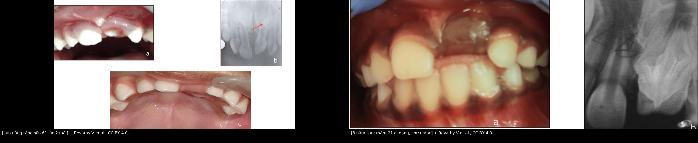
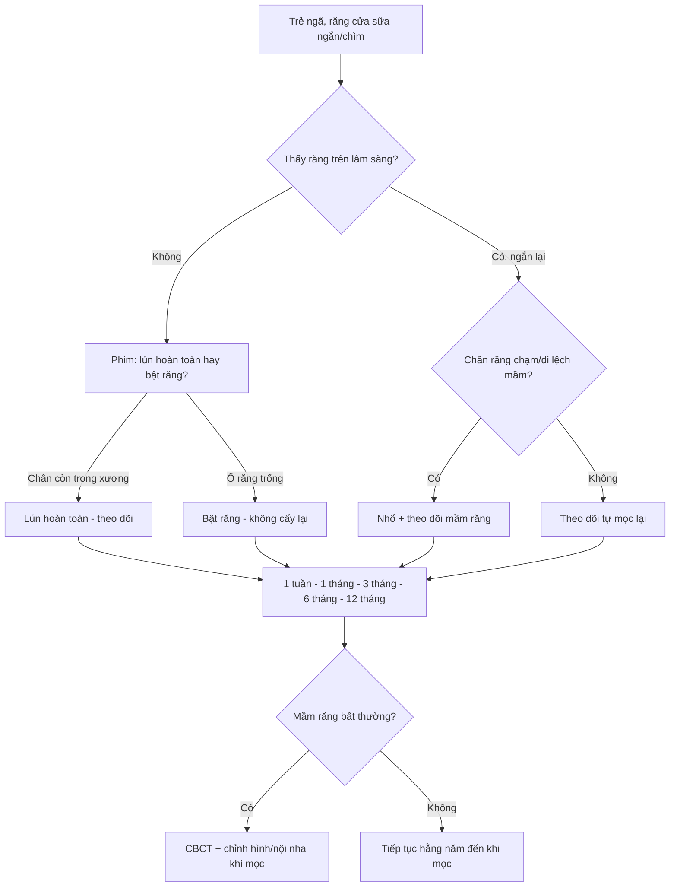
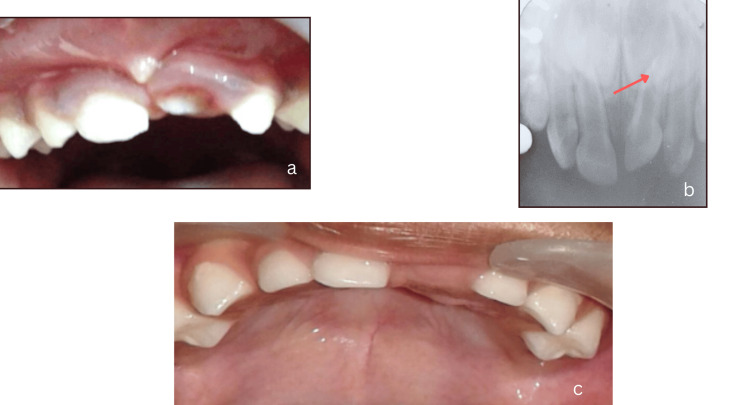
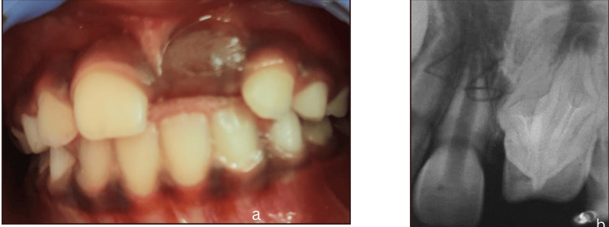
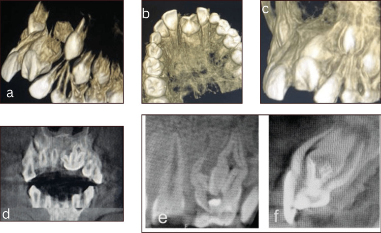

# 748 — Chấn thương răng SỮA và mầm răng vĩnh viễn: lún – bật – gãy, khi nào nhổ và theo dõi bao lâu / Primary tooth trauma and the permanent successor

**Tags:** `pattern:di-lech-rang` `pattern:lun-rang` `pattern:mat-rang-lam-sang` `pattern:di-dang-mam-rang` `vung:rang-ham` `vung:ham-mat` `vung:so-mat` `anatomy:rang-ham` `anatomy:xoang-ham` `protocol:CBCT` `protocol:phim-quanh-dinh` `protocol:toan-hinh` `score:IADT`
**Mức chắc chắn (certainty):** tổng hợp y văn (literature synthesis) — đoàn hệ **238 răng / 168 trẻ** (PMC34165860), đoàn hệ **138 răng / 78 trẻ** theo dõi **7 năm** (PMID 19820735), **18 nghiên cứu** trong tổng quan hệ thống (PMID 25382149), **hướng dẫn IADT 2020** cho răng sữa (PMID 32458553) và **ca nguyên văn có ảnh** theo dõi **8 năm** (PMC11214667). Câu nào là suy luận được ghi **[suy luận]**.

> **Vì sao bài này quan trọng:** [747](../747-chan-thuong-rang-o-tre/lesson.md) phủ **răng vĩnh viễn**; nhưng trẻ **dưới 4 tuổi** bị chấn thương răng hầu như luôn là **răng sữa**, và hậu quả không nằm ở chiếc răng sữa — nó rơi vào **mầm răng vĩnh viễn chưa mọc**. Răng sữa lún (intrusion) **tự mọc lại 68–78%**, nên phản xạ "nhổ cho nhanh" là sai; nhưng **52,6–54%** trường hợp để lại **khiếm khuyết mầm răng** (men, chân răng, vị trí mọc), chỉ lộ ra **nhiều năm sau** (PMC34165860, PMID 19820735). Bỏ theo dõi = bỏ mất cửa sổ can thiệp chỉnh hình/endodontic.

## 1. Tổng quan bệnh học – cơ chế hình ảnh

- **Giải phẫu quyết định hậu quả:** mầm răng vĩnh viễn nằm **phía lưỡi và phía chóp** so với răng sữa; chân răng sữa **dài hơn** so với thân, chóp đóng muộn (**2–3 tuổi**). Vì vậy lực **dọc trục** của lún đẩy chân răng sữa **thẳng vào mầm răng** — khác hẳn lực ngang của luxation. **Trẻ < 2–3 tuổi** có xương ổ **ít canxi hóa**, mầm răng đang ở **giai đoạn tạo hình sớm** → tổn thương nặng hơn (PMC11214667).
- **TẠI SAO phim thấy "răng ngắn lại/chìm vào xương":** lún là **di lệch theo trục dọc** vào xương ổ; trên phim quanh đỉnh, **thân răng cao độ bất thường**, **khe dây chằng nha chu (PDL) mất** ở vùng chân răng bị dồn ép, và **chân răng chồng lên mầm răng vĩnh viễn**. Khi lún **hoàn toàn**, răng **không còn thấy trên lâm sàng** — dễ bị đọc là **avulsion** (bật răng).
- **TẠI SAO hậu quả xuất hiện MUỘN:** mầm răng bị chấn thương ở **giai đoạn khoáng hóa** → **nguyên bào men (ameloblast)** chết một phần → **thiểu sản men khu trú (Turner tooth)**; tổn thương **vỏ Hertwig** → **gãy cong chân răng (dilaceration)** hoặc **nhân đôi chân răng**; tổn thương nặng toàn bộ mầm → **ngưng phát triển, di dạng kiểu odontoma, hoặc cầm tù mầm răng**. Các bất thường này **chỉ thấy khi răng vĩnh viễn mọc hoặc trên CBCT**.
- **Vì sao nhiễm trùng răng sữa làm nặng thêm:** răng sữa hoại tử → viêm quanh chóp → **viêm lan vào mầm răng**, gây **ngưng tạo men/ngà** và **tiêu mầm**. Vì thế kiểm soát nhiễm trùng răng sữa **song song** với theo dõi mầm răng.
- **Số liệu định lượng cốt lõi:**
  - **Dịch tễ:** chấn thương răng sữa gặp **22,7%** trẻ (gộp toàn cầu) và **24,2%** trong một tổng quan 24 nghiên cứu; **luxation** là thể thường gặp nhất (PMC11791467). **Lún** chiếm **8–22%** các ca luxation răng sữa (có báo cáo tới **54%**) (PMC11214667).
  - **Đoàn hệ 238 răng / 168 trẻ** (PMC34165860): **87,8%** là **răng cửa giữa hàm trên**; **Grade I 32,8%**; **mọc lại 13,1% trong 30 ngày**, **58,7% sau 3–6 tháng**, **68% sau ≥ 6 tháng**; **Grade III (lún hoàn toàn)** liên quan **hoại tử tủy/nhiễm trùng** (p = 0,002); trong **78 răng vĩnh viễn** được đánh giá, **52,6% có bất thường phát triển**.
  - **Đoàn hệ 138 răng / 78 trẻ 12–48 tháng, theo dõi 7 năm** (PMID 19820735): **36 răng (23 trẻ)** phải nhổ ngay vì **luxation ngang rộng + lún**; **102 răng còn lại**: **78% mọc lại hoàn toàn**, **15% mọc một phần**, **7% cầm tù**; **54%** răng có hậu quả sau chấn thương; **74/138 mầm răng vĩnh viễn** có ≥ 1 bất thường — **thiểu sản men 28,3%**, **gãy cong chân răng 16,7%**, **mọc lệch chỗ 16,7%**. Không tìm thấy liên quan với tuổi lúc chấn thương.
  - **Tổng quan 18 nghiên cứu** (PMID 25382149): trẻ **càng nhỏ** và chấn thương **càng nặng (lún/bật)** → hậu quả mầm răng **càng nhiều và càng nặng**.
  - **Ca nguyên văn** (PMC11214667): bé gái **2 tuổi**, răng **61 lún 7 mm**, chỉ thấy **1/3 cạnh cắn**; phim cho thấy chân răng **chạm mầm 21 đang tạo hình** → **nhổ 61**; **8 năm sau** răng **21 chưa mọc**, CBCT: **dị dạng thân răng, mấu răng kiểu talon, gãy cong chân, nhân đôi chân răng**; chờ **6 tháng** răng tự mọc; sau đó **áp-xe quanh chóp** → nội nha nhiều ống tủy + phục hồi composite.

## 2. Mẫu hình + chẩn đoán phân biệt theo vị trí (gamut)

**Mẫu hình chốt:** trẻ **< 4 tuổi**, **ngã đập mặt**, **răng cửa giữa hàm trên**; răng **ngắn lại, chìm vào xương ổ, lung lay hoặc mất hẳn** trên lâm sàng; phim cho thấy **chân răng sữa chồng lên mầm răng vĩnh viễn**.

- **Theo kiểu di lệch:**
  - **Lún (intrusion):** nặng nhất cho mầm răng; chia **Grade I–III** theo độ sâu (Grade III = lún hoàn toàn, không thấy thân răng). Hướng chân răng **ra trước (labial)** hay **vào trong (palatal)** quyết định nguy cơ chạm mầm răng.
  - **Bật (avulsion):** răng rời ổ — **không cấy lại răng sữa** (nguy cơ làm tổn thương mầm răng và nhiễm trùng).
  - **Luxation ngang (lateral luxation):** răng di lệch sang bên, thường **tự nắn 95%**; **24,2%** hoại tử tủy trong 3 năm (PMC11791467).
  - **Trồi (extrusion):** răng dài ra, cản trở khớp cắn; nhiều ca phải **nhổ ngay**; **15,6%** răng còn lại hoại tử trong 3 năm.
  - **Dập/subluxation:** nguy cơ hoại tử thấp.
  - **Gãy thân/chân răng:** lấy **mảnh lung lay** để tránh hít sặc; **không cố lấy mảnh chân nhỏ** sát mầm răng.
- **Gamut "răng sữa không thấy trên lâm sàng":** **lún hoàn toàn** (phải tìm trên phim) – **avulsion** – **răng mọc lệch vào mô mềm/mũi** – **răng chưa mọc** – **nhổ/rụng trước đó**. **Bắt buộc phim** trước khi kết luận "mất răng".
- **Gamut "răng vĩnh viễn chưa mọc sau chấn thương răng sữa":** **cầm tù do sẹo/xương** – **gãy cong chân** – **di dạng kiểu odontoma** – **nhân đôi chân** – **mọc lệch chỗ** – **chậm mọc sinh lý**.

## 3. Bảng so sánh phân biệt (ma trận đối chiếu)

| Thực thể (entity) | Hình ảnh điển hình | Chốt vào (rule-in) | Chốt loại (rule-out) | Gợi ý xác nhận |
|---|---|---|---|---|
| **Lún răng sữa (intrusion)** | Thân răng **cao độ bất thường**, chìm vào xương; **mất khe PDL**; chân chồng mầm răng | **Răng ngắn/chìm + tiền sử chấn thương dọc trục** | Răng bật khỏi ổ (không thấy cả chân) | Phim quanh đỉnh; CBCT khi nghi chạm mầm/gãy chân |
| **Bật răng sữa (avulsion)** | **Ổ răng trống**, không có chân răng trong xương; mô mềm rách | **Không thấy răng cả trên phim** | Lún hoàn toàn (còn chân trong xương) | Phim quanh đỉnh ± CBCT |
| **Luxation ngang** | Răng **di lệch sang bên**, khe PDL rộng một bên | **Di lệch ngang + lung lay** | Lún (di lệch dọc) | Phim 2 bình diện; đo độ di lệch |
| **Trồi răng (extrusion)** | Răng **dài ra**, chân di chuyển ra khỏi ổ | **Răng dài + cản khớp cắn** | Lún (răng ngắn) | Phim quanh đỉnh |
| **Gãy chân răng sữa** | **Đường sáng ngang chân răng**, mảnh chân di lệch | **Đường gãy rõ + mảnh lung lay** | Lún (không có đường gãy) | CBCT khi phim 2D không rõ |
| **Mầm răng vĩnh viễn bình thường** | Nang răng bao quanh mầm, **khoảng cách đều**, không di lệch | **Nang răng liên tục, mầm đúng vị trí** | Mầm di lệch/ngưng phát triển | So phim cũ; CBCT nếu nghi |
| **Di chứng mầm răng (Turner/dilaceration)** | **Thiểu sản men khu trú**, **gãy cong chân**, **nhân đôi chân**, **mọc lệch** | **Bất thường hình thể trên CBCT/panoramic** | Mầm bình thường, chỉ chậm mọc | CBCT + theo dõi đến khi mọc |

*Trái: **61 lún 7 mm** ở trẻ 2 tuổi — chỉ còn 1/3 cạnh cắn, phim cho thấy chân răng chạm mầm 21 (a, b); sau nhổ, niêm mạc lành (c). Phải: **8 năm sau** — 21 chưa mọc, phim cho thấy **dị dạng thân và chân răng**. Nguồn: Revathy V et al., Cureus 2024 (PMC11214667), CC BY 4.0; ảnh ghép letterbox.*

## 4. Protocol chụp + hệ phân độ/điểm chuẩn hóa

- **Trước chụp — khám lâm sàng có cấu trúc:**
  - Tuổi, cơ chế, thời điểm, **tiêm phòng uốn ván**, bệnh nền; **tầm soát chấn thương do ngược đãi (NAI)** ở trẻ nhỏ vì đây là nhóm nguy cơ (PMC11791467).
  - Đếm răng, **mức lún (mm)**, hướng lún, **lung lay**, **cản khớp cắn**, màu răng, **lỗ rò/sưng**, vết thương mô mềm; khám **mũi/môi** (răng có thể bị đẩy vào mô mềm).
- **Chụp — chọn đúng, ít tia (ALARA):**
  - **Phim quanh đỉnh (periapical) + phim cắn (occlusal)** là bước đầu; phim toàn cảnh (panoramic) khi cần nhìn mầm răng hai hàm.
  - **CBCT** khi: nghi **gãy chân răng**, **lún sâu sát mầm**, **mầm răng di lệch/bất thường**, hoặc trước **nội nha/chỉnh hình**. Dùng **trường chiếu nhỏ (FOV) + low-dose**; bài **9421** phủ liều CBCT nha khoa — không lặp.
  - **Không chụp lại thường quy** nếu không thay đổi xử trí; chụp khi có **triệu chứng mới** hoặc **mốc theo dõi**.
- **Xử trí theo IADT 2020 (răng sữa):**
  - **Lún:** **theo dõi mọi mức lún**, kể cả lún hoàn toàn — đa số **tự mọc lại**; **không nắn bằng lực**, **không nội nha dự phòng** (PMC11791467).
  - **Nhổ** khi: răng lún **sâu, chân răng chạm/di lệch mầm răng vĩnh viễn**, **nhiễm trùng/hoại tử không kiểm soát được**, **cản khớp cắn**, hoặc **không thể theo dõi** [suy luận từ tiêu chí thực hành + ca PMC11214667].
  - **Bật răng sữa:** **không cấy lại** trong mọi trường hợp (nguy cơ tổn thương mầm răng và nhiễm trùng) (PMC11791467).
  - **Kháng sinh toàn thân:** **không có bằng chứng** cho luxation răng sữa; chỉ dùng theo **đánh giá nguy cơ** từng ca.
  - **Mảnh chân răng nhỏ:** thường **để lại**, tránh làm tổn thương mầm răng.
- **Theo dõi (lịch thực hành — [suy luận] từ khuyến cáo IADT):** **1 tuần – 1 tháng – 3 tháng – 6 tháng – 12 tháng**, sau đó **hằng năm đến khi răng vĩnh viễn mọc**; khám **màu răng, lỗ rò, lung lay, vị trí mọc**; chụp lại khi có bất thường. Ghi **bàn giao** khi gia đình chuyển nơi ở — đây là lý do hay mất theo dõi nhất (ca PMC11214667 mất liên lạc 8 năm).
- **Không có hệ phân độ riêng cho mầm răng.** Dùng **phân độ lún I–III** cho răng sữa + mô tả **5 kiểu di chứng** (men, thân, chân, vị trí, cầm tù).

## 5. Biến thể bình thường và cạm bẫy

- **Biến thể:** **mầm răng vĩnh viễn nằm sát chân răng sữa** là bình thường; **khe PDL rộng nhẹ** ở răng sữa đang tiêu chân răng sinh lý **không** phải chấn thương. Luôn so **phim cũ** và đối chiếu **hai bên**.
- **Cạm bẫy 1 — lún hoàn toàn bị đọc là bật răng:** răng "mất" trên lâm sàng nhưng **chân vẫn trong xương**; nếu kết luận bật răng sẽ **bỏ qua theo dõi mầm** và **không phát hiện** di chứng. Ca lún độ 3 từng bị chẩn đoán nhầm là avulsion, dẫn tới **dính răng sữa–răng vĩnh viễn** và phải nhổ cả hai (PMC38853604).
- **Cạm bẫy 2 — "răng sữa rồi sẽ rụng":** đúng về số phận chiếc răng, **sai về mầm răng**; **52,6–54%** để lại di chứng. Không theo dõi = bỏ **thiểu sản men/gãy cong chân**.
- **Cạm bẫy 3 — cấy lại răng sữa:** **chống chỉ định tuyệt đối**; nguy cơ **nhiễm trùng** và **tổn thương mầm răng**.
- **Cạm bẫy 4 — kháng sinh "cho chắc":** không có bằng chứng cho luxation răng sữa; dùng tràn lan gây **loạn khuẩn/kháng thuốc**.
- **Cạm bẫy 5 — nhổ mảnh chân nhỏ:** có thể **làm tổn thương mầm răng**; chỉ lấy mảnh **lung lay, dễ hít sặc**, còn mảnh sát mầm thường **để lại**.
- **Cạm bẫy 6 — CBCT quá tay:** trẻ nhỏ nhạy cảm bức xạ; chỉ chụp khi **thay đổi xử trí** (FOV nhỏ, low-dose).
- **Cạm bẫy 7 — bỏ theo dõi vì "răng đã mọc lại":** răng sữa mọc lại **không** loại trừ tổn thương mầm đang tiến triển; mốc **6–12 tháng** và **hằng năm** mới bắt được **gãy cong chân/mọc lệch**.

## 6. Tự lượng giá — Blind Quiz

**Ca 1 — Bé gái 2 tuổi, ngã từ xe tập đi, răng cửa giữa hàm trên bên phải ngắn lại, chỉ còn 1/3 cạnh cắn.**

- Gợi ý: không có tiền sử chấn thương trước đó; răng bên cạnh bình thường; phim quanh đỉnh thấy chân răng sữa chồng lên mầm răng vĩnh viễn.
- Hỏi: (1) Chẩn đoán và mức lún? (2) Vì sao phải nhổ trong ca này? (3) Hậu quả lâu dài có thể gặp ở răng vĩnh viễn?

<b>Bấm để hiện đáp án</b>

- **Dấu hiệu:** (a) **61 lún**, chỉ thấy **1/3 cạnh cắn**; (b) phim quanh đỉnh: **chân 61 chồng lên mầm 21**, mầm đã tạo **1/3 thân răng**; (c) sau nhổ, niêm mạc lành.
- **Mức lún:** **7 mm** so với răng bên — lún nặng, chân răng **đe dọa mầm 21**.
- **Vì sao nhổ:** chân răng **chạm/di lệch mầm răng vĩnh viễn** đang tạo hình — để lại sẽ tăng nguy cơ **di dạng mầm** và **nhiễm trùng**.
- **Hậu quả lâu dài:** **thiểu sản men (Turner)**, **dị dạng thân răng**, **gãy cong chân**, **nhân đôi chân**, **mọc lệch/cầm tù**.
- Nguồn: Revathy V et al., Cureus 2024 (PMC11214667), CC BY 4.0 (Fig. 1).

**Ca 2 — Cùng bệnh nhi, 8 năm sau: răng cửa giữa hàm trên bên trái chưa mọc.**

- Gợi ý: các răng 11, 12, 22 đã mọc đúng vị trí; không sưng đau lúc khám.
- Hỏi: (1) Chẩn đoán phân biệt của một răng cửa vĩnh viễn chưa mọc sau chấn thương răng sữa? (2) Phim cho thấy gì? (3) Bước tiếp theo?

<b>Bấm để hiện đáp án</b>

- **Dấu hiệu:** (a) **21 chưa mọc**, niêm mạc phồng nhẹ; (b) phim: **mầm 21 dị dạng thân và chân răng**, không giống răng bên.
- **Chẩn đoán phân biệt:** **cầm tù do sẹo/xương**, **gãy cong chân**, **di dạng kiểu odontoma**, **nhân đôi chân**, **mọc lệch chỗ**, **chậm mọc sinh lý**.
- **Bước tiếp theo:** **CBCT** đánh giá hình thể/đường mọc; nếu không cản trở và còn khả năng mọc → **theo dõi**; nếu cầm tù/di dạng nặng → **phẫu thuật hỗ trợ mọc** hoặc **nhổ + phục hình** khi đủ tuổi.
- Nguồn: Revathy V et al., Cureus 2024 (PMC11214667), CC BY 4.0 (Fig. 2).

**Ca 3 — CBCT của cùng răng 21 sau 8 năm.**

- Gợi ý: răng 21 chưa mọc, hình thể lâm sàng bất thường; CBCT được chụp trước khi quyết định can thiệp.
- Hỏi: (1) CBCT thêm được thông tin gì so với phim quanh đỉnh? (2) Mô tả 3 bất thường? (3) Vì sao chọn theo dõi thay vì mổ ngay?

<b>Bấm để hiện đáp án</b>

- **Giá trị CBCT:** thấy **hình thể 3D** của thân/chân, **mấu răng phía lưỡi**, **gãy cong chân**, **số chân/ống tủy**, và **tương quan với xương ổ** — phim 2D chỉ thấy một mặt phẳng.
- **Ba bất thường:** **dị dạng thân răng + mấu kiểu talon**, **gãy cong chân răng (dilaceration)**, **nhân đôi chân răng**.
- **Vì sao theo dõi:** mầm còn khả năng **mọc tự phát**; mổ sớm có thể **làm tổn thương thêm mầm** — ca này răng **tự mọc sau 6 tháng**, sau đó mới xử trí **áp-xe/nội nha**.
- Nguồn: Revathy V et al., Cureus 2024 (PMC11214667), CC BY 4.0 (Fig. 3).

## Bài liên quan chéo
- [747 – Chấn thương răng và ổ răng ở trẻ: luxation – intrusion – avulsion, CBCT và ngưỡng nẹp](../747-chan-thuong-rang-o-tre/lesson.md)
- [1708 – Gãy lồi cầu xương hàm dưới ở trẻ](../1708-gay-loi-cau-xuong-ham-duoi-o-tre/lesson.md)
- [9421 – CBCT nón trong nha khoa & chỉnh nha ở trẻ: FOV, DRL và khi nào dùng phim 2D](../9421-cbct-non-nha-khoa-chinh-nha-tre/lesson.md)
- [600 – Tổng quan Nhi khoa](../600-tong-quan-nhi-khoa/lesson.md)

> Không dùng để chẩn đoán độc lập khi chưa có người hướng dẫn.
