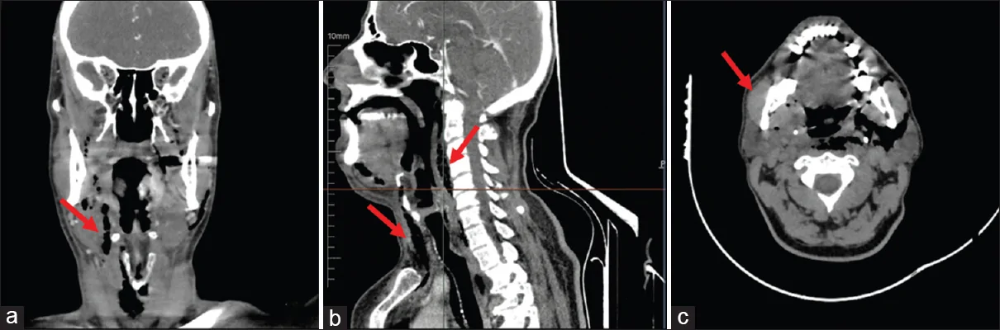
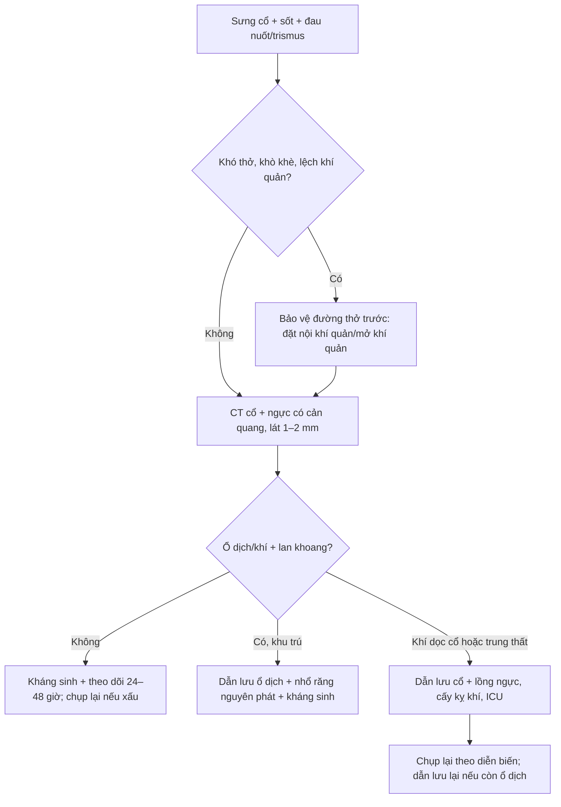
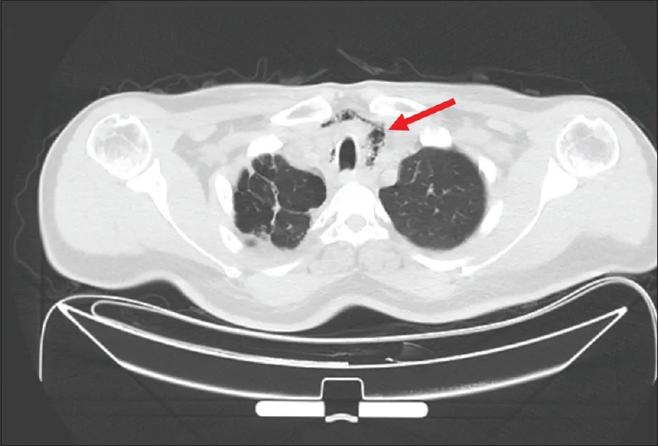
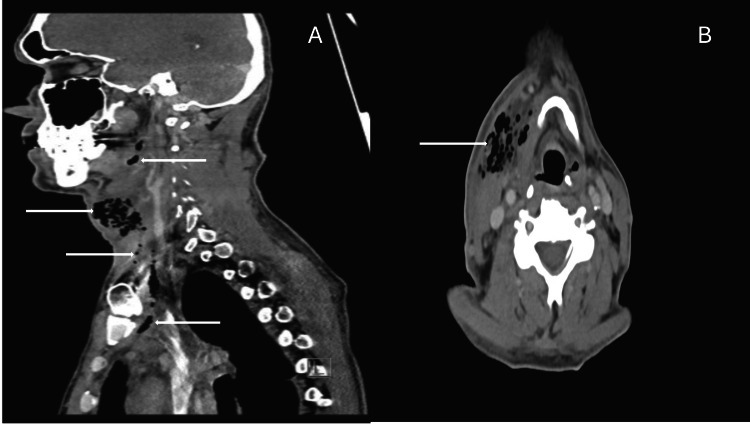

# 749 — Nhiễm khuẩn răng nguyên phát lan xuống trung thất / Odontogenic infection with descending mediastinal spread

**Tags:** `pattern:nhiem-trung-co` `pattern:khi-trong-mo-mem` `pattern:o-dich` `vung:co-sau` `vung:trung-that` `protocol:CT-co-nguc-tiem`

**Mức chắc chắn (certainty):** tổng hợp y văn (literature synthesis) — số liệu từ **đoàn hệ 997 ca nhiễm khuẩn răng nhập viện có mổ** (*BMC Oral Health* 2025, PMC12817696, CC BY 4.0), **496 ca nhiễm trùng cổ sâu** (*Turk J Thorac Cardiovasc Surg* 2026, PMC13658977, CC BY-NC 4.0), **tổng quan 18 nghiên cứu / 881 ca viêm trung thất hoại tử xuống** (PMC13476192, CC BY-NC 4.0) và **2 ca nguyên văn có ảnh** (PMC13722338, PMC12357488). Nhóm **không có bệnh nhân của mình**.

> **Câu chốt:** nhiễm khuẩn răng là **nguyên nhân hàng đầu của nhiễm trùng cổ sâu nặng**, và đường lan chết người là **khoang sau hầu → danger space → trung thất sau**. Ba số phải thuộc: **khoang dưới hàm 50,7%**, **lan nhiều khoang 6,3% nhưng làm tăng biến chứng gấp 5,5 lần (aOR 5,49)**, và **áp-xe sau hầu chỉ 2,8% ca cổ sâu nhưng là nguồn của 44,4% ca viêm trung thất hoại tử**. Khí trong mô mềm là **dấu hiệu báo động**, nhưng **không có khí không loại trừ**.

## 1. Tổng quan bệnh học – cơ chế hình ảnh

### 1.1 Từ sâu răng đến trung thất — giải phẫu quyết định tất cả

- **Ổ nguyên phát:** tủy răng hoại tử → viêm quanh chân răng → thủng vỏ xương hàm. **Răng hàm dưới** có chân nằm **dưới đường mylohyoid** → mủ vào **khoang dưới hàm (submandibular)**; răng hàm trên và răng cửa → **khoang má (buccal)** và **hố nanh (canine fossa)**. Đây là lý do **khoang dưới hàm chiếm 50,7%**, khoang má **18,6%**, hố nanh **12,0%** trong 997 ca.
- **Vì sao mủ xuống được trung thất:** **khoang sau hầu (retropharyngeal)** và **danger space** là **hành lang trở lực thấp chạy từ nền sọ đến cơ hoành**, không có vách chắn ngang. Khi áp lực trong khoang tăng (nuốt, thở), mủ và khí bị **đẩy xuống theo trọng lực và chênh áp**; **danger space nằm sau lá alar, trước đốt sống** nên dẫn thẳng vào **trung thất sau**, trong khi **khoang cạnh hầu/tĩnh mạch cảnh** dẫn vào **trung thất trên**.
- **Vì sao thấy khí trên CT:** vi khuẩn kỵ khí sinh hơi (*Prevotella*, *Fusobacterium*, *Peptostreptococcus*) và mô hoại tử sinh khí. Trên CT, **khí có đậm độ khoảng −1000 HU**, dịch 0–20 HU, mỡ −50 đến −100 HU; khí trong khoang sâu là **dấu hiệu của nhiễm khuẩn kỵ khí/hoại tử**, không phải "khí từ phổi".
- **Sinh bệnh học của sốc:** mủ trong khoang kín làm tăng áp lực → **chèn ép đường thở** (khò khè, lệch khí quản) và **huyết khối tĩnh mạch cảnh**; vi khuẩn vào máu gây **nhiễm khuẩn huyết**. Vì vậy **đường thở luôn được xử lý trước khi chụp CT** ở bệnh nhân khó thở.

### 1.2 Dịch tễ và các con số quyết định xử trí

- **997 ca mổ vì nhiễm khuẩn răng (PMC12817696):** **50,7%** khoang dưới hàm, **18,6%** khoang má, **12,0%** hố nanh; **6,3%** lan ≥ 2 khoang; **biến chứng toàn thân 3,8%** (28/38 ca biến chứng phải ICU, **2 ca tử vong = 0,2%**); **nằm viện kéo dài ≥ 10 ngày 6,7%**; thời gian nằm trung bình **6,0 ± 3,8 ngày**.
- **Yếu tố nguy cơ độc lập cho biến chứng (aOR):** tuổi **1,04/năm**; **COPD 3,71**; **nghiện rượu mạn 5,63**; **lan nhiều khoang 5,49**. **Lan nhiều khoang** cũng là yếu tố dự báo nằm viện kéo dài: **aOR 8,38**.
- **496 ca nhiễm trùng cổ sâu (PMC13658977):** **viêm trung thất hoại tử xuống (DNM) 1,81% (9/496)**; **áp-xe sau hầu chỉ 2,8% ca cổ sâu nhưng là nguồn của 44,4% ca DNM**; **66,7% ca DNM có tổn thương khoang sau hầu**; **tất cả 9 ca sống** sau dẫn lưu ngoại khoa tích cực.
- **Tử vong của DNM:** **11–40%** trong các loạt hiện đại (PMC13476192); **tới 40% nếu chẩn đoán và điều trị muộn** (PMC13722338); **60–70% DNM khởi nguồn từ răng hoặc vùng hàm mặt**.
- **Viêm cân mạc hoại tử cổ (CNF):** khoảng **2,6%** các nhiễm khuẩn mô mềm, tử vong **7–20%**; **30–50%** có nguồn răng (PMC12357488).

## 2. Mẫu hình + chẩn đoán phân biệt theo vị trí (Gamut)

- **Trên đường mylohyoid (khoang dưới lưỡi):** áp-xe dưới lưỡi, **Ludwig angina** — viêm **hai bên khoang dưới hàm + dưới lưỡi + dưới cằm**, sàn miệng nâng cao, **lưỡi bị đẩy ra sau** → đường thở là ưu tiên số 1.
- **Dưới đường mylohyoid (khoang dưới hàm, má, cơ nhai, cạnh hầu):** áp-xe dưới hàm (hay gặp nhất), áp-xe cơ nhai (trismus nổi bật), áp-xe cạnh hầu (đau nuốt, lệch thành họng).
- **Khoang sau hầu/danger space:** áp-xe sau hầu — **nguy cơ DNM cao nhất**; khí lan dọc **trước đốt sống** xuống **trung thất sau**.
- **Trung thất:** viêm trung thất hoại tử xuống (DNM) — khí/dịch trong trung thất, tràn dịch/tràn khí màng phổi, nhiễm khuẩn huyết.
- **Biến chứng mạch máu:** **Lemierre** (huyết khối tĩnh mạch cảnh trong + thuyên tắc phổi nhiễm khuẩn), giả phình cảnh, chảy máu cảnh.
- **Mnemonic vị trí "4 tầng":** **D**ưới lưỡi/dưới hàm (Ludwig) → **C**ơ nhai/cạnh hầu (trismus) → **S**au hầu/danger (đường xuống) → **M**ediastinum (DNM). Đi từng tầng để không bỏ sót.

## 3. Bảng so sánh phân biệt (ma trận đối chiếu)

| Thực thể (entity) | Hình ảnh điển hình | Chốt vào (rule-in) | Chốt loại (rule-out) | Gợi ý xác nhận |
|---|---|---|---|---|
| **Áp-xe răng đơn khoang** | Ổ dịch **một khoang**, viền ngấm, **ổ răng/sâu răng** cùng bên | **Ổ dịch + viền ngấm + sâu răng/răng đau** | Lan ≥ 2 khoang, khí dọc cổ → đã nặng hơn | CT có cản quang; chụp răng |
| **Ludwig angina** | **Hai bên dưới hàm + dưới lưỡi + dưới cằm**, sàn miệng nâng, không ổ dịch rõ | **Sưng hai bên + lưỡi bị đẩy sau + khó nuốt/khó thở** | Ổ dịch khu trú một bên → áp-xe đơn thuần | CT cổ; **đánh giá đường thở trước** |
| **Áp-xe sau hầu/DNM** | **Ổ dịch + khí sau hầu**, lan **trước đốt sống → trung thất sau** | **Khí dọc danger space + khí/dịch trung thất** | Không lan dưới eo giáp, không khí → áp-xe khu trú | CT cổ - ngực cản quang; Endo |
| **Viêm cân mạc hoại tử cổ** | **Khí lan rộng trong mô mềm**, dày cân nông, **không ổ dịch rõ**, da tím/bóng nước | **Khí lan ngoài khoang + đau không tương xứng + nhiễm khuẩn huyết** | Ổ dịch có viền rõ, không khí → áp-xe | Mổ thăm dò + cấy; **không chờ hình ảnh** |
| **Lemierre** | **Tĩnh mạch cảnh trong huyết khối** + áp-xe cạnh hầu + **nốt/thuyên tắc phổi** | **Huyết khối IJV + di căn phổi nhiễm khuẩn** | Không huyết khối IJV → áp-xe đơn thuần | CT tĩnh mạch cổ; cấy máu kỵ khí |
| **U/viêm xương hàm** | Khối đặc, **phá xương**, không khí; có thể nhầm áp-xe | **Phá xương + khối đặc + không ổ dịch** | Ổ dịch + khí + sốt cấp → nhiễm trùng | CT xương hàm, sinh thiết nếu nghi u |

*(a) Coronal: nhiều ổ khí trong mô mềm cổ; (b) Sagittal: khí chạy dọc cân cổ sâu xuống dưới; (c) Axial: **ổ nhiễm nguyên phát cạnh răng khôn hàm dưới phải mọc lệch**. Nguồn: Fettahoglu ST và cs, Turk J Emerg Med 2026, Fig. 1, CC BY-NC-SA 4.0.*

## 4. Protocol chụp + phân độ và xử trí

### 4.1 CT cổ - ngực có cản quang là chuẩn

- **Chỉ định:** sưng cổ + sốt + đau nuốt/trismus, **nghi áp-xe hoặc lan trung thất**; bệnh nhân **không đáp ứng kháng sinh sau 48–72 giờ**.
- **Kỹ thuật:** **CT cổ + ngực có cản quang**, lát **1–2 mm**, cửa sổ mô mềm và xương; **luôn chụp tới trung thất** nếu có khí cổ hoặc triệu chứng ngực — chụp cổ đơn thuần sẽ bỏ sót DNM.
- **Báo cáo 6 mục:** (1) **ổ răng nguyên phát** (răng nào, sâu/viêm quanh chân); (2) **khoang nào** bị ổ dịch; (3) **khí** trong mô mềm/trung thất; (4) **đường thở** (hẹp/lệch khí quản, phù thanh môn); (5) **mạch máu** (huyết khối IJV, giả phình cảnh); (6) **mức lan trung thất** theo **Endo**.
- **Endo (1999), dẫn qua PMC13476192:** **I** — khu trú trung thất trên (trên carina); **IIA** — xuống **trung thất trước dưới**; **IIB** — xuống **trung thất sau dưới**; **III** — toàn bộ trung thất. **Endo IIB và Guan III** có gánh nặng mổ và tử vong cao nhất (**Guan III > 30%**).

### 4.2 Xử trí — không có "kháng sinh đơn thuần" cho ổ dịch

- **Kháng sinh theo kinh nghiệm:** **ampicillin/sulbactam** hoặc **amoxicillin/clavulanate** (phổ liên cầu miệng + kỵ khí); dị ứng penicillin → **clindamycin**; điều chỉnh theo cấy. **Không có ngưỡng kích thước tuyệt đối để mổ** — chỉ định dựa vào **ổ dịch, chèn ép đường thở, nhiễm khuẩn huyết hoặc không đáp ứng nội khoa**.
- **Loại bỏ ổ răng** trong cùng lần mổ khi có thể; nếu chưa thể, đánh dấu và xử lý sớm sau khi kiểm soát nhiễm trùng.
- **DNM:** dẫn lưu **cổ + trung thất** (transcervical và/hoặc transthoracic, ưu tiên **VATS**), **mổ lại > 50%** ca nặng; ICU, nuôi dưỡng, kiểm soát đau.

## 5. Biến thể bình thường và cạm bẫy

- **Không thấy khí không loại trừ nhiễm khuẩn kỵ khí:** khí xuất hiện muộn và không có ở mọi ca; **ổ dịch + viền ngấm + sốt** đã đủ chỉ định dẫn lưu.
- **Chụp cổ mà quên ngực:** bỏ sót DNM — bệnh nhân chỉ ho/khó thở nhẹ nhưng đã có khí trung thất. **Luôn chụp tới carina** khi có khí cổ.
- **Nhầm khí trung thất do nguyên nhân khác:** tràn khí màng phổi, vỡ thực quản, thủ thuật nha khoa dùng khí nén. **Hỏi kỹ tiền sử can thiệp răng**; khí đơn thuần không kèm ổ dịch/dày cân có thể do barotrauma.
- **Bỏ sót "răng khôn mọc lệch" ở góc hàm:** ổ nhiễm có thể nằm **ngoài lát cắt thường quy**; phải cuộn hết xương hàm dưới.
- **Trismus làm khám hạn chế:** không há miệng được không có nghĩa là nhẹ — **trismus + sưng dưới hàm** là áp-xe cơ nhai/cạnh hầu cho tới khi chứng minh khác.
- **Sai lầm "chỉ cần kháng sinh vì đã có kháng sinh mạnh":** ổ mủ kín không có nồng độ kháng sinh hiệu quả; **dẫn lưu là điều trị, kháng sinh là hỗ trợ**.

## 6. Tự lượng giá — Blind Quiz

**Ca 1 — Nam 52 tuổi, sốt, sưng cổ bên phải, hạn chế há miệng, không chấn thương, không can thiệp răng trước đó. Nhìn CT cổ, mô tả trước.**

- Hỏi: Tổn thương nằm ở khoang nào? Dấu hiệu nào cho biết mức độ nặng? Nguyên phát từ đâu?

<b>Bấm để hiện đáp án (findings + chẩn đoán)</b>

- **Dấu hiệu:** (a) **nhiều ổ khí** trong mô mềm cổ bên phải; (b) khí **chạy dọc cân cổ sâu xuống dưới**; (c) **ổ nhiễm cạnh răng khôn hàm dưới phải mọc lệch**.
- **Chẩn đoán:** **áp-xe răng lan khoang cổ sâu**, có khí — nghĩ **nhiễm khuẩn kỵ khí/hoại tử**; nguy cơ **DNM**.
- **Việc cần làm:** bảo vệ đường thở nếu khó thở; **CT cổ + ngực**; dẫn lưu + nhổ răng + kháng sinh phổ kỵ khí; cấy kỵ khí.
- **Nguồn ảnh:** Fettahoglu ST và cs, Turk J Emerg Med 2026, Fig. 1, CC BY-NC-SA 4.0 (PMC13722338).

**Ca 2 — Cùng bệnh nhân, CT ngực được chụp thêm. Đọc trước khi mở đáp án.**

- Hỏi: Dấu hiệu chính? Đây là biến chứng gì? Vì sao phải mổ cả cổ và ngực?

<b>Bấm để hiện đáp án (findings + chẩn đoán)</b>

- **Dấu hiệu:** **khí tự do trong trung thất trước và giữa** (mũi tên), **khí dưới da**; tiếp nối từ khoang cổ.
- **Chẩn đoán:** **viêm trung thất hoại tử xuống (DNM)** — trong ca gốc được xếp **Endo IIA**.
- **Vì sao mổ cả hai:** dẫn lưu cổ đơn thuần **không kiểm soát được ổ trung thất**; cần dẫn lưu lồng ngực (VATS/mở) + kháng sinh + ICU.
- **Nguồn ảnh:** Fettahoglu ST và cs, Turk J Emerg Med 2026, Fig. 2, CC BY-NC-SA 4.0 (PMC13722338).

**Ca 3 — Nam 61 tuổi, viêm khớp dạng thấp đang dùng etanercept, tiền sử tiêm chích. Nhập viện vì nấc cụt không cắt cơn, chóng mặt; ban đầu bị chẩn đoán "hội chứng virus". Sau đó sưng cổ và sốc nhiễm khuẩn.**

- Hỏi: Vì sao chẩn đoán ban đầu sai? Dấu hiệu CT nào phân biệt viêm cân mạc hoại tử với áp-xe thường?

<b>Bấm để hiện đáp án (findings + chẩn đoán)</b>

- **Dấu hiệu:** (A) Sagittal — **khí lan rộng** trong khoang cạnh hầu, dưới hàm, tạng, **xuống trung thất trên**; (B) Axial — **khí trong nhiều khoang cổ**, dày cân, không thấy ổ dịch có viền rõ.
- **Chẩn đoán:** **viêm cân mạc hoại tử cổ (CNF) + DNM**; cấy polymicrobial (*Streptococcus constellatus*, *Parvimonas*, *Cutibacterium*, *Actinomyces turicensis*) gợi nguồn răng.
- **Vì sao sai ban đầu:** **nấc cụt** và triệu chứng mơ hồ; ở người ức chế miễn dịch (etanercept), **phản ứng viêm bị che lấp**, không có sốt cao/sưng rõ lúc đầu.
- **Chốt loại:** **khí lan ngoài khoang + không ổ dịch khu trú + đau không tương xứng** → CNF, cần **mổ thăm dò cấp cứu**, không chờ hình ảnh "điển hình".
- **Nguồn ảnh:** Lorenzo E và cs, Cureus 2025, Fig. 1, CC BY 4.0 (PMC12357488).

## Bài liên quan chéo
- [730 – Nhiễm trùng cổ sâu: áp-xe sau hầu, danger space & phù giả](../730-deep-neck-infections/lesson.md)
- [747 – Chấn thương răng và ổ răng ở trẻ](../747-chan-thuong-rang-o-tre/lesson.md)
- [090 – Bỏng hít đường thở](../090-bong-hit-duong-tho-o-tre/lesson.md) (đường thở cấp cứu)
- [700 – Tổng quan Đầu Cổ](../700-head-neck-overview/lesson.md)
- [093 – Hội chứng tĩnh mạch chủ trên](../093-hoi-chung-tinh-mach-chu-tren/lesson.md) (khi có chèn ép trung thất)

> Không dùng để chẩn đoán độc lập khi chưa có người hướng dẫn.
