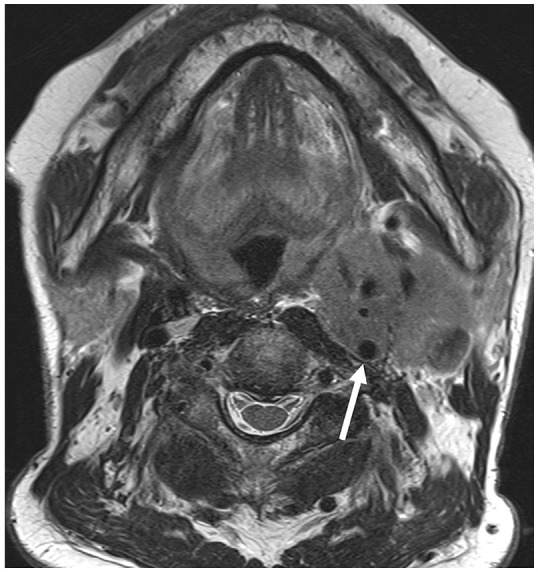
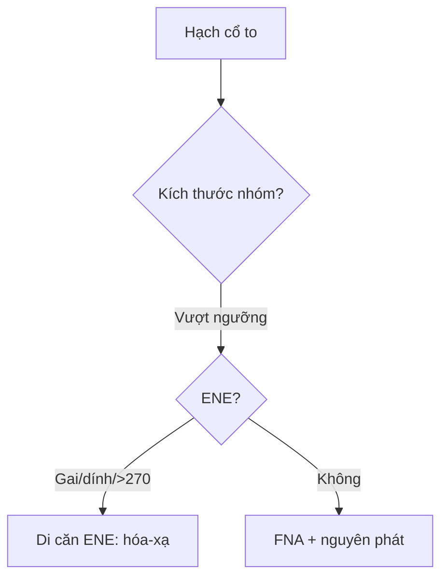

# 750 — Hạch cổ I–VII, ENE & NI-RADS / Neck nodes

**Tags:** `pattern:hach-co` `vung:co` `score:NI-RADS`
**Mức chắc chắn (certainty):** tổng hợp y văn (literature synthesis) — nhóm tự biên từ y văn mở, chưa gắn ca nguyên văn đơn lẻ.

## 1. Tổng quan — kích thước theo nhóm + gai mỡ mới là ENE thật

- Ngưỡng trục ngắn: **nhóm II > 15 mm** (cổ trên to sẵn), khác **> 10 mm**, Rouvière **> 5–8 mm** — TẠI SAO khác nhau: hạch phản ứng vùng II to sinh lý, sau hầu không có hạch lành to.
- iENE chuẩn 2024–2025 (0–3): 0 (không), 1 (gai mỡ + vỏ không đều đa mặt), 2 (dính mất mỡ + góc < 90°), 3 (xâm lấn cơ/da/mạch > 270°) — TẠI SAO bờ mờ đơn thuần KHÔNG đủ: kappa chỉ 0,2–0,6 (chủ quan!).
- NI-RADS sau điều trị: 1 (không nghi) → 4 (chắc chắn) — quyết định sinh thiết lại/xạ.

## 2. Gamut hạch cổ to (Gamut)

- **Tròn + mất rốn + hoại tử + nhóm II:** di căn — FNA + tìm nguyên phát (vòm/hạ họng!).
- **Gai mỡ + dính + > 270° ĐMC:** ENE 1–3 — hóa-xạ + mổ (AJCC 9!).
- **Chuỗi hạt + lao/HIV + vôi:** lao — GenXpert, đừng mổ!
- **Sau điều trị + NI-RADS 1:** theo dõi (đừng sinh thiết oan!).

## 3. Bảng so sánh phân biệt (ma trận đối chiếu)

| Thực thể (entity) | Hình ảnh điển hình | Chốt vào (rule-in) | Chốt loại (rule-out) | Gợi ý xác nhận |
|---|---|---|---|---|
| Di căn | **Tròn + mất rốn + hoại tử + nhóm II-VI** | **Kích thước nhóm + hoại tử** | Rốn mỡ + bầu dục → phản ứng | FNA + nguyên phát |
| ENE 1–3 | **Gai mỡ + dính + > 270° mạch** | **Đa mặt + xâm lấn + AJCC 9** | Bờ mờ đơn thuần → chưa đủ | Hóa-xạ + mổ |
| Lao hạch | **Chuỗi + vôi + hoại tử + lao phổi** | **GenXpert + vôi + trẻ** | Gai mỡ + nguyên phát → di căn | Kháng lao |
| NI-RADS sau trị | **1: sạch; 4: chắc chắn** | **So sánh nền + PET** | Viêm sau xạ → 2 | Sinh thiết khi 3–4 |

*Thay thế cấu trúc + mất ranh giới (mũi tên). Nguồn: Lee et al., J Korean Soc Radiol 2026 Fig. 5, CC BY-NC 4.0.*

## 4. Protocol hạch cổ

- **CT/MRI + siêu âm + FNA + PET** khi hạch to; NI-RADS sau điều trị 8–12 tuần.

## 5. Cạm bẫy

- **Bờ mờ = ENE** quá đà (kappa thấp!) — gai mỡ đa mặt mới chốt.
- **Rosenmüller không đều sinh lý** tưởng u vòm — đối xứng + không lan mới là thường.
- **FDG vòng Waldeyer + cơ thanh quản bù** tưởng tái phát — sinh lý + liệt đối bên là chốt.

## 6. Tự lượng giá — Blind Quiz

**Ca 1 — K hạ họng + hạch cổ. Đọc MRI.**

- Hỏi: ENE độ mấy? Đổi giai đoạn và điều trị không?

<b>Bấm để hiện đáp án</b>

- Dấu hiệu (findings): khối hạch bao ĐMC trong > 270° + mất cấu trúc.
- Chẩn đoán (diagnosis): **iENE độ 3** — hóa-xạ (AJCC 9: cN thay đổi, không mổ đơn thuần!).
- Nguồn: Lee et al., Fig. 5, CC BY-NC 4.0.

**Ca 2 — Hạch II 12 mm bầu dục + rốn mỡ còn:** bệnh lý không? *(Bảng mục 3.)*

<b>Bấm để hiện đáp án</b>

- **Phản ứng:** nhóm II < 15 mm + rốn mỡ — theo dõi (không FNA vội).

## Bài liên quan chéo
- [700 – Tổng quan Đầu Cổ](../700-head-neck-overview/lesson.md)
- [230 – Tuyến giáp](../230-tuyen-giap-hach-co/lesson.md) (hạch giáp)
- [740 – Tuyến nước bọt](../740-salivary-gland-tumors/lesson.md) (xâm lấn tuyến)

> Không dùng để chẩn đoán độc lập khi chưa có người hướng dẫn.
