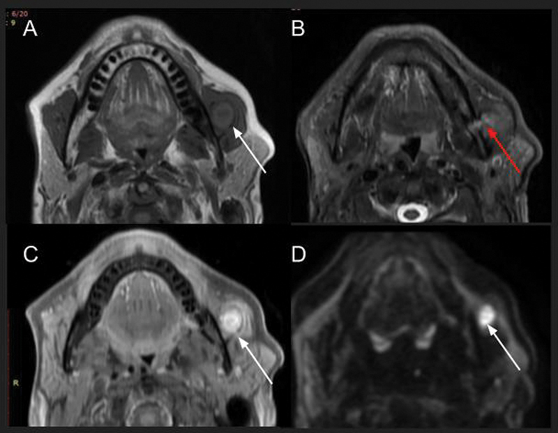
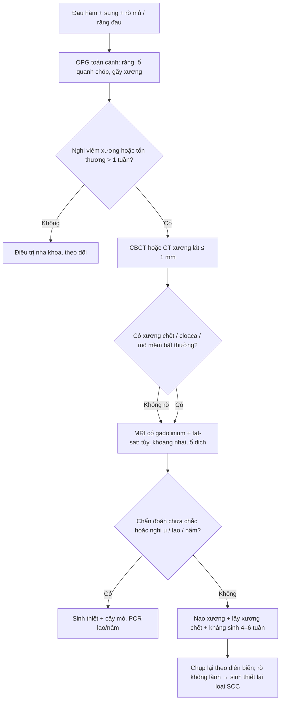
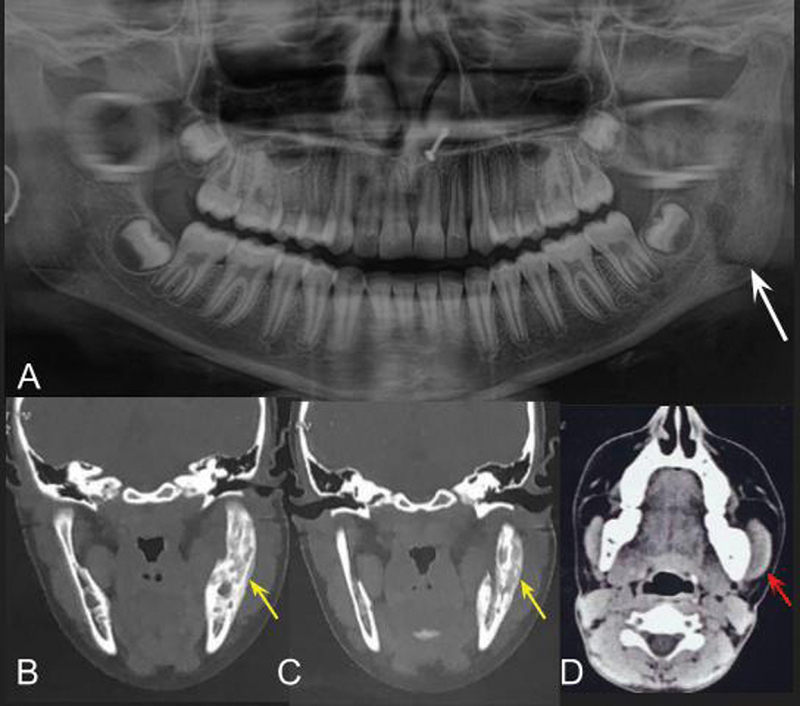
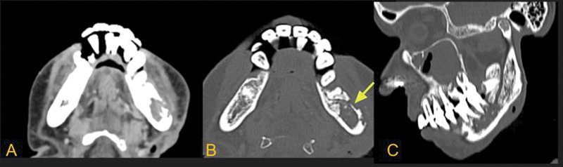
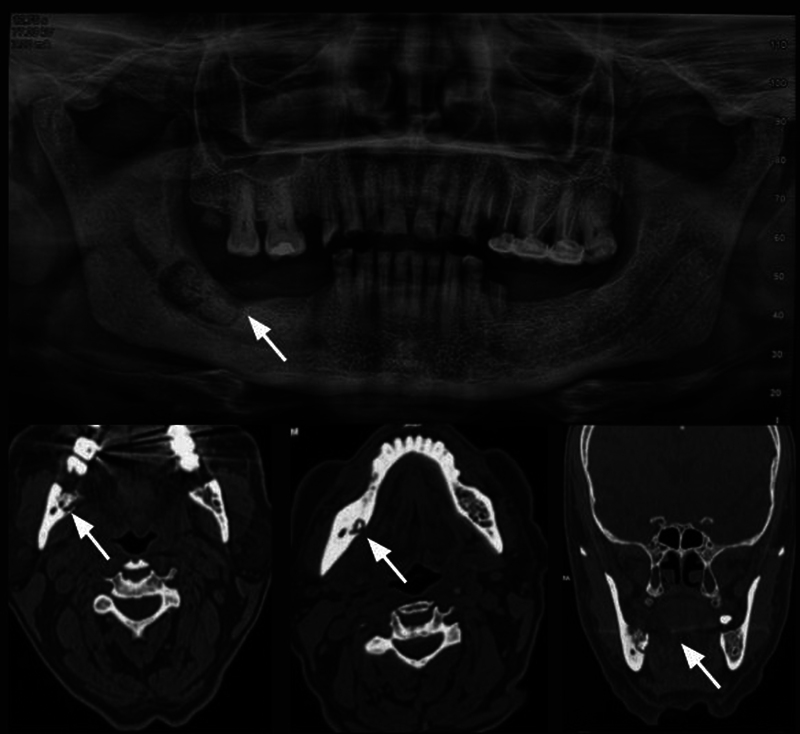

# 751 — Viêm xương hàm do răng: xương chết, vỏ xương thủng và các bệnh giả / Odontogenic osteomyelitis of the jaws

**Tags:** `pattern:tieu-xuong` `pattern:xuong-chet` `pattern:xo-xuong` `pattern:ro-xuong` `pattern:phan-ung-mang-xuong` `vung:ham-mat` `vung:ham-duoi` `protocol:OPG` `protocol:CBCT` `protocol:MRI-co-tuong` `score:Zurich-PANO`

**Mức chắc chắn (certainty):** tổng hợp y văn (literature synthesis) — số liệu từ **tổng quan ảnh học 14 hình của *Indian J Radiol Imaging* 2025** (PMC12169932, CC BY-NC-ND), **tổng quan điều trị *J Clin Exp Dent* 2025** (PMC11994200, CC BY) tái phân tích các đoàn hệ Fenelon/Koorbusch/Haeffs, và **nghiên cứu toàn quốc Thụy Điển về viêm xương hàm nguyên phát mạn** (*Acta Odontol Scand* 2024, PMC11457353, CC BY 4.0). Nhóm **không có bệnh nhân của mình**; các con số dịch tễ đều là số của tác giả gốc, ghi kèm nguồn.

> **Câu chốt:** viêm xương hàm là bệnh **của tủy xương chứ không phải của ổ răng** — hình ảnh chỉ dương tính rõ khi đã mất **30–50% khoáng xương**, nên **MRI là modality sớm nhất (phù tủy sau 1–2 ngày)**, còn **CT/CBCT là modality của xương chết (sequestrum) và vỏ xương thủng (cloaca)**. Ba câu hỏi phải trả lời trước khi gọi tên: **(1) có ổ răng/nguyên nhân tại chỗ không? (2) có xương chết hoặc mảnh xương tách rời không? (3) có gì khiến đây là bệnh giả (hoại tử sau xạ, MRONJ, u, bệnh xơ hóa) không?**

## 1. Tổng quan bệnh học – cơ chế hình ảnh

### 1.1 Vì sao hàm dưới, và vì sao hình ảnh đến muộn

- **Giải phẫu quyết định vị trí:** xương hàm dưới **nghèo mạch máu hơn hàm trên**, vỏ xương dày, tủy xương nhiều → ổ nhiễm bị **"nhốt" trong một khoang kín**. Vì vậy viêm xương do vi khuẩn **hàm dưới > hàm trên**, còn **nấm (mucor) lại ưu thế hàm trên** do lan từ xoang (PMC12169932).
- **Chuỗi mô bệnh:** sâu răng → hoại tử tủy răng → viêm quanh chân răng → **tăng áp lực nội tủy** → huyết khối các nhánh mạch nuôi xương → **hoại tử xương (xương chết, sequestrum)** → vỏ xương bị ăn mòn tạo **lỗ thủng (cloaca)** → mủ ra dưới màng xương → **vỏ xương mới (involucrum)**. Bốn từ này là toàn bộ ngôn ngữ của bệnh trên CT.
- **TẠI SAO MRI sớm nhất:** phản ứng đầu tiên là **phù tủy** (nước ngoại bào tăng) → T1 giảm tín hiệu, T2/STIR tăng tín hiệu, xuất hiện **1–2 ngày sau khởi phát** (PMC12169932). Nhưng phù tủy **chưa phải viêm xương**: trong viêm mô tế bào (cellulitis) phù tủy có thể lặng lẽ — nên **chỉ gọi viêm xương khi có ngấm thuốc tương ứng** (tăng tín hiệu sau gadolinium) ở vùng tủy bất thường.
- **Dấu "penumbra" (viền tranh tối tranh sáng):** viền **tăng nhẹ tín hiệu T1** quanh ổ mủ trong tủy = **lớp mô hạt** lót ổ áp-xe xương; ngoài viền này là phù và xương mới phản ứng — dấu của **giai đoạn bán cấp**.
- **TẠI SAO X-quang/CBCT muộn:** phim chỉ thấy **mất khoáng ≥ 30–50%** mới thành vùng thấu quang; tác giả tổng quan ghi rõ **hủy xương thấy được trên phim là dấu hiệu MUỘN, bệnh nhân thường đã có triệu chứng > 1 tuần** (PMC12169932). Đây là lý do **"phim bình thường" không loại trừ** viêm xương hàm.
- **TẠI SAO xạ hình sớm:** 99mTc-MDP gắn vào xương mới tạo — phát hiện **3 ngày sau khởi phát**, độ phát hiện **89–100%**, và cho thấy **tổn thương nhiều ổ** (CRMO/SAPHO) (PMC11994200 dẫn lại).
- **TẠI SAO CT thấy xương chết:** xương hoại tử **mất tưới máu nhưng giữ khoáng** → đậm độ xương bình thường hoặc cao, **tách khỏi xương sống bởi viền thấu quang**; trên CT còn thấy **vỏ xương bị thủng từng lỗ (cloaca)** và màng xương dày.

### 1.2 Dịch tễ và các con số quyết định xử trí

- **Định nghĩa mạn:** viêm xương **kéo dài > 4 tuần** = viêm xương mạn thứ phát (secondary chronic osteomyelitis, SCO) (PMC11994200).
- **Triệu chứng (Koorbusch, dẫn qua PMC11994200):** viêm **74%**, đau **71%**, **rò mủ 37%**; **xương chết, lộ xương, gãy bệnh lý, trismus, sốt chỉ 3–6%** — nghĩa là **các dấu hiệu "điển hình" lại hiếm**.
- **Vi khuẩn (Fenelon):** *Streptococcus* **40,7%** (*S. constellatus*, *S. intermedius*, *S. anginosus*), *S. mitis* **26,2%**, *Actinomyces* **15,1%**; Haeffs: *Streptococcus* **74%**, *Staphylococcus* **43%** kèm đề kháng kháng sinh (PMC11994200).
- **Điều trị trong thực hành:** **87% phải mổ**, **50% mổ ≥ 2 lần**, thủ thuật hay dùng nhất là **nạo xương + lấy xương chết** (Fenelon, dẫn qua PMC11994200); kháng sinh **4–6 tuần**.
- **Biến chứng muộn:** **chuyển dạng ung thư biểu mô vảy 1,5–2%** ở viêm xương mạn (Hudson, dẫn qua PMC11994200) — lý do mọi ổ rò/lộ xương **không lành sau điều trị đúng phải sinh thiết**.
- **Viêm xương nguyên phát mạn (PCO/DSO, Thụy Điển 2012–2018):** chỉ **17 ca/6 năm**; tuổi khởi phát trung bình **9,9**, tuổi chẩn đoán **10,6** → **trễ 8 tháng**; **76% nữ**; **NSAID là điều trị đầu tay**, kháng sinh ở **10/17 ca "ít hoặc không hiệu quả"**, cuối cùng **12/17 hết triệu chứng** (PMC11457353).
- **CRMO:** chiếm **2–5%** các ca viêm xương, **nữ:nam = 5:1**, **> 80% nhiều ổ**, hay gặp **xương đòn** (PMC12169932).
- **Viêm xương quanh implant nha khoa:** rất thấp, **0,02%** trong một số nghiên cứu, nhưng **đáp ứng kém và hay phải mổ lại** vì bề mặt implant nuôi biofilm (PMC11994200).
- **Chuyển tủy theo tuổi (bẫy tín hiệu):** tủy đỏ → tủy vàng **bắt đầu ở thân hàm dưới trong thập niên thứ 2**, lan ra góc/ngành rồi tới **lồi cầu vào thập niên thứ 3** (PMC12169932). Trước mốc đó, tủy T1 thấp **có thể là sinh lý**, không phải viêm.

## 2. Mẫu hình + chẩn đoán phân biệt theo vị trí (Gamut)

- **Theo xương:** **hàm dưới** (thân, góc, ngành) → vi khuẩn do răng, viêm xương do lao, ORN, MRONJ; **hàm trên** → **nấm xâm lấn** (mucor/aspergillus) hàng đầu, rồi viêm do răng, GPA, u lympho NK/T.
- **Theo hình thái — tiêu xương (lytic):** SCO do răng (ổ răng + ổ dịch + cloaca), ORN (sau xạ, **1–3 năm**), MRONJ (bisphosphonate), u lympho NK/T (niêm mạc dày rất nhiều, **không có ổ răng**), GPA (tiêu xương **điểm 75%**, tạo xương mới **50%**, đối xứng hai bên), lao hàm (ổ lạnh, nhiều lỗ rò dọc **bờ dưới hàm**).
- **Theo hình thái — xơ hóa (sclerotic):** **Garré (periostitis ossificans)** — xương mới **trên vỏ, dưới màng xương**, vỏ nhân đôi "vỏ hành", **không đau, không sốt**, tuổi thiếu niên–người trẻ; **DSO/PCO** — xơ hóa lan tỏa người lớn, **không có xương chết, không có lỗ rò**; **CRMO/SAPHO** — trẻ/nữ, nhiều ổ, **xương đòn + khớp ức–đòn**; **loạn sản xương (florid osseous dysplasia)** — khu trú ổ răng.
- **Mnemonic 4 nhóm "SCOPE":** **S**econdary chronic (do răng — có xương chết), **C**hronic non-bacterial (CRMO/SAPHO), **O**steonecrosis (ORN, MRONJ, do thuốc/mạch máu), **P**eriostitis ossificans (Garré), **E**xtra (u, lao, nấm, GPA).

## 3. Bảng so sánh phân biệt (ma trận đối chiếu)

| Thực thể (entity) | Hình ảnh điển hình (OPG/CBCT/CT/MRI) | Chốt vào (rule-in) | Chốt loại (rule-out) | Gợi ý xác nhận |
|---|---|---|---|---|
| **Viêm xương do răng (SCO)** | Ổ răng/sâu răng cùng bên; **tiêu xương không đều + xương chết**; **cloaca**; màng xương dày; MRI: T1 thấp/STIR cao + **ngấm thuốc**, có thể **penumbra sign** | **Ổ răng nguyên phát + xương chết/cloaca + ngấm thuốc tủy** | Không có ổ răng, không ngấm thuốc, tổn thương đối xứng → nghĩ bệnh giả | CBCT/CT xương lát ≤ 1 mm; cấy mủ + mô bệnh |
| **Viêm xương do lao** | **Nhiều lỗ rò dọc bờ dưới hàm**, ổ lạnh, **không đau nhiều**; tiêu xương + ổ dịch dưới màng xương | **Lao nơi khác + ổ lạnh + nhiều lỗ rò** | Sốt cao, đau dữ dội, ổ răng rõ → vi khuẩn thường | PCR/cấy lao dịch hút; X-quang ngực |
| **ORN (sau xạ)** | **Xạ 1–3 năm trước**; tiêu xương **chủ yếu mặt ngoài**, kiểu **xơ–thấu quang hỗn hợp**, **không có khối mô mềm** | **Tiền sử xạ + lộ xương/gãy + không khối mô mềm** | Có khối mô mềm + hạch → nghĩ tái phát u | Đối chiếu trường chiếu; CT; sinh thiết nếu nghi tái phát |
| **MRONJ** | Xơ hóa đậm cả xương xốp và vỏ, **mảnh giống xương chết**, **không tạo xương màng xương**; OPG có thể **dày lá cứng** | **Bisphosphonate/denosumab + lộ xương > 8 tuần + xơ hóa không tạo xương mới** | Tạo xương màng xương rõ + ổ răng → viêm xương thật | Tiền sử thuốc; CT; ngừng thuốc theo chuyên khoa |
| **Garré (periostitis ossificans)** | **Xương mới trên vỏ–dưới màng xương, nhẵn, vỏ nhân đôi**, thường thân/ngành hàm; có thể kèm tiêu xương nhỏ | **Tuổi trẻ + sưng cứng không đau + vỏ nhân đôi** | Đau, sốt, ổ dịch, xương chết → viêm xương mủ | OPG + CT; theo dõi, sinh thiết khi không điển hình |
| **DSO/PCO (không do vi khuẩn)** | **Xơ hóa lan tỏa**, dày xương, **KHÔNG xương chết, KHÔNG lỗ rò**; T2 tủy tăng (phù) | **Đau–sưng–trismus tái diễn + không mủ + không xương chết** | Có xương chết/lỗ rò → SCO | Sinh thiết (loại u); đáp ứng NSAID |
| **CRMO/SAPHO** | Nhiều ổ, **> 80%**, đối xứng; **xương đòn, khớp ức–đòn**, viêm khớp cùng chéo | **Nhiều ổ + xương đòn + viêm khớp ức–đòn** | Một ổ + ổ răng + mủ → nhiễm khuẩn | Xạ hình toàn thân/MRI; CRP/ESR tăng nhẹ |
| **U lympho NK/T / SCC / LCH** | **Mô mềm nhiều không tương xứng với hủy xương**, tiêu xương thấm, màng xương hung hãn, **hạch bệnh lý**; LCH: tiêu xương gần toàn bộ hàm, **răng "trôi"** | **Khối mô mềm lớn + hạch + không ổ răng** | Mô mềm mỏng, có ổ răng, ngấm thuốc kiểu viêm → viêm xương | Sinh thiết **bắt buộc** trước khi điều trị dài |

*Nam 43 tuổi, loét và rò mủ 4 tháng. (A) T1 không cản quang: vùng tủy **giảm tín hiệu không bờ** ở nửa hàm dưới trái; (B) STIR: **tăng tín hiệu** cùng vùng + **vỡ vỏ xương và đường rò** (mũi tên đỏ); (C) T1 sau tiêm: **ngấm thuốc** lan vào **khoang nhai** tạo **áp-xe cơ cắn** (mũi tên trắng); (D) DWI: **hạn chế khuếch tán** trong ổ áp-xe. Nguồn: Justine D và cs, *Indian J Radiol Imaging* 2025;35(3):361–373, Fig. 5, CC BY-NC-ND 4.0 (PMC12169932) — ảnh nguyên bản, không cắt/ghép.*

### Ba dấu hiệu phải gọi tên trên CT/CBCT

- **Xương chết (sequestrum):** mảnh xương đậm độ xương, **bờ không đều**, nằm trong vùng thấu quang — dấu **chốt của viêm xương mủ**, và là **chỉ định lấy bỏ**.
- **Cloaca:** lỗ thủng vỏ xương nơi mủ thoát ra; trên CT là **khuyết vỏ xương có bờ** kèm mô mềm/ổ dịch ngay ngoài.
- **Involucrum:** vỏ xương mới dày, đôi khi **có lỗ** (cloaca xuyên qua) — dấu của quá trình **mạn, đang tái tạo**.

## 4. Protocol chụp + phân độ và xử trí

### 4.1 Thứ tự modality (đừng bắt đầu bằng CT)

- **OPG (panoramic) trước tiên:** đánh giá **tình trạng răng**, ổ quanh chóp, mất xương ổ răng, gãy xương, và các **yếu tố thuận lợi**; đây là phim tác giả tổng quan khuyến cáo **làm trước mọi chụp cắt lớp** (PMC12169932).
- **CBCT/CT xương, lát ≤ 1 mm, cửa sổ xương + mô mềm:** để thấy **xương chết, cloaca, màng xương, vôi hóa, sỏi tuyến**; CBCT **liều thấp hơn** nhưng **không đánh giá tốt mô mềm**.
- **MRI có gadolinium + fat-sat (T1, T2/STIR, DWI):** chỉ định khi cần **phạm vi tủy, ổ dịch khoang nhai/dưới màng xương, chèn ép thần kinh** hoặc khi CT chưa rõ. Ngấm thuốc là **điều kiện để gọi viêm xương** (phân biệt với phù tủy đơn thuần).
- **Xạ hình (99mTc) / SPECT / PET:** khi nghi **nhiều ổ** (CRMO/SAPHO), khi phim âm tính mà lâm sàng mạnh, hoặc theo dõi đáp ứng — nhớ **không đặc hiệu** (u, gãy, sau mổ cũng dương tính).
- **Mô bệnh + cấy là chuẩn vàng:** mẫu **qua đường ngoài miệng (extraoral)** để tránh nhiễm tạp khuẩn miệng khi cấy xương (PMC11457353).

### 4.2 Phân độ hay dùng

- **Zurich/PANO (Baltensperger):** **P**rimary **A**cute, **P**rimary chronic (PCO — không có nguyên nhân ngoài), **S**econdary **A**cute, **S**econdary chronic (SCO — sau nhiễm răng/chấn thương) (PMC11457353). Phân độ này quyết định **kháng sinh hay NSAID**, không phải kháng sinh cho tất cả.
- **Cierny–Mader (dùng cho xương dài, áp dụng được cho hàm):** giai đoạn **I tủy, II bề mặt, III khu trú, IV lan tỏa** + **4 yếu tố vật chủ (A–D)**; càng cao càng cần **cắt bỏ + tái tạo**, không chỉ nạo.
- **Ngưỡng xử trí:** có **xương chết/lỗ rò/áp-xe** → **mổ** (nạo + lấy xương chết; cắt đoạn khi lan tỏa hoặc gãy bệnh lý); **không có xương chết** (PCO/DSO) → **NSAID ± corticoid/antiresorptive trước**, **decortication** khi thất bại (PMC11457353). Kháng sinh **4–6 tuần**, chọn theo cấy (PMC11994200).

## 5. Biến thể bình thường và cạm bẫy

- **Tủy đỏ chưa chuyển hết:** trước thập niên thứ 2–3, tủy T1 thấp ở thân/góc hàm là **sinh lý**; đối chiếu **tuổi + đối xứng + có ngấm thuốc hay không** (PMC12169932).
- **"Phim bình thường" không loại trừ:** cần mất **30–50% khoáng** mới thấy thấu quang; bệnh nhân đã đau **> 1 tuần** mà OPG sạch vẫn có thể đã có viêm tủy xương — **chuyển CBCT/CT/MRI**.
- **Ba bệnh giả hay bị gọi là "viêm xương"** (xem ảnh dưới): **ORN** (tiền sử xạ 1–3 năm, không khối mô mềm), **MRONJ** (bisphosphonate, xơ hóa + mảnh giống xương chết, **không tạo xương màng xương**), **Garré** (vỏ nhân đôi, không đau/sốt).
- **Bỏ sót ổ răng nguyên phát:** đọc hết **cung răng** và **xương ổ răng**, không chỉ vùng đau; răng khôn mọc lệch ở góc hàm nằm **ngoài lát cắt thường quy**.
- **SCC giả viêm xương:** viêm xương mạn **chuyển dạng SCC 1,5–2%**; **rò/lộ xương không lành sau điều trị đúng → sinh thiết**, đừng tăng kháng sinh.
- **Satisfaction of search:** thấy ổ răng là dừng lại — phải tìm thêm **áp-xe khoang nhai, lan khoang cổ sâu, huyết khối xoang hang** (nối bài 749/730).
- **Sau mổ/sau xạ:** thay đổi xơ hóa và mảnh xương nhỏ tồn tại **nhiều tháng**; so phim cũ trước khi gọi "tái phát".

*Garré (periostitis ossificans). (A) OPG: xơ hóa không bờ nửa hàm dưới trái, chủ yếu ngành hàm lan ra thân sau, có ổ tiêu xương và **thủng vỏ** (mũi tên trắng); (B, C) CT xương: **giãn xương, mỏng vỏ, xơ hóa lan tỏa** + **xương mới khu trú mặt ngoài** (mũi tên vàng); (D) cửa sổ mô mềm: **phù cơ cắn**, cơ to hơn bên đối diện (mũi tên đỏ). Nguồn: Justine D và cs, *Indian J Radiol Imaging* 2025, Fig. 12, CC BY-NC-ND 4.0 (PMC12169932).*

*Hoại tử xương do xạ (ORN). Bệnh nhân ung thư tuyến mang tai trái đã mổ + xạ: CT cho thấy **hủy vỏ xương không bờ, chủ yếu mặt ngoài** nửa hàm dưới trái (mũi tên vàng), kiểu **xơ–thấu quang hỗn hợp**, và **KHÔNG có khối mô mềm** — điểm phân biệt với tái phát u. Nguồn: Justine D và cs, *Indian J Radiol Imaging* 2025, Fig. 10, CC BY-NC-ND 4.0 (PMC12169932).*

*Hoại tử xương hàm liên quan thuốc (MRONJ). Nam 68 tuổi, đa u tủy, **acid zoledronic 25 mg/ngày × 2 năm**: OPG và CT cho thấy **ổ tiêu xương bờ rõ ở thân hàm dưới phải + mảnh trung tâm giống xương chết + xơ hóa lan tỏa**, và **không có xương mới dưới màng xương**. Nguồn: Justine D và cs, *Indian J Radiol Imaging* 2025, Fig. 11, CC BY-NC-ND 4.0 (PMC12169932).*

## 6. Tự lượng giá — Blind Quiz

**Ca 1 — Nam 43 tuổi, loét và rò mủ vùng góc hàm trái 4 tháng, không sốt. Xem 4 chuỗi MRI rồi mô tả trước khi mở đáp án.**

- Hỏi: Chuỗi nào cho biết **phạm vi tủy**, chuỗi nào chứng minh **có ổ áp-xe**? Dấu hiệu nào khiến đây là **viêm xương** chứ không chỉ viêm mô tế bào?

<b>Bấm để hiện đáp án (findings + chẩn đoán)</b>

- **Dấu hiệu:** T1 giảm tín hiệu không bờ ở nửa hàm dưới trái; STIR tăng tín hiệu cùng vùng, **vỡ vỏ xương + đường rò**; T1 sau tiêm **ngấm thuốc** lan vào khoang nhai (áp-xe cơ cắn); DWI **hạn chế khuếch tán**.
- **Chẩn đoán:** **viêm xương hàm dưới do răng (SCO)** + áp-xe khoang nhai. Chốt: **bất thường tủy CÓ ngấm thuốc** (không phải phù đơn thuần) + vỡ vỏ xương.
- **Việc cần làm:** CBCT/CT xương tìm xương chết; cấy mủ; **nạo xương + lấy xương chết + xử lý răng nguyên phát**, kháng sinh 4–6 tuần.
- **Nguồn ảnh:** Justine D và cs, *Indian J Radiol Imaging* 2025, Fig. 5, CC BY-NC-ND 4.0 (PMC12169932).

**Ca 2 — Nam 17 tuổi, sưng cứng vùng góc hàm trái nhiều tháng, **không đau, không sốt**, không rò mủ. Xem OPG + CT.**

- Hỏi: Dấu hiệu xương nào gợi ý **phản ứng màng xương** hơn là ổ nhiễm mủ? Chẩn đoán phân biệt với viêm xương mủ dựa vào đâu?

<b>Bấm để hiện đáp án (findings + chẩn đoán)</b>

- **Dấu hiệu:** xơ hóa lan tỏa + giãn xương + mỏng vỏ, **xương mới khu trú mặt ngoài vỏ** (kiểu "vỏ nhân đôi"), phù cơ cắn.
- **Chẩn đoán:** **viêm xương Garré (periostitis ossificans)** — phản ứng màng xương không mủ. **Chốt loại viêm xương mủ:** không ổ dịch, không xương chết, không sốt/đau dữ dội.
- **Bẫy:** ở trẻ < 6 tháng, hình ảnh tương tự là **tăng sản vỏ xương nhũ nhi (Caffey)** — nhưng Caffey **hai bên, nhiều xương** (vai, xương đòn, sườn), kèm quấy khóc/sốt nhẹ.
- **Nguồn ảnh:** Justine D và cs, *Indian J Radiol Imaging* 2025, Fig. 12, CC BY-NC-ND 4.0 (PMC12169932).

**Ca 3 — Nam 68 tuổi, đa u tủy, đã dùng acid zoledronic 2 năm, nay lộ xương hàm dưới phải. Xem OPG + CT.**

- Hỏi: Vì sao **không** gọi đây là viêm xương do răng? Dấu hiệu nào trên CT giúp phân biệt với xương chết của viêm xương mủ?

<b>Bấm để hiện đáp án (findings + chẩn đoán)</b>

- **Dấu hiệu:** ổ tiêu xương bờ rõ ở thân hàm dưới phải, **mảnh trung tâm giống xương chết**, **xơ hóa lan tỏa** cả vỏ và xương xốp, **không có xương mới dưới màng xương**.
- **Chẩn đoán:** **MRONJ** (hoại tử xương hàm liên quan thuốc). Chốt loại: tiền sử bisphosphonate + lộ xương + **xơ hóa không kèm tạo xương màng xương**; xương chết thật thường đi cùng **cloaca + màng xương dày**.
- **Vì sao quan trọng:** xử trí **khác hẳn** — không nạo rộng, hạn chế mổ xương, phối hợp chuyên khoa ung thư và răng hàm mặt; nạo rộng làm **lan hoại tử**.
- **Nguồn ảnh:** Justine D và cs, *Indian J Radiol Imaging* 2025, Fig. 11, CC BY-NC-ND 4.0 (PMC12169932).

## Bài liên quan chéo
- [749 – Nhiễm khuẩn răng lan xuống trung thất](../749-nhiem-khuan-rang-lan-trung-that/lesson.md) (mặt lan xa của cùng ổ răng)
- [747 – Chấn thương răng ở trẻ](../747-chan-thuong-rang-o-tre/lesson.md)
- [748 – Chấn thương răng sữa và di chứng mầm răng vĩnh viễn](../748-chan-thuong-rang-sua/lesson.md)
- [730 – Nhiễm trùng cổ sâu: áp-xe sau hầu, danger space](../730-deep-neck-infections/lesson.md)
- [9421 – CBCT nha khoa ở trẻ](../9421-cbct-non-nha-khoa-chinh-nha-tre/lesson.md)
- [1461 – Áp-xe dưới màng xương hốc mắt ở trẻ](../1461-ap-xe-duoi-mang-xuong-hoc-mat-o-tre/lesson.md) (khi ổ răng hàm trên lan lên hốc mắt)
- [700 – Tổng quan Đầu Cổ](../700-head-neck-overview/lesson.md)

## Ảnh
- `images/751_viem-xuong-ham_MRI_PMC12169932.jpg` — MRI 4 chuỗi, viêm xương hàm dưới + áp-xe cơ cắn (Fig. 5).
- `images/751_garre_OPG-CT_PMC12169932.jpg` — Garré: OPG + CT (Fig. 12).
- `images/751_orn_CT_PMC12169932.jpg` — ORN: CT xương (Fig. 10).
- `images/751_mronj_OPG-CT_PMC12169932.jpg` — MRONJ: OPG + CT (Fig. 11).
- Cả 4 ảnh: **CC BY-NC-ND 4.0** (PMC12169932) → dùng **nguyên bản, không cắt, không ghép**; ghi công đầy đủ trong `images/CREDITS.md`.

> Không dùng để chẩn đoán độc lập khi chưa có người hướng dẫn.
