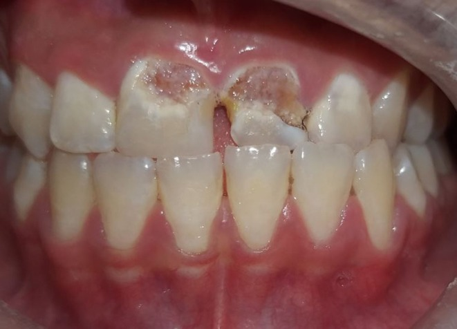
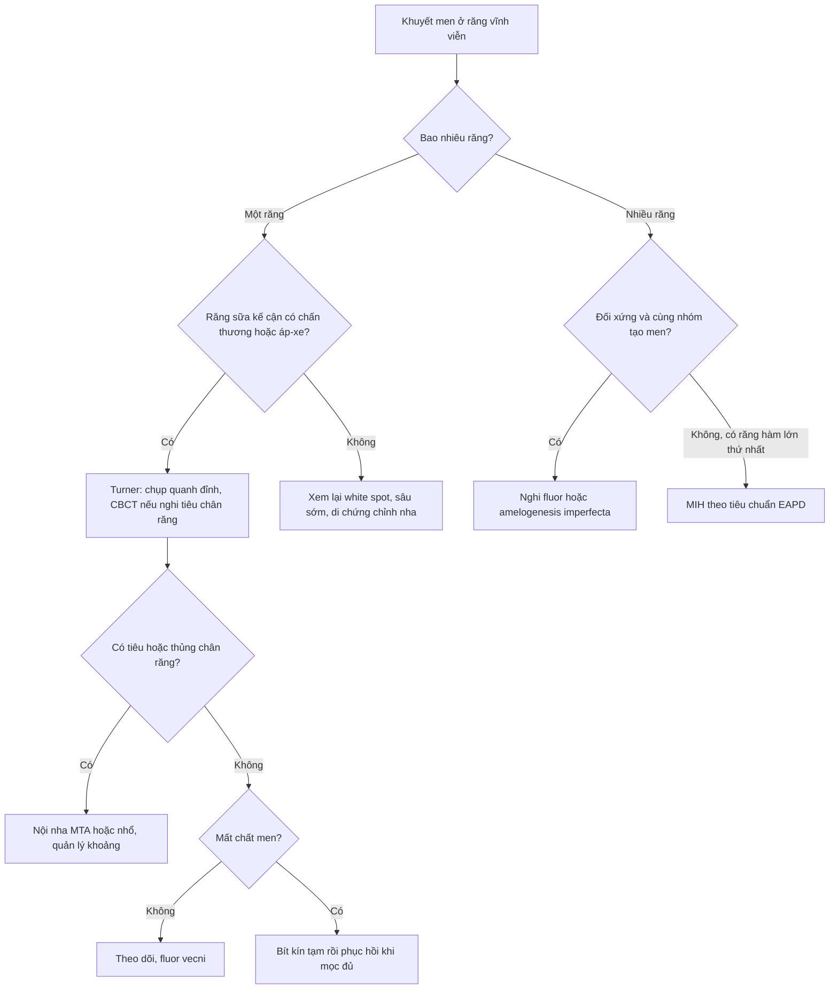
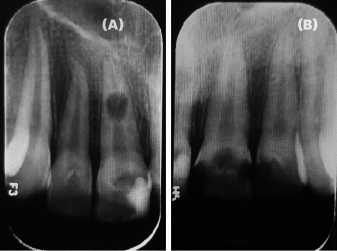
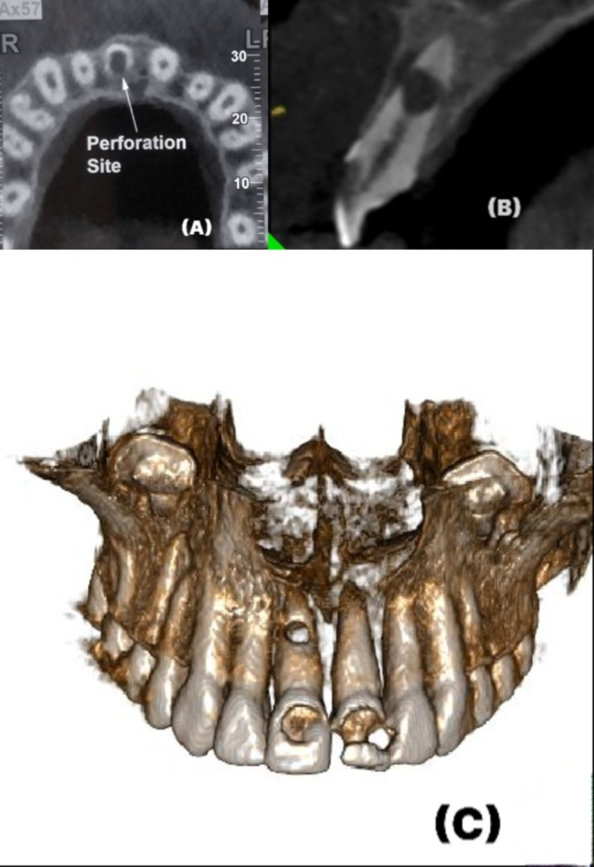

# 752 — Thiểu sản men Turner ở răng vĩnh viễn sau chấn thương răng sữa / Turner hypoplasia of the permanent successor

**Tags:** `pattern:thieu-san-men` `pattern:khuyem-khuyet-men-khu-tru` `pattern:doi-mau-rang` `pattern:tieu-xuong-chop-rang` `vung:rang-ham` `vung:ham-mat` `vung:so-mat` `anatomy:rang-ham` `anatomy:men-rang` `protocol:CBCT` `protocol:phim-quanh-dinh` `protocol:toan-hinh` `score:MIH-EAPD`
**Mức chắc chắn (certainty):** tổng hợp y văn (literature synthesis) — **206 trẻ / 360 răng vĩnh viễn bị ảnh hưởng / 1.057 răng chứng** (Int J Paediatr Dent 2025, PMC12332103), **mô học 1 ca Turner nặng** (BMC Oral Health 2026, PMC13637313), **1 ca nguyên văn** có ảnh (Clin Case Rep 2025, PMC12222176) và **2 nghiên cứu dịch tễ MIH** để đối chiếu phân biệt (PMC12658266; PMC12638329). Câu nào là suy luận được ghi **[suy luận]**.

> **Vì sao bài này quan trọng:** [748](../748-chan-thuong-rang-sua/lesson.md) đã chốt **52,6–54% mầm răng có di chứng** sau chấn thương răng sữa, nhưng dừng ở mức mô tả. Câu hỏi thực hành là: một **đốm trắng/ lõm men khu trú** ở răng cửa vĩnh viễn là **di chứng chấn thương (Turner)**, **khiếm khuyết men răng cửa–răng hàm (MIH)** hay **nhiễm fluor** — ba bệnh **cùng trông giống**, nhưng **thời điểm phục hồi, tiên lượng và cách theo dõi khác nhau**; gọi sai dẫn tới **phục hồi quá sớm** (khi răng chưa mọc đủ), **bỏ sót tiêu chân răng**, hoặc **điều trị răng lành**.

## 1. Tổng quan bệnh học – cơ chế hình ảnh

- **Cơ chế:** mầm răng vĩnh viễn nằm **ngay dưới chóp răng sữa**, chỉ cách nhau **vài mm xương**. Chấn thương lún/ trật/ bật răng sữa, hoặc **nhiễm khuẩn quanh chóp răng sữa** (sâu sớm, áp-xe), làm **nguyên bào tạo men (ameloblast) tổn thương cục bộ** trong lúc chúng đang tổng hợp men → **men thiếu số lượng** (hypoplasia: mỏng, lõm, khuyết) hoặc **men đủ dày nhưng sai khoáng** (opacity: đốm trắng/ vàng–nâu).
- **TẠI SAO thời điểm chấn thương quyết định kiểu khuyết:** men răng cửa vĩnh viễn **bắt đầu tạo từ 3–4 tháng tuổi** và **hoàn thành thân răng ~4–5 tuổi**; chân răng tiếp tục phát triển tới **9–10 tuổi**. Vì vậy:
  - **0–2 tuổi:** đang tạo men → **thiểu sản nặng/ dị dạng thân răng**;
  - **3–4 tuổi:** men đã dày → chủ yếu **đốm mờ (opacity)**;
  - **≥ 5 tuổi:** thân răng xong → di chứng chuyển sang **gãy/ cong chân răng, tiêu chân răng**, ít khuyết men [suy luận từ niên biểu, khớp với dữ liệu dưới đây].
- **Bằng chứng định lượng (206 trẻ, 360 răng bị ảnh hưởng, 1.057 răng chứng; PMC12332103):** **thiểu sản và dị dạng** tập trung ở nhóm **0–2 tuổi** và gắn với **trật bên (lateral luxation), lún (intrusion), bật răng (avulsion)**; **đốm mờ khu trú và lan tỏa** gặp ở **mọi nhóm tuổi** và gắn với **lung lay, trật ra ngoài, trật bên, lún, bật**; **nguy cơ cao hơn 7 lần** so với răng chứng ở các nhóm chấn thương. Ngay cả nhóm nhẹ nhất: **lung lay (subluxation) → thiểu sản 7/100 răng (7%)**; **trật ra ngoài (extrusion) → 2/25 (8%)**.
- **TẠI SAO răng Turner "yếu" hơn vẻ ngoài:** mô học ca nặng cho thấy **lớp nguyên bào ngà mỏng hơn**, **ranh giới ngà–tủy mất liên tục**, **sợi tủy chóp rối loạn**, **mạch máu giảm**, **xi măng mỏng hơn** và **mô tủy viêm** (IL-1β, TNF-α cao hơn; CD105, CD31, DSPP, RUNX2 thấp hơn; tất cả **P < 0,05**) (PMC13637313). Hệ quả: răng có thể **tiêu chân răng/ thủng chân răng** dù thân răng chỉ "sứt một miếng" — ca nguyên văn có **thủng cả mặt ngoài và mặt trong chân răng 21** trên CBCT (PMC12222176).
- **Vì sao cần CBCT chứ không chỉ phim quanh đỉnh:** phim 2D **chồng hình** thân răng–chân răng và không thấy **hướng thủng/ tiêu chân răng**; CBCT lát mỏng **≤ 0,2 mm** cho thấy vị trí lỗ thủng, mức tiêu xương và **độ cong chân răng (dilaceration)** — dữ liệu quyết định **giữ hay nhổ** [suy luận, khớp ca nguyên văn].

## 2. Mẫu hình + chẩn đoán phân biệt theo vị trí (gamut)

**Câu hỏi trung tâm: khuyết men này là MỘT RĂNG (khu trú) hay NHIỀU RĂNG (hệ thống)?**

- **A. Một răng, kề răng sữa có tiền sử chấn thương/ áp-xe → Turner.** Vị trí hay gặp: **răng cửa giữa hàm trên**, đôi khi **răng cửa bên** (ca nguyên văn: 11, 21 và 22 cùng bị, vì cùng vùng chấn thương).
- **B. Nhiều răng, không đối xứng, có răng hàm lớn thứ nhất bị nặng hơn → MIH.** Tiêu chuẩn **EAPD**: **≥ 1 răng hàm lớn vĩnh viễn thứ nhất** ± răng cửa, **đốm mờ khu trú rõ ranh**, có thể **vỡ men sau mọc (post-eruptive breakdown)**. Tỉ lệ **12,7%** (95% CI 11,2–14,3%) ở **1.834 trẻ 7–11 tuổi** Việt Nam; **9–11%** ở Ireland (PMC12658266; PMC12638329).
- **C. Nhiều răng đối xứng, cùng thời điểm tạo men, vùng có fluor nước cao → nhiễm fluor (fluorosis).** Đốm **lan tỏa**, trắng đục/ nâu, **không mất chất** (trừ thể nặng), phân độ **Dean**; men dày bình thường.
- **D. Toàn bộ hoặc gần toàn bộ răng, tính chất gia đình → thiểu sản men bẩm sinh (amelogenesis imperfecta).** Men mỏng/ rỗ/ đổi màu lan rộng, nhiều thế hệ.
- **E. Khuyết men khu trú nhưng KHÔNG có tiền sử chấn thương:** sâu răng sớm/ đốm trắng do mảng bám (white spot), nhiễm tetracycline (dải ngang), di chứng điều trị chỉnh nha — **bối cảnh** là chốt.

**Gamut "một răng mọc lệch/ ngắn/ đổi màu"** [suy luận]: Turner; răng sinh đôi/ hợp nhất; chấn thương đang hoạt động (gãy thân răng); tiêu chân răng do chấn thương; răng trong (embedded) có nang; di chứng nhổ răng sữa quá sớm (mất khoảng, lệch trục).

## 3. Bảng so sánh phân biệt (ma trận đối chiếu)

| Thực thể (entity) | Hình ảnh/ lâm sàng điển hình | Chốt vào (rule-in) | Chốt loại (rule-out) | Gợi ý xác nhận |
|---|---|---|---|---|
| **Thiểu sản men Turner** | **Một răng**, đốm trắng–vàng–nâu **khu trú**, lõm/ khuyết men, thân răng **dị dạng hoặc nhỏ**; răng sữa kế cận có tiền sử chấn thương/ áp-xe | **Khu trú 1 răng + tiền sử chấn thương/ nhiễm răng sữa cùng vùng + men mỏng** | Đốm **đối xứng nhiều răng** hoặc có **răng hàm lớn thứ nhất** bị → không phải Turner | Phim quanh đỉnh + **CBCT** khi nghi tiêu/ thủng chân răng; so bên đối diện |
| **MIH** | **≥ 1 răng hàm lớn thứ nhất** ± cửa, **đốm mờ khu trú ranh rõ**, **vỡ men sau mọc**, nhạy cảm/ ê khi chải | **Răng hàm lớn thứ nhất + đốm khu trú + vỡ sau mọc** | Chỉ **1 răng cửa** đơn độc, không răng hàm → nghi Turner/ chấn thương | EAPD criteria; đối chiếu **12,7%** dân số chung để không gọi bừa [suy luận] |
| **Nhiễm fluor** | **Lan tỏa, đối xứng**, cùng nhóm răng tạo men một lúc, trắng đục/ nâu, men **không mỏng** | **Đối xứng + vùng fluor nước + không mất chất** | Bất đối xứng một răng + mất chất → Turner | Dean index; tiền sử nguồn nước |
| **Amelogenesis imperfecta** | **Toàn bộ/ gần toàn bộ** răng, men mỏng–rỗ–đổi màu, **gia đình** | **Nhiều răng cả hai hàm + tiền sử gia đình** | Chỉ vài răng khu trú → không phải AI | Ảnh gia đình, di truyền |
| **Đốm trắng do mảng bám (white spot)** | Cổ răng, **men nguyên vẹn**, mất khoáng khi khô, hồi phục sau vệ sinh/ fluor | **Vị trí cổ răng + men còn nguyên + đáp ứng fluor** | **Lõm/ mất chất** → không phải white spot | Khám khô/ ướt, theo dõi 3 tháng |
| **Tiêu chân răng trong ở răng Turner** | **Hình sáng bầu dục trong chân răng** trên phim, **thủng mặt ngoài/ trong** trên CBCT, tủy còn sống | **Bóng tiêu trong chân + thủng vỏ chân + tiền sử chấn thương** | Thủng **do nội nha can thiệp trước đó** → không phải tiêu tự phát | **CBCT lát ≤ 0,2 mm**, so phim cũ |

*Thiểu sản men Turner ở 11 và 21 (kèm 22): khuyết men khu trú, lộ ngà, bờ khuyết rõ — khác đốm mờ lan tỏa của fluor/ MIH. Nguồn: Ghandi M et al., Clin Case Rep 2025;13:e70587 (PMC12222176), CC BY-NC-ND.*

### Dấu hiệu cần đọc trên phim

- **Phim quanh đỉnh:** so **chiều dày men** với răng đối diện cùng loại; tìm **bóng sáng trong chân răng** (tiêu trong) và **mất liên tục vỏ chân**.
- **CBCT:** xác nhận **hướng thủng** (ngoài/ trong), **độ cong chân răng**, và **mức xương ổ răng** trước khi quyết định nội nha hay nhổ.

## 4. Protocol chụp + hệ phân độ/điểm chuẩn hóa

- **Bước 1 — lâm sàng:** đếm số răng bị, vị trí (khu trú vs đối xứng), **có mất chất hay không**, tiền sử **chấn thương/ nhổ/ áp-xe răng sữa**, tiền sử gia đình, nguồn nước.
- **Bước 2 — chẩn đoán hình ảnh:** **phim quanh đỉnh** (hoặc **toàn hình** khi nhiều răng/ đang mọc) → **CBCT FOV hẹp** khi nghi **tiêu chân răng, thủng, cong chân răng, răng ngầm**; dùng **nguyên tắc ALARA** (trẻ em: FOV nhỏ nhất đủ thấy tổn thương, lát mỏng).
- **Bước 3 — phân loại khuyết men (dùng để chọn điều trị):**

| Mức | Mô tả | Xử trí ban đầu |
|---|---|---|
| 1 | Đốm mờ, **men còn nguyên**, không ê | Theo dõi, fluor vecni, vệ sinh; **không mài** |
| 2 | Khuyết men **nông**, lộ ngà ít, không ê nhiều | **Bít xoang/ composite** sau khi răng mọc đủ; GIC tạm nếu trẻ còn nhỏ |
| 3 | Khuyết **sâu/ rộng**, ê răng, thân răng dị dạng | **Composite/ veneer**; cân nhắc **mão** nếu cấu trúc yếu |
| 4 | Kèm **tiêu chân răng/ thủng/ cong chân răng** | **Nội nha (MTA) hoặc nhổ** + quản lý khoảng; **không** trám thân răng trước khi xử lý chân răng |

- **Thời điểm phục hồi:** chờ răng **mọc đủ** (bờ men–lợi ổn định, thường **2–3 tháng sau khi mọc hết**) rồi mới làm phục hồi thẩm mỹ vĩnh viễn; trong thời gian chờ, **bít kín** để chống sâu và giảm ê [suy luận].
- **Theo dõi:** khám + phim **mỗi 6–12 tháng** tới khi chân răng đóng cuống; ca có tiêu chân răng theo dõi **12 và 24 tháng** (ca nguyên văn: **MTA** bít phần chóp + vùng tiêu, phim lại **12 tháng và 24 tháng** ổn định).

**Phân độ tham chiếu để không chẩn đoán quá tay:** MIH **12,7%** dân số trẻ (EAPD) — nghĩa là đốm mờ ở trẻ **rất thường**, không đồng nghĩa Turner; ngược lại, **7–8%** răng sau chấn thương sữa nhẹ nhất đã có thiểu sản, nên **tiền sử chấn thương là dấu hiệu nặng ký** dù khuyết nhỏ.

## 5. Biến thể bình thường và cạm bẫy

- **Biến thể bình thường:** **đường tăng trưởng men (perikymata)/ đốm mờ nhẹ ở rìa cắn** răng mới mọc; **men mỏng sinh lý ở hố răng** — không phải thiểu sản.
- **Cạm bẫy 1 — "một đốm trắng = MIH":** MIH bắt buộc có **răng hàm lớn thứ nhất**; một răng cửa đơn độc phải nghĩ **Turner** trước.
- **Cạm bẫy 2 — bỏ qua chân răng:** thân răng chỉ sứt nhẹ nhưng **tiêu chân răng đã thủng** (ca nguyên văn: thủng **cả mặt ngoài và mặt trong** chân 21) → **luôn chụp phim** trước khi hứa "trám là xong".
- **Cạm bẫy 3 — phục hồi quá sớm:** trám khi răng **chưa mọc đủ** → viền phục hồi dưới lợi, viêm lợi, phải làm lại.
- **Cạm bẫy 4 — nhổ răng vì "dị dạng":** nếu chân răng còn tốt và **không tiêu/ thủng**, giữ răng + phục hồi thẩm mỹ thường tốt hơn implant (trẻ **chưa đủ tuổi cấy ghép**) [suy luận].
- **Cạm bẫy 5 — satisfaction of search:** thấy khuyết men rồi dừng, **bỏ sót răng bên cạnh** (ca nguyên văn có **3 răng**: 11, 21, 22) → khám và chụp **cả vùng**.

## 6. Tự lượng giá — Blind Quiz

**Ca 1 — trẻ 10 tuổi, hai răng cửa giữa hàm trên có khuyết men từ khi mọc**

- Gợi ý lâm sàng: khuyết men **khu trú**, lộ ngà, không ê nhiều; răng sữa cùng vùng từng bị chấn thương.
- Câu hỏi: Ba chẩn đoán phân biệt? Dấu hiệu nào **chốt Turner** thay vì MIH/ fluor? Cần chụp gì trước khi trám?

<b>Bấm để hiện đáp án (findings + chẩn đoán)</b>

- Dấu hiệu: men **mỏng/ khuyết khu trú** ở 11 và 21 (kèm 22), bờ khuyết rõ, **màu vàng–nâu do lộ ngà**; các răng còn lại men bình thường.
- Chẩn đoán: **thiểu sản men Turner** sau chấn thương răng sữa — **khu trú một vùng + tiền sử chấn thương** là chốt; MIH cần **răng hàm lớn thứ nhất**, fluor thì **đối xứng lan tỏa**.
- Cần làm: **phim quanh đỉnh/ CBCT** loại **tiêu chân răng/ thủng** trước khi phục hồi; phục hồi khi răng mọc đủ.
- Nguồn ảnh: Ghandi M et al., Clin Case Rep 2025;13:e70587 (PMC12222176), **CC BY-NC-ND**.

**Ca 2 — cùng bệnh nhân, răng 21 ê khi ăn và đổi màu**

- Gợi ý lâm sàng: răng Turner, tủy còn đáp ứng, đau khi kích thích.
- Câu hỏi: Bóng sáng trong chân răng 21 là gì? Vì sao phải làm CBCT?

<b>Bấm để hiện đáp án (findings + chẩn đoán)</b>

- Dấu hiệu: **bóng sáng bầu dục trong chân răng 21** (A) — **tiêu chân răng trong (internal inflammatory root resorption)**; chân răng các răng bên không đổi.
- Chẩn đoán: tiêu chân răng trong trên **răng Turner**; phim 2D **không thấy hướng thủng** → **CBCT** để đánh giá **thủng mặt ngoài/ mặt trong** và lập kế hoạch nội nha.
- Nguồn ảnh: Ghandi M et al., Clin Case Rep 2025;13:e70587 (PMC12222176), **CC BY-NC-ND**.

**Ca 3 — CBCT của chính răng 21 đó**

- Gợi ý lâm sàng: kế hoạch nội nha, cần biết lỗ thủng ở đâu.
- Câu hỏi: (A) và (B) cho thấy gì? Điều này đổi kế hoạch điều trị thế nào?

<b>Bấm để hiện đáp án (findings + chẩn đoán)</b>

- Dấu hiệu: (A) lát trục — **lỗ thủng cả mặt ngoài và mặt trong** chân răng kèm **tiêu xương ổ**; (B) lát đứng — vùng tiêu/ thủng và mức xương; (C) dựng 3D — khuyết men thân răng tương ứng.
- Chẩn đoán: **tiêu chân răng trong có thủng hai mặt** trên **răng Turner**; xử trí trong ca gốc: **nội nha qua đường vào phía ngoài**, **nút MTA** bít chóp và vùng tiêu, theo dõi **12 và 24 tháng** ổn định.
- Nguồn ảnh: Ghandi M et al., Clin Case Rep 2025;13:e70587 (PMC12222176), **CC BY-NC-ND**.

## Bài liên quan chéo

- [748 – Chấn thương răng SỮA và mầm răng vĩnh viễn: di chứng 52,6–54%, theo dõi tới khi mọc đủ](../748-chan-thuong-rang-sua/lesson.md)
- [747 – Chấn thương răng và ổ răng ở trẻ: luxation – intrusion – avulsion, nẹp và CBCT](../747-chan-thuong-rang-o-tre/lesson.md)
- [749 – Nhiễm khuẩn răng lan trung thất: biến chứng xa của ổ nhiễm răng sữa](../749-nhiem-khuan-rang-lan-trung-that/lesson.md)

## Ảnh

- `752_turner-men_Clinical-hypoplasia_ClinCaseRep2025-F1.jpg` — Ghandi M et al. (PMC12222176), **CC BY-NC-ND**, nguyên bản.
- `752_turner-men_Periapical_ClinCaseRep2025-F2.jpg` — Ghandi M et al. (PMC12222176), **CC BY-NC-ND**, nguyên bản.
- `752_turner-men_CBCT_ClinCaseRep2025-F3.jpg` — Ghandi M et al. (PMC12222176), **CC BY-NC-ND**, nguyên bản.
- Chi tiết giấy phép từng ảnh: `images/CREDITS.md`.

> Không dùng để chẩn đoán độc lập khi chưa có người hướng dẫn.
