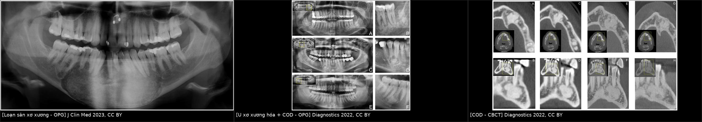
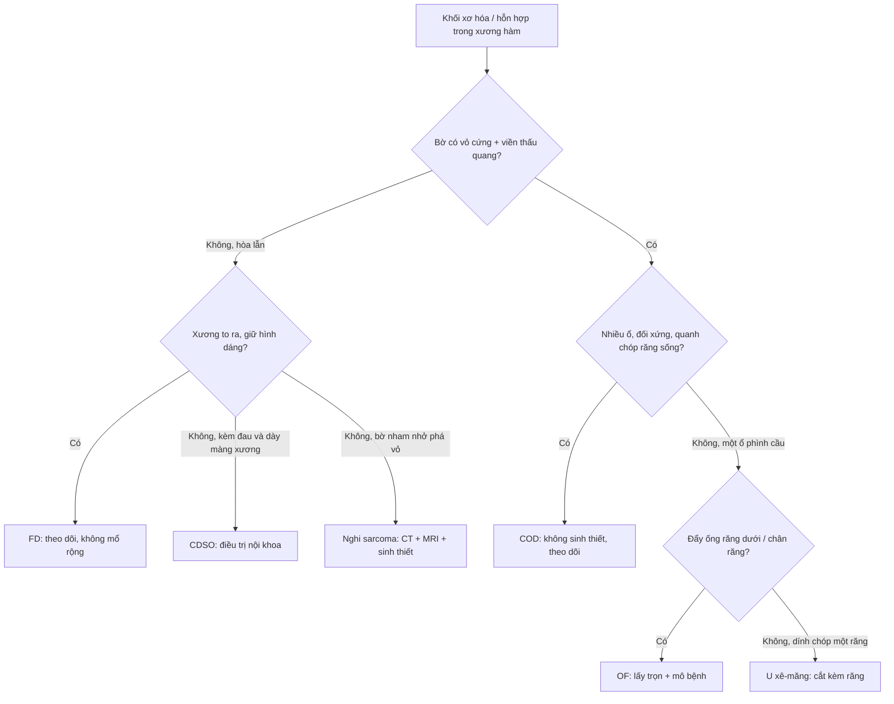
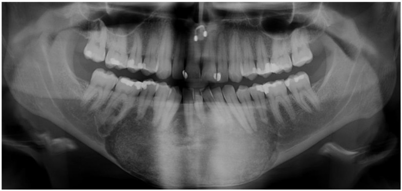
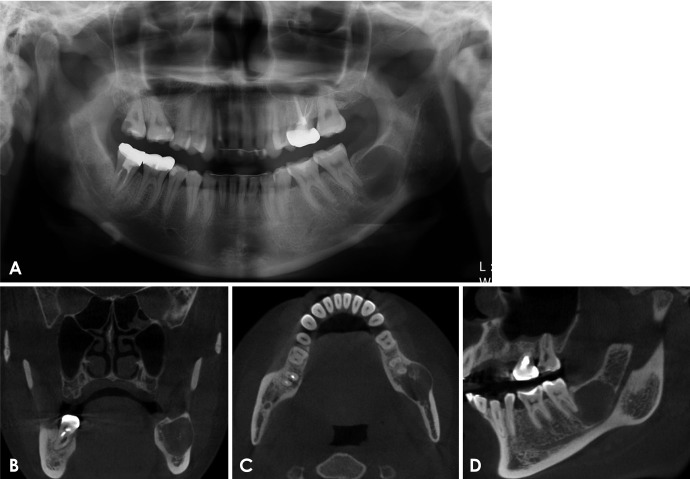
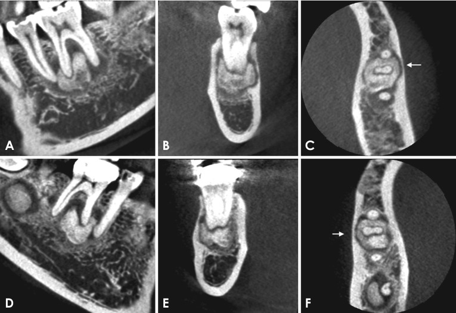

# 753 — Loạn sản xơ xương & u xơ xương hóa ở hàm: ba nhóm bệnh "xơ hóa" dễ mổ oan / Fibro-osseous lesions of the jaws

**Tags:** `pattern:kinh-mo` `pattern:xuong-hoa` `pattern:phinh-xuong` `pattern:khong-ro-bien` `vung:ham-mat` `vung:ham-duoi` `protocol:toan-hinh` `protocol:CBCT` `incidentaloma:phat-hien-ngoai-roi`

**Mức chắc chắn (certainty):** tổng hợp y văn (literature synthesis) — số liệu lấy từ **nghiên cứu hồi cứu 14 năm của Đại học Zurich** (*Diagnostics* 2022, PMC8870765, CC BY), **tổng quan ảnh học – điều trị FD hàm** (*J Clin Med* 2023, PMC10299264, CC BY), **4 ca u xơ xương hóa có phân tích CBCT** (*Imaging Sci Dent* 2020, PMC7078407, CC BY-NC), **ca COD tái phát có triệu chứng** (*Imaging Sci Dent* 2018, PMC6015922, CC BY-NC) và **tổng quan *Clin Radiol* 2015** (MacDonald, dẫn qua phần tóm tắt). Nhóm **không có bệnh nhân của mình**.

> **Câu chốt:** ba nhóm "xơ hóa" của hàm **không phân biệt được bằng mô bệnh học** — nhà giải phẫu bệnh vẫn không thể tách FD, OF và COD nếu chỉ có tiêu bản (Clin Radiol 2015; PMC8870765). Vì thế **chẩn đoán là một quyết định hình ảnh**: *(1) bờ có vỏ xương rõ hay hòa lẫn với xương lành? (2) xương có to ra không? (3) tổn thương có dính chặt với chân răng — nhiều ổ, đối xứng — không?* Ba câu này tách **FD (không mổ rộng)** khỏi **OF (phải lấy trọn vì tái phát)** và khỏi **COD (không được chọc/mổ khi không nhiễm)**.

## 1. Tổng quan bệnh học – cơ chế hình ảnh

### 1.1 Bản chất: một tổn thương, ba cơ chế

- **Fibro-osseous lesion (FOL)** = xương lành bị thay **từng phần** bằng **mô liên kết xơ** chứa lượng khoáng khác nhau dưới dạng **xương non (woven bone)**, **xương trưởng thành** hoặc **chất giống xê-măng (cementum-like)** (PMC8870765).
- WHO 5th edition (2022) xếp chung **u và tổn thương xương hàm – hàm mặt**; trong nhóm FOL có **loạn sản xơ xương (fibrous dysplasia, FD)**, **u xơ xương hóa (ossifying fibroma, OF — gồm thể thiếu niên)**, **loạn sản xơ–xê măng (cemento-osseous dysplasia, COD)**, u xê-măng khổng lồ thể gia đình (familial gigantiform cementoma, FGC) (PMC10299264, PMC8870765).
- **Ba cơ chế khác nhau** quyết định ba kiểu hình ảnh:
  1. **FD — bất thường phát triển xương:** đột biến **GNAS1 R201H** (codon 201) làm tăng cAMP, **ức chế biệt hóa nguyên bào xương** → mô xơ thay xương, **khuôn xương vẫn lớn dần** nhưng cấu trúc bên trong hỗn loạn (PMC10299264).
  2. **OF — u thật (neoplasm):** tăng sinh **có vỏ bọc** quanh mô xơ, đẩy lệch cấu trúc lân cận → **bờ vỏ rõ, phình cầu, đẩy ống răng dưới** (PMC7078407).
  3. **COD — phản ứng tại chỗ từ dây chằng nha chu:** sang thương **nhiều ổ, đối xứng, khu trú ở xương ổ răng**, tiến triển **thấu quang → hỗn hợp → cản quang** theo thời gian (PMC6015922).

### 1.2 TẠI SAO "kính mờ" — vật lý của hình ảnh

- **Ground-glass (kính mờ):** mạng lưới xương non dày **dưới ngưỡng phân giải không gian của CT/CBCT** (bề dày bè xương ~vài trăm µm, voxel 0,15–0,4 mm) → **hiệu ứng thể tích riêng phần (partial volume)** biến các bè xương rời rạc thành **một vùng đậm độ trung gian đồng nhất**, không thấy bè xương riêng lẻ. Khi mức khoáng hóa tăng, vùng mờ **đậm dần lên** — đây là lý do FD "già" trông đặc hơn FD "trẻ".
- **Bờ hòa lẫn (blending):** FD **không có vỏ xơ**; xương loạn sản chuyển trực tiếp sang xương lành → **không vẽ được đường bờ**. OF có **vỏ xơ (fibrous capsule)** → trên phim/CBCT thành **viền thấu quang mảnh + bờ vỏ cứng** — đúng như mô tả "bờ rõ, có vỏ, phình cầu" của u xơ xương hóa (PMC7078407).
- **TẠI SAO COD nằm quanh chóp răng và đối xứng:** khởi phát từ **dây chằng nha chu**, nên tổn thương **bám vào răng sống**, khu trú **trên ống răng dưới (dưới chỗ hợp khẩu cái cứng)** — chỉ trong xương ổ răng (PMC6015922). Nhiều răng cùng chịu một "vùng thay đổi" → **nhiều ổ, đối xứng theo phần sáu (sextant)**, không phải đối xứng gương.
- **TẠI SAO răng còn sống là dấu chốt:** trong COD, tủy răng **không bị viêm** → **đáp ứng tủy dương tính**; trong viêm quanh chóp do tủy hoại tử, tủy **đã chết**. Đây là khác biệt lâm sàng rẻ nhất và quyết định nhất (PMC6015922).

### 1.3 Các con số phải nhớ

- **FD:** chiếm **2,5%** mọi tổn thương xương và **~7%** u xương lành; **> 90%** là thể một xương (monostotic), nhưng ở hàm trên tổn thương **vượt đường khớp** sang xương bướm, gò má, nền sọ (PMC10299264). Khởi phát **thập niên 1–2** (khảo sát craniofacial), biểu hiện ở hàm thường **thập niên 2–3**; **không "ngủ yên" sau dậy thì** như FD ở xương dài, có thể **hoạt động lại khi mang thai**.
- **Kiểu CT của FD hàm:** **kính mờ 56%**, **đặc đồng nhất 23%**, **dạng nang 21%** (PMC10299264 dẫn lại).
- **Đột biến GNAS1:** phát hiện được ở **~78%** FD vùng sọ mặt (một loạt 24/29 = **83%**) — **mosaic** nên **âm tính KHÔNG loại trừ** FD (PMC10299264).
- **Tần suất tương đối (Zurich 2005–2019):** **COD 45%**, **OF 39%**, **FD 16%**; các đoàn hệ châu Á cho **OF 77% / FD 23%** và **51% / 43%** — tùy nguồn (phòng xét nghiệm giải phẫu bệnh hay khoa phẫu thuật) (PMC8870765).
- **COD:** **95%** bệnh nhân là nữ trong đoàn hệ Zurich; tuổi chẩn đoán trung bình **30–50**; phụ nữ **gốc Phi** rồi **Đông Nam Á** hay gặp nhất (PMC8870765, PMC6015922).
- **OF:** hay gặp **thập niên 2–4**, **nữ > nam**, **hàm dưới (vùng răng cối)** > hàm trên, khởi phát **trên ống răng dưới** (PMC7078407).
- **OF thể thiếu niên (JPOF):** tuổi trung bình **18 ± 16**, hàm dưới **56%**, phình **trong–ngoài 57%**, **81%** xâm lấn xoang hàm/cánh bướm/sàn ổ mắt (PMC9932254 — dẫn qua phần tóm tắt).

## 2. Mẫu hình + chẩn đoán phân biệt theo vị trí (gamut)

### 2.1 Bốn trục định vị — trả lời theo thứ tự

1. **Bờ:** *hòa lẫn, không vẽ được* → **FD**, viêm xương xơ hóa lan tỏa (CDSO), sarcoma xương; *vỏ rõ + viền thấu quang* → **OF**, COD giai đoạn muộn, u xê-măng (cementoblastoma).
2. **Hình dạng – thể tích:** *xương to lên nhưng giữ hình dáng giải phẫu* → **FD**; *phình cầu, đối xứng quanh trục, nong đều mọi hướng* → **OF**; *không phình (có thể ăn thủng vỏ nhưng không nong)* → **COD** (PMC7078407, PMC6015922).
3. **Quan hệ với răng:** *quanh chóp nhiều răng, răng sống* → **COD**; *một ổ, đẩy chân răng, ống răng dưới xuống dưới* → **OF**; *vắt qua đường giữa, không tôn trọng vị trí chân răng* → **FD**.
4. **Số ổ – đối xứng:** *nhiều ổ, ≥ 2 phần sáu, đối xứng* → **COD thể florid**; *một ổ* → OF/FD.

### 2.2 Gamut theo vị trí

- **Xương ổ răng, quanh chóp răng cửa hàm dưới (periapical):** COD thể quanh chóp, viêm quanh chóp mạn, u hạt quanh chóp, nang quanh chóp.
- **Thân/ngành hàm dưới, trên ống răng dưới:** OF, COD thể khu trú, u xê-măng, di căn (vú/tuyến tiền liệt), sarcoma xương hàm.
- **Hàm trên, vượt đường giữa/đường khớp:** FD (lan vào xoang hàm, gò má, nền sọ), OF thể thiếu niên, ung thư xoang hàm xâm lấn xương.
- **Lan tỏa một bên hàm dưới kèm dày màng xương:** CDSO (viêm xương xơ hóa lan tỏa mạn) — bệnh giả sát nhất với FD.

### 2.3 Ba "bệnh giả" hay gặp nhất trên phim

- **CDSO:** vùng **xơ hóa rộng + tạo xương dưới màng xương** (PMC10299264, Hình 2A) — khác FD ở **đau, hay sau nhiễm trùng răng**, và **không làm xương to đều**.
- **U hạt tế bào khổng lồ trung tâm (CGCG):** **bờ rõ nhưng lượn sóng (undulating)**, thấu quang, không có vỏ xơ mảnh (PMC10299264, Hình 2B).
- **Paget xương hàm:** dày xương, "cotton-wool", nhưng **thường > 55 tuổi**, tăng phosphatase kiềm, hay kèm khung chậu/cột sống.

## 3. Bảng so sánh phân biệt (ma trận đối chiếu)

| Thực thể (entity) | Hình ảnh điển hình (OPG/CBCT/CT) | Chốt vào (rule-in) | Chốt loại (rule-out) | Gợi ý xác nhận |
|---|---|---|---|---|
| **FD** | Kính mờ đồng nhất, **bờ hòa lẫn**, xương **to ra nhưng giữ hình dáng**, có thể vượt đường khớp; CT: kính mờ 56%, đặc 23%, nang 21% | **Bờ hòa lẫn + xương to + không vỏ xơ**, nhiều năm không đổi | **Bờ vỏ cứng + viền thấu quang + phình cầu** → OF, không phải FD | OPG + CBCT; GNAS1 (dương ~78%, âm không loại trừ); theo dõi trọn đời |
| **OF** | **Bờ rõ, vỏ cứng, phình cầu**, viền thấu quang mảnh = vỏ xơ; đẩy **ống răng dưới xuống**, đẩy/hủy chân răng; trong ổ có cản quang kiểu hạt | **Vỏ xơ + phình cầu + đẩy ống răng dưới** | Xương **không to**, nhiều ổ đối xứng → COD | CBCT; **lấy trọn + mô bệnh**; theo dõi tái phát |
| **COD** (quanh chóp/khu trú/florid) | Nhiều khối cản quang **có viền thấu quang**, quanh chóp răng **sống**, **đối xứng theo phần sáu**, **không phình**; có thể ăn thủng vỏ không nong | **Nhiều ổ + đối xứng + răng sống + không phình** | Một ổ đơn độc phình cầu → OF; tủy chết + đau → viêm quanh chóp | Thử tủy răng; CBCT **liều thấp** theo dõi hằng năm; **không sinh thiết** |
| **CDSO** | Xơ hóa **rộng, một bên**, **tạo xương dưới màng xương**, dày vỏ | **Đau + xơ hóa lan tỏa + dày màng xương** | Không phình đối xứng, không viền thấu quang | Lâm sàng đau; loại trừ nhiễm trùng răng; bisphosphonate |
| **U xê-măng (cementoblastoma)** | Khối cản quang **dính chặt vào chóp một răng sống**, có viền thấu quang, phình vỏ | **Dính chóp răng + viền sáng đều** | Nhiều ổ, không dính một răng → COD | CBCT; cắt kèm răng |
| **CGCG** | Thấu quang **bờ rõ nhưng lượn sóng**, không vỏ xơ mảnh, phình xương | **Bờ lượn sóng + thấu quang đơn thuần** | Có cản quang trong ổ → FOL | CBCT; mô bệnh sau nạo |
| **Sarcoma xương hàm** | Hủy xương **bờ nham nhở**, **phá vỏ**, xương hình "tia nắng", khối mô mềm | **Phá vỏ + khối mô mềm + đau/tê tăng nhanh** | Bờ hòa lẫn nhưng vỏ liên tục nhiều năm → FD | CT + MRI + sinh thiết |
| **Paget xương hàm** | Dày xương, "cotton-wool", tái tạo bè xương thô | **Tuổi > 55 + nhiều xương + ALP cao** | Bệnh một xương ở người trẻ → FD | Xạ hình, ALP, phim khung chậu |

*Trái: FD xương hàm dưới trước — vùng kính mờ, bờ không vẽ được, xương to ra. Giữa: OPG một ca OF hàm dưới sau (A–B) và hai ca COD (C–F, ảnh phóng đại ở góc). Phải: CBCT COD theo dõi nhiều năm — khối cản quang có viền thấu quang, **không nong vỏ**. Nguồn: *J Clin Med* 2023 (PMC10299264, Fig. 1) và *Diagnostics* 2022 (PMC8870765, Fig. 2 và Fig. 4), **CC BY 4.0**; ảnh ghép letterbox.*

## 4. Protocol chụp + thuật toán chẩn đoán

### 4.1 Chụp gì, khi nào

- **Bước 1 — phim toàn cảnh (OPG/panoramic):** đủ cho phần lớn COD và FD điển hình; dùng làm **phim nền** để so theo thời gian (PMC8870765).
- **Bước 2 — CBCT:** khi cần **bờ, vỏ xương, ống răng dưới, quan hệ chân răng**, hoặc trước khi mổ. FOV nhỏ (5 × 5 cm) cho ổ đơn độc, FOV lớn khi nghi nhiều ổ; voxel **0,15–0,2 mm**; **liều thấp** cho lần theo dõi (PMC8870765 dùng protocol low-dose cho lần chụp cuối).
- **Bước 3 — CT (không cản quang):** FD hàm trên lan rộng cần đánh giá **xoang hàm, hốc mắt, nền sọ**; đo mức chèn ép **ống thị giác**.
- **MRI:** không đặc hiệu cho chẩn đoán FOL (**tín hiệu giảm/không đặc hiệu** — PMC10299264), nhưng cần khi nghi **u thần kinh/khối mô mềm** hoặc **chèn ép thần kinh thị**.
- **Xạ hình xương:** đánh giá **FD nhiều xương/hoạt tính**; COD cũng bắt xạ hình mạnh (PMC6015922).
- **Sinh thiết:** **không** cho COD điển hình; **có** khi tổn thương **phình nhanh, đau, phá vỏ, một ổ không điển hình** hoặc trước khi cắt xương lớn. Nhớ: mô bệnh **một mình không tách được** ba nhóm (Clin Radiol 2015) → luôn đọc kèm ảnh.

### 4.2 Thuật toán hình ảnh (thay cho RADS — xương hàm **không có** hệ phân độ chuẩn hóa)

### 4.3 Theo dõi và điều trị (ảnh hưởng trực tiếp lịch chụp)

- **FD:** **không mổ rộng** ở vùng mang răng (Zone 4 của Chen–Noordhoff); **gọt xương (shaving)** khi biến dạng, nhưng **tái phát cao hơn**; mổ khi **đã trưởng thành xương và bệnh ổn định**; **theo dõi trọn đời** vì có thể hoạt động lại (PMC10299264). Bisphosphonate/denosumab chỉ **giảm đau**, **không chứng minh làm ngừng tiến triển**.
- **OF:** **lấy trọn có bờ** vì là u thật, **có nguy cơ tái phát**; thể thiếu niên tiến triển nhanh, cần theo dõi sát (PMC10299264, PMC7078407).
- **COD:** **không điều trị** khi không triệu chứng; **tránh nhổ răng/sinh thiết trong vùng** vì **mở đường cho nhiễm trùng xương** — ổ xơ cứng **kém mạch, dễ viêm xương thứ phát** (PMC6015922).

## 5. Biến thể bình thường và cạm bẫy

- **Biến thể bình thường dễ nhầm:** **tủy xương đỏ còn lại** ở hàm dưới người trẻ (vùng góc hàm) trông "mờ" hơn — nhưng **đối xứng, không phình, không có viền**, và giảm dần theo tuổi.
- **Cạm bẫy 1 — "viêm quanh chóp" ở răng sống:** COD giai đoạn sớm **thấu quang quanh chóp** giống hệt viêm quanh chóp → **nội nha hoặc nhổ răng oan**, rồi **nhiễm trùng xương**. Chốt: **thử tủy**, **nhiều ổ đối xứng**, **không sâu răng/không phục hồi hỏng** (PMC6015922).
- **Cạm bẫy 2 — sinh thiết COD:** không giúp chẩn đoán (mô bệnh chồng lấp), lại **tạo đường nhiễm**; ca COD tái phát có triệu chứng trong PMC6015922 khởi phát đúng sau can thiệp răng.
- **Cạm bẫy 3 — đảo FD với OF:** FD **không cắt rộng**, OF **phải lấy trọn**; gọi nhầm dẫn tới **mổ quá rộng** (FD) hoặc **tái phát** (OF). Chốt: **bờ + vỏ + phình cầu + ống răng dưới**.
- **Cạm bẫy 4 — "kính mờ" không đồng nghĩa FD:** CDSO, Paget, di căn xơ hóa, sarcoma xương tạo xương đều có thể mờ; phải đọc **bờ, vỏ, màng xương, tuổi, đau**.
- **Cạm bẫy 5 — OPG đánh giá thấp:** phim 2D **bỏ sót nong vỏ và thủng vỏ**; trước khi mổ phải có **CBCT** (PMC8870765).
- **Cạm bẫy 6 — bỏ sót ổ thứ hai:** COD hay **4 phần sáu**; đọc hết hai hàm, không dừng ở ổ gây triệu chứng (satisfaction of search).
- **Cạm bẫy 7 — tê môi + lớn nhanh:** FD thường **không gây tê**; nếu có **dị cảm/hypoesthesia** kèm phình nhanh, phải loại **ác hóa/u khác** (ca FD hàm trên trong PMC8870765 có đau và dị cảm — cần theo dõi sát, không mặc định lành).

## 6. Tự lượng giá — Blind Quiz

**Ca 1 — Phát hiện tình cờ khi chụp răng, không đau, không sưng.**

- Gợi ý lâm sàng: người trẻ, không triệu chứng; các răng trong vùng **còn sống**.
- Câu hỏi: mô tả **bờ** và **mật độ**; xương có to ra không? Ba chẩn đoán phân biệt? Dấu hiệu nào chốt?

<b>Bấm để hiện đáp án (findings + chẩn đoán)</b>

- Dấu hiệu: vùng **kính mờ đồng nhất** ở xương hàm dưới trước, **bờ hòa lẫn không vẽ được**, xương **to ra nhưng giữ hình dáng**, không viền thấu quang, không đẩy chân răng rõ.
- Chẩn đoán: **loạn sản xơ xương (FD)** thể một xương — mô xơ thay xương làm bè xương dưới ngưỡng phân giải → kính mờ; không vỏ xơ nên bờ hòa lẫn.
- Phân biệt: **OF** (bờ vỏ + phình cầu), **COD** (nhiều ổ, đối xứng, quanh chóp), **CDSO** (đau, dày màng xương).
- Chốt: **bờ hòa lẫn + xương to giữ hình dáng**; theo dõi trọn đời, **không mổ rộng**.
- Nguồn ảnh: *J Clin Med* 2023;12(12):4100 (PMC10299264), Fig. 1 — Obermeier KT và cs, **CC BY 4.0**.

**Ca 2 — Sưng hàm dưới trái nhiều tháng, không đau.**

- Gợi ý lâm sàng: nữ, 30–40 tuổi, sưng vùng góc hàm, không đau; răng trong vùng còn sống.
- Câu hỏi: bờ tổn thương? Ống răng dưới bị gì? Chẩn đoán và thái độ điều trị?

<b>Bấm để hiện đáp án (findings + chẩn đoán)</b>

- Dấu hiệu: khối **bờ rõ, vỏ cứng, phình cầu** ở thân–ngành hàm dưới trái; trên CBCT (B–D) tổn thương **nong vỏ**, **đẩy ống răng dưới xuống dưới** và **đẩy chân răng cối**; trong ổ có cản quang hỗn hợp.
- Chẩn đoán: **u xơ xương hóa (ossifying fibroma)** — u thật có vỏ xơ; vỏ xơ cho **viền thấu quang mảnh** và bờ cứng; tính chất phình cầu + đẩy ống răng dưới là dấu của khối choán chỗ chậm.
- Điều trị: **lấy trọn có bờ + mô bệnh**, theo dõi tái phát — khác FD (theo dõi) và COD (không can thiệp).
- Nguồn ảnh: *Imaging Sci Dent* 2020;50(1):65–71 (PMC7078407), Fig. 1 — Jih MK, Kim JS, **CC BY-NC 3.0**.

**Ca 3 — Đau răng cối dưới phải sau bọc răng, hơn 3 tháng.**

- Gợi ý lâm sàng: nữ 40 tuổi, đau khi nhai; không sâu răng mới; tổn thương ở **nhiều răng, hai bên**.
- Câu hỏi: mô tả viền tổn thương và mức nong vỏ; vì sao **không** sinh thiết? Nguy cơ nếu nhổ răng trong vùng?

<b>Bấm để hiện đáp án (findings + chẩn đoán)</b>

- Dấu hiệu: **nhiều khối cản quang không đồng nhất có viền thấu quang**, nằm quanh chóp các răng cối hai bên hàm dưới; vỏ xương **không nong** nhưng tổn thương **ăn vào vỏ** (ảnh C, mũi tên) mà không phá vỡ.
- Chẩn đoán: **loạn sản xơ–xê măng thể florid (florid COD)** giai đoạn hỗn hợp–muộn; tổn thương do dây chằng nha chu, nhiều ổ, đối xứng.
- Vì sao không sinh thiết: mô bệnh **không phân biệt được** với FOL khác, còn tạo đường nhiễm cho vùng xương **kém mạch**.
- Nguy cơ: **nhổ răng/sinh thiết trong vùng → viêm xương thứ phát**, đau và phải nạo nhiều lần (đúng diễn tiến ca gốc).
- Nguồn ảnh: *Imaging Sci Dent* 2018;48(2):131–137 (PMC6015922), Fig. 2 — Min CK, Koh KJ, Kim KA, **CC BY-NC 3.0**.

## Bài liên quan chéo
- [700 – Tổng quan Đầu Cổ](../700-head-neck-overview/lesson.md)
- [751 – Viêm xương hàm do răng](../751-viem-xuong-ham-do-rang/lesson.md) (bệnh giả số 1: xương chết, rò mủ, ổ răng nguyên phát)
- [749 – Nhiễm khuẩn răng lan trung thất](../749-nhiem-khuan-rang-lan-trung-that/lesson.md)
- [752 – Thiếu sản men răng (Turner)](../752-thieu-san-men-turner-rang-vinh-vien/lesson.md)
- [747 – Chấn thương răng ở trẻ](../747-chan-thuong-rang-o-tre/lesson.md)

## Ảnh
- `753_loansan-xo-xuong_OPG_PMC10299264.jpg` — OPG FD hàm dưới trước (CC BY 4.0).
- `753_u-xo-xuong-hoa_OPG_PMC8870765.jpg` — OPG OF + hai ca COD, kèm ảnh phóng đại (CC BY 4.0).
- `753_loansan-xo-xuong_CT_PMC8870765.jpg` — CT FD hàm trên sau, 3 bình diện (CC BY 4.0).
- `753_loansan-xo-xuong-rang_CBCT_PMC8870765.jpg` — CBCT COD theo dõi nhiều năm (CC BY 4.0).
- `753_u-xo-xuong-hoa_CBCT_PMC7078407.jpg` — OPG + CBCT OF, ống răng dưới bị đẩy xuống (CC BY-NC 4.0).
- `753_loansan-xo-xuong-rang_CBCT_PMC6015922.jpg` — CBCT COD florid, viền thấu quang, ăn vỏ không nong (CC BY-NC 4.0).
- `composite_fol-3-nhom.jpg` — ảnh ghép 3 nhóm (CC BY 4.0; letterbox, không crop).
- Nguồn, giấy phép và tác giả từng ảnh: `images/CREDITS.md`.

> Không dùng để chẩn đoán độc lập khi chưa có người hướng dẫn.
