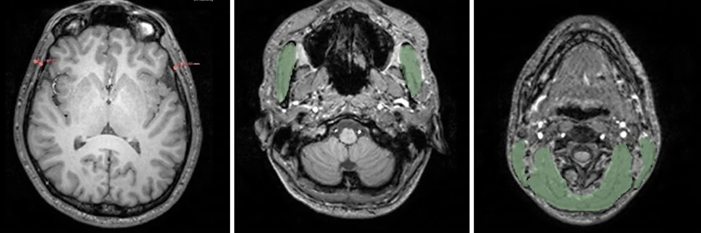
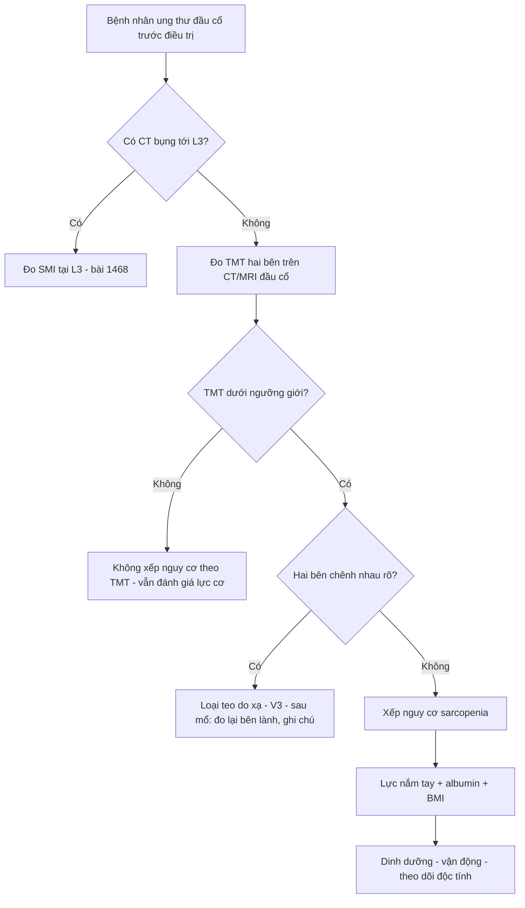
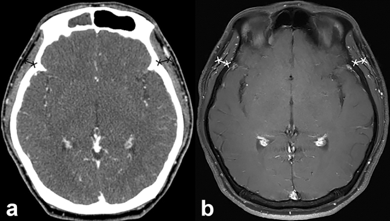
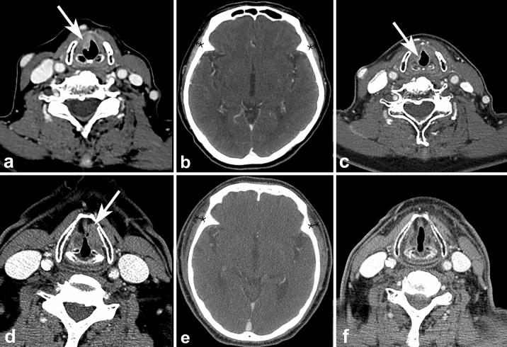
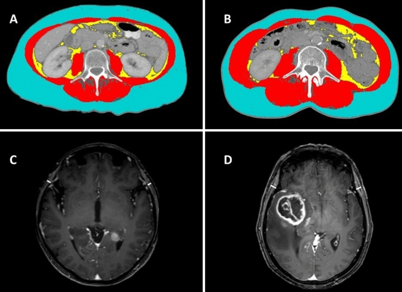

# 754 — Độ dày cơ thái dương (TMT) trên CT đầu–cổ: chỉ dấu sarcopenia ở ung thư đầu cổ / Temporalis muscle thickness

**Tags:** `pattern:teo-co` `pattern:mat-khoi-co` `vung:dau-co` `vung:so-mat` `score:TMT` `score:SMI` `protocol:CT-dau-co` `protocol:MRI-so-nao` `incidentaloma:sarcopenia`

**Mức chắc chắn (certainty):** tổng hợp y văn (literature synthesis) — ghép **đoàn hệ hồi cứu 106 ca ung thư biểu mô vảy đầu cổ (HNSCC) có CT đầu–cổ trước điều trị** (Lee và cs. 2021, *Sci Rep* 11:19717, **PMC8492642**, CC BY 4.0), **bảng giá trị tham chiếu 624 người khỏe** (Steindl và cs. 2020, *J Clin Med* 9:1272, **PMC7288067**, CC BY), **245 ca u nguyên bào thần kinh đệm có đối chiếu diện tích cơ tại L3** (Ten Cate và cs. 2022, *J Neurooncol* 160:793–801, **PMC9758090**, CC BY), các đoàn hệ đầu cổ **61 ca** (Mukai và cs. 2024, DOI **10.1007/s10147-024-02591-3**) và **96 ca** (Acta Otolaryngol 2026, PMID **42384890**), cùng **nghiên cứu cắt ngang 247 ca u não đo đồng thời ba chỉ số** (van Heusden và cs. 2026, *Quant Imaging Med Surg* 16:857, **PMC13743311**, CC BY-NC-ND). Nhóm **không có bệnh nhân của mình**; mọi nghiên cứu đều **hồi cứu/quan sát**, **ngưỡng cắt khác nhau giữa các bài**, và **hai nhóm kết quả mâu thuẫn nhau về mức tương quan** — đọc tỷ lệ phải kèm định nghĩa đã dùng.

> **Câu chốt:** Ở bệnh nhân ung thư đầu cổ **hiếm khi có CT bụng tới L3**, nhưng **ai cũng có CT/MRI đầu–cổ**. Đo **độ dày cơ thái dương hai bên, vuông góc trục dài cơ, mốc khe Sylvius – vòm ổ mắt**, lấy trung bình: **≤ 6,3 mm (nam) / ≤ 5,2 mm (nữ)** = "nguy cơ sarcopenia" (lấy **2,5 SD dưới trung bình người trẻ 18–40 tuổi**). Ở 106 ca HNSCC, ngưỡng ROC **6,47 mm** cho **AUC 0,779**, và **TMT ≤ 6,24 mm** làm **PFS xấu hơn (HR 0,399)**. Nhưng TMT **chỉ là một chiều của khối cơ**: tương quan với diện tích cơ L3 dao động **r = 0,20–0,73** tùy quần thể và cách đo — **TMT bình thường KHÔNG loại trừ sarcopenia**.

## 1. Tổng quan bệnh học – cơ chế hình ảnh (TẠI SAO)

### 1.1 Vì sao đo được cơ thái dương trên CT — vật lý HU và giải phẫu

- **Cơ vân 30–60 HU**, **mỡ −50 đến −190 HU**, **nước 0 HU**, **xương > 200 HU**. Cơ thái dương là **cơ dẹt hình quạt** nằm trong **hố thái dương**: mặt ngoài giới hạn bằng **cân thái dương** (dải xơ mỏng, rõ trên CT), mặt trong áp sát **vòm sọ**, bờ dưới bám **mỏm vẹt xương bướm**. Vì cơ **tựa trên xương và có cân bọc**, bờ trên CT **tương phản tốt** dù không cản quang — đó là lý do TMT đo được trên **chính CT đầu–cổ đã chụp vì lý do khác**, không cần thêm phơi nhiễm.
- **TẠI SAO phải đo vuông góc trục dài cơ:** cơ hình quạt nên **cắt xiên làm "dày" giả** (cắt chéo một mặt phẳng nghiêng luôn cho bề dày lớn hơn). Mốc chuẩn: **lát ngang song song đường trước–sau ủy liên (AC–PC)**, dùng **khe Sylvius** định hướng trước–sau và **vòm ổ mắt** định hướng trên–dưới, thước đo **vuông góc với trục dài cơ**, đo **cả hai bên** rồi lấy trung bình (PMC7288067, PMC8492642).
- **TẠI SAO ảnh 3 mm vẫn đủ:** bề dày sinh lý **6–10 mm** lớn hơn nhiều **độ phân giải trong mặt phẳng 0,5–0,7 mm**; sai số chủ yếu đến từ **chọn lát và góc đo**, không từ pixel. Trái lại, **lát quá dày (5 mm)** ở vùng cơ vát sẽ **trung bình hóa với mỡ/cân** và làm sai lệch **1–2 mm** — đủ để đổi nhóm ngưỡng.

### 1.2 Vì sao cơ thái dương đại diện cho khối cơ toàn thân

- Cơ thái dương là **cơ vân tiêu thụ glucocorticoid, giảm vận động và viêm hệ thống** giống cơ chi; vì vậy nó **teo cùng nhịp** với khối cơ chung: **TMT tương quan với lực nắm tay ρ = 0,746** (624 người khỏe, PMC7288067) và **với diện tích cơ tại L3 r = 0,733** (154 ca di căn não, PMC6264824).
- **Nhưng mức tương quan phụ thuộc quần thể và cách đo:** ở **245 ca u nguyên bào thần kinh đệm**, TMT–diện tích cơ L3 (đo trực tiếp) là **r = 0,537** toàn nhóm, **0,678** trong nhóm đã teo (PMC9758090); ở **154 ca di căn não** là **0,733** (PMC6264824). Ngược lại, **247 ca u não** đo đồng thời ba chỉ số trên cùng một lần chụp chỉ thấy tương quan **THẤP**: TMT–MCSA **r = 0,39**, MCSA–C3SMA **0,30**, TMT–C3SMA **0,20**, TMT–L3SMA (ước tính từ C3) **0,24**; và chỉ **2/136 ca (1,5%)** được xếp "khối cơ thấp" bởi **cả ba** chỉ số, **κ = 0,01–0,11** (PMC13743311). Nghĩa là **TMT phát hiện tốt người ĐÃ teo sâu, nhưng ba phép đo không hoán đổi cho nhau** — đúng bản chất một **dấu hiệu sàng lọc**, không phải phép đo khối cơ chuẩn.
- **TMT gần như độc lập với BMI** (ρ = 0,116 ở người khỏe, 0,227 ở bệnh nhân thần kinh; PMC7288067): người **béo vẫn có thể teo cơ**, nên **cân nặng/BMI không thay thế được** phép đo này.

### 1.3 Ngưỡng sinh lý: giảm theo tuổi, khác theo giới

| Nhóm (người khỏe, MRI 1 mm) | TMT trung bình | SD |
|---|---|---|
| Nam 18–29 tuổi (n = 98) | **9,97 mm** | 1,43 |
| Nữ 18–29 tuổi (n = 108) | **8,62 mm** | 1,45 |
| Nam ≥ 80 tuổi (n = 5) | **6,51 mm** | 1,06 |
| Nữ ≥ 80 tuổi (n = 5) | **5,17 mm** | 1,58 |

*Nguồn: PMC7288067, Bảng 1.* Hai điều rút ra: **(1)** nữ mỏng hơn nam **~1,3–1,4 mm** ở mọi lứa tuổi → **không dùng một ngưỡng chung**; **(2)** TMT giảm **~3 mm từ 18–29 đến ≥ 80 tuổi** → ngưỡng "bệnh" phải so với **người trẻ**, không so với người cùng tuổi. Vì vậy ngưỡng chuẩn được tính **2,5 SD dưới trung bình người trẻ 18–40 tuổi**: **6,3 mm (nam) và 5,2 mm (nữ)** — cùng nguyên tắc với định nghĩa sarcopenia của EWGSOP (PMC7288067).

### 1.4 Số liệu trụ cột (bắt buộc nhớ)

| Đại lượng | Con số | Nguồn |
|---|---|---|
| **HNSCC trước điều trị (n = 106)** | TMT CT ↔ MRI **ICC 0,894**; ngưỡng ROC **6,47 mm**, **AUC 0,779**; trung vị **6,24 mm**; **49/106** tái phát/di căn sau **37 tháng** | PMC8492642 |
| Nguy cơ tiến triển khi TMT thấp | **HR 0,399** (KTC 95% 0,209–0,763), **p = 0,005** (TMT ≤ 6,24 mm) | PMC8492642 |
| **Ung thư miệng sau mổ (n = 61)** | Ngưỡng **6,3 mm (nam) / 5,2 mm (nữ)**; tử vong **HR 4,51** (1,49–13,61), p = 0,0076; sống đặc hiệu bệnh **không khác**; ICC 2 người đọc **0,988** | 10.1007/s10147-024-02591-3 |
| **HNSCC hóa–xạ đồng thời (n = 96)** | TMT thấp **54 ca** vs cao **42 ca**; giảm bạch cầu **độ ≥ 3 gặp nhiều hơn (p = 0,023)**; đa biến p = 0,045; BMI < 18,5 p = 0,044; ICC **0,853** | PMID 42384890 |
| **Sarcopenia tại C3 ở 246 ca hóa–xạ** | **58%** sarcopenia; trễ hóa trị **> 1 tuần 37%**, gián đoạn xạ **> 1 tuần 14%**; sarcopenia: độc tính hóa trị **HR 2,15**, gián đoạn xạ **HR 2,99**, tử vong **HR 1,83** | PMID 31085391 |
| **Xác định sarcopenia bằng C3 SMI ở 300 ca** | SMI trung bình **31,9 cm²/m²** (nam 32,78 / nữ 26,19); **91%** bị xếp sarcopenia theo ngưỡng đã dùng | PMID 34403887 |
| **Di căn não (n = 435)** | Mỗi **+1 mm** TMT giảm **19%** (vú) và **24%** (phổi) nguy cơ tử vong | PMID 28050694 |
| Ung thư miệng (n = 527) | TMT trung bình **6,3 ± 1,3 mm**; thấp hơn ở người nhiều bệnh nền, BMI thấp | PMID 42744654 |
| **Ba chỉ số trên cùng một lần chụp (n = 247)** | Tương quan đều **thấp** (r 0,20–0,39); đồng thuận phân loại **κ 0,01–0,11**; chỉ **1,5%** cùng "thấp" theo cả ba; ICC TMT **0,919** | PMC13743311 |

- **Điểm chết người về ngưỡng:** cùng quần thể ung thư đầu cổ, tỷ lệ "sarcopenia" có thể là **31–35%** (ngưỡng TMT theo giới), **58%** (C3 SMI) hay **91%** (một ngưỡng C3 khác) — **con số vô nghĩa nếu không ghi ngưỡng và mốc đo**.

## 2. Mẫu hình + chẩn đoán phân biệt theo kiểu hình (Gamut)

**Mẫu hình khởi điểm:** một lát CT/MRI đầu–cổ ngang qua hố thái dương; câu hỏi là **cơ thái dương dày bao nhiêu mm**, **hai bên có đối xứng không**, và **cơ có bị tổn thương tại chỗ không**.

- **Kiểu A — mỏng ĐỐI XỨNG, bờ cơ sắc nét:** mất cơ hệ thống — sarcopenia tuổi, cachexia ung thư, thiếu dinh dưỡng, dùng corticoid kéo dài, bệnh mạn. **Đây là kiểu TMT được thiết kế để bắt.**
- **Kiểu B — mỏng MỘT BÊN (bất đối xứng):** **teo sau xạ** (thể tích cơ thái dương cùng bên giảm **3,32 cm³** sau xạ hậu phẫu ở 30 ca, và mức teo tương quan với **trismus r = −0,533**, PMID 42935071), **tổn thương thần kinh V3** sau xạ/mổ (bài 1764), sau **mở sọ**, bất động, hoặc **u xâm lấn cơ**. **Không được tính vào "sarcopenia"** — phải đo trước điều trị, hoặc loại trừ bên tổn thương.
- **Kiểu C — dày giả / mỏng giả do kỹ thuật:** cắt xiên, **lát qua hốc mắt** (cơ đã mỏng dần), **nghiến răng – co cơ khi chụp** (dày lên), đầu xoay, phù cơ, mỡ len trong cơ làm bờ nhòe.
- **Kiểu D — TMT "bình thường" nhưng vẫn sarcopenia:** cơ **nhiều mỡ (myosteatosis)**, teo không đều, hoặc khối cơ giảm nhưng chưa dưới ngưỡng; **BMI cao che mất**. Cần thêm **mật độ cơ (HU)** hoặc **diện tích cơ** (cm²).
- **Kiểu E — cơ thái dương to bất thường:** phì đại do **nghiến răng (bruxism)**, sau **cắt xương hàm đối bên**, hoặc **u/xâm lấn** — không phải "cơ khỏe".

**Gamut theo bối cảnh:** ung thư đầu cổ trước hóa–xạ (tiên lượng độc tính, PFS), ung thư miệng sau mổ (tử vong, tàn tật), u não/di căn não (sống còn), người cao tuổi đa bệnh (sàng lọc sarcopenia), và **trẻ em có u não** (dùng **percentile**, không dùng mm cố định — PMID 42203630).

## 3. Bảng so sánh phân biệt (ma trận đối chiếu)

| Thực thể (entity) | Hình ảnh điển hình | Chốt vào (rule-in) | Chốt loại (rule-out) | Gợi ý xác nhận |
|---|---|---|---|---|
| **TMT trên CT đầu–cổ** | Cơ thái dương dẹt, bờ cân rõ; đo vuông góc trục dài, 2 bên | **≤ 6,3 mm (nam) / ≤ 5,2 mm (nữ)**; hoặc dưới ngưỡng ROC của trung tâm | Đo ở lát qua hốc mắt/xoang, cắt xiên, một bên đã xạ | Đo lại 2 người đọc (ICC 0,853–0,988), ghi mốc lát |
| **TMT trên MRI T1** | T1 không cản quang 1 mm; bờ cơ sắc hơn CT | **ICC CT↔MRI 0,894** → dùng thay được | MRI có phù cơ sau mổ/xạ | So sánh với CT cùng kỳ nếu có |
| **C3 SMI (cm²/m²)** | Lát ngang C3 (ngang sụn giáp), vẽ toàn bộ cơ cổ | SMI thấp theo ngưỡng trung tâm; gắn với độc tính hóa–xạ | C3 có hạch/u lớn, khung xương vỡ, cổ đã xạ | Phần mềm bán tự động, ghi ngưỡng |
| **L3 SMI (chuẩn tham chiếu)** | Lát L3, cơ thắt lưng–cạnh sống–thành bụng | Có CT bụng thì **đây là chuẩn** (bài 1468) | Không có CT bụng ở ung thư đầu cổ | Đo khi CT bụng đã có sẵn, không chụp thêm |
| **Diện tích cơ nhai (CSA)** | Vẽ toàn bộ cơ thái dương/cơ cắn trên lát chuẩn | Tương quan SMI **r = 0,687 (thái dương)**, **0,689 (cơ cắn)** | Chỉ số 1 chiều không bắt myosteatosis | Cơ cắn **AUC 0,837** tốt hơn ở người khỏe |
| **Lực nắm tay / BIA** | Không phải hình ảnh | Lực cơ thấp = nửa còn lại của định nghĩa sarcopenia | Không thay thế đo khối cơ | Nắm tay chuẩn hóa 3 lần/bên |
| **Mật độ cơ (HU)** | Trung bình HU trong ROI cơ | HU thấp = mỡ len trong cơ, tiên lượng xấu thêm | Nhiễu do cản quang, phù, chênh kV | Đo trên lát không cản quang, ROI tránh mỡ |

- **Nguyên tắc chọn:** **có CT bụng L3 → đo SMI (bài 1468)**; **chỉ có CT đầu–cổ → TMT**; cần **độ chính xác cao hơn** → vẽ **CSA cơ nhai**; cần **định nghĩa sarcopenia đầy đủ** → **luôn phải có lực cơ**, TMT chỉ là phần "khối lượng".
- **Ba chỉ số KHÔNG hoán đổi:** trên cùng một lần chụp MRI, TMT, diện tích cơ cắn (MCSA) và diện tích cơ tại C3 (C3SMA) chỉ tương quan **r = 0,20–0,39** và xếp **cùng một bệnh nhân** vào nhóm "thấp" với độ đồng thuận **κ = 0,01–0,11** (PMC13743311). Vì vậy **không được đổi chỉ số giữa các lần theo dõi** — phải ghi rõ đang dùng chỉ số nào.

*Trái: **TMT** — hai thước đỏ vuông góc trục dài cơ thái dương. Giữa: **diện tích cơ cắn (MCSA)** — tô xanh toàn bộ cơ cắn hai bên. Phải: **diện tích cơ tại C3 (C3SMA)** — tô xanh các cơ cổ. Ba phép đo này **không thay thế nhau**: tương quan thấp và phân loại "khối cơ thấp" chỉ trùng nhau ở **1,5%** ca. Ảnh nguyên bản của tác giả, **không crop/ghép** (giấy phép cấm tạo tác phẩm phái sinh). Nguồn: van Heusden và cs., Quant Imaging Med Surg 2026, PMC13743311, CC BY-NC-ND 4.0.*

### Đọc con số TMT đúng cách
- **TMT là độ dày, không phải diện tích:** cơ hình quạt nên **cùng khối lượng có thể khác bề dày** nếu sọ to/nhỏ; vì vậy **ngưỡng tuyệt đối (mm) mang tính quần thể**, không phải chẩn đoán cá nhân.
- **Trung bình hai bên che mất bất đối xứng:** nếu một bên 4,0 mm và bên kia 8,0 mm, trung bình 6,0 mm "bình thường" — **phải luôn ghi cả hai bên**.
- **TMT thấp + lực cơ bình thường** = "sarcopenia tiền lâm sàng"/nguy cơ, chưa phải sarcopenia theo EWGSOP; **TMT bình thường + lực cơ thấp** = sarcopenia vẫn có thể (xem kiểu D).

## 4. Protocol chụp + hệ phân độ/điểm chuẩn hóa

- **Chỉ định:** mọi bệnh nhân ung thư đầu cổ **đã có CT/MRI đầu–cổ trước điều trị** mà **không có CT bụng tới L3**; bệnh nhân cao tuổi có nguy cơ sarcopenia khi đang đánh giá trước mổ/xạ. **Không cần chụp thêm** chỉ để đo TMT.
- **Thông số tối thiểu:** CT **120 kV**, **lát 1–3 mm**, cửa sổ mô mềm; MRI **T1 1 mm đẳng thể tích**, lát ngang song song **AC–PC** (PMC7288067, PMC8492642). Cản quang **không cần** cho phép đo, nhưng nếu có thì **ghi rõ thì** để so sánh các lần.
- **Cách đo (5 bước):** (1) chọn lát ngang qua **khe Sylvius**, ngay dưới **vòm ổ mắt**; (2) xác định trục dài cơ thái dương; (3) kẻ thước **vuông góc trục dài**, tại chỗ cơ **dày nhất của lát đó**; (4) đo **phải và trái riêng**; (5) lấy **trung bình cộng** và **ghi cả hai giá trị**.
- **Loại trừ khỏi phép đo:** cơ có **phù, tụ máu, teo do mổ/xạ** cùng bên (PMC7288067 loại trừ rõ các trường hợp này); nếu buộc phải dùng, ghi chú **"một bên tổn thương"**.
- **Độ lặp lại:** ICC **0,853** (3 người đọc, PMID 42384890), **0,988** (2 người đọc, DOI 10.1007/s10147-024-02591-3), CT↔MRI **0,894** (PMC8492642) — đủ tốt để dùng lâm sàng **nếu cùng lát, cùng mốc**.
- **Ngưỡng hành động (2026):** **nam ≤ 6,3 mm**, **nữ ≤ 5,2 mm** → coi là **nguy cơ sarcopenia**, phối hợp **lực nắm tay + albumin + BMI** để quyết định **dinh dưỡng tích cực, phục hồi chức năng, theo dõi độc tính**. Ngưỡng ROC/trung vị trong từng nghiên cứu (**6,24–6,47 mm**) **không dùng thay ngưỡng theo giới**.

*Hai dấu thước đặt **vuông góc trục dài cơ thái dương**, hai bên, cùng lát tham chiếu. Ca minh họa: TMT trung bình **6,66 mm trên CT** và **8,04 mm trên MRI** — chênh do chuỗi xung và bờ cơ, không do bệnh. Nguồn: Lee và cs., Sci Rep 2021, PMC8492642, CC BY 4.0.*

## 5. Biến thể bình thường và cạm bẫy

- **Bất đối xứng sinh lý nhẹ:** chênh **≤ 1 mm** giữa hai bên là bình thường (thuận tay, tư thế). Chênh **> 2 mm** phải tìm lý do: xạ, V3, sau mổ, bất động.
- **Teo sau xạ là bẫy lớn nhất:** xạ hậu phẫu làm **thể tích cơ thái dương cùng bên giảm 3,32 cm³** và tương quan với **trismus (r = −0,533)** (PMID 42935071). Nếu đo **sau** điều trị mà không so bên đối diện, sẽ **chẩn đoán oan sarcopenia toàn thân** hoặc **bỏ sót teo do xạ**.
- **Co cơ khi chụp:** nghiến răng, nuốt, lo lắng làm cơ dày lên **1–2 mm**; ở bệnh nhân đau/hẹp miệng (trismus) cơ có thể **co kéo liên tục**.
- **Lát cắt sai:** càng lên cao (qua hốc mắt) cơ càng mỏng; càng xuống thấp (qua cung gò má) cơ chuyển sang gân bám → **luôn ghi mốc lát** và dùng **cùng mốc** cho lần sau.
- **Đầu xoay/nghiêng:** làm mặt phẳng cắt **không song song AC–PC**, một bên bị cắt xiên → dày giả một bên.
- **U xâm lấn cơ thái dương:** ung thư vòm mũi họng lan lên, sarcoma, di căn → **cơ dày + ngấm thuốc + mất mỡ quanh cơ**, không được đọc là "cơ khỏe".
- **TMT bình thường không loại trừ sarcopenia:** tương quan với L3 chỉ **r = 0,537** (và 0,20–0,24 ở nghiên cứu khác); người **béo – myosteatosis** có TMT bình thường nhưng khối cơ chức năng thấp. **TMT thấp cũng không đồng nghĩa phải can thiệp ngay** — cần lực cơ + bối cảnh.
- **Đổi chỉ số giữa các lần:** TMT, MCSA và C3SMA xếp **cùng một người** vào nhóm "thấp" với **κ = 0,01–0,11** (PMC13743311). Trong hồ sơ theo dõi, **ghi rõ chỉ số + ngưỡng + mốc lát** ở mọi lần; không so TMT lần này với SMI lần trước.
- **Trẻ em:** không dùng ngưỡng người lớn; nghiên cứu 881 người có u não ở trẻ dùng **percentile < 15** (iTMT) và thấy **73%** từng có "sarcopenia theo percentile" (PMID 42203630) — nếu áp mm cố định sẽ **quá chẩn đoán**.

## 6. Tự lượng giá — Blind Quiz

**Ca 1 — Hai bệnh nhân nữ cùng T2N0M0 thanh môn, cùng máy CT. Ai có khối cơ thấp hơn, và ai tái phát?**

- Gợi ý lâm sàng: hai bệnh nhân nữ (72 và 74 tuổi) đều được chẩn đoán ung thư thanh môn cT2N0M0 trước điều trị.
- Câu hỏi: (1) Ở hàng trên (a–c) và hàng dưới (d–f), dấu thước ở lát sọ đo cơ gì và dài bao nhiêu? (2) Cặp nào thuộc nhóm "nguy cơ sarcopenia"? (3) Vì sao **cùng một giai đoạn u** lại có tiên lượng khác nhau?

<b>Bấm để hiện đáp án (findings + chẩn đoán)</b>

- **Findings:** hàng trên (a–c): u thanh môn (mũi tên trắng) + TMT trung bình **4,56 mm** — dưới ngưỡng trung vị **6,24 mm**. Hàng dưới (d–f): u cùng vị trí + TMT **6,56 mm**.
- **Chẩn đoán:** bệnh nhân TMT **4,56 mm** thuộc nhóm **nguy cơ sarcopenia** — tái phát thanh môn sau **6 tháng**; bệnh nhân **6,56 mm** không tái phát trong **42 tháng**.
- **Cơ chế:** khối cơ thấp đi kèm **giảm dự trữ protein, giảm dung nạp điều trị** → tiến triển sớm hơn; đây là **kết hợp tiên lượng**, không phải quan hệ nhân–quả đã chứng minh.
- **Nguồn ảnh:** Lee và cs., *Sci Rep* 2021, **PMC8492642**, Hình 5, CC BY 4.0 (ảnh nguyên bản, không crop/ghép).

**Ca 2 — Hai bệnh nhân u não: ai thực sự thiếu cơ? Nhìn ảnh sọ có đoán được không?**

- Gợi ý lâm sàng: hai bệnh nhân nữ (53 và 63 tuổi) chụp MRI sọ vì u não; cả hai đều có CT bụng trong cùng đợt đánh giá.
- Câu hỏi: (1) Cặp ảnh nào (A–C hay B–D) là **cùng một người**? (2) Người ở C có TMT bao nhiêu so với ngưỡng nữ? (3) Vì sao TMT **không đủ** để kết luận sarcopenia?

<b>Bấm để hiện đáp án</b>

- **Findings:** **A và C** là nữ 53 tuổi: diện tích cơ tại L3 **76 cm²**, **TMT 3,4 mm** (dưới ngưỡng nữ 5,2 mm). **B và D** là nữ 63 tuổi: **140 cm²** và **TMT 8,3 mm**.
- **Chẩn đoán:** người thứ nhất có **khối cơ thấp thật** (khớp cả hai phép đo); người thứ hai bình thường.
- **Vì sao TMT không đủ:** đây là ca **khớp đẹp**; trong cùng đoàn hệ, tương quan TMT–diện tích cơ L3 chỉ **r = 0,537** (và **0,20** ở một nghiên cứu khác) → TMT **bỏ sót** người teo nhẹ và **không đo được mỡ trong cơ**.
- **Nguồn ảnh:** Ten Cate và cs., *J Neurooncol* 2022, **PMC9758090**, Hình 1, CC BY 4.0 (ảnh nguyên bản).

## 7. Câu hỏi nghiên cứu & điểm chưa đồng thuận (tính đến 11/2026)

1. **[Tranh cãi] Ở bệnh nhân ung thư đầu cổ, TMT có dự báo tiến triển/độc tính độc lập hơn SMI tại C3 hay L3 không?**
   - **Đã biết:** TMT liên quan PFS (**HR 0,399**) và giảm bạch cầu độ ≥ 3 (p = 0,023); nhưng tương quan TMT–SMA **r = 0,537** ở một đoàn hệ, chỉ **0,20–0,24** ở một đoàn hệ khác, và **diện tích cơ thái dương không độc lập** trong mô hình đa biến ở người khỏe (**p = 0,484**), trong khi **cơ cắn độc lập (p = 0,005; AUC 0,837)**.
   - **Chưa rõ:** chưa có nghiên cứu **đầu–đối–đầu** so AUC của TMT với C3 SMI trên cùng bệnh nhân; khác biệt có thể do **đo trực tiếp hay ước tính L3**, do mốc lát, và do chọn quần thể (u não vs ung thư đầu cổ).
   - **Hướng nghiên cứu:** đoàn hệ tiến cứu đo đồng thời TMT, C3 SMI, L3 SMI và lực nắm tay; so AUC/IDI cho độc tính và sống còn.
   - **Nguồn:** PMC8492642 (2021); PMC10808244 (2024); PMC13743311 (2026); DOI 10.1007/s10147-024-02591-3 (2024).

2. **[Khoảng trống] Giá trị tham chiếu TMT cho trẻ em và cho người Việt Nam/Đông Nam Á đã có chưa?**
   - **Đã biết:** ngưỡng 6,3/5,2 mm lấy từ **624 người da trắng trưởng thành**; ở trẻ có u não người ta phải dùng **percentile < 15** thay cho mm cố định, và **73%** từng đạt ngưỡng này.
   - **Chưa rõ:** ảnh hưởng của **kích thước sọ mặt, dân tộc, chiều cao** lên TMT; chưa có bảng tham chiếu theo tuổi cho trẻ em ngoài ung thư.
   - **Hướng nghiên cứu:** nghiên cứu cắt ngang lập **bảng percentile TMT** theo tuổi–giới–dân tộc, đối chiếu DXA/BIA.
   - **Nguồn:** PMC7288067 (2020); DOI 10.1016/j.landig.2025.100973 (2026, PMID 42203630).

3. **[Khác biệt thực hành] Khi đã có CT bụng tới L3, có nên bỏ TMT — và nên đo TMT trước hay sau xạ?**
   - **Đã biết:** SMI tại L3 là chuẩn tham chiếu, nhưng nhiều trung tâm vẫn báo cáo TMT thường quy trên CT đầu–cổ; xạ làm **teo cơ một bên** (thể tích giảm **3,32 cm³**, tương quan trismus **r = −0,533**) nên đo sau xạ sẽ sai.
   - **Chưa rõ:** ngưỡng **bất đối xứng bao nhiêu mm** là bệnh lý; chưa có khuyến cáo thống nhất về **thời điểm đo** và việc dùng TMT thay SMI khi cả hai đều có.
   - **Hướng nghiên cứu:** đồng thuận Delphi về định nghĩa/ thời điểm; registry ghi cả hai chỉ số để so tiên lượng.
   - **Nguồn:** DOI 10.31557/APJCP.2026.27.10.3785 (2026, PMID 42935071); PMC8492642 (2021).

## Bài liên quan chéo
- [700 – Tổng quan Đầu Mặt Cổ & mạc cổ sâu](../700-head-neck-overview/lesson.md)
- [1468 – Sarcopenia trên CT: SMI tại L3, mật độ cơ và "dùng ngưỡng nào"](../1468-suy-mon-sarcopenia-ct-ung-thu/lesson.md)
- [1764 – Bệnh thần kinh V3 sau xạ trị đầu cổ (teo cơ nhai một bên)](../1764-v3-sau-xa-tri-dau-co/lesson.md)
- [1761 – Trismus sau xạ trị đầu cổ](../1761-trismus-sau-xa-tri-dau-co/lesson.md)
- [1763 – Xơ hóa mô mềm cổ sau xạ](../1763-xo-hoa-mo-mem-co-sau-xa/lesson.md)

## Ảnh
- `images/754_tmt-co-thai-duong_do-luong_CT-MRI_PMC8492642.jpg` — Lee và cs., Sci Rep 2021, Hình 2, **CC BY 4.0**.
- `images/754_tmt-co-thai-duong_thap-vs-cao_CT_PMC8492642.jpg` — Lee và cs., Sci Rep 2021, Hình 5, **CC BY 4.0**.
- `images/754_tmt-co-thai-duong_vs-SMA-L3_CT-MRI_PMC9758090.jpg` — Ten Cate và cs., J Neurooncol 2022, Hình 1, **CC BY 4.0**.
- `images/754_tmt-co-thai-duong_ba-chi-so_MRI_PMC13743311.webp` — van Heusden và cs., Quant Imaging Med Surg 2026, Hình 1, **CC BY-NC-ND 4.0** (giữ nguyên bản).
- Nguồn + giấy phép chi tiết từng ảnh: `images/CREDITS.md`.

> Không dùng để chẩn đoán độc lập khi chưa có người hướng dẫn.
