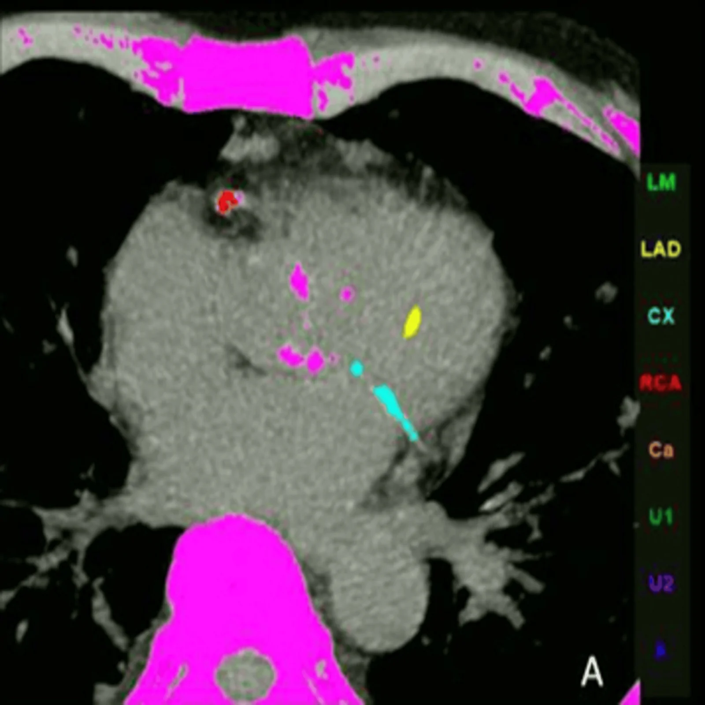
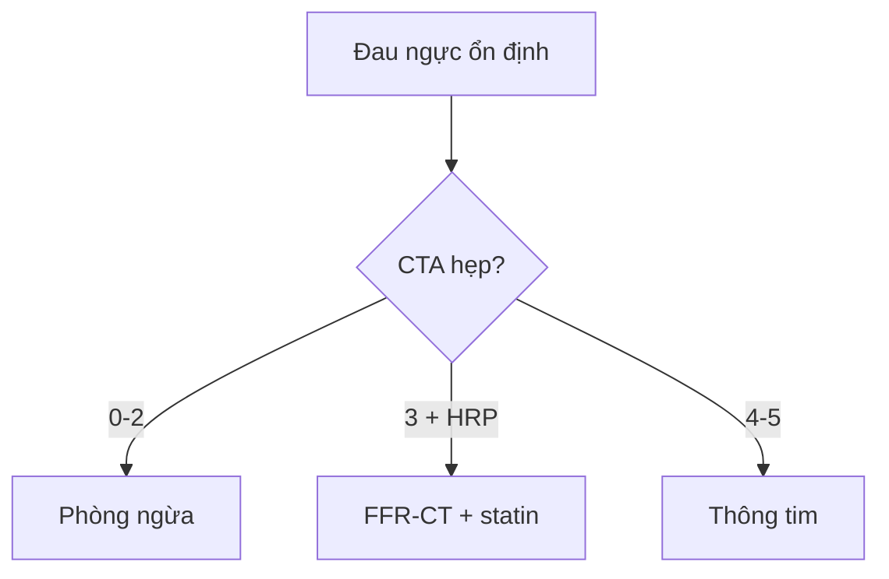

# 810 — Vành & CAD-RADS 2.0: Agatston, hẹp & mảng nguy cơ / Coronary CTA

**Tags:** `pattern:hep-vanh` `vung:vanh` `score:CAD-RADS` `protocol:CTA-vanh`
**Mức chắc chắn (certainty):** tổng hợp y văn (literature synthesis) — nhóm tự biên từ y văn mở, chưa gắn ca nguyên văn đơn lẻ.

## 1. Tổng quan — canxi là gánh nặng, hẹp là mức độ, mảng mềm là nguy cơ

- Vôi hóa (Agatston: 0 / 1–99 / 100–299 / ≥ 300) = xơ vữa tích lũy — TẠI SAO Agatston 0 vẫn có thể nhồi máu: mảng mềm không vôi mới là thủ phạm vỡ (đặc biệt người trẻ!).
- Hẹp CAD-RADS 2.0 (0 / 1: 1–24% / 2: 25–49% / 3: 50–69% / 4A-4B: 70–99% / 5: 100%) + P1–P4 (gánh mảng) — TẠI SAO tách hẹp và mảng: hẹp quyết định tưới máu, mảng quyết định phòng ngừa.
- 4 dấu HRP (tỷ trọng thấp < 30 HU + tái cấu trúc > 1,1 + vôi lấm tấm + napkin-ring) — TẠI SAO vỡ: lõi hoại tử lớn + vỏ mỏng + viêm.

## 2. Gamut đau ngực (Gamut)

- **Agatston 0 + không hẹp:** CAD-RADS 0 — phòng ngừa (nhưng đừng quên mảng mềm người trẻ!).
- **Hẹp 50–69% + HRP:** CAD-RADS 3 + HRP — chức năng (FFR-CT/tưới máu) + statin mạnh.
- **Hẹp ≥ 70% / thân chung trái:** CAD-RADS 4–5 — thông tim can thiệp/bắc cầu.
- **Blooming vôi/stent giả hẹp:** đọc quá mức — IVUS/OCT khi nghi ngờ.

## 3. Bảng so sánh phân biệt (ma trận đối chiếu)

| Thực thể (entity) | Hình ảnh điển hình | Chốt vào (rule-in) | Chốt loại (rule-out) | Gợi ý xác nhận |
|---|---|---|---|---|
| CAD-RADS 0–2 | **Không hẹp/hẹp < 50% + Agatston thấp** | **Không hẹp đáng kể** | HRP (+) → tăng cường | Phòng ngừa + statin |
| CAD-RADS 3 + HRP | **50–69% + < 30 HU/napkin-ring** | **HRP = nguy cơ vỡ** | Không HRP → theo dõi | FFR-CT + statin mạnh |
| CAD-RADS 4–5 | **≥ 70% / tắc / thân chung** | **Hẹp nặng + triệu chứng** | Blooming → kiểm tra lại | Thông tim/bắc cầu |
| Giả hẹp | **Blooming vôi/stent + cầu cơ tâm thu** | **Vôi nặng/stent + chỉ tâm thu** | Tâm trương vẫn hẹp → thật | IVUS/kiểm tra 2 thì |

*Tính Agatston theo nhánh (LM/LAD/CX/RCA). Nguồn: Khanduri et al., Cureus 2026 Fig. 1, CC BY 4.0.*

## 4. Protocol CTA vành

- **CTA vành ECG-gating + chẹn beta + nitro + Agatston** khi đau ngực ổn định; nhịp đều mới gating tốt (loạn nhịp = stair-step!).

## 5. Cạm bẫy

- **Blooming vôi/stent** đọc quá hẹp — cửa sổ hẹp + IVUS khi nghi ngờ.
- **Cầu cơ tâm thu** tưởng hẹp cố định — so sánh tâm thu-trương.
- **Agatston 0 = miễn dịch** ở người trẻ/hút thuốc — mảng mềm không vôi vẫn vỡ!

## 6. Tự lượng giá — Blind Quiz

**Ca 1 — Đau ngực + CTA vôi hóa đa nhánh. Đọc ảnh mã màu.**

- Hỏi: tính gì từ ảnh này? Quyết định gì tiếp theo?

<b>Bấm để hiện đáp án</b>

- Dấu hiệu (findings): mảng vôi đa nhánh mã màu theo LAD/RCA.
- Chẩn đoán (diagnosis): **điểm Agatston + CAD-RADS/P** — phân tầng (0/1–99/100–299/≥ 300) + đánh giá hẹp/HRP quyết định phòng ngừa hay can thiệp.
- Nguồn: Khanduri et al., Fig. 1, CC BY 4.0.

**Ca 2 — Hẹp 60% LAD + napkin-ring + RR 1,3:** CAD-RADS mấy? Bước tiếp? *(Bảng mục 3.)*

<b>Bấm để hiện đáp án</b>

- **CAD-RADS 3 + HRP:** FFR-CT/tưới máu + statin mạnh (không thông tim ngay).

## Bài liên quan chéo
- [800 – Tổng quan Tim mạch](../800-cardiovascular-overview/lesson.md)
- [070 – PE & ĐMC](../070-thuyen-tac-phoi-dmc-cap/lesson.md) (CTA ngực)
- [820 – MRI tim](../820-cardiac-mri-lge-mapping/lesson.md) (sống còn cơ tim)

> Không dùng để chẩn đoán độc lập khi chưa có người hướng dẫn.
