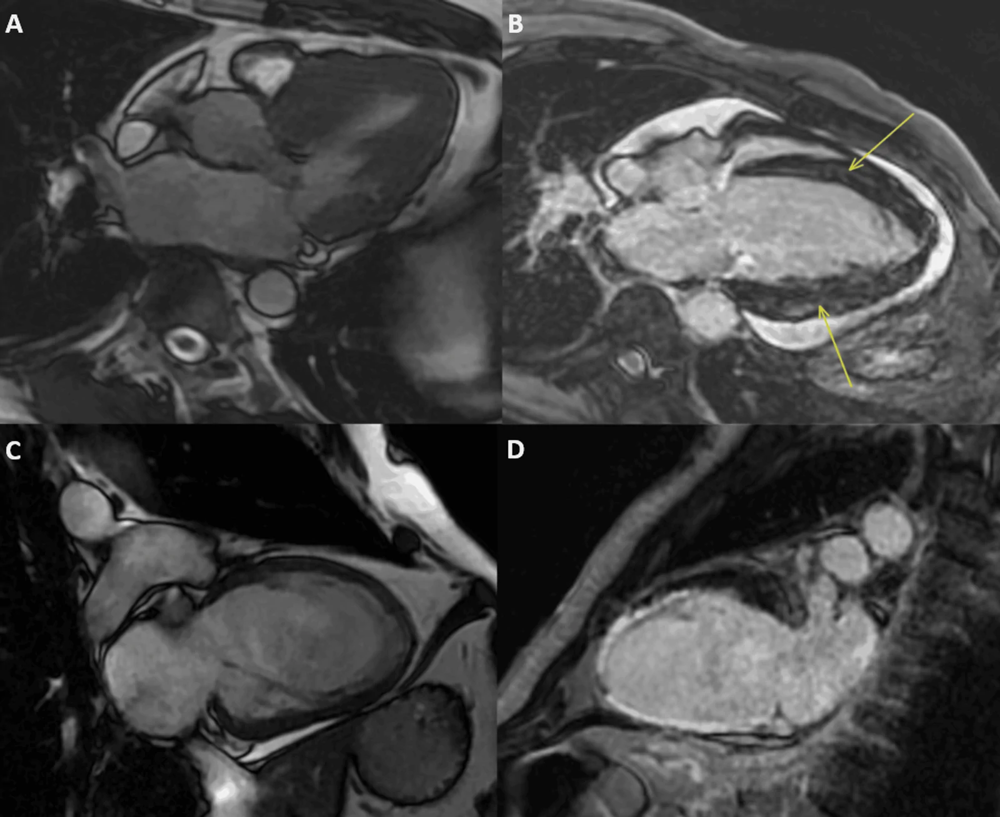
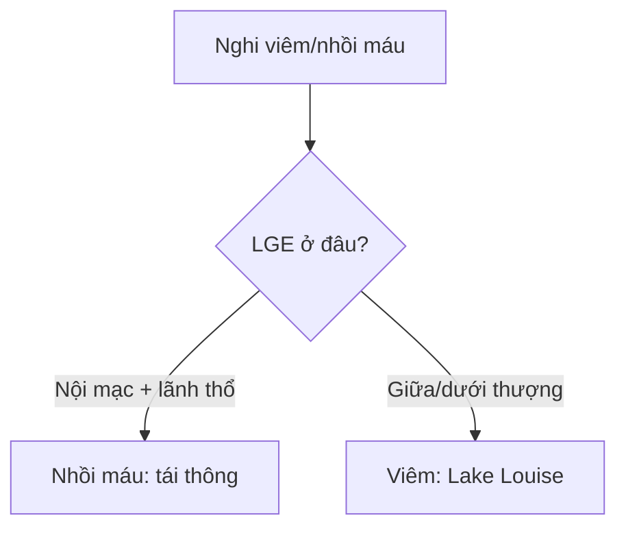

# 820 — MRI tim: LGE xuyên thành vs giữa/dưới thượng tâm mạc / Cardiac LGE

**Tags:** `pattern:LGE-cotim` `vung:cotim` `score:Lake-Louise`
**Mức chắc chắn (certainty):** tổng hợp y văn (literature synthesis) — nhóm tự biên từ y văn mở, chưa gắn ca nguyên văn đơn lẻ.

## 1. Tổng quan — thiếu máu từ trong ra, viêm từ giữa ra

- Nhồi máu: tắc vành → chết từ **dưới nội tâm mạc** lan ra ngoài theo lãnh thổ vành — TẠI SAO LGE dưới nội tâm mạc/xuyên thành + theo LAD/RCA/CX = thiếu máu: vùng xa nhất tưới máu chết trước.
- Viêm/sarcoid/DCM: tổn thương kẽ/không thiếu máu — TẠI SAO **giữa thành/dưới thượng tâm mạc, không theo lãnh thổ**: viêm lan theo mô kẽ, chừa nội mạc.
- Lake Louise 2018 (viêm): phù T2 + tổn thương T1 (LGE/ECV) — cần cả 2; ECV thường **25 ± 4%**; TI sai = cơ không đen = giả LGE.

## 2. Gamut đau ngực + men tim (Gamut)

- **LGE dưới nội tâm mạc theo lãnh thổ:** nhồi máu — tái thông + sống còn (transmural > 50% khó hồi phục!).
- **LGE giữa/dưới thượng + phù T2:** viêm cơ tim — nghỉ + NSAID/colchicine + tránh thể thao 3–6 tháng.
- **LGE lan + ECV cao + dày:** amyloid/sarcoid/DCM — sinh thiết + điều trị căn nguyên.
- **Không LGE + phù:** Takotsubo/viêm sớm — theo dõi + lặp lại.

## 3. Bảng so sánh phân biệt (ma trận đối chiếu)

| Thực thể (entity) | Hình ảnh điển hình | Chốt vào (rule-in) | Chốt loại (rule-out) | Gợi ý xác nhận |
|---|---|---|---|---|
| Nhồi máu | **LGE nội mạc/xuyên thành theo lãnh thổ vành** | **Theo LAD/RCA/CX + dưới nội mạc** | Giữa/dưới thượng → viêm | Tái thông + viability |
| Viêm cơ tim | **LGE giữa/dưới thượng + phù T2 (Lake Louise)** | **Không lãnh thổ + phù + men tim** | Xuyên thành → nhồi máu | Nghỉ + kiêng thể thao |
| Sarcoid/DCM | **LGE giữa/vách + ECV cao + block** | **Dẫn truyền + ngoài phổi** | Theo lãnh thổ → thiếu máu | PET + sinh thiết |
| Takotsubo | **Phù + không LGE + bóng chóp** | **Stress + hồi phục + không LGE** | LGE dày → viêm/xơ | Theo dõi + ức chế |

*(A) cine; (B–D) LGE/viêm các mặt cắt. Nguồn: Raja et al., Cureus 2026 Fig. 1, CC BY 4.0.*

## 4. Protocol MRI tim

- **Cine + T2/STIR + LGE (TI chuẩn) + T1/T2 mapping + ECV** khi viêm/cơ tim/nhồi máu không rõ; TI đúng = cơ đen hoàn toàn.

## 5. Cạm bẫy

- **TI sai** giả LGE toàn bộ — PSIR + kiểm tra cơ đen mới đọc.
- **Amyloid tưởng nhồi máu** — LGE lan + khó null + ECV rất cao là sinh thiết.
- **Viêm khỏi vẫn LGE tồn dư** — LGE là sẹo, phù T2 mới là hoạt tính.

## 6. Tự lượng giá — Blind Quiz

**Ca 1 — Đau ngực + troponin (+), vành bình thường. Đọc CMR.**

- Hỏi: LGE ở lớp nào? Nhồi máu hay viêm? Kiêng gì?

<b>Bấm để hiện đáp án</b>

- Dấu hiệu (findings): ngấm giữa/dưới thượng tâm mạc + phù, không theo lãnh thổ vành.
- Chẩn đoán (diagnosis): **viêm cơ tim (Lake Louise)** — nghỉ + kiêng thể thao 3–6 tháng (khác nhồi máu nội mạc theo vành).
- Nguồn: Raja et al., Fig. 1, CC BY 4.0.

**Ca 2 — LGE xuyên thành LAD + mỏng thành:** còn sống không? *(Bảng mục 3.)*

<b>Bấm để hiện đáp án</b>

- **Sẹo transmural:** không hồi phục sau tái thông (viability < 50% mới cứu được).

## Bài liên quan chéo
- [800 – Tổng quan Tim mạch](../800-cardiovascular-overview/lesson.md)
- [810 – Vành CAD-RADS](../810-coronary-cta-cadrads/lesson.md) (thiếu máu)
- [075 – Màng tim](../075-tran-dich-mang-tim/lesson.md) (viêm màng)

> Không dùng để chẩn đoán độc lập khi chưa có người hướng dẫn.
