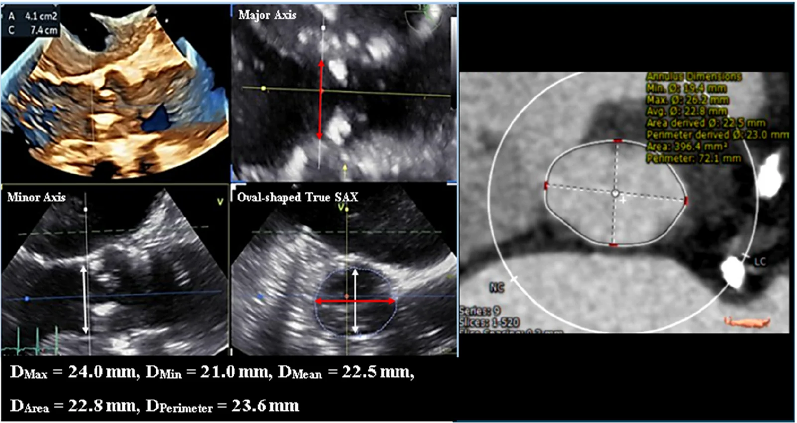
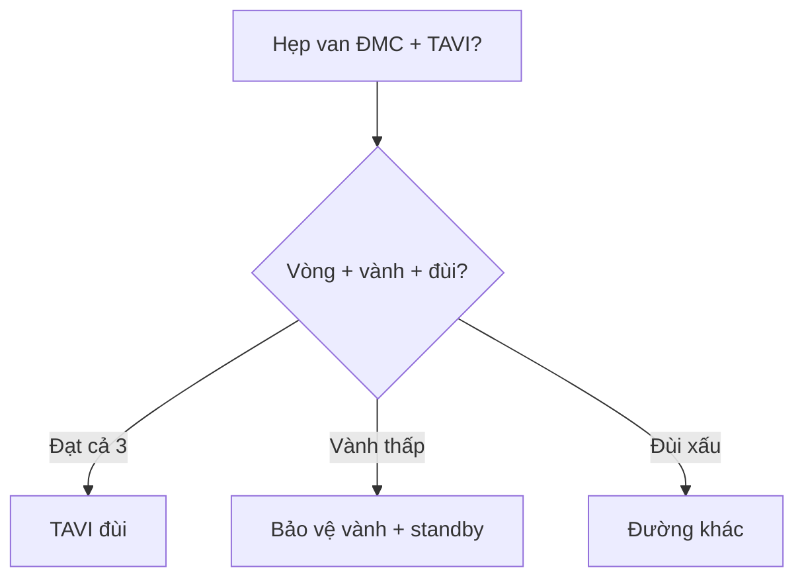

# 830 — TAVI: vòng van, vành & đường vào / TAVI planning

**Tags:** `pattern:TAVI` `vung:van-tim` `protocol:CT-TAVI`
**Mức chắc chắn (certainty):** tổng hợp y văn (literature synthesis) — nhóm tự biên từ y văn mở, chưa gắn ca nguyên văn đơn lẻ.

## 1. Tổng quan — vòng bầu dục + vành thấp + đùi nhỏ là 3 cửa tử

- Vòng van ĐMC bầu dục (không tròn!) — TẠI SAO đo double-oblique qua hinge points thì 30–40%: axial đơn cắt chéo cho số sai → chọn sai cỡ van (hở/rách!).
- Tắc vành khi bung van: lá van ép vào lỗ vành — TẠI SAO **vành < 10–12 mm + xoang < 30 mm** là nguy cơ: lá van dài hơn khoảng trống.
- ĐM đùi chung **> 5,5–6 mm** mới đưa được hệ thống — TẠI SAO: sheath 14–16 Fr (~5–6 mm) + vôi/xoắn là rách/bóc tách.

## 2. Gamut hẹp van ĐMC (Gamut)

- **Vòng vừa + vành cao + đùi tốt:** TAVI đùi — mini-TEE + LACS.
- **Vành thấp + xoang hẹp + van 2 lá:** nguy cơ tắc vành — bảo vệ vành (chimney) + phẫu thuật viên standby.
- **Đùi nhỏ/vôi/xoắn:** đường khác (dưới đòn/cảnh/trực tiếp ĐMC).
- **Hở cạnh van sau TAVI:** PVL — TEE đa mặt (sau kém TTE!) + nong thêm/van thứ 2.

## 3. Bảng so sánh phân biệt (ma trận đối chiếu)

| Thực thể (entity) | Hình ảnh điển hình | Chốt vào (rule-in) | Chốt loại (rule-out) | Gợi ý xác nhận |
|---|---|---|---|---|
| Đủ điều kiện TAVI | **Vòng đo chuẩn + vành > 12 mm + đùi > 6 mm** | **3 cửa đều đạt** | 1 cửa hỏng → đổi đường/kỹ thuật | Heart team + mini-TEE |
| Nguy cơ tắc vành | **Vành < 10–12 mm + xoang < 30 mm + lá dài** | **Thấp + hẹp + van 2 lá** | Vành cao + xoang rộng → an toàn | Bảo vệ vành + standby mổ |
| Đường vào xấu | **Đùi < 5,5 mm + vôi + xoắn** | **Sheath không qua** | Đùi tốt → đùi | Dưới đòn/cảnh/trực tiếp |
| PVL sau TAVI | **Hở cạnh + TEE sau + trước kém TTE** | **Đa mặt TEE + VCA** | Xuyên van → khác | Nong thêm/van thứ 2 |

*Trái: MPR 3D qua hinge points; phải: CT cùng bệnh nhân. Nguồn: Chen et al., J Cardiovasc Imaging 2026 Fig. 3, CC BY 4.0.*

## 4. Protocol CT TAVI

- **CT ECG thì 30–40% + double-oblique + vành mm + đùi + não** trước mọi TAVI; TEE trong thủ thuật (mini-TEE + LACS).

## 5. Cạm bẫy

- **Đo axial đơn** sai cỡ van — double-oblique hinge points là luật.
- **PVL sau TTE bỏ sót** (đặc biệt sau!) — TEE đa mặt + VCA 3D mới đủ.
- **Suy thận + thuốc cản quang liều cao** — TEE dẫn đường giảm thuốc (suy thận 33%!).

## 6. Tự lượng giá — Blind Quiz

**Ca 1 — Hẹp van ĐMC + plan TAVI. Đọc 3D TEE + CT.**

- Hỏi: đo ở mặt phẳng nào? Số bao nhiêu? TEE thấp hơn CT bao nhiêu %?

<b>Bấm để hiện đáp án</b>

- Dấu hiệu (findings): vòng 410 mm²/74 mm đo double-oblique qua hinge points.
- Chẩn đoán (diagnosis): **đủ điều kiện cỡ van** — TEE thấp hơn CT 4–7% nhưng không đổi cỡ van (axial đơn mới là sai!).
- Nguồn: Chen et al., Fig. 3, CC BY 4.0.

**Ca 2 — Vành trái 8 mm + xoang 26 mm + van 2 lá:** TAVI thường hay bảo vệ vành? *(Bảng mục 3.)*

<b>Bấm để hiện đáp án</b>

- **Nguy cơ tắc vành cao:** chimney + standby mổ (đừng bung mù!).

## Bài liên quan chéo
- [800 – Tổng quan Tim mạch](../800-cardiovascular-overview/lesson.md)
- [810 – Vành CAD-RADS](../810-coronary-cta-cadrads/lesson.md) (vành trước TAVI)
- [075 – Màng tim](../075-tran-dich-mang-tim/lesson.md) (tràn máu màng tim)

> Không dùng để chẩn đoán độc lập khi chưa có người hướng dẫn.
