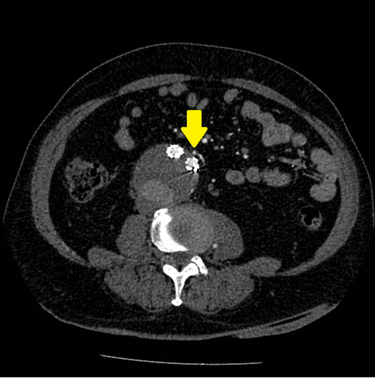
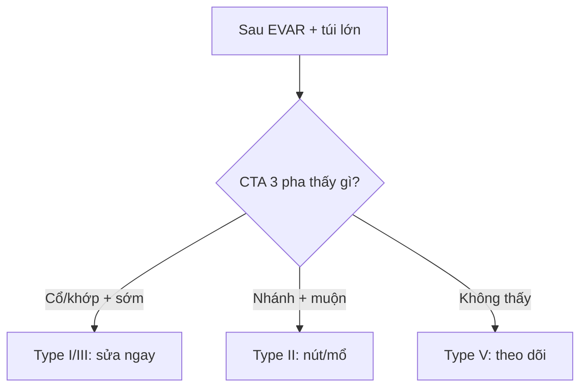

# 840 — AAA sau EVAR: Endoleak I–V & PAD / EVAR surveillance

**Tags:** `pattern:endoleak` `vung:DMC-bung` `protocol:CT-3-pha`
**Mức chắc chắn (certainty):** tổng hợp y văn (literature synthesis) — nhóm tự biên từ y văn mở, chưa gắn ca nguyên văn đơn lẻ.

## 1. Tổng quan — túi còn áp lực là còn vỡ + pha muộn mới thấy type II

- Endoleak: máu còn vào túi phình sau EVAR — TẠI SAO type II (nhánh ngược: mạc treo dưới/thắt lưng) cần pha muộn 70–120s: dòng chậm, thì động mạch chưa tới.
- Ngưỡng mổ AAA: nam > 5,5 cm / nữ > 5,0 cm / lớn > 0,5 cm/6 tháng — TẠI SAO Laplace: áp lực thành ∝ bán kính, túi càng to càng dễ vỡ.
- Type I (cổ) + III (khớp) = áp lực hệ thống → sửa ngay; type II + V (căng túi) theo dõi khi túi không lớn.

## 2. Gamut túi phình sau EVAR (Gamut)

- **Cổ/trên-dưới + sớm + túi lớn:** type I — cuffs/ống nới rộng cấp cứu.
- **Nhánh ngược + muộn + túi lớn dần:** type II — nút nhánh vào-ra (cả 2 đầu!) hoặc mổ mở.
- **Khớp graft + sớm:** type III — nối thêm đoạn.
- **Không thấy + túi lớn:** type V — tăng áp lực + theo dõi sát/mổ.

## 3. Bảng so sánh phân biệt (ma trận đối chiếu)

| Thực thể (entity) | Hình ảnh điển hình | Chốt vào (rule-in) | Chốt loại (rule-out) | Gợi ý xác nhận |
|---|---|---|---|---|
| Type I | **Cổ trên/dưới + sớm + áp lực cao** | **Rò cổ + túi lớn nhanh** | Muộn + nhánh → II | Sửa cấp cứu |
| Type II | **Nhánh ngược + muộn 70–120s + túi lớn dần** | **IMT/thắt lưng + muộn** | Sớm + cổ → I | Nút 2 đầu/mổ mở |
| Type III | **Khớp graft + sớm + tách đoạn** | **Rò khớp + X-quang** | Nhánh → II | Nối thêm |
| Type V | **Túi lớn + không thấy rò** | **Loại trừ I–IV + căng** | Thấy rò → I–IV | Theo dõi/mổ |

*Túi 6 cm lớn dần 0,2 cm/năm sau EVAR 14 năm. Nguồn: Giannakopoulos et al., Cureus 2024 Fig. 1, CC BY 4.0.*

## 4. Protocol theo dõi EVAR

- **CTA 3 pha (non-contrast + động mạch + muộn 70–120s)** định kỳ; thiếu pha muộn = sót type II, thiếu non-contrast = nhầm vôi!

## 5. Cạm bẫy

- **Thiếu pha muộn** sót type II lưu lượng thấp — 3 pha là luật.
- **Vôi túi tưởng rò** — non-contrast đối chiếu mới kết luận.
- **Type II flow-through** (vào + ra) nguy cơ cao — nút cả 2 đầu, đừng nút 1 đầu!

## 6. Tự lượng giá — Blind Quiz

**Ca 1 — Sau EVAR 14 năm + túi 6 cm lớn dần. Đọc CTA.**

- Hỏi: type mấy? Nguồn vào đâu? Nút hay mổ mở?

<b>Bấm để hiện đáp án</b>

- Dấu hiệu (findings): ĐM mạc treo dưới + thắt lưng trái còn thông vào túi.
- Chẩn đoán (diagnosis): **endoleak type II dòng chảy qua** — nút 2 đầu thất bại → mổ mở thắt + giữ graft (túi lớn dần!).
- Nguồn: Giannakopoulos et al., Fig. 1, CC BY 4.0.

**Ca 2 — Rò cổ trên + túi lớn nhanh sau EVAR:** type mấy? Xử trí? *(Bảng mục 3.)*

<b>Bấm để hiện đáp án</b>

- **Type I:** sửa cấp cứu (áp lực hệ thống = vỡ!).

## Bài liên quan chéo
- [800 – Tổng quan Tim mạch](../800-cardiovascular-overview/lesson.md)
- [170 – Phình ĐMC](../170-phinh-DMC-bung/lesson.md) (ngưỡng mổ)
- [920 – Nút mạch](../920-vascular-embolization-gi-bleed/lesson.md) (nút type II)

> Không dùng để chẩn đoán độc lập khi chưa có người hướng dẫn.
