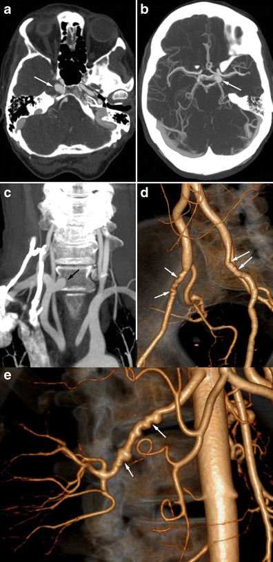
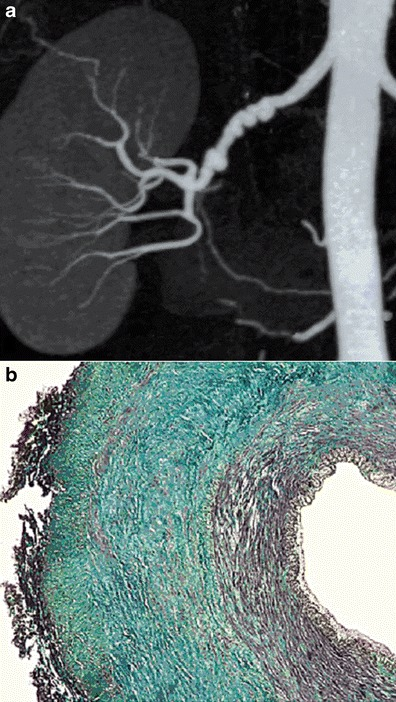
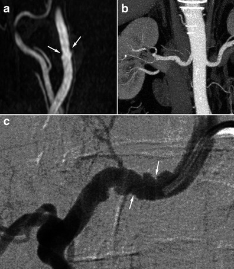
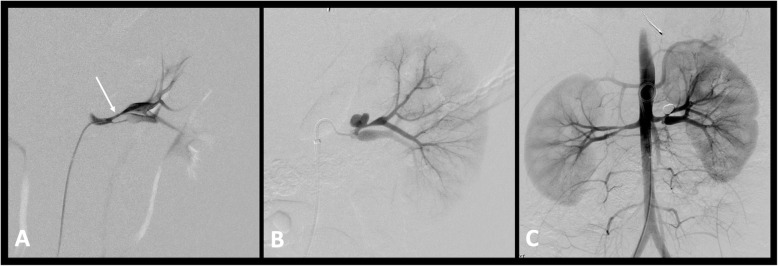
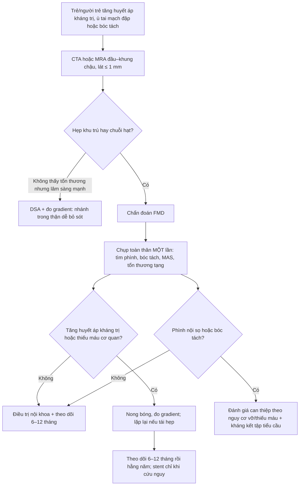
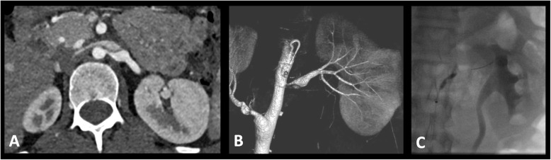
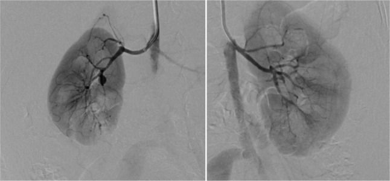

# 850 — Loạn sản cơ xơ (fibromuscular dysplasia — FMD) toàn thân ở trẻ và người trẻ: chuỗi hạt, phình, bóc tách & khi nào nong bóng / Fibromuscular dysplasia in children and young adults

**Tags:** `pattern:hep-mach` `pattern:chui-hat` `pattern:phinh-mach` `pattern:boc-tach` `vung:than` `vung:co-canh` `score:none` `protocol:CTA-toan-than`
**Mức chắc chắn (certainty):** tổng hợp y văn (literature synthesis) — ghép 4 nguồn chính: tổng quan hệ thống 119 nghiên cứu về FMD mạch cảnh–não (PMC13100393), bài hình ảnh học FMD của *Insights into Imaging* (PMC4444794), tổng quan can thiệp tăng huyết áp do mạch thận ở trẻ (PMC7790992) và ca FMD ở trẻ 13 tháng tuổi có hoại tử chi (PMC13371219). Số nào nguồn không đưa thì ghi "chưa rõ".

> **Câu chốt:** FMD **không phải bệnh của người lớn nữ 50 tuổi** — ở trẻ, **FMD không hội chứng là nguyên nhân thường gặp nhất của tăng huyết áp do mạch thận (renovascular hypertension — RVH)**, và kiểu hình lại **khu trú (unifocal) nhiều hơn chuỗi hạt**. Điểm quyết định: chẩn đoán FMD = **chụp toàn bộ cây mạch từ đầu đến khung chậu MỘT lần** để tìm phình/bóc tách không triệu chứng (phình nội sọ 7%, bóc tách mạch cảnh 7–17%, tổn thương ĐMC 10%), rồi **nong bóng — không đặt stent ở trẻ đang lớn**.

## 1. Tổng quan bệnh học – cơ chế hình ảnh

### 1.1 Vì sao mạch "chuỗi hạt" — và vì sao trẻ lại "khu trú" (TẠI SAO)

- **Bệnh học:** FMD là bệnh động mạch **không do xơ vữa, không do viêm**: tăng sinh tế bào cơ trơn + chất nền làm **dày và biến dạng thành mạch**, tạo hẹp, phình, bóc tách hoặc xoắn vặn (định nghĩa đồng thuận quốc tế 2019, dẫn qua PMC7790992). Tổn thương hay gặp nhất: **động mạch thận (renal artery)**, **động mạch cảnh trong/đốt sống**, động mạch mạc treo và ĐMC bụng.
- **Vì sao "chuỗi hạt" (string of beads):** thể **loạn sản cơ lớp giữa (medial fibroplasia)** tạo các **dải xơ vòng** (fibrous ridges) xen kẽ vùng thành mỏng → trên CTA/MRA/DSA thấy **các đoạn giãn xen kẽ các đoạn hẹp**, bờ **lượn sóng không đều**, đường kính **lớn hơn khẩu kính bình thường** ở chỗ giãn. Đây là lý do chuỗi hạt **không phải** hẹp đơn thuần: chỗ "giãn" đã là **phình nhỏ** mất lớp cơ → dễ bóc tách.
- **Vì sao trẻ khác người lớn:** ở trẻ **hẹp khu trú (unifocal/focal) chiếm ưu thế** hơn thể đa ổ, và **hình chuỗi hạt kinh điển ít gặp** (PMC7790992). Hệ quả thực hành: **không loại trừ FMD chỉ vì không thấy chuỗi hạt**; hẹp **khu trú, trơn, ở thân hoặc nhánh động mạch thận** ở trẻ vẫn là FMD cho đến khi chứng minh khác.
- **Vì sao hẹp → tăng huyết áp:** hẹp làm giảm áp lực tưới máu thận → **thận tiết renin** (cơ chế renin–angiotensin) → tăng huyết áp **thường nặng, kháng trị, có thể thành cơn tăng huyết áp**. Hẹp **hai bên 24–78%** trong các loạt nhi (PMC7790992) → phải chụp **cả hai** bên, không chỉ bên có triệu chứng.
- **Vì sao bóc tách/phình lại hay đi kèm:** dải xơ + mất cơ trơn + **dòng xoáy ở chỗ giãn** tạo điểm yếu thành mạch. Trong FMD, **bóc tách mạch cảnh 13,9%** (ARCADIA, 65/469) và **liên quan ≥ 3 vùng mạch làm tăng nguy cơ bóc tách (OR 2,49)** (PMC8483547); **phình nội sọ 7%**, **bóc tách mạch cảnh 7–17%** (PMC13100393).
- **Vì sao "không do viêm" quan trọng trên hình ảnh:** không có **dày thành mạch đối xứng, thâm nhiễm quanh mạch hay bắt thuốc thành mạch** như Takayasu — tổn thương FMD **khu trú vào lớp thành**, mạch xung quanh sạch. Đây là chốt phân biệt với viêm mạch (mục 3).

### 1.2 Ngưỡng định lượng nằm lòng (bắt buộc nhớ)

| Chỉ số | Con số | Nguồn |
|---|---|---|
| Tỷ lệ FMD ở động mạch thận (loạt chụp mạch) | **4–6%** | PMC4444794 |
| Tỷ lệ FMD mạch cảnh–não (loạt chụp mạch) | **0,3–3%** | PMC4444794 |
| FMD thận **có triệu chứng** | **~4/1000** | PMC1899482 |
| RVH trong tăng huyết áp ở trẻ | **5–25%** | PMC7790992 |
| Hẹp động mạch thận **hai bên** ở loạt nhi | **24–78%** | PMC7790992 |
| Chụp mạch ở trẻ: tổn thương **hai bên hoặc nhánh trong thận** | **thường gặp** — lý do DSA vẫn là chuẩn vàng | PMC7790992 |
| Bóc tách mạch cảnh trong FMD (ARCADIA 469 BN) | **13,9%** (65/469); nam **OR 2,66** (1,34–5,25); **≥ 3 vùng mạch OR 2,49** (1,15–5,40) | PMC8483547 |
| Bóc tách mạch cảnh trong FMD (tổng quan 119 nghiên cứu) | **7–17%** | PMC13100393 |
| Phình động mạch nội sọ trong FMD | **7%** | PMC13100393 |
| Đột quỵ thiếu máu / TIA / SAH / ICH do FMD mạch cảnh–não | **7–10%** / **5–12%** / **2–3%** / **0,01%** | PMC13100393 |
| Đau đầu / ù tai mạch đập khi khởi phát | **8–52%** / **17–23%** | PMC13100393 |
| Tổn thương ĐMC ở FMD đa ổ (360 BN, chụp đủ ĐMC) | **10,0%** (36/360; KTC 95% 7,3–13,5) | PMC13599887 |
| Nong bóng thận ở trẻ: có lợi | **48,5–100%** | PMC7790992 |
| Tái hẹp sau nong bóng | **17–41%** | PMC7790992 |
| Tái hẹp **sau stent** so với **sau nong bóng** | **35,5% vs 17,4%** | PMC7790992 |
| Phẫu thuật tái thông (phân tích gộp người lớn) | khỏi bệnh **54%** | PMC7790992 |

## 2. Mẫu hình + chẩn đoán phân biệt theo vị trí (gamut)

**Mẫu hình cần nhận ra:** **trẻ/người trẻ < 40 tuổi** (nữ nhiều hơn, nhưng **nam vẫn mắc — 16% ARCADIA**) có **tăng huyết áp nặng/kháng trị**, **ù tai mạch đập**, **đau đầu**, hoặc **đột quỵ/bóc tách ở người không có yếu tố nguy cơ xơ vữa** → CTA/MRA thấy **hẹp khu trú trơn ở thân/nhánh động mạch thận** hoặc **chuỗi hạt** ở cảnh trong/đốt sống, kèm **phình, bóc tách, xoắn vặn**.

**Gamut theo vị trí (mnemonic "THẬN – CẢNH–ĐỐT SỐNG – TẠNG – CHỦ"):**

1. **THẬN (renal):** hay nhất ở trẻ — hẹp **thân hoặc nhánh**, thường **hai bên**, hẹp **khu trú** nhiều hơn chuỗi hạt; gây RVH, teo thận một bên, chênh kích thước thận > 1 cm.
2. **CẢNH – ĐỐT SỐNG (carotid–vertebral):** chuỗi hạt ở **đoạn C1 giữa cổ** (không phải chỗ phân nhánh như xơ vữa), **xoắn vặn (tortuosity)**, **web mạch cảnh**, **bóc tách**; biểu hiện: đau đầu, ù tai mạch đập, TIA, đột quỵ.
3. **TẠNG (splanchnic):** hẹp/phình động mạch mạc treo, lách, gan — thường **không triệu chứng**, phát hiện khi chụp toàn thân; phình có thể vỡ.
4. **CHỦ (aorta) – chậu:** **hẹp eo/tắc đoạn giữa ĐMC bụng (middle aortic syndrome — MAS)**, phình/giãn ĐMC ngực **10%** (PMC13599887), hẹp chậu–đùi gây **cách hồi (claudication) ở trẻ** — như ca 13 tháng tuổi huyết khối động mạch chậu phải (PMC13371219).

**Vì sao phải chụp "head-to-pelvis" một lần:** tổn thương **đa ổ không triệu chứng** là quy luật, không phải ngoại lệ (≥ 3 vùng mạch làm tăng nguy cơ bóc tách, OR 2,49); đồng thuận quốc tế khuyến nghị **chụp toàn bộ động mạch từ não đến khung chậu một lần** khi đã chẩn đoán FMD (PMC13100393, PMC13458163).

*Hình 7 — Nữ 56 tuổi đau đầu không đặc hiệu: (a,b) CTA não: **phình động mạch cảnh hai bên phát triển vào xoang hang** (mũi tên); (c) dựng MIP các thân mạch trên ĐMC: **phình động mạch dưới đòn phải** (mũi tên đen); (d) dựng 3D: **phình + xoắn vặn động mạch cảnh–đốt sống**; (e) **phình động mạch thận** kèm biến đổi chuỗi hạt. Một bệnh nhân — bốn vùng mạch. Nguồn: PMC4444794, **CC BY 4.0**.*

## 3. Bảng so sánh phân biệt (ma trận đối chiếu)

| Thực thể (entity) | Hình ảnh điển hình | Chốt vào (rule-in) | Chốt loại (rule-out) | Gợi ý xác nhận |
|---|---|---|---|---|
| **FMD thể đa ổ (chuỗi hạt)** | Chuỗi hẹp–giãn xen kẽ, **bờ lượn sóng**, đoạn giãn **rộng hơn khẩu kính gốc**, ở **thân/đoạn giữa–xa** động mạch thận hoặc **C1 cảnh trong** | **≥ 2 đoạn giãn xen kẽ hẹp + bờ không đều + bệnh nhân trẻ/nữ + nhiều vùng mạch** | Bờ **trơn đều, hẹp đơn độc sát gốc (ostial)**, có canxi hóa → xơ vữa | CTA/MRA toàn thân; DSA xác nhận |
| **FMD thể khu trú (unifocal)** — phổ biến ở TRẺ | **Một đoạn hẹp trơn, hình nón/vai rõ**, không chuỗi hạt, thường ở **thân hoặc nhánh** thận | **Trẻ + hẹp trơn không canxi + không dấu viêm + chênh renin** | Hẹp **sát gốc đối xứng** kèm hội chứng NF1 rõ → nghĩ loạn sản do NF1 | DSA + đo gradient; loại trừ viêm mạch |
| **Xơ vữa động mạch thận** | Hẹp **sát gốc (ostial)**, canxi hóa, mảng không đều, bờ **gồ ghề** | **Tuổi > 50 + ĐTĐ/rối loạn lipid + canxi hóa + tổn thương ĐM vành/chi** | **Trẻ, không canxi, tổn thương đoạn giữa–xa** → không phải xơ vữa | CTA (canxi), siêu âm Doppler (vận tốc) |
| **Takayasu (viêm mạch chủ)** | **Hẹp trơn, dài, thuôn dần**, thành mạch **dày đối xứng, bắt thuốc**, ĐMC và các nhánh gốc; có thể tắc hoàn toàn | **Dày thành mạch + bắt thuốc thành + CRP/VS tăng + tuổi trẻ nữ châu Á** | Thành mạch **không dày, không bắt thuốc**, tổn thương khu trú từng đoạn → FMD | MRI thành mạch + CRP/VS; PET-CT khi nghi |
| **Loạn sản do NF1** | Hẹp **sát gốc, trơn, ngắn**, thường một bên; kèm **MAS** | **Café-au-lait, u sợi thần kinh, đốm Freckling + hẹp gốc** | Không có dấu da/NF1 và tổn thương **đoạn giữa–xa** → FMD không hội chứng | Khám da, tiền sử gia đình, MRI |
| **Hội chứng Williams / Alagille** | Hẹp động mạch thận + **hẹp van ĐMC trên van** (Williams) hoặc **MAS + thiểu sản đường mật** (Alagille) | **Đặc điểm mặt, tăng canxi máu ở nhũ nhi (Williams); vàng da ứ mật + trục động mạch phổi hẹp (Alagille)** | Không có bất thường van ĐMC/đường mật → FMD đơn thuần | Siêu âm tim, xét nghiệm gan, di truyền |
| **Loạn sản cơ trung mạc từng đoạn (segmental arterial mediolysis — SAM)** | **Bóc tách/phình** động mạch tạng, **không có chuỗi hạt**, nhiều ổ, có thể tự lành | **Phình/bóc tách tạng ở người trung niên + không hẹp chuỗi hạt** | Có chuỗi hạt/hẹp điển hình + nhiều vùng mạch → FMD | CTA lặp 3–6 tháng |
| **Co thắt mạch não có hồi phục (RCVS)** | Co thắt **lan tỏa, nhiều đoạn "dạng xúc xích"**, **hồi phục sau vài tuần** | **Đau đầu sét đánh tái diễn + co thắt đa ổ + hồi phục trên chụp lặp** | Tổn thương **cố định** trên chụp lặp + có chuỗi hạt thật → FMD | Chụp lặp 4–6 tuần |
| **Sóng đứng (standing/stationary waves)** | **Sóng đều đặn, chu kỳ giống nhau**, ở đoạn **thẳng** mạch, mất khi bơm mạnh/dùng thuốc giãn mạch | **Chu kỳ đều + đổi theo áp lực bơm** | Bờ **không đều, chu kỳ khác nhau**, tồn tại sau giãn mạch → FMD thật | Lặp DSA sau giãn mạch; đối chiếu CTA |

*Hình 2 — (a) CTA thận mặt phẳng vành, dựng MIP: **chuỗi hạt** điển hình ở động mạch thận phải, các đoạn giãn xen kẽ hẹp. (b) Tiêu bản màu: **xơ hóa lan rộng lớp giữa (medial fibrosis)** — cơ sở giải phẫu của hình ảnh; nội mạc và ngoại mạc bình thường. Nguồn: Varennes L et al., Insights Imaging 2015 (PMC4444794), **CC BY 4.0** — nguyên bản, không crop.*

*Hình 6 — Nam 62 tuổi tăng huyết áp: (a) MRA dựng MIP: chuỗi hạt **kín đáo** ở động mạch cảnh trong (mũi tên trắng); (b) CTA thận cùng bệnh nhân: chuỗi hạt rõ ở động mạch thận. (c) DSA xác nhận. **Đây là lý do phải chụp toàn thân**: tổn thương ở vùng thứ hai có thể kín đáo hơn vùng đang triệu chứng. Nguồn: cùng bài (PMC4444794), **CC BY 4.0**.*

## 4. Protocol chụp + hệ phân độ & chiến lược xử trí

**Chụp gì (thứ tự leo thang):**

1. **CTA (hoặc MRA nếu trẻ cần tránh bức xạ)** từ **đầu đến khung chậu**, lát mỏng **≤ 1 mm**, dựng **MIP + 3D VR**: đánh giá **cả hai** động mạch thận đến **nhánh trong thận**, cảnh trong/đốt sống, tạng, ĐMC. CTA ưu thế khi cần **canxi hóa, stent, xương**; MRA ưu thế ở trẻ nhỏ/người trẻ cần theo dõi lặp.
2. **DSA** vẫn là **chuẩn vàng** — đặc biệt ở trẻ, vì tổn thương hay ở **nhánh trong thận** mà CTA/MRA bỏ sót; DSA cho phép **đo gradient áp lực qua chỗ hẹp** ngay trên bàn và **nong bóng cùng lúc** (PMC7790992).
3. **Siêu âm Doppler** là bước sàng lọc (chênh kích thước thận, vận tốc dòng, **parvus–tardus**), **không đủ loại trừ** FMD ở trẻ — chụp mạch vẫn cần khi lâm sàng nghi (PMC7790992).
4. **IVUS/OCT** giúp xem thành mạch và kết quả nong, nhưng **chưa được chuẩn hóa ở trẻ** — không dùng để quyết định một mình.
5. **Chụp lặp**: sau nong bóng **6–12 tháng** rồi hằng năm; **khi có bóc tách/phình** chụp lặp **3–6 tháng** cho tới khi ổn định.

*Hình 6 — (a) Chụp mạch thận trái: phân nhánh sớm với **hẹp dài, chít hẹp cả hai nhánh** (mũi tên). (b,c) Chụp lại 2 tháng sau nong bóng: **giả phình tại chỗ nong nhánh trên** (mũi tên), điều trị thành công bằng **coil**. Đây là biến chứng phải khám lại sau nong: đau hông lưng + giảm hemoglobin sau thủ thuật. Nguồn: Patel PA, Cahill AM, CVIR Endovasc 2021 (PMC7790992), **CC BY 4.0**.*

**Ngưỡng & quyết định can thiệp (số nằm lòng):**

- **Nong bóng (percutaneous transluminal angioplasty — PTA) có lợi 48,5–100%**, tái hẹp **17–41%** → chấp nhận **nong lặp lại** thay vì stent (PMC7790992).
- **Tránh stent ở trẻ đang lớn**: stent không lớn theo trẻ → thành chỗ hẹp cố định; tái hẹp sau stent **35,5% vs 17,4%** sau nong bóng (PMC7790992). Chỉ đặt stent khi **cần cứu nguy cấp** (bóc tách gây thiếu máu, vỡ phình).
- **Phẫu thuật tái thông** (ghép, bypass, tái tạo) khi nong thất bại nhiều lần, tổn thương **nhánh xa/kéo dài**, hoặc MAS phức tạp; phân tích gộp người lớn: **khỏi bệnh 54%** — nhỉnh hơn nong đơn thuần nhưng xâm lấn hơn (PMC7790992).
- **Điều trị nội khoa song song:** kiểm soát huyết áp **chặt** (thuốc chẹn men chuyển/chẹn thụ thể là lựa chọn hợp lý khi hẹp **một bên**; **thận trọng khi hẹp hai bên**), **statine không chỉ định thường quy** vì không phải bệnh xơ vữa, **ngừng thuốc lá**, và **kháng kết tập tiểu cầu** hợp lý cho FMD mạch cảnh–não để giảm nguy cơ huyết khối (PMC13458163, PMC13100393).
- **Phình nội sọ:** can thiệp khi **có yếu tố nguy cơ vỡ** (kích thước, vị trí, tăng theo thời gian) hoặc **thiếu máu não tái diễn dù đã điều trị** (PMC13100393).

*Hình 1 — (A) CTA ngang: hẹp động mạch thận trái kèm **giãn sau hẹp**. (B) Chụp mạch quay (rotational angiography) xác nhận. (C) **Eo bóng (balloon waist)** tại chỗ hẹp khi bơm — dấu hiệu tổn thương xơ chịu lực, và là mốc để nong tăng dần. Nguồn: Patel PA, Cahill AM, CVIR Endovasc 2021 (PMC7790992), **CC BY 4.0**.*

## 5. Biến thể bình thường và cạm bẫy

- **Cạm bẫy 1 — "không có chuỗi hạt = không phải FMD":** ở trẻ, **hẹp khu trú trơn là kiểu hình chính** và chuỗi hạt kinh điển **ít gặp** (PMC7790992). Bỏ sót ở đây = trẻ tăng huyết áp nhiều năm, teo thận.
- **Cạm bẫy 2 — sóng đứng (standing waves) giả chuỗi hạt:** sóng **đều chu kỳ**, ở đoạn mạch **thẳng**, mất khi bơm mạnh hoặc sau thuốc giãn mạch; chuỗi hạt FMD **không đều** và **tồn tại**. Nếu nghi, lặp DSA sau giãn mạch.
- **Cạm bẫy 3 — gán hẹp sát gốc cho FMD:** hẹp **ostial đối xứng** ở trẻ gợi **NF1** (nguyên nhân hẹp mạch thận thường gặp thứ hai ở trẻ phương Tây, PMC7790992); ở người lớn là **xơ vữa**. Vị trí + tuổi + dấu da quyết định.
- **Cạm bẫy 4 — chỉ chụp vùng có triệu chứng:** **10%** FMD đa ổ có tổn thương ĐMC, **7%** có phình nội sọ, **7–17%** bóc tách mạch cảnh — tất cả có thể **im lặng** (PMC13599887, PMC13100393). Chụp toàn thân **một lần** là tiêu chuẩn.
- **Cạm bẫy 5 — đặt stent "cho chắc" ở trẻ:** stent chặn sự lớn của mạch, tái hẹp **35,5% vs 17,4%**; ưu tiên **nong lặp** (PMC7790992).
- **Cạm bẫy 6 — quên thận khi đã thấy tổn thương cảnh:** FMD là bệnh **toàn thân**; hình 6 cho thấy cùng bệnh nhân có cả hai ổ, và vùng kín đáo hơn lại là vùng không triệu chứng.
- **Cạm bẫy 7 — web mạch cảnh đọc thành "hẹp xơ vữa":** web là **màng nội mạc khu trú** ở mặt sau–bên hành cảnh, là **một dạng FMD**, chiếm ưu thế ở **người da đen** (PMC13100393); xử trí thiên về can thiệp/kháng kết tập chứ không phải statine.
- **Biến thể bình thường:** **xoắn vặn nhẹ động mạch cảnh trong** ở người trẻ không triệu chứng, **giãn nhẹ động mạch thận** không kèm hẹp — theo dõi, không can thiệp.

## 6. Tự lượng giá — Blind Quiz ngay trên trang tĩnh

**Ca 1 — Trẻ 13 tháng tuổi, chân phải tím–đau, mất mạch mu chân. Siêu âm không có tín hiệu Doppler. Chụp mạch thận chọn lọc:**

- Câu hỏi: (1) Mô tả bất thường ở hai động mạch thận. (2) Vì sao trẻ 13 tháng tuổi lại có **huyết khối động mạch chậu** và **phình động mạch mạc treo**? (3) Chẩn đoán mô bệnh nào xác nhận?

<b>Bấm để hiện đáp án (findings + chẩn đoán)</b>

- **Findings:** hai động mạch thận **mất tính chất đều đặn**, bờ **lượn sóng dạng chuỗi hạt (beaded)** — hẹp–giãn xen kẽ lan tỏa. Trước đó CT cho thấy **tắc hoàn toàn động mạch chậu chung phải** và **giãn phình động mạch mạc treo trên/dưới**.
- **Chẩn đoán:** **FMD thể nặng ở trẻ nhỏ**, biểu hiện bằng **huyết khối–thiếu máu chi cấp** (phải cắt cụt) và **phình mạch tạng**; tăng huyết áp do mạch thận xuất hiện trong lúc gây mê (cơn tăng huyết áp do mạch thận).
- **Vì sao:** thành mạch loạn sản + dòng xoáy ở đoạn giãn → huyết khối tại chỗ và phình; **trẻ nhỏ có thể biểu hiện bằng biến cố mạch máu**, không chỉ tăng huyết áp.
- **Mô bệnh:** **bệnh lý động mạch lan rộng phù hợp FMD** trên bệnh phẩm chi cắt cụt.
- **Nguồn ảnh:** Louiselle A et al., BMC Pediatr 2026 (PMC13371219), **CC BY-NC-ND 4.0** — nguyên bản, không crop.

**Ca 2 — Nam 42 tuổi, đột ngột nói khó và yếu nửa người phải, trong cửa sổ tiêu sợi huyết. CTA cổ–não:**

- Câu hỏi: (1) Dấu hiệu ở động mạch cảnh trong (ảnh a) là gì, và vì sao nó **không giống xơ vữa**? (2) Ảnh b và c cho thêm thông tin gì buộc phải chụp thêm? (3) Có nên đặt stent "phòng ngừa" đoạn chuỗi hạt không?

<b>Bấm để hiện đáp án (findings + chẩn đoán)</b>

- **Findings:** (a) MRA MIP động mạch cảnh trong: **các đoạn hẹp–giãn xen kẽ kín đáo** ở đoạn giữa cổ (mũi tên trắng) — **chuỗi hạt**, bờ không đều, **không ở chỗ phân nhánh** (khác xơ vữa). (b) CTA thận cùng bệnh nhân: **chuỗi hạt rõ** ở động mạch thận. (c) DSA xác nhận cả hai.
- **Chẩn đoán:** **FMD đa ổ (cảnh + thận)** — cần chụp **đầu–khung chậu một lần** để tìm thêm phình/bóc tách.
- **Không đặt stent "phòng ngừa":** tổn thương FMD ở người trưởng thành thường **lành tính về hẹp**, điều trị chính là **kháng kết tập tiểu cầu + kiểm soát huyết áp**; can thiệp chỉ khi **thiếu máu não tái diễn dù đã điều trị nội khoa** (PMC13100393). Stent ở đoạn chuỗi hạt dễ gây tái hẹp.
- **Nguồn ảnh:** Varennes L et al., Insights Imaging 2015 (PMC4444794), **CC BY 4.0**.

**Ca 3 — Tính toán:** bé gái 9 tuổi tăng huyết áp kháng trị, CTA phát hiện hẹp **khu trú** động mạch thận phải; nong bóng lần 1 tốt, 8 tháng sau huyết áp tăng lại, DSA cho tái hẹp 60%.

- Câu hỏi: (1) Tỷ lệ tái hẹp sau nong bóng là bao nhiêu? (2) Nên nong lại hay đặt stent? (3) Theo dõi tiếp thế nào?

<b>Bấm để hiện đáp án (findings + chẩn đoán)</b>

- **Tái hẹp sau nong bóng: 17–41%** (PMC7790992) — lần tái hẹp này **nằm trong dự kiến**, không phải thất bại kỹ thuật.
- **Nong lại**, không stent: **tái hẹp sau stent 35,5% vs 17,4%** sau nong bóng, và stent **không lớn theo trẻ** — nong lặp giúp mạch **tái tạo lớn dần** (PMC7790992). Stent chỉ khi **cấp cứu** (bóc tách/thiếu máu) hoặc nong thất bại nhiều lần.
- **Theo dõi:** chụp mạch/CTA lặp **6–12 tháng** rồi **hằng năm**; kiểm soát huyết áp, tầm soát **bên đối diện** (hẹp hai bên 24–78%) và **các vùng khác** (ĐMC 10%).
- **Nguồn số liệu:** PMC7790992; điều trị nội khoa: PMC13458163.

## Bài liên quan chéo
- [685 – Theo dõi dài hạn sau bóc tách động mạch cổ ở trẻ](../685-theo-doi-ngung-thuoc-sau-boc-tach-dong-mach-co-o-tre/lesson.md)
- [247 – Bóc tách động mạch cảnh–đốt sống](../247-boc-tach-dong-mach-co-dot-song-cervical-artery-dissection/lesson.md)
- [248 – Can thiệp nội mạch giả phình/bóc tách động mạch cảnh–đốt sống](../248-can-thiep-noi-mach-gia-phinh-boc-tach-dong-mach-co-dot-song/lesson.md)
- [249 – Rò động mạch cảnh–xoang hang sau chấn thương](../249-ro-dong-mach-canh-xoang-hang-chan-thuong/lesson.md)
- [207 – Phình mạch nội sọ chưa vỡ: nguy cơ vỡ & chỉ định can thiệp](../207-phinh-mach-noi-so-chua-vo/lesson.md)
- [652 – Đột quỵ mạch máu não ở trẻ: moyamoya & viêm mạch](../652-dot-quy-mach-mau-nao-nhi-moyamoya-viem-mach/lesson.md)
- [172 – Theo dõi sau can thiệp bóc tách ĐMC bụng (EVAR/TEVAR)](../172-theo-doi-sau-can-thiep-boc-tach-dmc-bung/lesson.md)
- [800 – Tổng quan hệ Tim mạch](../800-cardiovascular-overview/lesson.md)

## Ảnh
- `850_renal-string-of-beads_CTA-MIP_PMC4444794-Fig2.jpg` — Varennes L et al., Insights Imaging 2015 (PMC4444794), **CC BY 4.0**.
- `850_dong-thoi-co-canh-than_MRA-CTA_PMC4444794-Fig6.jpg` — cùng bài, **CC BY 4.0**.
- `850_phinh-dong-thoi-nhieu-noi_CTA_PMC4444794-Fig7.jpg` — cùng bài, **CC BY 4.0**.
- `850_hep-dong-mach-than-nong-bong_CVIT_PMC7790992-Fig1.jpg` — Patel PA, Cahill AM, CVIR Endovasc 2021 (PMC7790992), **CC BY 4.0**.
- `850_gia-phinh-sau-nong-bong_CVIT_PMC7790992-Fig6.jpg` — cùng bài, **CC BY 4.0**.
- `850_dong-mach-than-tre-13-thang_DSA_PMC13371219-Fig3.jpg` — Louiselle A et al., BMC Pediatr 2026 (PMC13371219), **CC BY-NC-ND 4.0**.
- Chi tiết nguồn/giấy phép từng ảnh: `images/CREDITS.md`.

> Không dùng để chẩn đoán độc lập khi chưa có người hướng dẫn.
