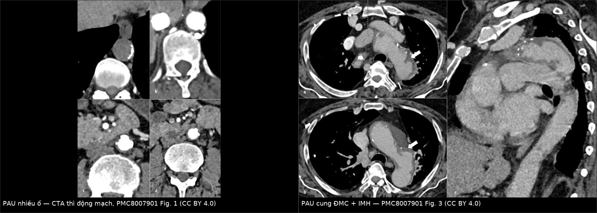
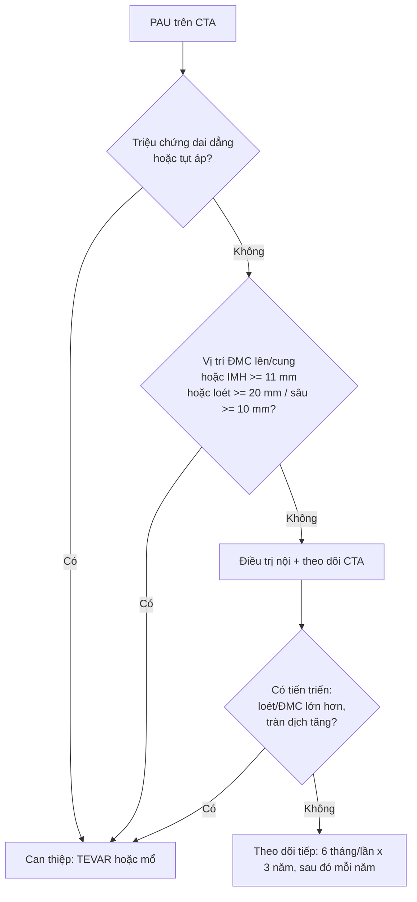
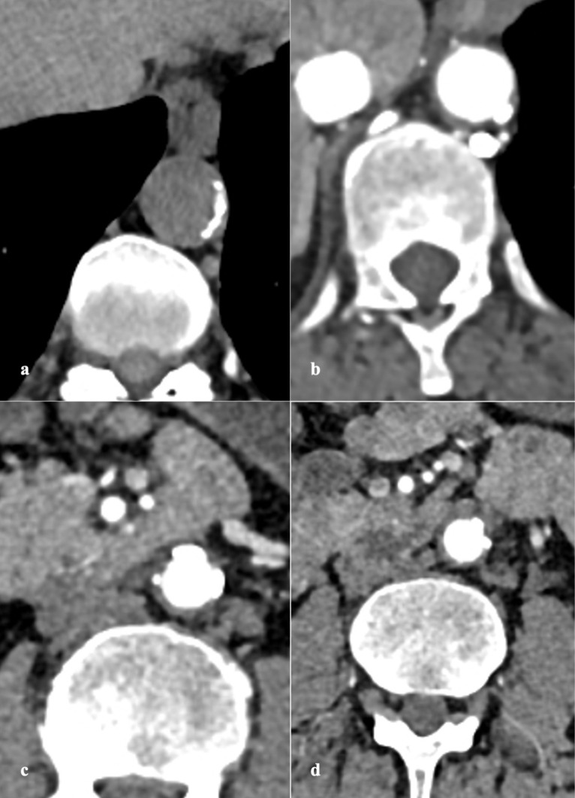
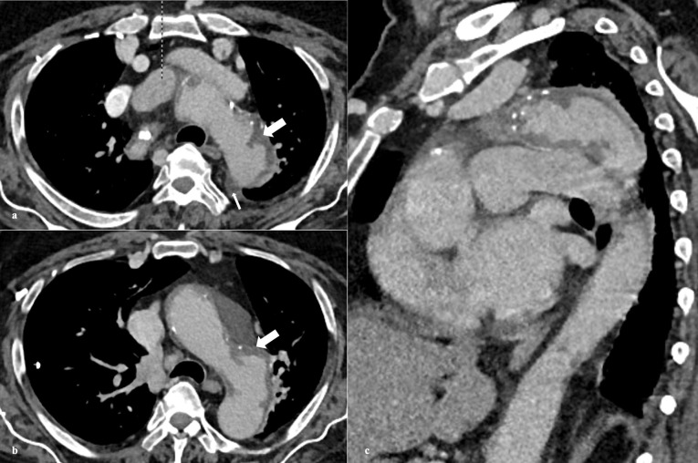
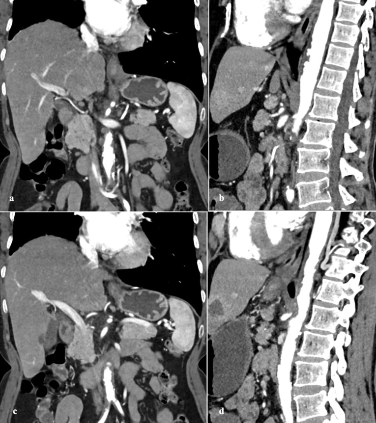

# 851 — Loét xuyên thành động mạch chủ (PAU): thể thứ ba của hội chứng ĐMC cấp / Penetrating atherosclerotic ulcer

**Tags:** `pattern:loet-xuyen-thanh` `pattern:huyet-khoi-thanh-mach` `pattern:phinh-mach` `pattern:khuyet-thuoc` `vung:dong-mach-chu-nguc` `score:none` `protocol:CTA-ECG-gated` `protocol:MRI` `incidentaloma:pau`

**Mức chắc chắn (certainty):** tổng hợp y văn (literature synthesis) — 1 bài tổng quan lâm sàng–hình ảnh–điều trị (J Cardiovasc Thorac Res 2021, **PMC8007901**, gộp **19 loạt ca**, trong đó **Nathan 315 ca** và **Cho 105 ca**). **Không có thử nghiệm ngẫu nhiên** riêng cho PAU; bằng chứng là đoàn hệ hồi cứu và ca báo cáo.

> **Câu chốt:** PAU **không phải** "túi phình nhỏ" và **không phải** bóc tách: đó là **ổ loét của mảng xơ vữa ăn qua nội mạc vào trung mạc**, trên CTA là **ổ đọng thuốc lồi ra ngoài đường viền lòng mạch, sát vôi hóa nội mạc**, gần như luôn kèm **huyết khối thành mạch (intramural hematoma, IMH)**. Vì **không có lòng giả**, các tiêu chuẩn của bóc tách **không áp dụng được**; cái quyết định là **triệu chứng + độ sâu/đường kính ổ loét + độ dày IMH + vị trí**.

## 1. Tổng quan bệnh học – cơ chế hình ảnh

### 1.1 Vì sao có "ổ loét" và vì sao nó nguy hiểm
- Mảng xơ vữa loét → mất **màng đàn hồi trong (internal elastic lamina)** → máu động mạch ăn vào **trung mạc (media)**. Trung mạc mất đàn hồi, không chịu được **áp lực × bán kính** (định luật Laplace) → phình giả (pseudoaneurysm) → **bóc tách hoặc vỡ**.
- Hệ quả theo thứ tự: **loét → IMH → phình giả dưới ngoại mạc → vỡ / bóc tách / rò sang tạng lân cận**. Vì thành đã xơ hóa, PAU **hiếm khi tạo lòng giả hai ống (double-barrel)** như bóc tách kinh điển — nhưng **vẫn tiến triển được**.
- **80%** ca PAU có IMH đi kèm (loạt Mayo, theo tổng quan PMC8007901); **25%** tiến triển trên theo dõi (Nathan, **315 ca**); **vỡ 13–14%** (Nathan; Quint), tới **38%** ở loạt toàn ca có triệu chứng và nửa ở ĐMC lên (Tittle).

### 1.2 Vì sao CTA thấy được — và phải chụp thế nào
- **Ổ loét = ổ đọng thuốc (contrast-filled outpouching)** lồi ra ngoài đường viền lòng mạch, **sát một mảng vôi hóa nội mạc bị đẩy lệch vào trong**. Kích thước **vài mm đến 2,5 cm**, sâu tới **3 cm**, **thường nhiều ổ** (23% nhiều ổ trong loạt Nathan).
- **IMH trên thì không cản quang:** máu đông trong thành có **60–70 HU**, hình **liềm (crescentic)** ôm theo thành, **không ngấm thuốc**. Đây là lý do **bắt buộc có thì không cản quang**: nếu chỉ có thì động mạch, IMH mỏng có thể "biến mất" và ổ loét bị đọc thành túi phình nhỏ.
- **Thì động mạch đích ≥ 250 HU**, **ECG-gating** để tránh **giả ảnh nhịp đập (pulsation artifact)** — giả ảnh này tạo "vạt" chạy ngang gốc ĐMC và bị đọc nhầm thành bóc tách.
- **Lát 5 mm + tái tạo đa bình diện (MPR)**; tổng quan khuyến cáo **giới hạn trường chụp ở ĐMC ngực** nhưng vẫn phải đủ **toàn bộ ĐMC** để không bỏ sót ổ loét thứ hai hoặc lan xuống bụng.
- **MRI:** tốt hơn CT cho **IMH** vì không cần thuốc và phân biệt được **tuổi máu** — **methemoglobin trong máu bán cấp T1W tăng tín hiệu** (do Fe³⁺ chưa ghép cặp electron), còn **huyết thanh/khối máu tối** trên T1W. Chuỗi **cine** phân biệt **dòng chậm của bóc tách** với **không dòng của IMH**.

### 1.3 Ngưỡng định lượng phải nhớ
| Biến số | Ngưỡng | Ý nghĩa |
|---|---|---|
| Đường kính ổ loét | **≥ 20 mm** | Dự báo tiến triển (Ganaha) |
| Độ sâu ổ loét | **≥ 10 mm** | Dự báo tiến triển; > 10 mm là "loét sâu" |
| Độ dày IMH | **≥ 11 mm** | Dự báo vỡ (tổng quan PMC8007901) |
| Đường kính ĐMC | **> 40 mm** tiến triển; **> 50 mm** tử vong; **> 55–60 mm** mổ | Theo dõi sát / chỉ định can thiệp |
| Tràn dịch màng phổi | **không có** = yếu tố CT duy nhất báo ổn định (Quint) | Có tràn dịch + đau dai dẳng = dấu hiệu xấu |

## 2. Mẫu hình + chẩn đoán phân biệt theo vị trí (gamut)

- **ĐMC ngực xuống (hay gặp nhất):** PAU đơn độc · PAU + IMH · bóc tách type B · phình giả nhiễm khuẩn · loét do viêm (Takayasu) · rò ĐMC–phế quản/thực quản.
- **Cung ĐMC / ĐMC lên (ít gặp, nặng nhất):** PAU cung/ĐMC lên → **tràn máu màng tim, chèn ép tim**, thiếu máu não; chỉ cần **PAU + IMH type A** là chỉ định can thiệp sớm.
- **ĐMC bụng:** PAU · phình giả nhiễm khuẩn · **phình viêm (inflammatory aneurysm — thành dày, xơ quanh ĐMC)** · túi phình dạng túi (saccular).
- **"Họ hàng" dễ lẫn:** **ULP (ulcer-like projection)** — ổ loét nhỏ **đường kính lòng ≥ 3 mm**, thường thấy trên theo dõi IMH; **IBP (intramural blood pool)** — ổ máu trong thành thông với nhánh (liên sườn/thắt lưng) qua **cổ hẹp**; **FID (focal intimal disruption)** và **LIT (limited intimal tear)** — rách nội mạc khu trú, có thể tiến triển thành bóc tách thật.

## 3. Bảng so sánh phân biệt (ma trận đối chiếu)

| Thực thể (entity) | Hình ảnh điển hình | Chốt vào (rule-in) | Chốt loại (rule-out) | Gợi ý xác nhận |
|---|---|---|---|---|
| **PAU** | Ổ đọng thuốc lồi ngoài đường viền lòng mạch, sát vôi hóa; ± IMH liềm | **Ổ loét có cổ rõ + vôi hóa nội mạc bị đẩy vào trong + IMH quanh** | Không có ổ đọng thuốc → không phải PAU (chỉ IMH) | CTA thì động mạch + không cản quang; đo sâu/đường kính |
| **IMH** | Liềm **60–70 HU** không ngấm thuốc, dày thành > 5 mm (tới 10 mm) | **Không thấy ổ loét, không có lòng giả** | Có ổ loét → PAU + IMH | CTA không cản quang; MRI T1W |
| **Bóc tách kinh điển** | **Vạt nội mạc (intimal flap)** chia hai lòng, lòng giả có thể có "cobweb" | **Hai lòng thật–giả + flap** | Chỉ một lòng + ổ loét → PAU | CTA ECG-gated; TEE |
| **ULP** | Ổ loét nhỏ, **đường kính lòng ≥ 3 mm**, trong nền IMH | **≥ 3 mm + nằm trong IMH đang theo dõi** | Ổ lớn, cổ rõ, ngoài IMH → PAU | So sánh các lần CTA |
| **IBP** | Ổ máu trong thành, **cổ hẹp**, thông nhánh liên sườn/thắt lưng | **Cổ hẹp + thông nhánh** | Cổ rộng, lồi ra ngoài → PAU/ULP | CTA đa bình diện |
| **Phình giả nhiễm khuẩn** | Túi dạng túi, thành dày, khí/mô viêm quanh ĐMC, sốt | **Sốt + cấy dương + khí trong thành** | Không viêm, nhiều ổ xơ vữa → PAU | CT + PET; cấy máu |
| **Phình dạng túi (saccular)** | Túi phình **cổ rộng**, không có ổ loét nội mạc riêng | **Đường kính túi lớn, cổ rộng** | Ổ loét nhỏ, cổ hẹp → PAU | CTA 3D |

*Trái: nhiều ổ đọng thuốc lồi ra khỏi thành ĐMC có vôi hóa (PAU nhiều ổ). Phải: PAU ở cung ĐMC (mũi tên dày) kèm IMH và ít dịch màng phổi (mũi tên mảnh). Nguồn: Dev R et al., J Cardiovasc Thorac Res 2021, PMC8007901 Fig. 1 và Fig. 3 — CC BY 4.0; ảnh ghép letterbox bằng `tools/make_composite.py`.*

## 4. Protocol chụp + phân tầng nguy cơ

- **CTA toàn ĐMC, ECG-gated:** không cản quang → thì động mạch (≥ 250 HU) → thì muộn nếu nghi rò/endoleak; lát **5 mm**, MPR trục–dọc–ngang.
- **Đo và ghi vào báo cáo (checklist):** đường kính + độ sâu ổ loét, số ổ, **độ dày IMH**, đường kính ĐMC, **tràn dịch màng phổi/màng tim**, huyết khối trong lòng, nhánh tạng bị ảnh hưởng.
- **Phân tầng:** triệu chứng dai dẳng dù giảm đau/giảm áp lực, **IMH ≥ 11 mm**, **PAU ≥ 20 mm hoặc sâu ≥ 10 mm**, máu tụ quanh ĐMC, tràn dịch tăng, **vị trí ĐMC lên/cung** = **nguy cơ cao**.
- **Điều trị:** kiểm soát huyết áp (chẹn beta là nền tảng); **TEVAR** cho ca nguy cơ cao/ĐMC xuống; **mổ mở hoặc TEVAR** cho ĐMC lên/cung. TEVAR: **vùng neo 1,5–2 cm** mỗi đầu, **quá cỡ ≤ 10%**, **không nong bóng mạnh** khi có IMH (thành dễ rách).

- **Lịch theo dõi (tổng quan):** ca có triệu chứng **1, 3, 6, 12 tháng** rồi mỗi năm; ca không triệu chứng **6 tháng/lần trong 3 năm** rồi mỗi năm. PAU + IMH theo dõi **suốt đời** vì nguy cơ lòng giả muộn.

## 5. Biến thể bình thường và cạm bẫy

- **Giả ảnh nhịp đập** ở gốc ĐMC/dưới động mạch dưới đòn: "vạt" chỉ thấy trên 1–2 lát, **không thấy trên MPR dọc** → dùng **ECG-gating**, đối chiếu đa bình diện.
- **Vôi hóa nội mạc giả ổ loét** trên thì không cản quang: vôi có **> 130 HU** và **không đổi hình giữa các thì**; ổ loét **đầy thuốc ở thì động mạch**.
- **PAU ĐMC lên < 10 mm** rất dễ bỏ sót (tổng quan ghi rõ); nếu bệnh cảnh phù hợp (đau ngực, tràn máu màng tim) mà không thấy ổ loét → **MRI/TEE**.
- **Đọc "IMH đơn thuần" khi thực ra có ổ loét**: ổ loét nhỏ bị huyết khối lấp → **so thì không cản quang + MPR mỏng**, tìm ổ đọng thuốc.
- **Bẫy thoả mãn tìm kiếm:** 23% ca có **nhiều ổ** — tìm hết chiều dài ĐMC trước khi kết luận.
- **Rò ĐMC–thực quản/phế quản:** "chảy máu báo trước" rồi ồ ạt; **nội soi thực quản thường quy có thể làm bùng phát chảy máu**; stent-graft phủ ở đây có **nguy cơ nhiễm mảnh ghép cao** → cần bàn với phẫu thuật.
- **Không có tràn dịch màng phổi** là yếu tố CT duy nhất báo ổn định (Quint) — nhưng **không** đủ để loại trừ tiến triển.

## 6. Tự lượng giá — Blind Quiz

**Ca 1 — Nam 72 tuổi, tăng huyết áp, đau ngực–lưng 6 giờ. CTA ngực có thì không cản quang và thì động mạch. Nhìn trước, mô tả ổ tổn thương.**

- Câu hỏi: Có mấy ổ đọng thuốc? Chúng nằm trong hay ngoài đường viền lòng mạch? Có IMH không? Chẩn đoán và 3 phân biệt?

<b>Bấm để hiện đáp án (findings + chẩn đoán)</b>

- **Dấu hiệu:** (a) thì không cản quang — thành ĐMC dày, vôi hóa nội mạc; (b–d) thì động mạch — **nhiều ổ đọng thuốc lồi ra ngoài đường viền lòng mạch** dọc thành ĐMC xuống, sát vôi hóa. Đây là **PAU nhiều ổ**.
- **Chẩn đoán:** PAU (thể thứ ba của hội chứng ĐMC cấp). Phân biệt: bóc tách type B (có vạt nội mạc, hai lòng), IMH đơn thuần (không có ổ đọng thuốc), phình dạng túi (cổ rộng, không có ổ loét nội mạc).
- **Xử trí:** kiểm soát huyết áp; nếu đau dai dẳng/ổ loét lớn/IMH dày → TEVAR.
- Nguồn ảnh: Dev R et al., J Cardiovasc Thorac Res 2021, Fig. 1 — **CC BY 4.0** (PMC8007901).

**Ca 2 — Nữ 68 tuổi, đau sau lưng lan xuống, tràn dịch màng phổi trái lượng ít. CTA có MPR dọc.**

- Câu hỏi: Tổn thương ở đoạn nào? Dấu hiệu nào chứng minh đây là PAU chứ không phải bóc tách? Yếu tố nào quyết định can thiệp?

<b>Bấm để hiện đáp án</b>

- **Dấu hiệu:** ổ loét đọng thuốc ở **cung ĐMC** (mũi tên dày), **IMH** dày quanh thành, **dịch màng phổi ít** (mũi tên mảnh). Không có vạt nội mạc chia hai lòng.
- **Vì sao không phải bóc tách:** không có **lòng giả** và **vạt nội mạc**; tổn thương khu trú tại mảng xơ vữa.
- **Quyết định:** **vị trí cung/ĐMC lên** + **IMH** = nguy cơ cao → hội chẩn can thiệp sớm (TEVAR/mổ), không chờ.
- Nguồn ảnh: Dev R et al., J Cardiovasc Thorac Res 2021, Fig. 3 — **CC BY 4.0** (PMC8007901).

**Ca 3 — Nam 75 tuổi, đau bụng–lưng; CTA bụng có MPR trục và dọc.**

- Câu hỏi: Vì sao phải xem cả MPR dọc? Nếu ổ loét sâu 6 mm, đường kính 12 mm, không triệu chứng thì xử trí thế nào?

<b>Bấm để hiện đáp án</b>

- **Dấu hiệu:** ổ loét đọng thuốc nhô ra khỏi thành ĐMC, thấy rõ **độ sâu và chiều dài** chỉ khi tái tạo dọc; trục giúp xác định vị trí so với nhánh tạng.
- **Xử trí:** kích thước dưới ngưỡng (**< 20 mm, sâu < 10 mm**), không triệu chứng, ĐMC không lớn → **nội khoa + theo dõi CTA 6 tháng/lần trong 3 năm**. Nếu đau dai dẳng, IMH ≥ 11 mm hoặc ổ loét lớn lên → can thiệp.
- Nguồn ảnh: Dev R et al., J Cardiovasc Thorac Res 2021, Fig. 2 — **CC BY 4.0** (PMC8007901).

## Bài liên quan chéo

- [800 — Tổng quan Tim mạch](../800-cardiovascular-overview/lesson.md)
- [840 — Endoleak & theo dõi sau EVAR](../840-aorta-endoleak-pad/lesson.md)
- [850 — Loạn sản cơ xơ (FMD): phình và bóc tách](../850-loan-san-co-xo-fibromuscular-dysplasia-toan-than-o-tre/lesson.md)
- [171 — Bóc tách & IMH động mạch chủ bụng](../171-boc-tach-dong-mach-chu-bung-va-IMH/lesson.md)
- [938 — Rò động mạch chủ–ruột (aorto-enteric fistula)](../938-ro-dong-mach-chu-ruot/lesson.md)
- [1844 — Rò/hoại tử thực quản do xạ](../1844-ro-hoai-tu-thuc-quan-do-xa/lesson.md)
- [097 — Phình động mạch phế quản & ho ra máu](../097-phinh-dong-mach-phe-quan-baa/lesson.md)

> **Disclaimer:** Tài liệu học tập, không dùng để chẩn đoán độc lập khi chưa có bác sĩ chuyên khoa hướng dẫn.
