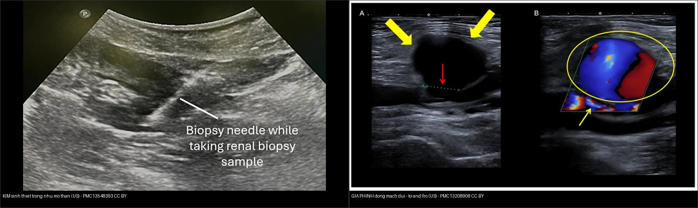
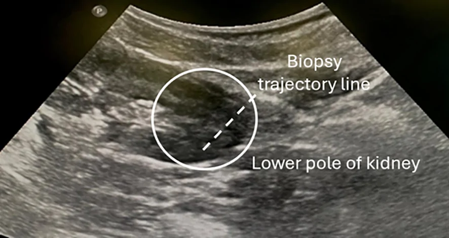
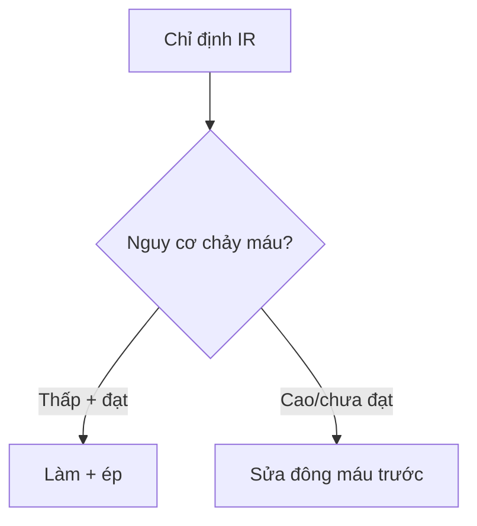
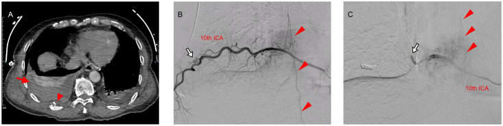
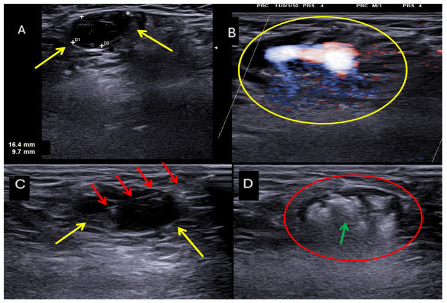
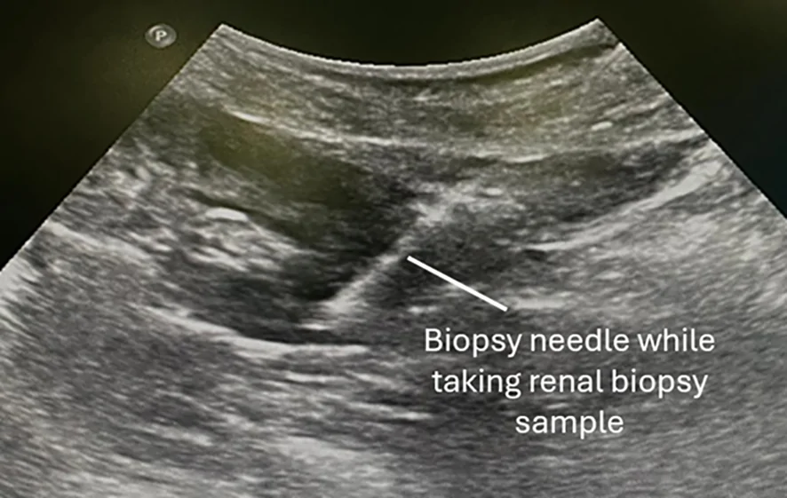

# 900 — Đại cương IR: kim, đông máu & cửa sổ chọc / IR fundamentals

**Tags:** `pattern:an-toan-IR` `vung:can-thiep` `score:SIR`
**Mức chắc chắn (certainty):** tổng hợp y văn (literature synthesis) — nhóm tự biên từ y văn mở, chưa gắn ca nguyên văn đơn lẻ.

## 1. Tổng quan — đông máu + giải phẫu mạch là 2 cửa sống còn

- SIR phân loại chảy máu: **nguy cơ thấp (INR < 1,8–2,0 + tiểu cầu > 20–50k)** vs **cao (INR < 1,5 + tiểu cầu > 50k)** — TẠI SAO ngưỡng khác nhau: chọc tạng/mạch lớn không ép được vs chọc nông ép được.
- Đơn vị French (**1 Fr = 0,33 mm**) + Gauge ngược (G càng lớn kim càng nhỏ) — TẠI SAO chọn kim nhỏ nhất làm được việc: giảm chảy máu + giả phình đường vào.
- Thượng vị dưới (thành bụng) + liên sườn (bờ dưới sườn) — TẠI SAO: mạch chạy bờ dưới sườn + thượng vị nuôi thành bụng, đâm trúng là máu ổ bụng/ngực.

## 2. Gamut thủ thuật (Gamut)

- **Chọc hút/dẫn lưu nông + đông máu đạt:** nguy cơ thấp — làm + ép.
- **Sinh thiết gan/thận + INR 1,6:** nguy cơ cao — sửa đông máu trước.
- **Đường vào đùi + mạch đả:** siêu âm + micropuncture + nút mạch khi rút.
- **Dị ứng thuốc + suy thận:** bù nước + giảm liều + thay thế (CO2/MRI).

## 3. Bảng so sánh phân biệt (ma trận đối chiếu)

| Thực thể (entity) | Hình ảnh/kỹ thuật | Chốt vào (rule-in) | Chốt loại (rule-out) | Gợi ý xác nhận |
|---|---|---|---|---|
| Nguy cơ thấp | **Chọc nông + ép được + đạt ngưỡng** | **INR/TC đạt + ép được** | Tạng sâu → cao | Làm + theo dõi |
| Nguy cơ cao | **Tạng/mạch + INR/TC chưa đạt** | **Sửa đông máu trước** | Đạt ngưỡng → thấp | Vit K/huyết tương/tiểu cầu |
| Đường vào an toàn | **Siêu âm + tránh thượng vị/liên sườn** | **Thấy mạch + tránh được** | Mù + mạch ngang → đổi đường | Micropuncture + siêu âm |
| Biến chứng đường vào | **Máu tụ + giả phình + thông động-TM** | **Sưng + thổi + Hb rơi** | Ổn định → ép + theo dõi | Ép/nút/mổ |

*Trái: siêu âm — **kim sinh thiết** (đường tăng hồi âm) nằm trong nhu mô thận đúng đích (Alturkistani H, Front Nephrol 2026, PMC13548393, Fig. 3, CC BY). Phải: siêu âm Doppler màu — **giả phình động mạch đùi** sau thủ thuật, thấy túi (mũi tên vàng) + cổ (mũi tên đỏ) và dòng "to-and-fro" (Borzelli A et al., J Pers Med 2026, PMC13208908, Fig. 4, CC BY). Ảnh ghép letterbox giữ tỷ lệ.*

## 4. Protocol an toàn IR

- **Checklist: đông máu + thuốc + dị ứng + thận + đường vào siêu âm + đồng ý** trước mọi thủ thuật; Fr nhỏ nhất + kim 1 lần.

*Quét siêu âm dọc để **lập kế hoạch đường vào** trước khi chọc — bước bắt buộc để chọn cửa sổ an toàn và tránh mạch/tạng. Alturkistani H, Front Nephrol 2026 (PMC13548393, Fig. 1), CC BY — nguyên bản.*

## 5. Cạm bẫy

- **Thượng vị dưới/liên sườn** đâm mù — siêu âm mạch trước mọi chọc bụng/ngực.
- **Ngừng kháng đông/kháng kết tập sai** — huyết khối vs chảy máu, hội chẩn + bridging.
- **Suy thận + thuốc cản quang liều cao** — bù nước + hạn chế + theo dõi creatinine.
- **Động mạch liên sườn chạy bờ dưới sườn** — chọc liên sườn mù rất dễ trúng: nhìn ảnh DSA dưới đây, động mạch bám sát **bờ dưới xương sườn** (đầu mũi tên) và giả phình có thể hình thành sau chấn thương/chọc → chọc luôn **đi bờ trên sườn** + siêu âm dò mạch.

*Semba R et al., Radiol Case Rep 2026 (PMC13264221, Fig. 1), CC BY — nguyên bản.*

*Xử trí biến chứng đường vào không cần mổ: **tiêm thrombin dưới hướng siêu âm** làm tắc túi giả phình. Borzelli A et al., J Pers Med 2026 (PMC13208908, Fig. 5), CC BY — nguyên bản.*

## 6. Tự lượng giá — Blind Quiz

**Ca 1 — Sinh thiết gan + INR 1,7 + tiểu cầu 45k:** nguy cơ nào? Làm luôn hay sửa? *(Bảng mục 3.)*

- Câu hỏi: Nhận ra kim trên siêu âm bằng dấu hiệu gì? Với INR 1,7 và TC 45k thì chọc được chưa?

<b>Bấm để hiện đáp án</b>

- **Kim = đường tăng hồi âm (hyperechoic line)** vuông góc trục dài thận khi bắn kim — xác nhận kim trong vỏ thận.
- **Nguy cơ cao (tạng):** cần INR < 1,5 + TC > 50k — sửa đông máu trước (nguy cơ thấp chỉ cho chọc nông).
- Nguồn ảnh: Alturkistani H, Front Nephrol 2026 (PMC13548393, Fig. 3), CC BY.

**Ca 2 — Chọc dịch màng phổi mù đường nách sau + máu tươi:** sai ở đâu? *(Bảng mục 3.)*

<b>Bấm để hiện đáp án</b>

- **Đâm mạch liên sườn (bờ dưới sườn):** siêu âm + đi bờ trên sườn + ép/nút mạch. Đối chiếu ảnh DSA động mạch liên sườn ở mục 5.
- Nguồn số liệu/ảnh: Semba R et al., Radiol Case Rep 2026 (PMC13264221), CC BY.

## Bài liên quan chéo
- [900 – Tổng quan IR](../901-ir-overview/lesson.md)
- [920 – Nút mạch](../920-vascular-embolization-gi-bleed/lesson.md) (cầm máu)
- [150 – Bosniak](../150-nang-than-Bosniak/lesson.md) (sinh thiết thận)

> Không dùng để chẩn đoán độc lập khi chưa có người hướng dẫn.
