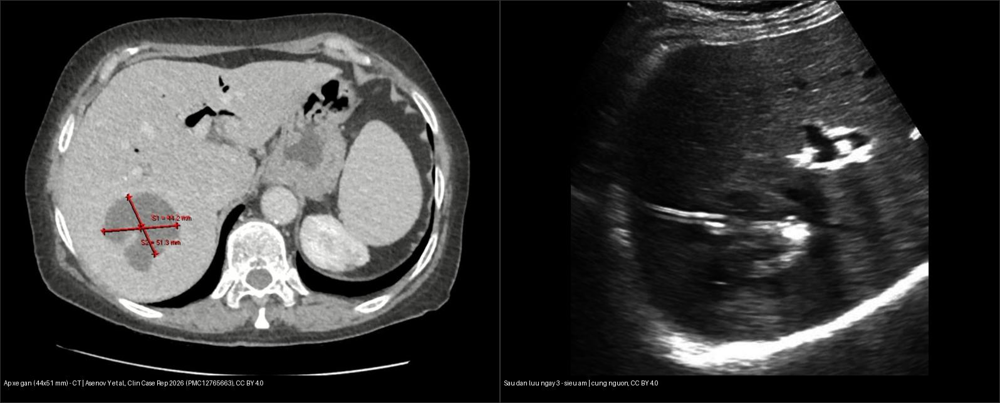
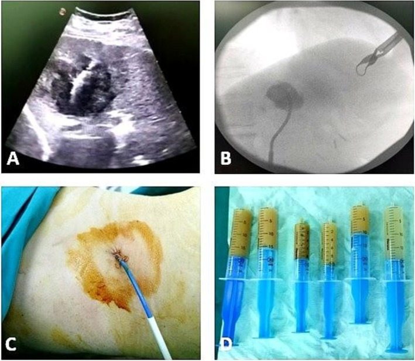
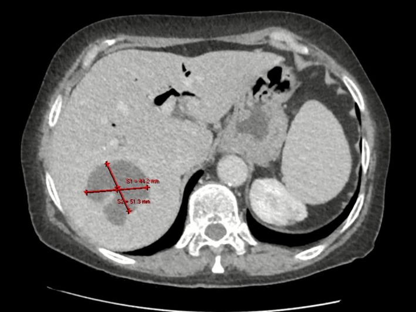
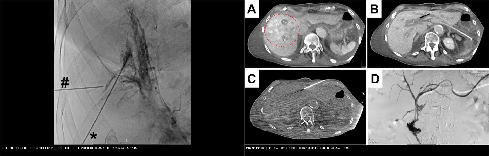
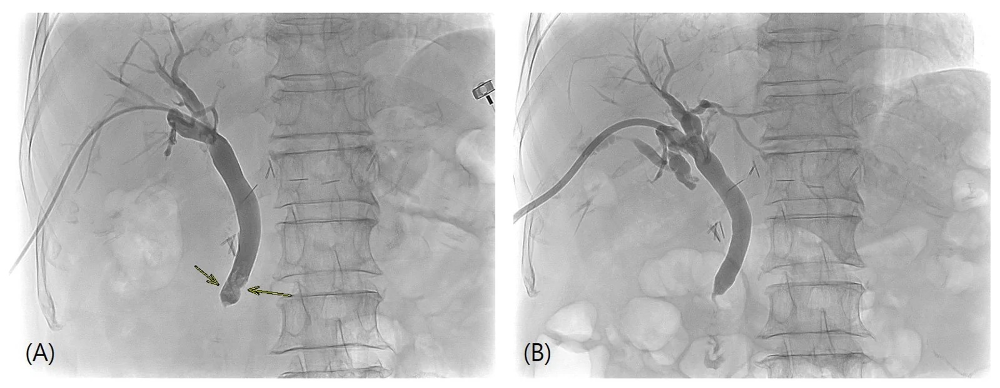
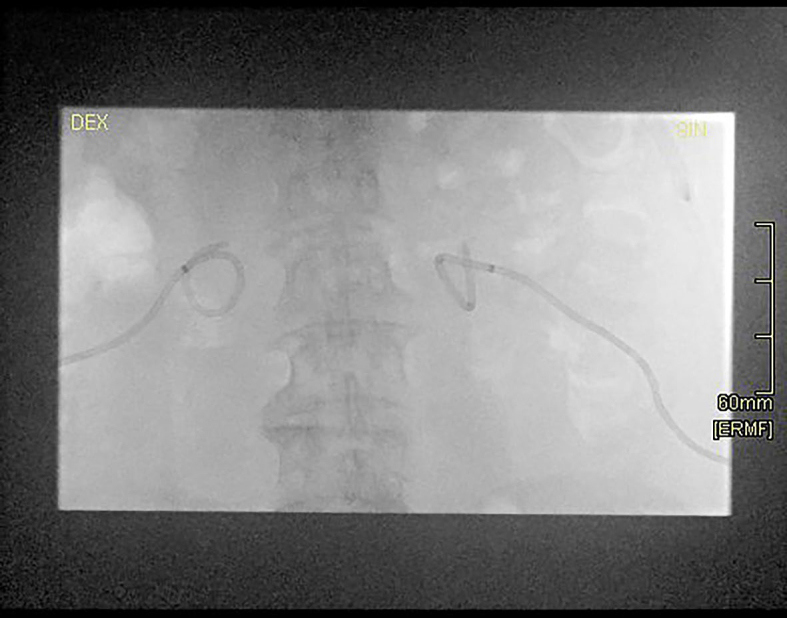
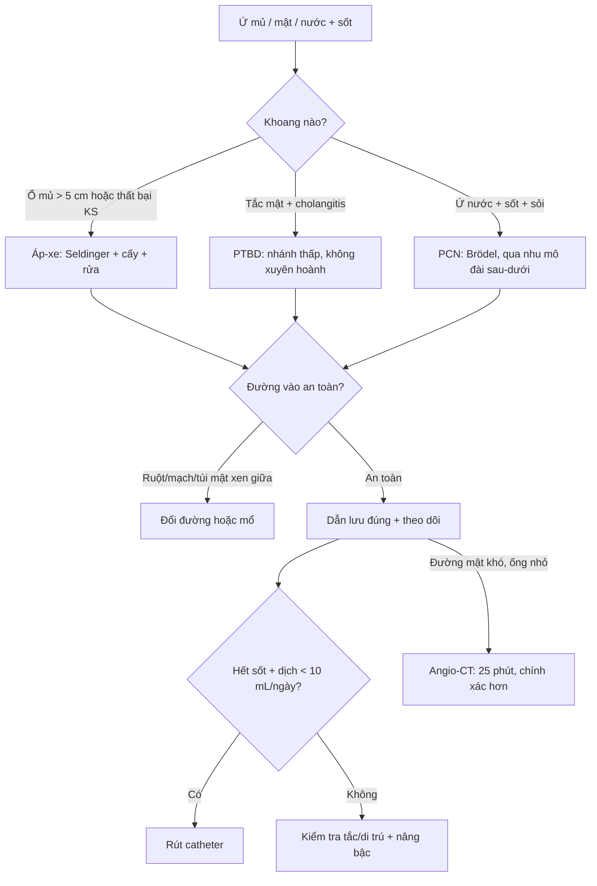
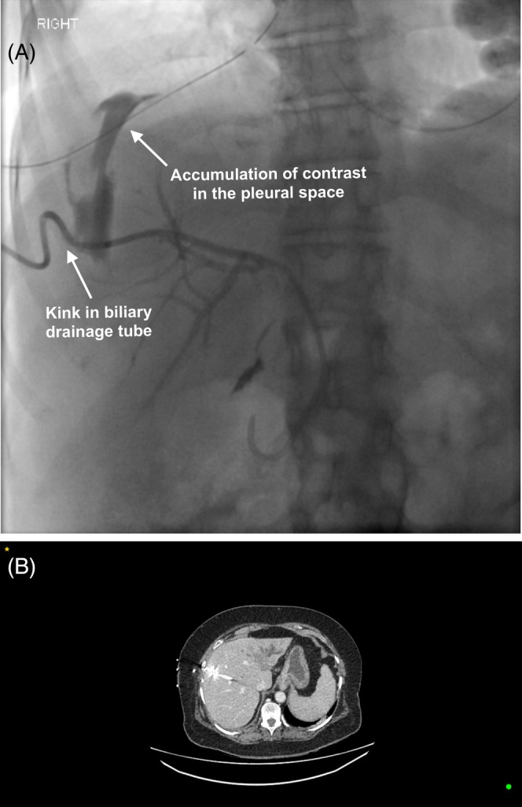

# 910 — Dẫn lưu: áp-xe, PTBD & thận qua da / Image-guided drainage (abscess, PTBD, PCN)

**Tags:** `pattern:dan-luu` `pattern:ap-xe` `vung:bung-tiet-nieu` `protocol:PTBD` `protocol:PCN` `protocol:Seldinger`
**Mức chắc chắn (certainty):** tổng hợp y văn (literature synthesis) — tự biên từ 5 nguồn mở (Asenov 2026 CC BY; Nadjiri 2026 CC BY; Kuhelj 2025 CC BY; Lee 2026 CC BY; Jayabalan 2025 CC BY-NC-ND) + các ca nguyên văn gắn ảnh.

## 1. Tổng quan — vì sao "ống thông đúng đường" an toàn hơn "đâm thẳng"

- **Ba thủ thuật dẫn lưu cùng nguyên lý, khác khoang:** **dẫn lưu ổ áp-xe** (mủ trong ổ khu trú), **PTBD** (percutaneous transhepatic biliary drainage — mật trong đường mật giãn), **PCN** (percutaneous nephrostomy — nước tiểu trong đài bể thận ứ). Cả ba đều **đặt catheter (pigtail) dưới hướng dẫn siêu âm/CT/fluoroscopy**.
- **Seldinger (kim → dây dẫn → ống) vs trocar (đâm thẳng):** TẠI SAO Seldinger **an toàn hơn ở tạng sâu/nhỏ**: dây dẫn **giữ vững đường vào** trong khi **nong dần (serial dilatation)** và **luồn ống theo dây** — giảm rách mô, giảm số lần chọc, kiểm soát được hướng. Điều này đặc biệt quan trọng khi **đường mật không giãn** (ống nhỏ cỡ kim 22G ≈ 0,7 mm) — nhiều mũi chọc tăng biến chứng (Nadjiri 2026).
- **Đài thận sau–dưới qua góc Brödel (20–30°, sau đường nách sau):** TẠI SAO **vô mạch**: nhánh **động mạch phân thùy sau** đi ở ranh giới, **chọc qua nhu mô đài sau–dưới** tránh được mạch máu lớn → ít chảy máu và ít rò nước tiểu so với **chọc thẳng bể thận** (Kuhelj 2025).
- **PTBD "sâu" là hiểm — màng phổi phản chiếu xuống thấp:** màng phổi thành–hoành **trải sâu xuống dưới bờ dưới phổi**, nhất là **phía sau và bên**. Bình thường không có khoang màng phổi ở đây (hai lá áp sát), nhưng nếu đường chọc **quá cao/xuyên qua** → **rò mật vào khoang màng phổi = biliothorax (dịch mật trong màng phổi)**. TẠI SAO: kim/catheter đi qua **màng phổi trước khi vào gan** rồi mật thấm ngược lên (Jayabalan 2025).
- **Ngưỡng định lượng (bắt buộc):**
  - **Ổ áp-xe dẫn lưu được:** điển hình **≥ 5 cm** (hoặc < 5 cm nhưng **không đáp ứng kháng sinh**); dùng **catheter pigtail** + **rửa (lavage)**; ca minh chứng **áp-xe gan 6 cm phân thùy VII** sau ERCP, dẫn lưu ra mủ *Enterococcus faecalis*, khỏi sau **10 ngày** kháng sinh (Asenov 2026).
  - **PTBD có đường mật giãn/có khí (aerobilia):** ống **≥ 1,5–2 mm mới thấy** rõ trên CT; ống nhỏ hơn cần **CT fluoroscopy động** để bắt dòng khí thoáng qua; **angio-CT** cho **thành công lấy đường mật 100% ca, thời gian can thiệp trung bình 25 phút, không biến chứng** (Nadjiri 2026).
  - **PCN:** **22,7% catheter bị di trú** trong thời gian theo dõi; **thời gian trung bình đến lần đổi ống 4,16 tháng**; **loại catheter, số mũi khâu và tuổi > 70 KHÔNG ảnh hưởng** tỷ lệ di trú (p = 0,57 / 0,34 / 0,61) (Kuhelj 2025).
  - **Rút catheter PTBD:** **rút sớm 7–10 ngày (n = 199)** vs **muộn > 10 ngày (n = 158)** sau khi giải quyết tắc mật — **không khác biệt biến chứng**, nhưng **nằm viện ngắn hơn ~5,36 ngày** (12 vs 17 ngày) (Lee 2026).
  - **Tiêu chí rút mọi catheter dẫn lưu:** **hết sốt + dịch < 10 mL/ngày trong 24–48 giờ** + cải thiện lâm sàng.

## 2. Gamut theo khoang ứ (Gamut)

- **Ổ mủ (áp-xe) + sốt + cấy:** dẫn lưu qua da (trừ **viêm ruột thừa/túi mật** — ưu tiên mổ nội soi!) — Seldinger + rửa; **áp-xe gan** hay gặp sau đường mật (ERCP, sỏi), **áp-xe ổ bụng** sau mổ.
- **Tắc mật + bilirubin cao + nhiễm trùng (cholangitis):** **PTBD** (nhánh **trái/phải thấp**, tránh xuyên hoành) — stent trong–ngoài; khi **ERCP thất bại** (hẹp rốn gan, đường mật không giãn, phẫu thuật Bilroth/ruột nối mật–ruột).
- **Ứ nước + sốt + sỏi (pyonephrosis):** **PCN** đài sau–dưới qua **Brödel** + kháng sinh (**nhiễm trùng + tắc = dẫn lưu trước!**).
- **Chọc sai khoang:** **xuyên hoành → biliothorax/tràn khí**, **chọc thẳng bể thận → rò nước tiểu + chảy máu**.

## 3. Bảng so sánh phân biệt (ma trận đối chiếu)

| Thực thể (entity) | Hình ảnh/kỹ thuật | Chốt vào (rule-in) | Chốt loại (rule-out) | Gợi ý xác nhận |
|---|---|---|---|---|
| Áp-xe dẫn lưu được | Ổ dịch **viền ngấm thuốc**, ± khí; **đường vào an toàn** trên US/CT | **Ổ ≥ 5 cm (hoặc < 5 cm thất bại kháng sinh) + Seldinger + cấy + rửa** | Ruột/túi mật/mạch xen giữa → **đổi đường** hoặc mổ | Dẫn lưu + kháng sinh định hướng |
| PTBD đúng | Nhánh mật **thấp (trái/phải dưới)**, **không xuyên hoành**; mật chảy ra | **Đường mật ≥ 1,5–2 mm + cholangiogram xác nhận + mật chảy** | Đường **quá cao + khí/dịch màng phổi** → xuyên hoành | Stent trong–ngoài; theo dõi bilirubin |
| PCN đúng | Đài **sau–dưới**, qua góc **Brödel**, qua nhu mô | **Nước tiểu chảy + hết sốt** | **Chọc thẳng bể thận** → rò/máu | Kháng sinh + tán sỏi sau |
| Chọc sai khoang | Xuyên hoành (biliothorax) / bể thận trực tiếp | **Tràn khí–mật màng phổi / máu–nước tiểu** | Xuyên đúng đường → không biến chứng | Dẫn lưu màng phổi / nút mạch – mổ |
| Catheter di trú (PCN) | Catheter **rời vị trí** trên fluoroscopy, mất chức năng | **22,7% di trú, trung bình 4,16 tháng** | Còn đúng vị trí → tiếp tục | Không phụ thuộc loại ống/số mũi khâu |

*Trái: CT bụng cản quang — ổ áp-xe gan thùy phải **44 × 51 mm**, viền ngấm thuốc. Phải: siêu âm ngày 3 sau dẫn lưu — catheter đúng vị trí, **ổ áp-xe thu nhỏ**. Nguồn: Asenov Y et al., Clin Case Rep 2026 (PMC12765663), CC BY 4.0. Ảnh ghép letterbox.*

*(A) Siêu âm: kim vào giữa ổ áp-xe. (B) Fluoroscopy: xác nhận catheter pigtail đúng vị trí. (C) Catheter ra da + gạc mật. (D) Các bơm hút mủ. Nguồn: Asenov Y et al., Clin Case Rep 2026 (PMC12765663), Fig. 2, CC BY 4.0.*

*CT cản quang: ổ áp-xe gan **44 × 51 mm** phân thùy VII — chỉ định dẫn lưu qua da (đo kích thước > 5 cm + không đáp ứng kháng sinh). Nguồn: Asenov Y et al. (PMC12765663), Fig. 1, CC BY 4.0.*

## 4. Protocol dẫn lưu + ngưỡng theo dõi + flowchart

- **Chuẩn bị & kỹ thuật:** **siêu âm/CT (hoặc angio-CT) dẫn đường**; ưu tiên **Seldinger**; **cấy dịch** + **rửa ổ** sau dẫn lưu; kháng sinh theo cấy.
- **Luật "thấp và trong nhu mô":** **PTBD nhánh thấp** (tránh ngách sườn–hoành); **PCN qua nhu mô đài sau–dưới** (góc Brödel) — không bao giờ chọc thẳng bể thận.
- **Theo dõi & rút:** rút khi **hết sốt + dịch < 10 mL/ngày (24–48 giờ)**; với PTBD trong viêm đường mật, **rút sớm 7–10 ngày an toàn và rút ngắn nằm viện ~5,36 ngày** (Lee 2026); PCN/PTBD có thể **thay/thay định kỳ** (PCN trung bình đổi ở 4,16 tháng) (Kuhelj 2025).
- **Khi đường mật khó (không giãn + có khí):** **angio-CT** (tích hợp CT + fluoroscopy một phòng) giúp thấy ống nhỏ, rút ngắn thời gian (25 phút), tăng độ chính xác (Nadjiri 2026).

*Trái: PTBD đường thường quy **thất bại** — đường mật không giãn cỡ kim 22G, nhiều mũi chọc, thuốc cản quang lan tỏa. Phải: **thành công bằng angio-CT** — A/B CT lập kế hoạch + C kim trong đường mật + D cholangiogram (PTBD). Nguồn: Nadjiri J et al., Abdom Radiol 2026 (PMC13269293), CC BY 4.0. Ảnh ghép letterbox.*

*Cholangiogram qua PTBD: (A) lần đầu — khuyết thiếu trong lòng đường mật (mũi tên, sỏi/khối). (B) kiểm tra lại sau can thiệp. Nguồn: Lee JM et al., J Clin Med 2026 (PMC13607037), CC BY 4.0.*

*Fluoroscopy: **catheter PCN loop đúng vị trí hai bên** dù chỉ khâu cố định bên phải không giữ (minh họa catheter type/số mũi khâu không quyết định di trú). Nguồn: Kuhelj D et al., Radiol Oncol 2025 (PMC12707554), CC BY 4.0.*

## 5. Biến thể bình thường và cạm bẫy

- **PTBD cao xuyên hoành → biliothorax:** màng phổi phản chiếu **xuống thấp phía sau/bên**; rò mật vào màng phổi gây **tràn dịch–khí màng phổi**. Luôn **đánh giá màng phổi trước chọc** và chọn **nhánh thấp**.

*(A) Tubogram: **gấp ống dẫn lưu mật (kink)** + **thuốc cản quang tích tụ trong khoang màng phổi** (mũi tên). (B) CT ngang: vị trí ống dẫn lưu mật. Nguồn: Jayabalan D et al., Respirol Case Rep 2025 (PMC12230195), Fig. 2, **CC BY-NC-ND 4.0 — giữ nguyên bản**.*

- **Chọc thẳng bể thận → rò nước tiểu + chảy máu:** luôn **qua nhu mô đài sau–dưới** (Brödel); nếu chảy máu → **ép/nút mạch**.
- **Nhiễm trùng + tắc mà chỉ kháng sinh, không dẫn lưu = sốc nhiễm trùng:** **dẫn lưu TRƯỚC, kháng sinh sau!** (pyonephrosis, cholangitis mủ).
- **Cạm bẫy "catheter nhìn đúng nhưng không chức năng":** luôn đối chiếu **lượng dịch + lâm sàng (hết sốt)**; PCN di trú thường gặp (**22,7%**) và **không loại trừ được bằng loại ống/số mũi khâu** (Kuhelj 2025) — theo dõi bằng chức năng, không chỉ hình ảnh.
- **Cạm bẫy mặt cắt:** ổ dịch cạnh cơ hoành — phân biệt **màng phổi vs dưới hoành vs trong gan** bằng **dấu crus lệch, dấu bare area, vị trí tương quan**; tránh nhầm **màng phổi** thành **gan** khi lập kế hoạch đường vào.

## 6. Tự lượng giá — Blind Quiz

**Ca 1 — Bệnh nhân 72 tuổi sau ERCP (lấy sỏi + cắt cơ vòng) sốt cao trong 48 giờ. CT bụng dưới đây — findings, chẩn đoán và xử trí?**

- Hỏi: mô tả ổ dịch (kích thước, vị trí)? Dẫn lưu được không? Bước tiếp theo?

<b>Bấm để hiện đáp án (findings + chẩn đoán)</b>

- Dấu hiệu (findings): **ổ áp-xe gan phân thùy VII, 44 × 51 mm (≈ 6 cm)**, viền ngấm thuốc, sau ERCP.
- Chẩn đoán (diagnosis): **áp-xe gan mủ sau ERCP** (biến chứng hiếm) — dẫn lưu qua da dưới hướng dẫn siêu âm, mủ *Enterococcus faecalis*, khỏi sau 10 ngày kháng sinh.
- Xử trí: **dẫn lưu qua da (catheter pigtail) + cấy + kháng sinh định hướng**; theo dõi siêu âm.
- Nguồn ảnh: Asenov Y et al., Clin Case Rep 2026 (PMC12765663), Fig. 1, CC BY 4.0.

**Ca 2 — Bệnh nhân vàng da tắc mật, đường mật KHÔNG giãn, ERCP thất bại. Nhìn hình PTBD, cách nào giúp thành công?**

- Hỏi: vì sao đường thường quy thất bại? Cách nào giúp thấy ống nhỏ? Ngưỡng kích thước ống nhìn thấy trên CT?

<b>Bấm để hiện đáp án (findings + chẩn đoán)</b>

- Dấu hiệu (findings): trái — nhiều mũi chọc, cản quang lan tỏa vì **đường mật không giãn (cỡ kim 22G)**; phải — **angio-CT** lập kế hoạch + cholangiogram, PTBD đặt được.
- Chốt (clincher): **đường mật ≥ 1,5–2 mm mới thấy rõ trên CT**; ống nhỏ hơn cần **CT fluoroscopy động** để bắt dòng khí; angio-CT: **thành công 100%, 25 phút, không biến chứng**.
- Nguồn ảnh: Nadjiri J et al., Abdom Radiol 2026 (PMC13269293), Fig. 2 & 3, CC BY 4.0.

**Ca 3 — Bệnh nhân ung thư đường mật đặt PTBD, sau đó khó thở. Xem tubogram + CT — sai ở đâu?**

- Hỏi: dịch ở khoang nào? Tại sao PTBD lại gây tràn màng phổi? Xử trí?

<b>Bấm để hiện đáp án (findings + chẩn đoán)</b>

- Dấu hiệu (findings): tubogram — **gấp ống (kink) + thuốc cản quang tích tụ trong khoang màng phổi**; CT xác nhận vị trí ống.
- Chẩn đoán (diagnosis): **biliothorax (dịch mật trong màng phổi)** — đường chọc **quá cao/xuyên màng phổi** vì màng phổi phản chiếu **xuống thấp phía sau/bên**.
- Xử trí: **dẫn lưu màng phổi + chỉnh/hạ đường PTBD (nhánh thấp)**; phòng bằng đánh giá màng phổi trước chọc.
- Nguồn ảnh: Jayabalan D et al., Respirol Case Rep 2025 (PMC12230195), Fig. 2, CC BY-NC-ND 4.0 (giữ nguyên bản).

**Ca 4 — Bệnh nhân PCN hai bên: catheter nhìn đúng trên fluoroscopy. Có cần lo lắng di trú không, dựa vào đâu?**

<b>Bấm để hiện đáp án (findings + chẩn đoán)</b>

- Dấu hiệu (findings): **catheter PCN loop đúng vị trí hai bên**; một bên chỉ khâu không giữ da.
- Chốt (clincher): **loại catheter, số mũi khâu và tuổi > 70 KHÔNG ảnh hưởng** di trú (p > 0,05); **22,7% PCN di trú, trung bình đổi lúc 4,16 tháng** → theo dõi bằng **chức năng (dịch + hết sốt)**, không chỉ hình ảnh.
- Nguồn ảnh: Kuhelj D et al., Radiol Oncol 2025 (PMC12707554), Fig. 2, CC BY 4.0.

## Bài liên quan chéo
- [901 – Tổng quan IR](../901-ir-overview/lesson.md)
- [900 – Đại cương IR](../900-ir-fundamentals-biopsy/lesson.md) (an toàn)
- [920 – Nút mạch](../920-vascular-embolization-gi-bleed/lesson.md) (xử trí chảy máu sau chọc)
- [152 – Sỏi niệu](../152-soi-nieu/lesson.md) (nhiễm trùng + tắc → PCN)
- [131 – Tắc mật](../131-tac-mat/lesson.md) · [132 – Hẹp đường mật không xác định](../132-hop-duong-mat-khong-xac-dinh/lesson.md) (PTBD)

## Ảnh
- `910_apxe-gan_CT_PMC12765663-CCBY.jpg`, `910_dan-luu-apxe_US-XQ_PMC12765663-CCBY.jpg`, `910_dan-luu-apxe-sau_US_PMC12765663-CCBY.jpg`, `composite_dan-luu-apxe_CT-vs-sau-US.jpg` — CC BY 4.0, Asenov Y et al., Clin Case Rep 2026 (PMC12765663).
- `910_ptbd_CT-PTBD_PMC13269293-CCBY.jpg`, `910_ptbd-that-bai_CT_PMC13269293-CCBY.jpg`, `composite_ptbd_that-bai-vs-thanh-cong.jpg` — CC BY 4.0, Nadjiri J et al., Abdom Radiol 2026 (PMC13269293).
- `910_pcn_XQ_PMC12707554-CCBY.jpg` — CC BY 4.0, Kuhelj D et al., Radiol Oncol 2025 (PMC12707554).
- `910_ptbd_cholangiogram_PMC13607037-CCBY.jpg` — CC BY 4.0, Lee JM et al., J Clin Med 2026 (PMC13607037).
- `910_biliothorax_XQ-CT_PMC12230195-CCBYNCND.jpg` — CC BY-NC-ND 4.0, Jayabalan D et al., Respirol Case Rep 2025 (PMC12230195). **Giữ nguyên bản, không ghép.**
- Chi tiết giấy phép từng ảnh trong `images/CREDITS.md`.

> Không dùng để chẩn đoán độc lập khi chưa có người hướng dẫn.
