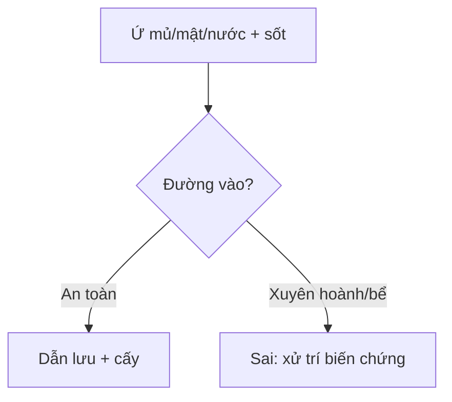

# 910 — Dẫn lưu: áp-xe, PTBD & thận qua da / Drainage

**Tags:** `pattern:dan-luu` `vung:bung-tiet-nieu`
**Mức chắc chắn (certainty):** tổng hợp y văn (literature synthesis) — nhóm tự biên từ y văn mở, chưa gắn ca nguyên văn đơn lẻ.

## 1. Tổng quan — Seldinger an toàn + Brödel vô mạch + xuyên hoành là hiểm

- Seldinger (kim-dây-ống) vs trocar (đâm thẳng) — TẠI SAO Seldinger an toàn hơn tạng sâu: dây dẫn giữ đường, nong dần, ít rách.
- Đài thận sau-dưới qua góc Brödel (20–30° sau nách sau) — TẠI SAO vô mạch: vào đài sau tránh nhánh phân thùy sau ĐM thận.
- PTBD nhánh phải quá cao xuyên ngách sườn-hoành — TẠI SAO biliothorax/tràn khí: kim đi qua màng phổi trước khi vào gan.

## 2. Gamut ứ mủ/ứ mật/ứ nước (Gamut)

- **Ổ áp-xe + sốt + cấy:** dẫn lưu qua da (trừ ruột thừa/túi mật mổ được!) — Seldinger + rửa.
- **Tắc mật + bilirubin cao + nhiễm trùng:** PTBD (trái/phải thấp!) — stent trong-ngoài.
- **Ứ nước + sốt + sỏi:** PCN đài sau-dưới — Brödel + kháng sinh (nhiễm trùng + tắc = dẫn lưu trước!).
- **Chọc bể thận trực tiếp:** rò nước tiểu + máu lớn — luôn qua nhu mô đài!

## 3. Bảng so sánh phân biệt (ma trận đối chiếu)

| Thực thể (entity) | Hình ảnh/kỹ thuật | Chốt vào (rule-in) | Chốt loại (rule-out) | Gợi ý xác nhận |
|---|---|---|---|---|
| Áp-xe dẫn lưu được | **Ổ dịch + viền + an toàn đường vào** | **Seldinger + cấy + rửa** | Ruột xen → đổi đường | Dẫn lưu + KS |
| PTBD đúng | **Nhánh thấp + không xuyên hoành** | **Trái/phải thấp + mật chảy** | Cao + tràn khí → xuyên hoành | Stent + theo dõi |
| PCN đúng | **Đài sau-dưới + Brödel + qua nhu mô** | **Nước tiểu + hết sốt** | Bể trực tiếp → rò/máu | Kháng sinh + tán sỏi sau |
| Chọc sai | **Xuyên hoành/bể trực tiếp** | **Tràn khí/máu/nước tiểu** | Đúng đường → không biến chứng | Dẫn lưu màng phổi/mổ |

## 4. Protocol dẫn lưu

- **Siêu âm/CT dẫn đường + Seldinger + cấy + rửa** khi ứ mủ/mật/nước + sốt; Brödel + nhánh thấp là luật; rút dẫn lưu khi hết sốt + dịch < 10 mL/ngày trong 24–48 giờ.

## 5. Cạm bẫy

- **PTBD cao xuyên hoành** biliothorax — nhánh thấp + siêu âm màng phổi trước chọc.
- **Chọc bể thận trực tiếp** rò + máu — Brödel qua nhu mô đài sau-dưới.
- **Nhiễm trùng + tắc chỉ kháng sinh** không dẫn lưu = sốc — dẫn lưu trước, kháng sinh sau!

## 6. Tự lượng giá — Blind Quiz

**Ca 1 — Tắc mật + sốt + PTBD nhánh phải cao, sau đó khó thở + tràn khí:** sai ở đâu? Xử trí? *(Bảng mục 3.)*

<b>Bấm để hiện đáp án</b>

- **Xuyên ngách sườn-hoành (biliothorax + tràn khí):** dẫn lưu màng phổi + hạ thấp đường PTBD (nhánh thấp!).

**Ca 2 — Ứ nước + sốt + chọc thẳng bể thận + máu nhiều:** sai gì? *(Bảng mục 3.)*

<b>Bấm để hiện đáp án</b>

- **Chọc bể trực tiếp:** Brödel qua nhu mô đài sau-dưới + ép/nút mạch khi chảy máu.

## Bài liên quan chéo
- [901 – Tổng quan IR](../901-ir-overview/lesson.md)
- [900 – Đại cương IR](../900-ir-fundamentals-biopsy/lesson.md) (an toàn)
- [152 – Sỏi niệu](../152-soi-nieu/lesson.md) (nhiễm trùng + tắc)

> Không dùng để chẩn đoán độc lập khi chưa có người hướng dẫn.
