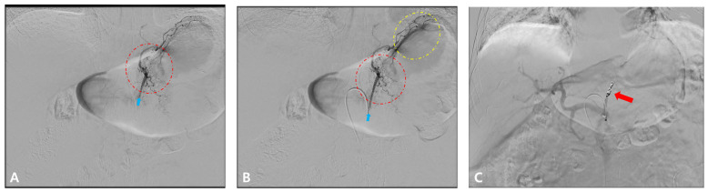

# 920 — Nút mạch cầm máu: thoát hoạt tính vs giả phình / Embolization

**Tags:** `pattern:nut-mach` `vung:mach-mau` `protocol:CTA-DSA`
**Mức chắc chắn (certainty):** tổng hợp y văn (literature synthesis) — nhóm tự biên từ y văn mở, chưa gắn ca nguyên văn đơn lẻ.

## 1. Tổng quan — đổi hình là đang chảy, giữ hình là túi cũ

- Thoát hoạt tính: thuốc ra ngoài lòng mạch lan theo mô — TẠI SAO **đổi hình + lan thì muộn**: máu tiếp tục chảy sau thì động mạch.
- Giả phình: túi thông lòng mạch — TẠI SAO **giữ hình + rửa song hành ĐMC**: thuốc vào-ra cùng nhịp mạch chủ.
- Ngưỡng thấy: CTA **0,3–0,5 mL/phút** nhạy hơn DSA **0,5–1,0** — TẠI SAO CTA trước DSA: thấy chảy chậm + bản đồ đường vào.

## 2. Gamut chảy máu cấp (Gamut)

- **Đổi hình + lan muộn + tụt HA:** thoát hoạt tính — nút mạch chọn lọc cấp cứu.
- **Giữ hình + rửa cùng ĐMC:** giả phình — coil/bơm tắc túi (kể cả khi đã cầm!).
- **Sỏi/clip/phân + chỉ 1 thì:** giả thoát — đối chiếu non-contrast, đừng nút oan.
- **Ho lạc chỗ/vú trong ho máu:** tìm mạch lạc chỗ — CT ngực + DSA phế quản.

## 3. Bảng so sánh phân biệt (ma trận đối chiếu)

| Thực thể (entity) | Hình ảnh điển hình | Chốt vào (rule-in) | Chốt loại (rule-out) | Gợi ý xác nhận |
|---|---|---|---|---|
| Thoát hoạt tính | **Đổi hình + lan thì muộn + tụt HA** | **CTA 0,3 + lan = đang chảy** | Giữ hình → giả phình | Nút mạch cấp cứu |
| Giả phình | **Túi giữ hình + rửa cùng ĐMC** | **Cùng nhịp ĐMC + cổ túi** | Lan muộn → thoát | Coil tắc túi/cổ |
| Giả thoát | **Sỏi/clip/phân + 1 thì + không lan** | **Non-contrast có sẵn** | 3 pha đều lan → thật | Đối chiếu, không nút |
| Ho máu | **Phế quản + lạc chỗ/vú trong** | **Tìm hết mạch nuôi** | Bỏ sót → tái phát | Nút + mổ khi thất bại |


*(A–B) chọn lọc nhánh trái + điểm chảy; (C) tắc sau nút. Nguồn: Jeong et al., Cancers 2026 Fig. 3, CC BY 4.0.*

## 4. Protocol chảy máu

- **CTA 3 pha (non-contrast bắt buộc!) + DSA + nút chọn lọc** (coil/hạt/keo) + hồi sức song song; ho máu thêm CT ngực tìm lạc chỗ.

```mermaid
flowchart TD
  A[Chảy máu cấp] --> B{CTA 3 pha?}
  B -->|Đổi hình + lan| C[Thoát: nút cấp cứu]
  B -->|Giữ hình| D[Giả phình: coil túi]
  B -->|1 thì (sỏi/clip)| E[Giả: không nút]
```

## 5. Cạm bẫy

- **Bỏ non-contrast** nút oan sỏi/clip/phân — 3 pha là luật.
- **Giả phình đã cầm vẫn vỡ muộn** — túi còn là còn nguy cơ, tắc chủ động.
- **Ho máu bỏ sót lạc chỗ** tái phát — vú trong + liên sườn + dưới hoành đều có thể nuôi.

## 6. Tự lượng giá — Blind Quiz

**Ca 1 — K dạ dày nôn máu + tụt HA. Đọc DSA.**


- Hỏi: nút mạch gì? Thành công đánh giá thế nào? Bước tiếp nếu tái phát?

<details><summary><b>Bấm để hiện đáp án</b></summary>

- Dấu hiệu (findings): chọn lọc nhánh vị trái + mất điểm chảy sau nút (C).
- Chẩn đoán (diagnosis): **TAE cầm máu u thành công** — theo dõi tái phát (nội soi/xạ/mổ khi thất bại; cầm máu là cầu nối hóa trị!).
- Nguồn: Jeong et al., Fig. 3, CC BY 4.0.
</details>

**Ca 2 — Điểm sáng ruột chỉ 1 thì + sỏi niệu quản cùng vị trí non-contrast:** thoát hay sỏi? *(Bảng mục 3.)*

<details><summary><b>Bấm để hiện đáp án</b></summary>

- **Sỏi (giả thoát):** không nút — đối chiếu non-contrast là luật.
</details>

## Bài liên quan chéo
- [901 – Tổng quan IR](../901-ir-overview/lesson.md)
- [900 – Đại cương IR](../900-ir-fundamentals-biopsy/lesson.md) (an toàn)
- [140 – Chấn thương tạng](../140-lach-tang-dac/lesson.md) (thoát thuốc)

> Không dùng để chẩn đoán độc lập khi chưa có người hướng dẫn.
