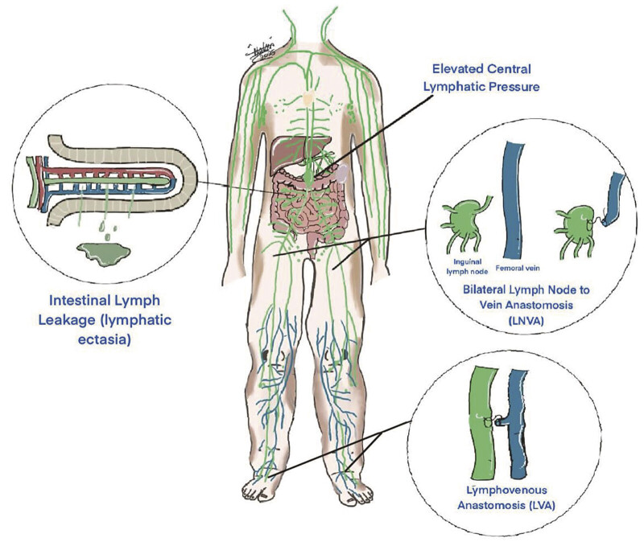
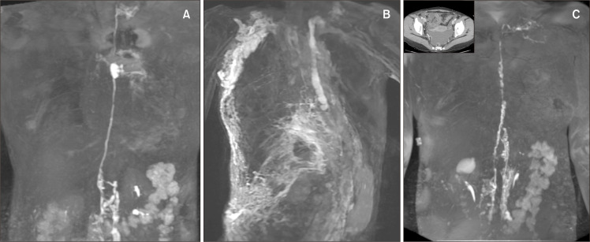
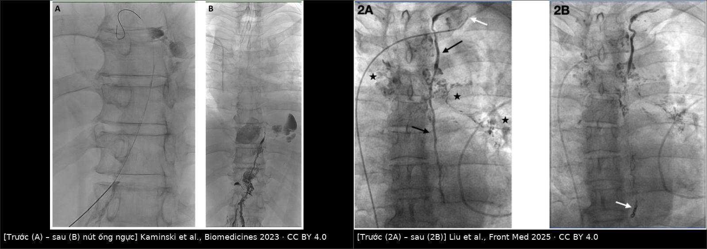
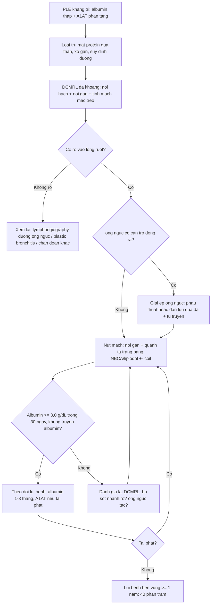
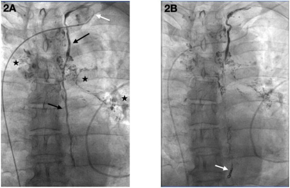

# 921 — Nút mạch bạch huyết qua da & giải ép ống ngực trong PLE kháng trị / Percutaneous lymphatic embolization and thoracic duct decompression in refractory protein-losing enteropathy

**Tags:** `pattern:ro-bach-huyet` `pattern:giam-albumin` `vung:bach-huyet` `vung:bung` `vung:nguc` `protocol:DCMRL` `protocol:lymphangiography`
**Mức chắc chắn (certainty):** tổng hợp y văn (literature synthesis) — ghép 2 nghiên cứu can thiệp có số liệu định lượng (JACC 2026: 71 ca PLE ở bệnh tim bẩm sinh; Biomedicines 2023: 78 ca rò dưỡng trấp bụng–ngực) + 2 bài tổng quan (Ann Pediatr Cardiol 2026; Vasc Specialist Int 2023) + 1 loạt ca giải ép ống ngực (JTCVS Tech 2025). Không có ca nguyên văn riêng của nhóm.

## 1. Tổng quan — protein mất qua ruột xảy ra khi áp lực bạch huyết trung tâm vượt "van" của ống ngực; TẠI SAO lipiodol và DCMRL nhìn thấy đường rò

- **Định nghĩa PLE (protein-losing enteropathy, mất protein qua ruột)** theo đồng thuận quốc tế (trích trong Ann Pediatr Cardiol 2026): mất protein qua ruột tăng, đo bằng **α1-antitrypsin (A1AT) phân: spot > 54 mg/dL; độ thanh thải > 27 mL/24 h khi không tiêu chảy và > 56 mL/24 h khi có tiêu chảy**; hoặc bằng **99mTc-albumin**. Kèm **albumin < 3,5 g/dL + protein toàn phần < 6 g/dL** và **≥ 1** biểu hiện: phù, chướng bụng, tiêu chảy, tràn dịch (cổ trướng/màng phổi/màng tim).
- **Dịch tễ:** PLE gặp ở **~12%** bệnh nhân tuần hoàn Fontan; **sống 5 năm tính từ đợt PLE đầu tiên 88%**; cung lượng tim ở Fontan **giảm 20–50%** so với bình thường. Đây là bệnh cảnh **suy dinh dưỡng – suy miễn dịch – phù** tiến triển, không phải "phù do tim" đơn thuần.
- **Cơ chế (tại sao lại rò vào ruột):** áp lực tĩnh mạch trung tâm (CVP) cao mạn tính + cản trở dòng ra của ống ngực → **áp lực bạch huyết trung tâm tăng** → vừa **tăng sản xuất lymph** (ứ gan, ứ tạng) vừa **mở các nhánh bạch huyết bất thường về nơi có áp lực thấp nhất = lòng ruột**. Dịch thoát vào lòng ruột giàu **albumin, globulin, immunoglobulin, lymphocyte** → giảm albumin, giảm IgG, tiêu chảy, phù, nhiễm trùng. Nội soi đã chứng minh trực tiếp: bơm cản quang vào **hạch bạch huyết gan** thấy dịch bạch huyết chảy vào **tá tràng**.
- **TẠI SAO đích nút phải gồm cả "quanh tá tràng", không chỉ trong gan:** trên **DCMRL đa khoang** (nội hạch + nội gan + tĩnh mạch mạc treo), **rò tá tràng được thấy ở 100% (71/71)** bệnh nhân PLE kháng trị; nút **chỉ trong gan** đạt đáp ứng ban đầu **41%**, còn **trong gan + quanh tá tràng** đạt **87%**. Nguồn rò vì vậy là **hệ bạch huyết ruột–gan**, không phải một ống gan đơn lẻ.
- **TẠI SAO DCMRL thấy được đường rò:** gadolinium rút ngắn **T1** → tăng tín hiệu trên chuỗi **T1 fat-sat**; tiêm vào **nút bạch huyết (nội hạch), nhu mô gan (nội gan) hoặc tĩnh mạch mạc treo** rồi chụp **động từng 30–60 giây**. Lymph chảy chậm nên ảnh động cho thấy **hướng chảy, nhánh bất thường, thuốc vào lòng ruột** — thứ mà CT/MRI tĩnh không thấy.
- **TẠI SAO lipiodol vừa là "thuốc cản quang" vừa là "thuốc chữa":** lipiodol là **dầu iod hóa, không tan trong nước** nên **không bị pha loãng** trong lòng mạch bạch huyết, giữ nguyên dạng **giọt dầu đậm đặc** và lưu lại **nhiều giờ đến nhiều ngày** — cho phép chụp X-quang/fluoroscopy rồi **CT trễ 1–24 giờ** để tìm chỗ rò. Bản thân lymphangiography bằng lipiodol đã làm ngừng một phần rò (hiệu ứng "tamponade" tại chỗ), nhưng **chỉ đạt 44,8%** so với **91,8%** khi có nút mạch.
- **TẠI SAO nút bằng keo + coil:** **NBCA (n-butyl cyanoacrylate)** trùng hợp khi gặp dịch có ion → đúc thành **cast** bịt chỗ rò; trộn với lipiodol **1:1–1:5** để làm chậm trùng hợp và cản quang; **coil** dùng cho **mạch bạch huyết lớn (ống ngực)** để chống trôi vật liệu. Hệ quả sinh hóa khi bịt được đường rò: **albumin trung vị 2,3 → 4,2 g/dL**.

*Cơ chế PLE do bạch huyết: áp lực trung tâm cao → lymph thoát vào lòng ruột (intestinal lymph leakage/lymphatic ectasia); các đường giải ép phẫu thuật (LVA chi dưới, LNVA bẹn) dẫn lymph về tĩnh mạch. Hình minh họa của Mortada H et al., Arch Plast Surg 2026 (PMC13461259), CC BY 4.0.*

## 2. Mẫu hình + chọn đích can thiệp theo vị trí (gamut)

### 2a. Theo vị trí rò trên DCMRL — quyết định "nút ở đâu"

- **Nội gan (intrahepatic, IH):** nhánh bạch huyết gan đổ thẳng vào tá tràng/ruột non; hình ảnh **thuốc từ gan chảy xuống lòng tá tràng** thì động. Nút **chỉ IH**: đáp ứng ban đầu **41%**, **tái phát 100%**, lui bệnh bền vững **11%** — vì còn nguồn rò ngoài gan.
- **Quanh tá tràng (periduodenal, PD):** nhánh từ **mạc treo/tá tràng** đổ vào lòng ruột; thường **kết hợp** với IH trong cùng bệnh nhân → **IH + PD** là chiến lược cho kết quả tốt hơn.
- **Ống ngực / trung thất:** rò dưỡng trấp màng phổi, màng tim, **plastic bronchitis**; đích là **nút ống ngực (TDE)** hoặc nhánh bên.
- **Đa khoang (multicompartment):** phối hợp nhiều tầng (gan, ruột, phổi, màng tim) — cần **DCMRL đa khoang** trước khi quyết định, không nút "mò".

### 2b. Gamut "phù + albumin thấp" — PLE không phải chẩn đoán duy nhất

- **Mất protein qua ruột thật:** PLE sau Fontan, **lymphangiectasia ruột nguyên phát**, viêm ruột/celiac, nhiễm ký sinh trùng, tăng áp lực tĩnh mạch cửa.
- **Mất protein qua thận:** hội chứng thận nhiễm mỡ (protein niệu > 3,5 g/ngày).
- **Giảm tổng hợp:** xơ gan, suy dinh dưỡng nặng.
- **Phù do tim/gan:** CVP cao nhưng **A1AT phân bình thường** — đây là chốt loại PLE.
- **Suy giảm miễn dịch:** giảm IgG + lympho do mất lymph (bộ ba phù – albumin thấp – giảm IgG) — xem bài 6158.

### 2c. Gamut "dịch dưỡng trấp" — dịch sữa không đồng nghĩa dưỡng trấp

- **Dưỡng trấp thật:** **triglyceride dịch > 110 mg/dL**, **cholesterol < 50 mg/dL**, **tỷ lệ cholesterol/triglyceride < 1**, lympho ưu thế.
- **Giả dưỡng trấp (pseudo-chyle):** cholesterol cao, tỷ lệ ≥ 1 — dịch do viêm/ung thư, không phải lymph; **nút mạch bạch huyết vô ích**.
- **Dịch trong (nhịn ăn):** mất chylomicron → TG thấp; **không loại trừ rò ống ngực**, cần DCMRL/lymphangiography.

*A: thấm bạch huyết bất thường vào trung thất (tràn dưỡng trấp màng tim) — nút ống ngực thành công. B: hội chứng Noonan, nhánh bạch huyết thành ngực qua tuần hoàn bàng hệ — nút nhánh bàng hệ thành công. C: ống ngực giãn ngoằn ngoèo nhưng **không có thấm bất thường ra phổi** — nút ống ngực **thất bại**, phải mổ. Nguồn: Hur S, Vasc Specialist Int 2023 (PMC10754830) Fig. 4, CC BY-NC 4.0.*

## 3. Bảng so sánh phân biệt (ma trận đối chiếu)

| Thực thể (entity) | Hình ảnh / đặc điểm điển hình | Chốt vào (rule-in) | Chốt loại (rule-out) | Gợi ý xác nhận |
|---|---|---|---|---|
| **Nút nội gan đơn thuần (IH)** | DCMRL: thuốc từ nhánh gan chảy vào tá tràng; không thấy nhánh quanh tá tràng | **Rò gan–ruột trên DCMRL nội gan** | Có nhánh mạc treo/tá tràng cùng lúc → **không đủ, phải nút thêm PD** | Đáp ứng 30 ngày (albumin ≥ 3,0 g/dL); tái phát ~100% nếu bỏ sót PD |
| **Nút nội gan + quanh tá tràng (IH + PD)** | Hai ổ rò cùng bệnh nhân; nút cả hai đích trong 1–2 thì | **Rò tá tràng + rò gan trên DCMRL đa khoang** | Chỉ một đích rõ → nút đơn đích là đủ | Đáp ứng **87%**, lui bệnh ≥ 1 năm **40%**, tái phát **45%** |
| **Nút ống ngực (TDE)** | Lymphangiography: ống ngực đứt/rò, thuốc tràn ra ngoài; sau nút thấy **coil + cast keo**, hết tràn thuốc | **Rò trực tiếp từ ống ngực/ống bạch huyết lớn** | Ống ngực **không thấy** hoặc rò từ nhánh nhỏ → chọn nút nhánh/nội gan | Thành công lâm sàng **91,8%** (so với XRL đơn thuần 44,8%) |
| **Giải ép ống ngực (TDD, phẫu thuật)** | Không cần hình ảnh đích; chỉ định khi **cản trở dòng ra** của ống ngực | **CVP cao + ống ngực tắc/hẹp + PLE kháng trị** | Không có cản trở dòng ra → không có gì để "giải ép" | Loạt 5 ca: hết triệu chứng, ngừng thuốc, không biến chứng nặng; **theo dõi ≤ 12 tháng**, chọn bệnh nhân chức năng thất tốt |
| **Dẫn lưu ống ngực qua da + tự truyền lại** | Catheter trong ống ngực, dịch dẫn ra rồi truyền lại tĩnh mạch | **Suy bạch huyết đa khoang + CVP cao (trung vị 15,5 mmHg)** | Nhiễm trùng huyết/không còn đường vào → không đặt | 8 ca: **87,5% sống tới khi rút catheter**, tự truyền **11,5 ngày**, creatinin **0,63 → 0,36 mg/dL** |
| **Nối bạch huyết–tĩnh mạch (LVA/LNVA)** | Siêu âm/lymphoscintigraphy: ứ trệ, dermal backflow; mổ nối vi phẫu | **Ứ trệ ngoại vi + còn mạch bạch huyết nối được** | Ống ngực tắc hoàn toàn/bụng đầy lymph → khó nối | Xem bài 6158 (albumin 1,5 → 3,2 g/dL, tái phát sau 3 năm) |
| **Chỉ lymphangiography (XRL) bằng lipiodol** | Thuốc đọng trong ống/nút; có thể tự cầm rò một phần | **Rò nhỏ, một nhánh, không có túi giả bạch huyết** | Rò lưu lượng lớn/túi giả → cần nút | **44,8%** thành công — không thay thế nút khi có chỉ định |
| **Tràn dịch giả dưỡng trấp** | Dịch đục nhưng **cholesterol cao, chol/TG ≥ 1** | Bệnh cảnh viêm/ung thư, không có rò lymph trên DCMRL | **TG > 110 mg/dL + chol < 50 + lympho ưu thế** → dưỡng trấp thật | Đừng nút mạch bạch huyết khi chưa loại giả dưỡng trấp |

*Trái: ống ngực bị đứt ở ngực dưới, cản quang thoát ra ngoài (A) → sau nút bằng micro-coil + NBCA/lipiodol 1:2, rò ngừng ngay (B). Phải: rò ống ngực vào nhu mô phổi + màng tim (2A, dấu hoa thị) → sau nút, cast coil + keo bịt kín (2B). Nguồn: Kaminski LC et al., Biomedicines 2023 (PMC10526188) Fig. 2, CC BY 4.0; Liu Q et al., Front Med 2025 (PMC12705354) Fig. 2, CC BY 4.0. Ảnh ghép letterbox, không crop.*

## 4. Protocol can thiệp + ngưỡng thành công + sơ đồ quyết định

### 4a. Trước thủ thuật — chọn đúng bệnh nhân

- **Xác nhận PLE bằng số:** A1AT phân (spot/clearance), albumin, protein toàn phần; loại trừ mất protein qua thận (protein niệu), xơ gan, suy dinh dưỡng.
- **DCMRL đa khoang** (nội hạch hai bên + nội gan ± tĩnh mạch mạc treo) trong vòng 2 tuần trước can thiệp: xác định **vị trí rò (IH/PD/ống ngực)** và **có cản trở dòng ra của ống ngực hay không**.
- **Đánh giá ống ngực:** nếu có **tắc/hẹp dòng ra** → kết quả nút kém hơn (thời gian lui bệnh ngắn hơn, p = 0,0005) → cân nhắc **giải ép ống ngực** (phẫu thuật hoặc dẫn lưu qua da) chứ không chỉ nút.
- Chuẩn bị: nhịn ăn, kháng sinh dự phòng theo cơ sở, gây mê toàn thân (trẻ nhỏ/không hợp tác), sẵn sàng xử trí phản ứng cản quang.

### 4b. Kỹ thuật lymphangiography + nút mạch (định lượng)

- **Đường vào nội hạch bẹn hai bên** (1 kim mỗi bên), kim 22–30 G; bơm **lipiodol tối đa 20 mL** (tổng hai bên).
- Chụp fluoroscopy thì sớm + **CT trễ** để thấy chỗ rò/reflux; nếu cần, chọc **ống ngực/bể dưỡng trấp** bằng kim 22 G, đưa **microcatheter 2,7 F**.
- **Vật liệu nút:** **NBCA:lipiodol = 1:1 đến 1:5** (keo loãng hơn → trùng hợp chậm hơn, đi xa hơn); **coil** cho mạch lớn/ống ngực để chống trôi; kiểm tra DSA sau nút: **không còn thuốc thoát ra**.
- **Nguyên tắc:** nút **đúng nhánh rò**, không nút "cả ống ngực" khi rò từ nhánh bên; nếu có nhiều ổ rò → nút lần lượt trong cùng buổi, kiểm tra hết rò trước khi rút catheter.

### 4c. Ngưỡng đáp ứng (dùng để theo dõi, không phải để "cảm nhận")

- **Đáp ứng ban đầu:** **albumin ≥ 3,0 g/dL trong 30 ngày** mà **không truyền albumin tĩnh mạch** và **không can thiệp lặp**.
- **Lui bệnh bền vững:** albumin **≥ 3,0 g/dL liên tục ≥ 1 năm** — đạt **40%** ở nhóm IH + PD và **11%** ở nhóm chỉ IH (p = 0,04).
- **Tái phát:** **45%** (IH + PD) so với **100%** (IH) — tái phát không có nghĩa là thất bại vĩnh viễn; có thể nút lặp.
- **Biến chứng thường gặp (báo trước cho gia đình):** **viêm tụy thoáng qua 75%**, **tăng bilirubin 40%**, phần lớn tự giới hạn; biến cố nặng/catastrophic **43–44%**, mức 4/5 là **8,7% (IH) vs 3,5% (IH + PD)** — đây là thủ thuật trên bệnh nhân rất nặng, không phải "thủ thuật nhẹ".

> Lưu ý trung thực nguồn: các tỷ lệ 87%/41%, 45%/100%, 40%/11% đến từ **một trung tâm, hồi cứu, 71 bệnh nhân tim bẩm sinh** (JACC 2026) — chưa có thử nghiệm ngẫu nhiên; con số dùng để tư vấn, không phải để hứa hẹn.

### 4d. Sơ đồ quyết định

## 5. Biến thể bình thường và cạm bẫy

- **Ống ngực không hiện trên lymphangiography** (gặp ở một phần ca): do chọc sai nút, dòng chảy ngược, hoặc ống ngực đã tắc; **không kết luận "không có rò"** — chuyển sang **chọc nội gan/tĩnh mạch mạc treo** hoặc DCMRL đa khoang.
- **Đáp ứng giả:** albumin tăng sau truyền albumin tĩnh mạch hoặc sau truyền máu → luôn hỏi "có truyền albumin trong 30 ngày không" trước khi gọi là đáp ứng.
- **Viêm tụy sau nút (75%)** là biến chứng **thường gặp và tự giới hạn**; đừng nhầm với tái phát PLE hay viêm tụy do bệnh nền.
- **Thuyên tắc dầu (lipiodol) vào phổi:** thuốc có thể vào tuần hoàn phổi qua nhánh bạch huyết–tĩnh mạch; biểu hiện khó thở/ho; **giới hạn thể tích lipiodol** và theo dõi sau thủ thuật.
- **Loét/hoại tử da – nhiễm vật liệu lạ** sau nút hạch: da trên hạch bẹn có thể hoại tử do keo/lipiodol trào ngược; theo dõi sớm, dẫn lưu khi có ổ nhiễm.
- **Nút "quá tay" ống ngực** khi rò chỉ từ một nhánh → mất đường dẫn lưu bạch huyết chính, phù chi dưới; chỉ nút đúng nhánh.
- **Bỏ sót ổ rò thứ hai:** nút IH đơn thuần có tái phát **100%** — luôn kiểm tra lại toàn bộ đường rò trước khi kết thúc.
- **Giả dưỡng trấp:** TG thấp/cholesterol cao → nút mạch không có tác dụng, phải tìm nguyên nhân viêm/ung thư.
- **Tràn dịch "tái phát" sau nút:** có thể do **CVP vẫn cao**; nút chỉ chặn đường rò, không chữa được sinh lý Fontan → cần phối hợp tim mạch (fenestration, tối ưu Fontan, ghép tim).

## 6. Tự lượng giá — Blind Quiz

**Ca 1 — trẻ Fontan, phù + albumin 2,1 g/dL**

- Bối cảnh: bệnh nhi tuần hoàn Fontan, phù toàn thân, albumin 2,1 g/dL, A1AT phân tăng; không tiêu chảy máu.
- Câu hỏi: (1) Ba tầng nào cần tiêm cản quang để không bỏ sót đường rò? (2) Hình nào cho thấy "rò thật" và hình nào là "giãn ống ngực không rò"? (3) Nếu chỉ nút trong gan thì tỷ lệ tái phát bao nhiêu?

<b>Bấm để hiện đáp án (findings + chẩn đoán)</b>

- Dấu hiệu: **DCMRL đa khoang** (nội hạch, nội gan, tĩnh mạch mạc treo) — A và B có **thuốc thấm ra ngoài lòng mạch bạch huyết** (trung thất/thành ngực) và nút tương ứng thành công; C là **ống ngực giãn ngoằn ngoèo nhưng không thấm ra phổi**, nút ống ngực thất bại.
- Chẩn đoán: **rò bạch huyết đa khoang** — đích can thiệp là **nhánh rò**, không phải "ống ngực chung".
- Con số chốt: nút **chỉ nội gan → tái phát 100%**; **IH + PD → tái phát 45%**, lui bệnh ≥ 1 năm 40%.
- Nguồn ảnh: Hur S, Vasc Specialist Int 2023 (PMC10754830) Fig. 4, CC BY-NC 4.0.

**Ca 2 — sau cắt thực quản, tràn dịch hai bên ngực**

- Bối cảnh: nam 71 tuổi, tràn dưỡng trấp hai bên sau cắt thực quản, thất bại dinh dưỡng MCT; dịch TG rất cao.
- Câu hỏi: (1) Dấu hiệu nào trên hình trái chứng minh ống ngực bị đứt? (2) Vật liệu nút gồm gì và tỷ lệ trộn? (3) Sau nút, dấu hiệu thành công trên hình là gì?

<b>Bấm để hiện đáp án</b>

- Dấu hiệu: hình trái — **cản quang thoát khỏi ống ngực ở ngực dưới**, dây dẫn đã ra ngoài lòng mạch tại chỗ rò; hình phải — **cast coil + keo** trong ống ngực, **không còn thuốc thoát ra**.
- Chẩn đoán: **đứt ống ngực sau mổ** → nút ống ngực bằng **micro-coil + NBCA/lipiodol 1:2**.
- Con số chốt: nút mạch thành công lâm sàng **91,8%** (so với lymphangiography đơn thuần **44,8%**); biến chứng **5/78 (6,4%)**.
- Nguồn ảnh: Kaminski LC et al., Biomedicines 2023 (PMC10526188) Fig. 2, CC BY 4.0; Liu Q et al., Front Med 2025 (PMC12705354) Fig. 2, CC BY 4.0; ảnh ghép letterbox.

**Ca 3 — PLE kháng trị, DCMRL chỉ thấy rò trong gan**

- Bối cảnh: bệnh nhân PLE sau Fontan, nút nội gan lần 1: albumin lên 3,2 g/dL trong 2 tuần rồi tụt lại sau 5 tháng.
- Câu hỏi: (1) Vì sao "thành công ngắn" lại gợi ý bỏ sót ổ rò? (2) Cần chụp gì tiếp theo và tìm ở đâu? (3) Khi nào chuyển sang giải ép ống ngực thay vì nút lặp?

<b>Bấm để hiện đáp án</b>

- Dấu hiệu: hình A — ống ngực có **lỗ rò hoạt động** (thuốc tràn vào nhu mô phổi/màng tim, dấu hoa thị); hình B — sau nút **coil + keo bịt kín**, không còn thoát thuốc.
- Chẩn đoán: **rò ống ngực còn lại/bỏ sót ổ quanh tá tràng** — tái phát sau nút nội gan đơn thuần gặp **100%** trong loạt 71 ca.
- Con số chốt: **có cản trở dòng ra của ống ngực → thời gian lui bệnh ngắn hơn** (p = 0,0005); lui bệnh bền vững **40% (IH + PD) vs 11% (IH)**.
- Nguồn ảnh: Liu Q et al., Front Med 2025 (PMC12705354) Fig. 2, CC BY 4.0.

> **Phản biện nguồn:** phần lớn số liệu PLE ở trên là hồi cứu một trung tâm, không có nhóm chứng; loạt giải ép ống ngực chỉ **5 ca, theo dõi ≤ 12 tháng** và **chọn bệnh nhân chức năng thất tốt** — không nên khái quát cho mọi PLE nặng.

## Bài liên quan chéo
- [6158 – PLE do bạch huyết ở trẻ: chẩn đoán, dinh dưỡng MCT và LVA](../6158-ple-bach-huyet-tre/lesson.md)
- [6161 – Tràn dưỡng trấp màng phổi sau mổ tim bẩm sinh](../6161-chylothorax-sau-mo-tim-o-tre/lesson.md)
- [079 – Tràn dịch dưỡng trấp (chylothorax)](../079-tran-dich-duong-trap-chylothorax/lesson.md)
- [1822 – DCMRL: hình ảnh bạch huyết động học](../1822-dcmrl-bach-huyet/lesson.md)
- [1839 – Rò dưỡng trấp sau cắt gan](../1839-chylothorax-sau-cat-gan/lesson.md)

## Ảnh
- `images/921_nut-mach-bach-huyet-ple_So-do_PMC13461259-F8.jpg` — sơ đồ cơ chế PLE (Mortada H et al., Arch Plast Surg 2026, CC BY 4.0).
- `images/921_nut-mach-bach-huyet-ple_DCMRL_PMC10754830-F4.jpg` — 3 kịch bản DCMRL (Hur S, Vasc Specialist Int 2023, CC BY-NC 4.0).
- `images/921_nut-mach-bach-huyet-ple_Lymphangiography_PMC10526188-F2.jpg` — XRL + nút ống ngực (Kaminski LC et al., Biomedicines 2023, CC BY 4.0).
- `images/921_nut-mach-bach-huyet-ple_TDE_PMC12705354-F2.jpg` — XRL + nút ống ngực (Liu Q et al., Front Med 2025, CC BY 4.0).
- `images/composite_XRL-vs-sau-nut.jpg` — ảnh ghép letterbox 2 figure trên (kế thừa CC BY 4.0), tạo bằng `tools/make_composite.py`.
- Nguồn đầy đủ + giấy phép từng ảnh: `images/CREDITS.md`; link gốc: `sources.md`.

> Không dùng để chẩn đoán độc lập khi chưa có người hướng dẫn.
