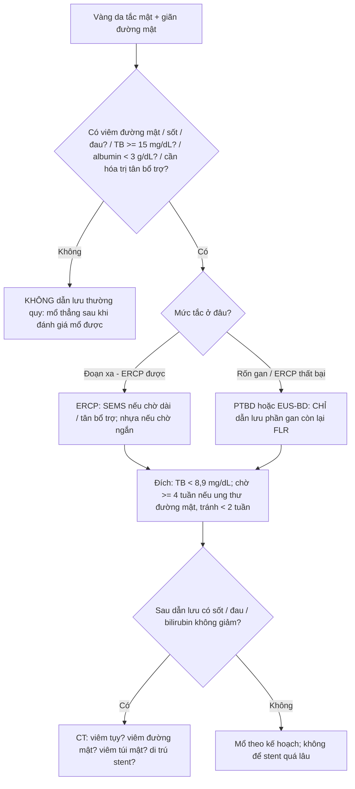
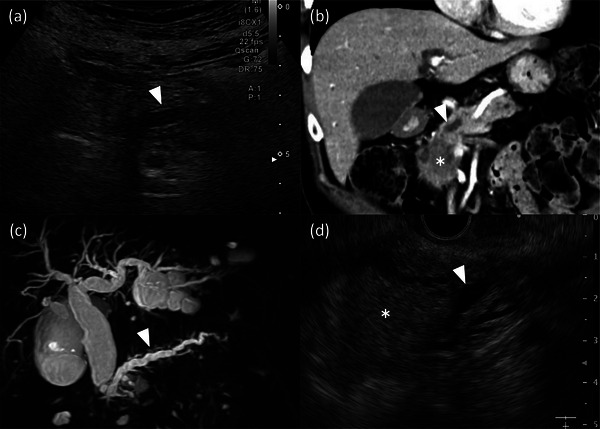
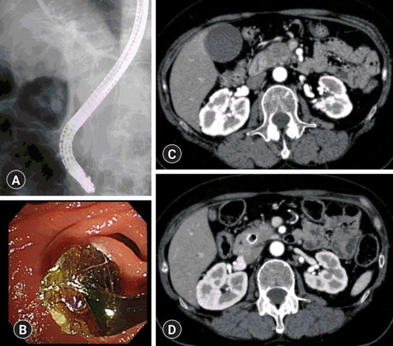
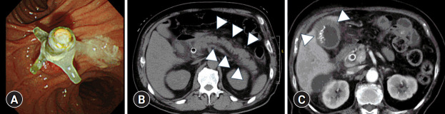

# 925 — Dẫn lưu đường mật trước phẫu thuật (preoperative biliary drainage — PBD): ai cần, chọn đường nào, chờ bao lâu & biến chứng trên CT

**Tags:** `pattern:ong-mat-gian` `pattern:double-duct` `vung:duong-mat` `vung:tuy` `protocol:CT-4-thi` `protocol:MRCP` `protocol:PBD`
**Mức chắc chắn (certainty):** tổng hợp y văn (literature synthesis) — bài tự biên từ các nghiên cứu mở 2023–2026 (PMC12500813, PMC13212022, PMC13525688, PMC10508238, PMC12604501, PMC11405119, PMC10293702, PMC12933553, PMC13212015) + 3 ca nguyên văn gắn ảnh. Số liệu trích trực tiếp từ nguồn; chỗ chưa có số ghi "chưa rõ".

## 1. Tổng quan bệnh học – cơ chế hình ảnh

- **Vì sao tắc mật gây hại (không chỉ là "vàng da"):** áp lực trong ống mật tăng → **mối nối chặt (tight junction) của tế bào ống mật mở** → dịch mật (muối mật, endotoxin đường ruột) vào máu → **nhiễm khuẩn đường mật, rối loạn đông máu do thiếu vitamin K, suy dinh dưỡng (kém hấp thu mỡ), tổn thương thận (hepatorenal)**. Vì vậy "mở đường mật" chỉ có lợi khi **có biến chứng hoặc mức vàng da đủ nặng** — nếu không, chính thủ thuật lại thêm nhiễm khuẩn.
- **Ngưỡng định lượng (bắt buộc — đây là toàn bộ bài học):**
  - **Bilirubin toàn phần (TB) ≥ 14,6 mg/dL (250 µmol/L)** là yếu tố tiên lượng độc lập của tử vong 90 ngày sau cắt khối tá tụy (pancreaticoduodenectomy — PD): **13,3%** ở nhóm không dẫn lưu + TB cao, so với **2,9–5,7%** ở các nhóm còn lại; biến chứng chung **29,0% vs 12,8–20,7%** (PMC12500813).
  - **Ngưỡng chỉ định của đồng thuận châu Á – Thái Bình Dương 2024 (bệnh lý rốn gan):** PBD khi **viêm đường mật (cholangitis)**, vàng da kéo dài, **mổ phải hoãn** (chờ nút mạch cửa xơ hóa gan lành — PVE, hoặc **albumin < 3 g/dL**), hoặc **TB ≥ 15 mg/dL (≈ 257 µmol/L)** (PMC11405119).
  - **Đích sau dẫn lưu:** hạ **TB xuống < 151,8 µmol/L (≈ 8,9 mg/dL)** thì biến chứng nặng giảm có ý nghĩa (P = 0,047); nhóm vàng da nhẹ **không** được lợi từ PBD thường quy (PMC12604501).
  - **Vàng da "trung bình" 10–15 mg/dL:** PBD **không lợi** — nhiễm trùng vết mổ (SSI) **70,8% vs 18,7%**, cấy mật dương **75% vs 25%**, chi phí kháng sinh **+50%** (PMC13212022).
  - **Gộp 6 RCT (PBD so với mổ thẳng):** không khác biệt tử vong, nhưng **biến chứng nặng tăng: RR 1,65 (KTC 95%: 1,21–2,25)** (PMC10508238).
- **TẠI SAO đặt stent lại gây nhiễm khuẩn (cơ chế then chốt):** stent **đi qua cơ vòng Oddi** → mất hàng rào một chiều → vi khuẩn đường ruột trào ngược, **màng sinh học (biofilm)** bám stent, ứ mật từng đợt khi stent bị bùn che. Hệ quả đo được: cấy mật trong mổ dương **75,8% vs 5,6%** (có stent vs không), **đa loài 80,8%**, **Enterobacterales 43,6%**, **Enterococcus 35,7%**, **Candida 19,2%**; thời gian chờ mổ dài hơn (**51,2 vs 23,8 ngày**) (PMC13525688).
- **TẠI SAO hình ảnh trông như vậy:**
  - **Mật là dịch nước (0–20 HU)** → ống mật **chỉ thấy khi giãn**; ống mật chủ (common bile duct — CBD) bình thường **≤ 8 mm** (sau cắt túi mật có thể tới **10 mm**), ống trong gan **> 2 mm** là giãn.
  - **MRCP (T2 3D)**: mật **tĩnh, giàu proton tự do** → tín hiệu **rất sáng**, không cần thuốc cản quang; dựng được "bản đồ" đường mật và **mức tắc**.
  - **Sau đặt stent trên CT:** kim loại **> 1.000 HU** + **giả ảnh dải (streak artifact)**; **khí trong đường mật (pneumobilia) −200 đến −1.000 HU**; **dày thành ống mật + thâm nhiễm quanh ống** = viêm đường mật.
  - **Vì sao PBD làm mổ khó hơn:** stent gây **xơ hóa quanh ống mật chủ (pericholedochal fibrosis)** — đã hình thành **rõ từ ngày thứ 6**, không tăng thêm theo thời gian lưu stent; **độ dày thành ống** phân biệt ống đã dẫn lưu với ống không (AUC 0,886) (PMC13212015).

## 2. Mẫu hình + chẩn đoán phân biệt theo vị trí (gamut)

**Mẫu hình 1 — "giãn đường mật": dùng MỨC TẮC để chọn đường dẫn lưu.**

- **Tắc đoạn xa (CBD/đầu tụy/bóng Vater):** giãn **cả ống trong gan và CBD đến sát đầu tụy**, kèm **giãn ống tụy chính** = **dấu ống đôi (double duct sign)** → u đầu tụy, ung thư bóng Vater, ung thư ống mật xa, viêm tụy mạn, viêm tụy tự miễn IgG4.
- **Tắc rốn gan (hilar/Klatskin):** giãn **ống trong gan hai bên** nhưng **CBD xẹp** ("hai cây không nối"), có thể teo thùy → ung thư đường mật rốn gan, ung thư túi mật xâm lấn rốn, di căn hạch rốn.
- **Tắc trong gan:** giãn từng đoạn/khu trú → sỏi trong gan (viêm đường mật mủ tái phát), PSC, bệnh Caroli, u trong gan.
- **Quy tắc chọn đường:** tắc **xa + giải phẫu bình thường → ERCP** (qua nhú Vater); **thất bại ERCP, tắc rốn gan, thùy gan cần dẫn lưu nằm xa nhú, hoặc có ruột nối mật–ruột → PTBD hoặc EUS-BD** (dẫn lưu xuyên gan/xuyên dạ dày); **chỉ dẫn lưu phần gan sẽ còn lại (future liver remnant — FLR)** ở ung thư rốn gan, tránh chọc vào thùy sẽ cắt.

**Mẫu hình 2 — "biến chứng sau dẫn lưu" trên CT (đọc sau mỗi lần đặt stent).**

- **Viêm tụy sau ERCP (post-ERCP pancreatitis — PEP):** tụy to, **thâm nhiễm/dịch quanh tụy**, tăng amylase **> 3 lần giới hạn trên** sau 24 giờ.
- **Viêm đường mật do stent tắc:** dày thành ống mật, **pneumobilia**, ổ áp-xe gan; sốt + vàng da tái phát.
- **Viêm túi mật do stent che ống túi mật:** thành túi mật **> 3 mm**, dịch quanh túi mật, túi mật căng.
- **Di trú stent / thủng tá tràng / máu trong đường mật (hemobilia)** — biến chứng nặng, cần CTA/ERCP cấp.

**Mnemonic "DRAIN":** **D**istal hay hilar (mức tắc), **R**oute (ERCP/PTBD/EUS-BD), **A**ntibiotic (khi có cholangitis), **I**nterval (chờ bao lâu), **N**utrition (albumin, vitamin K).

## 3. Bảng so sánh phân biệt (ma trận đối chiếu)

| Thực thể (entity) | Hình ảnh điển hình | Chốt vào (rule-in) | Chốt loại (rule-out) | Gợi ý xác nhận |
|---|---|---|---|---|
| **Tắc đoạn xa do u (u đầu tụy/bóng Vater)** | CBD + ống tụy chính giãn tới sát đầu tụy (**double duct sign**), khối giảm tỉ trọng thì tụy, cắt cụt kiểu "vai" | **Giãn cả hai ống + thấy khối ở đầu tụy + cắt cụt đột ngột** | Chỉ giãn CBD, không giãn ống tụy, có sỏi → nghĩ nguyên nhân lành | CT 4 thì lát ≤ 1 mm + EUS-FNA; MRCP |
| **Tắc rốn gan (Klatskin)** | Giãn ống trong gan hai bên, **CBD xẹp**, teo thùy, có thể xâm lấn nhánh cửa | **"Hai cây không nối" + khối rốn gan + teo thùy** | CBD cũng giãn tới Vater → tắc xa, không phải rốn gan | MRCP + CT động học; chỉ dẫn lưu FLR |
| **Sỏi ống mật chủ** | Hình **"bia bắn" (target sign)** trong lòng ống, đầu dưới hình chén (meniscus), không có khối | **Sỏi thấy trực tiếp + ống giãn không tương xứng với khối** | Có khối đặc bắt thuốc thì **loại sỏi đơn thuần** | Siêu âm/EUS; MRCP; ERCP lấy sỏi |
| **Viêm tụy tự miễn (IgG4)** | Tụy **"xúc xích"**, bao quanh **viền giảm tỉ trọng**, hẹp ống mật **đoạn dài, nhẵn**, không có khối | **Hẹp dài + tụy to đều + IgG4 > 135 mg/dL** | Hẹp ngắn bờ vai + khối → nghĩ ác tính | IgG4, đáp ứng corticoid |
| **Viêm đường mật do stent tắc** | Dày thành ống mật, **pneumobilia**, ổ dịch/áp-xe quanh rốn gan, stent có thể đầy bùn | **Sốt + vàng da tái phát sau đặt stent + dày thành ống** | Không sốt, stent thông, bilirubin giảm đều → không phải | Cấy máu/mật; thay stent |
| **Viêm tụy sau ERCP (PEP)** | Tụy to, **dịch/thâm nhiễm quanh tụy** (dấu đầu mũi tên trong ảnh Fig. 3B), có thể hoại tử | **Đau bụng sau thủ thuật + amylase > 3× ULN + dịch quanh tụy** | Dịch quanh tụy **trước** thủ thuật → do u/viêm tụy nền | Amylase/lipase 24 giờ; CT nếu nặng |
| **Viêm túi mật sau stent (SEMS che ống túi mật)** | Thành túi mật **> 3 mm**, dịch quanh, túi mật căng, có stent trong CBD | **Stent kim loại + đau hạ sườn phải + thành túi mật dày** | Không stent, không đau → loại | Siêu âm; chọc hút túi mật nếu không mổ được |

## 4. Protocol chụp + hệ thống ngưỡng + thuật toán

**Trước khi quyết định dẫn lưu — chụp gì để không "đặt stent rồi mới biết không mổ được":**
- **CT bụng 4 thì, lát ≤ 1 mm:** không tiêm, **thì tụy 40–50 giây**, thì cửa 65–70 giây, thì muộn; đánh giá **khả năng mổ (resectability)** theo tiếp giáp **SMA/SMV/động mạch gan** và di căn **TRƯỚC** khi đặt stent — vì **giả ảnh kim loại làm sai phân giai đoạn mạch máu**.
- **MRCP (T2 3D)** khi cần bản đồ mức tắc, phân biệt hẹp lành/ác, hoặc bệnh nhân không dùng được cản quang.
- **EUS** khi CT/MRCP nghi ngờ nhưng chưa có mô: **EUS-FNA** khối đầu tụy; **EUS-BD** (HGS/CDS) khi ERCP thất bại.
- **Xét nghiệm trước thủ thuật:** bilirubin/ALP, **CA 19-9**, đông máu (INR), **albumin**, cấy máu nếu sốt.

**Ba câu hỏi trước khi đặt stent (dùng đúng ngưỡng):**

**Chọn stent (số liệu):**
- **Stent kim loại tự bung có màng (FCSEMS) khi chờ mổ dài/tân bổ trợ:** tái can thiệp **RR 0,42 (0,25–0,72)**, tắc stent **OR 0,29 (0,15–0,57)** so với stent nhựa (PMC10508238); **tắc tái phát 0% vs 25%**, stent nhựa **thông trung bình 126 ngày** (PMC10293702).
- **Stent nhựa khi chờ ngắn (< 2–3 tuần)** hoặc khi cần tháo nhanh; **nhược điểm: tắc → viêm đường mật** (ảnh Fig. 3A).
- **PEP sau PBD:** **20% (FCSEMS) vs 8,2% (nhựa)** — khác biệt **không có ý nghĩa** trong cohort nhỏ; yếu tố nguy cơ: **nữ (OR 5,68)** và **không giãn ống tụy chính (OR 4,91)** (PMC10293702).

**Thời điểm mổ sau dẫn lưu (interval):**
- **≥ 4 tuần** ở ung thư đường mật **giảm** nhiễm khuẩn bệnh viện (**aRR 0,292**; KTC 95% 0,100–0,853); **≤ 2 tuần** ở PD robot **tăng** nhiễm khuẩn (**aRR 3,058**) (PMC10979617).
- Nhưng **đừng chờ quá lâu**: xơ hóa quanh ống mật đã **rõ từ ngày 6**, cộng thêm **bùn/stent tắc** và **khuẩn trú** — thời gian chờ trong nghiên cứu có stent là **51,2 ngày** so với **23,8 ngày** không stent (PMC13525688).

## 5. Biến thể bình thường và cạm bẫy

- **Cạm bẫy số 1 — đọc CT sau khi đã đặt stent để phân giai đoạn:** giả ảnh kim loại và viêm quanh ống **bắt chước xâm lấn mạch**; luôn dùng **CT/MR trước stent** để đánh giá mổ được.
- **Khí trong đường mật (pneumobilia) sau ERCP là bình thường** vài ngày; nhưng **khí lan ra ngoại vi tới sát bao gan + thâm nhiễm** = **khí tĩnh mạch cửa (portal venous gas)** — dấu hiệu thiếu máu/hoại tử ruột, không phải "khí do thủ thuật".
- **Vàng da giảm không đồng nghĩa hết nhiễm trùng:** bilirubin có thể giảm trong khi **áp-xe gan/viêm đường mật ứ đọng** tiến triển; đọc thêm **ALP, CRP, bạch cầu** và tìm ổ dịch.
- **Dẫn lưu "cả hai bên" ở ung thư rốn gan là sai lầm thường gặp:** có thể **gây viêm đường mật ở thùy không dẫn lưu** (thuốc cản quang đẩy vi khuẩn) và làm teo thêm FLR — chỉ dẫn lưu **phần gan sẽ giữ lại** (PMC11405119).
- **Bilirubin 10–15 mg/dL không phải "chỉ định mặc định":** PBD ở nhóm này **tăng SSI, nhiễm bẩn mật, chi phí** mà **không giảm biến chứng** (PMC13212022).
- **Pitfall "satisfaction of search":** thấy u đầu tụy rồi dừng → bỏ **di căn gan/phúc mạc, hạch xa, huyết khối tĩnh mạch cửa** — những thứ đổi hoàn toàn quyết định (mổ triệt căn hay chỉ dẫn lưu giảm nhẹ).
- **Ống mật giãn sau cắt túi mật** (tới 10 mm) là **biến thể bình thường**, đừng gán "tắc" nếu không có cắt cụt, không tăng ALP.

## 6. Tự lượng giá — Blind Quiz ngay trên trang tĩnh

**Ca 1 — Nam 68 tuổi, vàng da tăng dần, sụt cân. Siêu âm (a), CT thì tụy (b), MRCP (c), EUS (d).**

- Gợi ý lâm sàng: không sốt, không đau; bilirubin 16 mg/dL, albumin 3,4 g/dL.
- Câu hỏi: (1) Dấu hiệu chính là gì? (2) Tắc ở mức nào? (3) Có chỉ định dẫn lưu trước mổ không, và nếu có thì đích bilirubin là bao nhiêu?

<b>Bấm để hiện đáp án (findings + chẩn đoán)</b>

- **Findings:** (a) siêu âm: **ống tụy chính giãn** (đầu mũi tên); (b) CT: **khối giảm tỉ trọng ở đầu tụy** (dấu *) làm hẹp ống tụy, **ống tụy giãn** phía sau (đầu mũi tên); (c) MRCP: **ống tụy chính giãn rõ**; (d) EUS: khối (dấu *) + ống giãn (đầu mũi tên).
- **Chẩn đoán:** **u đầu tụy gây tắc ống tụy** (kèm giãn đường mật trên lâm sàng = **double duct sign**).
- **Có dẫn lưu không:** **CÓ** — bilirubin **16 mg/dL ≥ 15 mg/dL**, albumin 3,4 g/dL, và cần chờ đánh giá/mổ. Đích **TB < 8,9 mg/dL (151,8 µmol/L)**, chờ **≥ 4 tuần** nếu có tân bổ trợ.
- **Vì sao không mổ thẳng:** TB ≥ 14,6 mg/dL làm **tử vong 90 ngày 13,3%** nếu không dẫn lưu (PMC12500813).
- **Nguồn ảnh:** Kozakai F et al., *DEN Open* 2024, PMC10293702 Fig. 1 — CC BY 4.0.

**Ca 2 — Cùng bệnh nhân sau đặt stent kim loại, chụp kiểm tra trước hóa trị. Fluoroscopy (A), nội soi (B), CT (C, D).**

- Gợi ý: không sốt, bilirubin giảm từ 16 xuống 3,2 mg/dL.
- Câu hỏi: (1) Stent nằm ở đâu, có đúng vị trí? (2) Trên CT, cấu trúc tăng tỉ trọng trong CBD là gì và gây cạm bẫy gì? (3) Đánh giá khối u trên CT này có đáng tin không?

<b>Bấm để hiện đáp án (findings + chẩn đoán)</b>

- **Findings:** (A) fluoroscopy: **stent kim loại phủ màng (FCSEMS)** bắc qua chỗ hẹp, đầu dưới ở nhú Vater; (B) nội soi: **đầu stent nhìn thấy ở nhú**; (C) CT: **khối đầu tụy** trước hóa trị; (D) CT sau hóa trị: khối **nhỏ lại**, stent **tăng tỉ trọng mạnh** trong lòng CBD.
- **Chẩn đoán:** PBD bằng FCSEMS đúng vị trí; đáp ứng với hóa trị tân bổ trợ.
- **Cạm bẫy:** stent kim loại tạo **giả ảnh dải (streak)** và che mất **mặt phẳng tiếp giáp mạch máu** → **không dùng CT sau stent để kết luận xâm lấn SMA/SMV**; dùng **CT/MR trước stent**.
- **Nguồn ảnh:** Tamura T et al., *Clin Endosc* 2025, PMC12933553 Fig. 1 — CC BY-NC 4.0.

**Ca 3 — Bệnh nhân sau PBD 5 ngày, sốt 38,8 °C, đau bụng lan sau lưng, amylase tăng 5 lần. Nội soi (A), CT (B), CT (C).**

- Gợi ý: stent nhựa đặt 4 tuần trước (A); hoặc stent kim loại đặt 24 giờ trước (B, C).
- Câu hỏi: (1) Ba ổ biến chứng trên ảnh là gì? (2) Dấu hiệu CT nào phân biệt viêm tụy sau ERCP với u tiến triển? (3) Xử trí từng ổ?

<b>Bấm để hiện đáp án (findings + chẩn đoán)</b>

- **Findings:** (A) nội soi: **stent nhựa đầy bùn/mủ** trong lòng → **viêm đường mật do tắc stent**; (B) CT: **dịch quanh tụy** (đầu mũi tên) → **viêm tụy cấp sau ERCP**; (C) CT: **thành túi mật dày + thâm nhiễm quanh túi mật** (đầu mũi tên) → **viêm túi mật cấp do SEMS che ống túi mật**.
- **Chẩn đoán:** ba biến chứng kinh điển của PBD — **cholangitis do stent tắc, PEP, cholecystitis**.
- **Phân biệt với u tiến triển:** PEP có **dịch/thâm nhiễm quanh tụy + amylase > 3× ULN sau thủ thuật**; u tiến triển có **khối bắt thuốc thì tụy** và **không tăng amylase**.
- **Xử trí:** (A) thay stent + kháng sinh; (B) nhịn ăn, dịch, giảm đau, theo dõi hoại tử; (C) kháng sinh ± chọc hút túi mật/cắt túi mật nếu nặng.
- **Nguồn ảnh:** Tamura T et al., *Clin Endosc* 2025, PMC12933553 Fig. 3 — CC BY-NC 4.0.

## Bài liên quan chéo
- [100 – Tổng quan hệ Bụng](../100-tong-quan-he-bung/lesson.md)
- [131 – Tắc mật: tiếp cận hình ảnh](../131-tac-mat/lesson.md)
- [102 – Viêm túi mật & viêm tụy sau stent mật/ERCP](../102-viem-tui-mat-va-viem-tuy-sau-stent-mat-ercp/lesson.md)
- [137 – Theo dõi stent & dẫn lưu đường mật (tắc, nhiễm trùng)](../137-theo-doi-stent-dan-luu-duong-mat-di-tru-tac-nhiem-trung/lesson.md)
- [107 – MRCP & gadoxetic acid thì gan–mật](../107-mrcp-gadoxetic-acid-hbp/lesson.md)
- [910 – Dẫn lưu áp-xe & đường mật qua da (PTBD)](../910-abscess-biliary-nephrostomy/lesson.md)
- [179 – Hoại tử ống mật & cholangiopathy thiếu máu sau can thiệp u gan](../179-bien-chung-duong-mat-sau-can-thiep-u-gan/lesson.md)
- [135 – Viêm tụy cấp (Atlanta)](../135-viem-tuy-Atlanta/lesson.md)
- [930 – TACE, đốt & LR-TR](../930-hepatic-oncology-tace-rfa/lesson.md)

> Không dùng để chẩn đoán độc lập khi chưa có người hướng dẫn.
