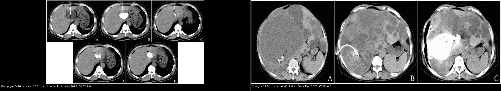
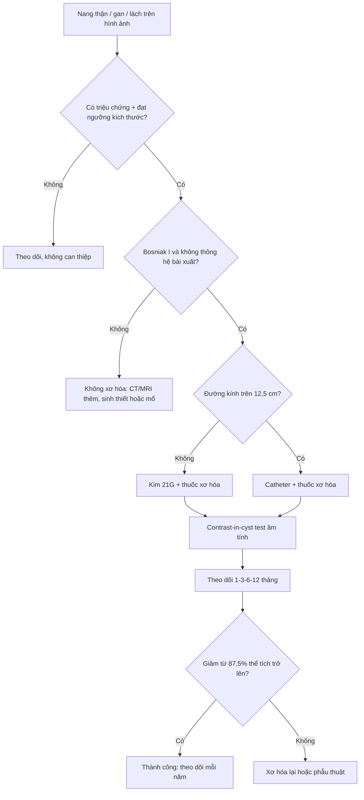
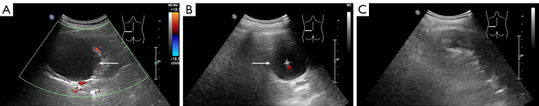
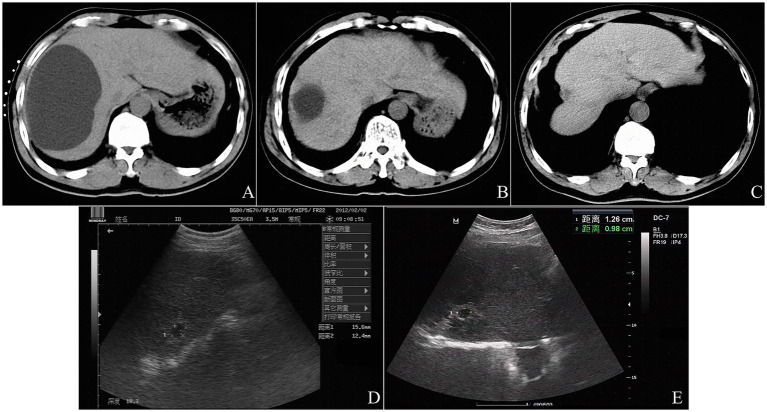
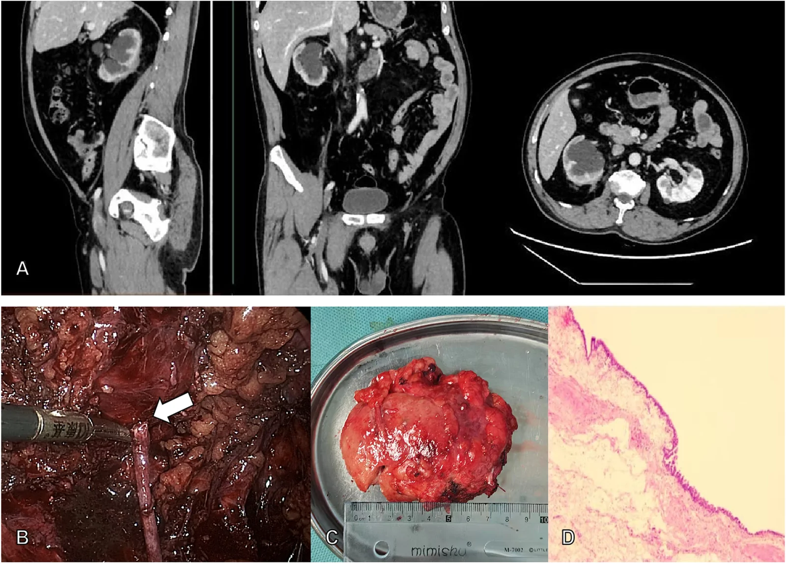

# 929 — Gây xơ hóa nang qua da: nang thận – gan – lách / Percutaneous cyst sclerotherapy

**Tags:** `pattern:nang` `vung:than` `vung:gan` `protocol:xo-hoa-nang` `incidentaloma:nang-than`
**Mức chắc chắn (certainty):** tổng hợp y văn (literature synthesis) — nhóm tự biên từ toàn văn các bài mở: thử nghiệm ngẫu nhiên đa trung tâm ethanol tuyệt đối cho nang thận đơn thuần (PMC12290762, CC BY-NC-ND 4.0), nghiên cứu hồi cứu bleomycin cho nang gan 3 năm (PMC12657345, CC BY 4.0), loạt ca hẹp khớp bể–niệu quản muộn sau xơ hóa (PMC13623730, CC BY 4.0), so sánh ethanol với lauromacrogol (PMC13172279, CC BY-NC-ND 4.0) và ca nang lách khổng lồ dùng bọt polidocanol (PMC7355813, CC BY-NC-ND 4.0). Số liệu lấy từ toàn văn, không lấy từ abstract gián tiếp.

## 1. Tổng quan bệnh học – cơ chế hình ảnh

- **Bệnh học:** nang đơn thuần (simple cyst) là khoang kín **không thông với hệ thống bài xuất** — ở thận là ống góp/ống lượn xa phình ra, ở gan là nang bẩm sinh **không thông đường mật**; thành là **mô xơ** lót **một lớp biểu mô trụ/khối** bài tiết dịch thanh tương tự huyết tương. Chính lớp biểu mô này là **đích của xơ hóa**: phá lớp lót → ngừng tiết dịch → khoang xẹp và dính lại.
- **Vì sao nang "lớn dần" và vì sao chỉ can thiệp khi có triệu chứng:** đường kính nang thận tăng **~5%/năm** (PMC13172279); tỷ lệ nang thận đơn thuần **2,38% ở thập niên thứ 2** tăng lên **35% ở người > 70 tuổi**. Đa số **không triệu chứng, không cần điều trị** — chỉ nang **to, tăng nhanh, hoặc gây đau/chèn ép** mới can thiệp.
- **Vật lý – mô học của từng chất gây xơ (tại sao chọn chất nào):**
  - **Ethanol tuyệt đối (99,5–100%)**: **đông vón protein lớp lót trong 1–3 phút**, nhưng **thấm qua vỏ xơ chậm 4–12 giờ** — đó là lý do phải **giữ thuốc trong nang đủ lâu** và vì sao ethanol **không phá nhu mô thận lành** khi thời gian lưu được kiểm soát (PMC12290762). Hệ quả thực hành: đau rát khi bơm, say rượu thoáng qua nếu hấp thu nhiều.
  - **Bleomycin**: kháng sinh gây **đứt sợi ADN**, gây chết tế bào lớp lót mà **không gây hoại tử đông** → ít đau, **hấp thu toàn thân thấp**, dùng được cho nang gan lớn; trần liều **0,6–0,8 mg/kg** (PMC12657345).
  - **Lauromacrogol / polidocanol**: chất tẩy **biến tính protein bề mặt**, ít đau hơn ethanol; dạng **bọt (foam)** làm tăng diện tiếp xúc nên **giảm thể tích thuốc** cần dùng (nang lách 11 cm chỉ cần **40 mL bọt/lần**) (PMC7355813).
  - **Đối chiếu hiệu quả:** ethanol khử nước và lauromacrogol cho **tỷ lệ biến mất nang tương đương** sau khi hiệu chỉnh propensity score (p = 0,61 và p = 0,43 với IPW; p = 0,57 và p = 0,50 với OW) (PMC13172279) → **chọn chất theo dung nạp/đau và kinh nghiệm, không theo "chất mạnh hơn"**.
- **Ngưỡng định lượng nằm lòng (bắt buộc nhớ):**
  - **Chỉ định (gan):** nang **> 5 cm** + **có triệu chứng** (đau, chèn ép, sớm no, khó thở); nang **5–10 cm → kim 21G một lần chọc**; nang **> 12,5 cm hoặc > 1.000 mL → catheter** (PMC12657345).
  - **Định nghĩa thành công (thận):** **giảm ≥ 87,5% thể tích** nang ở tuần 24 — không phải "xẹp một phần" (PMC12290762).
  - **Liều bleomycin:** **5 mg/100 mL dịch hút ra**, tổng **≤ 0,6–0,8 mg/kg**, thể tích dung dịch thuốc = **5–10% thể tích dịch hút**, **không quá 10 mL** (PMC12657345).
  - **Thể tích ethanol:** nguyên tắc chung là **20–30% thể tích dịch hút** (số cụ thể của từng nghiên cứu khác nhau — xem mục 4); điều quan trọng hơn là **thời gian lưu và số lần bơm trong một buổi**.

## 2. Mẫu hình + chẩn đoán phân biệt theo vị trí (gamut)

- **Mẫu hình chung:** khối **đồng nhất, dịch (0–20 HU), không vách, không thành rõ, không ngấm thuốc**, bờ mỏng đều, **không thông với hệ bài xuất** (Bosniak I ở thận).
- **Gamut theo vị trí:**
  - **Thận:** nang vỏ thận đơn thuần (đích của xơ hóa) / **nang cạnh bể thận (parapelvic cyst)** — nằm sát bể, **có thể thông bể thận**, xơ hóa dễ gây hẹp khớp bể–niệu quản / **nang phức tạp Bosniak ≥ IIF** / **ung thư thận dạng nang hoại tử** (bắt thuốc vách) / **nang sán (cystic echinococcosis)** — tuyệt đối không chọc.
  - **Gan:** nang gan đơn thuần / **bệnh gan đa nang (PLD, > 10 nang)** / **u nhầy dạng nang (mucinous cystic neoplasm)** — có vách, thành dày / **Caroli, nang quanh đường mật** — thông đường mật / **áp-xe gan, nang sán**.
  - **Lách:** nang biểu mô (epidermoid, có thể vôi hóa vỏ) / **nang giả (pseudocyst)** sau chấn thương — dịch có cặn, có mảng máu cũ / **nang ký sinh trùng**.
- **Mnemonic 3 câu hỏi trước khi bơm thuốc:** **(1) Có thông với hệ bài xuất không? (2) Có thành/vách ngấm thuốc không? (3) Có đường chọc an toàn không?**

## 3. Bảng so sánh phân biệt (ma trận đối chiếu)

| Thực thể (entity) | Hình ảnh điển hình | Chốt vào (rule-in) | Chốt loại (rule-out) | Gợi ý xác nhận |
|---|---|---|---|---|
| **Nang đơn thuần — đích xơ hóa** | Đồng nhất **0–20 HU**, thành mỏng **< 2 mm**, không vách, **không ngấm**, bờ đều | **Không ngấm thuốc + không vách + Bosniak I** | Có vách/ngấm/nốt thành → **không xơ hóa** | Siêu âm + CT có cản quang (đối chiếu trước–sau tiêm) |
| **Nang cạnh bể thận (parapelvic)** | Nằm **sát xoang thận**, chèn ép bể, có thể **thấy cổ thông** | **Vị trí trung tâm + sát bể thận** | Nang vỏ ngoại vi → xơ hóa an toàn hơn | CT thì muộn/ MR urography tìm thông; **cân nhắc không xơ hóa** |
| **Nang phức tạp (Bosniak IIF–IV)** | Vách mảnh/tày, vôi hóa, **phần đặc ngấm thuốc** | **Có thành/đặc ngấm thuốc** | Đồng nhất 0–20 HU → nang đơn thuần | CT đa thì; **không chọc xơ hóa**, theo dõi/mổ |
| **Nang sán (echinococcosis)** | Nang mẹ–nang con, vôi hóa vỏ, **màng tách** | **Nang con bên trong + vôi hóa + dịch tễ** | Nang đơn thuần một khoang → loại | Siêu âm/CT + huyết thanh; **chọc = nguy cơ sốc phản vệ** |
| **Nang gan đơn thuần** | Đồng nhất, không vách, **không thông đường mật** | **Không thấy đường mật trong nang trên MR** | Có thông → Caroli/nang quanh mật | **Bơm 10 mL cản quang vào nang** trước khi bơm thuốc (không thấy thuốc vào đường mật/ổ bụng) |
| **Nang lách** | Thường **vôi hóa vỏ**, dịch có cặn lơ lửng (nang giả) | **Vị trí trong lách + vôi hóa vỏ** | Khối đặc ngấm thuốc → u lách | Siêu âm + CT; lách **khó cầm máu → cân nhắc kỹ đường vào** |

*Trái (A–E): nang gan 10 cm — kim Chiba 21G một lần chọc, bơm cản quang kiểm tra (B), hút kiệt (C), bơm bleomycin pha cản quang (D), CT sau thủ thuật thuốc còn trong nang (E). Phải (A–C): **bệnh gan đa nang** — catheter đặt trong nang trội, hút dịch, rồi bơm thuốc. Nguồn: Li L et al., Front Med 2025, CC BY 4.0. Ảnh ghép letterbox.*

### Hai dấu hiệu quyết định trên bàn chọc
- **Nghiệm pháp cản quang trong nang (contrast-in-cyst test):** bơm **10 mL iohexol 300** rồi chụp lại — **không thấy thuốc đi vào đường mật/hệ bài xuất/ổ bụng** mới được bơm chất xơ. Đây là bước **rẻ tiền nhất để tránh biến chứng nặng nhất** (viêm đường mật hóa học, viêm quanh thận).
- **Dịch hút ra:** nang đơn thuần cho **dịch trong, vàng chanh**; **dịch đục/màu nâu sẫm/mùi** → nghĩ nang bội nhiễm, nang sán, hoặc u hoại tử → **gửi xét nghiệm tế bào/sinh hóa, dừng xơ hóa**.

## 4. Protocol chụp/can thiệp + ngưỡng xử trí

**Chọn bệnh nhân:** nang **có triệu chứng** + **Bosniak I** (thận) hoặc nang gan **> 5 cm có triệu chứng**; loại trừ: nang phức tạp, thông hệ bài xuất, nang sán, rối loạn đông máu nặng (**tiểu cầu < 30 × 10⁹/L, PT ≥ 30 s hoặc hoạt độ prothrombin < 40%** — tiêu chuẩn loại trừ của PMC12657345), không có đường chọc an toàn.

**Kỹ thuật (theo bậc):**
1. **Định vị:** siêu âm hoặc CT; **tránh xuyên qua dạ dày–ruột, túi mật, màng phổi, mạch lớn**; với nang thận cực trên → đường vào **dưới sườn**, tránh màng phổi.
2. **Chọc – hút:** kim 21G (nang 5–10 cm) hoặc **catheter** (nang > 12,5 cm / > 1.000 mL) để hút kiệt và **bơm lặp nhiều lần trong một buổi**.
3. **Kiểm tra cản quang** (mục 3) trước khi bơm thuốc.
4. **Bơm thuốc – thời gian lưu:**
   - **Ethanol tuyệt đối:** bơm **~20–30% thể tích dịch hút**, giữ **10–20 phút**, **xoay bệnh nhân nhiều tư thế**, hút ra rồi **bơm lại 2–3 lần trong cùng buổi** ("một buổi – nhiều lần bơm") — đây chính là biến thể cho **thành công 90,43%** so với **13,79%** khi chỉ hút dịch (PMC12290762).
   - **Bleomycin:** **5 mg/100 mL dịch**, pha trong **5–10% thể tích dịch hút (≤ 10 mL)**, tổng **≤ 0,6–0,8 mg/kg**; **để nguyên trong nang, không hút ra** (PMC12657345).
   - **Polidocanol bọt:** tỷ lệ bọt thường 1:4 (thuốc:không khí) — ca nang lách 11 cm dùng **40 mL bọt/lần, 2 lần cách nhau vài tuần** (PMC7355813); tỷ lệ cụ thể chưa được chuẩn hóa trong y văn — **chưa rõ, cần tra thêm**.
5. **Theo dõi sau thủ thuật:** CT/siêu âm kiểm tra ngay để loại trừ rò/thoát thuốc; hẹn **siêu âm hoặc CT ở 1–3–6–12 tháng**, sau đó **mỗi năm** (quan trọng: biến chứng muộn xuất hiện **sau nhiều năm**).

**Định nghĩa đáp ứng (dùng thống nhất khi đọc lại phim):** thận — **giảm ≥ 87,5% thể tích** ở tuần 24 là thành công, **tái phát** = nang lớn lại **bằng kích thước ban đầu** (PMC12290762); gan — **đáp ứng 96,9% ở 6 tháng, 100% từ 12 tháng** với bleomycin một buổi (PMC12657345).

## 5. Biến thể bình thường và cạm bẫy

- **Biến thể bình thường:** **nang cạnh bể thận** và **nang xoang thận** thường lành tính, **không triệu chứng** — đừng "điều trị hình ảnh"; **túi thừa đài thận** trông như nang nhưng **đổ vào đài khi chụp muộn** → chống chỉ định xơ hóa.
- **Cạm bẫy 1 — chỉ hút dịch mà không xơ hóa:** tỷ lệ thành công **13,79%**, tái phát **86,21%** ở tuần 24 (PMC12290762). "Hút ra là xẹp" không phải điều trị.
- **Cạm bẫy 2 — hẹp khớp bể–niệu quản MUỘN (biến chứng hiếm nhưng mất thận):** bệnh nhân 60 tuổi xơ hóa nang thận hai bên năm **2021**, **không biến chứng sớm**; đến **2025** mới đau hông lưng, CTU cho thấy **ứ nước nặng, hệ đài không ngấm thuốc**, mổ ra **xơ hóa quanh rốn thận cực nặng** → **phải cắt thận**; ca thứ hai được chẩn đoán sớm nên **mổ tạo hình bể–niệu quản giữ được chức năng thận** (PMC13623730). Bài học: **không xơ hóa nang sát bể thận; dặn bệnh nhân theo dõi nhiều năm; đau hông lưng xuất hiện muộn sau xơ hóa = chụp lại ngay**.
- **Cạm bẫy 3 — thoát thuốc ra quanh thận/ổ bụng:** đau dữ dội tức thì khi bơm → **ngừng bơm, kiểm tra vị trí đầu kim bằng cản quang**, không "bơm tiếp cho đủ liều". Ethanol ngoài nang gây **viêm mô quanh thận**, có thể xơ hóa vĩnh viễn.
- **Cạm bẫy 4 — sốt sau thủ thuật:** **sốt nhẹ 37,3–39 °C trong 3 ngày gặp ở 12,5%** bệnh nhân bleomycin và tự hết (PMC12657345); sốt cao, đau tăng, dịch đục → **nghĩ nang bội nhiễm/áp-xe**, chụp lại + kháng sinh, **không mặc định là "phản ứng thường gặp"**.
- **Cạm bẫy 5 — "nang" thực ra là ung thư:** nang hoại tử của ung thư thận có **vách/đặc ngấm thuốc**; chọc hút chỉ thấy dịch **không loại trừ** — luôn đọc **CT có cản quang trước khi quyết định**.

## 6. Tự lượng giá — Blind Quiz

**Ca 1 — Nang thận trái ở bệnh nhân đau hông lưng. Xem 3 ảnh siêu âm trước – trong – sau.**

- Gợi ý lâm sàng: nang đơn thuần có triệu chứng, không có bệnh thận nền.
- Câu hỏi: Ảnh B cho thấy gì? Vì sao phải chụp lại ở tuần 12 và 24? Tiêu chí "thành công" là gì?

<b>Bấm để hiện đáp án</b>

- Dấu hiệu (findings): (A) nang lớn đồng nhất, không vách (mũi tên trắng), có tín hiệu mạch ở nhu mô lân cận; (B) **đầu kim nằm trong lòng nang** (mũi tên đỏ); (C) nang **biến mất hoàn toàn** sau xơ hóa.
- Chẩn đoán (diagnosis): **nang thận đơn thuần** đã xơ hóa bằng ethanol tuyệt đối, **một buổi – nhiều lần bơm**. Thành công = **giảm ≥ 87,5% thể tích** ở tuần 24 (nhóm ethanol **90,43%** so với **13,79%** nếu chỉ hút dịch).
- Nguồn ảnh: Luo S et al., Quant Imaging Med Surg 2025, Fig. 2, **CC BY-NC-ND 4.0** (nguyên bản, không chỉnh sửa).

**Ca 2 — Nang gan rất lớn, chèn ép, khó thở. Xem ảnh trước và sau 3 năm.**

- Câu hỏi: Vì sao chọn **kim** chứ không **catheter**? Chất xơ nào hợp với nang gan lớn và vì sao? Ảnh B còn một "bóng" nhỏ — thất bại hay thành công?

<b>Bấm để hiện đáp án</b>

- Dấu hiệu (findings): (A) nang khổng lồ đồng nhất chiếm gần hết thùy phải; (B) sau 6 tháng còn **nang nhỏ ~2–3 cm**, bờ đều; (C) sau 3 năm nhu mô gan gần như bình thường; (D, E) siêu âm theo dõi.
- Chẩn đoán (diagnosis): nang gan đơn thuần **> 12,5 cm** — điểm cắt của nhóm tác giả là **catheter**; nang 5–10 cm mới dùng kim. Ảnh B **không phải thất bại**: đáp ứng **96,9% ở 6 tháng** và **100% từ 12 tháng**.
- Nguồn ảnh: Li L et al., Front Med 2025, Fig. 4, **CC BY 4.0**.

**Ca 3 — Đau hông lưng 4 năm sau xơ hóa nang thận. Nhìn CTU, đoán biến chứng.**

- Gợi ý lâm sàng: nam 60 tuổi, xơ hóa nang thận hai bên năm 2021, hoàn toàn không biến chứng gần; 2025 đau hông lưng phải.
- Câu hỏi: Dấu hiệu chính trên (A)? Vì sao thận mất chức năng? Bài học phòng tránh?

<b>Bấm để hiện đáp án</b>

- Dấu hiệu (findings): (A) **ứ nước nặng** đài–bể thận phải, **không thấy hệ đài ngấm thuốc** (chức năng gần như mất); (B) mổ ra **xơ hóa quanh rốn thận cực nặng**, miệng nối căng; (C) thận teo sau cắt; (D) mô học viêm–xơ.
- Chẩn đoán (diagnosis): **hẹp khớp bể–niệu quản muộn sau xơ hóa nang thận** — biến chứng hiếm, khởi phát âm thầm, **latency nhiều năm**; ca này chẩn đoán muộn → **cắt thận** (creatinine 157,3 µmol/L, eGFR 40,8). Phòng tránh: **không xơ hóa nang sát bể thận**, dặn theo dõi dài hạn, chụp lại khi có triệu chứng mới.
- Nguồn ảnh: Yu H et al., Front Med 2026, Fig. 1, **CC BY 4.0**.

## Bài liên quan chéo
- [930 – TACE, đốt & LR-TR](../930-hepatic-oncology-tace-rfa/lesson.md) (nguyên lý can thiệp gan, đọc đáp ứng sau điều trị)
- [910 – Áp-xe gan, dẫn lưu mật & thận qua da](../910-abscess-biliary-nephrostomy/lesson.md) (kỹ thuật chọc–dẫn lưu cùng hệ)
- [150 – Nang thận & phân loại Bosniak](../150-nang-than-Bosniak/lesson.md) (chọn đúng nang được xơ hóa)
- [157 – Bệnh thận đa nang ADPKD/ARPKD](../157-benh-than-da-nang-adpkd-arpkd/lesson.md) (thể đa nang — chỉ định khác)
- [633 – Nang sán đa cơ quan ở trẻ](../633-nang-san-da-co-quan-o-tre/lesson.md) (chống chỉ định chọc)
- [198 – Li-Fraumeni (TP53)](../198-li-fraumeni-tp53-chompret-tu-van/lesson.md), [197 – Xạ trị ở Li-Fraumeni](../197-xa-tri-li-fraumeni/lesson.md)

## Ảnh
- Toàn bộ ảnh tải từ bài full-text mở (Europe PMC), ghi nguồn + giấy phép từng file trong `images/CREDITS.md`. Ảnh **CC BY-NC-ND** dùng **nguyên bản, không cắt/không ghép**.
- Ca nang lách khổng lồ (11 cm, bọt polidocanol 40 mL × 2 lần, còn 5 cm sau 3 tháng) — **chỉ dẫn link**, không tải ảnh: https://pmc.ncbi.nlm.nih.gov/articles/PMC7355813/

> Không dùng để chẩn đoán độc lập khi chưa có người hướng dẫn.
