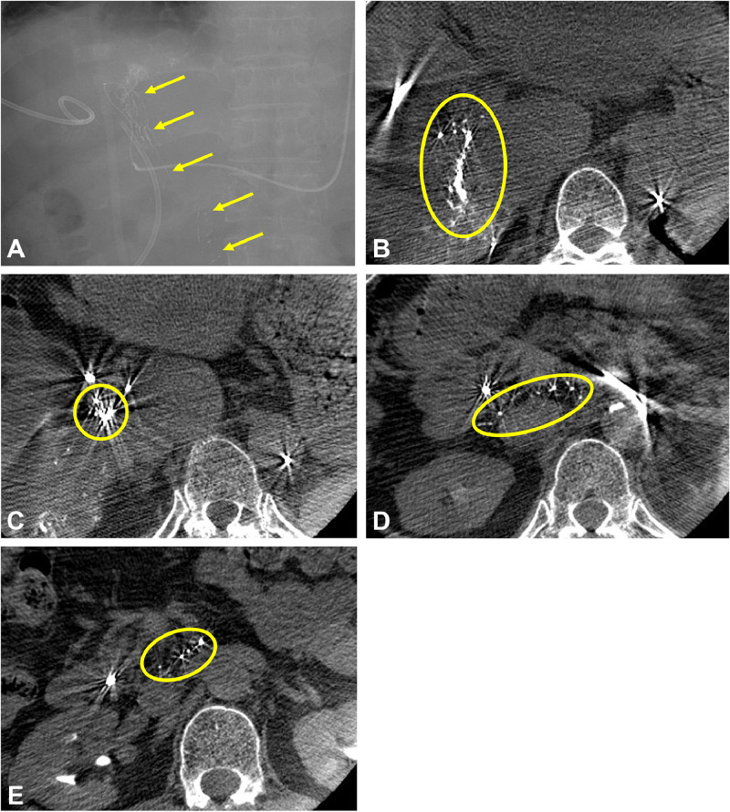
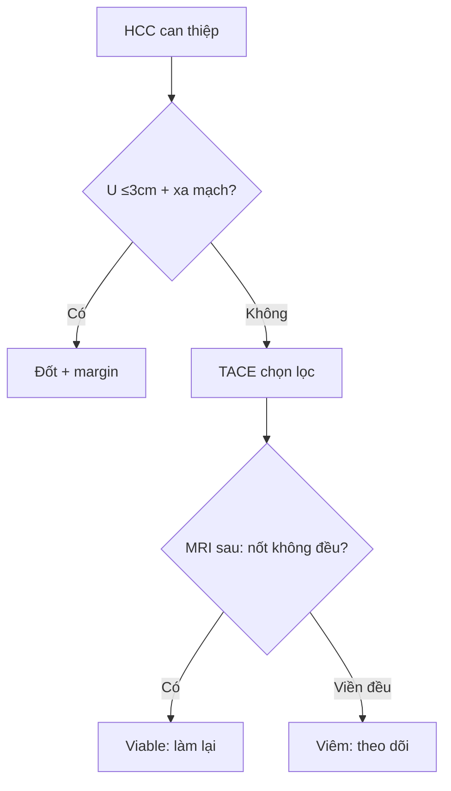

# 930 — Gan can thiệp: TACE, đốt & LR-TR / Liver IR

**Tags:** `pattern:TACE-dot` `vung:gan` `score:LR-TR`
**Mức chắc chắn (certainty):** tổng hợp y văn (literature synthesis) — nhóm tự biên từ y văn mở, chưa gắn ca nguyên văn đơn lẻ.

## 1. Tổng quan — gan 2 nguồn máu + nhiệt lan + viền đều là lành

- HCC ăn ĐM gan, nhu mô ăn TM cửa — TẠI SAO TACE chọn lọc diệt u giữ gan: nút ĐM + hóa chất vào u, gan còn cửa nuôi.
- Đốt (RFA/MWA): margin **5–10 mm** + mạch **> 3 mm** gây heat-sink — TẠI SAO u sát mạch tái phát: máu làm nguội đầu đốt.
- Sau điều trị: **viền xung huyết đều toàn chu vi** = viêm lành; **nốt dày không đều** = u sống (LR-TR Viable); Lipiodol che ngấm — TẠI SAO CT sau cTACE khó đọc: Lipiodol đặc át thuốc.

## 2. Gamut HCC can thiệp (Gamut)

- **HCC + Child-Pugh A + không mạch/lan xa:** TACE chọn lọc — cầu nối mổ/ghép.
- **U ≤ 3 cm + xa mạch:** đốt RFA/MWA + margin — khỏi tương đương mổ nhỏ.
- **Viền đều + Lipiodol đặc:** viêm/Lipiodol — theo dõi (đừng TACE lại oan!).
- **Nốt không đều + washout:** Viable — TACE/đốt lại + toàn thân.

## 3. Bảng so sánh phân biệt (ma trận đối chiếu)

| Thực thể (entity) | Hình ảnh điển hình | Chốt vào (rule-in) | Chốt loại (rule-out) | Gợi ý xác nhận |
|---|---|---|---|---|
| Chỉ định TACE | **HCC + gan còn bù + nuôi ĐM** | **Child A + không EPE** | Suy gan/mạch → toàn thân | TACE chọn lọc + MRI |
| Chỉ định đốt | **≤ 3 cm + xa mạch > 3 mm + margin** | **Nhỏ + xa mạch** | Sát mạch/lớn → TACE/mổ | RFA/MWA + margin 5–10 mm |
| Viêm/Lipiodol | **Viền đều + Lipiodol đặc + không nốt** | **Đều + toàn chu vi** | Nốt không đều → Viable | Theo dõi, đừng đốt lại |
| LR-TR Viable | **Nốt dày không đều + APHE + washout** | **Nốt + động học HCC** | Viền đều → viêm | TACE/đốt lại + toàn thân |

*Opac bạch huyết rốn gan + hạch (không phải u!); ngừng bơm + theo dõi, TACE lại sau ổn. Nguồn: Mori et al., Radiol Case Rep 2026 Fig. 2, CC BY-NC-ND 4.0 (giữ nguyên bản).*

## 4. Protocol TACE/đốt + LR-TR flowchart

- **DSA chọn lọc + cone-beam CT + margin + MRI động học** sau 4–6 tuần (LR-TR v2024: Viable/Equivocal/Nonviable).

## 5. Cạm bẫy

- **Lipiodol lạc bạch huyết** tưởng u lan (ca trên!) — chuỗi hạt rốn gan + hạch là ngừng bơm, không phải thất bại.
- **U sát mạch > 3 mm đốt đơn** tái phát — heat-sink là TACE/mổ kết hợp.
- **Viền xung huyết TACE lại oan** — đều toàn chu vi là viêm (nốt mới là Viable!).

## 6. Tự lượng giá — Blind Quiz

**Ca 1 — TACE HCC S6 + opac lạ rốn gan. Đọc DSA + cone-beam.**

- Hỏi: thuốc đi đâu? Ngừng hay bơm tiếp? Xử trí?

<b>Bấm để hiện đáp án</b>

- Dấu hiệu (findings): Lipiodol vào bạch huyết rốn gan + hạch (chuỗi hạt), không vào u.
- Chẩn đoán (diagnosis): **thông động-bạch huyết (xơ gan + viêm đường mật)** — ngừng bơm + theo dõi (TACE lại 6 tháng sau ổn, không biến chứng!).
- Nguồn: Mori et al., Fig. 2, CC BY-NC-ND 4.0 (nguyên bản).

**Ca 2 — Sau đốt + viền đều toàn chu vi, không nốt:** Viable hay viêm? *(Bảng mục 3.)*

<b>Bấm để hiện đáp án</b>

- **Viêm xung huyết:** theo dõi (nốt dày không đều mới là Viable!).

## Bài liên quan chéo
- [901 – Tổng quan IR](../901-ir-overview/lesson.md)
- [920 – Nút mạch](../920-vascular-embolization-gi-bleed/lesson.md) (kỹ thuật nút)
- [121 – LI-RADS](../121-khoi-gan-LIRADS/lesson.md) (HCC + LR-TR)

> Không dùng để chẩn đoán độc lập khi chưa có người hướng dẫn.
