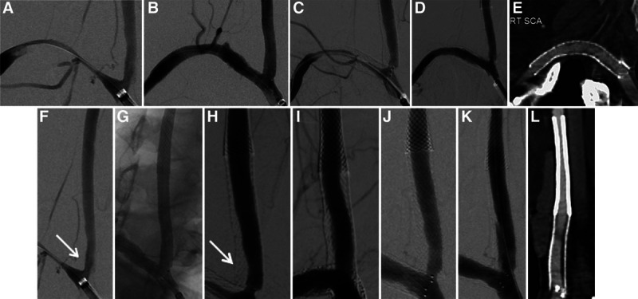
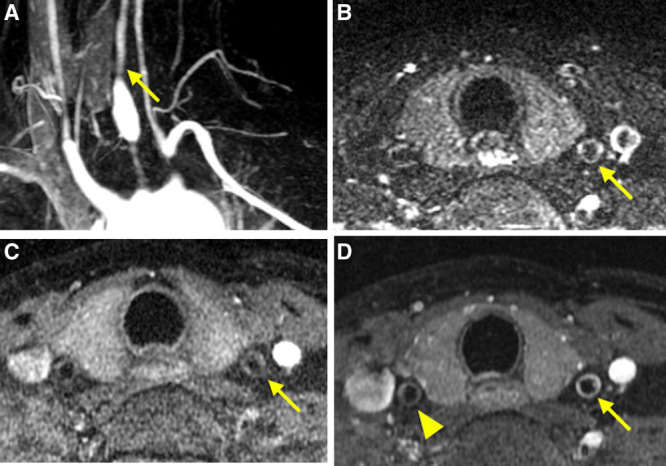
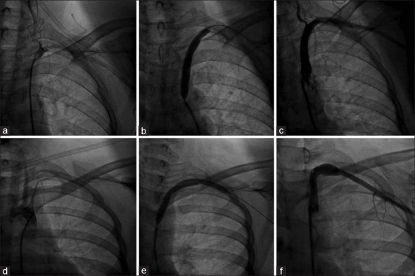
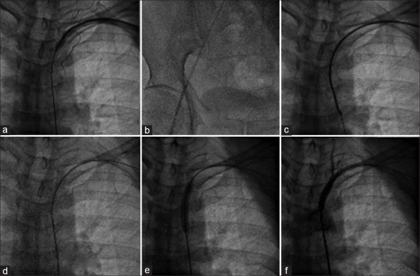
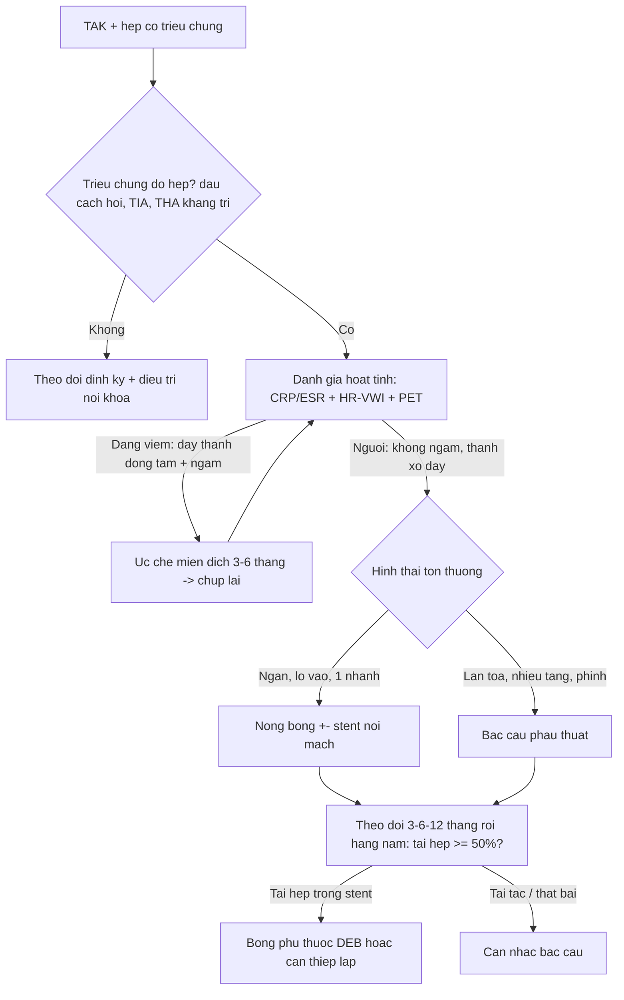
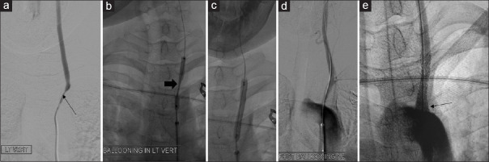
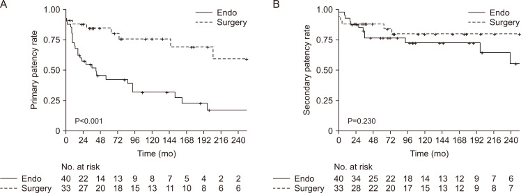

# 931 — Takayasu: nong/stent & phẫu thuật bắc cầu — chọn bệnh nhân, chọn kỹ thuật, theo dõi tái hẹp

**Tags:** `pattern:hep-mach-dai-doan` `vung:thanh-mach-lon` `score:Numano` `protocol:HR-VWI` `protocol:CTA-MRA` `protocol:theo-doi-sau-can-thiep`
**Mức chắc chắn (certainty):** tổng hợp y văn (literature synthesis) — ghép cohort 73 lần tái thông ở 56/545 bệnh nhân TAK (Vasc Specialist Int 2024, CC BY-NC 4.0), series can thiệp nhánh trên cung có HR-VWI (J Chin Med Assoc 2021, CC BY-NC-ND 4.0), kỹ thuật nong/stent dưới đòn (Heart Views 2019, CC BY-NC-SA 4.0) và ca mắt (Taiwan J Ophthalmol 2022, CC BY-NC-SA 4.0). Số liệu là **nguyên văn từng bài**, không trộn ước lượng.

## 1. Tổng quan — vì sao can thiệp trong Takayasu khác mọi bệnh hẹp mạch khác

- **Takayasu (TAK)** là viêm mạch lớn mạn tính ở **nữ trẻ**, tổn thương **hẹp/tắc dài đoạn** hoặc **phình** ĐMC và các nhánh (xem bài 436 để chẩn đoán – phân loại Numano). Can thiệp chỉ đặt ra khi **hẹp gây triệu chứng** và **thất bại/không dung nạp điều trị nội khoa**: trong cohort Hàn Quốc, lý do can thiệp hay gặp nhất là **tăng huyết áp không kiểm soát (49,3–64,3%)** và **đau cách hồi chi (39,7%)**.
- **Khác biệt cốt lõi so với xơ vữa:** thành mạch **đang viêm** thì **tăng sinh nội mạc tái phát nhanh** sau nong → **tái hẹp sớm**. Vì vậy câu hỏi đầu tiên **không phải "nong bằng bóng hay đặt stent"** mà là **"bệnh còn hoạt tính không?"** — và đó là lý do **HR-VWI (high-resolution vessel wall imaging)** trở thành bước chọn bệnh nhân.
- **Cơ chế hình ảnh (TẠI SAO):**
  - **Viêm hoạt tính:** phù thành mạch (**T2/STIR sáng**) + **ngấm gadolinium đồng tâm** trên HR-VWI; **FDG-PET** ngấm dọc thành. Can thiệp vào đoạn này → **tái hẹp/tắc sớm**.
  - **Giai đoạn xơ (fibrotic/burnt-out):** thành **dày, tăng tín hiệu T1, không ngấm**, canxi hóa lấm tấm; **nội khoa ít hiệu quả ở giai đoạn này** → đây là "cửa sổ" để can thiệp.
  - **Sau nong/stent:** **tăng sinh nội mạc trong stent (in-stent restenosis)** là cơ chế tái hẹp chủ yếu, khác huyết khối — nên **đọc CTA/HR-VWI**, không chỉ đo lòng mạch trên MRA.
- **Ngưỡng định lượng phải nhớ:**
  - **Tái hẹp (restenosis) = hẹp ≥ 50% đường kính lòng mạch đích**; **tái tắc (re-occlusion) = mất dòng chảy** đoạn đã can thiệp; **thất bại kỹ thuật = còn hẹp ≥ 50%** ngay sau thủ thuật (định nghĩa dùng trong cohort 73 lần tái thông).
  - **Thông suốt tiên phát (primary patency) sau nội mạch: 42,2% / 31,7% / 17,0% ở 5 / 10 / 20 năm**; **sau phẫu thuật: 84,4% / 75,7% / 59,0%** (p < 0,001) — khác biệt **rất lớn và có ý nghĩa**.
  - **Thông suốt thứ phát (secondary patency) khác biệt KHÔNG có ý nghĩa** giữa hai nhóm → tái hẹp sau nội mạch **cứu được bằng can thiệp lặp**, đây là lý do nội mạch vẫn hợp lý ở bệnh nhân chọn lọc.
  - **Tái hẹp tập trung trong 3 năm đầu** sau nội mạch → **tăng nhịp theo dõi trong 3 năm đầu** là khuyến cáo trực tiếp từ cohort.
  - **Series nhánh trên cung có HR-VWI:** 6 bệnh nhân, **22 động mạch**, thành công kỹ thuật **100%**, **không biến chứng thần kinh**, theo dõi trung bình **56,3 ± 41,1 tháng**, **tái hẹp 12/22 (54,5%)** — con số nhắc rằng **thủ thuật an toàn nhưng tuổi thọ stent ngắn**.
  - **Series dưới đòn (kỹ thuật antegrade/retrograde):** thành công cấp **100%**, không biến chứng đáng kể, **tái hẹp 18,2%** ở theo dõi **22,5 tháng** — trong đó **có 1 ca Takayasu**, gợi ý **bệnh nền quyết định tái hẹp chứ không phải kỹ thuật**.

## 2. Mẫu hình + chọn can thiệp theo vị trí (gamut)

- **Nhánh trên cung (dưới đòn, cảnh, thân cánh tay đầu):** hẹp **ngắn, lỗ vào (ostial)** → **nội mạch**; biểu hiện **đau cách hồi chi trên, hội chứng ăn cắp dưới đòn, thiếu máu não, giảm thị lực**. Đây là nhóm **thuận lợi nhất** cho nong/stent.
- **Động mạch thận:** hẹp lỗ vào → **tăng huyết áp kháng trị ở người trẻ**; nội mạch mang lại **giảm huyết áp**, nhưng **thận là vị trí tái thông hay gặp nhất (31,5%)** và **tái hẹp đòi hỏi can thiệp lặp**.
- **ĐMC bụng/ngực:** tổn thương **lan tỏa, nhiều tầng, kèm phình** → **phẫu thuật bắc cầu** là lựa chọn ưu tiên (nhóm mổ chiếm **45,2%** các lần tái thông, dành cho **bệnh lan tỏa/phức tạp**).
- **Động mạch vành – mạch phổi:** tổn thương **lỗ vào (ostial)** đặc trưng của viêm mạch; can thiệp được nhưng **nguy cơ tái hẹp cao**, cần phối hợp ức chế miễn dịch.
- **Ngoại lệ không can thiệp:** hẹp **không triệu chứng**, hẹp **đã có tuần hoàn bàng hệ tốt**, hoặc **đang trong đợt viêm hoạt tính chưa kiểm soát** → **điều trị nội khoa trước, chụp lại sau 3–6 tháng**.

## 3. Bảng so sánh phân biệt (ma trận đối chiếu)

| Thực thể (entity) | Hình ảnh điển hình | Chốt vào (rule-in) | Chốt loại (rule-out) | Gợi ý xác nhận |
|---|---|---|---|---|
| **Nong bóng đơn thuần (PTA)** | Lòng mạch mở sau bóng, **có thể còn hẹp tồn dư**, không có vật liệu trong lòng | **Hẹp ngắn, lỗ vào, mạch thẳng, không canxi hóa nặng** | **Co hồi đàn hồi (recoil) ngay sau nong** → cần stent | Chụp kiểm tra ngay; đo hẹp tồn dư (%) |
| **Stent (BMS)** | Khung kim loại **gây nhiễu (blooming)** trên CTA/MRA, lòng mạch đều | **Hẹp tồn dư ≥ 30% hoặc recoil sau nong**, tổn thương lỗ vào | **Nhiễu kim loại che mất lòng mạch** → không đọc được, cần **HR-VWI/CTA lát mỏng** | CTA + HR-VWI; siêu âm Doppler đo PSV |
| **Bóng phủ thuốc (DEB/DCB)** | Không để lại vật liệu; lòng mạch mở, **không nhiễu** | **Tái hẹp trong stent (in-stent restenosis)**, tổn thương ngắn | **Tổn thương dài/lan tỏa** → DEB không đủ | Chụp mạch kiểm tra 6–12 tháng |
| **Bắc cầu (bypass)** | Cầu mạch **ngoài ổ tổn thương**, có thể qua cổ/ngực; trên CTA thấy **đoạn mạch ghép** | **Tổn thương lan tỏa/nhiều tầng, thất bại nội mạch, phình** | **Bệnh còn hoạt tính chưa kiểm soát** → hoãn mổ | CTA sau mổ; kiểm tra miệng nối + đoạn ghép |
| **Xơ vữa (atherosclerosis)** | **Canxi hóa lấm tấm**, mảng **lệch tâm ở ngã ba**, thành không dày đồng tâm | **Yếu tố nguy cơ tim mạch + canxi hóa + tuổi lớn** | **Nữ trẻ + dày thành đồng tâm + tổn thương lỗ vào nhiều nhánh** → TAK | Đối chiếu HR-VWI/PET, CRP/ESR |

**Chọn kỹ thuật theo hình thái tổn thương:**

| Hình thái tổn thương | Ưu tiên | Lý do |
|---|---|---|
| Hẹp ngắn < 3 cm, lỗ vào, một nhánh | **Nong bóng ± stent** | Ít xâm lấn, bảo tồn nhánh, tái can thiệp được |
| Hẹp dài, lan tỏa, nhiều tầng | **Bắc cầu (bypass)** | Nội mạch thất bại cao vì đoạn lành quá ngắn để neo stent |
| Tái hẹp trong stent | **Nong bóng phủ thuốc (DEB/DCB)**, cân nhắc stent mới | DEB được báo cáo hứa hẹn cho tái hẹp kháng trị trong stent |
| Phình/giả phình sau nong | **Stent phủ (covered stent)** hoặc mổ | Kiểm soát biến chứng thủng/giả phình |

*Hai vị trí can thiệp ở cùng bệnh nhân: **động mạch dưới đòn phải (A–E)** và **động mạch cảnh chung phải (F–L)** — chụp mạch trước, nong bóng, và kết quả sau đặt stent. Nguồn: Chen ST et al., J Chin Med Assoc 2021 (PMC12966148) Fig. 2, CC BY-NC-ND 4.0 — **nguyên bản, không ghép**.*

### Ba câu hỏi trước khi can thiệp (thứ tự không được đảo)

1. **Có triệu chứng do hẹp không?** (đau cách hồi, thiếu máu não, THA kháng trị, thiếu máu cơ tim) — hẹp không triệu chứng **không phải chỉ định**.
2. **Bệnh còn hoạt tính không?** — **HR-VWI** (dày thành **đồng tâm + ngấm** = viêm cấp) + **CRP/ESR + PET**. Còn hoạt tính → **điều trị miễn dịch trước 3–6 tháng**, chụp lại.
3. **Tổn thương ngắn/lỗ vào hay lan tỏa?** — **ngắn/lỗ vào → nội mạch**; **lan tỏa/nhiều tầng → bắc cầu**.

*HR-VWI ở nữ 36 tuổi TAK **giai đoạn viêm cấp**: MRA 3D cho thấy hẹp khít, còn các lát HR-VWI cho thấy **dày thành đồng tâm + ngấm thuốc** — dấu **chống chỉ định tương đối** can thiệp ngay. Nguồn: Chen ST et al. (PMC12966148) Fig. 1, CC BY-NC-ND 4.0 — nguyên bản, không ghép.*

## 4. Protocol chụp, theo dõi & hệ phân tầng

**Trước can thiệp (bắt buộc):**
- **HR-VWI 3T** (hoặc 1,5T có chuỗi thành mạch): T1 trước/sau gadolinium + T2/STIR thành mạch **ĐMC và toàn bộ nhánh dự kiến can thiệp**; đọc **dày thành đồng tâm** và **mức ngấm** (so với cơ/gan).
- **CTA (ĐMC + nhánh) lát ≤ 1 mm** hoặc **MRA** để đo **đường kính lòng mạch, chiều dài đoạn hẹp (mm/cm)**, phân loại **Numano**.
- **CRP/ESR + FDG-PET/CT** khi HR-VWI không kết luận; **chức năng thận (eGFR)** trước khi dùng cản quang, **đo HA hai tay** (chênh ≥ 20 mmHg là dấu theo dõi).

**Thủ thuật (khung kỹ thuật):**
- **Đường vào:** bẹn ± cánh tay; tổn thương dưới đòn tắc hoàn toàn có thể cần **tiếp cận ngược dòng (retrograde) + snare** tạo vòng động–động để đặt stent từ trên xuống (kỹ thuật báo cáo ở Heart Views 2019).
- **Vật liệu:** nong bóng trước, **stent khi recoil/hẹp tồn dư**; **bóng phủ thuốc** cho tái hẹp trong stent; **stent phủ** khi có nguy cơ thủng/giả phình.
- **Sau thủ thuật:** **không ngừng ức chế miễn dịch**; kháng kết tập theo bác sĩ; kiểm tra mạch ngoại vi + HA.

*Trình tự một thì: (a) tổn thương dưới đòn trái, (b) đặt stent, (c) kết quả cuối; hàng dưới là ca Takayasu — (d) tổn thương, (e) nong bóng, tiến tới đặt stent. Nguồn: Krishnappa S et al., Heart Views 2019 (PMC6791090) Fig. 1, CC BY-NC-SA 4.0.*

*Tái hẹp sau can thiệp: (a) qua chỗ hẹp, (b) snare tạo vòng động–động, (c) đưa catheter qua tổn thương, (d) nong bóng lại — minh họa "tái hẹp cứu được bằng can thiệp lặp". Nguồn: Krishnappa S et al. (PMC6791090) Fig. 5, CC BY-NC-SA 4.0.*

**Lịch theo dõi sau can thiệp (dựa trên nguy cơ tái hẹp 3 năm đầu):**

| Thời điểm | Việc làm | Ngưỡng hành động |
|---|---|---|
| Ngay sau thủ thuật | Chụp kiểm tra + đo hẹp tồn dư | Hẹp tồn dư ≥ 50% = **thất bại kỹ thuật** |
| 3 tháng | CTA/HR-VWI + siêu âm Doppler | Tái hẹp ≥ 50% → xem lại kế hoạch |
| 6 tháng | CTA/MRA | Như trên |
| 12 tháng | CTA/MRA + CRP/ESR | Tái hẹp trong stent → cân nhắc DEB |
| Hằng năm (suốt đời) | CTA/MRA + HR-VWI khi nghi hoạt tính | Tái hẹp/tái tắc → can thiệp lặp hoặc bắc cầu |

## 5. Biến thể bình thường và cạm bẫy

- **Can thiệp khi viêm còn hoạt tính = tự chuốc tái hẹp:** HR-VWI **dày thành đồng tâm + ngấm** là dấu **trì hoãn** — ca trong series JCMA chính vì thấy dấu này mà **chọn bệnh nhân khác/hoãn**, không nong ngay.
- **Đọc "hẹp" mà bỏ "dày thành":** trên CTA, **thành dày 1–2 mm đồng tâm** dễ bị coi là "bình thường"; **hẹp dài đoạn không canxi hóa ở nữ trẻ** phải đo **độ dày thành (mm)**, không chỉ đo lòng.
- **Nhiễu kim loại của stent:** CTA/MRA có thể **che lấp lòng mạch trong stent** → **không kết luận tắc stent trên một mặt cắt bị nhiễu**; dùng **HR-VWI/CTA lát mỏng + Doppler PSV**.
- **Tái hẹp ≠ thất bại điều trị:** **thông suốt thứ phát không khác biệt** giữa nội mạch và mổ — tái hẹp **cứu được**; đừng vì một lần tái hẹp mà chuyển ngay sang mổ lớn.
- **"Bóng nong xong là khỏi" — sai:** **54,5%** động mạch trong series nhánh trên cung tái hẹp; bệnh nhân cần **theo dõi suốt đời**, đặc biệt **3 năm đầu**.
- **Cạm bẫy mắt:** hẹp dưới đòn/cảnh có thể biểu hiện **mù một mắt, tân mạch mống mắt, đục thủy tinh thể** (Takayasu retinopathy) — **tái thông có thể cải thiện thị lực** (báo cáo hiếm), nhưng **mắt đã mù sâu thì không hồi phục**; cần phối hợp bác sĩ mắt **trước** khi quyết định can thiệp.
- **Hạ huyết áp sau nong thận:** bệnh nhân đang dùng nhiều thuốc hạ áp dễ **tụt HA** sau tái thông → giảm liều **trước** thủ thuật, theo dõi 24–48 giờ.

## 6. Tự lượng giá — Blind Quiz

**Ca 1 — Nữ 36 tuổi, TAK, đau cách hồi tay phải, chênh HA hai tay 30 mmHg. Trước can thiệp, HR-VWI:**

- Hỏi: có nên nong/stent **ngay** không? Dấu nào quyết định? Nếu vẫn can thiệp thì hậu quả dự kiến?

<b>Bấm để hiện đáp án (findings + chẩn đoán)</b>

- Findings: MRA 3D hẹp khít nhánh trên cung; các lát HR-VWI cho **dày thành đồng tâm + ngấm gadolinium** = **viêm đang hoạt tính**.
- Chẩn đoán: **TAK giai đoạn hoạt tính** — **chống chỉ định tương đối** can thiệp ngay.
- Xử trí: **ức chế miễn dịch 3–6 tháng**, chụp lại HR-VWI; khi thành **không còn ngấm** mới nong/stent.
- Hậu quả nếu can thiệp sớm: **tăng sinh nội mạc nhanh → tái hẹp sớm** (series có **54,5%** tái hẹp).
- Nguồn: Chen ST et al. (PMC12966148) Fig. 1, CC BY-NC-ND 4.0.

**Ca 2 — Cùng bệnh nhân sau khi kiểm soát viêm: nong bóng dưới đòn rồi stent. Chụp mạch:**

- Hỏi: mô tả các bước? Vì sao phải kiểm tra **cả cảnh chung** chứ không chỉ dưới đòn?

<b>Bấm để hiện đáp án (findings + chẩn đoán)</b>

- Findings: (A–E) **nong bóng + stent động mạch dưới đòn phải**; (F–L) **nong bóng + stent động mạch cảnh chung phải** — chụp trước, bóng, kết quả sau.
- Vì sao kiểm tra cảnh: TAK tổn thương **nhiều nhánh cùng lúc**; bỏ sót hẹp cảnh = **nguy cơ thiếu máu não** dù tay đã hết đau cách hồi.
- Theo dõi: CTA/HR-VWI 3–6–12 tháng, sau đó hằng năm; **tái hẹp ≥ 50%** là ngưỡng hành động.
- Nguồn: Chen ST et al. (PMC12966148) Fig. 2, CC BY-NC-ND 4.0.

**Ca 3 — Nam 28 tuổi, hẹp khít dưới đòn trái tới lỗ động mạch sống, nong bóng rồi đặt stent:**

- Hỏi: đọc chuỗi hình? Vì sao nong bóng đơn thuần không đủ ở lỗ vào? Điều gì chứng minh tái thông có lợi cho mắt?

<b>Bấm để hiện đáp án (findings + chẩn đoán)</b>

- Findings: (a) **hẹp > 90% động mạch dưới đòn trái lan tới lỗ động mạch sống**; (b–c) bóng nong, **thắt eo (waist)** khi bơm; (d) **còn hẹp tồn dư ở lỗ vào**; (e) **stent** mở rộng lỗ vào, dòng chảy tốt.
- Vì sao cần stent: tổn thương **lỗ vào (ostial)** có **co hồi đàn hồi** mạnh → nong bóng đơn thuần để lại hẹp tồn dư.
- Mắt: bệnh nhân **15 tuổi** có **Takayasu retinopathy** (tân mạch mống mắt, đục thủy tinh thể một mắt); sau tái thông, **dấu đáy mắt và thị lực cải thiện** — báo cáo hiếm, nhấn mạnh **tái thông mạch lớn có thể cứu mắt**.
- Nguồn: Jain VK et al., Taiwan J Ophthalmol 2022 (PMC9262024) Fig. 2, CC BY-NC-SA 4.0.

**Ca 4 — So sánh thông suốt 20 năm: đọc biểu đồ Kaplan–Meier của 73 lần tái thông:**

- Hỏi: nhóm nào thông suốt tốt hơn? Chênh lệch ở 20 năm là bao nhiêu? Vì sao vẫn có thể chọn nội mạch?

<b>Bấm để hiện đáp án (findings + chẩn đoán)</b>

- Findings: **thông suốt tiên phát sau nội mạch 42,2% / 31,7% / 17,0%** ở 5/10/20 năm; **sau mổ 84,4% / 75,7% / 59,0%** (p < 0,001).
- Chênh lệch 20 năm: **59,0% − 17,0% = 42 điểm phần trăm** nghiêng về phẫu thuật.
- Vẫn chọn nội mạch vì: **thông suốt thứ phát không khác biệt** (can thiệp lặp cứu được), **ít xâm lấn**, phù hợp tổn thương **ngắn/lỗ vào**, và bệnh nhân TAK thường **cần nhiều lần can thiệp trong đời**.
- Nguồn: Shin J et al., Vasc Specialist Int 2024 (PMC11697587) Fig. 2, CC BY-NC 4.0.

## Bài liên quan chéo
- [436 – Takayasu vs GCA: chẩn đoán & phân loại](../436-takayasu-vs-gca/lesson.md) (bước 1: ai là TAK, Numano, ACR/EULAR 2022)
- [438 – Theo dõi dài hạn GCA & biến chứng mạch lớn](../438-theo-doi-dai-han-gca-bien-chung-mach-lon/lesson.md) (đối chiếu theo dõi viêm mạch lớn)
- [910 – Dẫn lưu áp-xe/đường mật/thận qua da](../910-abscess-biliary-nephrostomy/lesson.md) (nguyên tắc can thiệp dưới hướng dẫn hình ảnh)
- [930 – TACE/RFA gan](../930-hepatic-oncology-tace-rfa/lesson.md) (khung can thiệp nội mạch: chọn bệnh nhân, biến chứng)
- [840 – ĐMC: endoleak & bệnh động mạch ngoại biên](../840-aorta-endoleak-pad/lesson.md) (theo dõi stent graft — cùng nguyên lý "vật liệu trong lòng mạch")

## Ảnh
- `931_takayasu-hr-vwi-hoat-tinh_MRI_PMC12966148-Fig1.jpg` — Chen ST et al., J Chin Med Assoc 2021 (PMCID: PMC12966148) Fig. 1, CC BY-NC-ND 4.0 (nguyên bản).
- `931_takayasu-ptas-canh-duoi-don_DSA_PMC12966148-Fig2.jpg` — Chen ST et al. (PMC12966148) Fig. 2, CC BY-NC-ND 4.0 (nguyên bản).
- `931_takayasu-nong-bong-stent-duoi-don_DSA_PMC6791090-Fig1.jpg` — Krishnappa S et al., Heart Views 2019 (PMCID: PMC6791090) Fig. 1, CC BY-NC-SA 4.0.
- `931_takayasu-hep-lai-sau-can-thiep_DSA_PMC6791090-Fig5.jpg` — Krishnappa S et al. (PMC6791090) Fig. 5, CC BY-NC-SA 4.0.
- `931_takayasu-thong-suat-sau-tai-thong_KM_PMC11697587-Fig2.jpg` — Shin J et al., Vasc Specialist Int 2024 (PMCID: PMC11697587) Fig. 2, CC BY-NC 4.0.
- `931_takayasu-hep-90-va-stent_DSA_PMC9262024-Fig2.jpg` — Jain VK et al., Taiwan J Ophthalmol 2022 (PMCID: PMC9262024) Fig. 2, CC BY-NC-SA 4.0.
- Chi tiết giấy phép từng ảnh trong `images/CREDITS.md`. AuntMinnie/Radiopaedia: chỉ dẫn link, không tải.

> Không dùng để chẩn đoán độc lập khi chưa có người hướng dẫn.
