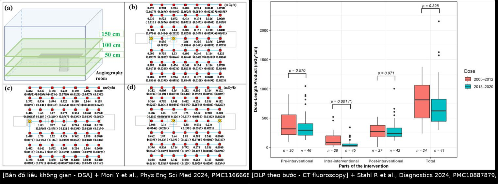
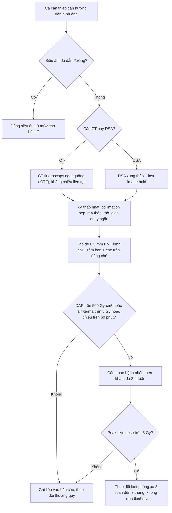
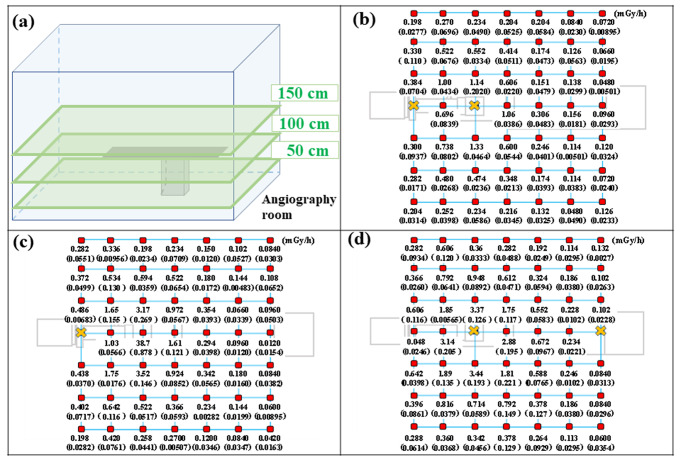
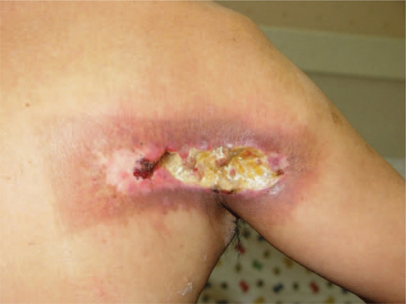
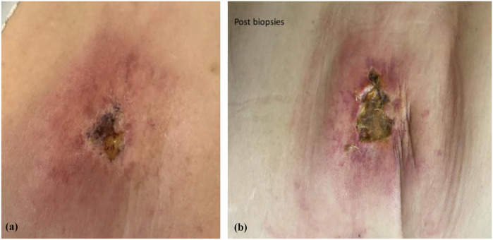

# 932 — An toàn bức xạ trong can thiệp dưới CT/DSA / Radiation safety in CT fluoroscopy & DSA

**Tags:** `protocol:an-toan-buc-xa` `protocol:CT-fluoroscopy` `protocol:DSA` `vung:toan-than`
**Mức chắc chắn (certainty):** tổng hợp y văn (literature synthesis) — biên từ toàn văn các bài mở: mô hình liều bác sĩ trong CT fluoroscopy (PMC11163508, CC BY 4.0), thực hành phòng hộ trong can thiệp (PMC9527100, CC BY-NC 4.0), bản đồ liều không gian phòng DSA (PMC11666685, CC BY 4.0), DLP theo từng bước của thủ thuật CT (PMC10887879, CC BY 4.0), ca loét phóng xạ sau nong mạch (PMC11481164, CC BY-NC 4.0) và loạt 9 ca loét phóng xạ sau can thiệp tim (PMC4674206, CC BY 4.0). Số liệu lấy từ toàn văn, không lấy từ abstract gián tiếp.

## 1. Tổng quan — liều hình thành thế nào và TẠI SAO phải đo bằng ba đại lượng khác nhau

- **Vật lý cơ bản:** bác sĩ can thiệp hầu như không bao giờ nằm trong chùm tia trực tiếp mà nhận **tia tán xạ (scattered radiation)**. Photon đi qua bệnh nhân bị tán xạ Compton, đổi hướng và mất một phần năng lượng; **nguồn tán xạ chính là mặt da bệnh nhân nằm trong trường chiếu**, không phải đầu đèn. Vì vậy "che đúng chỗ" = che đúng mặt da đó, và "đứng đúng chỗ" = tránh vùng tán xạ mạnh nhất.
- **Hai loại tán xạ khác nhau về cường độ:** tán xạ ngược (back-scatter, từ mặt da phía ống tia) **mạnh hơn tán xạ tới (forward-scatter) khoảng 20 lần** (PMC9527100). Hệ quả thực hành: khi chiếu nghiêng, **đứng phía đầu thu (detector) lại ít liều hơn đứng phía ống tia** — trái với cảm nhận "đứng phía đầu thu thì tia chiếu vào mình". Tán xạ ngược chiếu vào **phần dưới cơ thể** (cẳng chân, bụng dưới) nên liều vùng này thường **không được đo** vì liều kế cá nhân hay đeo ở cổ/ngực.
- **Con số nằm lòng:** trong bán kính **50 cm quanh ống tia**, suất liều có thể **1–10 mSv/h**; nếu đặt tay vào trường chiếu (tia trực tiếp), suất liều **hàng trăm đến hàng nghìn mSv/h**. Tán xạ cỡ **µSv/phút**, trực tiếp cỡ **mSv/phút** — chênh nhau khoảng 1.000 lần (PMC9527100). Đây là lý do "một lần đưa tay vào màn hình" có thể bằng nhiều phút chiếu hợp lý.
- **TẠI SAO phải ba đại lượng cho bệnh nhân:**
  - **DAP / KAP (dose–area product, Gy·cm²)** = tổng năng lượng trên toàn trường chiếu → dùng để **so sánh protocol và đặt ngưỡng cảnh báo**, nhưng **không cho biết liều tại một điểm da**.
  - **Air kerma tại điểm tham chiếu (Gy)** đo tại mặt da vào → ước lượng **liều da đỉnh (peak skin dose)** khi trường chiếu ít di chuyển; khi trường chiếu quét nhiều vị trí, DAP lớn mà liều da đỉnh vẫn có thể thấp.
  - **DLP / CTDIvol (mGy·cm / mGy)** cho CT: DLP = CTDIvol × chiều dài quét → so sánh các bước của thủ thuật.
  - **Liều hiệu dụng (mSv)** cho nhân viên: chỉ có nghĩa khi đo **cả trong và ngoài áo chì**, theo công thức **HE = 0,11 × Ha + 0,89 × Hb** (Ha ngoài áo, Hb trong áo) (PMC9527100).
- **TẠI SAO kV và collimation lại quan trọng hơn "đứng xa một bước":** đo thực nghiệm trên CT fluoroscopy cho thấy khi giữ nguyên mọi thứ khác, giảm **120 → 80 kV giảm 70% liều bác sĩ**, thu hẹp collimation **10 → 1,25 mm giảm 76%**, giảm dòng **100 → 10 mA giảm 90%**, rút thời gian quay **1 → 0,3 s giảm 70%** (PMC11163508, Bảng 2). Liều tán xạ **tỉ lệ tuyến tính với mA và thời gian quay**, nhưng **không tuyến tính với kV và collimation** — vì vậy "chỉnh kV/collimation" là can thiệp rẻ và mạnh nhất.
- **Áo chì 0,5 mm Pb che được bao nhiêu:** ở 120 kV, collimation 10 mm, 100 mAs, liều vào đo được giảm từ **6,261 µGy → 0,186 µGy** (≈ **97%**); ở collimation 40 mm giảm từ **20,950 → 0,584 µGy** (≈ **97,2%**) (PMC11163508, Bảng 1). Nhưng áo chì **không bảo vệ mắt** — xem mục 4.
- **CT fluoroscopy có "độc" hơn DSA không:** không, tính theo liều bác sĩ. Suất liều không khí của CTF **cao hơn 3,5 lần** nhưng thời gian chiếu **ngắn hơn 31,6 lần** → phải làm **9,1 lần** số thủ thuật CTF mới bằng liều một thủ thuật DSA (PMC11163508). Ca CTF điển hình tại trung tâm khảo sát: **30,1 lần bấm pedi (tap)**, 121 kV, collimation 6 mm, 58 mA, 0,5 s → **0,60 µGy** liều vào khi có áo chì. Đây là lý do **không nên rời phòng sau mỗi lần kim** nếu chỉ sợ liều — nhưng phải đứng đúng và che đúng.

## 2. Mẫu hình + gamut theo vị trí: ai nhận liều, ở đâu

- **Mẫu hình "bản đồ liều" (dose map):** liều trong phòng can thiệp giảm theo **bình phương khoảng cách** tính từ mặt da trong trường chiếu, nhưng **không đối xứng** — phía ống tia mạnh hơn phía đầu thu, và **cao nhất ở tầm bàn/thấp** (nơi tán xạ ngược thoát ra). Bản đồ đo thực tế ở 3 độ cao **150 / 100 / 50 cm** cho thấy vùng liều cao nhất nằm **sát bệnh nhân và thấp dần ra xa**, với giá trị đỉnh hàng trăm mGy/h ngay cạnh trường chiếu (PMC11666685).
- **Gamut theo người nhận liều:**
  - **Bác sĩ thủ thuật:** thân mình + tay (tán xạ tới), cẳng chân/bụng dưới (tán xạ ngược), **thủy tinh thể** (tán xạ từ phía đầu bệnh nhân, không bị áo chì che), bàn tay (chỉ nguy hiểm thật khi **vào trường chiếu trực tiếp**).
  - **Nhân viên hỗ trợ/gây mê:** thường **không có áo chì đúng lúc**, hay tiếp cận bệnh nhân **trong lúc đang chiếu** → liều cao hơn tưởng tượng; giải pháp là **dừng chiếu trước khi bước vào** (PMC9527100).
  - **Bệnh nhân:** da tại vị trí trường chiếu cố định (nguy cơ **tổn thương tất định**), toàn thân (nguy cơ **ngẫu nhiên**), và **thai nhi** nếu có thai.
- **Gamut theo đại lượng:** DAP/KAP → protocol; air kerma tại điểm tham chiếu → da; peak skin dose → loét; DLP/CTDIvol → từng bước CT; liều hiệu dụng → nhân viên; liều kế vòng tay → bàn tay. **Không dùng một số thay cho tất cả.**
- **Ba câu hỏi trước mỗi ca (mnemonic ALARA-3):** **(1) Có thể dùng siêu âm thay thế không? (2) Đã giảm kV – collimation – mA – thời gian chưa? (3) Ai đang đứng trong phòng và đã che chắn/đeo liều kế chưa?**

## 3. Bảng so sánh phân biệt (ma trận đối chiếu)

| Nguồn/tình huống liều | Hình ảnh – số đo điển hình | Chốt vào (rule-in) | Chốt loại (rule-out) | Cách xác nhận |
|---|---|---|---|---|
| **Tán xạ ngược từ bàn (under-table)** | Liều thấp ở cẳng chân/bụng dưới; cao khi chiếu nghiêng mà bác sĩ đứng phía ống tia | **Đứng cùng phía ống tia khi chiếu nghiêng** + liều kế vùng bụng dưới cao | Đứng phía đầu thu → chỉ nhận tán xạ tới (thấp hơn ~20 lần) | Liều kế bổ sung ở cẳng chân; đo thử 1 ca |
| **Tán xạ tới từ phía đầu thu** | Liều thân trên, giảm mạnh khi có **che trần đặt đúng** | **Che trần nằm giữa đầu thu và người bác sĩ** + đầu thu sát bệnh nhân | Che trần đặt sai phía, hoặc đầu thu xa bệnh nhân → hở khe tán xạ | Quan sát tư thế; chụp huỳnh quang kiểm tra vị trí che |
| **Chiếu trực tiếp (tay trong trường chiếu)** | **Thấy bàn tay trên màn hình**; suất liều mSv/phút | **Tay hiện trên màn hình huỳnh quang** | Tay không bao giờ vào trường chiếu → chỉ tán xạ | Không bao giờ đưa tay vào; dùng kẹp/dụng cụ |
| **Liều da bệnh nhân cao (nguy cơ tất định)** | DAP **> 500 Gy·cm²**, air kerma tại điểm tham chiếu **> 5 Gy**, hoặc chiếu **> 60 phút** | **Peak skin dose > 3 Gy** hoặc có ≥ 1 ngưỡng cảnh báo trên | DAP < 500 Gy·cm² **và** air kerma < 3 Gy **và** chiếu < 60 phút → nguy cơ thấp | Ghi DAP/air kerma/thời gian vào báo cáo; hẹn khám da nếu vượt ngưỡng |
| **Liều nhân viên vượt ngưỡng (ngẫu nhiên)** | Liều hiệu dụng **20 mSv/năm** (trung bình 5 năm); **thủy tinh thể 20 mSv/năm**, không quá **50 mSv** năm bất kỳ | Liều kế **trong áo** tăng dần qua các tháng; Hb/Ha bất thường | Liều kế chỉ đeo ngoài áo → **không** phản ánh liều hiệu dụng thật | Đeo 2 liều kế; tính HE = 0,11 Ha + 0,89 Hb; kiểm tra áo định kỳ |

*Trái (a–d): bản đồ liều đo ở 150/100/50 cm — vùng đỏ sát bệnh nhân, giảm dần ra xa; đây là căn cứ để chọn chỗ đứng và đặt che. Phải: DLP bước **trong thủ thuật** giảm từ 80,5 → 31,0 mGy·cm (p = 0,001) sau khi đổi protocol, trong khi bước chụp quy hoạch/kiểm tra không đổi. Nguồn: Mori Y et al., Phys Eng Sci Med 2024 (PMC11666685); Stahl R et al., Diagnostics 2024 (PMC10887879); CC BY 4.0. Ảnh ghép letterbox.*

### Dấu hiệu quyết định trên bảng điều khiển
- **Last-image hold (giữ ảnh cuối)** thay cho chiếu liên tục khi đang suy nghĩ/bàn luận: giảm thời gian chiếu mà không mất thông tin.
- **Pulsed fluoroscopy (chiếu xung)** ở tần số thấp (3–7,5 xung/giây) thay vì liên tục: giảm liều gần tuyến tính theo số xung.
- **Detector sát bệnh nhân + collimation hẹp:** hai thao tác này vừa tăng chất lượng ảnh vừa giảm liều bệnh nhân; collimation 10 → 1,25 mm giảm **76%** liều bác sĩ (PMC11163508).

## 4. Protocol chụp/can thiệp + ngưỡng xử trí

**Trước thủ thuật (checklist 60 giây):**
1. **Chọn modality thấp nhất đủ dùng:** siêu âm → CT fluoroscopy **ngắt quãng (iCTF)** → DSA. iCTF ("step-and-shoot", "tap mode") chỉ quay **một vòng/lần bấm** thay vì chiếu liên tục (cCTF).
2. **Cá nhân hóa thông số:** kV thấp nhất cho phép, collimation hẹp nhất, mA thấp nhất, thời gian quay ngắn nhất. Bảng 2 của PMC11163508 là bảng "giá" để thương lượng với máy.
3. **Phòng hộ cá nhân:** tạp dề chì **0,5 mm Pb** (che ~97% ở 120 kV); **kính chì** (hệ số che 0,52–0,80 — tức giảm 52–80% liều mắt, PMC12460050); **kính cận thông thường chỉ giảm 5,5–7,1%** — không được coi là phòng hộ.
4. **Che tại bàn:** rèm chì dưới bàn phải nằm **giữa ống tia và cẳng chân bác sĩ**, không phải phía chân bàn; che trần đặt **giữa đầu thu và người bác sĩ** (PMC9527100).
5. **Liều kế:** 1 chiếc **ngoài áo** ở cổ/ngực + 1 chiếc **trong áo**; kiểm tra áo chì **vài tháng/lần bằng huỳnh quang** (tuổi thọ thường ~5 năm, hư bên trong không thấy bằng mắt) (PMC9527100).

**Trong thủ thuật:**
6. **Không bơm cản quang bằng tay (hand injection)** khi chụp mạch: một lần bơm tay có thể bằng **hàng chục phút chiếu** (PMC9527100). Dùng bơm tự động; nếu buộc phải bơm tay, đứng xa và che tối đa.
7. **Dừng chiếu khi nhân viên bước vào** phòng/bệnh nhân — nói trước để họ chờ (PMC9527100).
8. **Chiếu nghiêng: đứng phía đầu thu**, không phía ống tia (mục 1).
9. **Ghi liều sau mỗi ca:** DAP, air kerma tại điểm tham chiếu, thời gian chiếu, số tap CTF.

**Ngưỡng cảnh báo bệnh nhân (da) — ghi vào báo cáo và hẹn khám da khi vượt:**
- **Peak skin dose > 3 Gy**; **air kerma tại điểm tham chiếu > 5 Gy**; **DAP > 500 Gy·cm²**; **thời gian chiếu > 60 phút** (Balter & Patel, dẫn trong PMC11481164).
- **Liều da > 10 Gy:** nguy cơ **viêm da phóng xạ mạn/loét** (PMC11481164).
- **Ngưỡng tất định của da (nhớ để giải thích cho bệnh nhân):** ~2 Gy có thể thoáng đỏ da; 6 Gy đỏ da rõ; 10 Gy bong lớp ẩm; **15 Gy loét/hoại tử cần phẫu thuật** — các ngưỡng này là kiến thức chuẩn của ICRP/NCRP, bài này chỉ dẫn lại qua ngưỡng cảnh báo của PMC11481164.

**Ngưỡng nhân viên:**
- Liều hiệu dụng **20 mSv/năm** (trung bình 5 năm, không quá 50 mSv năm bất kỳ).
- **Thủy tinh thể 20 mSv/năm** (trung bình 5 năm, **không quá 50 mSv/năm**) — ICRP 2011, dẫn trong PMC12460050.

**Định nghĩa "liều thấp" trong báo cáo (dùng thống nhất khi đọc lại):** với CT dẫn lưu ổ bụng, **DLP toàn thủ thuật < 942 mGy·cm** được đề xuất làm ngưỡng tham chiếu (dẫn trong PMC10887879); nghiên cứu cùng bài cho thấy bước **trong thủ thuật** là bước dễ tối ưu nhất (80,5 → 31,0 mGy·cm), còn bước quy hoạch/kiểm tra gần như không đổi.

## 5. Biến thể bình thường và cạm bẫy

- **Biến thể bình thường:** **"liều thấp" không có nghĩa là "không có liều"** — một ca CTF điển hình vẫn cho liều vào 0,60 µGy khi có áo chì; con số này **rất nhỏ** so với ngưỡng tất định nhưng vẫn cộng dồn theo năm. Ngược lại, một ca DSA phức tạp có thể vượt mọi ngưỡng cảnh báo da trong **một lần**.
- **Cạm bẫy 1 — tưởng CT "độc" hơn DSA:** thực tế **9,1 lần ít liều hơn** tính theo liều bác sĩ (PMC11163508). Rời phòng sau mỗi lần kim vì sợ liều làm **tăng thời gian, tăng số tap, tăng liều bệnh nhân** mà không giảm liều bác sĩ tương xứng.
- **Cạm bẫy 2 — đứng sai phía khi chiếu nghiêng:** đứng phía ống tia nhận **tán xạ ngược mạnh gấp ~20 lần** tán xạ tới (PMC9527100). Đây là lỗi hay gặp ở người mới vì "muốn nhìn rõ hơn".
- **Cạm bẫy 3 — rèm chì đặt phía chân bàn:** không che được tán xạ ngược chiếu vào cẳng chân; kiểm tra bằng cách nhìn từ cẳng chân bác sĩ xem **có thấy mặt da trong trường chiếu** không (PMC9527100).
- **Cạm bẫy 4 — coi kính cận là phòng hộ mắt:** nhựa trong kính cận chỉ giảm **5,5–7,1%**; phải dùng **kính chì** (giảm 52–80%) (PMC12460050).
- **Cạm bẫy 5 — bỏ qua tán xạ vào chân vì liều kế đeo ở cổ:** liều kế ngoài áo **không đo** phần cơ thể dưới; tính liều hiệu dụng phải có **Hb** trong áo: **HE = 0,11 Ha + 0,89 Hb** (PMC9527100).
- **Cạm bẫy 6 — áo chì "trông còn tốt":** rách lớp chì bên trong không thấy bằng mắt; kiểm tra bằng huỳnh quang vài tháng/lần; tuổi thọ ~5 năm (PMC9527100).
- **Cạm bẫy 7 — sinh thiết "ổ loét lạ" sau can thiệp:** loét phóng xạ **xuất hiện 3 tuần – 3 tháng** sau thủ thuật, hay ở **vùng ngực/lưng dưới** nơi trường chiếu cố định; **sinh thiết làm nặng thêm** và mô bệnh học **sai ở 5/6 ca** trong loạt 9 ca (PMC4674206). Chẩn đoán dựa vào **tiền sử thủ thuật + DAP/air kerma + hình dạng rõ rệt**, không dựa vào sinh thiết.
- **Cạm bẫy 8 — quên liều của nhân viên gây mê/hỗ trợ:** họ thường vào phòng khi đang chiếu; quy tắc "**nói trước – dừng chiếu – mới vào**" giảm liều rõ rệt (PMC9527100).

## 6. Tự lượng giá — Blind Quiz

**Ca 1 — Bác sĩ đứng đâu trong phòng DSA? Nhìn bản đồ liều dưới đây, mô tả vùng liều cao nhất trước.**

- Gợi ý: bản đồ đo ở 3 độ cao 150/100/50 cm quanh bàn bệnh nhân; đơn vị mGy/h.
- Câu hỏi: Vùng nào cao nhất? Vì sao vùng thấp (50 cm) lại quan trọng? Nếu phải đứng trong phòng khi chiếu nghiêng, chọn phía nào?

<b>Bấm để hiện đáp án</b>

- Dấu hiệu (findings): liều **cao nhất sát bệnh nhân/trường chiếu**, giảm dần theo khoảng cách; ở **50 cm** vẫn còn vùng liều đáng kể vì tán xạ ngược thoát xuống dưới bàn; giá trị đỉnh hàng trăm mGy/h ngay cạnh trường chiếu.
- Chẩn đoán/lựa chọn: đứng **phía đầu thu khi chiếu nghiêng**, lùi xa bàn, đặt **rèm chì dưới bàn** giữa ống tia và cẳng chân, **che trần** giữa đầu thu và người.
- Vì sao: tán xạ ngược mạnh hơn tán xạ tới ~20 lần; liều kế đeo ở cổ **không đo** phần thấp cơ thể.
- Nguồn ảnh: Mori Y et al., Phys Eng Sci Med 2024, Fig. 6, **CC BY 4.0**.

**Ca 2 — Nong mạch vành 2 giờ 34 phút, đau lưng dưới 6 tuần sau. Nhìn ảnh, chẩn đoán trước khi đụng dao.**

- Gợi ý lâm sàng: bệnh nhân can thiệp mạch vành phức tạp, thời gian chiếu kéo dài; tổn thương ở vùng lưng dưới, bờ rõ, đau nhiều.
- Câu hỏi: Chẩn đoán? Vì sao **không** sinh thiết ngay? Cần hỏi thêm số liệu gì từ phòng can thiệp?

<b>Bấm để hiện đáp án</b>

- Dấu hiệu (findings): **loét sâu, bờ rõ rệt, nền hoại tử vàng**, quầng đỏ tím quanh; vị trí tương ứng vùng trường chiếu cố định khi chụp nghiêng.
- Chẩn đoán: **loét phóng xạ (radiation ulcer)** sau can thiệp huỳnh quang. Ca tương tự trong y văn: chiếu **2 giờ 34 phút**, **DAP 1.278 Gy·cm²**, **liều tại điểm tham chiếu 14,95 Gy** (PMC11481164) — vượt xa ngưỡng cảnh báo **5 Gy**.
- Vì sao không sinh thiết: trong loạt 9 ca, **mô bệnh học sai 5/6**, và sinh thiết **làm nặng thêm** viêm da phóng xạ (PMC4674206). Chẩn đoán bằng **tiền sử + liều + hình thái**, điều trị bằng **cắt lọc/vạt** khi cần.
- Nguồn ảnh: Wei KC et al., Medicine 2015, Fig. 4, **CC BY 4.0**.

**Ca 3 — Viêm da sau nong mạch, đã sinh thiết 2 lần. Nhìn ảnh trước–sau sinh thiết, giải thích điều gì đã xảy ra.**

- Gợi ý: (a) trước sinh thiết; (b) sau các lần sinh thiết.
- Câu hỏi: Vì sao ổ loét **rộng ra và mất quầng đỏ** sau sinh thiết? Bài học thực hành?

<b>Bấm để hiện đáp án</b>

- Dấu hiệu: (a) **quầng đỏ rõ, loét trung tâm**; (b) sau sinh thiết **loét lan rộng, giảm đỏ** — mô phóng xạ kém tái tạo, vết thương không lành.
- Chẩn đoán: **viêm da/loét phóng xạ mạn do huỳnh quang** — biến chứng của thủ thuật kéo dài, **khởi phát 3 tuần–3 tháng**, dai dẳng, **không đáp ứng chăm sóc vết thương thường** (PMC4674206).
- Bài học: ghi **DAP/air kerma/thời gian chiếu**; khi vượt ngưỡng → **hẹn khám da**; nghi ngờ thì **không sinh thiết mù**, chuyển phẫu thuật tạo hình khi cần.
- Nguồn ảnh: Harvey G et al., SAGE Open Med Case Rep 2024, Fig. 1, **CC BY-NC 4.0** (nguyên bản, không chỉnh sửa).

## Bài liên quan chéo
- [901 – Tổng quan Điện quang Can thiệp](../901-ir-overview/lesson.md) (tam giác an toàn, nguyên tắc chung)
- [900 – Đại cương IR & sinh thiết](../900-ir-fundamentals-biopsy/lesson.md) (chuẩn bị, đông máu, kỹ thuật chọc)
- [910 – Dẫn lưu áp-xe, mật & thận qua da](../910-abscess-biliary-nephrostomy/lesson.md) (thủ thuật CT fluoroscopy điển hình)
- [920 – Nút mạch cầm máu](../920-vascular-embolization-gi-bleed/lesson.md) (DSA, thời gian chiếu dài)
- [925 – Dẫn lưu đường mật trước mổ](../925-dan-luu-duong-mat-truoc-phau-thuat/lesson.md)
- [929 – Gây xơ hóa nang qua da](../929-xo-hoa-nang-qua-da/lesson.md) (thủ thuật dưới CT/siêu âm)
- [930 – TACE, đốt & LR-TR](../930-hepatic-oncology-tace-rfa/lesson.md) (can thiệp gan, nhiều lần chiếu)

## Ảnh
- Ảnh tải từ bài full-text mở (Europe PMC); nguồn + giấy phép từng file ở `images/CREDITS.md`. Ảnh **CC BY-NC** dùng **nguyên bản**, không ghép; ảnh **CC BY** được ghép bằng `tools/make_composite.py` (letterbox, giữ aspect).

> Không dùng để chẩn đoán độc lập khi chưa có người hướng dẫn.
