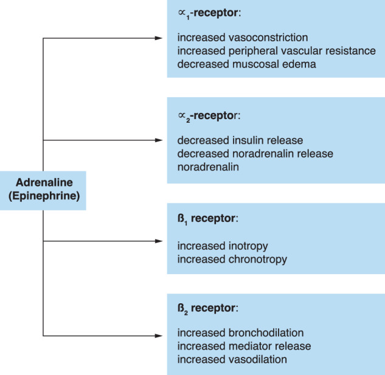
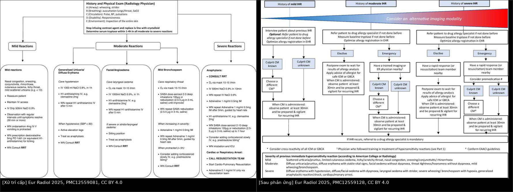
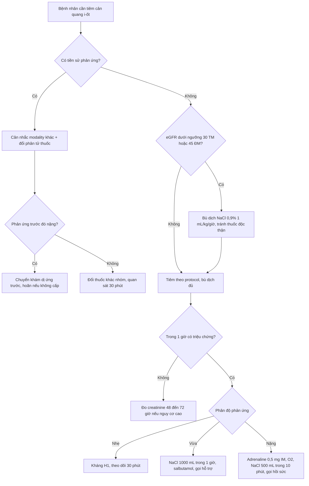
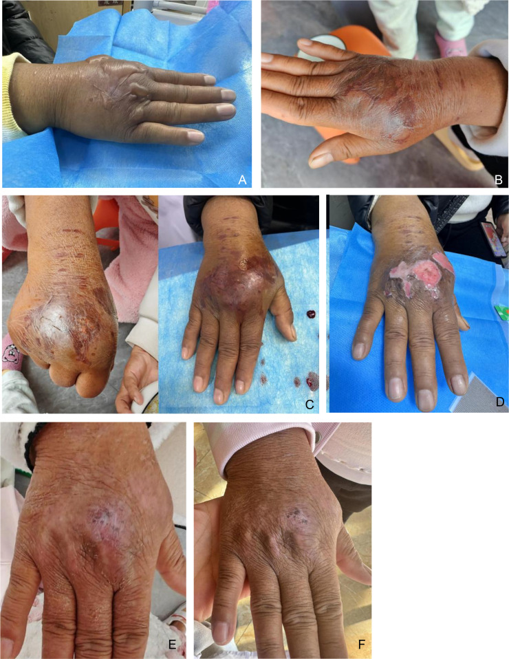
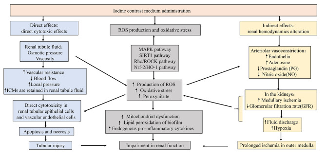

# 933 — Sốc phản vệ & bệnh thận do thuốc cản quang i-ốt / Contrast media hypersensitivity & PC-AKI

**Tags:** `pattern:soc-phan-ve` `pattern:ton-thuong-than-cap` `vung:toan-than` `score:ESUR-2025` `protocol:tiem-can-quang` `protocol:du-phong-PC-AKI`
**Mức chắc chắn (certainty):** tổng hợp y văn (literature synthesis) — biên từ toàn văn: hướng dẫn ESUR 2025 phần 1 (PMC12559081, CC BY 4.0) và phần 2 (PMC12559128, CC BY 4.0), tổng quan cơ chế–dự phòng PC-AKI (PMC11034108, CC BY 4.0), tổng quan dự phòng CA-AKI trong thủ thuật (PMC10803418, CC BY 4.0) và ca thoát mạch nặng (PMC13233547, CC BY 4.0). Số liệu lấy từ toàn văn, không lấy từ abstract gián tiếp.

## 1. Tổng quan — hai biến cố khác nhau, hai cơ chế khác nhau, hai cách xử trí

**Một mũi tiêm cản quang có thể gây hai chuyện hoàn toàn khác nhau, và người đọc phim phải tách chúng ra:**

**(A) Phản ứng quá mẫn (hypersensitivity reaction — HR):** biến cố **tức thời, miễn dịch/dị ứng**, xảy ra trong phút, đe dọa đường thở và huyết áp. Không liên quan đến chức năng thận.

**(B) Bệnh thận sau tiêm cản quang (post-contrast acute kidney injury — PC-AKI):** biến cố **âm thầm, 48–72 giờ**, đe dọa thận. Không liên quan đến dị ứng.

### TẠI SAO phản ứng quá mẫn xảy ra — và TẠI SAO "dị ứng i-ốt" là cách giải thích sai

- **Không phải i-ốt là dị nguyên.** ESUR 2025 nói thẳng: phản ứng quá mẫn **không do i-ốt hay gadolinium** gây ra; cái quyết định là **cả phân tử thuốc** (chuỗi bên, độ ion, độ thẩm thương) (PMC12559128). Hệ quả thực hành rất lớn: bệnh nhân "dị ứng cản quang" **không** phải kiêng i-ốt trong thuốc sát khuẩn/thyroid, và **không** cần tránh mọi thuốc cản quang như nhau — **đổi sang phân tử khác** là biện pháp dự phòng hiệu quả nhất (mục 4).
- **Cơ chế:** phần lớn là phản ứng **qua trung gian tế bào mast (mast cell)** — một phần IgE thật, phần lớn là hoạt hóa trực tiếp tế bào mast/bổ thể (trước đây gọi "anaphylactoid"). Dù đường nào, **histamin** là chất trung tâm: giãn mạch + tăng tính thấm mao mạch (mày đay, phù mặt, phù thanh quản) và co cơ trơn phế quản (khò khè) (PMC12559081, Fig. 3).
- **TẠI SAO adrenaline là thuốc số 1, không phải kháng histamin:** tụt huyết áp trong sốc phản vệ là **giãn mạch + thoát dịch**, không phải histamin đơn thuần. Adrenaline kích thích **α1** (co mạch, tăng sức cản ngoại vi), **β2** (giãn phế quản, giảm thoát dịch) và **β1** (tăng co bóp) — một thuốc sửa cả ba trục. Kháng H1 chỉ chặn ngứa/mày đay, **không** nâng huyết áp (PMC12559081).
- **Số liệu nằm lòng (ESUR 2025):** phản ứng tức thời với thuốc cản quang i-ốt **0,15–0,69%**, phản ứng **nặng 0,005–0,013%**; với gadolinium **0,06–0,17%**, nặng **0,003–0,006%** (PMC12559081). Nghĩa là: khoảng **1/150 đến 1/650** ca có phản ứng, và **1/8.000 đến 1/20.000** ca có phản ứng nặng — hiếm, nhưng mỗi khoa vẫn gặp vài lần mỗi năm.

*Adrenaline kích thích α1 (co mạch, giảm phù), β2 (giãn phế quản, giảm thoát dịch) và β1 (tăng co bóp) — vì vậy một thuốc sửa được cả tụt huyết áp, co thắt phế quản và phù đường thở. Nguồn: van der Molen AJ et al., Eur Radiol 2025 (PMC12559081), Fig. 3, CC BY 4.0 — nguyên bản, không ghép.*

### TẠI SAO PC-AKI lại "trễ" 48–72 giờ — và TẠI SAO creatinine là chỉ số tồi để quyết định tiêm

- **Cơ chế tổn thương ba lớp:** (1) **thiếu oxy vùng tủy thận** do co mạch (adenosin, endothelin) → vùng tủy vốn đã "đói oxy" nay càng thiếu; (2) **độ nhớt** tăng trong ống thận làm chậm dòng, kéo dài thời gian tiếp xúc tế bào ống; (3) **stress oxy hóa** (ROS) + độc tế bào trực tiếp → **hoại tử ống thận cấp**, apoptosis, pyroptosis (PMC11034108, Fig. 1).
- **TẠI SAO trễ:** creatinine chỉ phản ánh **GFR ở trạng thái ổn định**. Sau một cú giảm GFR đột ngột, creatinine cần **48–72 giờ** mới tích lũy đủ để vượt ngưỡng chẩn đoán. Vì vậy PC-AKI **luôn là chẩn đoán hồi cứu** — không thể "chờ creatinine" để quyết định có tiêm hay không. Quyết định phải dựa trên **eGFR ước tính trước tiêm**.
- **Ngưỡng chẩn đoán (KDIGO, dùng cho PC-AKI):** creatinine huyết thanh tăng **≥ 0,3 mg/dL (26,5 µmol/L) trong 48 giờ**, hoặc **≥ 1,5 lần giá trị nền trong 7 ngày** (PMC11034108).
- **Ngưỡng nguy cơ (ESUR 2018):** **eGFR < 45 mL/phút/1,73 m²** khi tiêm **động mạch**, **eGFR < 30** khi tiêm **tĩnh mạch** mới là yếu tố nguy cơ độc lập (PMC11034108 dẫn ESUR 2018). Đây là lý do một bệnh nhân 80 tuổi, teo cơ, creatinine "bình thường" vẫn có thể có eGFR 35.
- **Số liệu nặng:** ở người có bệnh thận mạn, tỉ lệ PC-AKI **tới 40%**; khoảng **13%** bệnh nhân nhập viện bị PC-AKI trở thành **phụ thuộc lọc máu vĩnh viễn**, tử vong chung **7–31%** (PMC11034108). Tiêm cản quang **lặp lại trong 48–72 giờ** làm tăng nguy cơ (PMC11034108) — vì thận chưa kịp hồi phục.
- **TẠI SAO "tiền mê corticoid" không cứu được PC-AKI:** corticoid không sửa được thiếu oxy tủy thận; và với phản ứng quá mẫn, bằng chứng cho tiền mê cũng yếu (mục 4).

## 2. Mẫu hình + chẩn đoán phân biệt theo thời điểm và theo cơ quan tổn thương (Gamut)

- **Theo thời điểm — câu hỏi đầu tiên luôn là "bao lâu sau tiêm?":**
  - **Tức thời (immediate, IHR):** trong **1 giờ**, đa số trong **20 phút** → mày đay, phù mạch, co thắt phế quản, tụt huyết áp.
  - **Muộn (non-immediate, NIHR):** từ **1 giờ đến 1 tuần** → dát sẩn (maculopapular exanthem), mày đay muộn, phù mạch muộn; hiếm nhưng nặng: **AGEP, DRESS, SJS/TEN** (nhóm SCAR).
- **Theo kiểu hình (phenotype) — gamut của IHR:**
  - **Chỉ da:** mày đay khu trú/ly tâm, ngứa, đỏ da → nhẹ.
  - **Da + phù:** phù mi, phù môi, phù thanh quản (khàn tiếng, khó nuốt) → vừa, nguy cơ đường thở.
  - **Hô hấp:** khò khè, co thắt phế quản, giảm SpO₂ → vừa đến nặng.
  - **Tuần hoàn:** tụt huyết áp, ngất, sốc → nặng (sốc phản vệ).
- **Gamut của "tụt huyết áp trong phòng chụp" — 4 thủ phạm hay bị gộp làm một:**
  - **Sốc phản vệ** (mày đay + co thắt phế quản + tụt HA, đáp ứng adrenaline).
  - **Phản ứng vagal (vasovagal)** — sợ kim, đau, đứng dậy đột ngột: **mạch chậm**, vã mồ hôi, tái nhợt, hồi phục nhanh khi **nằm đầu thấp**.
  - **Tụt HA do thuốc an thần/gây mê** hoặc do bệnh nền (nhồi máu cơ tim, thuyên tắc phổi) — không mày đay.
  - **Thoát mạch (extravasation)** gây đau dữ dội → kích thích vagal thứ phát, nhưng **có sưng căng tại chỗ tiêm**.
- **Gamut của "creatinine tăng sau tiêm" — không phải cứ tăng là do cản quang:** hoại tử ống thận do **hạ huyết áp/nhiễm trùng**, **tắc nghẽn** đường niệu, **thuốc độc thận khác** (NSAID, aminoglycosid, cisplatin), **thuyên tắc cholesterol** (sau can thiệp động mạch: ngón chân xanh, tàn nhang sống động, eosinophilia), **bệnh thận cấp do thuốc khác** hoặc **đợt cấp bệnh thận mạn**. PC-AKI là chẩn đoán **loại trừ + đúng thời điểm**.
- **Gamut của "đau/sưng tay sau tiêm":** thoát mạch (thuốc cản quang trong mô), **huyết khối tĩnh mạch** tại chỗ, **viêm mô tế bào**, **hội chứng khoang** (biến chứng nặng nhất của thoát mạch).

## 3. Bảng so sánh phân biệt (ma trận đối chiếu)

| Thực thể (entity) | Hình ảnh / dấu hiệu điển hình | Chốt vào (rule-in) | Chốt loại (rule-out) | Gợi ý xác nhận |
|---|---|---|---|---|
| **Sốc phản vệ (anaphylaxis)** | Mày đay/đỏ da + khò khè + tụt HA, khởi phát **trong phút** | **Mày đay/ngứa + co thắt phế quản + tụt HA**, đáp ứng **adrenaline 0,5 mg IM** | Không mày đay, **mạch chậm**, hồi phục khi kê chân → vagal | Đo tryptase **1–4 giờ** sau khởi phát; ghi giờ, thuốc, liều |
| **Phản ứng vagal (vasovagal)** | Tái nhợt, vã mồ hôi, **nhịp chậm**, HA tụt thoáng qua | **Nhịp chậm + hồi phục trong 1–2 phút khi nằm đầu thấp** | Có mày đay/phù thanh quản/khò khè → không phải vagal | Theo dõi mạch–HA liên tục; không dùng adrenaline |
| **Phản ứng da muộn (NIHR)** | Dát sẩn đối xứng, ngứa, xuất hiện **sau 6 giờ đến vài ngày** | **Khởi phát > 6 giờ sau tiêm**, toàn trạng ổn, không tụt HA | Khởi phát < 1 giờ → IHR | Chụp ảnh tổn thương; hẹn khám da liễu; ghi vào hồ sơ dị ứng |
| **SCAR (DRESS/SJS-TEN/AGEP)** | Đỏ da lan rộng, bọng nước, **niêm mạc loét**, sốt, tăng eosinophil | **Tổn thương niêm mạc + bọng nước + sốt + tăng eosinophil** | Chỉ mày đay khu trú, không niêm mạc → không phải SCAR | Chuyển da liễu **cấp**; **chống chỉ định** dùng lại thuốc |
| **PC-AKI** | Creatinine tăng **≥ 0,3 mg/dL trong 48 giờ** hoặc **≥ 1,5× trong 7 ngày**; không có hình ảnh đặc hiệu | **Đúng ngưỡng KDIGO + đúng thời điểm + không có nguyên nhân khác** | Có tụt HA/nhiễm trùng/tắc nghẽn/thuốc độc thận khác → gán cho nguyên nhân đó | Creatinine nền + 48–72 giờ; eGFR trước tiêm; siêu âm loại trừ tắc nghẽn |
| **Thoát mạch (extravasation)** | Sưng căng, đau bỏng tại chỗ tiêm; thuốc cản quang trong mô mềm nếu chụp lại | **Sưng căng + đau tại chỗ tiêm + bơm không đủ áp lực** | Sưng lan cả cánh tay, **dị cảm, mạch yếu, đau tăng vô lý** → hội chứng khoang | Đánh dấu vùng sưng, đo vòng chi, khám cảm giác/mạch ngoại vi; gọi ngoại khoa nếu nghi khoang |

*Trái: phân tầng nhẹ – vừa – nặng, liều adrenaline **0,5 mg IM** (đùi ngoài), NaCl 0,9% **1.000 mL/1 giờ** ở mức vừa; ngưỡng gọi đội hồi sức. Phải: với ca có tiền sử phản ứng, ưu tiên **đổi phân tử thuốc cản quang** và **cân nhắc modality khác**, quan sát **≥ 30 phút** sau tiêm. Nguồn: van der Molen AJ et al., *European Radiology* 2025 (PMC12559081 và PMC12559128), CC BY 4.0. Ảnh ghép letterbox.*

### Dấu hiệu quyết định trên bàn tiêm
- **"Đổi hình dạng" của mày đay:** mày đay lan nhanh ra ngoài vùng tiêm trong vài phút = phản ứng hệ thống, không phải phản ứng tại chỗ.
- **Khàn tiếng/thay đổi giọng** là dấu hiệu phù thanh quản sớm — nguy hiểm hơn cả mày đay toàn thân.
- **Bơm không đủ áp lực + trễ ngấm thuốc ở thì động mạch** là dấu hiệu **thoát mạch** trên màn hình theo dõi — dừng bơm ngay (ca PMC13233547 phát hiện đúng theo cách này).

## 4. Protocol tiêm cản quang + thang xử trí + ngưỡng

### 4.1. Trước tiêm — checklist 5 câu
1. **Có chỉ định thay thế không xạ/không cản quang không?** (siêu âm, MRI không gadolinium, X-quang) — với phản ứng nặng đã biết, ESUR 2025 đặt **cân nhắc modality khác** lên trước cả việc chọn thuốc (PMC12559128, Fig. 1).
2. **eGFR (không phải creatinine trần):** tiêm tĩnh mạch — ngưỡng nguy cơ **< 30**; tiêm động mạch — **< 45** (ESUR 2018). Nếu trên ngưỡng: vẫn tiêm, nhưng **ghi lý do** và **đo lại creatinine 48–72 giờ** nếu nguy cơ cao.
3. **Tiền sử phản ứng:** hỏi **tên thuốc cản quang cụ thể** + kiểu phản ứng + thời điểm. Đây là dữ kiện quyết định — **không** hỏi chung chung "có dị ứng gì không".
4. **Metformin:** metformin **không** là yếu tố nguy cơ PC-AKI (ESUR 2018); chỉ ngừng khi có **AKI hoặc eGFR < 30**; không cần ngừng chỉ vì tiêm cản quang (PMC11034108).
5. **Thuốc độc thận khác:** cân nhắc ngừng **NSAID, aminoglycosid, cisplatin** quanh thời điểm tiêm ở người eGFR thấp (PMC11034108).

### 4.2. Tiền mê (premedication) — quan điểm 2025 đã đổi
- **Không khuyến cáo tiền mê thường quy** cho mọi bệnh nhân có tiền sử phản ứng (ESUR 2025, PMC12559128). Không có bằng chứng corticoid giảm **phản ứng nặng**; bằng chứng cho phản ứng nhẹ–vừa yếu và mâu thuẫn.
- **Đổi phân tử thuốc cản quang hiệu quả hơn tiền mê.** Số liệu: dùng **cùng thuốc + corticoid** → tái phát **19%** (80/423 lần); **đổi thuốc, không corticoid** → **3%** (10/322 lần); **OR 0,14 (95% CI 0,06–0,33)** (PMC12559128). Phân tích đa biến: đổi thuốc giảm **67,1%** nguy cơ tái phát (OR 0,329; 95% CI 0,168–0,644). Lợi ích rõ hơn ở phản ứng **vừa–nặng** (OR 0,30) so với nhẹ (OR 0,51).
- **Tiền mê chỉ còn chỗ đứng trong tình huống cấp** (không thể hoãn, không có thuốc thay thế): theo EAACI, quan sát **≥ 30 phút** với đường truyền còn nguyên và sẵn sàng xử trí tái phát (PMC12559128).

### 4.3. Trong tiêm — thang xử trí (theo mức độ, ESUR 2025)
| Mức độ | Biểu hiện | Xử trí chính |
|---|---|---|
| **Nhẹ** | Mày đay khu trú, ngứa, đỏ da, nghẹt mũi | Ngừng tiêm; **kháng H1** (clemastine 2 mg); theo dõi **≥ 30 phút**; ghi hồ sơ |
| **Vừa** | Mày đay lan rộng, phù mặt, khò khè nhẹ | **NaCl 0,9% 1.000 mL/1 giờ**; kháng H1; **salbutamol** 2–4 nhịp (100 µg/nhịp) nếu khò khè; gọi đội hồi sức |
| **Nặng — sốc phản vệ** | Tụt HA, phù thanh quản, co thắt phế quản nặng | **Adrenaline 0,5 mg IM** mặt ngoài đùi (1 mg/mL), lặp theo nhịp tim; **O₂ 10–15 L/phút**; NaCl 0,9% **500 mL/10 phút**; gọi đội hồi sức |
| **Ngừng tim** | Không mạch | **CPR** ngay; adrenaline **0,1 mg IV** mỗi 3–5 phút theo phác đồ hồi sinh |

- **Lưu ý beta-blocker:** bệnh nhân đang dùng beta-blocker (chụp tim) có thể **không đáp ứng adrenaline** — thay bằng **glucagon** hoặc **dobutamine** (PMC12559081).
- **Tryptase:** lấy máu **1–4 giờ** sau khi phản ứng vừa–nặng khởi phát để xác nhận hoạt hóa tế bào mast; kèm **tryptase nền** khi khám dị ứng (PMC12559081, PMC12559128).

### 4.4. Thoát mạch — ngưỡng và xử trí
- **Tần suất 0,1–1,2%** các mũi tiêm cản quang cho CT; **biến chứng nặng << 1%** các ca thoát mạch, hay gặp nhất là **hội chứng khoang**, rồi loét/hoại tử da (ACR Manual on Contrast Media 2024).
- **Yếu tố nguy cơ:** người không giao tiếp được (trẻ, lớn tuổi, rối loạn ý thức), tuần hoàn chi kém, **chi đã xạ trị**, tiêm **mu tay/cổ tay/cổ chân**, thuốc cản quang **độ nhớt cao** (ACR 2024).
- **Xử trí:** dừng bơm ngay → **nâng cao chi** trên mức tim → đánh dấu vùng sưng, đo vòng chi, khám **mạch – cảm giác – hồi lưu mao mạch** → chườm (nóng hoặc lạnh, bằng chứng không rõ) → theo dõi vài giờ; **chỉ cho về khi triệu chứng giảm**. Không có bằng chứng ủng hộ hút lại thuốc qua kim hay tiêm hyaluronidase/corticoid tại chỗ (ACR 2024).
- **Gọi ngoại khoa khẩn:** đau tăng không tương xứng, **dị cảm**, mạch ngoại vi yếu, bọng nước, da tím — hội chứng khoang có thể xuất hiện **sớm nhất 6 giờ** sau thoát mạch (ACR 2024).

## 5. Biến thể bình thường và cạm bẫy

- **"Dị ứng hải sản" không phải chống chỉ định cản quang.** Dị ứng hải sản là dị ứng **protein**; thuốc cản quang i-ốt không chứa protein hải sản. ESUR 2025 khẳng định phản ứng **không do i-ốt** (PMC12559128). Dùng tiền sử này để bắt buộc tiền mê là **can thiệp không có bằng chứng**.
- **Cản quang i-ốt và gadolinium là hai hệ khác nhau:** dị ứng thuốc i-ốt **không** đồng nghĩa dị ứng gadolinium; ngược lại, đổi thuốc trong **cùng nhóm** mới là biện pháp chính (xem nhóm phân tử ở Fig. 2 của PMC12559128).
- **Mày đay thoáng qua do histamin giải phóng không đặc hiệu** có thể gặp mà không phải dị ứng thật; nhưng **không được** coi nhẹ nếu kèm khò khè/tụt HA — phân độ theo **triệu chứng nặng nhất**, không theo mày đay.
- **Tụt HA thoáng qua khi đứng dậy sau tiêm** dễ bị gọi là "sốc phản vệ": kiểm tra **nhịp tim** — nhịp chậm + hồi phục khi nằm = vagal.
- **Creatinine nền "bình thường" ở người già/teo cơ** che giấu eGFR thấp: luôn tính eGFR, đừng đọc creatinine trần.
- **Sai lầm "satisfaction of search" kinh điển:** thấy mày đay là dừng lại — bỏ sót **khò khè im lặng** (lưu lượng khí vào rất thấp) và **phù thanh quản**.
- **Thoát mạch ở mu tay/cổ tay** nguy hiểm hơn ở khuỷu vì khoang chật — đừng đánh giá thấp vì "lượng thuốc ít".

## 6. Tự lượng giá — Blind Quiz

**Ca 1 — Đang chụp CT bụng có cản quang, bệnh nhân đột ngột kêu ngứa và khó thở.**

- Gợi ý lâm sàng: nữ 54 tuổi, tiêm i-ốt tĩnh mạch được 3 phút; mày đay ở cổ + khò khè + HA 85/50 mmHg, mạch 118.
- Câu hỏi: Phân độ phản ứng? Thuốc đầu tay và liều? Hai việc phải làm song song? Lần sau chụp lại thì chuẩn bị gì?

<b>Bấm để hiện đáp án (findings + chẩn đoán)</b>

- **Phân độ: nặng — sốc phản vệ** (mày đay + co thắt phế quản + tụt HA, khởi phát trong phút).
- **Đầu tay: adrenaline 0,5 mg IM (1 mg/mL) mặt ngoài đùi**, lặp theo nhịp tim; **O₂ 10–15 L/phút**; **NaCl 0,9% 500 mL trong 10 phút**; gọi đội hồi sức. Kháng H1 **không** thay được adrenaline.
- **Song song:** dừng tiêm, giữ đường truyền, đo tryptase trong **1–4 giờ**, ghi hồ sơ dị ứng (tên thuốc + kiểu phản ứng).
- **Lần sau:** ưu tiên **modality khác**; nếu buộc phải cản quang → **đổi phân tử khác nhóm** (hiệu quả hơn tiền mê: tái phát **3%** so với **19%** khi dùng lại thuốc cũ + corticoid), khám dị ứng, quan sát **≥ 30 phút**.
- Nguồn: van der Molen AJ et al., *Eur Radiol* 2025 (PMC12559081, PMC12559128), CC BY 4.0.

**Ca 2 — Sau khi bơm cản quang bằng bơm áp lực vào mu tay, thấy sưng căng và đau bỏng.**

- Gợi ý lâm sàng: nữ 66 tuổi, tiền sử ung thư phổi đã mổ + hóa trị, tĩnh mạch ngoại vi kém; bơm 40 mL iohexol 350 mgI/mL ở 4 mL/s, thấy trễ ngấm thuốc ở thì động mạch.
- Câu hỏi: Dấu hiệu nào trên màn hình đã tố cáo biến chứng? Xử trí ngay? Khi nào gọi ngoại khoa?

<b>Bấm để hiện đáp án (findings + chẩn đoán)</b>

- **Thoát mạch (extravasation)**: trễ ngấm thuốc ở thì động mạch + sưng căng, đau bỏng tại chỗ tiêm. Tần suất chung **0,1–1,2%**; biến chứng nặng **<< 1%** ca thoát mạch.
- **Xử trí ngay:** dừng bơm, **nâng cao chi**, đánh dấu vùng sưng + đo vòng chi, khám mạch/cảm giác/hồi lưu mao mạch, chườm, theo dõi vài giờ.
- **Gọi ngoại khoa:** đau tăng vô lý, dị cảm, mạch yếu, bọng nước, da tím → **hội chứng khoang** (biến chứng nặng hay gặp nhất, có thể sớm nhất **6 giờ**).
- Hình: bọng nước căng ngày 1, tái phát ngày 5, dịch mủ ngày 7, hoại tử da ngày 8, rồi lành dần — diễn tiến viêm tại chỗ đỉnh **24–48 giờ**.
- Nguồn: Yang L et al., *Radiol Case Rep* 2026 (PMC13233547), CC BY 4.0; ngưỡng theo ACR Manual on Contrast Media 2024.

**Ca 3 — Bệnh nhân đái tháo đường, eGFR 28, được chỉ định CT có cản quang để đánh giá ổ bụng cấp.**

- Gợi ý lâm sàng: nam 72 tuổi, đái tháo đường type 2, creatinine 1,3 mg/dL (eGFR 28), đang dùng metformin và ibuprofen; không có tiền sử dị ứng.
- Câu hỏi: Có tiêm được không và cần chuẩn bị gì? Vì sao không thể "chờ creatinine sau tiêm rồi mới quyết"? Ngưỡng chẩn đoán PC-AKI là gì?

<b>Bấm để hiện đáp án (findings + chẩn đoán)</b>

- **Vẫn có thể tiêm nếu chỉ định cấp và cần thiết**, nhưng: **bù dịch NaCl 0,9% tĩnh mạch** (1 mL/kg/giờ; 0,5 mL/kg/giờ nếu suy tim/EF ≤ 35%), **ngừng NSAID**, xem lại metformin (ngừng nếu eGFR < 30/AKI), **giảm thể tích thuốc** ở mức đủ chẩn đoán.
- **Vì sao không chờ:** creatinine trễ **48–72 giờ**; PC-AKI là chẩn đoán **hồi cứu**, quyết định phải dựa trên **eGFR trước tiêm** (ngưỡng nguy cơ: **< 30** tĩnh mạch, **< 45** động mạch).
- **Ngưỡng chẩn đoán (KDIGO):** creatinine tăng **≥ 0,3 mg/dL trong 48 giờ** hoặc **≥ 1,5 lần nền trong 7 ngày**. Ở người bệnh thận mạn, PC-AKI tới **40%**; **13%** trở thành phụ thuộc lọc máu.
- **Cơ chế (hình):** thiếu oxy tủy thận + tăng độ nhớt ống thận + ROS → tổn thương tế bào ống thận; corticoid/kháng histamin **không** sửa được cơ chế này.
- Nguồn: Li Y, Wang J. *BMC Nephrol* 2024 (PMC11034108), CC BY 4.0.

## Bài liên quan chéo
- [932 – An toàn bức xạ trong can thiệp dưới CT/DSA](../932-an-toan-buc-xa-ct-dsa/lesson.md) (cùng nhóm "an toàn trong phòng can thiệp")
- [910 – Dẫn lưu: áp-xe, PTBD & thận qua da](../910-abscess-biliary-nephrostomy/lesson.md) (thủ thuật dùng cản quang lặp lại)
- [920 – Nút mạch cầm máu](../920-vascular-embolization-gi-bleed/lesson.md) (tiêm động mạch, nguy cơ PC-AKI cao hơn)
- [901 – Tổng quan Điện quang Can thiệp](../901-ir-overview/lesson.md)
- [164 – Nang thận trong ADPKD & biến chứng](../164-nang-than-adpkd-bien-chung/lesson.md) (đối chiếu "creatinine tăng sau tiêm" với bệnh thận mạn)

## Ảnh
- 5 ảnh gốc + 1 ảnh ghép, tất cả **CC BY 4.0**; nguồn và giấy phép từng file trong `images/CREDITS.md`.
- Ảnh ghép `composite_933_xu-tri-cap-va-phong-ngua-tai-phat.jpg` tạo bằng `tools/make_composite.py` (letterbox, giữ tỷ lệ, dải attribution).
- Hướng dẫn ACR Manual on Contrast Media 2024 và ESUR 2025 chỉ **dẫn link** (không tải PDF/ảnh).

> Không dùng để chẩn đoán độc lập khi chưa có người hướng dẫn.
