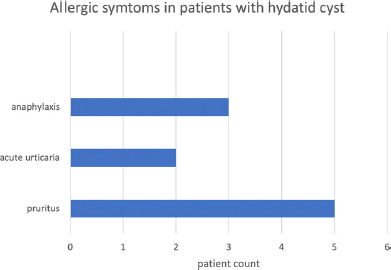
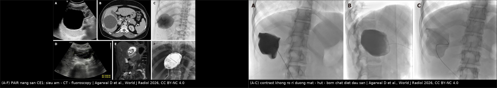
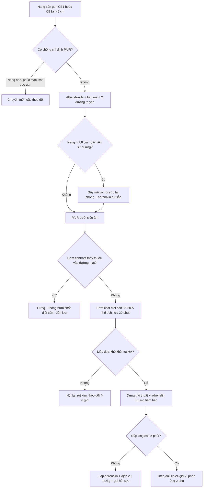
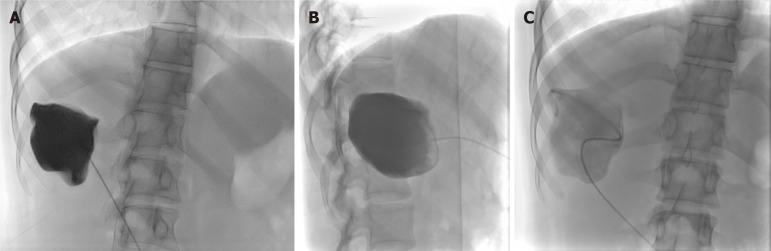

# 934 — Sốc phản vệ do vỡ nang sán khi can thiệp: PAIR, chọc hút & mổ / Anaphylaxis from a ruptured hydatid cyst

**Tags:** `pattern:soc-phan-ve` `vung:gan` `protocol:PAIR` `protocol:dieu-tri-nang-san`
**Mức chắc chắn (certainty):** tổng hợp y văn (literature synthesis) + 1 ca nguyên văn (verbatim case) — biên từ toàn văn các bài mở: tổng quan kỹ thuật can thiệp nang sán gan (Agarwal D et al., *World J Radiol* 2026, PMC13122038, CC BY-NC), ca sốc phản vệ trong PAIR ở trẻ 11 tuổi (Atay G et al., *North Clin Istanb* 2023, PMC10846569, CC BY-NC), loạt 104 bệnh nhân về triệu chứng dị ứng (Atik O et al., *North Clin Istanb* 2026, PMC13047262, CC BY-NC), nghiên cứu bệnh–chứng 16 ca sốc/43 ca chứng (Ye J et al., *Korean J Parasitol* 2016, PMC5266365, CC BY-NC), phác đồ xử trí sốc phản vệ (WAO White Book 2026, PMC12996770, CC BY-NC-ND) và tổng quan thực hành sốc phản vệ (PMC13155647, CC BY). Số liệu lấy từ toàn văn, không lấy từ abstract gián tiếp.

> **Phân vai với bài 632:** [632](../632-theo-doi-dai-han-nang-san-tai-phat/lesson.md) phủ **theo dõi dài hạn sau điều trị** (huyết thanh, albendazole chu kỳ, khi nào gọi tái phát) và chỉ có một tiểu mục ngắn về xử trí phản vệ. Bài này đi sâu **phía phòng can thiệp**: ai được PAIR theo WHO-IWGE, chuẩn bị gì trước khi chọc, phân tầng nguy cơ theo kích thước/xét nghiệm, và **phác đồ cấp cứu tại bàn chọc** với liều theo cân nặng + thời gian theo dõi phản ứng 2 pha.

## 1. Tổng quan — vì sao một mũi kim vào nang sán có thể làm bệnh nhân ngừng thở

- **Bệnh học:** nang sán gan (*Echinococcus granulosus*) gồm **màng ngoài do vật chủ (pericyst)**, **màng sán** và **dịch nang chứa đầu sán (protoscolex)**. Dịch nang là một **hỗn dịch kháng nguyên mạnh** — lipoprotein **antigen B** và các glycoprotein của màng sinh sản (PMC13122038).
- **TẠI SAO nang "căng" lại nguy hiểm hơn nang xẹp:** nang CE1/CE3a là **khoang dịch kín dưới áp lực**; chọc kim tạo **lỗ rò có diện tích nhỏ nhưng chênh áp lớn** → dịch phun theo đường kim ra **khoang phúc mạc hoặc vào tĩnh mạch**. Không cần "làm vỡ nang" mới có phản vệ: **chỉ cần một thể tích dịch đủ lớn tiếp xúc niêm mạc phúc mạc** (ca nguyên văn dưới đây xảy ra khi hút **200 mL** từ nang thứ hai — PMC10846569).
- **TẠI SAO phản vệ mà không chỉ là "ngứa":** hai đường cùng lúc — **(1) IgE trên tế bào mast/basophil** gặp kháng nguyên → bùng nổ histamin, tryptase, leukotrien; **(2) hoạt hóa bổ thể** sinh **C3a/C5a (anaphylatoxin)** — nên phản ứng kiểu "anaphylactoid" vẫn xảy ra ở người **không có IgE đặc hiệu** (PMC13047262). Hệ quả sinh lý: **giãn mạch + thoát dịch mao mạch** (tụt huyết áp, cô đặc máu) và **co thắt phế quản + phù thanh môn** (khó thở, giảm SpO₂) — chính là lý do **adrenalin** (α1 co mạch, β2 giãn phế quản, β1 tăng co bóp) là thuốc số 1, không phải kháng histamin (bài 933).
- **TẠI SAO eosinophil KHÔNG dùng để loại trừ:** chỉ **22% (23/104)** bệnh nhân nang sán có tăng eosinophil; trong ca nguyên văn, eosinophil **0,5% trước** và chỉ tăng **10,6% (AEC 82 → 1.400/µL) SAU** phản vệ (PMC13047262, PMC10846569). Eosinophil là dấu hiệu **muộn (giờ–ngày)**, không phải dấu hiệu cấp.
- **Ngưỡng định lượng nằm lòng:**
  - **Tỷ lệ vỡ nang sán (tự phát/chấn thương): 3–17%** (PMC10846569).
  - **Sốc phản vệ sau vỡ nang: ~2%** theo y văn được dẫn lại (PMC13047262).
  - **Loạt 104 bệnh nhân nang sán gan:** triệu chứng dị ứng **10/104 (9,6%)** — ngứa 5, mày đay cấp 2, **sốc phản vệ 3 (2,9%)**; **cả 3 ca phản vệ đều do nang vỡ vào đường mật trong ERCP** (PMC13047262).
  - **Loạt phẫu thuật sán 5 năm: 18/1.426 (1,26%)** sốc phản vệ chu phẫu (Ye J et al., dẫn trong PMC13047262).
  - **Bệnh–chứng 16 ca sốc vs 43 ca chứng (PMC5266365):** **IL-4 ≥ 415,67 ng/mL** → AUC **0,926**, Se **75,0%**, Sp **97,7%**; **nang ≥ 7,8 cm** → AUC **0,828**, Se **81,3%**, Sp **76,7%**; OR độc lập: IL-4 **1,096** (1,015–1,185; p = 0,02), kích thước nang **3,028** (1,259–7,283; p = 0,013). IgE trước mổ **233,1 vs 166,3 ng/mL** (p = 0,010); IgG **377,4 vs 247,8 g/L** (p < 0,001). Đơn vị của biến "kích thước" không ghi rõ trong bài → **dùng cut-off 7,8 cm** làm mốc thực dụng, không suy ra "mỗi cm tăng 3 lần".

*Ngứa 5, mày đay cấp 2, sốc phản vệ 3 trên 104 bệnh nhân nang sán gan — tức "một phần mười" có triệu chứng dị ứng, nhưng trong đó 1/3 là phản vệ thật. Nguồn: Atik O et al., North Clin Istanb 2026, Fig. 1, CC BY-NC 4.0 (nguyên bản).*

## 2. Mẫu hình + chẩn đoán phân biệt theo thời điểm và bối cảnh (gamut)

- **Mẫu hình đích:** bệnh nhân **đang được chọc/hút/bơm nang sán** (hoặc vừa mổ mở nang) đột ngột **ho, tức ngực, khó thở, mày đay, đỏ da, tụt huyết áp** trong **5–30 phút**; đáp ứng nhanh với **adrenalin**.
- **Gamut theo thời điểm (quyết định xử trí khác nhau):**
  - **Trong 0–30 phút (phản ứng tức thời):** dịch nang tràn vào phúc mạc/tĩnh mạch; **cản quang i-ốt** vừa bơm để kiểm tra thông nang–mật; **thuốc tê/gây mê/kháng sinh** vừa dùng; **latex** găng tay/bộ dụng cụ.
  - **30 phút – 6 giờ (phản ứng muộn do hấp thu):** dịch nang còn đọng trong phúc mạc tiếp tục hấp thu kháng nguyên; **phản ứng 2 pha (biphasic)** sau khi đã ổn định.
  - **6–24 giờ:** phản ứng 2 pha nặng (đã gặp tới **12–24 giờ** ở ca nặng/lặp adrenalin — PMC13155647); hoặc **sốc nhiễm trùng** do nang bội nhiễm/áp-xe đường mật (sốt, bạch cầu, mủ) — không phải phản vệ.
- **Gamut theo cơ chế — 6 nhóm phải tách:**
  1. **Quá mẫn do kháng nguyên sán** (IgE ± bổ thể) — đích của bài này.
  2. **Quá mẫn do thuốc cản quang i-ốt** — PAIR **có** bơm cản quang (bài 933).
  3. **Quá mẫn do thuốc khác** (beta-lactam dự phòng, chlorhexidine sát khuẩn, thuốc tê, giãn cơ).
  4. **Phản ứng vasovagal** — **nhịp chậm**, da lạnh ẩm, không mày đay, hồi phục khi nằm đầu thấp.
  5. **Sốc nhiễm trùng** do nang bội nhiễm/vỡ mủ vào phúc mạc — sốt, thở nhanh, bạch cầu tăng.
  6. **Biến cố cơ học** — **tràn khí màng phổi áp lực** (nang gan vòm hoành), **tắc mạch khí**, **chảy máu trong nang/đường mật** (nhịp nhanh, Hct giảm, không mày đay).
- **Mnemonic "SÁN–VỠ" khi đứng trước một ca tụt huyết áp trong phòng can thiệp nang sán:** **S**án (antigen) · **Á**p lực (tràn khí) · **N**hiễm trùng · **V**agal · **Ỡ** (dịch thoát – mất máu) — mỗi chữ là một hướng kiểm tra trong 60 giây đầu.

## 3. Bảng so sánh phân biệt (ma trận đối chiếu)

| Thực thể (entity) | Hình ảnh / bối cảnh điển hình | Chốt vào (rule-in) | Chốt loại (rule-out) | Gợi ý xác nhận |
|---|---|---|---|---|
| **Sốc phản vệ do vỡ nang sán** | Đang chọc/hút nang **CE1–CE3a căng**, dịch chảy ra ngoài đường kim hoặc vào phúc mạc | **Mày đay/đỏ da + co thắt phế quản/tụt HA trong 5–30 phút sau khi dịch tràn**, đáp ứng adrenalin | Không có mày đay nhưng **nhịp chậm + hồi phục khi kê cao chân** → vasovagal; sốt + bạch cầu → nhiễm trùng | Lâm sàng + đáp ứng adrenalin; eosinophil/IgE **sau** (muộn) |
| **Phản ứng cản quang i-ốt** | Vừa bơm contrast vào nang để loại thông nang–mật (bước bắt buộc của PAIR) | **Trước đó đã tiêm cản quang tĩnh mạch/trong nang vài phút**, tiền sử phản ứng cản quang | Phản ứng xảy ra **trước** khi bơm bất kỳ cản quang nào → không phải do cản quang | Bài 933; ngừng cản quang, xử trí như phản vệ |
| **Vasovagal** | Đau khi chọc, bệnh nhân lo lắng, **nhịp chậm**, vã mồ hôi | **Nhịp chậm + HA tụt nhưng da ấm lại nhanh khi nằm**, không mày đay/co thắt phế quản | Mày đay + khò khè + nhịp nhanh → phản vệ | Nằm đầu thấp, atropin nếu nhịp chậm kéo dài; **không dùng adrenalin** |
| **Sốc nhiễm trùng do nang bội nhiễm** | Nang có mức khí-dịch, sốt trước thủ thuật, mủ khi hút | **Sốt + bạch cầu tăng + mủ hôi**, tụt HA kiểu giãn mạch kéo dài | Mày đay, co thắt phế quản, đáp ứng adrenalin tức thì → phản vệ | Cấy dịch nang/máu, kháng sinh, dẫn lưu |
| **Tràn khí màng phổi áp lực / tắc mạch khí** | Nang gan **vòm hoành**, bơm khí vào nang, hoặc catheter vào tĩnh mạch | **Giảm SpO₂ đơn thuần/lệch phổi + gõ vang**, tụt HA kiểu chèn ép tim | Có mày đay + khò khè lan tỏa hai phổi → phản vệ | Siêu âm phổi/CT cấp; chọc giải áp nếu áp lực |
| **Chảy máu trong nang / đường mật** | Nang lớn, hút ra máu tươi, đau tức vùng gan | **Nhịp nhanh + Hct giảm + dịch hút ra có máu**, không mày đay | Tụt HA kèm mày đay/khò khè → phản vệ | CT có cản quang/DSA; truyền máu |
| **Ngộ độc cồn (flush reaction)** | Bơm **cồn 95–99%** vào nang, hấp thu nhanh | **Đỏ bừng mặt/thân, chóng mặt, nôn, hơi thở mùi cồn**, HA thường ổn | Có co thắt phế quản/tụt HA thật + mày đay → phản vệ | Ngừng bơm, thở oxy, dịch; tự hết |

*Trái (A–F): nang CE1 — (A) siêu âm dịch đồng nhất, (B) CT trục, (C) fluoroscopy đặt catheter, (D) siêu âm đo nang, (E) CT sau khi nang xẹp, (F) fluoroscopy bơm contrast kiểm tra. Phải (A–C): bơm contrast **không rò vào đường mật** → hút → bơm chất diệt đầu sán. Chính bước bơm/hút này là lúc dịch nang có thể tràn ra ngoài. Nguồn: Agarwal D et al., World J Radiol 2026, Fig. 5–6, CC BY-NC 4.0 (ảnh ghép letterbox, giữ tỷ lệ).*

## 4. Protocol can thiệp + phân tầng nguy cơ + xử trí cấp cứu tại phòng

### 4.1. Ai được can thiệp (ngưỡng chọn bệnh, WHO-IWGE)

| Loại nang (WHO) | Kích thước | Xử trí ưu tiên | Can thiệp qua da? |
|---|---|---|---|
| **CE1** (dịch đồng nhất) | **> 5 cm** | **PAIR + benzimidazole** | Có |
| **CE1** | **< 5 cm** | **Benzimidazole** đơn thuần, theo dõi | Không (khoang quá nhỏ để làm đủ 4 bước) |
| **CE3a** (màng tách rời) | **> 5 cm** | **PAIR + benzimidazole** | Có |
| **CE2 / CE3b** (nhiều nang con) | **< 5 cm** | Benzimidazole | Không |
| **CE2 / CE3b** | **> 5 cm** | **Mổ** (± benzimidazole); thay thế: **MoCAT** | Chỉ khi có chống chỉ định mổ |
| **CE4 / CE5** (không hoạt động) | Bất kỳ | **Theo dõi "watch and wait"** | Không |

*Nguồn bảng: Agarwal D et al., World J Radiol 2026 (PMC13122038), Fig. 3 — thuật toán theo WHO-IWGE.*
- **Chống chỉ định PAIR:** nang **não** và **phúc mạc** (không có nhu mô đỡ quanh nang → dịch tràn tự do), nang **sát bao gan/exophytic** (dịch rò vào ổ bụng), rối loạn đông máu, **thông nang–đường mật chưa loại trừ** (bơm chất diệt sán vào đường mật → xơ hóa đường mật, bài 106).

*Nang "hoạt động/chuyển tiếp" (CE1, CE3a, CE2, CE3b) mới cần can thiệp; CE4/CE5 theo dõi. Đây là lý do phần lớn ca "nang sán tình cờ" không có chỉ định chọc — và mỗi lần chọc là một lần đặt bệnh nhân trước nguy cơ phản vệ. Nguồn: Agarwal D et al., World J Radiol 2026, Fig. 3, CC BY-NC 4.0 (nguyên bản).*

### 4.2. Chuẩn bị trước can thiệp — 6 việc bắt buộc

1. **Benzimidazole (albendazole 10–15 mg/kg/ngày, chia 2 lần):** theo WHO-IWGE khởi đầu **1 ngày trước** thủ thuật và tiếp **1 tháng** sau nếu không có tràn dịch trong mổ (PMC13122038); thực hành nhiều trung tâm dùng **3–7 ngày trước** (ca nguyên văn: 7 ngày trước, tiếp 1 tháng — PMC10846569; ca khác: 3 ngày trước, tiếp 3 tháng — PMC13019174). **Bài nguồn không thống nhất thời điểm khởi đầu** → ghi rõ trong hồ sơ, không coi albendazole là "bảo hiểm chống phản vệ".
2. **Tiền mê kháng histamin + corticoid** theo quy trình của đơn vị (PMC13122038) — tác dụng dự phòng **chưa được chứng minh** cho phản vệ do kháng nguyên sán; **không được thay thế** việc chuẩn bị adrenalin.
3. **Hai đường truyền tĩnh mạch lớn** + monitor SpO₂/ECG/HA liên tục.
4. **Adrenalin rút sẵn** (ống 1 mg/mL) trong tầm tay + **bộ đặt nội khí quản, mask, suction, oxy** ngay tại phòng (PMC13122038).
5. **Gây mê/bác sĩ hồi sức đứng cùng** với ca nang **> 7,8 cm** hoặc có tiền sử dị ứng — nhóm nguy cơ cao theo PMC5266365.
6. **Bảng kiểm "dừng ngay khi":** ho, tức ngực, khò khè, mày đay, SpO₂ giảm > 5%, HA tụt > 20 mmHg, hoặc bệnh nhân "thấy không ổn".

### 4.3. Kỹ thuật PAIR — các con số quyết định an toàn

- **Kim 18G** chọc **xuyên một lớp nhu mô gan lành** (giảm rò dịch và chảy máu), dưới siêu âm ± fluoroscopy/CT (PMC13122038).
- **Hút 20% thể tích dịch** → **bơm contrast ~10% thể tích** để **loại thông nang–đường mật** (nhìn thấy thuốc vào đường mật = **dừng**, không bơm chất diệt sán).
- **Chất diệt đầu sán: 35–50% thể tích nang**, lưu **20 phút** rồi hút lại: **cồn 95%**, **NaCl 20%**, cetrimide 0,1%, povidone-iodine 10% (PMC13122038). Trong ca nguyên văn: bơm **80 mL NaCl 20%**, chờ **20 phút**, rồi hút (PMC10846569).
- **Nguyên tắc vàng:** mọi thao tác bơm/hút đều có thể **đẩy dịch nang ra ngoài** — nguy cơ cao nhất là **nang thứ hai trở đi** (khi đội ngũ đã "qua" nang đầu và cảnh giác giảm; ca nguyên văn phản vệ đúng ở nang thứ hai).

### 4.4. Xử trí phản vệ tại phòng can thiệp — theo thứ tự, không chờ xét nghiệm

| Bước | Việc làm | Con số / liều |
|---|---|---|
| 1 | **Dừng ngay** bơm/hút, gọi hỗ trợ, để bệnh nhân nằm, thở oxy lưu lượng cao | — |
| 2 | **Adrenalin tiêm bắp mặt trước ngoài đùi** | **0,5 mg** (tuổi teen/người lớn); **0,3 mg** (6–12 tuổi); **0,15 mg** (1–5 tuổi); **0,01 mg/kg** (nhũ nhi < 10 kg = 0,01 mL/kg dung dịch 1 mg/mL); **tối đa 0,5 mg** — lặp mỗi **5 phút** nếu chưa đáp ứng |
| 3 | **Dịch tinh thể tĩnh mạch** khi tụt HA | **20 mL/kg** (trẻ), lặp theo đáp ứng |
| 4 | Corticoid liều duy nhất (không thay adrenalin) | **hydrocortison 200 mg IV** (người lớn); trẻ theo cân nặng |
| 5 | Kháng histamin H1 (chỉ triệu chứng da) | **không được làm chậm adrenalin** |
| 6 | Đặt nội khí quản khi phù thanh môn/khò khè không đáp ứng; salbutamol khí dung nếu co thắt phế quản dai dẳng | — |
| 7 | Theo dõi phản ứng 2 pha | **4–6 giờ** (nhẹ); **12–24 giờ** (nặng hoặc lặp adrenalin) |

*Liều adrenalin: WAO White Book 2026 (PMC12996770); bậc thang xử trí, dịch và thời gian theo dõi: PMC13155647. Lưu ý thực tế: adrenalin **bị dùng muộn hoặc không dùng tới ~50%** ca trong các khảo sát thực hành.*

## 5. Biến thể bình thường và cạm bẫy

- **"Đã uống albendazole thì an toàn":** albendazole làm giảm sức sống đầu sán, **không trung hòa kháng nguyên đã tràn** và **không chặn phản ứng IgE**. Ca nguyên văn đã uống albendazole **7 ngày** trước PAIR vẫn phản vệ (PMC10846569).
- **Bỏ qua "chỉ mày đay":** mày đay đơn thuần là **bậc thang đầu**, có thể tiến triển trong vài phút; ở bệnh nhân đang thủ thuật, **ngứa/mày đay = tín hiệu dừng** để đánh giá trước khi bơm tiếp.
- **Nhầm vasovagal với phản vệ:** vasovagal **nhịp chậm**, không mày đay, hồi phục khi nằm đầu thấp; dùng adrenalin cho vasovagal gây **nhịp nhanh, tăng HA không cần thiết**.
- **Nhầm với phản ứng cản quang:** PAIR **bắt buộc** bơm cản quang để loại thông nang–mật → **cùng một phòng, hai dị nguyên khác nhau trong 10 phút**. Ghi lại **mốc thời gian** từng lần bơm (cản quang, chất diệt sán, kháng sinh) để truy nguyên.
- **Quên phản ứng 2 pha:** bệnh nhân hết mày đay sau 1 liều adrenalin **không có nghĩa là xong** — cho về sau **4–6 giờ** (nhẹ), **12–24 giờ** (nặng/lặp liều).
- **Dùng eosinophil để trấn an:** **78%** bệnh nhân nang sán **không tăng eosinophil**; AEC bình thường không loại trừ phản vệ.
- **Nang đã vôi hóa một phần (CE5) nhưng còn dịch:** vôi hóa **không đồng nghĩa bất hoạt hoàn toàn**; nếu còn khoang dịch và định chọc → vẫn phải chuẩn bị như nang hoạt động.
- **Cạm bẫy mặt cắt:** trên CT, **nang sán vỡ vào đường mật** có thể chỉ biểu hiện **giãn đường mật trong gan + mất liên tục thành nang** — đọc là "giãn đường mật do sỏi" và bỏ qua nguồn phản vệ. Luôn đối chiếu **vị trí nang với đường mật giãn** (bài 139).

## 6. Tự lượng giá — Blind Quiz

**Ca 1 — Bé gái 11 tuổi, 2 nang sán gan (5,5 cm và 7 cm), PAIR dưới gây mê. Nhìn hình và đoán bước nào đã gây ra biến cố.**

- Gợi ý lâm sàng: nang thứ nhất 5,5 cm đã hút **120 mL**, bơm **80 mL NaCl 20%** trong **20 phút**, dung nạp tốt. Sang nang thứ hai 7 cm: hút **200 mL** thì bệnh nhân **co thắt phế quản**.
- Câu hỏi: (1) Ba chẩn đoán phân biệt cho tình trạng co thắt phế quản + tụt HA lúc này? (2) Dấu hiệu nào trên hình giúp loại một nguyên nhân? (3) Xử trí đầu tay?

<b>Bấm để hiện đáp án (findings + chẩn đoán)</b>

- Dấu hiệu: hình fluoroscopy cho thấy **contrast trong khoang nang, không thấy thuốc vào đường mật** → loại được nguyên nhân "bơm chất diệt sán vào đường mật".
- Chẩn đoán: **sốc phản vệ do kháng nguyên dịch nang tràn ra** khi hút nang thứ hai (200 mL) — cơ chế IgE/bổ thể trên tế bào mast. Ca nguyên văn: bệnh nhân được **adrenalin tĩnh mạch + methylprednisolon + kháng histamin**, **đặt nội khí quản 4 giờ**, ra ICU; eosinophil **0,5% → 10,6%**, AEC **82 → 1.400/µL**; nang xẹp hoàn toàn trên siêu âm ngày 2.
- Phản biện: đây là ca **nhi** dùng adrenalin **tĩnh mạch** trong môi trường gây mê có monitor — ngoài môi trường đó, **đường tiêm bắp** là đường chuẩn (0,01 mg/kg, tối đa 0,5 mg).
- Nguồn ảnh: Agarwal D et al., *World J Radiol* 2026, Fig. 6, CC BY-NC 4.0 (PMC13122038).
- Ca: Atay G et al., *North Clin Istanb* 2023 (PMC10846569).

**Ca 2 — Nam 45 tuổi, nang sán gan 4 cm, không triệu chứng. Gia đình xin "chọc hút cho nhanh". Đọc bảng phân loại và trả lời.**

- Gợi ý: nang CE1, **4 cm**, xét nghiệm gan bình thường, không triệu chứng chèn ép.
- Câu hỏi: Có chỉ định PAIR không? Nếu không, làm gì và theo dõi thế nào?

<b>Bấm để hiện đáp án</b>

- Dấu hiệu: nang **CE1 < 5 cm** → nhánh **benzimidazole** trên thuật toán; PAIR chỉ đặt ra cho **CE1/CE3a > 5 cm** (khoang < 5 cm không đủ chỗ cho đủ 4 bước và nguy cơ rò cao hơn lợi ích).
- Chẩn đoán/thực hành: **albendazole 10–15 mg/kg/ngày** + theo dõi hình ảnh **3–6 tháng/lần**, sau khi nang bất hoạt thì theo dõi **≥ 5 năm** (PMC13122038). Giải thích cho gia đình: mỗi lần chọc là một lần đặt bệnh nhân trước **phản vệ 2–3%** và nguy cơ **gieo rắc phúc mạc**.
- Nguồn ảnh: Agarwal D et al., *World J Radiol* 2026, Fig. 3, CC BY-NC 4.0.

**Ca 3 — Đọc biểu đồ: "nang sán hiếm khi gây dị ứng" có đúng không?**

- Gợi ý: 104 bệnh nhân nang sán gan, phỏng vấn chi tiết triệu chứng dị ứng.
- Câu hỏi: Bao nhiêu phần trăm có triệu chứng dị ứng? Trong số đó, bao nhiêu là phản vệ? Điều này thay đổi cách bạn tư vấn trước thủ thuật thế nào?

<b>Bấm để hiện đáp án</b>

- Dấu hiệu: **10/104 (9,6%)** có triệu chứng — ngứa **5**, mày đay cấp **2**, **phản vệ 3 (2,9%)**; **cả 3 ca phản vệ xảy ra khi nang vỡ vào đường mật trong ERCP**, không phải tự phát.
- Chẩn đoán/thực hành: tư vấn trước thủ thuật phải nêu **nguy cơ phản vệ ~2–3%** khi có vỡ/tràn dịch, và **1,26% (18/1.426)** trong loạt mổ sán 5 năm; **eosinophil chỉ tăng ở 22%** nên không dùng để sàng lọc.
- Nguồn ảnh: Atik O et al., *North Clin Istanb* 2026, Fig. 1, CC BY-NC 4.0.

## Bài liên quan chéo
- [139 – Nang sán gan: phân độ WHO-IWGE CE1–CE5, dấu màng tách, PAIR & albendazole](../139-san-la-gan/lesson.md) (chẩn đoán và chọn đường điều trị)
- [632 – Theo dõi dài hạn & dự phòng tái phát nang sán](../632-theo-doi-dai-han-nang-san-tai-phat/lesson.md) (sau điều trị: huyết thanh, albendazole chu kỳ, tái phát)
- [106 – Xơ hóa đường mật do chất diệt đầu sán](../106-xo-hoa-duong-mat-do-chat-diet-dau-san/lesson.md) (biến chứng của chính bước bơm chất diệt sán)
- [144 – Sán thể hang ở gan](../144-san-the-hang-o-gan/lesson.md) (khối giả u, khác hoàn toàn về can thiệp)
- [933 – Sốc phản vệ & bệnh thận do thuốc cản quang i-ốt](../933-an-toan-thuoc-can-quang/lesson.md) (cùng phòng, khác dị nguyên — phác đồ adrenalin dùng chung)
- [932 – An toàn bức xạ trong can thiệp dưới CT/DSA](../932-an-toan-buc-xa-ct-dsa/lesson.md) (PAIR dưới fluoroscopy)
- [910 – Dẫn lưu áp-xe, PTBD & thận qua da](../910-abscess-biliary-nephrostomy/lesson.md) (kỹ thuật đặt catheter trong nang)
- [901 – Tổng quan Điện quang Can thiệp](../901-ir-overview/lesson.md)

## Ảnh
- 4 ảnh gốc + 1 ảnh ghép: `934_pair-cac-buoc_US-CT_…` (Fig. 5), `934_pair-fluoroscopy_…` (Fig. 6), `934_who-phan-loai_…` (Fig. 3), `934_trieu-chung-di-ung_…` (Fig. 1). Nguồn và giấy phép từng file trong `images/CREDITS.md`.
- Ảnh PMC13122038 và PMC13047262 là **CC BY-NC 4.0** (không ND): dùng nguyên bản; composite ghép hai ảnh **cùng bài CC BY-NC**, letterbox giữ tỷ lệ, dải attribution.
- Không tải ảnh từ Radiopaedia/AuntMinnie; các ca minh họa chỉ dẫn link trong `sources.md`.

> Không dùng để chẩn đoán độc lập khi chưa có người hướng dẫn.
