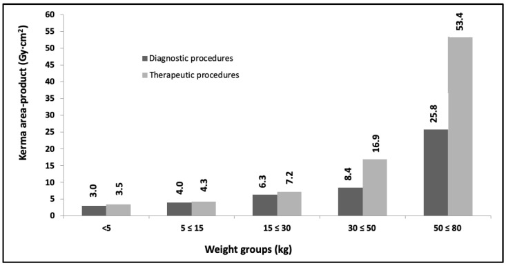
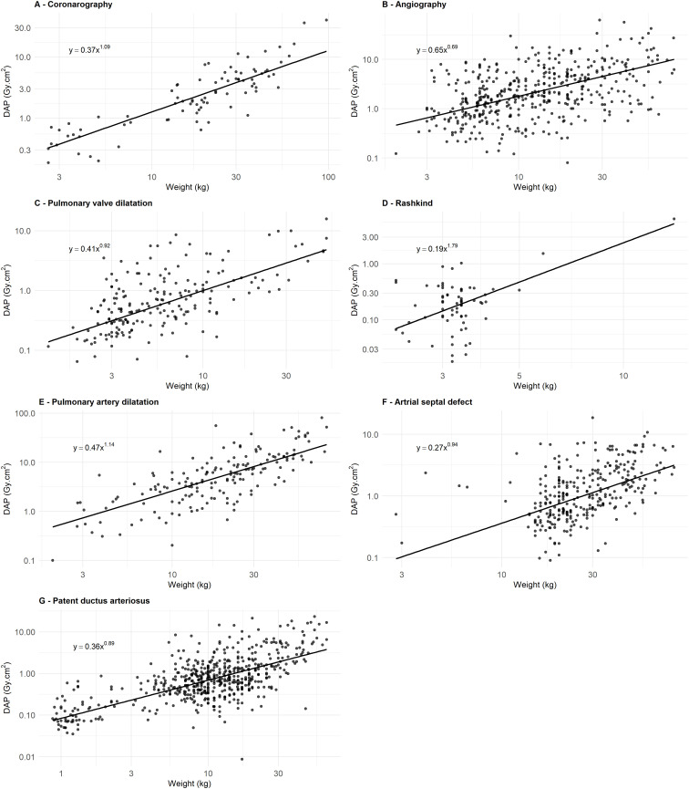
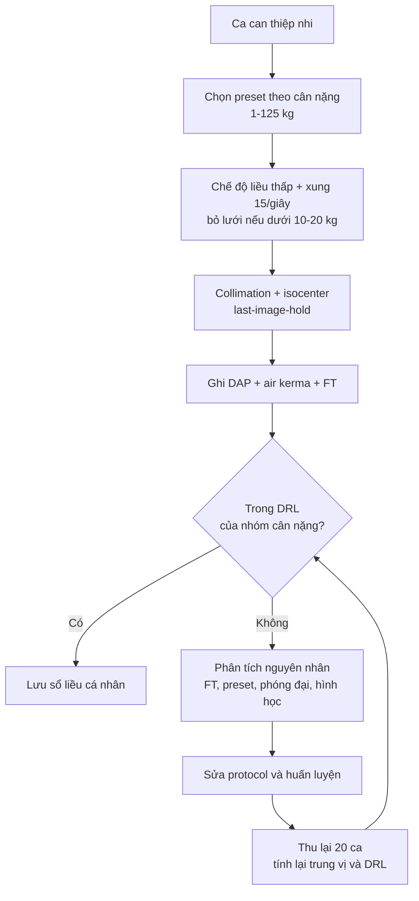
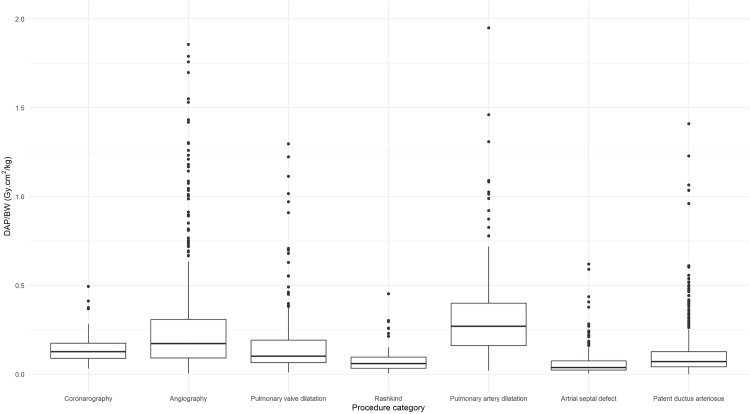

# 935 — Tối ưu liều can thiệp NHI: DRL theo kích thước cơ thể, preset theo cân nặng và theo dõi liều tích lũy / Pediatric interventional dose optimization

**Tags:** `pattern:lieu-buc-xa-cao` `vung:toan-than` `score:DRL` `score:DAP` `protocol:ALARA` `protocol:preset-theo-can-nang`

**Mức chắc chắn (certainty):** tổng hợp y văn (literature synthesis) — **đồng thuận chuyên gia PICS/AEPC/APPCS/CSANZ/SCAI/SOLACI 2024** về thông tim nhi (*J Soc Cardiovasc Angiogr Interv* 2024, **PMC11307799**, CC BY); **1.815 ca can thiệp tim nhi** 7 bệnh viện Pháp trong dự án HARMONIC (*PLoS One* 2025, **PMC12443263**, CC BY 4.0); **DRL theo nhóm cân nặng của OPRIPALC** (*Children* 2023, **PMC10742238**, CC BY 4.0); **đoàn hệ 3.609 trẻ tim bẩm sinh** Na Uy (*Pediatr Radiol* 2023, **PMC10635954**, CC BY); **tổng quan hệ thống DRL fluoroscopy nhi** (**PMID 41671884**, không mở) và **nghiên cứu hệ số chuyển DAP→liều hiệu dụng** (**PMID 33836530**, không mở). Không có ảnh bệnh nhân thật — 3 ảnh đều là **biểu đồ liều** từ bài CC BY.

> **Câu chốt:** Trẻ **không phải "người lớn thu nhỏ"**. Cùng một **DAP**, **liều hiệu dụng ở trẻ sơ sinh cao hơn trẻ 15 tuổi tới ~10 lần** (hệ số chuyển DAP→ED khác nhau **1 bậc độ lớn**, PMID 33836530) — vì vậy **ngưỡng DRL phải chia theo CÂN NẶNG**, và câu hỏi đúng không phải "DAP bao nhiêu là nhiều" mà là **"ca này thuộc nhóm cân nặng nào, đang vượt bao nhiêu lần DRL, và vượt vì thời gian chiếu hay vì chế độ máy"**.

## 1. Tổng quan bệnh học – cơ chế hình ảnh

- **Vì sao trẻ nhạy cảm hơn (sinh học):** mô đang lớn có **hoạt động phân bào cao** → nhạy với bức xạ hơn; trẻ có **tuổi thọ còn dài** để biểu hiện hiệu ứng ngẫu nhiên; bệnh tim bẩm sinh thường phải **can thiệp lặp lại nhiều lần trong đời** (PICS 2024, **PMC11307799**). Mô hình rủi ro dùng trong thực hành là **tuyến tính không ngưỡng (LNT)** — không có ngưỡng "an toàn tuyệt đối".
- **Vì sao DAP không tỉ lệ với rủi ro:** **DAP (KAP) = air kerma × diện tích trường chiếu (Gy·cm²)**. Trẻ nhỏ có **trường chiếu nhỏ** → DAP **thấp**, nhưng **cùng DAP lại dồn vào khối mô nhỏ hơn** → **liều hiệu dụng (ED) cao hơn**. Số liệu: hệ số chuyển DAP→ED **khác nhau ~10 lần giữa sơ sinh và 15 tuổi**, và **ED tối đa 26 mSv** ghi nhận ở nhóm sơ sinh (**PMID 33836530**).
- **Ba đại lượng phải đọc cùng lúc (và đừng lẫn):**
  - **DAP/KAP (Gy·cm²)** — tổng "lượng bức xạ × diện tích", dùng để **so sánh với DRL** và tính ED.
  - **Air kerma tại điểm tham chiếu IRP (mGy)** — xấp xỉ **liều da lối vào**, dùng cho **hiệu ứng tất định** (ban đỏ, rụng tóc); đo ở **15 cm từ isocenter** về phía bóng.
  - **Thời gian chiếu (FT, phút)** — **không phải liều**, chỉ là **đại diện cho độ phức tạp**; PICS nói rõ FT **không dùng để đo liều**.
- **Vì sao trẻ vẫn có thể nhận liều "người lớn":** máy xuất xưởng **cấu hình mặc định cho người lớn** ("out of the box"); nếu không đổi preset theo cân nặng thì **kV, lọc, lưới, tốc độ khung hình** đều của người lớn → DAP tăng gấp nhiều lần (**PMC11307799**).
- **Số liệu nền để hiệu chỉnh trực giác:** trong **3.609 trẻ** tim bẩm sinh (**PMC10635954**), **91,0%** lượt chụp là **X-quang thường quy**, chỉ **4,0%** là CT; ED trung vị **0,008–0,02 mSv** cho X-quang ngực và **0,76–3,47 mSv** cho CT ngực — nhưng vì **số lần chụp nhiều** (4–12% trẻ có **≥ 10 phim ngực**), X-quang ngực đóng góp **28–65%** tổng liều của CT ngực (**40%** khi gộp mọi tuổi). Bài học: **liều thấp × rất nhiều lần ≠ ít**.
- **Định nghĩa DRL (ICRP 135) — dùng đúng thuật ngữ:** **giá trị điển hình (typical value) = trung vị** của phân bố liều; **DRL = bách phân vị 75** của phân bố **trung vị từng cơ sở** cho **một loại thủ thuật × một nhóm cân nặng/tuổi**; cỡ mẫu tối thiểu **20 bệnh nhân** (10 nếu thủ thuật hiếm). Vượt DRL **không phải "sai"** mà là **tín hiệu phải rà soát quy trình**.
- **Con số DRL thực tế (HARMONIC, 534 ca chẩn đoán + 1.281 ca điều trị, 5 nhóm cân nặng):** DAP trung vị tăng theo cân nặng rất khác nhau giữa các thủ thuật — **chụp mạch vành 0,5 → 14,6 Gy·cm²**, **chụp mạch máu 0,7 → 9,2**, **nong van động mạch phổi 0,3 → 11,7**, **đặt stent/nong động mạch phổi 1,1 → 26,5**, **đóng PDA** thấp hơn (**0,1 → 3,1**); **FT trung vị cao nhất ở nong/nhánh động mạch phổi 17,6 phút**, chụp mạch máu 8,1 phút, chụp vành 4,1 phút (**PMC12443263**). Nghĩa là **cùng một "ca nặng" nhưng DAP khác nhau 10 lần tùy thủ thuật** → DRL phải **theo thủ thuật**, không gộp.

*Hình: **bách phân vị 75 của KAP** (Gy·cm²) theo **nhóm cân nặng** — thủ thuật chẩn đoán (cột đậm) vs điều trị (cột nhạt): **< 5 kg 3,0/3,5 · 5–15 kg 4,0/4,3 · 15–30 kg 6,3/7,2 · 30–50 kg 8,4/16,9 · 50–80 kg 25,8/53,4**. Chênh lệch giữa nhóm nhỏ nhất và lớn nhất **~8,6 lần (chẩn đoán)** và **~15 lần (điều trị)**. Nguồn: Children 2023;10(12), PMCID PMC10742238, CC BY 4.0.*

## 2. Mẫu hình + chẩn đoán phân biệt theo vị trí (Gamut)

- **Mẫu hình cần nhận ra:** "ca can thiệp nhi có DAP/air kerma **vượt DRL của nhóm cân nặng**" — trước khi kết luận "máy lỗi", phải loại trừ **5 nguồn tăng liều theo thứ tự tần suất**:
  1. **Preset người lớn** (kV cao, lọc mỏng, **lưới chống tán xạ còn bật**, tần số khung hình cao).
  2. **Thời gian chiếu dài** (giải phẫu phức tạp, nhiều lần chụp DSA, chuyển vị trí bàn nhiều).
  3. **Phóng đại hình học/điện tử** (FOV nhỏ, 3DRA, chụp nghiêng) — **giảm nửa FOV làm liều da tăng gấp đôi**.
  4. **Hình học bệnh nhân–bàn–detector** (bàn thấp, bệnh nhi lệch isocenter, tay/thiết bị trong trường chiếu).
  5. **Tích lũy qua nhiều lần can thiệp** (trẻ tim bẩm sinh, bệnh thận, dị dạng mạch).
- **Gamut theo nhóm tuổi/cân nặng (lý do phải chia nhóm):** **< 5 kg** — DAP tuyệt đối nhỏ nhất nhưng **ED/DAP cao nhất**; **5–15 kg** — nhóm phổ biến nhất, DAP tăng **~2 lần** so với < 5 kg; **15–50 kg** — DAP tăng gần tuyến tính theo cân nặng; **50–80 kg** — DAP **tăng vọt** ở thủ thuật điều trị (van, stent) vì **thời gian chiếu và số dụng cụ tăng** (**PMC10742238**, **PMC12443263**).
- **Gamut theo thủ thuật (DAP tăng dần):** đóng PDA < đóng ASD ≈ nong van phổi < chụp vành < chụp mạch máu < **nong/đặt stent động mạch phổi** (cao nhất, FT 17,6 phút).
- **Gamut "DAP cao mà FT bình thường":** nghĩ ngay **preset/chế độ máy** (lưới, lọc, kV, phóng đại) — không phải tay nghề.
- **Gamut "FT dài mà DAP tương xứng":** nghĩ **độ phức tạp giải phẫu** (nhánh phổi nhỏ, tuần hoàn bàng hệ, nhiều lần đổi catheter) → can thiệp bằng **3DRA/image fusion, siêu âm trong lòng mạch (ICE)** để **giảm số lần chụp**, chứ không chỉ "chiếu ít đi".

*Hình: **DAP–cân nặng trên thang log–log** cho 7 thủ thuật; phương trình **DAP = a × BW^b** với **b = 0,69–1,79**: chụp vành **0,37 × BW^1,09**, chụp mạch **0,65 × BW^0,69**, nong van phổi **0,41 × BW^0,92**, Rashkind **0,19 × BW^1,79**, stent ĐM phổi **0,47 × BW^1,14**, đóng ASD **0,27 × BW^0,94**, đóng PDA **0,36 × BW^0,89** (R² 0,18–0,75). Nguồn: PLoS One 2025;20(9):e0332241, PMCID PMC12443263, CC BY 4.0.*

## 3. Bảng so sánh phân biệt (ma trận đối chiếu)

| Nguyên nhân DAP/liều cao | Dấu hiệu trên báo cáo liều | Chốt vào (rule-in) | Chốt loại (rule-out) | Gợi ý xác nhận |
|---|---|---|---|---|
| **Preset người lớn** (kV cao, lọc mỏng, lưới bật) | **DAP cao nhưng FT bình thường**; ảnh "đẹp, ít nhiễu" | Đối chiếu **cùng thủ thuật, cùng cân nặng** với DRL: **> 1,5–2 lần** mà FT không tăng | FT **rất dài** so với chuẩn → do độ phức tạp, không do preset | Kiểm tra **preset đang chọn**, có **lưới**, **kV**, **lọc thêm**, **chế độ liều thấp/trung bình/cao** |
| **Thời gian chiếu dài** | **FT tăng** kèm DAP tăng **gần tuyến tính** | FT **> 2 lần trung vị** của thủ thuật đó (vd stent ĐM phổi > 17,6 phút) | FT bình thường + DAP cao → preset/phóng đại | Ghi lại **số lần chụp (runs)**, thời gian đổi dụng cụ; xem **học việc** (trainee) |
| **Phóng đại/3DRA** | **Air kerma tăng mạnh** trong khi DAP tăng ít | Dùng **FOV nhỏ hoặc 3DRA** trong ca; **air kerma/FT tăng vọt** | DAP tăng nhưng air kerma bình thường → trường chiếu rộng, không phóng đại | Đối chiếu **FOV đã chọn** và **số lần 3DRA**; **giảm nửa FOV = gấp đôi liều da** |
| **Hình học bàn/detector** | DAP tăng **không giải thích** bởi thủ thuật; ảnh nhiều tán xạ | **Bàn thấp**, bệnh nhi **xa isocenter**, **tay trong trường chiếu** | Bàn cao, bệnh nhi ở isocenter → loại trừ hình học | Kiểm tra **chiều cao bàn** và tư thế; dùng **khoảng không khí 15 cm** thay lưới khi bỏ lưới |
| **Tích lũy nhiều lần can thiệp** | DAP **mỗi lần trong DRL** nhưng **tổng đời cao** | **≥ 3 can thiệp có fluoroscopy**, hoặc ED tích lũy > **10 mSv** | Chỉ 1 lần can thiệp → loại trừ tích lũy | Sổ liều cá nhân/ris/PACS dose report; cân nhắc **thay thế bằng MRI/echo** cho lần sau |
| **Thiết bị cũ/không bảo trì** | DAP **tăng dần theo thời gian** trên cùng thủ thuật | Cùng protocol mà DAP **tăng > 20%** sau bảo trì/thay bóng | DAP ổn định → loại trừ | **QA vật lý định kỳ**; PICS khuyến cáo thay hệ máy **mỗi 8–10 năm** |

## 4. Protocol chụp + hệ phân độ/điểm chuẩn hóa

- **Preset theo cân nặng (bắt buộc, không dùng preset người lớn):** đặt sẵn **các nhóm 1–125 kg** với **mức liều thấp nhất còn đủ ảnh**; nguyên tắc PICS: **mặc định liều thấp rồi tăng lên khi ảnh không đủ**, không làm ngược lại (**PMC11307799**).
- **Thông số cụ thể (PICS 2024):**
  - **Xung fluoroscopy ≤ 15 xung/giây**, **acquisition ≤ 30 khung/giây**; ca chậm (venography, bơm bóng) dùng **thấp hơn**.
  - **Độ rộng xung 5 ms** cho trẻ nhỏ (ảnh nét khi tim đập nhanh), tới **10 ms** cho trẻ lớn.
  - **Không để kV < 60**; tăng **lọc thêm** theo cân nặng thay vì hạ kV.
  - **Bỏ lưới chống tán xạ khi < 10–20 kg** (lưới làm bộ điều khiển tự động **tăng liều**); thay bằng **khoảng không khí ~15 cm** (≈ tăng 1 bậc phóng đại điện tử mà không tăng liều).
  - **Bắt đầu ở chế độ liều thấp** — có thể **giảm ≥ 50%** so với chế độ cao.
  - **Thu nhỏ trường chiếu (collimation)** luôn thấy trong màn hình; **tránh phóng đại điện tử** nếu không cần.
  - **Nâng bàn/đưa bệnh nhi vào isocenter**; liều da giảm theo **bình phương nghịch khoảng cách**.
  - **Last-image-hold, virtual collimation, lưu fluoroscopy** thay vì chụp lại; **3DRA/image fusion** để giảm số lần chụp.
- **Báo cáo liều mỗi ca (bắt buộc):** **DAP, air kerma tại IRP, FT** — cả 3, cho **mọi** can thiệp tim nhi (PICS 2024). Ghi vào hồ sơ để lần can thiệp sau biết **liều đã nhận**.
- **Ngưỡng hiệu ứng tất định (dù hiếm ở trẻ):** **2–5 Gy** → ban đỏ thoáng qua, có thể rụng tóc, thường hồi phục; **≥ 5 Gy** → rụng tóc vĩnh viễn, teo/induration da; **> 5 Gy** phải **tư vấn bệnh nhân/gia đình** và **hẹn khám lại 4–6 tuần** (**PMC11307799**).
- **Chu trình DRL (ICRP 135):** thu **≥ 20 ca** (10 nếu hiếm) cho **mỗi thủ thuật × nhóm cân nặng** → tính **trung vị (typical value)** và **bách phân vị 75 (DRL)** → **so sánh, rà soát nếu vượt** → sửa protocol → **đo lại**. Không dùng **một ca** để kết luận.
- **Kiểm soát chất lượng vật lý:** hiệu chuẩn, kiểm **liều/ảnh** định kỳ; thay hệ máy **mỗi 8–10 năm** (PICS); đo liều **nhân viên** (kính bảo hộ chì cho người sát nguồn, liều mắt **20 mSv/năm** theo EU 2013/59).

- **Hệ phân độ dùng trong bài:** bậc **"vượt DRL"** = (1) **trong DRL** (< bách phân vị 75); (2) **vượt nhẹ 1,0–1,5 lần** → rà soát nội bộ; (3) **vượt 1,5–2 lần** → hội chẩn vật lý y khoa; (4) **> 2 lần** → coi là **ca bất thường**, phân tích từng bước (FT, preset, 3DRA). **Không** dùng ngưỡng này thay cho đánh giá **air kerma** ở ca dài.

## 5. Biến thể bình thường và cạm bẫy

- **Biến thể bình thường:** trẻ **50–80 kg** có DAP **cao gấp nhiều lần** trẻ < 5 kg nhưng **ED/DAP thấp hơn** → đừng so DAP tuyệt đối giữa các nhóm.
- **Cạm bẫy 1 — hạ tần số khung hình tưởng giảm liều tuyến tính:** một số hệ **tự tăng liều mỗi khung** để giữ độ nhiễu cảm nhận → **giảm liều không tỉ lệ với giảm khung hình** (**PMC11307799**). Phải **đo DAP**, không suy ra từ fps.
- **Cạm bẫy 2 — chuẩn hóa DAP theo cân nặng (DAP/BW) rồi so sánh:** DAP/BW **không hằng số** — trên 1.815 ca, **trung vị DAP/BW** của chụp mạch máu **0,17 Gy·cm²/kg** (IQR 0,09–0,31) so với chụp vành **0,13** (0,09–0,17) và nong van phổi **0,10**; phân bố **rất rộng ở nhóm nhỏ** (**PMC12443263**, Hình 3). Chia cho cân nặng **không** biến DAP thành liều sinh học.
- **Cạm bẫy 3 — dùng FT làm thước đo liều:** FT **không** phản ánh preset, lọc, lưới, phóng đại; hai ca cùng FT có thể lệch DAP **vài lần**. Ngược lại, **FT vẫn hữu ích** để so độ phức tạp giữa các trung tâm (tổng quan hệ thống: FT can thiệp trung bình **9,75 phút** vs chẩn đoán **2,3 phút**, **PMID 41671884**).
- **Cạm bẫy 4 — so DRL giữa các trung tâm như so "điểm thi":** tổng quan 14 bài cho thấy **DAP và FT rất không đồng nhất** giữa các cơ sở (I² cho thấy không đồng nhất), phản ánh **khác biệt case-mix và cách gọi tên thủ thuật**, không chỉ tay nghề (**PMID 41671884**).
- **Cạm bẫy 5 — "liều thấp là tốt" tuyệt đối:** hạ liều làm **ảnh nhiễu** → **kéo dài ca** → **tổng DAP tăng**. PICS nhấn mạnh: một ca **bị kéo dài vì ảnh kém không phải là giảm liều**.
- **Cạm bẫy 6 — bỏ qua liều tích lũy:** trẻ tim bẩm sinh có thể nhận **nhiều lần can thiệp + rất nhiều phim ngực** (4–12% trẻ có **≥ 10 phim ngực**, **PMC10635954**) — sổ liều **theo từng bệnh nhi** là công cụ, dù PICS lưu ý **chưa có bằng chứng** rằng biết tổng liều làm thay đổi quyết định lâm sàng.

## 6. Tự lượng giá — Blind Quiz ngay trên trang tĩnh (không cần app)

**Ca 1 — Báo cáo DRL của khoa: bách phân vị 75 theo nhóm cân nặng**

- Gợi ý lâm sàng: khoa mới triển khai can thiệp nhi, cần đặt **ngưỡng cảnh báo** cho từng nhóm cân nặng.
- Câu hỏi: (1) Nhóm nào có **KAP cao nhất** và cao hơn nhóm nhỏ nhất bao nhiêu lần? (2) Vì sao **nhóm 30–50 kg** có khoảng cách chẩn đoán/điều trị **lớn hơn** nhóm nhỏ? (3) Dùng các số này thế nào cho đúng?

<b>Bấm để hiện đáp án (findings + chẩn đoán)</b>

- Số liệu: **50–80 kg** cao nhất — **25,8 Gy·cm² (chẩn đoán)** và **53,4 Gy·cm² (điều trị)**; so với **< 5 kg** (3,0/3,5) → **~8,6 lần** và **~15 lần**.
- Vì sao: ở nhóm lớn, thủ thuật điều trị (van, stent, đóng lỗ) có **nhiều dụng cụ và FT dài** hơn hẳn; ở nhóm < 5 kg phần lớn là **chẩn đoán/nong bóng đơn giản**.
- Cách dùng đúng: lấy **bách phân vị 75** làm **DRL nội bộ**; **mỗi ca vượt** phải rà soát **FT, preset, phóng đại**, không kết luận từ 1 ca; **thu ≥ 20 ca/nhóm** rồi mới cập nhật.
- Nguồn ảnh: Children 2023;10(12), PMCID PMC10742238, CC BY 4.0.

**Ca 2 — Bé 20 kg cần nong/đặt stent động mạch phổi**

- Gợi ý lâm sàng: ca dự kiến **phức tạp**; khoa muốn **dự báo DAP** để đặt **ngưỡng dừng và hội chẩn**.
- Câu hỏi: (1) Thủ thuật nào có **số mũ b cao nhất** và nghĩa là gì? (2) Ước lượng DAP cho **20 kg** với stent ĐM phổi. (3) Nếu ca thực tế **40 Gy·cm²** thì xử trí?

<b>Bấm để hiện đáp án (findings + chẩn đoán)</b>

- Số mũ: **Rashkind b = 1,79** (DAP tăng nhanh nhất theo cân nặng); stent ĐM phổi **b = 1,14**; chụp mạch **b = 0,69** (gần như không phụ thuộc cân nặng).
- Ước lượng: **DAP = 0,47 × 20^1,14 ≈ 14,3 Gy·cm²** (trung vị kỳ vọng); nếu FT kéo dài 25–30 phút thì **cao hơn** là hợp lý.
- Nếu **40 Gy·cm²**: **~2,8 lần** trung vị → mức 4 ("bất thường") → phân tích **FT, số lần chụp, FOV, lưới**, và **air kerma** để loại trừ nguy cơ da; ghi vào sổ liều cá nhân.
- Nguồn ảnh: PLoS One 2025;20(9):e0332241, PMCID PMC12443263, CC BY 4.0.

**Ca 3 — Khoa chuẩn hóa DAP theo cân nặng và thấy "trẻ nhỏ liều cao hơn"**

- Gợi ý lâm sàng: bảng DAP/BW được đưa vào báo cáo tháng; nhóm can thiệp phản ánh "trẻ < 5 kg bị chiếu nhiều".
- Câu hỏi: (1) Đọc đúng hình này thế nào? (2) Vì sao không nên dùng DAP/BW làm chỉ số duy nhất? (3) Chỉ số nào cần báo cáo thêm?

<b>Bấm để hiện đáp án (findings + chẩn đoán)</b>

- Hình: **DAP/BW (Gy·cm²/kg)** theo thủ thuật — trung vị **chụp mạch 0,17** (IQR **0,09–0,31**), **chụp vành 0,13**, **nong van phổi 0,10**, **stent ĐM phổi 0,27**, phân bố **đuôi rất dài** ở nhóm nhỏ.
- Vì sao sai: DAP/BW **không hằng số** và **không phải liều sinh học**; nó **thưởng** cho trẻ nhỏ (mẫu số nhỏ) trong khi **ED/DAP lại cao nhất ở sơ sinh** (hệ số chuyển khác **~10 lần**, PMID 33836530).
- Báo cáo thêm: **air kerma tại IRP** (nguy cơ da), **FT** (độ phức tạp), và **số lần can thiệp tích lũy** của bệnh nhi.
- Nguồn ảnh: cùng bài PMC12443263, CC BY 4.0.

## Bài liên quan chéo
- [932 – An toàn bức xạ trong CT và DSA](../932-an-toan-buc-xa-ct-dsa/lesson.md)
- [900 – Nền tảng can thiệp: sinh thiết & dẫn lưu](../900-ir-fundamentals-biopsy/lesson.md)
- [600 – Tổng quan Nhi khoa: ALARA và thể tích phổi sơ sinh](../600-tong-quan-nhi-khoa/lesson.md)

## Ảnh
- `935_toi-uu-lieu-can-thiep-nhi_DRL_PMC10742238-F3.jpg` — KAP bách phân vị 75 theo nhóm cân nặng (CC BY 4.0).
- `935_toi-uu-lieu-can-thiep-nhi_DRL_PMC12443263-F3.jpg` — DAP/cân nặng theo thủ thuật (CC BY 4.0).
- `935_toi-uu-lieu-can-thiep-nhi_DRL_PMC12443263-F4.jpg` — đường DAP–cân nặng log–log (CC BY 4.0).
- Nguồn + giấy phép từng ảnh: `images/CREDITS.md`; link bài gốc: `sources.md`.

> Không dùng để chẩn đoán độc lập khi chưa có người hướng dẫn.
