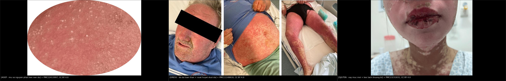
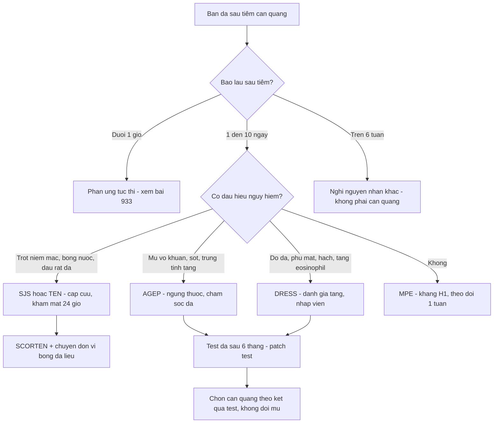
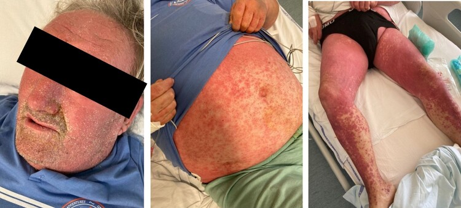
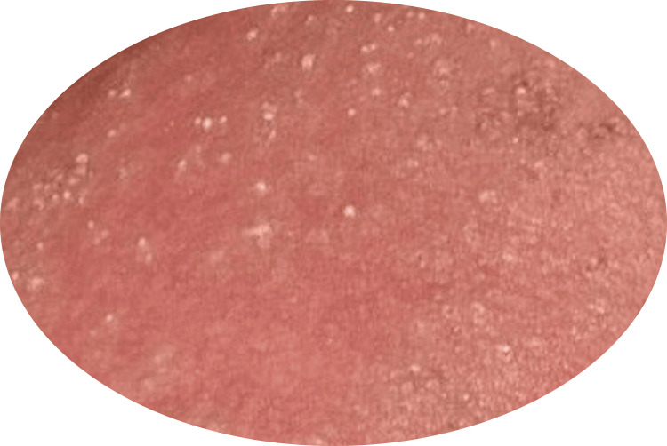
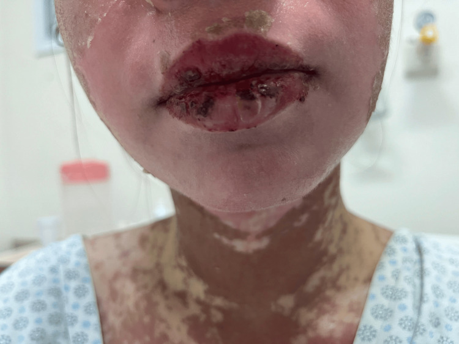
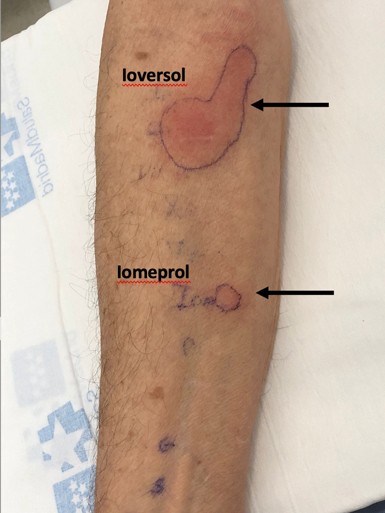

# 936 — Phản ứng da muộn NẶNG sau thuốc cản quang: AGEP, DRESS, SJS/TEN / Severe delayed cutaneous adverse reactions to contrast media

**Tags:** `pattern:phat-ban-da` `pattern:mu-vo-khuan` `pattern:bong-nuoc` `pattern:trot-niem-mac` `pattern:do-da-toan-than` `vung:toan-than` `vung:da` `score:RegiSCAR` `score:SCORTEN` `score:EuroSCAR-AGEP` `protocol:test-lay-da` `protocol:tiem-can-quang` `incidentaloma:khong`
**Mức chắc chắn (certainty):** tổng hợp y văn (literature synthesis) — biên từ toàn văn hướng dẫn ESUR 2025 phần 1 (PMC12559081, CC BY 4.0) và phần 2 (PMC12559128, CC BY 4.0), loạt ca DRESS/AGEP do cản quang i-ốt của Pháp (13 DRESS + 19 AGEP; PMID 33757916), chuỗi 297 ca AGEP (PMC8780223, CC BY 4.0), phân tích FAERS + tổng quan ca tử vong DRESS (PMC11683082, CC BY 4.0), meta-analysis SCORTEN (PMC13176803, CC BY 4.0) và các ca nguyên văn có ảnh (PMC11148818, PMC12413997, PMC13231831, PMC9972718 — đều CC BY 4.0). Số liệu lấy từ toàn văn/bảng, không viết từ abstract gián tiếp.

## 1. Tổng quan — ba chiếc đồng hồ khác nhau, một sai lầm chung

**Phản ứng da muộn (non-immediate hypersensitivity reaction — NIHR) sau cản quang không phải "dị ứng i-ốt".** ESUR 2025 nói rõ: cái quyết định là **cả phân tử thuốc** (chuỗi bên, độ ion, độ thẩm thương), không phải nguyên tử i-ốt (PMC12559128). Hệ quả: bệnh nhân có tiền sử phản ứng **không** phải kiêng i-ốt trong thuốc sát khuẩn hay iod phóng xạ; và **đổi sang phân tử khác** là biện pháp dự phòng chính, chứ không phải "tránh cản quang vĩnh viễn".

### 1.1. Vì sao phản ứng muộn lại "muộn" — và vì sao lần thứ hai lại nhanh

- Cơ chế là **quá mẫn typ IV qua trung gian tế bào T**, không phải IgE: tế bào T nhận diện thuốc theo hai đường — **hapten/ prohapten** (thuốc phải được trình diện qua MHC-II) và **p-i concept** (thuốc gắn trực tiếp vào thụ thể tế bào T hoặc phân tử MHC, không cần chuyển hóa) (PMC12559081). Chính đường p-i giải thích **phản ứng chéo** giữa các thuốc cản quang có cấu trúc chung.
- **Lần đầu:** cần **2–10 ngày** để tế bào T nhớ được clon chọn lọc và khuếch đại → ban xuất hiện muộn, thường **sau khi bệnh nhân đã về nhà**. **Lần tái phơi nhiễm:** tế bào T nhớ phản ứng trong **1–2 ngày** (PMC12559081). Đây là lý do hỏi "lần trước tiêm cản quang khi nào" quan trọng hơn hỏi "có dị ứng gì không".
- Trong thực hành, **> 90% NIHR chỉ ở da** và tự khỏi trong **1 tuần**; thể dát sẩn (maculopapular exanthem — MPE) là kiểu hình thường nhất (PMC12559081).

### 1.2. Vì sao cùng một thuốc lại ra ba bệnh cảnh khác nhau

| Thể (phenotype) | Tế bào/cytokine chủ đạo | Hệ quả mô học → hình ảnh lâm sàng |
|---|---|---|
| **AGEP** (acute generalized exanthematous pustulosis) | Th17/neutrophil, **CXCL8 (IL-8)**, GM-CSF | Thâm nhiễm **bạch cầu trung tính** dưới sừng → **mụn mủ vô khuẩn nhỏ, không ở nang lông**, trên nền đỏ phù |
| **DRESS** (drug reaction with eosinophilia and systemic symptoms) | Th2, **IL-5**, bạch cầu ái toan; tái hoạt **HHV-6** | Thâm nhiễm tế bào T + eosinophil ở da và **tạng** → đỏ da toàn thân, hạch, viêm gan/thận/phổi/cơ tim |
| **SJS/TEN** | CD8 độc tế bào, **granulysin**, FasL, perforin | **Apoptosis tế bào sừng lan rộng** → bọng nước mềm, dấu Nikolsky dương, **bong thượng bì**, trợt niêm mạc |

- **Vì sao AGEP có mủ mà không nhiễm:** mủ là ** neutrophil tập trung do cytokine**, cấy vô khuẩn; dùng kháng sinh không giúp mà còn làm chậm nhận diện thuốc thủ phạm.
- **Vì sao SJS/TEN bong da:** apoptosis tế bào sừng lan theo lớp đáy → mất lớp neo giữa thượng bì và bì; **diện bong > 30% diện tích cơ thể (TBSA) = TEN**, **< 10% = SJS**, **10–30% = thể chồng lấp** (PMC13176803).

### 1.3. Con số phải nhớ

| Chỉ số | Số liệu | Nguồn |
|---|---|---|
| Tần suất chung phản ứng muộn | thay đổi lớn, **báo cáo thiếu nhiều**; **> 90% chỉ ở da**, tự khỏi **1 tuần** | PMC12559081 |
| AGEP | **1–5 ca/triệu người/năm**; tử vong **tới 5%**, chuỗi 297 ca: **2,5%** (7 ca, 5 ca đã nặng trước đó); **sốt 64,3%**, **tổn thương tạng 18,9%** | PMC8780223 |
| DRESS | tử vong **1,2–6,1%** (ước tính cũ **10%**) | PMC11683082 |
| SJS | bong **< 10% TBSA**, tử vong **~10%** | PMC13176803 |
| TEN | bong **> 30% TBSA**, tử vong **tới 50%** | PMC13176803 |
| DRESS do cản quang i-ốt (Pháp) | **13 ca DRESS + 19 ca AGEP**; trung vị khởi phát **DRESS 4 ngày**, **AGEP 1 ngày** (ngắn hơn DRESS kinh điển) | PMID 33757916 |
| Đa mẫn cảm | **77%** bệnh nhân mẫn cảm với **nhiều loại** cản quang i-ốt; test lẩy da tìm được thuốc thủ phạm **72%** (21 ca) | PMID 33757916 |
| Cản quang trong nguyên nhân DRESS | **5%** các ca patch test dương trong DRESS toàn bộ y văn (536 test dương) | PMID 35233782 |
| Tín hiệu tử vong trên FAERS | **iomeprol 87 báo cáo tử vong** có DRESS (PRR 199,96); **iobitridol 41** (PRR 195,10) | PMC11683082 |

- **Điểm cần phản biện:** con số "DRESS do cản quang khởi phát sau 4 ngày" **ngắn hơn** mô tả kinh điển 2–6 tuần của DRESS do thuốc khác. Nguồn là loạt hồi cứu 32 ca, không có nhóm chứng — không được dùng để loại trừ DRESS vì "mới tiêm 3 ngày".

*Trái: AGEP — mụn mủ vô khuẩn nhỏ trên nền đỏ phù (PMC12413997). Giữa: DRESS — đỏ da toàn thân, phù mặt, xuất huyết dưới da ở chi dưới (PMC11148818). Phải: SJS/TEN — vảy máu ở môi và bong thượng bì cổ (PMC13231831). Cả ba ảnh là ca do thuốc **khác** cản quang, dùng để nhận diện **hình thái**; ảnh do cản quang nằm ở mục 6. Nguồn: ba bài CC BY 4.0, ảnh ghép letterbox.*

## 2. Mẫu hình + chẩn đoán phân biệt theo thời điểm và theo kiểu hình (Gamut)

### 2.1. Gamut theo thời điểm — câu hỏi đầu tiên luôn là "bao lâu sau tiêm?"

- **< 1 giờ:** phản ứng tức thời (mày đay, phù mạch, co thắt phế quản, sốc phản vệ) — **không phải** bài này, xem [933](../933-an-toan-thuoc-can-quang/lesson.md).
- **1–6 giờ:** mày đay muộn, phù mạch muộn.
- **1–3 ngày:** **AGEP** (trung vị 1 ngày sau cản quang), MPE ở người đã mẫn cảm.
- **4–10 ngày:** **DRESS** (trung vị 4 ngày sau cản quang; kinh điển 2–6 tuần), MPE lần đầu.
- **4–28 ngày:** **SJS/TEN** (thường 4–14 ngày sau khởi đầu thuốc mới).
- **> 6 tuần:** gần như không còn do cản quang — nghĩ nguyên nhân khác (nhiễm virus, thuốc mới thêm, bệnh nội khoa).

### 2.2. Gamut theo kiểu hình — nhìn da để chọn nhánh

- **Mụn mủ nhỏ (< 5 mm) vô khuẩn, không ở nang lông, nền đỏ phù, sốt, bạch cầu trung tính tăng** → **AGEP**.
- **Đỏ da lan rộng + phù mặt + hạch + tăng bạch cầu ái toan + tổn thương tạng (gan/thận/phổi/tim/tuyến giáp)** → **DRESS**.
- **Đau rát da/niêm mạc trước khi thấy ban, trợt miệng–mắt–sinh dục, bọng nước mềm, Nikolsky dương, bong thượng bì** → **SJS/TEN**.
- **Sẩn đỏ đối xứng, ngứa, không niêm mạc, toàn trạng ổn** → **MPE** (lành).
- **Mảng tròn tăng sắc tố, bọng nước tái phát đúng một vị trí** → **GBFDE** (generalized bullous fixed drug eruption).

### 2.3. Gamut của "sốt + ban đỏ sau tiêm cản quang" — không phải cứ ban là do thuốc

- **Nhiễm khuẩn huyết từ catheter/PICC** (đang nằm viện, có đường truyền) — ban do độc tố, cấy máu là chốt.
- **Phản ứng truyền máu/dịch** — sốt, ban, đau lưng; xảy ra trong lúc truyền.
- **Nhiễm virus (EBV, CMV, HHV-6, COVID)** — ban + sốt + hạch + tăng transaminase, **giống DRESS**.
- **Bệnh mô liên kết khởi phát** (lupus, Still) — sốt + ban + ferritin.
- **Huyết khối/thuyên tắc phổi** — sốt nhẹ, không ban đặc hiệu.
- **Viêm mô tế bào tại chỗ tiêm/thoát mạch** — đỏ khu trú, đau, ấm, không đối xứng.
- **Phản ứng thuốc khác dùng cùng ngày** (kháng sinh, allopurinol, kháng động kinh) — yếu tố gây nhiễu lớn nhất khi tính điểm causality.

## 3. Bảng so sánh phân biệt (ma trận đối chiếu)

| Thực thể (entity) | Hình ảnh/dấu hiệu điển hình | Chốt vào (rule-in) | Chốt loại (rule-out) | Gợi ý xác nhận |
|---|---|---|---|---|
| **AGEP** | Hàng trăm mụn mủ **nhỏ, không ở nang lông**, nền đỏ phù, bắt đầu ở nếp gấp/thân rồi lan; sốt; **bạch cầu trung tính tăng** | **Mụn mủ vô khuẩn + sốt + khởi phát 1–3 ngày + trung tính tăng**, cấy mủ âm | Có **tổn thương niêm mạc nặng/bong da** → không phải AGEP đơn thuần | Sinh thiết: mụn mủ dưới sừng chứa neutrophil; **EuroSCAR validation score** |
| **DRESS** | Đỏ da lan rộng → **đỏ da toàn thân**, phù mặt, hạch, **tăng eosinophil**, viêm gan/thận, sốt | **Đỏ da + eosinophil + tổn thương tạng + hạch + khởi phát 4 ngày–6 tuần**; **RegiSCAR ≥ 4** (ca minh họa đạt **6 = chắc chắn**) | Chỉ ban khu trú, không tạng, không eosinophil → MPE | CBC có công thức, LFT/creatinin, siêu âm hạch; **patch test** sau 6 tháng |
| **SJS** | Trợt niêm mạc miệng–mắt–sinh dục, **vảy máu môi**, bọng nước mềm, bong **< 10% TBSA** | **≥ 2 vị trí niêm mạc trợt + Nikolsky dương + bong thượng bì** | Không niêm mạc, chỉ mày đay/sẩn → không phải SJS | Sinh thiết da (apoptosis toàn lớp thượng bì), **SCORTEN**, khám mắt khẩn |
| **TEN** | Như SJS nhưng bong **> 30% TBSA**, toàn trạng nặng, suy tạng | **Bong > 30% TBSA + niêm mạc + sốt** | Bong < 10% → SJS | SCORTEN; chuyển đơn vị bỏng/da liễu |
| **MPE (lành)** | Sẩn/dát đỏ đối xứng, ngứa, **không niêm mạc**, toàn trạng ổn | **Khởi phát > 6 giờ, không tạng, không niêm mạc, tự giảm trong 1 tuần** | Sốt cao + tạng + niêm mạc → không phải MPE | Theo dõi 1–2 tuần; kháng H1 ± corticoid bôi |
| **GBFDE** | Mảng tròn tăng sắc tố, bọng nước **tái phát đúng vị trí cũ**, lan ra toàn thân | **Tiền sử tổn thương cố định tái phát cùng chỗ** | Tổn thương niêm mạc lan rộng → nghi SJS/TEN | Hỏi tiền sử ảnh cũ; sinh thiết |

- **Ngưỡng phân biệt SJS/TEN:** SJS **< 10% TBSA**, chồng lấp **10–30%**, TEN **> 30%** (PMC13176803). Đo bằng **bảng Rule of Nines**, không ước lượng mắt.
- **Ngưỡng DRESS:** thang **RegiSCAR** (< 2 loại trừ, 2–3 nghi ngờ, 4–5 có thể, **≥ 6 chắc chắn**); ca ioversol 84 tuổi trong bài đạt **6** (PMC9972718).

## 4. Protocol nhận diện + xử trí + lịch test dị ứng

### 4.1. Ba câu hỏi ngay khi bác sĩ CĐHA được gọi

1. **Bao lâu sau tiêm?** (< 1 giờ → tức thời; 1–10 ngày → NIHR; > 6 tuần → nghĩ nguyên nhân khác).
2. **Có "dấu hiệu nguy hiểm" không?** — trợt niêm mạc, bọng nước, đau rát da, sốt > 38,5 °C, phù mặt, hạch, đau mắt, tiểu máu/thiểu niệu, khó thở. **Có 1 dấu = gọi da liễu ngay trong ngày**, không hẹn khám sau.
3. **Có thuốc mới nào khác trong 8 tuần không?** — nếu có, cản quang chỉ là **một** ứng viên; phải lập danh sách theo giờ khởi phát.

### 4.2. Xét nghiệm tối thiểu (làm trước khi chuyển da liễu)

- **CBC + công thức** (eosinophil, tế bào lympho không điển hình), **CRP**, **AST/ALT/bilirubin**, **creatinin/eGFR**, **điện giải**, **tổng phân tích nước tiểu** (DRESS có thể biểu hiện bằng viêm thận kẽ).
- **Cấy máu × 2** nếu có sốt và đang có catheter — loại nhiễm khuẩn huyết trước khi gán cho thuốc.
- **PCR EBV/CMV/HHV-6** khi nghi DRESS (HHV-6 tái hoạt là tiêu chuẩn của DIHS Nhật, không bắt buộc cho DRESS).
- **Sinh thiết da** khi: chẩn đoán chưa rõ, nghi AGEP vs vảy nến mụn mủ toàn thân, hoặc cần loại SJS/TEN không điển hình. Lấy **tổn thương mới < 24 giờ**, tránh vùng đã bôi corticoid.

### 4.3. Phân tầng và xử trí

| Thể | Việc phải làm | Điều **không** làm |
|---|---|---|
| **MPE** | Ngừng thuốc nghi ngờ nếu có thể; kháng H1 uống + corticoid bôi; theo dõi 1 tuần | Không cần nhập viện, không dùng corticoid toàn thân kéo dài |
| **AGEP** | Nhập viện nếu lan rộng/sốt; **ngừng thuốc thủ phạm**; chăm sóc da, bù dịch, kiểm soát nhiệt độ | **Không kháng sinh** cho mụn mủ vô khuẩn; không chọc mủ |
| **DRESS** | Nhập viện, **ngừng ngay thuốc thủ phạm**, đánh giá tạng (gan/thận/phổi/tim/tuyến giáp), hội chẩn da liễu; corticoid toàn thân theo da liễu | Không cho về nhà "theo dõi" — DRESS có thể nặng lên **sau khi ngừng thuốc** |
| **SJS/TEN** | **Cấp cứu**: chuyển đơn vị bỏng/da liễu, bù dịch theo diện bong, giảm đau, **khám mắt trong 24 giờ**, chăm sóc niêm mạc, dinh dưỡng | Không tự bóc da, không dùng thuốc dán gây dính, không trì hoãn chuyển tuyến |

- **Liệu pháp miễn dịch đặc hiệu cho SJS/TEN (cyclosporine, etanercept, IVIG) chưa có đồng thuận thống nhất** — quyết định thuộc da liễu/bỏng, không thuộc bác sĩ CĐHA. Việc của CĐHA là **nhận diện đúng và chuyển đúng chỗ, đúng giờ**.

### 4.4. Lịch test dị ứng — phần quyết định lần chụp sau

- **Test lẩy da (skin test — ST)**: nhạy nhất khi làm **2–6 tháng** sau phản ứng; **giảm độ nhạy nếu làm trong tháng đầu hoặc sau 12 tháng** (PMC12559128).
- **NIHR:** đọc **IDT muộn** là công cụ nhạy nhất; bắt đầu bằng **SPT với cản quang nguyên chất**, nếu âm → **IDT pha 1:10** (PMC12559128).
- **SCAR (AGEP/DRESS/SJS/TEN):** hoãn test **> 6 tháng**; **ưu tiên patch test (PT) hơn SPT/IDT** vì nguy cơ phản ứng hệ thống thấp hơn; PT dùng **cản quang nguyên chất**, đọc **muộn 48–96 giờ** (PMC12559128).
- **LTT (lymphocyte transformation test):** làm **4–8 tuần sau khi hết phản ứng**, không làm trong giai đoạn cấp; corticoid liều cao có thể làm âm giả (PMC12559128).
- **DPT (drug provocation test):** chỉ ở trung tâm chuyên khoa; **chống chỉ định sau SCAR** — không dùng để "chứng minh" thuốc thủ phạm khi đã có SCAR.
- **Thực tế cần nhớ:** **77%** bệnh nhân DRESS/AGEP do cản quang mẫn cảm với **nhiều loại** cản quang i-ốt, và test lẩy chỉ tìm được thuốc thủ phạm ở **72%** — nên "đổi sang loại khác" **không** đồng nghĩa an toàn nếu chưa test (PMID 33757916).

### 4.5. Phòng ngừa — tiền mê KHÔNG phòng được SCAR

- ESUR 2025: **"premedication is not recommended for previous NIHR"** — tiền mê không có bằng chứng giảm phản ứng nặng, và với NIHR thì không được khuyến cáo (PMC12559128).
- Việc đúng: **ghi hồ sơ dị ứng theo 6 trường** (ngày giờ, tên thuốc + liều/nồng độ, loại phản ứng tức thời/muộn, triệu chứng + sinh hiệu, xử trí + đáp ứng, kết quả hội chẩn) (PMC12559081).
- Lần chụp sau: **cân nhắc modality không cản quang trước**; nếu buộc phải cản quang → **chọn thuốc theo kết quả test**, không đoán theo "nhóm ion/không ion".

## 5. Biến thể bình thường và cạm bẫy

- **"Dị ứng i-ốt" là nhãn sai:** phản ứng do **phân tử thuốc**, không do i-ốt (PMC12559128). Dán nhãn này dẫn tới tránh oan thuốc sát khuẩn iod, iod phóng xạ và cả cản quang cần thiết.
- **Khởi phát sau khi ra viện:** MPE lần đầu **2–10 ngày**, DRESS **4 ngày–6 tuần** — bệnh nhân quay lại **cấp cứu/da liễu**, không quay lại phòng chụp. Nếu khoa CĐHA không ghi nhận, lần sau bệnh nhân lại được tiêm đúng thuốc cũ.
- **Tiền mê tạo cảm giác an toàn giả:** corticoid + kháng H1 **không** phòng SCAR và **không được khuyến cáo** cho NIHR (PMC12559128).
- **AGEP vs vảy nến mụn mủ toàn thân (GPP):** cả hai đều mụn mủ vô khuẩn. Khác ở **tiền sử thuốc 1–3 ngày trước**, **sốt cao**, **tự khỏi nhanh khi ngừng thuốc**, và mụn mủ **không ở nang lông**; GPP thường có tiền sử vảy nến, tái phát nhiều đợt.
- **DRESS nặng lên sau khi ngừng thuốc:** đừng cho về nhà với "ngừng thuốc rồi sẽ khỏi". Đã có ca tử vong do viêm cơ tim DRESS **không có yếu tố nguy cơ kinh điển** (PMC11289355).
- **Chỉ thấy ban da mà bỏ tạng:** DRESS có thể biểu hiện **viêm gan, viêm thận kẽ, viêm phổi, viêm cơ tim** — phải xét nghiệm tạng **ngay** và **lặp lại sau 1–2 tuần** vì tạng có thể xuất hiện muộn.
- **SJS/TEN giai đoạn sớm rất mờ nhạt:** đau rát da, đau mắt, sốt, ban dạng sởi — **trợt niêm mạc là dấu hiệu phân biệt sớm nhất**. Bỏ qua "đau mắt" là bỏ qua cơ hội can thiệp mắt.
- **Đổi thuốc cản quang không kiểm tra = đánh bạc:** **77%** mẫn cảm nhiều loại, test chỉ dương **72%** (PMID 33757916).
- **Không phải ban nào sau tiêm cũng do thuốc:** nhiễm khuẩn huyết catheter, phản ứng truyền, nhiễm virus — cấy máu/PCR trước khi kết luận.

## 6. Tự lượng giá — Blind Quiz

**Ca 1 — 69 tuổi, đỏ da toàn thân sau chụp mạch vành có iomeprol.**

- Gợi ý lâm sàng: nam 69 tuổi, đái tháo đường, bệnh mạch vành ba nhánh đã can thiệp nhiều lần; sau lần chụp mạch vành gần nhất (iomeprol) nổi đỏ da toàn thân, xuất huyết dưới da, **ứ mật** và **tăng bạch cầu ái toan**, phải dùng corticoid toàn thân liều cao.
- Câu hỏi: Ba chẩn đoán phân biệt? Dấu hiệu nào chốt? Cần làm gì trong 24 giờ đầu và lịch test dị ứng thế nào?

<b>Bấm để hiện đáp án (findings + chẩn đoán)</b>

- **Findings:** đỏ da toàn thân ranh giới rõ, phù mặt, **xuất huyết dưới da rải rác ở chi dưới**, **ứ mật** (cholestasis) và tăng eosinophil.
- **Chẩn đoán: DRESS do cản quang i-ốt (iomeprol)** — đỏ da + xuất huyết dưới da + tổn thương gan mật + eosinophil. Phân biệt: **MPE** (không tạng, không hạch), **nhiễm virus** (EBV/CMV/HHV-6), **AGEP** (mụn mủ vô khuẩn, không đỏ da toàn thân). Ca tương tự trong y văn đạt **RegiSCAR 6 = chắc chắn** (PMC9972718).
- **24 giờ đầu:** ngừng iomeprol và mọi thuốc mới; nhập viện; CBC + LFT + creatinin + CRP + cấy máu; hội chẩn da liễu; đánh giá tim/phổi/thận vì DRESS có thể tổn thương tạng muộn.
- **Bẫy của ca này:** bệnh nhân có **bệnh mạch vành + đái tháo đường**, nên đỏ da/ứ mật dễ bị gán cho thuốc tim mạch hoặc nhiễm trùng — phải giữ **cản quang trong danh sách nghi vấn** và ghi hồ sơ dị ứng.
- **Test dị ứng:** hoãn **> 6 tháng**, ưu tiên **patch test** với cản quang nguyên chất, đọc **48–96 giờ**; kết quả có thể dương với **nhiều loại** cản quang (77% đa mẫn cảm) → lần sau chọn thuốc theo test, không theo cảm tính.
- **Tiên lượng:** tử vong DRESS **1,2–6,1%**; phải theo dõi cả sau khi ngừng thuốc.
- Nguồn ảnh: Griffith Brookles C et al., *Eur Heart J Case Rep* 2024 (PMC11148818), CC BY 4.0.

**Ca 2 — 1 ngày sau chụp CT có iomeprol, nổi "mụn nước nhỏ" khắp thân.**

- Gợi ý lâm sàng: nữ 58 tuổi, chụp CT bụng có iomeprol; 24 giờ sau sốt 38,8 °C, ngứa rát, hàng trăm mụn mủ nhỏ ở thân và nếp gấp; bạch cầu 14,2 × 10⁹/L, **neutrophil 82%**, cấy mủ âm.
- Câu hỏi: Chẩn đoán? Hai bệnh cần loại trừ? Có cần kháng sinh không?

<b>Bấm để hiện đáp án (findings + chẩn đoán)</b>

- **Findings:** mụn mủ **nhỏ, không ở nang lông**, trên nền đỏ phù; sốt; **trung tính tăng**; cấy vô khuẩn.
- **Chẩn đoán: AGEP do cản quang i-ốt.** Khởi phát trung vị **1 ngày** sau cản quang (PMID 33757916); tần suất **1–5/triệu người/năm**, tử vong tới **5%** (chuỗi 297 ca: **2,5%**) (PMC8780223).
- **Loại trừ:** **vảy nến mụn mủ toàn thân** (tiền sử vảy nến, tái phát) và **nhiễm khuẩn da** (cấy dương, đau khu trú).
- **Không kháng sinh**: mủ vô khuẩn; điều trị là **ngừng thuốc + chăm sóc da + bù dịch**. Kháng sinh chỉ khi cấy dương hoặc có ổ nhiễm thật.
- **Theo dõi:** AGEP có thể kèm **tổn thương tạng 18,9%** — kiểm tra gan/thận.
- *Lưu ý nguồn:* ảnh là ca AGEP **do nguyên nhân khác** (nam 27 tuổi, nghi nhiễm trùng); kịch bản trên là ca giả định sau cản quang — dùng để luyện nhận diện hình thái, không gán nguyên nhân.
- Nguồn ảnh: Martínez Jiménez HS, *Cureus* 2025 (PMC12413997), CC BY 4.0.

**Ca 3 — 62 tuổi, đau rát môi và mắt 3 ngày, sau đó bong da.**

- Gợi ý lâm sàng: nữ 62 tuổi, 10 ngày trước chụp CT có cản quang và được kê thêm một kháng sinh mới; hiện sốt 39 °C, **trợt môi, đau mắt, loét miệng**, bong thượng bì **~12% TBSA**, Nikolsky dương.
- Câu hỏi: Chẩn đoán và phân loại? Tính SCORTEN gồm những gì? Hai việc phải làm trong 24 giờ?

<b>Bấm để hiện đáp án (findings + chẩn đoán)</b>

- **Findings:** vảy máu môi, trợt niêm mạc miệng, đau mắt, bong thượng bì **12% TBSA** → **SJS/TEN thể chồng lấp** (SJS < 10%, chồng lấp 10–30%, TEN > 30%) (PMC13176803).
- **SCORTEN gồm 7 biến:** tuổi **≥ 40**; có bệnh ác tính; bong **> 10% TBSA**; nhịp tim **≥ 120**; **BUN > 10 mmol/L**; **bicarbonat < 20 mmol/L**; **glucose > 15 mmol/L** (PMC13176803).
- **24 giờ:** (1) chuyển **đơn vị bỏng/da liễu**, bù dịch theo diện bong, giảm đau, dinh dưỡng; (2) **khám mắt khẩn** + chăm sóc niêm mạc (mắt, miệng, sinh dục).
- **Causality:** phải rà **cả kháng sinh mới** — cản quang chỉ là một ứng viên; thuốc khởi phát 4–28 ngày trước là nghi vấn hàng đầu.
- **Tử vong:** SJS ~**10%**, TEN tới **50%** (PMC13176803). **Không** dùng DPT để "xác nhận" sau SCAR.
- *Lưu ý nguồn:* ảnh là ca SJS/TEN do **thuốc khác** (không phải cản quang); kịch bản là ca giả định — dùng để luyện nhận diện **trợt niêm mạc + bong thượng bì**.
- Nguồn ảnh: Shimizu Saito GK et al., *Cureus* 2026 (PMC13231831), CC BY 4.0.

**Ca 4 — Kết quả test lẩy da ở bệnh nhân từng DRESS do cản quang.**

- Gợi ý lâm sàng: bệnh nhân 84 tuổi từng DRESS sau ioversol, nay cần chụp lại; test nội bì với panel cản quang.
- Câu hỏi: Đọc kết quả? Ý nghĩa lâm sàng? Có được dùng lại iomeprol không?

<b>Bấm để hiện đáp án (findings + chẩn đoán)</b>

- **Findings:** phản ứng đỏ thâm nhiễm rõ với **ioversol** (thuốc thủ phạm cũ) và phản ứng **nhỏ hơn nhưng dương** với **iomeprol** → **phản ứng chéo**.
- **Ý nghĩa:** xác nhận cơ chế **qua trung gian tế bào T**; sinh thiết tại vị trí test dương cho thấy thâm nhiễm tế bào T. Test dương giúp **chọn thuốc thay thế**, không chỉ "tránh thuốc cũ".
- **Không dùng lại iomeprol** vì test dương; cần test thêm các thuốc khác trong panel và chọn thuốc **âm tính**.
- **Lưu ý:** test ở bệnh nhân SCAR phải hoãn **> 6 tháng** và ưu tiên **patch test**; kết quả âm không loại trừ tuyệt đối.
- Nguồn ảnh: Zambrano Ibarra G et al., *Allergy Asthma Clin Immunol* 2023 (PMC9972718), CC BY 4.0.

## Bài liên quan chéo
- [933 – Sốc phản vệ & bệnh thận do thuốc cản quang](../933-an-toan-thuoc-can-quang/lesson.md) (phản ứng **tức thời** trong 1 giờ — bài phải đọc trước)
- [932 – An toàn bức xạ trong can thiệp dưới CT/DSA](../932-an-toan-buc-xa-ct-dsa/lesson.md) (cùng nhóm an toàn phòng can thiệp)
- [910 – Dẫn lưu áp-xe, PTBD & thận qua da](../910-abscess-biliary-nephrostomy/lesson.md) (cản quang lặp lại nhiều lần)
- [920 – Nút mạch cầm máu](../920-vascular-embolization-gi-bleed/lesson.md) (tiêm động mạch, liều cao)
- [1692 – U tuyến núm vú](../1692-u-tuyen-num-vu/lesson.md) (bài học về **ăn mòn da/niêm mạc một bên** — phân biệt với phản ứng thuốc toàn thân)

## Ảnh
- 4 ảnh gốc + 1 ảnh ghép, tất cả **CC BY 4.0**; nguồn và giấy phép từng file trong `images/CREDITS.md`.
- `composite_936_AGEP-DRESS-SJS.jpg` tạo bằng `tools/make_composite.py` (letterbox, giữ tỷ lệ, dải attribution) từ **ba ảnh cùng giấy phép CC BY 4.0**.
- Ảnh ca 1 và ca 2 là **ca do thuốc khác cản quang** — dùng để dạy hình thái, đã ghi rõ trong chú thích; không gán sai nguyên nhân cho cản quang.

> Không dùng để chẩn đoán độc lập khi chưa có người hướng dẫn.
