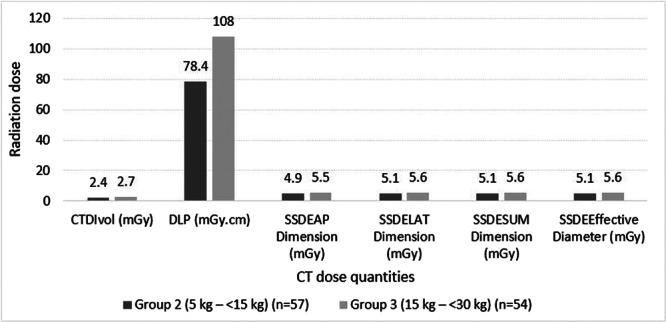
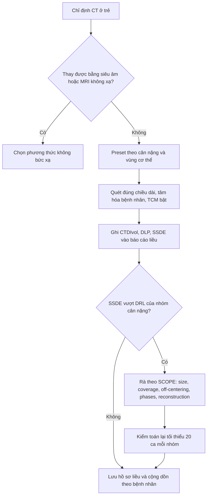
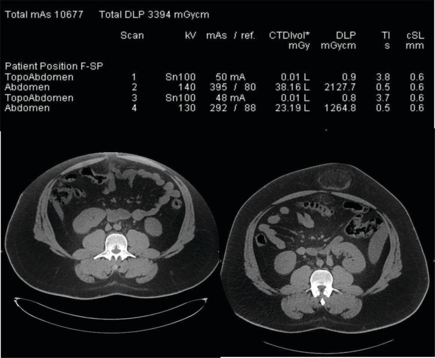
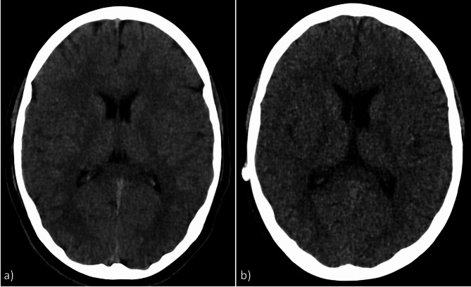
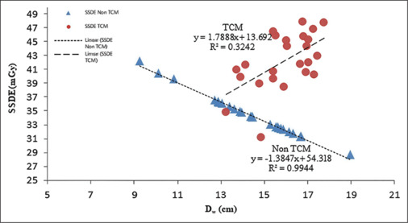

# 937 — Liều CT ở trẻ: SSDE thay CTDIvol, DRL nhi và theo dõi liều tích lũy / Pediatric CT dose: SSDE, pediatric DRLs and cumulative dose tracking

**Tags:** `pattern:lieu-buc-xa-cao` `vung:toan-than` `score:SSDE` `score:DRL` `score:DLP` `protocol:ALARA` `protocol:preset-theo-can-nang` `protocol:DRL-audit` `protocol:theo-doi-lieu-tich-luy` `incidentaloma:khong`

**Mức chắc chắn (certainty):** tổng hợp y văn (literature synthesis) — biên từ **toàn văn** các bài mở: tổng quan SSDE ở CT nhi (*World J Radiol* 2026, **PMC13527544**, CC BY-NC 4.0), DRL theo chỉ định và cân nặng cho CT bụng nhi (*Health Sci Rep* 2025, **PMC12277105**, CC BY-NC 4.0), quan hệ Dw–CTDIvol–SSDE–nhiễu trên CT sọ nhi (*J Med Phys* 2026, **PMC13345115**, CC BY-NC-ND 4.0), tối ưu liều CT sọ bằng auto prescription theo suy giảm (*Sci Rep* 2025, **PMC12474883**, CC BY-NC-ND 4.0), ca lệch tâm gây phơi nhiễm gấp > 10 lần trung vị (*J Belg Soc Radiol* 2025, **PMC12680003**, CC BY 4.0) và DLP theo tuổi ở CT sọ trẻ ≤ 5 tuổi (*J Imaging* 2026, **PMC13514631**, CC BY 4.0). Số liệu lấy từ toàn văn/bảng, không viết từ abstract gián tiếp.

> **Câu chốt:** **CTDIvol không phải liều của bệnh nhân** — nó là liều đo trong một **phantom acrylic 16 cm (đầu) hoặc 32 cm (thân)**, tức "công suất phát của máy" đã chuẩn hóa. Ở trẻ, **cùng một CTDIvol nghĩa là liều mô cao hơn nhiều** vì năng lượng dồn vào khối mô nhỏ hơn: **SSDE (size-specific dose estimate) cao hơn CTDIvol trung vị 88% (IQR 66–112%)** ở nhóm tính theo cân nặng (PMC13527544). Vì vậy câu hỏi đúng không phải *"CTDIvol bao nhiêu là an toàn"* mà là **"SSDE của ca này là bao nhiêu, so với DRL của đúng nhóm cân nặng/tuổi, và liều tích lũy của chính đứa trẻ này đang ở đâu"**.

## 1. Tổng quan — vì sao trẻ không phải "người lớn thu nhỏ", và vì sao CTDIvol đánh lừa

### 1.1. Sinh học: ba lý do trẻ nhạy cảm hơn với cùng một liều

- **Mô đang phân bào**: hệ tạo máu, tuyến giáp, vú, tuyến sinh dục, thủy tinh thể, hệ thần kinh trung ương và tủy xương là các mô nhạy nhất; ở trẻ các mô này **chưa biệt hóa hoàn toàn** (PMC13527544).
- **Cửa sổ tiềm tàng dài**: ung thư do bức xạ cần **nhiều thập kỷ** mới biểu hiện; một đứa trẻ 1 tuổi có **70–80 năm** để hiệu ứng muộn xuất hiện, trong khi người 70 tuổi gần như không có cửa sổ này.
- **Nhiều lần chụp trong đời**: trẻ bệnh mạn (u, tim bẩm sinh, bệnh thận, đau bụng tái diễn) có thể nhận **hàng chục lượt CT**, nên **liều thấp × rất nhiều lần ≠ ít**. Đây là lý do phải theo dõi **liều tích lũy theo từng bệnh nhân**, không chỉ từng ca.

- **Bằng chứng dịch tễ — nói đúng mức:** các đoàn hệ lớn (Pearce 2012 tại Anh; Mathews 2013 với **680.000 người** phơi nhiễm lúc nhỏ trong liên kết dữ liệu **11 triệu người** Australia; Miglioretti 2013 tại Mỹ) cho thấy **hiệu ứng liên quan đến liều hấp thụ** đối với bạch cầu cấp, u não và ung thư chung (PMC13527544). Đây là **hiệp hội dịch tễ**, không phải quan hệ nhân quả ở từng cá nhân; **rủi ro tuyệt đối của một ca thường thấp**, và **không được dùng con số này để từ chối một chỉ định cần thiết**. Kết luận thực hành: **biện minh chỉ định (justification) + tối ưu liều (optimization) + ghi liều (recording)**.

### 1.2. Vật lý: CTDIvol, DLP và SSDE khác nhau ở đâu

| Đại lượng | Định nghĩa | Đơn vị | Trả lời câu hỏi gì | Không trả lời được gì |
|---|---|---|---|---|
| **CTDIvol** | Liều trung bình trong **một lát cắt** đo trên phantom chuẩn (đầu **16 cm**, thân **32 cm**), chia cho bước ren (pitch) | mGy | Máy đang **phát ra bao nhiêu** với protocol này | Liều vào **bệnh nhân cụ thể**; bỏ qua kích thước cơ thể |
| **DLP** | **CTDIvol × chiều dài quét (cm)** | mGy·cm | Tổng "lượng phát" của **cả lần chụp** | Phân bố liều theo trục z; vùng cơ thể nào nhận nhiều |
| **SSDE** | **CTDIvol × hệ số chuyển đổi theo kích thước** (AAPM TG-204 cho thân; TG-220 dùng **Dw**; TG-293 cho đầu) | mGy | Liều **đã hiệu chỉnh theo kích thước** bệnh nhân trong **vùng được quét** | Liều **ngoài vùng quét** (da, tủy xương một phần), liều **cơ quan đích** như thủy tinh thể/tuyến giáp |
| **Liều hiệu dụng (ED)** | Tổng liều cơ quan × trọng số mô (ICRP), suy từ DLP × hệ số k theo tuổi/vùng | mSv | **Rủi ro ở mức quần thể**, so sánh giữa các kỹ thuật | Rủi ro **của cá nhân**; không dùng để quyết định một ca |

- **TẠI SAO CTDIvol đánh lừa ở trẻ:** CTDIvol được chuẩn hóa cho phantom **32 cm** (thân người lớn). Một bé 10 kg có đường kính bụng **≈ 15–18 cm** — cùng một lượng photon, nhưng khối mô hấp thụ nhỏ hơn nhiều, nên **liều mô thực tế cao hơn** liều phantom. SSDE sửa đúng điểm này bằng hệ số **lớn hơn 1** khi cơ thể nhỏ: nghiên cứu gộp cho thấy **SSDE tính theo cân nặng cao hơn CTDIvol trung vị 88% (IQR 66–112%)** (PMC13527544).
- **TẠI SAO dùng Deff chưa đủ:** Deff = trung bình nhân của **AP × LAT** — chỉ là **hình học**, không phản ánh **suy giảm tia**. Phổi chứa nhiều khí nên cùng kích thước hình học nhưng suy giảm ít hơn bụng. **Dw (water-equivalent diameter)** hiệu chỉnh theo suy giảm; so sánh trên CTA mạch vành cho thấy **SSDE_Deff thấp hơn SSDE_Dw trung bình 10,08%** (trung vị **18,26 vs 20,56 mGy**), và khoảng cách này **tăng tuyến tính** theo mức chênh Deff–Dw (PMC13527544). Kết luận: **không trộn Deff và Dw** khi so sánh hoặc đặt DRL.
- **TẠI SAO đầu phải dùng bộ hệ số riêng (TG-293):** hộp sọ có **xương dày, đường kính nhỏ, thủy tinh thể nằm sát trường chiếu** và tư thế quét khác thân. Dùng **hệ số thân (TG-204) cho đầu có thể ước lượng cao tới ~12%**; vì vậy đầu phải dùng **TG-293** (PMC13527544). Con số thực tế: SSDE trung vị CT sọ không cản quang theo tuổi **33,5 mGy (0–3 tháng) · 31,6 (3–12 tháng) · 36,2 (1–6 tuổi) · 57,9 (≥ 6 tuổi)** — **không tăng đơn điệu**, vì trẻ nhỏ chụp mỏng hơn nhưng đầu dày tương đối so với phantom (PMC13527544).
- **Vì sao SSDE vẫn chưa phải "liều cơ quan":** SSDE chỉ tính **vùng được quét**. Cơ quan **nằm ngoài hoặc một phần ngoài** trường chiếu (da, tủy xương, bề mặt xương) có tương quan với SSDE **kém hơn hẳn**; với cơ quan nằm trọn trong trường chiếu, tỉ số **liều cơ quan/SSDE ≈ 1,1 (0,7–1,4) cho ngực** và **0,9 (0,7–1,3) cho bụng–chậu** (PMC13527544). Vì vậy **SSDE là điểm khởi đầu để tính liều cơ quan, không thay thế liều cơ quan**.

### 1.3. Liều hiệu dụng tham chiếu — để không hoảng loạn và không xem nhẹ

- CT sọ một pha, liều hiệu dụng giảm mạnh theo tuổi: **4,2 mSv (sơ sinh) · 3,6 (1 tuổi) · 2,4 (5 tuổi) · 2,0 (10 tuổi) · 1,4 (15 tuổi)** (PMC13527544).
- Toàn bộ CT nhi dao động **< 1 mSv** (protocol siêu thấp liều) đến **10–15 mSv** (thân, quét dài) (PMC13527544).
- **Cách dùng đúng:** ED để **so sánh kỹ thuật** (CT thường vs siêu thấp liều) và **giải thích cho gia đình**, **không** để nói "ca này sẽ bị ung thư" hay "ca này vô hại".

## 2. Mẫu hình + gamut: "vì sao ca CT này có liều cao" — 7 nguyên nhân, xếp theo tần suất

Đây là **gamut của liều cao**, không phải gamut bệnh: khi một ca trẻ có SSDE vượt DRL, nguyên nhân gần như luôn nằm trong 7 nhóm sau, và **xử lý khác nhau hoàn toàn**.

1. **Preset người lớn / không theo cân nặng** (thường gặp nhất): kV, mAs, pitch, collimation, FOV để mặc định "out of the box"; trẻ 8 kg vẫn chụp 120 kVp, 200 mAs. Dấu hiệu: **CTDIvol gần như không đổi giữa các nhóm cân nặng** trong cùng một phòng.
2. **Che phủ quá dài (scan length)**: quét cả bụng–chậu cho một câu hỏi chỉ ở hố chậu phải. Bằng chứng định lượng: với **hệ số chiều cao 0,07**, CT định hướng thấy **100% ruột thừa** và giảm phơi nhiễm **~27%**; hệ số **0,03** thấy **97%** và giảm **~43%** (PMC13527544).
3. **Nhiều pha / chụp lặp**: 3 pha bụng cho một chỉ định không cần định tính mạch; hoặc lặp vì trẻ cử động, không hợp tác.
4. **Bệnh nhân lệch tâm (off-centering)**: bàn để quá cao/thấp làm **hệ thống điều biến dòng tự động (AEC/TCM)** hiểu sai kích thước → tăng mAs; đồng thời ảnh bị méo và mất chi tiết.
5. **TCM tắt hoặc đặt sai**: không điều biến theo trục z → phần mỏng (cổ, ngực trên) nhận liều thừa; hoặc TCM quá tay ở trẻ rất nhỏ.
6. **Tái tạo không phù hợp**: không dùng lọc lặp (IR) hoặc lọc lặp yếu, buộc phải tăng mAs để giữ nhiễu. Ngược lại, với lọc lặp mạnh, **giảm liều ~58–60% vẫn giữ chất lượng ảnh tương đương** (PMC13527544).
7. **"Liều cao giả" — do so sánh sai**: so CTDIvol của protocol **đầu (phantom 16 cm)** với protocol **thân (32 cm)**; so SSDE tính bằng **Deff** với SSDE tính bằng **Dw**; hoặc so hai hãng máy có cách báo cáo khác nhau.

**Mnemonic để rà một ca vượt DRL — "SCOPE":** **S**ize/preset theo cân nặng · **C**overage (chiều dài quét) · **O**ff-centering · **P**hases (số pha/lần lặp) · **E**nhancement/reconstruction (kV, lọc lặp, TCM).

## 3. Bảng so sánh phân biệt (ma trận đối chiếu)

| Nguyên nhân liều cao (entity) | Dữ liệu/hình ảnh điển hình | Chốt vào (rule-in) | Chốt loại (rule-out) | Gợi ý xác nhận |
|---|---|---|---|---|
| **Preset người lớn** | Ảnh ít nhiễu "đẹp" bất thường ở trẻ nhỏ; CTDIvol **không giảm** khi cân nặng giảm | **CTDIvol/SSDE bằng nhau giữa nhóm 10 kg và 50 kg** trong cùng phòng | SSDE giảm rõ theo nhóm cân nặng → preset đã đúng | So 20 ca/nhóm cân nặng; xem kV/mAs/pitch trên báo cáo liều |
| **Che phủ quá dài** | Trường quét vượt vùng giải phẫu cần (đầu–cổ–ngực cho câu hỏi bụng) | **DLP lớn trong khi CTDIvol bình thường** | DLP cao kèm CTDIvol cao → nguyên nhân khác | Đo chiều dài quét trên topogram; đối chiếu chỉ định |
| **Nhiều pha / chụp lặp** | 2–3 chuỗi cùng vùng, hoặc 2 lần cùng protocol trong một buổi | **Tổng DLP ≈ số pha × DLP một pha** | Chỉ 1 chuỗi, DLP vẫn cao → do kV/mAs | Đếm series trong báo cáo liều; hỏi lý do lặp |
| **Lệch tâm bệnh nhân** | Bệnh nhân không nằm giữa vòng gantry trên ảnh scout/axial; ảnh méo, mất mô ngoại vi | **Tổng DLP gấp > 10 lần trung vị** cùng chỉ định + ảnh không chẩn đoán được | Tâm hóa đúng + ảnh đủ chẩn đoán → không phải nguyên nhân | Đo khoảng cách bệnh nhân–tâm vòng quét; kiểm tra lại sau khi tâm hóa |
| **TCM tắt/sai** | Nhiễu không đều theo trục z; vùng mỏng (cổ) nhiễu thấp bất thường | **Nhiễu ở cổ thấp hơn hẳn ở bụng** dù cổ nhỏ hơn | Nhiễu đồng đều theo vùng → TCM hoạt động đúng | Đối chiếu CTDIvol từng lát với Dw từng lát |
| **Thiếu lọc lặp** | Ảnh nhiễu ở mức liều thấp; phải tăng mAs để "cho đẹp" | **Cùng liều, nhiễu cao hơn hẳn** so với protocol có IR/DLIR | Nhiễu thấp dù liều thấp → đã có lọc lặp mạnh | So ảnh cùng kV/mAs, khác thuật toán tái tạo |
| **So sánh sai (liều cao giả)** | Số liệu "ca này cao gấp đôi" nhưng khác phantom/kích thước/metric | **Khác phantom 16 vs 32 cm**, hoặc **Deff vs Dw**, hoặc CTDIvol vs SSDE | Cùng phantom, cùng metric, cùng nhóm kích thước → so sánh hợp lệ | Ghi rõ phantom và metric trước khi so |

*Hai nhóm cân nặng **5–< 15 kg (n = 57)** và **15–< 30 kg (n = 54)** trong nghiên cứu DRL cho CT bụng có cản quang ở trẻ có u nguyên bào thận: **CTDIvol 2,4 → 2,7 mGy**, **DLP 78,4 → 108 mGy·cm**, nhưng **SSDE 4,9–5,6 mGy** — luôn **cao hơn CTDIvol** vì đã hiệu chỉnh kích thước. Đây là lý do DRL phải đặt trên **SSDE**, không chỉ CTDIvol. Nguồn: *Health Sci Rep* 2025 (PMC12277105), CC BY-NC 4.0; dùng nguyên bản.*

### 3.1. Đọc báo cáo liều đúng thứ tự (5 bước)

1. **Xác định phantom**: "Body 32" hay "Head 16" — quyết định không được so với protocol khác phantom.
2. **Đọc CTDIvol của từng series**, không đọc số tổng của cả exam (số tổng dễ bị một series lỗi chi phối).
3. **Tính/ghi SSDE**: dùng Deff hoặc Dw **nhất quán**, và **TG-293 cho đầu**.
4. **DLP = CTDIvol × chiều dài**, kiểm tra chiều dài có khớp vùng chỉ định.
5. **Đối chiếu DRL của đúng nhóm tuổi/cân nặng**, rồi mới kết luận "ca này cao".

## 4. Protocol + hệ phân độ: preset theo cân nặng, DRL nhi và theo dõi liều tích lũy

### 4.1. Protocol tối thiểu cho một ca CT nhi

- **Chọn preset theo cân nặng** (dải thường dùng: **5 · 15 · 30 · 50 · 80 kg**), không theo tuổi đơn thuần; trong mỗi dải chia tiếp theo vùng (đầu, ngực, bụng).
- **kV thấp khi được**: 70–80 kVp cho ngực/bụng trẻ nhỏ có cản quang; **tự chọn kV theo suy giảm** (auto prescription) cho kết quả tốt hơn preset theo tuổi: nghiên cứu 147 trẻ cho thấy **giảm liều 48,2% ở nhóm 0–1 tuổi** và **40,4% ở nhóm 10–15 tuổi**, chất lượng ảnh chủ quan **không kém** (PMC12474883).
- **TCM bật**, pitch đủ thấp để không bỏ sót (pitch cao + bàn nhanh = khoảng trống), collimation hẹp, FOV vừa đủ.
- **Chiều dài quét = vùng giải phẫu cần**, không "quét cho chắc".
- **Lọc lặp (IR/DLIR)**: dùng mức phù hợp; đây là "van" cho phép giảm liều mà không tăng nhiễu.
- **Báo cáo liều bắt buộc có CTDIvol, DLP, SSDE** (hoặc phần mềm tự tính từ ảnh), lưu vào PACS/hệ thống quản lý liều **DACS**.

### 4.2. DRL: định nghĩa và ngưỡng (ICRP 135)

- **Giá trị điển hình (typical value)** = **trung vị** phân bố liều của một cơ sở cho một loại thủ thuật × một nhóm tuổi/cân nặng.
- **DRL** = **bách phân vị 75** của phân bố **trung vị từng cơ sở** (không phải 75th percentile của toàn bộ ca bệnh nhân).
- **Cỡ mẫu tối thiểu 20 bệnh nhân** mỗi nhóm (10 nếu thủ thuật hiếm).
- **Vượt DRL không phải "sai"** mà là **tín hiệu phải rà soát quy trình** (SCOPE); ngược lại, **luôn dưới DRL cũng không chứng minh ảnh đủ chẩn đoán** — phải gắn với chất lượng ảnh/nhiễu.
- **DRL phải chia theo cân nặng/kích thước, không theo tên "CT bụng"**: bảng dưới là ví dụ công bố.

| Nhóm | CTDIvol (mGy) | DLP (mGy·cm) | SSDE (mGy) | Nguồn |
|---|---|---|---|---|
| Bụng–chậu, **5 kg** | 1,4 | — | **4,1** (Deff < 13 cm) | PMC13527544 |
| Bụng–chậu, **15 kg** | 2,2 | — | **5,0** (14–16 cm) | PMC13527544 |
| Bụng–chậu, **30 kg** | 2,7 | — | **5,7** (17–20 cm) | PMC13527544 |
| Bụng–chậu, **50 kg** | 4,0 | — | **7,1** (21–24 cm) | PMC13527544 |
| Bụng–chậu, **80 kg** | 4,7 | — | **7,2** (> 24 cm) | PMC13527544 |
| CT bụng có cản quang, u nguyên bào thận, **5–< 15 kg** | 2,4 | 78,4 | **4,9–5,6** | PMC12277105 |
| CT bụng có cản quang, u nguyên bào thận, **15–< 30 kg** | 2,7 | 108 | **4,9–5,6** | PMC12277105 |
| CT sọ, **≤ 1 tuổi** | 28,6 | 545,8 | — | PMC13527544 (dẫn Kamdem) |
| CT sọ, **1–5 tuổi** | 32,6 | 735,0 | — | PMC13527544 |
| CT sọ, **5–10 tuổi** | 37,1 | 761,6 | — | PMC13527544 |
| CT sọ, **10–15 tuổi** | 44,2 | 1.081,2 | — | PMC13527544 |

*Lưu ý cách đọc bảng: các hàng bụng–chậu lấy **CTDIvol DRL theo nhóm cân nặng** và **SSDE DRL theo nhóm Deff** từ cùng một tổng quan — đây là **hai phân bố khác nhau**, không phải cặp số của cùng một nhóm bệnh nhân; không nhân/chia chéo giữa hai cột.*

> **Phản biện quan trọng:** nghiên cứu DRL cho CT bụng nhi ở Nam Phi (PMC12277105) đặt DRL bằng **trung vị** phân bố, **không phải bách phân vị 75** như ICRP 135; vì vậy con số của họ **thấp hơn** DRL châu Âu và **không tương đương** về phương pháp. Khi trích dẫn, phải ghi rõ **"DRL theo trung vị"** — nếu không sẽ so sai giữa các trung tâm.

### 4.3. Luồng quyết định (flowchart)

### 4.4. Theo dõi liều tích lũy — ba điều đúng, ba điều sai

- **Đúng:** theo dõi **theo từng bệnh nhân**, gắn với chỉ định và vùng cơ thể; dùng **hệ thống quản lý liều (DACS)** để tự động thu thập, phát hiện ca bất thường và **cảnh báo liều** khi vượt ngưỡng nội bộ.
- **Đúng:** với trẻ chụp lặp lại (u, tim bẩm sinh, bệnh mạn), **cộng dồn theo vùng cơ thể** và **theo thời gian**, không cộng thô mọi lần chụp.
- **Đúng:** dùng liều tích lũy để **mở cuộc trao đổi với lâm sàng** (có thể thay bằng MRI/siêu âm lần sau), không để tự động từ chối chỉ định.
- **Sai:** **cộng CTDIvol hoặc SSDE** của các lần chụp — mỗi lần có **chiều dài quét, tâm quét, TCM khác nhau**, nên tổng số học không phải liều tích lũy thật. Phải dùng **prôfin liều theo trục z** hoặc mô hình liều cơ quan (PMC13527544).
- **Sai:** coi "tổng DLP" của một exam là liều của bệnh nhân — DLP vẫn là đại lượng phantom.
- **Sai:** đặt một ngưỡng "an toàn tuyệt đối" cho liều tích lũy — hiện **không có ngưỡng được thống nhất**; mọi ngưỡng cảnh báo là **công cụ quản lý chất lượng nội bộ**.

## 5. Biến thể bình thường và cạm bẫy

- **Cạm bẫy 1 — lệch tâm (off-centering).** Ca nguyên văn: bệnh nhân 24 tuổi, hai lần chụp bụng–chậu, **tổng DLP 3.394 mGy·cm ≈ 51 mSv**, **gấp hơn 10 lần trung vị** của cơ sở cho cùng chỉ định; nguyên nhân là **bàn để quá cao** làm AEC hiểu sai kích thước, ảnh **không chẩn đoán được thoát vị rốn**; lần chụp lại đúng tâm có **CTDIvol thấp hơn 40%** nhưng **thấy rõ thoát vị** (PMC12680003). Bài học kép: **liều cao hơn không đồng nghĩa ảnh tốt hơn**, và **CTDIvol thấp hơn ở lần sau không chứng minh lần trước "nhẹ"** — nó chỉ phản ánh AEC bị đánh lừa.

*Trên: báo cáo liều với **tổng mAs 10.677**, **tổng DLP 3.394 mGy·cm**, hai chuỗi bụng **38,16 mGy/2.127,7 mGy·cm** và **23,19 mGy/1.264,8 mGy·cm**. Dưới: **trái — bệnh nhân lệch tâm, không thấy thoát vị rốn**; **phải — đúng tâm, thoát vị rốn hiện rõ**. Nguồn: *J Belg Soc Radiol* 2025 (PMC12680003), CC BY 4.0; dùng nguyên bản.*

- **Cạm bẫy 2 — so CTDIvol giữa hai phantom.** CTDIvol của đầu (16 cm) và thân (32 cm) **không cùng thang**: phantom nhỏ hơn nhận liều cao hơn cho cùng kV/mAs. Một protocol đầu "40 mGy" **không** đáng sợ hơn protocol bụng "10 mGy" nếu không quy về cùng đại lượng và cùng mô.
- **Cạm bẫy 3 — Deff ≠ Dw.** Chênh **~10%** trên CTA mạch vành, và **tăng khi cơ thể càng không đồng nhất** (ngực nhiều khí, bụng nhiều mỡ). Ghi rõ dùng metric nào; **không đổi metric giữa các lần** khi so xu hướng.
- **Cạm bẫy 4 — "liều thấp" mà ảnh không đủ.** Giảm liều **58–60%** chỉ khả thi **khi tăng lọc lặp**; nếu hạ mAs mà giữ lọc cũ, ảnh mất phân biệt xám–trắng và **phải chụp lại** — tổng liều tăng chứ không giảm. Luôn báo cáo **liều kèm nhiễu/điểm chất lượng ảnh**.
- **Cạm bẫy 5 — đầu ≠ thân.** Không dùng hệ số TG-204 cho đầu (sai tới **~12%**); **SSDE đầu không thay thế liều thủy tinh thể/tuyến giáp** (hai cơ quan này nằm ngoài hoặc sát trường chiếu).
- **Cạm bẫy 6 — bỏ sót liều "ẩn".** Topogram/scout, chuỗi định vị, chuỗi lặp sau cử động, và **over-ranging** (quét vượt hai đầu) thường **không được cộng** vào con số người đọc nhớ. Trong ca lệch tâm ở trên, **tổng mAs 10.677** mới là con số thật, không phải CTDIvol của một chuỗi.
- **Cạm bẫy 7 — "trẻ 15 tuổi = người lớn".** Tuổi sinh học không bằng kích thước: bé 15 tuổi 35 kg khác người lớn 70 kg; **luôn chọn preset theo cân nặng/kích thước**, không theo tuổi trên giấy tờ.

## 6. Tự lượng giá — Blind Quiz

**Ca 1 — Báo cáo liều của một ca CT bụng–chậu, hai lát cắt cùng độ cao. Nhìn số trước, đừng đoán bệnh.**

- Bối cảnh: người lớn trẻ, đau bụng, chụp lại vì lần đầu "không thấy gì".
- Câu hỏi: (1) Tổng DLP là bao nhiêu, gấp khoảng mấy lần trung vị? (2) Vì sao lần chụp thứ hai có **CTDIvol thấp hơn 40%** mà ảnh lại chẩn đoán được? (3) Ba việc phải làm ngay.

<b>Bấm để hiện đáp án (findings + chẩn đoán)</b>

- **Findings:** tổng DLP **3.394 mGy·cm ≈ 51 mSv**, **> 10 lần trung vị** cùng chỉ định; hai chuỗi bụng **38,16** và **23,19 mGy**; ảnh trái **lệch tâm** (bàn quá cao) → **không thấy thoát vị rốn**; ảnh phải **đúng tâm** → thoát vị rốn rõ.
- **Chẩn đoán:** **phơi nhiễm quá mức do lệch tâm bệnh nhân**, không phải do protocol nặng hơn. AEC đọc scout sai kích thước → tăng mAs; khi tâm hóa lại, AEC đọc đúng nên CTDIvol **giảm 40%** mà ảnh vẫn đủ.
- **Việc phải làm:** (1) tâm hóa bệnh nhân ở **tâm vòng quay** trước mọi chuỗi; (2) đặt **cảnh báo DLP** trên DACS và rà các ca > 10× trung vị; (3) **không chấp nhận ảnh không chẩn đoán** — chụp lại đúng tâm rẻ hơn nhiều so với chụp lại mù.
- **Nguồn:** *J Belg Soc Radiol* 2025 (PMC12680003), CC BY 4.0.

**Ca 2 — Hai bé tuổi gần bằng nhau, cùng chụp sọ không cản quang; hai ảnh chất lượng "na ná". Ảnh nào tiết kiệm liều hơn, và vì sao?**

- Bối cảnh: (a) bé gái **16,5 tuổi**, protocol theo tuổi; (b) bé trai **16,8 tuổi**, protocol tự chọn kV/mAs theo suy giảm từ scout.
- Câu hỏi: đọc **CTDIvol, DLP, SSDE, ED** của hai bên; chất lượng ảnh khác nhau thế nào; kết luận về "preset theo tuổi".

<b>Bấm để hiện đáp án</b>

- **(a) theo tuổi:** CTDIvol **34,4 mGy**, DLP **550,28 mGy·cm**, SSDE **33,02 mGy**, ED **1,49 mSv**, điểm chất lượng **3,2**.
- **(b) auto prescription:** CTDIvol **19,93 mGy**, DLP **311,50 mGy·cm**, SSDE **19,27 mGy**, ED **0,84 mSv**, điểm chất lượng **3,0**.
- **Kết luận:** giảm **~42% CTDIvol**, **~43% DLP**, **~42% SSDE**, **~44% ED**, chất lượng ảnh **không kém có ý nghĩa** (3,0 vs 3,2; tất cả tiêu chí chủ quan p < 0,05 không thua). Trên toàn bộ 147 trẻ, mức giảm lớn nhất ở **0–1 tuổi (48,2%)** và **10–15 tuổi (40,4%)**.
- **Bài học:** **tuổi là biến thay thế tồi cho kích thước/suy giảm**; hai trẻ cùng 16 tuổi có thể khác nhau 20 kg. Preset theo **suy giảm đo từ scout** phân bố liều đồng đều hơn và hạ liều ở cả hai đầu tuổi.
- **Nguồn:** *Sci Rep* 2025 (PMC12474883), CC BY-NC-ND 4.0 — ảnh dùng nguyên bản, không cắt/ghép.

**Ca 3 — Biểu đồ SSDE theo Dw: cùng một đầu, hai kiểu điều biến dòng. Đường nào là TCM bật?**

- Bối cảnh: 50 trẻ **0–14 tuổi**, CT sọ không cản quang, 120 kVp; 25 ca TCM bật, 25 ca dòng cố định.
- Câu hỏi: (1) Đường nào có hệ số góc âm, đường nào dương? (2) Vì sao bật TCM lại làm SSDE **tăng** theo Dw? (3) Nêu 2 hệ quả khi so SSDE giữa hai trung tâm.

<b>Bấm để hiện đáp án</b>

- **Đường dòng cố định (Non-TCM, tam giác xanh):** **y = −1,3847x + 54,318, R² = 0,994** — SSDE **giảm** khi Dw tăng, vì CTDIvol không đổi còn **hệ số chuyển đổi giảm** khi đầu to hơn.
- **Đường TCM bật (chấm đỏ):** **y = +1,7888x + 13,692, R² = 0,324** — SSDE **tăng** theo Dw. Cơ chế hợp lý: TCM **tăng mAs cho phần cơ thể dày hơn**, nên CTDIvol không còn hằng số; khi mức tăng CTDIvol **lớn hơn** mức giảm của hệ số chuyển đổi, SSDE tăng. R² chỉ **0,324** cho thấy quan hệ **mất tính tuyến tính** (tán xạ, vị trí đo, khác biệt giải phẫu).
- **Số liệu nhóm (theo bài):** TCM bật giảm **CTDIvol 38,5 ± 7,1 → 32,8 ± 6,4 mGy (−15,4%, p = 0,021)**, **SSDE 39,2 ± 6,1 → 29,6 ± 5,3 mGy (−24,5%, p < 0,001)**, **nhiễu 10,2 ± 2,3 → 8,6 ± 1,9 HU (p = 0,037)**.
- **Phản biện (quan trọng):** số trung bình nhóm nói TCM **giảm** SSDE, nhưng biểu đồ lại cho thấy các điểm TCM **nằm cao hơn** dòng cố định ở cùng Dw. Hai cách trình bày **không khớp nhau** — có thể do hai nhóm khác nhau về kích thước đầu hoặc do cách tính SSDE từng lát. Vì vậy **không được đọc biểu đồ này như "TCM làm tăng liều"**; chỉ nên đọc như bằng chứng rằng **quan hệ Dw–SSDE phụ thuộc trạng thái TCM và thành phần nhóm**, tức **SSDE không phải đại lượng so sánh được nếu khác điều kiện đo**.
- **Hệ quả:** (1) **SSDE chỉ so được khi cùng trạng thái TCM và cùng cách tính Dw/Deff**; (2) một trung tâm bật TCM có thể báo SSDE **khác** trung tâm tắt TCM dù liều cơ quan tương đương — đừng kết luận "trung tâm kia tệ hơn" từ một con số.
- **Nguồn:** *J Med Phys* 2026 (PMC13345115), CC BY-NC-ND 4.0 — ảnh dùng nguyên bản, không cắt/ghép.

## Bài liên quan chéo

- [932 – An toàn bức xạ trong can thiệp dưới CT/DSA: liều, che chắn & ngưỡng cảnh báo da](../932-an-toan-buc-xa-ct-dsa/lesson.md) (cùng vật lý liều, khác đối tượng: nhân viên & da bệnh nhân)
- [935 – Tối ưu liều can thiệp NHI: DRL theo cân nặng, preset, DAP](../935-toi-uu-lieu-can-thiep-nhi-drl/lesson.md) (DRL nhi nhưng cho fluoroscopy, không phải CT)
- [600 – Tổng quan Hệ Nhi khoa](../600-tong-quan-nhi-khoa/lesson.md) (ALARA và các trục đọc phim nhi)
- [605 – Siêu âm phổi có điểm (LUS) ở sơ sinh](../605-sieu-am-phoi-diem-so-sinh/lesson.md) (thay thế X-quang/CT khi được)
- [936 – Phản ứng da muộn nặng sau thuốc cản quang](../936-phan-ung-da-muon-nang-sau-can-quang/lesson.md) (an toàn thuốc cản quang — mặt còn lại của "an toàn trong CT")

> Không dùng để chẩn đoán độc lập khi chưa có người hướng dẫn.
