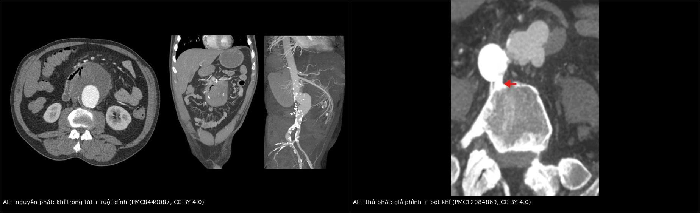
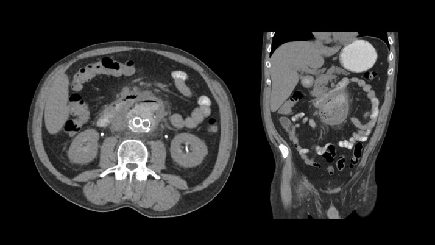
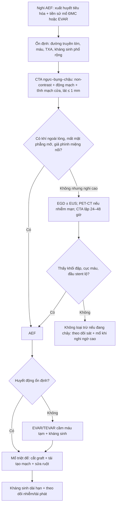
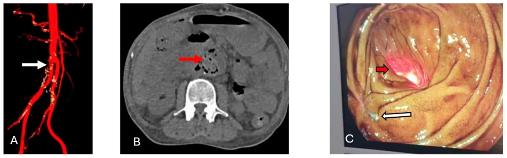
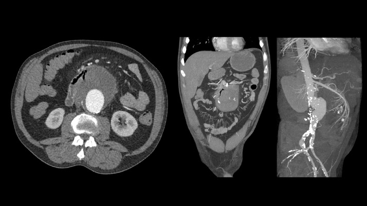
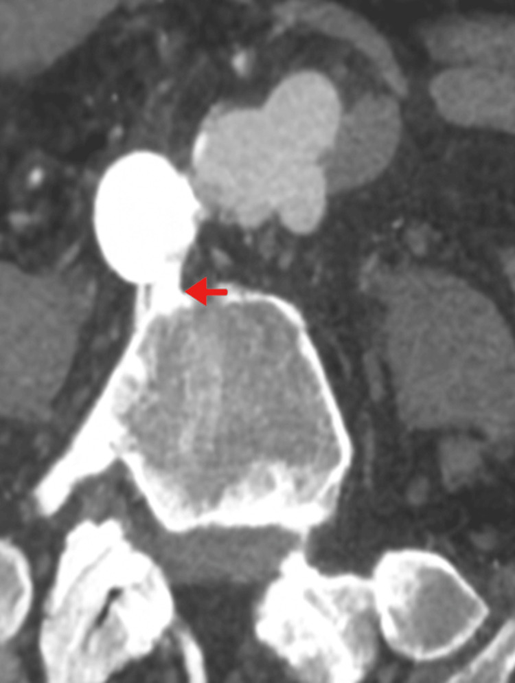
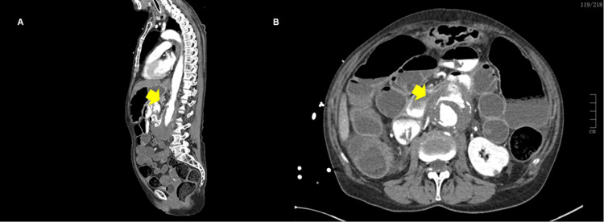

# 938 — Rò động mạch chủ–ruột (aortoenteric fistula, AEF): nguyên phát và sau EVAR

**Tags:** `pattern:ro-dong-mach-chu-ruot` `pattern:khi-ngoai-long` `pattern:gia-phinh-mien-noi` `pattern:xuat-huyet-tieu-hoa` `vung:dong-mach-chu-bung` `vung:dong-mach-chu-nguc` `vung:ta-trang` `protocol:CTA-bung-3-thi` `score:MAGIC`

**Mức chắc chắn (certainty):** tổng hợp y văn (literature synthesis) — 2 loạt phẫu thuật (23 ca hậu mổ ĐMC, *J Clin Med* 2022, PMC9369578; 10 ca, *BMC Gastroenterol* 2026, PMC12817749), 1 loạt 10 ca kèm thuật toán chẩn đoán (*Med Sci* 2026, PMC13609604), 2 ca nguyên văn có ảnh CT (PMC8449087; PMC12084869) và 1 ca nguyên văn có ảnh CTA (PMC12673226). Không có thử nghiệm ngẫu nhiên; mọi ngưỡng xử trí là tổng hợp thực hành, chỗ suy luận được ghi rõ.

> **Câu chốt:** AEF là **một đường thông giữa ĐMC và ống tiêu hóa**, gần như luôn là **cấp cứu chảy máu chết người**: **máu báo (herald bleed) 52–75%** rồi **vỡ ồ ạt**; tam chứng kinh điển **đau bụng + chảy máu tiêu hóa + khối đập** chỉ có **6–12%**. Ba câu để không bỏ sót: **(1)** người **đã mổ ĐMC/đặt stent-graft** mà **xuất huyết tiêu hóa tái diễn** → AEF cho tới khi loại trừ; **(2)** trên CTA tìm **khí trong túi phình/quanh graft**, **mất mặt phẳng mỡ** giữa ĐMC và ruột, **ruột dính vào thành ĐMC**, **giả phình miệng nối**, và dấu chốt **thoát cản quang từ ĐMC vào lòng ruột**; **(3)** **CTA âm không loại trừ** — loạt 23 ca chỉ phát hiện **47,8%** trên CTA, **39,1%** chỉ thấy khi mổ.

## 1. Tổng quan bệnh học – cơ chế hình ảnh (TẠI SAO)

### 1.1 Hai cơ chế, hai bệnh cảnh

- **AEF nguyên phát (primary AEF, PAEF):** phình ĐMC xơ vữa **ăn mòn** thành ruột kề bên (hay gặp **tá tràng D3–D4** vì đoạn này **cố định sau phúc mạc**, sát ĐMC ngay dưới động mạch thận) — hoặc do **nhiễm khuẩn ĐMC/viêm ĐMC nhiễm trùng**, dị vật, xạ trị, ung thư. Tần suất **0,007/1 triệu dân/năm**, khoảng **250 ca** trong y văn; **0,04–0,7%** trong tử thiết (PMC8449087; PMC12817749; PMC12673226).
- **AEF thứ phát (secondary AEF, SAEF):** biến chứng **muộn** của mổ ĐMC/EVAR: **nhiễm miếng ghép mạn** + **áp lực đập của ĐMC** làm mòn ruột và miệng nối. Tần suất **0,36–1,6%** sau mổ hở (PMC9369578; PMC12673226), **0,5–2,3%** sau mổ chung (PMC12817749), tới **3,9%** ở **giả phình miệng nối được đặt stent-graft** (PMC12673226). Thời gian từ mổ đến khi rò **69,4 ± 72,5 tháng** (PMC9369578), trung bình **8,05 năm (0,2–25)** (PMC13609604).
- **Phân bố:** gộp y văn cho thấy **56,1%** AEF ở ĐMC bụng, **43,9%** ở ĐMC ngực; **AEF bụng 78% là thứ phát**, còn **AEF ngực 72% là nguyên phát**; **16%** liên quan **ung thư tiêu hóa** (PMC13609604). AEF ngực (aortoesophageal, AOF) do **phình 54,2%, dị vật 19,2%, ung thư thực quản 17%** — tam chứng **Chiari** gồm **khó nuốt ngực giữa → máu báo → sốc mất máu** (PMC13609604).
- **Vì sao "máu báo" lại nguy hiểm:** lỗ rò nhỏ bị **cục máu đông bít tạm** → bệnh nhân **ổn định vài giờ đến vài ngày**, nội soi/CTA có thể âm; khi cục đông trôi → **vỡ ồ ạt**. Đây là lý do **không được trì hoãn** vì "đã cầm máu".

### 1.2 TẠI SAO nhìn thấy trên CT: khí, mỡ, cản quang

- **Khí ngoài lòng (ectopic gas):** khí trong lòng ruột có **−1.000 HU**, mỡ **−100 đến −50 HU**, máu đông **50–80 HU**, cản quang **200–400 HU**. Khí trong **túi phình đã huyết khối** hoặc **quanh miếng ghép** không thể giải thích bằng phẫu thuật đơn thuần → **dấu hiệu mạnh của rò** (PMC8449087; PMC3711735). Đọc trên **cửa sổ phổi (W 1.500/L −600)** để không bỏ sót bọt khí nhỏ.
- **Mất mặt phẳng mỡ + ruột dính thành ĐMC:** viêm quanh mạch do **nhiễm graft** làm **mờ/mất lớp mỡ** giữa ĐMC và ruột; ruột **bị kéo dính (tethering)** vào túi phình. Đây là dấu **sớm**, có thể xuất hiện **trước khi** có khí (PMC8449087; PMC3711735).
- **Thoát cản quang trực tiếp:** cản quang **trong lòng ĐMC đi vào lòng ruột** — **đặc hiệu** nhưng **hiếm**, nên **không dùng cản quang đường uống thường quy** để tìm dấu này (PMC8449087).
- **Giả phình miệng nối:** sau mổ hở/EVAR, **miệng nối mất tính toàn vẹn** → túi giả phình **quanh sợi chỉ/vòng stent**, thành mỏng, **bọt khí trong túi** = dấu SAEF (PMC12084869; PMC13609604).
- **Vì sao CTA vẫn có thể âm:** rò **nhỏ, gián đoạn**, bị **cục máu đông** bít; khí có thể **đã thoát qua ruột**; lát cắt dày làm mất bọt khí **1–2 mm**. Vì vậy phải **lát ≤ 1 mm + MPR**.

### 1.3 Ngưỡng định lượng trụ cột

| Đại lượng | Con số | Nguồn |
|---|---|---|
| PAEF | **0,007/1 triệu dân/năm**; **0,04–0,7%** tử thiết (nguồn khác ghi tới **0,07%**); **< 0,1%** ca phình ĐMC bụng | PMC8449087; PMC12817749; PMC12673226 |
| SAEF sau mổ ĐMC | **0,36–1,6%** (mổ hở) · **0,5–2,3%** · tới **3,9%** với giả phình được EVAR | PMC9369578; PMC12817749; PMC12673226 |
| Thời gian từ mổ đến rò | **69,4 ± 72,5 tháng** · trung bình **8,05 năm (0,2–25)** | PMC9369578; PMC13609604 |
| Máu báo (herald bleed) | **52–75%** | PMC13609604 |
| Tam chứng kinh điển | Chỉ **6–12%** lúc nhập viện | PMC12817749 |
| Tỉ lệ phát hiện | CTA **47,8%**, nội soi **13%**, chỉ thấy khi mổ **39,1%** (n = 23) · CTA **10/10** (n = 10) · nội soi **1/3** ca có chỉ định | PMC9369578; PMC12817749 |
| Tử vong | **30 ngày 30%** (loạt 10 ca); **trong viện 43,5%** (loạt 23 ca); **chung 60–65,2%**; không điều trị **~100%**; điều trị trong **60 ngày còn 50%** | PMC13609604; PMC9369578 |
| Theo đường vào | EVAR cầm máu: tử vong trong viện **7%** vs mổ hở **34%**; nhiễm khuẩn muộn **42% vs 19%** | PMC13609604 (dẫn y văn) |
| Biểu hiện chảy máu vs nhiễm mạn | Tử vong chu phẫu **66,7% vs 18,2%** (p = 0,019) | PMC9369578 |
| Stent-graft cầm máu tạm ở ca đang chảy | Sống chu phẫu **66,6% (4/6)** vs mổ hở cấp **0% (0/6)**, p = 0,014 | PMC9369578 |

## 2. Mẫu hình + chẩn đoán phân biệt theo vị trí (Gamut)

**Mẫu hình chốt:** *người có tiền sử phình/mổ ĐMC, xuất huyết tiêu hóa (có thể đã tạm ngừng), CTA có **khí trong túi/quanh graft** + **mất mặt phẳng mỡ** + **ruột dính thành ĐMC** ± **giả phình miệng nối**; dấu chốt là **cản quang từ ĐMC vào ruột**.*

### 2.1 Gamut theo vị trí

| Vị trí | Thực thể | Vì sao khác nhau |
|---|---|---|
| **ĐMC bụng – tá tràng D3/D4** | **SAEF sau mổ hở/EVAR** (hay nhất), **PAEF do phình xơ vữa** | Đoạn tá tràng **cố định sau phúc mạc**, sát ĐMC; SAEF thường ở **miệng nối hoặc thân graft** |
| **ĐMC bụng – hỗng tràng/đại tràng** | SAEF thể **ăn mòn cạnh graft (paraprosthetic erosion)**, rò do **ung thư/xạ trị** | Ruột **di động**, dấu khí khu trú, ít mức độ dính; **không có thông trực tiếp** = type II |
| **ĐMC ngực – thực quản (AOF)** | **Phình ĐMC ngực**, **dị vật** (xương cá/gà), **ung thư thực quản**, sau **TEVAR** | Tam chứng **Chiari**; trung thất nhiễm → tử vong nhanh; **không có "máu báo" kéo dài** |
| **ĐMC – tĩnh mạch chủ (aortocaval)** | Rò **ĐMC–TM chủ** (không phải AEF) | Cản quang **vào TM chủ thì sớm**, **không có khí trong ruột**; suy tim cấp |
| **Quanh graft không rò** | **Nhiễm miếng ghép ĐMC** (MAGIC), **áp-xe quanh graft** | Khí/dịch **quanh graft nhưng không thấy đường vào ruột**; cần PET-CT/theo dõi |

### 2.2 Mnemonic **AORTA** (đọc CTA)

- **A** — **Air** ngoài lòng: trong túi phình, quanh graft, **theo đường rò**.
- **O** — **Obliteration** mặt phẳng mỡ giữa ĐMC và ruột; ruột **dính/tethering**.
- **R** — **Rupture/pseudoaneurysm** ở **miệng nối** hoặc thân graft.
- **T** — **Transit** cản quang **từ ĐMC vào lòng ruột** (dấu đặc hiệu nhất).
- **A** — **Ancillary**: dịch/đặc quanh graft, dày thành ruột kề, hạch, **khí trong mô mềm**.

## 3. Bảng so sánh phân biệt (ma trận đối chiếu)

| Thực thể (entity) | Hình ảnh điển hình | Chốt vào (rule-in) | Chốt loại (rule-out) | Gợi ý xác nhận |
|---|---|---|---|---|
| **AEF nguyên phát (PAEF)** | Phình ĐMC bụng **8,9 × 10,3 cm** trong ca nguyên văn; **khí trong túi huyết khối**, **quai hỗng tràng dính thành**, không có miếng ghép | **Khí trong túi phình + ruột dính + không tiền sử mổ ĐMC** | **Có graft/stent** → nghĩ SAEF; **khí đơn độc sau mổ mới** → chưa chốt | CTA 3 thì lát 1 mm; mổ xác nhận |
| **SAEF type I (thông trực tiếp graft–ruột)** | **Giả phình miệng nối**, **khí trong túi**, **thoát cản quang vào ruột**, tạng **dính quanh graft** | **Tiền sử mổ ĐMC + khí quanh graft + giả phình miệng nối** | **Không có khí/dịch quanh graft, không giả phình** → ít nghĩ type I | CTA + **PET-CT** nếu nhiễm mạn; mổ |
| **SAEF type II (ăn mòn cạnh graft, không thông trực tiếp)** | **Dịch/khí quanh graft**, **dày ruột kề**, **không thấy đường rò** trên CTA | **Nhiễm graft mạn + xuất huyết tiêu hóa + khí quanh graft** | **Thấy đường thông trực tiếp** → type I | Nội soi + PET-CT; mổ thấy **ăn mòn thành ruột** |
| **Nhiễm miếng ghép ĐMC không rò** | **Dịch quanh graft**, **khí**, **giả phình**, **không có máu tiêu hóa** | **Sốt + CRP tăng + dịch/khí quanh graft** | **Có chảy máu tiêu hóa + khí trong lòng ruột** → nghĩ AEF | MAGIC; PET-CT; cấy máu/mô |
| **Phình nhiễm khuẩn (mycotic) / viêm ĐMC nhiễm trùng** | **Túi phình dạng thoi**, **khí trong thành**, **mất mặt phẳng mỡ**, **không có graft** | **Sốt + cấy máu dương + khí trong thành ĐMC** | **Có miệng nối/graft** → SAEF; **không khí** → xơ vữa đơn thuần | CTA + cấy máu; PET-CT |
| **Xơ hóa sau phúc mạc / aortitis** | **Dày mô mềm quanh ĐMC đồng tâm**, **không khí**, **không giả phình** | **Dày quanh ĐMC đều, không khí, không dính ruột** | **Khí ngoài lòng + ruột dính** → AEF | MRI/CT; sinh thiết nếu cần |
| **Xuất huyết tiêu hóa khác** | Loét, angiodysplasia, Dieulafoy, giãn tĩnh mạch — **không có bất thường quanh ĐMC** | **Nội soi thấy nguồn chảy, CTA bụng bình thường** | **Có tiền sử mổ ĐMC + khí quanh graft** → vẫn phải loại AEF | Nội soi; CTA lặp |
| **AOF do dị vật/ung thư** | **Dị vật cản quang** trong thực quản/trung thất, **khí trung thất**, **phình ĐMC ngực** | **Dị vật + khí trung thất + tam chứng Chiari** | **Không dị vật, phình ĐMC bụng** → AEF bụng | CT ngực; nội soi thực quản |

*Trái: **AEF nguyên phát** — phình ĐMC bụng đã huyết khối, **khí trong túi** (mũi tên đen), **quai hỗng tràng dính vào thành túi** (PMC8449087, CC BY 4.0). Phải: **AEF thứ phát** — **giả phình miệng nối** (mũi tên đỏ) với **bọt khí trong túi** sau mổ hở ĐMC bụng 12 năm (PMC12084869, CC BY 4.0). Ảnh ghép letterbox, không crop.*

### 3.1 Ba dấu hiệu cần đọc kỹ

- **Khí trong túi phình đã loại trừ (excluded sac) sau EVAR:** khí **tăng thêm** hoặc **mới xuất hiện** kèm **sốt/chảy máu** là dấu **rò**, không phải "khí lành" sau can thiệp. Ca nguyên văn: sau EVAR 5 ngày, **khí trong túi tăng** rồi **cản quang đường uống vào túi** xác nhận rò (PMC8449087 — Hình 4–5).
- **Mặt phẳng mỡ mất + ruột dính:** phải đọc **axial + coronal + sagittal**, so với **ĐMC trên/dưới tổn thương**; dấu này **đi trước** khí và **không đặc hiệu** (gặp trong nhiễm graft đơn thuần) (PMC3711735).
- **Thoát cản quang vào ruột:** nếu thấy, **chẩn đoán gần như chắc**; nhưng **không đặt sonde cản quang đường uống** chỉ để tìm dấu này — nguy cơ **che lấp khí** và **làm nặng nhiễm** (PMC8449087).

*CT bụng **có cản quang đường uống**: cản quang **trong lòng ruột đi vào túi phình đã được loại trừ** — xác nhận đường thông. Đây là dấu **đặc hiệu** nhưng hiếm; không dùng cản quang uống thường quy. Nguồn: *Radiol Case Rep* 2021 (PMC8449087), CC BY 4.0.*

## 4. Protocol chụp + hệ phân độ/điểm chuẩn hóa

### 4.1 Protocol theo tình huống

| Tình huống | Chuỗi bắt buộc | Mục đích |
|---|---|---|
| **Nghi AEF, huyết động còn ổn** | **CTA ĐMC ngực–bụng–chậu**: non-contrast → động mạch → **tĩnh mạch cửa 70–90 giây**; lát **≤ 1 mm**, MPR coronal/sagittal, **cửa sổ phổi** | Non-contrast phát hiện **vôi hóa, khí, máu tụ**; thì TM cửa bắt **thoát cản quang chậm** vào ruột |
| **Đang sốc/không ổn** | **CTA "damage control"** hoặc đưa thẳng phòng mổ; **không chờ nội soi** | Cầm máu ưu tiên hơn chẩn đoán hoàn chỉnh |
| **CTA âm nhưng nghi cao** | **Nội soi tiêu hóa trên (EGD)** ± **siêu âm nội soi (EUS)**; **PET-CT** nếu nhiễm graft mạn; **CTA lặp** sau 24–48 giờ | EGD thấy **khối đập, cục máu dính, đầu stent lộ**; EGD **âm không loại trừ** (chỉ **1/3** ca có chỉ định là chẩn đoán được, PMC12817749) |
| **Nhiễm graft mạn, chưa rò** | **PET-CT / leukocyte scan** + **MAGIC criteria** | Phân biệt **nhiễm graft** với **AEF**; định hướng **thời điểm mổ** |
| **Trước can thiệp** | CTA có **đường kính cổ túi, chiều dài vùng hạ cánh, nhánh tạng, tuần hoàn bàng hệ** | Chọn **stent-graft cầu nối** vs **mổ hở**; tránh che nhánh quan trọng |

### 4.2 Hệ phân độ/điểm thực hành

- **Phân loại AEF:** **nguyên phát** vs **thứ phát**; thứ phát chia **type I** (thông trực tiếp graft–ruột, thường do **bục miệng nối/giả phình**) và **type II** (ăn mòn cạnh graft, **không thông trực tiếp**) (PMC13609604; PMC9369578).
- **MAGIC (Management of Aortic Graft Infection Collaboration):** tiêu chuẩn **lâm sàng + xét nghiệm + hình ảnh** cho **nhiễm graft/endograft** — dùng để **không bỏ sót nhiễm nền** và **theo dõi sau mổ**; **không có thang điểm riêng cho AEF**.
- **Quyết định điều trị** dựa trên **huyết động + nhiễm + khả năng mổ**, không dựa vào kích thước túi.

### 4.3 Flowchart xử trí

- **Nguyên tắc:** **EVAR/TEVAR là cầu nối cầm máu**, **không phải chữa khỏi** — vẫn cần **cắt bỏ vật liệu nhiễm + tái tạo mạch + xử lý ruột** khi bệnh nhân ổn. Loạt 23 ca: **mổ hở 82,6%**, EVAR đơn thuần **8,7%**, hybrid **4,3%** (PMC9369578).
- **Kháng sinh:** phổ rộng **ngay** (đường thông với ruột → nhiễm **đa vi khuẩn, kể cả nấm**); cấy máu **40% dương**, **Candida** hay gặp (PMC13609604); thời gian **theo lâm sàng/vi sinh**, không có ngưỡng thống nhất.

*Ca 8: sau mổ phình ĐMC vỡ bằng **miếng ghép tẩm rifampin** — (A) graft, (B) **khí quanh graft** (mũi tên đỏ), (C) hình ảnh khác trong cùng chuỗi. Khí quanh graft **không đặc hiệu** (có thể gặp ngay sau mổ), nhưng **kèm chảy máu tiêu hóa** thì phải loại AEF. Nguồn: *Med Sci (Basel)* 2026 (PMC13609604), CC BY 4.0.*

## 5. Biến thể bình thường và cạm bẫy

### 5.1 Biến thể/dấu hiệu dễ đọc quá

- **Khí trong túi ngay sau EVAR:** một ít khí có thể tồn tại **vài tuần** sau can thiệp; **không đủ** để gọi AEF nếu **không có** chảy máu, sốt, dịch quanh graft. Ngược lại, **khí tăng dần** hoặc **khí mới** sau giai đoạn ổn định là **bất thường** (PMC8449087).
- **Vôi hóa thành ĐMC:** mảnh vôi **rất sáng** có thể **giả khí** trên cửa sổ mềm; đọc **cửa sổ phổi** và **non-contrast** để phân biệt (**vôi > 200 HU**, khí **−1.000 HU**).
- **Ruột chứa khí sát ĐMC:** khí **trong lòng ruột** không phải khí trong túi; phải xác định **vị trí tương đối** với thành túi/graft trên **nhiều mặt phẳng**.

### 5.2 Cạm bẫy (pitfall)

1. **"CTA âm = không có AEF"** — SAI. Loạt 23 ca: CTA chỉ **47,8%**, **39,1%** chẩn đoán khi mổ (PMC9369578). Nghi cao → **nội soi/PET/mổ**.
2. **"Nội soi âm = loại trừ"** — SAI. EGD chỉ **1/3** ca có chỉ định là thấy tổn thương (PMC12817749); tổn thương ở **D3–D4** dễ bị bỏ qua; **không bơm hơi quá mức** ở người có phình ĐMC.
3. **Nhầm khí quanh graft với nhiễm graft đơn thuần** — cả hai đều có khí; **chảy máu tiêu hóa + giả phình miệng nối** nghiêng AEF; **PET-CT** giúp nhưng **không thay thế** đánh giá đường rò.
4. **Bỏ sót "máu báo"** — bệnh nhân **ổn định sau một lần nôn máu** dễ bị cho về; **52–75%** có máu báo trước vỡ (PMC13609604). Ở người **đã mổ ĐMC**, xuất huyết tiêu hóa **phải** chụp CTA.
5. **Nhầm AEF với loét/Dieulafoy** — nội soi thấy **ổ loét** không loại trừ AEF; **không thấy nguồn** ở D3–D4 là gợi ý.
6. **Can thiệp EVAR xong rồi dừng** — **nhiễm vật liệu** tiếp tục; **42%** nhiễm khuẩn muộn sau EVAR so với **19%** sau mổ hở (PMC13609604 dẫn y văn). Phải có **kế hoạch mổ triệt để**.
7. **Không cấy máu/không kháng sinh sớm** — **40%** cấy máu dương; **Candida** làm tiên lượng xấu (PMC13609604).
8. **Bỏ sót AOF thể dị vật** — bệnh nhân **nuốt xương** rồi **sốt + đau ngực + nôn máu**; CTA thấy **dị vật + khí trung thất** (PMC13609604).
9. **"Khí trong túi sau EVAR là bình thường"** — chỉ đúng khi **không triệu chứng** và **khí giảm dần**; **khí tăng** = dấu rò (PMC8449087).
10. **Kết luận từ một thì:** thoát cản quang có thể **chỉ thấy thì tĩnh mạch cửa**; chụp **một thì động mạch** dễ âm.

## 6. Tự lượng giá — Blind Quiz

**Ca 1 — Nam 52 tuổi, ngất, không đau bụng; CT bụng có cản quang tình cờ. Nhìn axial + coronal + sagittal trước, mô tả trước.**

- Hỏi: bất thường ngoài phình ĐMC là gì? Nguyên phát hay thứ phát? Bước tiếp theo?

<b>Bấm để hiện đáp án (findings + chẩn đoán)</b>

- **Dấu hiệu:** phình ĐMC bụng dưới thận **8,9 × 10,3 cm**; **khí trong túi đã huyết khối** (mũi tên đen); **quai hỗng tràng dính vào thành túi**; không có miếng ghép.
- **Chẩn đoán:** **AEF nguyên phát** — phình xơ vữa ăn mòn hỗng tràng.
- **Xử trí trong ca:** đặt **stent-graft động mạch chủ–chậu hai bên** cùng ngày (cầu nối); sau đó **5 ngày** có **máu đỏ tươi qua trực tràng**, CT cho thấy **khí trong túi tăng**; chuyển mổ **cắt túi phình + bypass nách–hai đùi**.
- **Bài học:** khí trong túi + ruột dính = **AEF cho tới khi chứng minh ngược**, dù bệnh nhân **không đau bụng**.
- **Nguồn:** *Radiol Case Rep* 2021 (PMC8449087), **CC BY 4.0**.

**Ca 2 — Nam 74 tuổi, mổ hở phình ĐMC bụng cách đây 12 năm; mệt, phân đen 2 tuần rồi đi cầu máu ồ ạt + sốc. Nhìn CTA trước.**

- Hỏi: tổn thương ở đâu? Vì sao gọi là thứ phát? Hai dấu hiệu trên ảnh?

<b>Bấm để hiện đáp án (findings + chẩn đoán)</b>

- **Dấu hiệu:** **giả phình miệng nối động mạch chủ xa** kích thước **~3 × 2 cm** (mũi tên đỏ), **bọt khí bên trong**; chuỗi bệnh cảnh **máu báo 2 tuần** rồi **xuất huyết ồ ạt**.
- **Chẩn đoán:** **AEF thứ phát** sau mổ hở ĐMC bụng (miệng nối + nhiễm).
- **Xử trí:** **EVAR cầu nối** + kháng sinh theo kinh nghiệm; sau đó cần **mổ triệt để** cắt vật liệu nhiễm.
- **Bài học:** **máu báo** ở người có tiền sử mổ ĐMC = **báo động đỏ**, không chờ nội soi âm.
- **Nguồn:** *Cureus* 2025 (PMC12084869), **CC BY 4.0**.

**Ca 3 — Nữ 70 tuổi, phình ĐMC bụng theo dõi, nhập viện nôn máu ồ ạt, HA 84/45, Hb 6,5 g/dL. Nhìn CTA sagittal và axial trước.**

- Hỏi: dấu hiệu trực tiếp là gì? Nội soi trước đó thấy "chảy máu dạ dày không rõ nguồn" — loại trừ được AEF không? Xử trí?

<b>Bấm để hiện đáp án (findings + chẩn đoán)</b>

- **Dấu hiệu:** (A) sagittal và (B) axial — **thoát cản quang trực tiếp từ lòng ĐMC vào thành/tá tràng** (mũi tên vàng), **mất mặt phẳng mỡ**, túi phình lớn.
- **Chẩn đoán:** **AEF nguyên phát** (phình xơ vữa ăn mòn tá tràng).
- **Nội soi âm không loại trừ:** nội soi chỉ thấy **chảy máu dạ dày không nguồn**; tổn thương ở **D3–D4** khó thấy.
- **Xử trí:** hồi sức (máu, PCC, canxi), **kháng sinh phổ rộng**, chuyển **mổ/can thiệp cầm máu khẩn**; ca này **tử vong trong vài giờ** trước khi chuyển tuyến.
- **Nguồn:** *Cureus* 2025 (PMC12673226), **CC BY 4.0**.

## Bài liên quan chéo
- [901 – Tổng quan Điện quang Can thiệp](../901-ir-overview/lesson.md) — tam giác an toàn, động học thoát mạch
- [920 – Nút mạch cầm máu tiêu hóa](../920-vascular-embolization-gi-bleed/lesson.md) — phân biệt **thoát hoạt tính vs giả phình vs giả thoát**
- [148 – Nhiễm trùng mảnh ghép nội mạch động mạch chủ](../148-nhiem-trung-manh-ghep-noi-mach-dmc/lesson.md) — MAGIC, PET/CT, quyết định lấy hay giữ mảnh ghép (hàng DDx của AEF)
- [170 – Phình động mạch chủ bụng](../170-phinh-DMC-bung/lesson.md) — ngưỡng can thiệp, theo dõi túi
- [172 – Theo dõi sau can thiệp bóc tách ĐMC bụng](../172-theo-doi-sau-can-thiep-boc-tach-dmc-bung/lesson.md) — endoleak, nhiễm stent-graft
- [093 – Chèn ép tĩnh mạch chủ trên](../093-hoi-chung-tinh-mach-chu-tren/lesson.md) — stent tĩnh mạch, biến chứng
- [933 – Sốc phản vệ & PC-AKI do thuốc cản quang](../933-an-toan-thuoc-can-quang/lesson.md) — an toàn cản quang ở bệnh nhân sốc

## Ảnh
- Tên file: `938_*_Modality_SourceID.jpg`; nguồn + giấy phép từng ảnh trong `images/CREDITS.md`.
- `images/composite_nguyen-phat-vs-thu-phat.jpg` — ảnh ghép **chỉ từ nguồn CC BY 4.0** (PMC8449087 + PMC12084869), letterbox bằng `tools/make_composite.py`.

> Không dùng để chẩn đoán độc lập khi chưa có người hướng dẫn.
