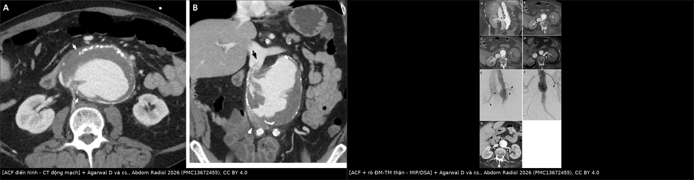
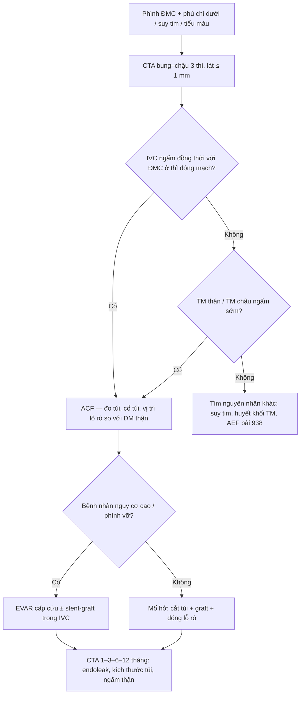
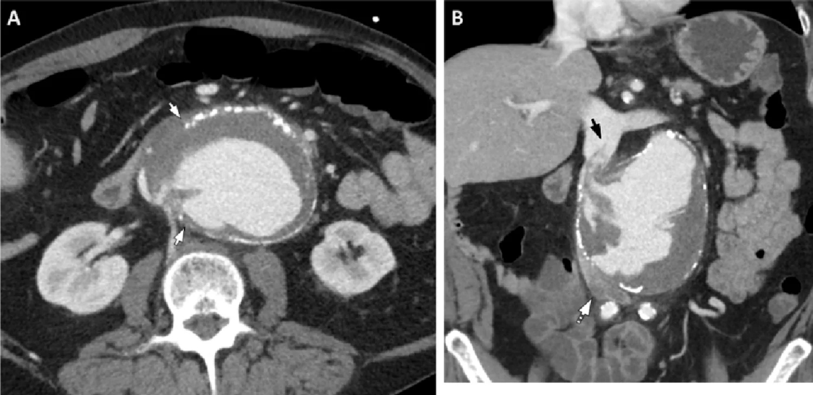
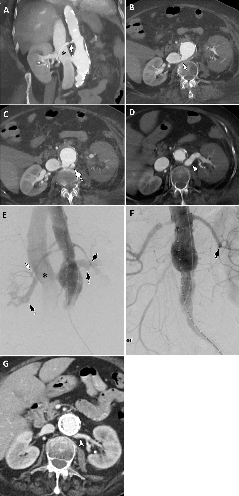
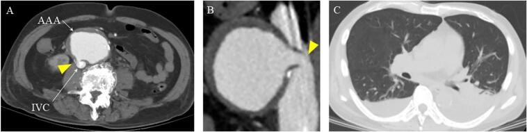

# 939 — Rò động mạch chủ–tĩnh mạch chủ (aortocaval fistula, ACF): ngấm TM chủ ở thì động mạch

**Tags:** `pattern:ro-dong-tinh-mach` `pattern:ngam-tinh-mach-som` `pattern:suy-tim-cung-luong-cao` `pattern:gia-ngam-thuoc-than` `pattern:gian-tinh-mach-chu` `vung:dong-mach-chu-bung` `vung:tinh-mach-chu-duoi` `vung:than` `protocol:CTA-bung-3-thi` `protocol:DSA` `protocol:EVAR`

**Mức chắc chắn (certainty):** tổng hợp y văn (literature synthesis) — 1 bài tổng quan hình ảnh rò ĐMC (*Abdom Radiol* 2026, PMC13672455), 2 ca nguyên văn có ảnh CTA (PMC12395442; PMC11999540), 1 ca nguyên văn dùng stent-graft trong IVC (PMC10907850) và 3 ca bổ trợ số liệu (PMC13017064; PMC11821926; PMC10319617). Không có thử nghiệm ngẫu nhiên; mọi ngưỡng xử trí là tổng hợp thực hành, chỗ suy luận được ghi rõ.

> **Câu chốt:** ACF là **đường thông giữa ĐMC (thường là túi phình dưới thận) và tĩnh mạch chủ dưới**. Dấu chốt trên CTA là **TM chủ ngấm cản quang ĐỒNG THỜI với ĐMC ở thì động mạch** — bình thường IVC chỉ ngấm ở thì tĩnh mạch **70–90 giây**. Bệnh cảnh gợi ý không phải "sốc mất máu" mà là **phình ĐMC + suy tim cung lượng cao/phù chi dưới/tiểu máu** — vì máu vẫn nằm trong lòng mạch, **sốc hiếm gặp** (PMC13672455). Bỏ sót = bơm bù dịch làm suy tim nặng thêm, hoặc mổ mà không kiểm soát được lỗ rò.

## 1. Tổng quan bệnh học – cơ chế hình ảnh (TẠI SAO)

### 1.1 Dịch tễ và bối cảnh

- **Tần suất:** ACF chiếm **< 1%** mọi phình ĐMC bụng (AAA) và tăng lên **2–6,7%** ở **phình ĐMC vỡ** (PMC10907850); bài tổng quan hình ảnh ghi **2–7%**, có loạt tới **10%** (PMC13672455); loạt khác ghi **0,2–1,3%** mọi phình và **~3%** phình vỡ (PMC11821926); tổng hợp ca bệnh ghi **< 1% đến 10%** (PMC10319617).
- **Nguyên nhân:** **80% nguyên phát** (phình xơ vữa ăn mòn IVC) và **20% thứ phát**; trong số nguyên phát, **5–10%** do phình nhiễm khuẩn (mycotic), Ehlers–Danlos hoặc Marfan (PMC11999540). Nguyên nhân khác: **chấn thương xuyên thấu, gãy–trật cột sống ngực–thắt lưng, mổ cột sống, thủ thuật sau phúc mạc (cắt thận), filter IVC, nhiễm khuẩn huyết** (PMC13672455; PMC10319617).
- **Vị trí:** **ĐMC bụng dưới thận**, ngay trên chỗ hợp lưu hai tĩnh mạch chậu là vị trí thường gặp nhất (PMC11999540; PMC13672455).
- **Tử vong:** **22–51%** (PMC11999540); đánh giá hồi cứu quanh mổ có thể tới **60%** do mất máu, thuyên tắc phổi và suy tim (PMC11821926).

### 1.2 Sinh lý bệnh — vì sao bệnh cảnh "kỳ lạ"

- **Shunt trái–phải lớn:** một phần cung lượng tim đổ thẳng vào hệ tĩnh mạch → **tăng thể tích tuần hoàn tĩnh mạch**, **suy tim cung lượng cao**, phù chi dưới, giãn tĩnh mạch, huyết khối tĩnh mạch sâu, thuyên tắc phổi, thiếu máu chi (PMC13672455).
- **Sốc hiếm:** máu **vẫn ở trong lòng mạch**, chỉ đổi "khoang" → huyết áp có thể còn giữ được trong khi bệnh nhân đã suy tim nặng. Đây là lý do ACF hay bị **chẩn đoán muộn** hoặc bị quy cho "suy tim do bệnh tim" (PMC13672455; PMC12395442).
- **Tăng áp lực tĩnh mạch thận:** dòng tĩnh mạch thận bị dội ngược → **tiểu máu, tăng creatinin, giảm ngấm nhu mô thận** (PMC11821926: creatinin **5,57 mg/dL**; PMC13017064: thận không ngấm, tĩnh mạch thận ngấm một phần).
- **Mức độ triệu chứng phụ thuộc KÍCH THƯỚC lỗ rò và thời gian tồn tại:** lỗ nhỏ → phát hiện tình cờ; lỗ lớn → suy tim cấp, thiếu máu chi, vô niệu (PMC13672455).

### 1.3 TẠI SAO nhìn thấy trên CT (vật lý + giải phẫu)

| Đại lượng | Con số | Ý nghĩa đọc phim |
|---|---|---|
| Cản quang trong ĐMC | **300–400 HU** | Mốc "máu động mạch" |
| Cản quang pha loãng trong IVC | **80–200 HU** | Vẫn sáng hơn cơ (**40–60 HU**) — đủ để gọi là "ngấm sớm" |
| Mỡ quanh ĐMC–IVC | **−100 đến −50 HU** | Mất mặt phẳng mỡ = dấu **sớm**, có trước khi thấy dòng rò |
| Vôi hóa thành ĐMC | **> 400 HU** | **Gián đoạn vôi hóa** ở vị trí rò là dấu định vị |
| Thì động mạch | **25–35 giây** | Thời điểm DUY NHẤT chứng minh rò |
| Thì tĩnh mạch bình thường của IVC | **70–90 giây** | IVC ngấm ở 25–35 giây = bất thường |

- **Ngấm sớm IVC:** cản quang đi tắt qua lỗ rò, nên **IVC và tĩnh mạch thận ngấm cùng lúc với ĐMC** — "đồng thời ngấm" là dấu **đặc hiệu** (pathognomonic) theo bài tổng quan (PMC13672455).
- **Vì sao IVC *dưới* lỗ rò lại KHÔNG ngấm tốt:** dòng máu từ lỗ rò tạo **dòng xoáy/pha loãng** và có thể **chảy ngược** về tĩnh mạch chậu; trên ảnh coronal, đoạn IVC dưới lỗ rò nhạt hơn hẳn — **đừng đọc là "IVC không có cản quang nên không rò"** (PMC13672455, Fig. 11).
- **Vì sao thận giảm ngấm:** tăng áp lực tĩnh mạch thận làm giảm chênh áp lọc → nhu mô ngấm chậm/kém, **hồi phục sau khi bịt rò** (PMC13672455, Fig. 10G).
- **Mảnh vôi/mảng xơ "trôi" vào IVC:** thành ĐMC mất liên tục, mảng xơ vữa bị dòng rò cuốn vào lòng IVC → hình ảnh **khuyết thuốc di động** trong IVC, phân biệt với huyết khối tĩnh mạch (PMC13672455, Fig. 11B).

## 2. Mẫu hình + chẩn đoán phân biệt theo cơ chế (Gamut)

- **Nhóm 1 — Phình (chiếm đa số):** AAA xơ vữa ăn mòn IVC; thể **"ACF + phình vỡ"** có tử vong cao nhất.
- **Nhóm 2 — Mổ/thủ thuật:** sau **EVAR** (endoleak type II muộn ăn mòn IVC — ca PMC10907850), sau mổ hở ĐMC, sau **cắt thận**, sau **filter IVC**.
- **Nhóm 3 — Chấn thương:** xuyên thấu; **gãy–trật cột sống ngực–thắt lưng** (ĐMC và IVC bị kéo căng trên cùng một trục).
- **Nhóm 4 — Nhiễm:** phình nhiễm khuẩn (Salmonella, Candida), viêm ĐMC.
- **Nhóm 5 — Bẩm sinh/di truyền:** ACF bẩm sinh ở trẻ (kèm còn ống động mạch), Ehlers–Danlos, Marfan.
- Gợi nhớ **"Phình – Mổ – Chấn – Nhiễm – Bẩm"**: gặp bệnh cảnh phình ĐMC + suy tim/phù chi thì nghĩ **Phình** trước, nhưng **luôn hỏi tiền sử can thiệp** vì nhóm **Mổ** đang tăng lên theo số ca EVAR.

## 3. Bảng so sánh phân biệt (ma trận đối chiếu)

| Thực thể (entity) | Hình ảnh điển hình | Chốt vào (rule-in) | Chốt loại (rule-out) | Gợi ý xác nhận |
|---|---|---|---|---|
| **ACF do phình ĐMC** | Túi phình dưới thận lớn, **gián đoạn vôi hóa** thành sau, mất mặt phẳng mỡ với IVC, **IVC ngấm thì động mạch** | **IVC ngấm ĐỒNG THỜI với ĐMC ở 25–35 giây** + mất liên tục thành ĐMC–IVC | IVC chỉ ngấm ở thì tĩnh mạch, mặt phẳng mỡ còn nguyên → không rò | CTA 3 thì + MPR coronal; DSA khi can thiệp |
| **ACF sau EVAR (endoleak type II muộn)** | Stent-graft cũ, **túi phình còn lớn**, khí/dịch quanh graft, IVC ngấm sớm | **Endoleak + IVC ngấm sớm**; túi không teo sau EVAR | Túi teo dần + không ngấm IVC → theo dõi | CTA 3 thì; so phim cũ; DSA chọn lọc |
| **Rò ĐMC–TM thận (aortorenal vein fistula)** | **TM thận trái giãn, ngoằn ngoèo**, thận cùng bên **ngấm kém**, IVC ngấm sớm | **TM thận giãn + ngấm sớm + thận giảm ngấm** | TM thận bình thường, thận ngấm đối xứng → không có nhánh rò | MIP coronal; DSA; hình ảnh **hồi phục sau stent** là chốt |
| **Rò ĐM chậu–TM chậu** | Ổ phình chậu + TM chậu ngấm sớm, **IVC ngấm muộn hơn** | **TM chậu ngấm sớm tại chỗ rò** | Ngấm bắt đầu từ IVC → không phải rò chậu | CTA bụng–chậu đến ngang bẹn |
| **Rò ĐMC–ruột (bài 938)** | Khí trong túi/quanh graft, ruột dính thành ĐMC, **máu báo** | **Khí ngoài lòng + ruột dính + XHTH** | Không khí, không XHTH → không phải AEF | Nội soi + CTA (bài 938) |
| **Trào ngược cản quang từ nhĩ phải (giả ACF)** | Cản quang trong IVC đoạn **cao** (gan), **độ ngấm thấp hơn ĐMC rõ rệt** | **Ngấm nhạt + chỉ ở IVC cao + không có lỗ rò** | **Đồng thời, đồng độ ngấm, tại ngang túi phình** → là rò thật | So độ HU IVC với ĐMC; xem MPR |
| **Huyết khối TM chủ** | **Khuyết thuốc** trong lòng IVC, IVC giãn | **Khuyết thuốc không ngấm + IVC giãn** | Có **dòng cản quang vào IVC ở thì động mạch** → là rò, không chỉ huyết khối | CTA 3 thì; đối chiếu thì không cản quang |

*Trái: ACF điển hình — thành ĐMC mất liên tục, mảnh xơ trôi vào IVC, IVC dưới lỗ rò nhạt. Phải: ACF kèm rò ĐMC–TM thận trái — TM thận giãn, thận trái ngấm kém, DSA trước/sau stent. Ảnh ghép letterbox từ 2 hình CC BY 4.0 (PMC13672455).*

### Ba dấu hiệu định vị lỗ rò (đọc theo thứ tự)
1. **Gián đoạn vôi hóa** thành sau ĐMC (thường 7–10 giờ trên mặt cắt ngang).
2. **Mất mặt phẳng mỡ** giữa ĐMC và IVC, hai thành **dính nhau**.
3. **Mảnh vôi/mảng xơ trong lòng IVC** hoặc **dòng cản quang phụt** vào IVC — dấu chốt.

## 4. Protocol chụp + phân độ & xử trí

- **CTA bụng–chậu 3 thì** (không cản quang → động mạch → tĩnh mạch), lát **≤ 1 mm**, **MPR coronal/sagittal + MIP**; thì động mạch dùng **bolus tracking** hoặc **25–35 giây** (PMC13672455).
- **Không** dùng cản quang đường uống để "tìm rò" (khác bài 938 — ở AEF cản quang uống có vai trò minh họa, ở ACF thì không).
- **Đo và ghi:** đường kính túi phình (mm), chiều dài cổ túi, khoảng cách lỗ rò tới **động mạch thận**, đường kính IVC, có/không huyết khối IVC, tình trạng ngấm hai thận.
- **Gợi ý kỹ thuật:** thì động mạch chụp khi **hít vào** có thể làm IVC giãn hơn (thay đổi đường kính theo nhịp thở) — bài tổng quan nêu như **giả thuyết kỹ thuật**, chưa có bằng chứng lâm sàng (PMC13672455).
- **Xử trí:** **EVAR cấp cứu** là lựa chọn cho bệnh nhân nguy cơ cao (ca 76 tuổi suy tim mạn + suy thận: EVAR, hậu phẫu thuận lợi, túi teo dần dù còn shunt nhỏ — PMC12395442); **mổ hở** (cắt túi + graft + đóng lỗ rò) cho người trẻ/ổn định; khi lỗ rò lớn có thể **đặt covered stent-graft trong IVC** (ca 78 tuổi sau EVAR 6 năm, theo dõi 24 tháng không tắc, không endoleak — PMC10907850).
- **Theo dõi sau can thiệp:** CTA **1–3–6–12 tháng**, tìm **endoleak tồn tại**, kích thước túi, độ ngấm thận, dấu suy tim.

## 5. Biến thể bình thường và cạm bẫy

- **Trào ngược cản quang từ nhĩ phải:** gặp ở bệnh nhân suy tim, tiêm tốc độ cao; cản quang trong IVC **nhạt hơn ĐMC** và **không có lỗ rò** — so độ HU để loại (PMC13672455).
- **IVC bị túi phình chèn ép:** lòng IVC dẹt, khó đánh giá "ngấm sớm" → dùng **tĩnh mạch thận/phụ hệ ngấm sớm** và **mất mặt phẳng mỡ** làm dấu thay thế (PMC13672455; ca PMC12395442: túi 56,6 × 73,7 mm **chèn ép IVC**).
- **Thận giảm ngấm ≠ nhồi máu thận:** tăng áp lực tĩnh mạch thận; sau khi bịt rò thận **ngấm lại bình thường** (PMC13672455, Fig. 10F–G) — đừng can thiệp thận.
- **"Không sốc" không loại trừ ACF:** máu vẫn trong lòng mạch; bù dịch mạnh có thể **làm suy tim cung lượng cao nặng thêm**.
- **Chỉ chụp thì tĩnh mạch:** IVC ngấm đều → **mất dấu chốt**; luôn phải có thì động mạch.
- **Mảnh vôi trong IVC** bị đọc thành huyết khối tĩnh mạch → kiểm tra thì không cản quang và bờ tổn thương.
- **Bỏ sót vì "túi phình đã vôi hóa kín":** dấu rò nằm ở **một điểm gián đoạn vôi hóa nhỏ**, cần cửa sổ mạch và MPR mỏng.

## 6. Tự lượng giá — Blind Quiz

**Ca 1 — Nam 70 tuổi, đau bụng đột ngột, tụt huyết áp, khối đập ở bụng.**

- Câu hỏi: Thành ĐMC mất liên tục ở đâu? Có gì trong lòng IVC? Vì sao đoạn IVC dưới lỗ rò lại nhạt?

<b>Bấm để hiện đáp án (findings + chẩn đoán)</b>

- **Findings:** túi phình ĐMC lớn, vôi hóa ngoại vi; **mất liên tục vôi hóa và mất bờ tròn thành ĐMC ở 7–10 giờ**, mất mặt phẳng với IVC; coronal: **lỗ rò dưới thận**, **mảnh xơ vữa trôi vào lòng IVC**; **IVC dưới lỗ rò không ngấm tốt**.
- **Chẩn đoán:** **ACF do phình ĐMC vỡ** — cản quang vào IVC ở thì động mạch là dấu chốt.
- **Vì sao IVC dưới nhạt:** dòng rò tạo xoáy/pha loãng và có thể chảy ngược về tĩnh mạch chậu — **không phải dấu loại trừ**.
- Nguồn ảnh: Agarwal D và cs., *Abdom Radiol* 2026, Fig. 11 (PMC13672455), CC BY 4.0.

**Ca 2 — Nữ 66 tuổi, đau hông lưng trái, creatinin 3,5 mg/dL, 4 ngày sau ngón chân tím và mạch yếu.**

- Câu hỏi: Vì sao thận trái ngấm kém? Có mấy đường rò? Sau stent thay đổi gì?

<b>Bấm để hiện đáp án (findings + chẩn đoán)</b>

- **Findings:** (A, B) ACF với **IVC ngấm sớm**; (C, D) thêm **rò ĐMC–tĩnh mạch thận trái**, **TM thận trái giãn ngoằn ngoèo**; **thận trái ngấm kém**; (E) DSA: nhánh ĐM thận trái bị "tỉa" (pruning), **TM thận và IVC ngấm sớm**; (F, G) sau đặt stent: ĐM thận trái ngấm bình thường, **hai thận ngấm đối xứng**.
- **Chẩn đoán:** **ACF + rò ĐMC–TM thận trái**; giảm ngấm thận do **tăng áp lực tĩnh mạch thận**, hồi phục sau khi bịt rò.
- **Cạm bẫy:** đừng gọi "nhồi máu thận" — tổn thương **hồi phục hoàn toàn** sau can thiệp.
- Nguồn ảnh: Agarwal D và cs., *Abdom Radiol* 2026, Fig. 10 (PMC13672455), CC BY 4.0.

**Ca 3 — Nam 76 tuổi, đang điều trị suy tim mạn, phát hiện tình cờ khi siêu âm bụng.**

- Câu hỏi: IVC ngấm ở thì nào? Vì sao có tràn dịch màng phổi hai bên? Hướng xử trí?

<b>Bấm để hiện đáp án (findings + chẩn đoán)</b>

- **Findings:** (A, B) **IVC ngấm cản quang ở thì động mạch** (mũi tên vàng) — dấu chốt ACF; túi phình dạng túi **56,6 × 73,7 mm chèn ép IVC**; (C) **tràn dịch màng phổi hai bên** do suy tim cung lượng cao.
- **Chẩn đoán:** ACF trên phình ĐMC ở bệnh nhân suy tim mạn + suy thận; **EVAR cấp cứu**, hậu phẫu thuận lợi, túi teo dần dù còn shunt nhỏ.
- **Vì sao không sốc:** máu vẫn trong lòng mạch → bệnh cảnh "suy tim + suy thận" chứ không phải "sốc mất máu".
- Nguồn ảnh: Tsumura K, Uchiyama M, *Int J Surg Case Rep* 2025, Fig. 1 (PMC12395442), CC BY 4.0.

## Bài liên quan chéo
- [938 – Rò động mạch chủ–ruột (AEF)](../938-ro-dong-mach-chu-ruot/lesson.md) (cùng bối cảnh "phình ĐMC + biến chứng", khác dấu chốt: khí/ruột thay vì TM chủ)
- [170 – Phình động mạch chủ bụng](../170-phinh-DMC-bung/lesson.md)
- [901 – Tổng quan can thiệp IR](../901-ir-overview/lesson.md)
- [920 – Nút mạch & vật liệu can thiệp](../920-vascular-embolization-gi-bleed/lesson.md)

## Ảnh
- `939_ro-dong-mach-chu-tinh-mach-chu_CT_PMC13672455-F11.jpg` — ACF điển hình (axial + coronal).
- `939_ro-dong-mach-chu-tinh-mach-chu_CT_PMC13672455-F10.jpg` — ACF + rò ĐM–TM thận, DSA trước/sau stent.
- `939_ro-dong-mach-chu-tinh-mach-chu_CT_PMC12395442-F1.jpg` — IVC ngấm thì động mạch + tràn dịch màng phổi.
- `composite_acf-dien-hinh-vs-giam-ngam-than.jpg` — ảnh ghép đối chiếu (CC BY 4.0).
- Nguồn + giấy phép từng ảnh: `images/CREDITS.md`.

> Không dùng để chẩn đoán độc lập khi chưa có người hướng dẫn.
