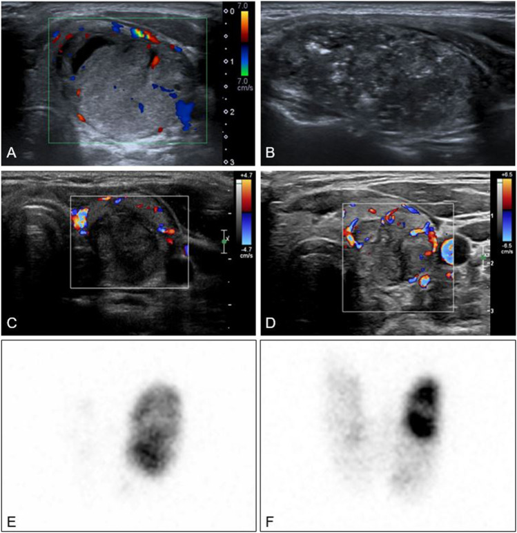
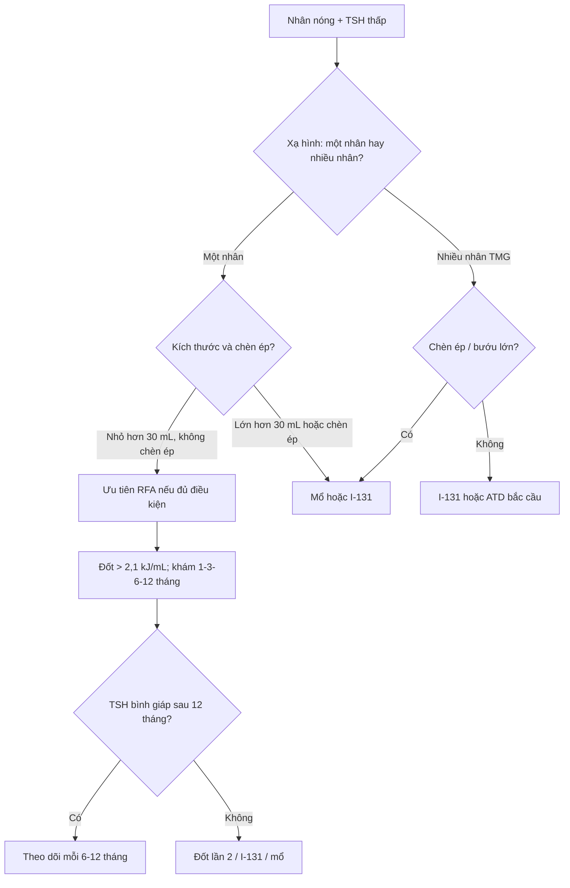
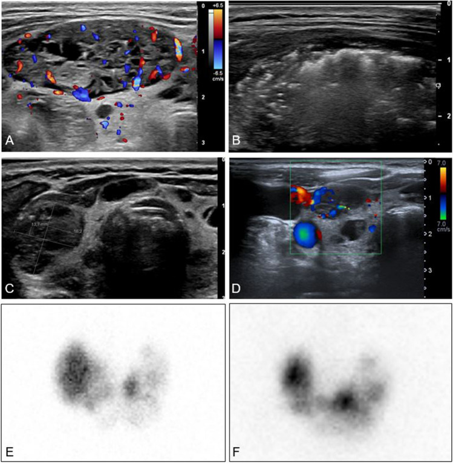

# 940 — Nhân giáp ĐỘC (toxic adenoma/AFTN): đốt nhiệt RFA–MWA so với I-131 và mổ

**Tags:** `pattern:not` `vung:tuyen-giap` `score:ETA-2020` `protocol:dot-nhiet-giap` `protocol:xac-nhan-nhan-nong` `incidentaloma:nhan-giap`
**Mức chắc chắn (certainty):** tổng hợp y văn (literature synthesis) — biên từ toàn văn các bài mở: đoàn hệ **48 bệnh nhân AFTN** (36 nhân độc đơn độc, 12 bướu đa nhân độc) được RFA, Eur J Nucl Med Mol Imaging 2023, **PMC10547644** (CC BY 4.0); nghiên cứu tiến cứu **17 AFTN** theo dõi 24 tháng, Ther Clin Risk Manag 2022, **PMC8747785** (CC BY-NC 3.0); đoàn hệ **883 nhân** một lần RFA theo dõi 8 năm, J Clin Endocrinol Metab 2026, **PMC13099205** (CC BY 4.0); phân tích **82 bệnh nhân cường giáp có nhân nóng** được mổ, 2026, **PMC13409719** (CC BY-NC); đồng thuận **LATS 2025** về đốt nhiệt tuyến giáp, **PMC12662451** (CC BY 4.0); tổng quan RFA nhân độc, 2024, **PMC10839704** (CC BY-NC-ND). Không có ca do nhóm tự chụp.

> **Câu hỏi thực hành:** nữ **42 tuổi**, tim đập nhanh, sụt 4 kg/3 tháng, run tay; TSH **0,01 mU/L**, FT4 **28 pmol/L**, FT3 **9,1 pmol/L**; siêu âm một nhân đặc **22 mm** thùy trái; xạ hình 99mTc thấy **nhân nóng duy nhất, mô giáp còn lại bị ức chế hoàn toàn**. Chị hỏi: **"Có phải u ác không? Đốt nhiệt có khỏi hẳn không, hay phải uống I-131/mổ?"**
> Bài chốt **năm quyết định**: **(1) nhân nóng KHÔNG đồng nghĩa lành — 8,5% bệnh nhân có nhân nóng được mổ phát hiện ung thư/u tiềm năng ác tính, và 4 ca ung thư thật trong 82 bệnh nhân; (2) RFA chữa khỏi cường giáp ở 72% nhân độc đơn độc sau 1 lần, 81% sau 2 lần — nhưng chỉ 25–33% ở bướu đa nhân độc; (3) hiệu quả phụ thuộc năng lượng: > 2,1 kJ/mL đạt khỏi 91% so với 44% khi đốt ít hơn; (4) I-131 khỏi tương đương nhưng gây suy giáp 10–30% sau 1 năm và 30–60% sau 20 năm; (5) mổ là lựa chọn khi bướu chèn ép, nhân lớn/xâm lấn, nghi ung thư hoặc đốt thất bại — nhưng tới 59% bệnh nhân cần hormon thay thế sau cắt một thùy.**

## 1. Tổng quan bệnh học – cơ chế hình ảnh: vì sao nhân "nóng" gây cường giáp và vì sao đốt nhiệt chữa chậm

- **AFTN là gì:** nhân giáp tự chủ (autonomously functioning thyroid nodule) sản xuất hormon **không phụ thuộc TSH**. Đột biến hoạt hóa **TSHR** hoặc **GNAS** ở tế bào nang làm tăng cAMP nội bào → tăng biểu hiện **NIS** (sodium–iodide symporter), tăng bắt iod và tổng hợp T3/T4 liên tục. Hậu quả: **TSH bị ức chế**, mô giáp lành quanh nhân teo chức năng và **không bắt xạ** — đây là cơ sở của hình ảnh "nhân nóng + nền lạnh".
- **Dịch tễ và ngưỡng:** AFTN chiếm **0,9–9%** mọi nhân giáp; **nhân độc đơn độc (STA)** chiếm khoảng **5%** nguyên nhân cường giáp, còn **bướu đa nhân độc (TMG)** khoảng **30%** (PMC10547644). Nhân có thể đi từ **nhân tiền độc (pre-toxic, TSH thấp nhưng FT4/FT3 bình thường)** đến **nhiễm độc thật**; tốc độ tiến triển thay đổi, nên **không phải mọi nhân nóng đều phải điều trị ngay**.
- **TẠI SAO xạ hình là "chốt" chứ không phải siêu âm:** siêu âm chỉ nói **hình thái** (đặc, giảm âm, có vách, mạch máu); chỉ **xạ hình 99mTcO₄⁻ hoặc 123I** mới chứng minh **chức năng tự chủ**: ổ tăng bắt xạ khu trú + **ức chế hoàn toàn** mô còn lại. Siêu âm không phân biệt được nhân nóng với nhân lạnh — và **ung thư tuyến giáp thường lạnh**, nhưng nhân nóng vẫn có thể là ung thư (mục 5).
- **TẠI SAO RFA diệt được mô tự chủ:** dòng điện xoay chiều tần số cao (**khoảng 350–500 kHz**) đi qua điện cực làm ion trong mô dao động → **đốt nóng cục bộ 60–100°C** → **hoại tử đông (coagulative necrosis)** và tắc vi mạch. Vùng đốt **không còn tế bào nang sống** nên không còn sản xuất hormon; mô giáp lành xung quanh **được giữ lại** và có thể phục hồi chức năng khi TSH tăng trở lại.
- **TẠI SAO siêu âm thấy "tăng âm" trong lúc đốt:** nhiệt làm **thoát khí và tạo bọt vi mô** trong mô → vùng đốt chuyển **tăng âm**, đây là **dấu hiệu dẫn đường** cho kỹ thuật **moving-shot** (rút kim từ đáy lên, quét từng lớp).
- **TẠI SAO khỏi chức năng chậm hơn giảm thể tích:** mô hoại tử **không biến mất ngay**; đại thực bào dọn dần trong **6–24 tháng**. Vì vậy thời gian trung bình để **hết cường giáp** là **3,1 tháng ở STA** và **6,5 tháng ở TMG**; đánh giá "thành công" phải ở **6–12 tháng**, không phải 1 tháng (PMC10547644).
- **TẠI SAO I-131 gây suy giáp nhiều:** đồng vị phóng xạ **131I** phát tia beta (quãng chạy **khoảng 0,6–2 mm**) và tia gamma; tế bào nang bắt iod qua NIS nên **cả nhân nóng lẫn mô giáp bị ức chế vẫn nhận liều**, đặc biệt khi dùng liều "diệt" đủ lớn. Suy giáp sau I-131 là **10–30% sau 1 năm** và **30–60% sau 20 năm** (PMC10547644, dẫn ATA).
- **Con số nằm lòng của đốt nhiệt (RFA):**
  - **Liều năng lượng:** trung vị **2,5 kJ/mL** ở STA và **2,8 kJ/mL** ở TMG; **ngưỡng > 2,1 kJ/mL** đạt khỏi **91%** so với **44%** khi ≤ 2,1 kJ/mL (PMC10547644).
  - **Giảm thể tích (VRR):** **67% (STA) và 74% (TMG)** sau 1 năm; trong đoàn hệ 883 nhân, nhân **độc** giảm **84% / 88% / 89%** ở **1 / 3 / 5 năm** (PMC13099205); loạt 17 AFTN đạt **95,65%** sau 24 tháng (PMC8747785).
  - **Khỏi cường giáp:** **72% STA** sau 1 lần RFA (25% TMG); lần 2 nâng **81% STA** và **33% TMG**; gộp cả nhóm **69%** (PMC10547644). Meta-analysis trước đó: **69,9%** bình giáp sau 1 hoặc nhiều lần đốt, **không có ca suy giáp** (dẫn trong PMC10547644).
  - **Tái phát:** **8,3%** STA tái cường giáp muộn **24–37 tháng**; đoàn hệ 883 nhân: **11,5%** nhân độc tái phát, **tích lũy 21,6% trong 7 năm**; **78%** nhân độc đạt kết cục tốt sau một lần RFA (PMC13099205).
  - **Biến chứng:** gộp **2,2%**; đoàn hệ 883: **2,3% trung bình, 0,3% nặng**; loạt 48 ca: **6,3%** chảy máu nhẹ trong thủ thuật, không ca nặng; suy giáp **1/48** (PMC10547644, PMC13099205).
- **So sánh trực tiếp I-131 với RFA (hồi cứu):** I-131 khỏi **18/25 (72%)**, RFA khỏi **20/22 (90,9%)** sau 1 năm; I-131 có **5 suy giáp + 2 suy giáp dưới lâm sàng**, RFA chỉ **2 suy giáp dưới lâm sàng** (PMC10547644 dẫn lại; nghiên cứu nhỏ, chưa phải RCT).
- **Mổ:** cắt một thùy (lobectomy) chữa cường giáp gần như ngay, nhưng **tới 59%** bệnh nhân vẫn cần hormon thay thế sau cắt một thùy; nguy cơ biến chứng vĩnh viễn **< 1%**, thay đổi giọng **0,5–4,7%** (LATS 2025, PMC12662451).

## 2. Mẫu hình + chẩn đoán phân biệt theo hình thái và bối cảnh (Gamut)

- **Theo số nhân nóng trên xạ hình:**
  - **Một nhân nóng, phần còn lại bị ức chế (STA):** chỉ định đốt nhiệt tốt nhất; khỏi **72%** sau 1 lần, **81%** sau 2 lần.
  - **Nhiều nhân nóng (TMG):** đốt nhiệt **kém hiệu quả** (25–33%); ưu tiên **I-131** hoặc **mổ** nếu bướu lớn/chèn ép.
  - **Nhân nóng + nhân lạnh khác:** phải **đánh giá nhân lạnh** bằng FNA vì nguy cơ ung thư nằm ở nhân lạnh; không được chỉ đốt nhân nóng rồi bỏ qua.
  - **Nhân nóng có ổ lạnh bên trong/không đồng nhất:** nghi ung thư trong nhân nóng — **không đốt khi chưa loại trừ**.
- **Theo kích thước (thể tích siêu âm):** **< 10 mL** — đốt nhiệt thuận lợi, ít biến chứng; **10–30 mL** — vẫn đốt được nhưng cần nhiều năng lượng và có thể cần 2 lần; **> 30 mL** — giảm thể tích kém hơn, nguy cơ **vỡ nhân** cao (đặc biệt **> 4,5 cm**), cân nhắc mổ/I-131.
- **Theo bối cảnh lâm sàng:**
  - **Nữ tuổi sinh sản:** RFA tránh phóng xạ và tránh suy giáp suốt đời → lựa chọn hấp dẫn; I-131 cần trì hoãn mang thai **4–6 tháng** và gây suy giáp.
  - **Người cao tuổi có rung nhĩ/loãng xương:** kiểm soát cường giáp nhanh bằng ATD trước, rồi RFA/I-131; **mổ** nếu bướu chèn ép.
  - **Bướu lớn, chèn ép khí quản, thòng trung thất:** **mổ** là lựa chọn chính; đốt nhiệt không giải quyết được hiệu ứng khối.
  - **Có thai/cho con bú:** **chống chỉ định** I-131 và RFA chương trình; điều trị bằng ATD liều thấp.
- **Chẩn đoán phân biệt của "cường giáp + nhân":**
  - **Basedow (Graves):** bắt xạ **lan tỏa**, có kháng thể **TRAb**, lồi mắt, phù niêm — không phải nhân nóng đơn độc.
  - **Viêm giáp bán cấp/hashitoxicosis:** bắt xạ **thấp**, đau cổ (bán cấp), kháng thể TPO/TRAb âm; **không đốt**.
  - **Cường giáp do thuốc/iod (Jod–Basedow, amiodaron):** bắt xạ thấp hoặc không đồng nhất; hỏi kỹ thuốc và iod cản quang.
  - **U giả cường giáp (factitious):** TSH thấp, FT4 cao, thyroglobulin **thấp**, không có bướu.
  - **TSHoma:** TSH **bình thường hoặc cao** kèm FT4 cao; MRI tuyến yên; hiếm.
  - **Struma ovarii:** bắt xạ ổ bụng, hiếm; chỉ nghĩ khi không có bướu cổ.

## 3. Bảng so sánh phân biệt (ma trận đối chiếu)

| Thực thể (entity) | Hình ảnh/đặc điểm điển hình | Chốt vào (rule-in) | Chốt loại (rule-out) | Gợi ý xác nhận |
|---|---|---|---|---|
| **RFA nhân độc** | Nhân đặc, giàu mạch; xạ hình nóng đơn độc; đốt → tăng âm trong thủ thuật, giảm thể tích dần | **STA < 30 mL + TSH thấp + không chèn ép + nhân lành trên FNA** | Nhân > 4,5 cm/thòng trung thất; nghi ung thư; thai; rối loạn đông | Siêu âm Doppler + xạ hình; đốt **> 2,1 kJ/mL**, khám lại 1–3–6–12 tháng |
| **MWA nhân độc** | Vùng đốt rộng hơn, ít phụ thuộc hiệu ứng tản nhiệt | **Nhân đặc lớn vừa, cần một lần đốt** | Sát khí quản/thần kinh quặt ngược; bằng chứng AFTN còn ít hơn RFA | Siêu âm; theo dõi cùng mốc |
| **I-131** | Bắt xạ khu trú; tác dụng toàn tuyến, phụ thuộc NIS | **Nhân nóng không chèn ép, không có bệnh mắt Basedow hoạt động** | Thai/cho bú; bướu lớn chèn ép; suy giáp đã có; bệnh mắt trung bình–nặng | Liều hoạt độ theo thể tích/bắt xạ; TSH sau 6–12 tuần |
| **Cắt một thùy (lobectomy)** | Nhân đơn độc, thùy còn lại bình thường | **Bướu lớn/chèn ép, nghi ung thư, đốt và I-131 thất bại** | Nguy cơ mổ cao; suy giáp đã có; bệnh nặng phối hợp | Giải phẫu bệnh; canxi/giọng sau mổ; hormon **tới 59%** |
| **Kháng giáp tổng hợp (ATD)** | Không có hình ảnh đặc hiệu; chỉ hạ hormon | **Bắc cầu trước can thiệp, cường giáp nhẹ, thai** | Không dùng dài hạn (tái phát khi ngừng); **agranulocytosis 0,3–0,5%**, độc gan | FT4/FT3 + CTM khi sốt/đau họng |

*Nhân độc thùy trái **13,9 mL**: (A) trước đốt — nhân đặc, mạch máu ngoại vi; (B) trong đốt — vùng tăng âm do bọt khí; (C) 4 tháng — còn **3,9 mL**, không còn mạch trong vùng đốt; (D) 2 năm — **4,0 mL**, bệnh nhân giữ bình giáp. (E–F) Xạ hình 123I trước và sau: giảm thể tích/độ tự chủ của nhân, mô giáp còn lại bắt xạ trở lại. Nguồn: Eur J Nucl Med Mol Imaging 2023, Fig. 2, PMC10547644, CC BY 4.0 (nguyên bản).*

## 4. Protocol đốt nhiệt + hệ phân độ/điểm chuẩn hóa

- **Chỉ định theo ETA 2020:** xem xét **RFA cho nhân độc đơn độc (STA) ở bệnh nhân trẻ, nhân nhỏ**, khi không muốn suy giáp suốt đời hoặc không phù hợp I-131/mổ (PMC10547644 dẫn ETA 2020). **TMG không phải chỉ định tốt** của RFA.
- **Kỹ thuật RFA (theo loạt 48 ca):** siêu âm dẫn đường, bệnh nhân nằm ngửa, cổ ưỡn; gây tê lidocain 2% dưới da và **quanh bao giáp (hydrodissection)** để tách khí quản/thần kinh/thực quản; đường vào **xuyên eo (trans-isthmic)**; điện cực làm mát **17–18 G**, đầu hoạt động **7–10 mm**; kỹ thuật **moving-shot**; **mục tiêu > 2,1 kJ/mL** mô nhân (trung vị dùng **2,5 kJ/mL**, thời gian đốt trung vị **13 phút**).
- **Theo dõi:** TSH, FT4, FT3 lúc **1–3–6–12 tháng**, sau đó **mỗi 6–12 tháng**; siêu âm thể tích cùng mốc; **xạ hình lặp** nếu TSH còn bị ức chế sau 12 tháng. Định nghĩa thành công: **bình giáp không cần ATD** + **VRR ≥ 50%** ở 6–12 tháng; thất bại → đốt lần 2, I-131 hoặc mổ.
- **Xử trí trước đốt:** kiểm soát cường giáp bằng ATD (methimazole/carbimazole) + **chẹn beta** nếu tim nhanh; **không cần** ngừng ATD ngay trước đốt nhưng phải theo dõi sát; ngừng ATD sau khi TSH bình giáp.
- **Chống chỉ định:** thai/cho bú; rối loạn đông máu nặng; nhiễm trùng da vùng cổ; **liệt dây thanh đối bên**; nhân không tiếp cận được; nghi ung thư chưa loại trừ; bướu thòng trung thất.
- **Biến chứng cần dự phòng:** chảy máu/tụ máu (đè ép 5–10 phút, siêu âm kiểm tra), đau/đau lan tai (giảm liều), **thay đổi giọng thoáng qua** (0,5–4,7%), **vỡ nhân** (nguy cơ tăng khi nhân **> 4,5 cm**), **cường giáp thoáng qua do viêm giáp** (theo dõi 2–4 tuần), **suy giáp** (hiếm, 1/48 trong loạt trên).
- **Sơ đồ quyết định:**

## 5. Biến thể bình thường và cạm bẫy

- **Cạm bẫy số 1 — "nhân nóng là lành":** trong **82 bệnh nhân** cường giáp có nhân nóng, **25 người được mổ**; **7/25 (28,0%)** có ung thư hoặc u tiềm năng ác tính (UMP), trong đó **4 ung thư thật**; tính trên toàn bộ 82 người, tỉ lệ quan sát **8,5%**. U trong nhân nóng **lớn hơn** (5,0 ± 2,8 cm so với 0,8 ± 0,7 cm) và **thường có hình mô học dạng nang** (85,7% so với 27,3%; **RR 3,14**) (PMC13409719). Vì vậy: **nhân nóng vẫn phải FNA nếu siêu âm có đặc điểm nghi ngờ**, và **không đốt mù** khi chưa loại trừ.
- **Cạm bẫy số 2 — TIRADS kém giá trị ở nhân nóng:** các dấu hiệu TIRADS được xây trên nhân chưa chọn lọc chức năng; trong nhân tự chủ, nguy cơ "FNAC không cần thiết" do TIRADS thấp, nhưng **không được dùng TIRADS để bỏ qua đánh giá mô học** khi có nốt cứng, vôi hóa vi mô, bờ xâm lấn (PMC11301566).
- **Cạm bẫy số 3 — TMG trông giống STA:** nếu xạ hình chỉ thấy "một ổ nóng" nhưng tuyến giáp có nhiều nhân trên siêu âm, **đừng hứa khỏi 72%**; TMG chỉ khỏi **25–33%** sau RFA (PMC10547644).
- **Cạm bẫy số 4 — cường giáp thoáng qua sau đốt:** do mô hoại tử giải phóng hormon; phân biệt với **đốt thất bại** bằng thời gian (thường **2–4 tuần** rồi giảm) và FT3/FT4; không vội đốt lại.
- **Cạm bẫy số 5 — vỡ nhân:** đau đột ngột, sưng, có thể sốt; nguy cơ cao khi nhân **> 4,5 cm**; xử trí bảo tồn (giảm đau, kháng sinh nếu nhiễm), hiếm khi cần mổ.
- **Cạm bẫy số 6 — I-131 ở bệnh mắt:** bệnh mắt Basedow hoạt động trung bình–nặng là **chống chỉ định tương đối**; ở nhân độc đơn thuần ít ảnh hưởng mắt hơn, nhưng vẫn phải hỏi và khám mắt trước.
- **Cạm bẫy số 7 — bỏ sót suy giáp:** sau RFA hiếm, nhưng sau I-131 và sau mổ thì thường; **kiểm tra TSH** ở mọi lần khám, không chỉ FT4.
- **Biến thể bình thường:** **nhân nóng không độc (pre-toxic)** có thể theo dõi nếu TSH còn bình thường và không triệu chứng; **nhân nóng nhỏ < 1 cm** hiếm khi gây cường giáp thật; **bướu đa nhân** có thể có vùng bắt xạ không đồng nhất, không phải "nhiều nhân độc" nếu TSH bình thường.

## 6. Tự lượng giá — Blind Quiz

**Ca 1 — Nữ 48 tuổi, sụt cân, tim nhanh, một nhân thùy trái. Nhìn ảnh trước khi đọc đáp án.**

- Gợi ý: TSH **0,01 mU/L**, FT4 **26 pmol/L**; xạ hình 99mTc: một ổ nóng thùy trái, mô còn lại mờ.
- Hỏi: (1) mô giáp còn lại vì sao mờ? (2) ba lựa chọn điều trị và tiêu chí chọn? (3) ảnh B và C cho biết gì?

<b>Bấm để hiện đáp án (findings + chẩn đoán)</b>

- **Findings:** (A) nhân đặc **13,9 mL**, mạch máu ngoại vi; (B) trong đốt, vùng **tăng âm** do bọt khí — dấu hiệu mô đang bị đốt; (C) 4 tháng sau, còn **3,9 mL**, **không còn mạch trong vùng đốt**; (D) 2 năm, **4,0 mL**, bình giáp. Xạ hình (E→F): nhân nóng giảm độ tự chủ, mô giáp còn lại bắt xạ trở lại.
- **Chẩn đoán:** nhân độc đơn độc (STA) — TSH bị ức chế làm mô lành không bắt xạ; RFA tiêu diệt mô tự chủ, sau đó TSH tăng và mô lành phục hồi.
- **Chọn lựa:** RFA hợp lý vì **STA < 30 mL**, không chèn ép, bệnh nhân không muốn suy giáp suốt đời; nếu nhân > 30 mL/chèn ép → mổ hoặc I-131.
- **Nguồn ảnh:** Eur J Nucl Med Mol Imaging 2023, Fig. 2, PMC10547644, CC BY 4.0.

**Ca 2 — Nam 62 tuổi, bướu đa nhân, tim nhanh, TSH 0,02 mU/L. Đốt một nhân lớn nhất.**

- Gợi ý: nhiều nhân hai thùy, nhân đích **8,9 mL**; sau đốt 1 năm còn **1,1 mL** nhưng TSH chỉ **0,24 mU/L**.
- Hỏi: vì sao thể tích giảm nhiều mà TSH vẫn thấp? Chiến lược tiếp theo?

<b>Bấm để hiện đáp án (findings + chẩn đoán)</b>

- **Findings:** (A) nhân giàu mạch **8,9 mL**; (B) tăng âm trong đốt; (C) 4 tháng **2 mL**, TSH **0,24 mU/L**; (D) 1 năm **1,1 mL**, còn mạch ngoại vi; xạ hình còn bắt xạ không đồng nhất.
- **Chẩn đoán:** **bướu đa nhân độc (TMG)** — đốt một nhân không kiểm soát được các nhân tự chủ khác; khỏi chỉ **25%** sau 1 lần, **33%** sau 2 lần (PMC10547644).
- **Chiến lược:** nếu còn cường giáp có triệu chứng → **I-131** hoặc **mổ**; nếu TSH thấp nhưng FT4/FT3 bình thường và không triệu chứng → theo dõi.
- **Nguồn ảnh:** Eur J Nucl Med Mol Imaging 2023, Fig. 3, PMC10547644, CC BY 4.0.

## Bài liên quan chéo
- [1629 — Đốt nhiệt nhân giáp lành tính đặc: RFA & MWA](../1629-dot-nhiet-nhan-giap-lanh-tinh-dac/lesson.md) (kỹ thuật, IAR, biến chứng)
- [1622 — Đốt cồn nang giáp (PEI)](../1622-dot-con-nang-giap-pei/lesson.md) (nhân nang, không phải nhân độc)
- [230 — Tuyến giáp và hạch cổ](../230-tuyen-giap-hach-co/lesson.md) (giải phẫu, hạch, FNA)

> Không dùng để chẩn đoán độc lập khi chưa có người hướng dẫn.
