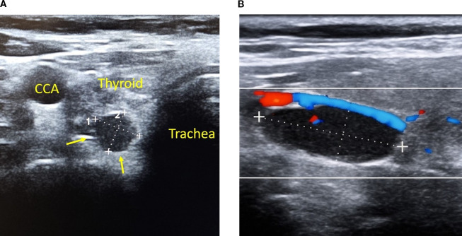
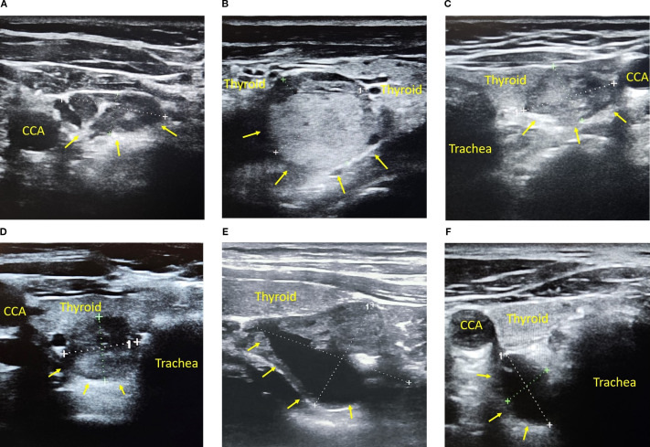
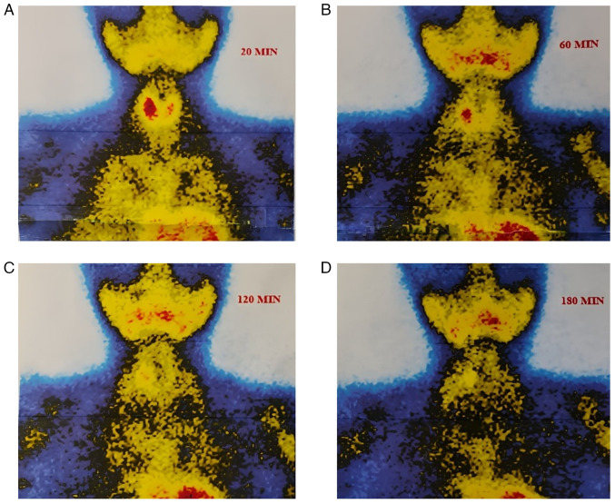
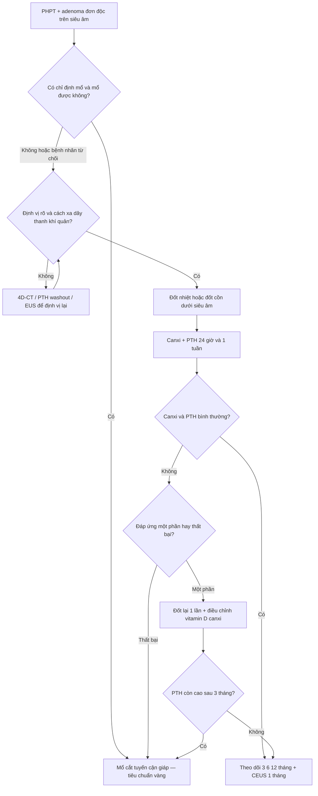
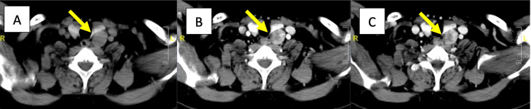
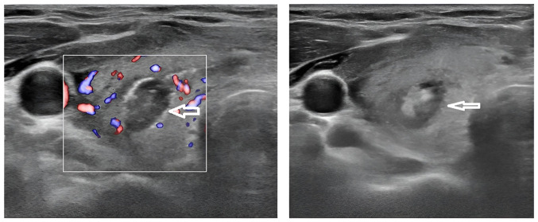

# 941 — Đốt nhiệt tuyến cận giáp (parathyroid adenoma): PTH washout, 4D-CT và ranh giới với “đốt nhầm nhân giáp”

**Tags:** `pattern:not` `pattern:giam-am` `pattern:tang-mach` `vung:tuyen-giap` `vung:co` `protocol:4D-CT` `protocol:dot-nhiet-giap` `score:PTH-washout`
**Mức chắc chắn (certainty):** tổng hợp y văn (literature synthesis) — ghép toàn văn 1 phân tích gộp MWA **9 đoàn hệ/355 bệnh nhân** (Front Oncol 2026, **PMC13634870**, CC BY 4.0), 1 thử nghiệm ngẫu nhiên **136 bệnh nhân** so đốt cồn với mổ (BMC Endocr Disord 2025, **PMC11761177**, CC BY-NC-ND), 1 thử nghiệm ưu tiên – bán ngẫu nhiên **30 bệnh nhân** (Int J Endocrinol 2026, **PMC13333659**, CC BY), 2 đoàn hệ RFA **43 và 10 bệnh nhân** (**PMC12779052** CC BY; **PMC7906106** CC BY-NC-SA), 1 ca MWA trong tuyến giáp (**PMC12635904** CC BY), 1 ca EUS đốt cồn có biến chứng dây thanh (**PMC13288515** CC BY), 2 nghiên cứu PTH washout (**PMC12479290** CC BY; **PMC10517582** CC BY), 2 nghiên cứu 4D-CT (**PMC12397896** CC BY; **PMC13687754** CC BY), 1 ca “đốt nhầm” (**PMC3811690** CC BY-NC 3.0). Không có thử nghiệm ngẫu nhiên nào so **đốt nhiệt với mổ** ở tuyến cận giáp; bằng chứng mạnh nhất là RCT đốt **cồn** và phân tích gộp **hồi cứu**.

> **Ca mở đầu — “u giáp” đã đốt 2 năm vẫn không nhỏ:** nữ **53 tuổi**, đau lưng 6 tháng, calci máu **14,6 mg/dL**, ALP **1.011 U/L**; 4 năm trước được chẩn đoán “nhân giáp + suy giáp” và đã **đốt nhiệt (RFA)** một “nhân” thùy trái vì to ra, nhưng nhân **không nhỏ đi**; khám lại vì tăng calci máu mới phát hiện cường cận giáp (PMC3811690). Sau mổ cắt tuyến cận giáp, bệnh nhân cần calci + vitamin D **9 tháng** vì hội chứng xương đói.
> **Bài chốt năm quyết định:** **(1) mọi “nhân giáp” giảm âm ở cực dưới phải loại trừ adenoma tuyến cận giáp bằng calci + PTH trước khi đốt;** **(2) PTH washout dương xác nhận mô cận giáp (Se 100%, PPV 91%) nhưng âm không loại trừ (NPV 9%);** **(3) 4D-CT: adenoma 48 → 112 → 72 HU, giáp 109 → 188 → 193 HU, hạch 15 → 51 → 63 HU;** **(4) đốt cồn đạt đáp ứng hoàn toàn 91,1% so với mổ 98,5% ở 6 tháng, nhưng adenoma > 425,5 mm³ hoặc > 13,5 mm dễ chỉ đáp ứng một phần;** **(5) đốt nhiệt không phải “mổ thay thế” — RFA chỉ đạt chữa khỏi sinh hóa 30,2% sau 1 năm, dù 86,6% có calci bình thường.**

## 1. Tổng quan bệnh học – cơ chế hình ảnh: vì sao một tuyến nhỏ 1 cm lại đổi cả canxi máu

### 1.1 Bệnh học và hormon: tuyến cận giáp “quên” tín hiệu canxi

- Cường cận giáp nguyên phát (primary hyperparathyroidism, PHPT) do **adenoma đơn độc 80–85%**, tăng sản đa tuyến 10–15%, ung thư < 1%. Nữ gấp khoảng **3 lần** nam; prevalence **0,1–0,4%**, tăng tới **~1% ở người ≥ 69 tuổi** (PMC13333659; PMC12635904).
- Tế bào chính (chief cell) mất đáp ứng ức chế của canxi lên tiết PTH → PTH cao **không tương xứng** với canxi cao. PTH tăng hoạt hủy cốt bào (bone resorption), tăng tái hấp thu canxi ở ống lượn xa, **giảm tái hấp thu phosphat** → **canxi cao – phosphat thấp – ALP tăng**. Đây là lý do ca “nhân giáp” ở trên có **ALP 1.011 U/L**: tổn thương xương do cường cận giáp đã tiến triển nhiều năm.
- **TẠI SAO hình ảnh lại “giảm âm”:** tuyến cận giáp không có keo iod như tuyến giáp; tế bào đặc, ít mô đệm, nhiều mao mạch → âm vang thấp hơn nhu mô giáp xung quanh. Trên siêu âm, adenoma điển hình là **nốt giảm âm, đồng nhất, bờ rõ, hình bầu dục**, nằm **sau cực dưới tuyến giáp** và có **mạch nuôi cực (polar vessel sign)** — cuống mạch đi vào một cực của nốt, thấy rõ trên Doppler màu (ảnh 1).
- **TẠI SAO tăng mạch:** adenoma là mô nội tiết tăng sinh với mạng mao mạch dày, sức cản thấp; trên CEUS thuốc vào nhanh, đậm, rồi thoát nhanh. Trên 4D-CT, đặc điểm này tạo ra **bắt thuốc động mạch mạnh rồi thải thuốc tĩnh mạch**, khác tuyến giáp (giữ thuốc) và hạch (bắt thuốc tiến triển).

*Hình 1 — (A) Nốt giảm âm bờ rõ (mũi tên vàng) nằm sau tuyến giáp, sát động mạch cảnh chung (CCA) và khí quản; (B) Doppler màu cho thấy mạch nuôi đi vào nốt. Nguồn: Front Endocrinol 2025, PMC12479290, CC BY 4.0; giữ nguyên nhãn A–B.*

### 1.2 Ngưỡng định lượng nằm lòng (phải nhớ trước khi đốt)

| Đại lượng | Ngưỡng / số liệu | Ý nghĩa thực hành | Nguồn |
|---|---|---|---|
| Canxi toàn phần | **> 10,5 mg/dL** (2,62 mmol/L) cùng PTH cao hoặc “không hợp lý” | Xác nhận PHPT sinh hóa; PTH ≥ 20 ng/L với canxi cao là bất thường | PMC13333659 |
| PTH washout | **PTH dịch rửa > PTH huyết thanh** = dương; âm < giới hạn trên PTH phòng xét nghiệm | Dương xác nhận mô cận giáp; âm **không** loại trừ | PMC10517582 |
| PTH washout — hiệu năng | **Se 100%, Sp 82%, PPV 91%, NPV 9%** (134 tổn thương) | Giá trị nằm ở **quy tắc vào**, không phải quy tắc loại | PMC10517582 |
| PTH washout — mức thực tế | Dương: trung vị **5.000 ng/L**; âm: **17 ng/L**; nhân giáp: **14 ng/L** | Cách biệt 2–3 bậc logarit, không cần cutoff cố định | PMC10517582 |
| Kích thước adenoma trong đoàn hệ đốt | đường kính lớn nhất trung bình **1,09–1,87 cm** | Chọn bệnh nhân đốt thường là adenoma nhỏ, thấy rõ | PMC13634870 |
| Ngưỡng dự báo đáp ứng một phần sau đốt cồn | **> 425,5 mm³** hoặc **> 13,5 mm** (Se 75%, Sp 69%, AUC 0,81/0,84) | Adenoma lớn hơn → cân nhắc mổ hoặc nhiều lần đốt | PMC11761177 |
| Đốt cồn — đáp ứng hoàn toàn | **91,1%** (62/68) so với mổ **98,5%** (67/68) ở 6 tháng | Hiệu quả gần mổ nhưng không bằng | PMC11761177 |
| MWA — chữa khỏi gộp | **86%** (6 tháng), **82%** (12 tháng), **75%** (lần khám cuối) | Giảm dần theo thời gian, không “một lần là xong” | PMC13634870 |
| MWA — giảm thể tích | **VRR 90,86%** ở 12 tháng; đường kính giảm **0,84 cm** | Theo dõi bằng thể tích, không chỉ nhìn nốt nhỏ | PMC13634870 |
| MWA — biến chứng gộp | **11,5%** (KTC 4,5–26,6%); khàn tạm **11%**, hạ canxi tạm **9%**, liệt dây thanh vĩnh viễn **2,3%** (2/87) | Phải tư vấn giọng nói trước thủ thuật | PMC13634870 |
| RFA — kết cục 1 năm | chữa khỏi sinh hóa **30,2%**; canxi bình thường **86,6%**; PTH còn cao **55,8%** | “Canxi bình thường” không đồng nghĩa khỏi bệnh | PMC12779052 |

### 1.3 Vì sao 4D-CT tách được adenoma khỏi tuyến giáp và hạch

- Adenoma **nghèo iod** nên tỷ trọng nền thấp; mạng mao mạch dày làm **đỉnh động mạch rất cao**; dẫn lưu tĩnh mạch nhanh làm **thải thuốc thì muộn**. Tuyến giáp giàu iod (nền cao) và giữ thuốc; hạch bắt thuốc từ từ, đỉnh ở thì tĩnh mạch.
- Số liệu một ca điển hình: adenoma **48 → 112 → 72 HU**, PAE **147,6%**; tuyến giáp **109 → 188 → 193 HU**, PAE **72,5%**; hạch **15 → 51 → 63 HU** (PMC12397896).
- **Cạm bẫy số học:** dùng cutoff PAE cố định **128,9%** chỉ đạt **Se 75%, Sp 31,6%, AUC 0,386** trong loạt 53 ca → **không được áp một con số PAE cho mọi protocol**; phải đọc **hình thái + vị trí + kiểu bắt thuốc** (PMC12397896).

### 1.4 Vì sao PTH washout lại dương ở adenoma

- Chọc hút qua nốt rồi rửa kim bằng 1 mL nước muối: tế bào cận giáp dễ vỡ và giải phóng PTH vào dịch rửa, nên nồng độ PTH trong dịch cao hơn huyết thanh nhiều lần. Mô giáp và hạch không chứa PTH → dịch rửa chỉ phản ánh PTH máu.
- Hệ quả lâm sàng: **45,1%** adenoma có PTH washout dương **không được xác định trên xạ hình**; **35,4%** trường hợp siêu âm đầu tiên âm hoặc nghi ngờ (PMC10517582). Vì vậy PTH washout là “pha thứ ba” sau siêu âm và xạ hình, không phải xét nghiệm thay thế mô bệnh.

### 1.5 Vì sao đốt nhiệt/cồn hạ được PTH — và vì sao không phải lúc nào cũng khỏi

- **Cơ chế:** nhiệt gây **hoại tử đông vón** (coagulative necrosis) toàn bộ tuyến; cồn còn gây **huyết khối mao mạch** nuôi adenoma. Mô chết không tiết PTH → PTH giảm trong 24 giờ, canxi giảm theo sau.
- **Vì sao không khỏi 100%:** (a) bỏ sót **đa tuyến** hoặc tuyến thứ hai; (b) **mô cận giáp còn sống ở rìa** (đặc biệt adenoma lớn, thể tích > 425,5 mm³); (c) đốt quá ít năng lượng; (d) sau khi canxi về bình thường, PTH có thể **tăng bù** do thiếu vitamin D, thiếu canxi, hoặc xương đói — đây là **tăng PTH đẳng canxi**, không phải luôn là tái phát (PMC12779052; PMC13634870).
- **Vì sao RFA 30,2% mà MWA 82%?** Không phải vì RFA “kém” một cách tuyệt đối: định nghĩa khỏi khác nhau, đoàn hệ RFA dùng **canxi + PTH đều bình thường ≥ 6 tháng**, còn nhiều nghiên cứu MWA báo “chữa khỏi lâm sàng” khi canxi bình thường. Bài giữ cả hai và ghi rõ định nghĩa — đây là điểm **không được trộn số**.

## 2. Mẫu hình + chẩn đoán phân biệt theo vị trí (gamut)

- **Vị trí điển hình:** tuyến cận giáp dưới nằm quanh **cực dưới tuyến giáp**, sau hoặc sau–ngoài; tuyến trên nằm **sau giữa tuyến giáp**, gần khớp nhẫn–giáp và dây thanh quản quặt ngược. Trong loạt 53 ca, **45% ở tuyến dưới phải**, **30% tuyến dưới trái** — tức **75% ở cực dưới** (PMC12397896).
- **Vị trí lạc chỗ:** tuyến lạc chỗ gặp **2–43%**; tuyến dưới lạc vào **trung thất trước/tuyến ức**, tuyến trên lạc vào **rãnh khí–thực quản/sau thực quản**; **trong tuyến giáp 1–6%** (PMC12635904).
- **Gamut theo hình thái — nốt giảm âm sau tuyến giáp:** adenoma tuyến cận giáp; nhân giáp lồi ra ngoài bao; hạch cổ (đặc biệt hạch có rốn mỡ); nang tuyến cận giáp; ung thư tuyến cận giáp (lớn, xâm lấn); hiếm hơn là di căn hạch của ung thư giáp.
- **Gamut theo sinh hóa:** PHPT (adenoma/tăng sản) — canxi cao, PTH cao; **cường cận giáp thứ phát** (suy thận) — canxi thấp/bình thường, PTH rất cao, thường tăng sản đa tuyến; **tăng PTH đẳng canxi** — canxi bình thường, PTH cao, cần loại trừ thiếu vitamin D và suy thận trước khi can thiệp.
- **Mnemonic “4P”:** **P**osition (sau giáp/cực dưới), **P**olar vessel, **P**TH washout, **P**hosphat thấp — đủ để nghĩ adenoma trước khi nghĩ “nhân giáp”.

## 3. Bảng so sánh phân biệt (ma trận đối chiếu)

| Thực thể (entity) | Hình ảnh điển hình (US / 4D-CT / xạ hình) | Chốt vào (rule-in) | Chốt loại (rule-out) | Gợi ý xác nhận |
|---|---|---|---|---|
| **Adenoma tuyến cận giáp** | Giảm âm, đồng nhất, bờ rõ, sau cực dưới giáp; Doppler có mạch nuôi cực; 4D-CT **48 → 112 → 72 HU**, thải thuốc; sestamibi giữ xạ muộn | **Vị trí sau giáp/cực dưới + PTH washout > PTH máu + canxi cao** | Nằm hoàn toàn trong giáp, có keo sáng, không tăng mạch → nghĩ nhân giáp | PTH washout, 4D-CT, sestamibi |
| **Nhân giáp đặc** | Đồng âm/giảm âm, có thể có quầng, vôi hóa; 4D-CT nền cao và **giữ thuốc** thì tĩnh mạch (109 → 188 → 193 HU) | **Bắt thuốc kéo dài + trong bao giáp + không tăng PTH** | Mạch nuôi cực + thải thuốc mạnh → nghĩ adenoma | PTH máu, PTH washout nếu nghi |
| **Hạch cổ** | Bầu dục, rốn mỡ sáng, vỏ mỏng; 4D-CT **15 → 51 → 63 HU**, bắt thuốc tiến triển | **Rốn mỡ + bắt thuốc muộn + không tăng PTH** | Bắt thuốc động mạch mạnh rồi thải → không phải hạch | Siêu âm, PTH washout |
| **Nang tuyến cận giáp** | Trống âm, vách mỏng, không tăng mạch; có thể là adenoma thoái hóa nang | **Dịch trong + PTH dịch cao** | Đặc hoàn toàn, tăng mạch → không phải nang đơn thuần | Chọc hút: PTH dịch, tế bào |
| **Ung thư tuyến cận giáp** | Khối lớn, bờ không đều, xâm lấn giáp/cơ/khí quản, vôi hóa, tăng mạch mạnh | **Xâm lấn + PTH rất cao + canxi rất cao** | Nhỏ, bờ rõ, không xâm lấn → adenoma lành | CT cổ, mô bệnh; **không đốt khi nghi ung thư** |
| **Tăng sản đa tuyến (thứ phát)** | Nhiều tuyến to, thường 2–4 tuyến; bệnh nhân suy thận | **Nhiều tuyến + bệnh thận + PTH rất cao** | Một tuyến đơn độc + canxi cao → adenoma | Sestamibi, 4D-CT, bối cảnh lâm sàng |

*Hình 2 — Sáu kiểu adenoma dễ đọc nhầm (A–F): có rốn giả như hạch, đặc giả nhân giáp, thể nang, bờ không đều. Nguồn: Front Endocrinol 2025, PMC12479290, CC BY 4.0; giữ nguyên nhãn A–F.*

- **Điểm chốt của ma trận:** không có dấu hiệu siêu âm nào đủ để một mình khẳng định adenoma; **PTH washout** là “chốt vào” mạnh nhất, còn **vị trí ngoài bao giáp + mạch nuôi cực + thải thuốc 4D-CT** là bộ ba định vị.

## 4. Protocol chụp + hệ phân độ/điểm chuẩn hóa

### 4.1 Chẩn đoán và định vị trước can thiệp

| Bước | Kỹ thuật | Số liệu/ngưỡng cần ghi | Cạm bẫy |
|---|---|---|---|
| 1. Sinh hóa | Canxi toàn phần + ion hóa, PTH, phosphat, ALP, vitamin D, creatinin | Canxi **> 10,5 mg/dL**, PTH cao/không hợp lý | Thiếu vitamin D làm PTH tăng bù → dễ chẩn đoán nhầm |
| 2. Siêu âm | Đầu dò thẳng **12–15 MHz**, B-mode + Doppler màu + CEUS nếu có | 3 kích thước, **thể tích ellipsoid**, khoảng cách tới da/bao giáp/khí quản/dây thanh | Nhân giáp lồi ra ngoài bao giả adenoma |
| 3. PTH washout | Kim **22–25 G**, rửa **1 mL** nước muối, gửi PTH | Dương: **> PTH huyết thanh**; ghi cả giá trị tuyệt đối | Âm không loại trừ (NPV 9%); chọc vào nang có thể chỉ lấy dịch |
| 4. 4D-CT | Không cản quang, động mạch **25–30 giây**, tĩnh mạch **60–70 giây**, lát **≤ 1 mm** | HU từng thì, PAE, hình thái; adenoma **48/112/72 HU** | Cutoff PAE cố định 128,9% có Se 75%/Sp 31,6% |
| 5. Sestamibi | 99mTc-sestamibi, chụp **20/60/120/180 phút** | Ổ giữ xạ muộn; so với giáp | 45,1% adenoma PTH-washout dương **không thấy** trên xạ hình |

*Hình 3 — Xạ hình 99mTc-sestamibi 20, 60, 120, 180 phút: ổ tăng xạ tồn tại ở vùng tuyến cận giáp dưới. Nguồn: Med Int 2026, PMC12635904, CC BY 4.0; giữ nguyên nhãn A–D.*

### 4.2 Kỹ thuật đốt — ba lựa chọn, ba cơ chế

| Phương thức | Dụng cụ / liều | Ưu điểm | Nhược điểm chính | Số liệu chốt |
|---|---|---|---|---|
| **MWA** | Anten **16–17 G**, công suất **20–45 W**, thời gian **72–950 giây**, năng lượng **2,16–9,28 kJ**; kỹ thuật moving-shot | Vùng hoại tử rộng, ít hiệu ứng tản nhiệt (heat sink) | Đau, bỏng da, tổn thương dây thanh nếu không hydrodissection | Kỹ thuật **100%**; khỏi **86%/82%/75%**; VRR **90,86%** ở 12 tháng (PMC13634870) |
| **RFA** | Điện cực đơn, công suất theo nhà sản xuất; đốt từng điểm | Ít xâm lấn, kiểm soát được | PTH có thể tăng lại; khỏi sinh hóa thấp | **43 ca**: khỏi **30,2%**, canxi bình thường **86,6%** sau 1 năm (PMC12779052) |
| **Đốt cồn (PEA)** | Kim **22 G**, ethanol **99,5–99,6%**, thể tích **85% thể tích adenoma** (hoặc **0,5–2 mL**), **2,09 lần** trung bình | Rẻ, dễ lặp lại, không cần máy đốt | Tràn cồn, đau, tổn thương dây thanh, cần nhiều lần | Đáp ứng hoàn toàn **91,1%** so với mổ **98,5%** (PMC11761177) |
| **EUS – đốt cồn trung thất** | Kim **19 G**, **3,5 mL** ethanol 96% = thể tích u, 2 lần | Tới được adenoma trung thất sau | Nguy cơ dây thanh quặt ngược, sặc | Ca **3 × 1,5 cm**: khỏi sinh hóa nhưng **liệt dây thanh một bên tạm thời** (PMC13288515) |

- **Chọn bệnh nhân (không có hướng dẫn hội thống nhất):** adenoma **đơn độc, thấy rõ trên siêu âm**, bệnh nhân **không mổ được** hoặc **từ chối mổ**, canxi cao có triệu chứng; **không** đốt khi nghi **ung thư tuyến cận giáp**, đa tuyến chưa định vị, hoặc không tách được khỏi dây thanh/khí quản/thực quản.
- **Khoảng an toàn:** hydrodissection bằng dung dịch sinh lý/lidocain quanh dây thanh quặt ngược, tạo lớp đệm **2–3 mm**; với adenoma sát bao giáp hoặc trong giáp, cân nhắc đường vào tránh xuyên mô giáp (bài 1629).
- **Theo dõi sau đốt:** canxi + PTH **24 giờ, 1 tuần, 1–3–6–12 tháng**; CEUS **1 tháng** tìm vùng không ngấm thuốc hoàn toàn; siêu âm thể tích **6 và 12 tháng**. Đáp ứng: canxi và PTH về bình thường; **đáp ứng một phần**: PTH còn cao nhưng canxi bình thường; **thất bại**: canxi/PTH không đổi (PMC11761177).
- **Khi nào đốt lại / chuyển mổ:** PTH không giảm sau 1–3 tháng, hoặc tăng lại kèm canxi cao; adenoma > 13,5 mm/> 425,5 mm³ có nguy cơ đáp ứng một phần cao hơn; đốt lại tối đa **2 lần** rồi chuyển mổ nếu vẫn còn bệnh.

- **Không có RADS/score riêng cho tuyến cận giáp.** “Điểm” thực hành là bộ ba: **(1) canxi/PTH**, **(2) PTH washout dương**, **(3) kích thước ≤ 13,5 mm và thể tích ≤ 425,5 mm³** — càng nhiều tiêu chí đạt, khả năng đáp ứng hoàn toàn càng cao.

## 5. Biến thể bình thường và cạm bẫy

- **“Đốt nhầm nhân giáp” là cạm bẫy số 1:** một “nhân” giảm âm ở cực dưới có thể là adenoma; nếu chỉ đọc siêu âm mà không đo canxi/PTH, bệnh nhân bị đốt nhiệt như u giáp, **không khỏi cường cận giáp**, và mổ bị trì hoãn. Ca PMC3811690: RFA “nhân giáp” **2 năm** không nhỏ, tổng trì hoãn **4 năm**, canxi **14,6 mg/dL**, ALP **1.011 U/L**, sau mổ cần calci/vitamin D **9 tháng** vì xương đói.
- **Adenoma trong tuyến giáp (1–6%)** trông như nhân giáp; trên siêu âm có thể có quầng giả bao và tăng mạch mạnh. Nếu PTH cao, phải **PTH washout** trước khi đốt; MWA vẫn khả thi (PMC12635904).
- **Adenoma không điển hình:** có “rốn giả” như hạch, đặc/giảm âm không đều như nhân giáp, hoặc thể nang (PTH washout cao hơn ở adenoma có thành phần nang) — đừng loại trừ chỉ vì hình thái (PMC12479290).
- **PTH washout âm không loại trừ:** NPV chỉ **9%**; nếu hình ảnh và sinh hóa mạnh, vẫn tiếp tục định vị bằng 4D-CT/sestamibi (PMC10517582).
- **Dây thanh quặt ngược:** ngay cả đốt cồn 2 lần có kiểm soát thể tích vẫn có thể gây **liệt dây thanh một bên tạm thời, sặc** (PMC13288515). Luôn hỏi giọng nói/khàn trước và sau đốt; nội soi dây thanh khi khàn kéo dài.
- **Hạ canxi sau đốt:** gộp **9%**; ở cường cận giáp thứ phát có thể tới **35,2%** (26 nghiên cứu/932 bệnh nhân) — bệnh nhân suy thận là nhóm nguy cơ cao (PMC13634870; PMC12635904).
- **“PTH tăng lại” không đồng nghĩa thất bại:** sau đốt, canxi bình thường nhưng PTH cao gặp **55,8%** sau RFA 1 năm; phần lớn là **tăng PTH đẳng canxi** do thiếu vitamin D/xương đói, không phải adenoma còn sống (PMC12779052).
- **Không sợ “gieo mầm” sau chọc PTH washout:** theo dõi 87 bệnh nhân không thấy parathyromatosis/gieo mầm; xơ hóa sau chọc không ảnh hưởng lâm sàng (PMC11018208; PMC12261381). Vẫn nên đi theo một đường kim và tránh chọc qua mô giáp không cần thiết.

## 6. Tự lượng giá — Blind Quiz

**Ca 1 — Nữ 58 tuổi, canxi 11,8 mg/dL, PTH 165 pg/mL, siêu âm sau thùy phải.**

- Hỏi: mô tả nốt và mạch nuôi; ba chẩn đoán phân biệt; xét nghiệm nào chốt chẩn đoán trước khi can thiệp?

<b>Bấm để hiện đáp án (findings + chẩn đoán)</b>

- Nốt **giảm âm, đồng nhất, bờ rõ**, nằm **sau tuyến giáp**, sát CCA/khí quản; Doppler có **mạch nuôi đi vào một cực** (polar vessel).
- Phân biệt: adenoma tuyến cận giáp, nhân giáp lồi ra ngoài bao, hạch cổ.
- Chốt: **PTH washout > PTH huyết thanh** (hoặc 4D-CT nếu washout không làm được). Canxi cao + PTH cao đã đủ xác nhận PHPT; hình ảnh chỉ để định vị.
- Nguồn: Front Endocrinol 2025, PMC12479290, CC BY 4.0.

**Ca 2 — Nam 46 tuổi, PHPT, 4D-CT ba thì.**

- Hỏi: đọc HU của adenoma ở ba thì; vì sao nó khác tuyến giáp và hạch? Có nên dùng một cutoff PAE cố định không?

<b>Bấm để hiện đáp án (findings + chẩn đoán)</b>

- (A) không cản quang **48 HU**, (B) động mạch **112 HU**, (C) tĩnh mạch **72 HU** → bắt thuốc động mạch mạnh rồi **thải thuốc**; PAE **147,6%**.
- Tuyến giáp **109 → 188 → 193 HU** (nền cao, giữ thuốc); hạch **15 → 51 → 63 HU** (bắt thuốc tiến triển). Vì adenoma nghèo iod + mao mạch dày + dẫn lưu nhanh.
- **Không** dùng cutoff PAE 128,9% cho mọi protocol: Se 75%, Sp 31,6%, AUC 0,386 — phải đọc kiểu bắt thuốc theo thì.
- Nguồn: Cureus 2025, PMC12397896, CC BY 4.0.

**Ca 3 — Nữ 62 tuổi sau MWA adenoma trong tuyến giáp, siêu âm 1 tháng.**

- Hỏi: vùng giảm âm không tăng mạch trong nốt có nghĩa gì? Làm gì để xác nhận đốt hoàn toàn? Biến chứng nào phải cảnh báo?

<b>Bấm để hiện đáp án (findings + chẩn đoán)</b>

- Vùng **hoại tử đông vón không ngấm thuốc** sau đốt; trên CEUS là **ổ không ngấm hoàn toàn**, viền tăng mạch mỏng 1–2 mm có thể là phản ứng lành.
- Xác nhận: **canxi + PTH 24 giờ/1 tuần/1–3–6–12 tháng**, CEUS 1 tháng, siêu âm thể tích 6–12 tháng; VRR kỳ vọng ~90% ở 12 tháng.
- Cảnh báo: **khàn/liệt dây thanh** (kể cả tạm thời), **hạ canxi** (dị cảm, chuột rút), chảy máu/tụ máu cổ.
- Nguồn: Med Int 2026, PMC12635904, CC BY 4.0 (ảnh trước đốt: `941_dot-tuyen-can-giap_US-truoc-dot_PMC12635904-f1.jpg`).

## Bài liên quan chéo

- [940 – Nhân giáp ĐỘC (toxic adenoma/AFTN): RFA–MWA so với I-131 và mổ](../940-dot-nhiet-nhan-giap-doc-aftn-rfa-vs-i131/lesson.md)
- [1629 – Đốt nhiệt nhân giáp lành tính ĐẶC: RFA/MWA, hydrodissection & ngưỡng đốt lại](../1629-dot-nhiet-nhan-giap-lanh-tinh-dac/lesson.md)
- [1622 – Đốt cồn nang giáp lành tính (PEI/EA)](../1622-dot-con-nang-giap-pei/lesson.md)
- [230 – Tuyến giáp & hạch cổ: TI-RADS, nốt giáp và bẫy hạch](../230-tuyen-giap-hach-co/lesson.md)
- [750 – Bản đồ hạch cổ & ACR NI-RADS](../750-cervical-lymph-nodes-nirads/lesson.md)
- [700 – Tổng quan Đầu Mặt Cổ & bản đồ mạc cổ sâu](../700-head-neck-overview/lesson.md)

> Không dùng để chẩn đoán độc lập khi chưa có người hướng dẫn.
